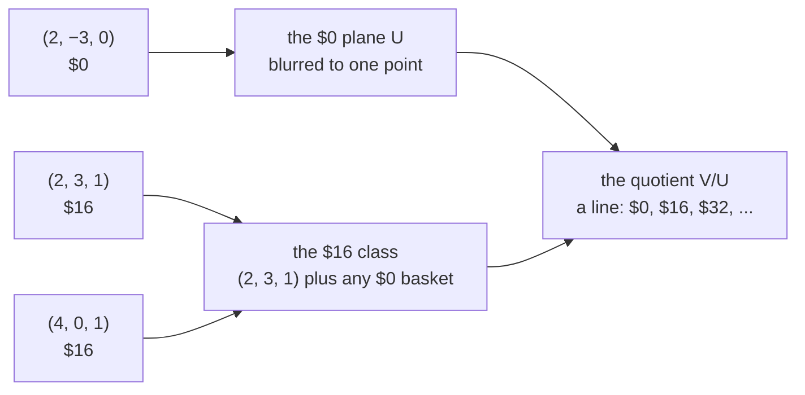

# Direct sums and quotient spaces: split a space into independent pieces, or blur a subspace to a point and count what is left

[Syllabus](../../../SYLLABUS.md) → [Algebra](../README.md) → [Duals, Quotients and Tensors](../README.md#s11) → Direct sums and quotient spaces

---

## General Overview

A weekly shop buys loaves at $3, milks at $2 and dozens of eggs at $4. Write a basket as three amounts: (loaves, milks, dozens of eggs). The basket (2, 3, 1) costs 6 + 6 + 4 = $16. The basket (4, 0, 1) costs 12 + 0 + 4 = $16 too.

The till cannot tell them apart. Their difference, (2, −3, 0), is two more loaves and three fewer milks, costing 6 − 6 = $0. Any two baskets with one bill differ by a $0 basket.

The $0 baskets form a plane through the empty basket. Blur that plane to a point and every basket collapses onto its bill, leaving a line, one point per bill: three directions, minus two blurred, leaves one.

The plane also splits the shop. Every basket is one $0 basket plus some milks, in exactly one way: (2, 3, 1) is (2, −5, 1) plus 8 milks. A negative amount is a return. That unique split is a **direct sum**. The blurred space is a **quotient space**.

**A space splits as a direct sum when every vector breaks into one piece from each part in exactly one way; blurring a subspace to a point leaves a quotient space whose dimension is what was left over, and blurring what a linear map ignores leaves a copy of what it reaches.**

**What kind of fact this is:** direct sum and quotient space are definitions; the dimension count and the first isomorphism theorem are theorems, proved in Why it works.

### The picture: baskets blurred to bills



Each class is a shifted copy of the $0 plane. The quotient keeps one point per class.

---

## The formula

Amounts may be any real numbers, so the baskets are $`V = \mathbb{R}^3`$, all lists of three real numbers ([Basis and dimension](../03-Vectors/05-basis-and-dimension.md)).

A **subspace** is a set of vectors that holds the zero vector and is closed under adding and scaling. Two subspaces $`U`$ and $`W`$ give a **sum** $`U + W`$, every $`u + w`$, and an **overlap** $`U \cap W`$, the vectors in both. The sum is **direct**, written $`\oplus`$, when the overlap is only zero:

```math
V = U \oplus W \quad\text{means}\quad U + W = V \ \text{ and } \ U \cap W = \{0\}
```

**Read it aloud:** the parts reach every vector together and share only zero, so every split is unique.

A **coset** of $`U`$ is one vector $`x`$ plus every member of $`U`$: a parallel copy of $`U`$ through $`x`$. The **quotient** $`V/U`$, said "V mod U", is the set of these copies:

```math
x + U = \{\, x + u : u \text{ in } U \,\}, \qquad V/U = \{\, x + U : x \text{ in } V \,\}
```

Cosets add and scale through any member: $`(x + U) + (y + U) = (x + y) + U`$. The size theorem:

```math
\dim(V/U) = \dim V - \dim U
```

**Read it aloud:** blurring a subspace to a point removes exactly its dimensions. Here 3 − 2 = 1.

A **linear map** $`T`$ respects adding and scaling ([Linear maps](../04-Matrices/04-linear-maps-as-matrices.md)). Its **kernel** $`\ker T`$ is everything it sends to zero; its **image** $`\mathrm{im}\,T`$ is everything it reaches. The **first isomorphism theorem**:

```math
V/\ker T \;\cong\; \mathrm{im}\,T, \qquad x + \ker T \;\mapsto\; T(x)
```

**Read it aloud:** blur away what the map ignores, and what is left is a copy of what the map reaches. The sign $`\cong`$ means isomorphic: the same space under other names, matched one to one, adding and scaling kept.

Here $`T`$ is the bill, $`T(a, b, c) = 3a + 2b + 4c`$, and its kernel is the $0 plane.

| Symbol | Plain meaning | In our example | Push it up and the answer… |
| --- | --- | --- | --- |
| $`V`$ | the whole space: every basket | $`\mathbb{R}^3`$, (loaves, milks, dozens) | — |
| $`U`$ | the subspace blurred away | the $0 plane, through (2, −3, 0) and (0, 2, −1) | a bigger $`U`$ leaves a smaller quotient |
| $`W`$, $`E`$ | second subspaces: a candidate other piece | the milk line, multiples of (0, 1, 0); the no-eggs plane | — |
| $`x`$, $`y`$, $`u`$, $`w`$; $`a, b, c`$ | single vectors; $`u`$ from $`U`$, $`w`$ from $`W`$; a basket's three amounts | (2, 3, 1), (4, 0, 1), (2, −5, 1), (0, 8, 0); 2, 3, 1 | — |
| $`U + W`$, $`U \cap W`$, $`\oplus`$ | the sum; the overlap; a sum whose overlap is zero | the milk line meets $`U`$ only at zero | a bigger overlap means more ways to split |
| $`x + U`$ | a coset: $`x`$ plus every $0 basket | the $16 class | — |
| $`T`$, $`\ker T`$, $`\mathrm{im}\,T`$ | the bill; what costs $0; every bill reachable | $`T(2, 3, 1) = 16`$; $`U`$; every real amount | — |
| $`V/U`$, $`\dim`$, $`\cong`$ | the space of cosets; the length of a basis; same space under other names | a line, one point per bill; 3, 2, 1 | — |

### When it holds

- **$`U`$ must be a subspace.** Blur the $16 class instead and nothing adds: (2, 3, 1) + (4, 0, 1) costs $32, outside the class.
- **Direct needs both halves.** A line inside $`U`$ fails both: it overlaps $`U`$, and the sum never leaves the $0 plane, so no $16 basket splits.
- **The dimension count needs finite dimension.** The quotient always exists, but infinity minus infinity counts nothing.
- **The theorem needs a linear map.** Add a $5 delivery fee and the empty basket costs $5, so the $0 baskets are no subspace.

---

## Why it works

### Step 0: equal bills means a $0 difference

The bill is linear, so the bill of a difference is the difference of the bills. Two baskets cost the same exactly when their difference costs $0, that is, lies in $`U`$.

### Step 1: a direct sum is a unique split

Suppose a basket splits two ways, $`u + w = u' + w'`$. Then $`u - u' = w' - w`$ lies in both $`U`$ and $`W`$. If the overlap is only zero, the two splits are one split.

The milk line passes: its only $0 member is no milk. So (2, 3, 1) has one split: 8 milks carry the $16, and the rest, (2, −5, 1), costs $0.

The no-eggs plane $`E`$ fails. It shares (2, −3, 0) with $`U`$, which splits as itself plus zero, or zero plus itself. The dimensions show the overlap:

```math
\dim(U + E) = \dim U + \dim E - \dim(U \cap E) = 2 + 2 - 1 = 3
```

Proof: pairs $`(u, w)`$, one from each plane, form a space of 2 + 2 = 4 dimensions, the direct sum of two separate spaces side by side. Adding the halves maps it linearly onto $`U + E`$, killing exactly the pairs $`(x, -x)`$ with $`x`$ in the overlap, so [Rank and nullity](../05-Solving%20Systems/05-rank-nullity.md) leaves 4 − 1 = 3.

The sum fills all three directions but is not direct. For the milk line, 2 + 1 − 0 = 3: direct, and $`V = U \oplus W`$.

### Step 2: cosets are parallel copies, and they add

This is the [Normal subgroups and quotient groups](../08-Groups/06-normal-subgroups-and-quotient-groups.md) construction again. There, a subgroup collapses to a point only when it is normal. Here vector addition ignores order, so every subspace passes that test.

Adding through members is safe: $`(x + u) + (y + u') = (x + y) + (u + u')`$, still in the coset of $`x + y`$. Scaling works alike.

So the $16 class plus the $16 class is the $32 class: (2, 3, 1) + (4, 0, 1) = (6, 3, 2), and 18 + 6 + 8 = $32. Three times the $16 class is the $48 class.

### Step 3: the quotient keeps the dimensions $`U`$ did not use

Take a basis of $`U`$, here (2, −3, 0) and (0, 2, −1). Add vectors until it is a basis of $`V`$ ([Basis and dimension](../03-Vectors/05-basis-and-dimension.md)). One milk, (0, 1, 0), finishes the job. The cosets of the added vectors are a basis of $`V/U`$, so its dimension is the number added: 3 − 2 = 1.

<details>
<summary>Detailed proof: the added vectors' cosets are a basis of the quotient</summary>

Let $`u_1, \dots, u_k`$ be a basis of $`U`$, extended by $`v_1, \dots, v_m`$ to a basis of $`V`$.

**They reach every coset.** Any $`x`$ is a mix of all $`k + m`$ basis vectors. The $`u`$ part lies in $`U`$, so it vanishes in the quotient: $`x + U`$ is the same mix of the cosets $`v_i + U`$.

**They are independent.** Suppose a mix of the cosets is the zero coset, $`U`$ itself. Then the same mix of the $`v_i`$ lies in $`U`$, so it equals some mix of the $`u_j`$:

$`\displaystyle c_1 v_1 + \dots + c_m v_m - d_1 u_1 - \dots - d_k u_k = 0`$

The whole list is independent, so every $`c_i`$ is 0. Hence $`\dim(V/U) = m = \dim V - \dim U`$.

</details>

A second road counts. On a 7-hour clock, amounts and bills wrap at 7: $7 reads $0. Seven is prime, so division works on the clock ([Finite fields](../09-Rings%20and%20Fields/05-finite-fields.md)) and bases work as usual: each basis vector takes 7 amounts, multiplying the count by 7. Of 343 baskets, 49 cost $0. The cosets are equal blocks, as in [Cosets and Lagrange's theorem](../08-Groups/04-cosets-and-lagranges-theorem.md): 343 ÷ 49 = 7. Sizes divide, so dimensions subtract: $`7^3 \div 7^2 = 7^1`$.

### Step 4: blur what the bill ignores, and the bills are left

Label each coset by the bill of any member. Step 0 makes the label well-defined, since a coset has one bill, and one-to-one, since equal bills mean one coset. It reaches every bill, and it keeps adding and scaling because the bill does. Only linearity was used, so any linear $`T`$ works alike.

So $`V/\ker T \cong \mathrm{im}\,T`$. Counting dimensions gives 3 − 2 = 1, which is [Rank and nullity](../05-Solving%20Systems/05-rank-nullity.md) again: what is kept plus what is killed is what went in.

Each coset crosses the milk line once: the $16 class at 8 milks. By Step 1 any complement $`W`$ of $`U`$ does the same, so it is a copy of $`V/U`$. The quotient needs no choice of complement; the split does.

---

## Worked numbers, by hand

| Step | Arithmetic | Value |
| --- | --- | --- |
| bill of (2, 3, 1) | 3 × 2 + 2 × 3 + 4 × 1 | $16 |
| bill of (4, 0, 1) | 3 × 4 + 2 × 0 + 4 × 1 | $16 |
| their difference | (4, 0, 1) − (2, 3, 1) | (2, −3, 0), $0 |
| dimension of the $0 plane | 3 amounts, 1 equation | 2 |
| split of (2, 3, 1) | 16 ÷ 2 = 8 milks; (2, 3, 1) − (0, 8, 0) | (2, −5, 1) + (0, 8, 0) |
| no-eggs plane against $`U`$ | 2 + 2 − 1 | 3, not direct |
| the 7-clock count | 343 ÷ 49 | 7 cosets |
| **dimension of the quotient** | 3 − 2 | **1** |

One number, the bill, names a basket's coset, so the quotient is a line.

### What breaks if you drop a piece

| Mistake | Comes out at | What went wrong |
| --- | --- | --- |
| Dimensions of two planes added | 2 + 2 = 4 in a 3-dimensional space | the overlap line was counted twice |
| V/U read as division | 3 ÷ 2 = 1.5 dimensions | sizes divide; dimensions subtract |
| Baskets counted, not cosets | 125 in a 0-to-4 box, against 35 cosets | a quotient's members are whole classes |
| A "complement" inside U | determinant 0: no split of a $16 basket | the sum never leaves the $0 plane |

---

## Code, from first principles, and it actually runs

Nothing is imported. The split of (2, 3, 1) comes two ways: Cramer's rule, which solves with determinants, and the bill shared among milks. The quotient's dimension comes from a basis and from counting cosets on the 7-hour clock. Last, a determinant test that never reads a price sorts 125 small baskets into classes, one bill each.

### Python

```python
# Direct sums and quotient spaces -- the check behind the card.  Nothing is imported.
# A basket is (loaves, milks, dozens of eggs); the price list ($3, $2, $4) reads its bill.
def bill(x): return 3 * x[0] + 2 * x[1] + 4 * x[2]
def sub(x, y): return tuple(a - b for a, b in zip(x, y))
def det(c1, c2, c3):                     # 3 x 3 determinant of the columns c1, c2, c3
    (a, d, g), (b, e, h), (c, f, i) = c1, c2, c3
    return a * (e * i - f * h) - b * (d * i - f * g) + c * (d * h - e * g)
def yn(claim): return "yes" if claim else "no"
def dimq(n, q):                          # n = q ** k members on a q-hour clock means k dimensions
    k = 0
    while n > 1: n, k = n // q, k + 1
    return k

x, y, u1, u2, milk, e1 = (2, 3, 1), (4, 0, 1), (2, -3, 0), (0, 2, -1), (0, 1, 0), (1, 0, 0)
print(f"bills: {x} -> ${bill(x)}, {y} -> ${bill(y)}; difference {sub(y, x)} -> ${bill(sub(y, x))}")
minor = u1[0] * u2[1] - u1[1] * u2[0]
print(f"$0 plane U: {u1} -> ${bill(u1)}, {u2} -> ${bill(u2)}; 2 x 2 minor {minor}, so dim U = 2")
D = det(u1, u2, milk)                    # road one to the split: Cramer's rule
a, b, m = det(x, u2, milk) // D, det(u1, x, milk) // D, det(u1, u2, x) // D
zero_part = tuple(a * p + b * q for p, q in zip(u1, u2))
print(f"U + milk line: det {D}, not 0, so direct; {x} = {a} x {u1} + {b} x {u2} + {m} milks")
by_bill = sub(x, (0, bill(x) // 2, 0))   # road two: 8 milks carry the $16, the rest is $0
print(f"split: $0 part {zero_part} + milk part (0, {m}, 0); by bill / 2: {by_bill} + (0, {bill(x) // 2}, 0)")
r = max(abs(det(*c)) for c in [(u1, u2, e1), (u1, u2, milk), (u1, e1, milk), (u2, e1, milk)])
print(f"U + no-eggs plane: largest 3 x 3 minor {r}, so U + E fills 3; overlap 2 + 2 - 3 = 1")
print(f"basket {u1} splits two ways: {u1} + (0, 0, 0) and (0, 0, 0) + {u1}")
q = 7                                    # road two to every dimension: count over the 7-clock
V7 = [(a, b, c) for a in range(q) for b in range(q) for c in range(q)]
U7 = [v for v in V7 if bill(v) % q == 0]
E7, W7 = {v for v in V7 if v[2] == 0}, [(0, b, 0) for b in range(q)]
add = lambda v, w: tuple((s + t) % q for s, t in zip(v, w))
cosets = {frozenset(add(v, u) for u in U7) for v in V7}
UW, UE = {add(u, w) for u in U7 for w in W7}, {add(u, e) for u in U7 for e in E7}
capW, capE = [v for v in U7 if v in W7], [v for v in U7 if v in E7]
print(f"mod {q}: {len(V7)} baskets, U has {len(U7)}, cosets {len(cosets)} = {len(V7)} / {len(U7)}; "
      f"dim V/U = {dimq(len(cosets), q)} = 3 - {dimq(len(U7), q)}")
print(f"mod {q}: U + W has {len(UW)}, U and W share {len(capW)}; U + E has {len(UE)}, U and E share {len(capE)}")
box = [(a, b, c) for a in range(5) for b in range(5) for c in range(5)]
classes = {frozenset(v for v in box if det(u1, u2, sub(w, v)) == 0) for w in box}
bills = {bill(v) for v in box}
one_bill = all(len({bill(v) for v in c}) == 1 for c in classes)
c16 = [c for c in classes if x in c][0]
print(f"box 0-4 each: {len(box)} baskets, {len(classes)} classes by the U test, {len(bills)} bills; one bill per class: {yn(one_bill)}")
print(f"the $16 class holds {len(c16)} box baskets, {y} among them: {yn(y in c16)}")
s = tuple(p + t for p, t in zip(x, y))
print(f"cosets add: $16 class + $16 class holds {s} -> ${bill(s)}; 3 x {x} -> ${bill(tuple(3 * t for t in x))}")
print(f"mistake 1, dimensions added: 2 + 2 = 4, but U + E is {dimq(len(UE), q)}-dimensional")
print(f"mistake 2, V/U read as division: 3 / 2 = {3 / 2}, but dim V/U = {dimq(len(cosets), q)}")
print(f"mistake 3, baskets counted: {len(box)}, but the box meets only {len(classes)} cosets")
print(f"mistake 4, a 'complement' inside U: det {det(u1, u2, u1)}, so no split of a ${bill(x)} basket")
assert D != 0 and minor != 0 and det(u2, u1, milk) == -D and bill(zero_part) == 0 and zero_part == by_bill and m == bill(x) // 2
assert len(cosets) == len(V7) // len(U7) == 7 and dimq(len(U7), q) == 2 and len(capE) == 7
assert len(UW) == 343 and len(capW) == 1 and len(UE) == 343 and r != 0
assert one_bill and len(classes) == len(bills) and y in c16 and det(u1, u2, u1) == 0
print("ALL CHECKS PASS")
```

**Ran 2026-11-23 on macOS, Python 3.14.10, standard library only. All checks passed. Output, pasted from the run:**

```
bills: (2, 3, 1) -> $16, (4, 0, 1) -> $16; difference (2, -3, 0) -> $0
$0 plane U: (2, -3, 0) -> $0, (0, 2, -1) -> $0; 2 x 2 minor 4, so dim U = 2
U + milk line: det 2, not 0, so direct; (2, 3, 1) = 1 x (2, -3, 0) + -1 x (0, 2, -1) + 8 milks
split: $0 part (2, -5, 1) + milk part (0, 8, 0); by bill / 2: (2, -5, 1) + (0, 8, 0)
U + no-eggs plane: largest 3 x 3 minor 3, so U + E fills 3; overlap 2 + 2 - 3 = 1
basket (2, -3, 0) splits two ways: (2, -3, 0) + (0, 0, 0) and (0, 0, 0) + (2, -3, 0)
mod 7: 343 baskets, U has 49, cosets 7 = 343 / 49; dim V/U = 1 = 3 - 2
mod 7: U + W has 343, U and W share 1; U + E has 343, U and E share 7
box 0-4 each: 125 baskets, 35 classes by the U test, 35 bills; one bill per class: yes
the $16 class holds 7 box baskets, (4, 0, 1) among them: yes
cosets add: $16 class + $16 class holds (6, 3, 2) -> $32; 3 x (2, 3, 1) -> $48
mistake 1, dimensions added: 2 + 2 = 4, but U + E is 3-dimensional
mistake 2, V/U read as division: 3 / 2 = 1.5, but dim V/U = 1
mistake 3, baskets counted: 125, but the box meets only 35 cosets
mistake 4, a 'complement' inside U: det 0, so no split of a $16 basket
ALL CHECKS PASS
```

### Rust

Same numbers, same labels, built with `rustc --edition 2021 -O`.

```rust
// Direct sums and quotient spaces -- the same check as the Python, in Rust.  No crates.
// A basket is (loaves, milks, dozens of eggs); the price list ($3, $2, $4) reads its bill.
use std::collections::BTreeSet;
type B = (i64, i64, i64);
fn bill(x: B) -> i64 { 3 * x.0 + 2 * x.1 + 4 * x.2 }
fn sub(x: B, y: B) -> B { (x.0 - y.0, x.1 - y.1, x.2 - y.2) }
fn det(c1: B, c2: B, c3: B) -> i64 {     // 3 x 3 determinant of the columns c1, c2, c3
    let ((a, d, g), (b, e, h), (c, f, i)) = (c1, c2, c3);
    a * (e * i - f * h) - b * (d * i - f * g) + c * (d * h - e * g)
}
fn yn(claim: bool) -> &'static str { if claim { "yes" } else { "no" } }
fn dim7(mut n: usize) -> usize {         // n = 7^k members on the 7-hour clock means k dimensions
    let mut k = 0;
    while n > 1 { n /= 7; k += 1 }
    k
}
fn add(v: B, w: B) -> B { ((v.0 + w.0) % 7, (v.1 + w.1) % 7, (v.2 + w.2) % 7) }

fn main() {
    let (x, y, u1, u2, milk, e1): (B, B, B, B, B, B) =
        ((2, 3, 1), (4, 0, 1), (2, -3, 0), (0, 2, -1), (0, 1, 0), (1, 0, 0));
    println!("bills: {:?} -> ${}, {:?} -> ${}; difference {:?} -> ${}", x, bill(x), y, bill(y), sub(y, x), bill(sub(y, x)));
    let minor = u1.0 * u2.1 - u1.1 * u2.0;
    println!("$0 plane U: {:?} -> ${}, {:?} -> ${}; 2 x 2 minor {}, so dim U = 2", u1, bill(u1), u2, bill(u2), minor);
    let d = det(u1, u2, milk);           // road one to the split: Cramer's rule
    let (a, b, m) = (det(x, u2, milk) / d, det(u1, x, milk) / d, det(u1, u2, x) / d);
    let zero_part = (a * u1.0 + b * u2.0, a * u1.1 + b * u2.1, a * u1.2 + b * u2.2);
    println!("U + milk line: det {}, not 0, so direct; {:?} = {} x {:?} + {} x {:?} + {} milks", d, x, a, u1, b, u2, m);
    let by_bill = sub(x, (0, bill(x) / 2, 0)); // road two: 8 milks carry the $16, the rest is $0
    println!("split: $0 part {:?} + milk part (0, {}, 0); by bill / 2: {:?} + (0, {}, 0)", zero_part, m, by_bill, bill(x) / 2);
    let r = [(u1, u2, e1), (u1, u2, milk), (u1, e1, milk), (u2, e1, milk)].iter()
        .map(|&(p, q, s)| det(p, q, s).abs()).max().unwrap();
    println!("U + no-eggs plane: largest 3 x 3 minor {}, so U + E fills 3; overlap 2 + 2 - 3 = 1", r);
    println!("basket {:?} splits two ways: {:?} + (0, 0, 0) and (0, 0, 0) + {:?}", u1, u1, u1);
    let v7: Vec<B> = (0..7).flat_map(|a| (0..7).flat_map(move |b| (0..7).map(move |c| (a, b, c)))).collect();
    let u7: Vec<B> = v7.iter().cloned().filter(|&v| bill(v) % 7 == 0).collect();
    let e7: BTreeSet<B> = v7.iter().cloned().filter(|v| v.2 == 0).collect();
    let w7: Vec<B> = (0..7).map(|b| (0, b, 0)).collect();
    let cosets: BTreeSet<BTreeSet<B>> = v7.iter().map(|&v| u7.iter().map(|&u| add(v, u)).collect()).collect();
    let uw: BTreeSet<B> = u7.iter().flat_map(|&u| w7.iter().map(move |&w| add(u, w))).collect();
    let ue: BTreeSet<B> = u7.iter().flat_map(|&u| e7.iter().map(move |&e| add(u, e))).collect();
    let cap_w = u7.iter().filter(|v| w7.contains(v)).count();
    let cap_e = u7.iter().filter(|v| e7.contains(v)).count();
    println!("mod 7: {} baskets, U has {}, cosets {} = {} / {}; dim V/U = {} = 3 - {}",
             v7.len(), u7.len(), cosets.len(), v7.len(), u7.len(), dim7(cosets.len()), dim7(u7.len()));
    println!("mod 7: U + W has {}, U and W share {}; U + E has {}, U and E share {}", uw.len(), cap_w, ue.len(), cap_e);
    let bx: Vec<B> = (0..5).flat_map(|a| (0..5).flat_map(move |b| (0..5).map(move |c| (a, b, c)))).collect();
    let classes: BTreeSet<BTreeSet<B>> = bx.iter()
        .map(|&w| bx.iter().cloned().filter(|&v| det(u1, u2, sub(w, v)) == 0).collect()).collect();
    let bills: BTreeSet<i64> = bx.iter().map(|&v| bill(v)).collect();
    let one_bill = classes.iter().all(|c| c.iter().map(|&v| bill(v)).collect::<BTreeSet<i64>>().len() == 1);
    let c16 = classes.iter().find(|c| c.contains(&x)).unwrap();
    println!("box 0-4 each: {} baskets, {} classes by the U test, {} bills; one bill per class: {}",
             bx.len(), classes.len(), bills.len(), yn(one_bill));
    println!("the $16 class holds {} box baskets, {:?} among them: {}", c16.len(), y, yn(c16.contains(&y)));
    let s = (x.0 + y.0, x.1 + y.1, x.2 + y.2);
    println!("cosets add: $16 class + $16 class holds {:?} -> ${}; 3 x {:?} -> ${}", s, bill(s), x, bill((3 * x.0, 3 * x.1, 3 * x.2)));
    println!("mistake 1, dimensions added: 2 + 2 = 4, but U + E is {}-dimensional", dim7(ue.len()));
    println!("mistake 2, V/U read as division: 3 / 2 = {}, but dim V/U = {}", 3.0 / 2.0, dim7(cosets.len()));
    println!("mistake 3, baskets counted: {}, but the box meets only {} cosets", bx.len(), classes.len());
    println!("mistake 4, a 'complement' inside U: det {}, so no split of a ${} basket", det(u1, u2, u1), bill(x));
    assert!(d != 0 && minor != 0 && det(u2, u1, milk) == -d && bill(zero_part) == 0 && zero_part == by_bill && m == bill(x) / 2);
    assert!(cosets.len() == v7.len() / u7.len() && cosets.len() == 7 && dim7(u7.len()) == 2 && cap_e == 7);
    assert!(uw.len() == 343 && cap_w == 1 && ue.len() == 343 && r != 0);
    assert!(one_bill && classes.len() == bills.len() && c16.contains(&y) && det(u1, u2, u1) == 0);
    println!("ALL CHECKS PASS");
}
```

**Ran 2026-11-23 on macOS, rustc 1.98.1, no crates. All checks passed. Output, pasted from the run:**

```
bills: (2, 3, 1) -> $16, (4, 0, 1) -> $16; difference (2, -3, 0) -> $0
$0 plane U: (2, -3, 0) -> $0, (0, 2, -1) -> $0; 2 x 2 minor 4, so dim U = 2
U + milk line: det 2, not 0, so direct; (2, 3, 1) = 1 x (2, -3, 0) + -1 x (0, 2, -1) + 8 milks
split: $0 part (2, -5, 1) + milk part (0, 8, 0); by bill / 2: (2, -5, 1) + (0, 8, 0)
U + no-eggs plane: largest 3 x 3 minor 3, so U + E fills 3; overlap 2 + 2 - 3 = 1
basket (2, -3, 0) splits two ways: (2, -3, 0) + (0, 0, 0) and (0, 0, 0) + (2, -3, 0)
mod 7: 343 baskets, U has 49, cosets 7 = 343 / 49; dim V/U = 1 = 3 - 2
mod 7: U + W has 343, U and W share 1; U + E has 343, U and E share 7
box 0-4 each: 125 baskets, 35 classes by the U test, 35 bills; one bill per class: yes
the $16 class holds 7 box baskets, (4, 0, 1) among them: yes
cosets add: $16 class + $16 class holds (6, 3, 2) -> $32; 3 x (2, 3, 1) -> $48
mistake 1, dimensions added: 2 + 2 = 4, but U + E is 3-dimensional
mistake 2, V/U read as division: 3 / 2 = 1.5, but dim V/U = 1
mistake 3, baskets counted: 125, but the box meets only 35 cosets
mistake 4, a 'complement' inside U: det 0, so no split of a $16 basket
ALL CHECKS PASS
```

### Lean

Lean proves the card's three general claims for every space, not just baskets, and checks the shop's numbers exactly.

- Take a subspace $`U`$ of a space $`V`$ of finite dimension. Then $`\dim(V/U) = \dim V - \dim U`$.
- Take any linear map $`T`$. Then blurring away its kernel leaves a copy of its image, with $`x + \ker T`$ matched to $`T(x)`$.
- Take two subspaces $`U`$ and $`W`$ of $`V`$. Then $`U + W = V`$ and $`U \cap W = \{0\}`$ exactly when every vector splits in exactly one way.
- The shop: (2, 3, 1) and (4, 0, 1) both cost $16, and their difference (2, −3, 0) costs $0.
- The split: (2, 3, 1) is the $0 basket (2, −5, 1) plus 8 milks, and (6, 3, 2) costs $32.
- The counts: on the 7-hour clock, 49 of the 343 baskets cost $0. A 0-to-4 box of 125 baskets shows only 35 bills.

Cramer's rule, the determinant test and sorting the box into classes are left to the Python and Rust checks.

```lean
-- Direct sums and quotient spaces: blurring a subspace U of a finite-dimensional space V leaves a quotient of dimension dim V - dim U, a linear map's domain blurred by its kernel is a copy of its image, and a sum with zero overlap splits every vector in exactly one way.
import Mathlib.LinearAlgebra.FiniteDimensional.Lemmas
import Mathlib.LinearAlgebra.Isomorphisms
import Mathlib.Data.ZMod.Basic

open Module

/-- Blurring a subspace to a point removes exactly its dimensions: for a subspace `U` of a
finite-dimensional vector space `V`, the quotient `V / U` has dimension `dim V - dim U`. -/
theorem finrank_quotient_eq_finrank_sub_finrank {K V : Type*} [Field K] [AddCommGroup V]
    [Module K V] [FiniteDimensional K V] (U : Submodule K V) :
    finrank K (V ⧸ U) = finrank K V - finrank K U := by
  have := Submodule.finrank_quotient_add_finrank U
  omega

/-- The first isomorphism theorem: for a linear map `T : V → W`, blurring away its kernel leaves
a copy of its image. The match sends the coset `x + ker T` to `T x`, and keeps adding and
scaling. -/
theorem quotient_ker_equiv_image {K V W : Type*} [Field K] [AddCommGroup V] [Module K V]
    [AddCommGroup W] [Module K W] (T : V →ₗ[K] W) :
    ∃ e : (V ⧸ LinearMap.ker T) ≃ₗ[K] LinearMap.range T,
      ∀ x : V, (e (Submodule.Quotient.mk x) : W) = T x := by
  exact ⟨T.quotKerEquivRange, fun x => by rw [LinearMap.quotKerEquivRange_apply_mk]⟩

/-- A direct sum is a unique split: `U + W = V` and `U ∩ W = {0}` exactly when every vector
breaks into one piece from `U` plus one piece from `W` in exactly one way. -/
theorem direct_sum_iff_unique_split {K V : Type*} [Field K] [AddCommGroup V] [Module K V]
    (U W : Submodule K V) :
    (U ⊔ W = ⊤ ∧ U ⊓ W = ⊥) ↔ ∀ v : V, ∃! p : U × W, (p.1 : V) + (p.2 : V) = v := by
  constructor
  · rintro ⟨hsup, hinf⟩ v
    have hv : v ∈ U ⊔ W := by rw [hsup]; exact Submodule.mem_top
    obtain ⟨y, hy, z, hz, hyz⟩ := Submodule.mem_sup.mp hv
    refine ⟨(⟨y, hy⟩, ⟨z, hz⟩), hyz, ?_⟩
    rintro ⟨⟨a, ha⟩, ⟨b, hb⟩⟩ hab
    simp only at hab
    have hU : a - y ∈ U := U.sub_mem ha hy
    have hW : a - y ∈ W := by
      have : a - y = z - b := by rw [← hyz] at hab; rw [sub_eq_sub_iff_add_eq_add, hab, add_comm]
      rw [this]; exact W.sub_mem hz hb
    have h0 : a - y ∈ U ⊓ W := ⟨hU, hW⟩
    rw [hinf, Submodule.mem_bot, sub_eq_zero] at h0
    subst h0
    have hb' : b = z := by
      have := hab.trans hyz.symm
      exact add_left_cancel this
    subst hb'
    rfl
  · intro h
    refine ⟨?_, ?_⟩
    · rw [eq_top_iff]
      intro v _
      obtain ⟨p, hp, _⟩ := h v
      rw [← hp]
      exact Submodule.add_mem_sup p.1.2 p.2.2
    · rw [eq_bot_iff]
      intro x hx
      obtain ⟨hxU, hxW⟩ := Submodule.mem_inf.mp hx
      obtain ⟨p, _, hu⟩ := h x
      have e1 := hu (⟨x, hxU⟩, 0) (by simp)
      have e2 := hu (0, ⟨x, hxW⟩) (by simp)
      have := e1.trans e2.symm
      have := congrArg (fun q : U × W => (q.1 : V)) this
      simpa using this

/-- The bill of a basket (loaves, milks, dozens of eggs) at the prices $3, $2, $4. -/
def bill (x : ℤ × ℤ × ℤ) : ℤ := 3 * x.1 + 2 * x.2.1 + 4 * x.2.2

-- (2, 3, 1) and (4, 0, 1) both cost $16; their difference (2, -3, 0) costs $0.
example : bill (2, 3, 1) = 16 ∧ bill (4, 0, 1) = 16 := by decide
example : (4, 0, 1) - (2, 3, 1) = ((2, -3, 0) : ℤ × ℤ × ℤ) ∧ bill (2, -3, 0) = 0 := by decide
-- The $0 plane is spanned by (2, -3, 0) and (0, 2, -1).
example : bill (0, 2, -1) = 0 := by decide
-- The split of (2, 3, 1): the $0 basket (2, -5, 1) plus 8 milks; (2, -5, 1) = 1 * (2, -3, 0) - 1 * (0, 2, -1).
example : ((2, -5, 1) : ℤ × ℤ × ℤ) + (0, 8, 0) = (2, 3, 1) ∧ bill (2, -5, 1) = 0 ∧
    ((2, -3, 0) : ℤ × ℤ × ℤ) - (0, 2, -1) = (2, -5, 1) := by decide
-- Cosets add: (2, 3, 1) + (4, 0, 1) = (6, 3, 2) costs $32, and 3 * (2, 3, 1) costs $48.
example : ((2, 3, 1) : ℤ × ℤ × ℤ) + (4, 0, 1) = (6, 3, 2) ∧ bill (6, 3, 2) = 32 ∧
    bill (6, 9, 3) = 48 := by decide
-- The no-eggs plane against U: 2 + 2 - 1 = 3; the quotient: 3 - 2 = 1.
example : 2 + 2 - 1 = 3 ∧ 3 - 2 = 1 := by decide
-- On the 7-hour clock: 343 baskets, 49 cost $0, and 343 / 49 = 7 cosets.
example : Fintype.card (ZMod 7 × ZMod 7 × ZMod 7) = 343 := by norm_num
set_option maxRecDepth 20000 in
example : ((Finset.univ : Finset (ZMod 7 × ZMod 7 × ZMod 7)).filter
    (fun v => 3 * v.1 + 2 * v.2.1 + 4 * v.2.2 = 0)).card = 49 := by decide
example : 343 / 49 = 7 := by decide
-- A box of 0 to 4 of each item: 125 baskets, but only 35 different bills.
set_option maxRecDepth 20000 in
example : ((Finset.range 5 ×ˢ Finset.range 5 ×ˢ Finset.range 5).image
    (fun v : ℕ × ℕ × ℕ => 3 * v.1 + 2 * v.2.1 + 4 * v.2.2)).card = 35 := by decide

#print axioms finrank_quotient_eq_finrank_sub_finrank
#print axioms quotient_ker_equiv_image
#print axioms direct_sum_iff_unique_split
```

**Checked 2026-11-23 on macOS, Lean 4.36.0-rc2, Mathlib v4.36.0-rc2. Every proof is complete and uses only Lean's standard axioms. Output, pasted from the run:**

```
'finrank_quotient_eq_finrank_sub_finrank' depends on axioms: [propext, Classical.choice, Quot.sound]
'quotient_ker_equiv_image' depends on axioms: [propext, Classical.choice, Quot.sound]
'direct_sum_iff_unique_split' depends on axioms: [propext, Classical.choice, Quot.sound]
```

> [!TIP]
> **Try changing**
> Guess first, then run it. The asserts are pinned to this shop, so expect one to stop it.
> - **Eggs at $5.** Change `4 * x[2]` to `5 * x[2]`. Does (0, 2, −1) still cost $0? No, it costs −$1. The determinant test still finds 35 classes, but the box shows 39 bills; the first assert stops it.
> - **Eggs as the complement.** Change `milk` to `(0, 0, 1)`. Guess the split. Cramer's rule gives 4 dozen eggs plus (2, 3, −3), but the milk road still says 8 milks. The first assert stops it.
> - **A 5-hour clock.** Set `q = 5`. Guess the counts: 125 baskets, 25 costing $0, 5 cosets, still 3 − 2 = 1. The second assert, pinned to 7, stops it.

---

## The usual mistake

> [!warning]
> **Reading V/U as a division of dimensions.** The slash suggests 3 ÷ 2 = 1.5. But a space blurred by a plane is a line: 3 − 2 = 1. Sizes divide, as on the 7-hour clock, 343 ÷ 49 = 7.
>
> - **Adding dimensions without the overlap.** The $0 plane and the no-eggs plane give 2 + 2 = 4 in a 3-dimensional space; they share a line, so the sum is 2 + 2 − 1 = 3.
> - **Counting vectors instead of cosets.** A 0-to-4 box holds 125 baskets but meets only 35 cosets, one per bill.
> - **Calling any second piece a complement.** A line inside $`U`$ adds nothing new: its determinant with $`U`$'s basis is 0, and no $16 basket splits.

---

## Where you meet it in real life

- **Solving linear equations.** The solutions of a linear system are one solution plus every solution with zeros on the right: one coset of the kernel, like the $16 baskets.
- **Error-correcting codes.** A receiver finds a garbled message's coset of the code from a short check, the syndrome; one table of fixes, one per coset, covers every message.
- **Statistics.** Measurements split as a direct sum: the mean, repeated, plus deviations adding to zero. Analysis of variance rests on it.

> **Say it back**
> A direct sum splits every vector into one piece from each part, in exactly one way; the parts share only zero. A quotient blurs a subspace to a point: its members are parallel copies of that subspace. Its dimension is the whole space's minus the subspace's, so blurring the $0 plane leaves a line of bills. Blurring what a linear map ignores leaves a copy of what it reaches.

---

## What this builds on

- [Basis and dimension](../03-Vectors/05-basis-and-dimension.md): extending a basis, which proves the dimension count.
- [Linear maps](../04-Matrices/04-linear-maps-as-matrices.md): rules that respect adding and scaling, like the bill.
- [Rank and nullity](../05-Solving%20Systems/05-rank-nullity.md): kept plus killed equals inputs, which the first isomorphism theorem explains.
- [Normal subgroups and quotient groups](../08-Groups/06-normal-subgroups-and-quotient-groups.md): the same collapse for groups, where only normal subgroups pass.

## Where this goes next

- [Dual spaces](02-dual-spaces.md): the price list itself as a vector, a linear reading of baskets.
- [Tensor products](03-tensor-products.md): a space built from two, where dimensions multiply.
- [Exact sequences of modules](../../22-Algebraic%20geometry/07-Exact%20Sequences%2C%20Ext%20and%20Tor/01-exact-sequences-and-the-snake-lemma.md): what one map hits the next one kills, and the snake lemma's connecting map.

The determinant test sorted the baskets just as the bill did; why such readings form a space of their own is the question left open.

---

## Sources

Verified 2026-11-23: every link below resolves to the publisher's page.

- Axler, Sheldon. *Linear Algebra Done Right*, 4th ed. Springer, 2024. [doi:10.1007/978-3-031-41026-0](https://doi.org/10.1007/978-3-031-41026-0). Section 1C: direct sums; section 3E: quotients and the dimension count.
- Halmos, Paul R. *Finite-Dimensional Vector Spaces*. Springer, 1974. [doi:10.1007/978-1-4612-6387-6](https://doi.org/10.1007/978-1-4612-6387-6). Direct sums, complements and quotients, classically.
- Dummit, David S., and Richard M. Foote. *Abstract Algebra*, 3rd ed. Wiley, 2003. [Publisher page](https://www.wiley.com/en-us/Abstract+Algebra%2C+3rd+Edition-p-9780471433347). Section 10.2: the isomorphism theorems for modules, vector spaces included.
