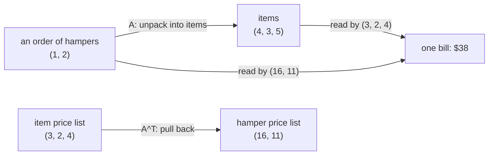

# Dual spaces: the linear readings of a space form a space of their own, a basis gives a dual basis, and the transpose is the dual map

[Syllabus](../../../SYLLABUS.md) → [Algebra](../README.md) → [Duals, Quotients and Tensors](../README.md#s11) → Dual spaces

---

## General Overview

A weekly shop: 2 loaves, 3 milks, 1 dozen eggs, at $3 a loaf, $2 a milk, $4 a dozen. The till reads the basket (2, 3, 1) and returns one number, the bill: $16.

So a price list is a machine: basket in, bill out. Double the basket and the bill doubles; join two baskets and the bills add. A rule with those two habits is a **linear reading** (also called a linear functional).

Price lists can be added and scaled too: a $1 rise on milk adds (0, 1, 0). So the readings form a vector space of their own, the **dual space**. It answers three practical questions:

- **Coordinates.** In a two-item shop (loaves, milks), bundle 1 is 2 loaves and 1 milk; bundle 2 is 1 loaf and 1 milk. The readings (1, −1) and (−1, 2) are no real prices: they count bundles. They are the **dual basis**.
- **Bundle prices.** A hamper is a fixed bundle of items. Item prices become hamper prices through the **transpose** of the hamper matrix (rows and columns swapped).
- **Row rank equals column rank.** Every matrix has as many independent rows as independent columns. Hidden price changes prove it.

**The linear readings of a finite-dimensional space form a space of the same size; a finite basis hands over one reading per basis vector, and a linear map pulls readings back through its transpose.**

**What kind of fact this is:** definitions carrying four theorems, each proved in Why it works.

### The picture: baskets go forward, prices come back



Baskets travel from hampers to items; price lists travel back. Both roads give the same bill.

---

## The formula

A **basis** builds every vector in exactly one way ([Basis and dimension](../03-Vectors/05-basis-and-dimension.md)). The **dual basis** of $`b_1, b_2`$ is the pair of readings $`f_1, f_2`$ with

```math
f_i(b_j) = \begin{cases} 1 & \text{if } i = j \\ 0 & \text{if } i \neq j \end{cases}
```

**Read it aloud:** each dual reading scores 1 on its own basis vector and 0 on every other one.

All linear readings of a space $`V`$ form $`V^*`$, read "V dual". Its **dimension**, the number of vectors in any basis, matches:

```math
\dim V^* = \dim V
```

**Read it aloud:** there are as many independent price lists as independent baskets.

A **linear map** $`T`$ with matrix $`A`$ sends hamper counts to item counts ([Linear maps](../04-Matrices/04-linear-maps-as-matrices.md)). Its **dual map** $`T^*`$ turns an item price list into a hamper price list: unpack, then price the items. The symbol $`q \circ T`$ means "first $`T`$, then $`q`$".

```math
T^*(q) = q \circ T \quad\text{has matrix}\quad A^{\mathsf T}
```

**Read it aloud:** pull a price list back through a map by multiplying by the transpose, the matrix with rows and columns swapped.

The **annihilator** $`U^0`$ of a subspace $`U`$ is every reading that scores 0 on all of $`U`$. With $`n = \dim V`$:

```math
\dim U^0 = n - \dim U \qquad\text{so}\qquad \text{row rank of } A = \text{column rank of } A
```

**Read it aloud:** the readings blind to a subspace fill the dimensions it leaves free, so rows and columns carry equal rank.

| Symbol | Plain meaning | In our example | Push it up and the answer… |
| --- | --- | --- | --- |
| $`V`$, $`n`$ | the space of baskets, and its dimension | two-item baskets, $`n = 2`$; three-item, $`n = 3`$ | one more item, one more independent price |
| $`V^*`$ | the dual space: every linear reading of $`V`$ | all price lists on two items | — |
| $`p`$, $`q`$; $`\cdot`$ | one reading, a price list; the dot product | (3, 2); (3, 2, 4) | a price rise, a bigger bill |
| $`b_1`$, $`b_2`$ | a basis of baskets | bundles (2, 1) and (1, 1) | change one and both dual readings move |
| $`f_1`$, $`f_2`$ | the dual basis: bundle counters | (1, −1) and (−1, 2) | — |
| $`T`$, $`A`$; $`A_{ij}`$; $`x`$ | a linear map and its matrix: hampers to items; the entry in row i, column j; an order (in Step 1, $`x`$ and $`y`$ are unknown prices) | columns (2, 3, 1) and (1, 0, 2); $`A_{21} = 3`$; (1, 2) | — |
| $`T^*`$, $`A^{\mathsf T}`$; $`q \circ T`$; $`e_j`$, $`e_i^*`$ | the dual map and its matrix: item prices to hamper prices; first $`T`$, then $`q`$; a single hamper or item; the counter of item i | (3, 2, 4) pulls back to (16, 11); $`e_1^*`$ counts loaves | dearer eggs, dearer hampers |
| $`U`$, $`r`$, $`U^0`$; $`u_i`$, $`g`$ | a subspace, its dimension, its annihilator; a basis of $`U`$; a reading in $`U^0`$ | baskets the hampers make, $`r = 2`$, multiples of (−2, 1, 1); the hampers; (−2, 1, 1) | a bigger $`U`$ leaves fewer blind readings |

### When it holds

- **Finitely many dimensions.** With endless lists, $`V^*`$ outgrows $`V`$: see [Dual spaces](../../18-Functional%20analysis/01-Normed%20and%20Banach%20Spaces/09-dual-spaces-and-lp-duality.md) in functional analysis.
- **Linear readings only.** A bill with a delivery charge reads the empty basket as more than zero, so it is not in $`V^*`$.
- **A real basis.** Bundles (2, 1) and (4, 2) are no basis. A reading worth 1 on the first is worth 2 on the second, never 0: no dual basis exists.

---

## Why it works

### Step 0: a reading is pinned down by its values on a basis

Every basket is a mix of basis baskets, and a linear reading respects mixes. So its values on the basis fix its value everywhere, the same fact that makes a linear map a matrix ([Linear maps](../04-Matrices/04-linear-maps-as-matrices.md)).

On single items those values are prices, so every reading is a dot product with a price list ([The dot product](../06-Dot%20Products%20and%20Best%20Fits/01-dot-product.md)).

### Step 1: the dual basis exists, so the two spaces have the same size

The counter $`f_1 = (x, y)`$ must read bundle 1 as 1 and bundle 2 as 0: $`2x + y = 1`$ and $`x + y = 0`$, so $`f_1 = (1, -1)`$. The same with 0 and 1 gives $`f_2 = (-1, 2)`$.

These are the rows of the inverse of the bundle matrix (bundles as columns), since that inverse times the bundles is the identity.

- **They span.** The counters build every price list. The list (3, 2) reads the bundles as 8 and 5. So does $`8f_1 + 5f_2`$, so by Step 0 they are equal: 8(1, −1) + 5(−1, 2) = (3, 2).
- **They are independent.** If $`c_1 f_1 + c_2 f_2`$ reads everything as 0, reading the bundles gives $`c_1 = c_2 = 0`$. So they are a basis of $`V^*`$, and $`\dim V^* = 2 = \dim V`$. The same steps work for any $`n`$.
- **They read coordinates.** Each counter is a coordinate. The basket (2, 3) reads −1 under $`f_1`$ and 4 under $`f_2`$, and −1(2, 1) + 4(1, 1) = (2, 3).

### Step 2: the transpose prices the hampers

Hamper 1 holds (2, 3, 1); hamper 2 holds (1, 0, 2). They are the columns of $`A`$ = `[[2, 1], [3, 0], [1, 2]]`, so the order (1, 2) unpacks to (4, 3, 5).

A hamper's price is the item prices read on its column: 16 and 11. Reading each column is multiplying by the matrix whose rows are those columns, $`A^{\mathsf T}`$.

<details>
<summary>Detailed proof: the dual map's matrix is the transpose, in any size</summary>

Let $`T`$ have matrix entries $`A_{ij}`$, let $`e_j`$ be the standard basis on each side, and let $`e_i^*`$ be the dual reading "how many of item $`i`$". Column $`i`$ of the matrix of $`T^*`$ is $`T^*(e_i^*)`$, and its entry $`j`$ is its reading on $`e_j`$:

$`\displaystyle (T^* e_i^*)(e_j) = e_i^*(T e_j) = A_{ij}`$

So $`A_{ij}`$ sits in row $`j`$, column $`i`$: the transpose. For every order $`x`$, $`q \cdot (Ax) = (A^{\mathsf T} q) \cdot x`$, so both roads give one bill.

</details>

### Step 3: the readings blind to a subspace fill the leftover dimensions

Extend a basis $`u_1, \dots, u_r`$ of $`U`$ to a basis of $`V`$, and take its dual basis. The last $`n - r`$ dual readings score 0 on every $`u_i`$. A reading $`g`$ in $`U^0`$ has coefficient $`g(u_i) = 0`$ on each of the first $`r`$, so it mixes only the last $`n - r`$. So $`\dim U^0 = n - r`$.

For the hampers, $`U`$ is the plane of baskets they make: $`r = 2`$, $`n = 3`$. So $`U^0`$ has dimension 1, the price change (−2, 1, 1). Bread down $2, milk and eggs up $1 each, and neither hamper moves: −4 + 3 + 1 = 0 and −2 + 0 + 2 = 0.

<details>
<summary>The annihilator and the quotient space</summary>

A reading in $`U^0`$ gives the same bill to baskets that differ by a member of $`U`$. Those classes are the quotient space $`V/U`$ of [Direct sums and quotient spaces](01-direct-sums-and-quotient-spaces.md), and $`U^0`$ matches the dual of $`V/U`$ one for one.

</details>

### Step 4: row rank equals column rank

Let $`A`$ have $`n`$ rows, and let its columns build a subspace $`U`$ of dimension $`r`$, the column rank.

1. $`A^{\mathsf T}`$ kills a price list exactly when every hamper costs nothing, so its null space is $`U^0`$.
2. By Step 3, that null space has dimension $`n - r`$.
3. $`A^{\mathsf T}`$ has $`n`$ columns, so [Rank and nullity](../05-Solving%20Systems/05-rank-nullity.md) gives its rank as $`n - (n - r) = r`$.
4. That rank counts independent columns of $`A^{\mathsf T}`$, which are the rows of $`A`$.

So the rows carry $`r`$ independent directions, like the columns. For the hampers: rank 2 both ways.

---

## Worked numbers, by hand

| Step | Arithmetic | Value |
| --- | --- | --- |
| the weekly shop's bill | (3, 2, 4) · (2, 3, 1) = 6 + 6 + 4 | $16 |
| $`f_1`$ from the bundles | 2x + y = 1 and x + y = 0 | **(1, −1)** |
| $`f_2`$ from the bundles | 2x + y = 0 and x + y = 1 | **(−1, 2)** |
| check the readings | (1, −1) · (2, 1) = 1, (1, −1) · (1, 1) = 0, and so on | 1, 0, 0, 1 |
| rebuild the price list (3, 2) | 8(1, −1) + 5(−1, 2) | (3, 2) |
| hamper prices | (3, 2, 4) · (2, 3, 1) and (3, 2, 4) · (1, 0, 2) | **(16, 11)** |
| order (1, 2), item road | items (4, 3, 5); 12 + 6 + 20 | $38 |
| order (1, 2), hamper road | 16 + 2 × 11 | **$38** |
| hidden price changes | solve 2a + 3b + c = 0, a + 2c = 0 | **multiples of (−2, 1, 1)** |

The counters count bundles, the transpose prices the hampers, and one price change stays hidden from hamper buyers: 3 minus rank 2.

### What breaks if you drop a piece

| Mistake | Comes out at | What went wrong |
| --- | --- | --- |
| Using the bundle (2, 1) as its own dual price list | reads the bundles as 5 and 3, not 1 and 0 | A dual reading is built from the whole basis |
| Pushing hamper prices forward with $`A`$ | (43, 48, 38): 43 dollars a loaf | Prices travel backwards, through $`A^{\mathsf T}`$ |
| Changing $`b_2`$ to (1, 0) and keeping $`f_1`$ | true $`f_1`$ is (0, 1), not (1, −1) | Each dual reading depends on every basis vector |


---

## Code, from first principles, and it actually runs

Nothing is imported. Four checks each take two independent roads:

- the dual basis, by inverting and by search;
- the order's bill, by items and by hamper prices;
- the annihilator, by search and by 3 minus the rank;
- row rank against column rank, on 300 generated matrices.

### Python

```python
# Dual spaces -- the check behind the card.  Nothing is imported.  The dual basis
# is found by inverting and by search; item prices are pulled back to hamper
# prices by the transpose; row rank = column rank is tested on 300 matrices.
def bill(p, v):                                   # a price list reading a basket
    return sum(a * b for a, b in zip(p, v))

def rank(rows):                                   # elimination in whole numbers
    rows, r = [list(x) for x in rows], 0
    for c in range(len(rows[0]) if rows else 0):
        piv = next((i for i in range(r, len(rows)) if rows[i][c]), None)
        if piv is None: continue
        rows[r], rows[piv] = rows[piv], rows[r]
        for i in range(r + 1, len(rows)):
            rows[i] = [rows[r][c] * x - rows[i][c] * y for x, y in zip(rows[i], rows[r])]
        r += 1
    return r

def dual_by_inverse(b1, b2):                      # rows of the inverse basis matrix
    d = b1[0] * b2[1] - b2[0] * b1[1]             # the determinant, 1 or -1 here
    return [(b2[1] // d, -b2[0] // d), (-b1[1] // d, b1[0] // d)]

def dual_by_search(b1, b2):                       # every price list from -5 to 5
    grid = [(x, y) for x in range(-5, 6) for y in range(-5, 6)]
    return [next(f for f in grid if (bill(f, b1), bill(f, b2)) == w) for w in ((1, 0), (0, 1))]

transpose = lambda m: [list(c) for c in zip(*m)]  # rows become columns
b1, b2, p, v = (2, 1), (1, 1), (3, 2), (2, 3)
f = dual_by_inverse(b1, b2)
readings = [[bill(fi, bj) for bj in (b1, b2)] for fi in f]
p_back = tuple(bill(p, b1) * f[0][k] + bill(p, b2) * f[1][k] for k in range(2))
v_back = tuple(bill(f[0], v) * b1[k] + bill(f[1], v) * b2[k] for k in range(2))
A, q, order = [[2, 1], [3, 0], [1, 2]], [3, 2, 4], [1, 2]     # columns are the hampers
hamper_prices = [bill(col, q) for col in transpose(A)]           # A^T q
items = [bill(row, order) for row in A]                          # A times the order
r3 = range(-3, 4)
hidden = [(a, b, c) for a in r3 for b in r3 for c in r3 if all(bill((a, b, c), h) == 0 for h in transpose(A))]
seed, vals = 7, []
for _ in range(3600):                             # 300 matrices, 3 by 4, entries 0 or 1
    seed = (seed * 1103515245 + 12345) % 2**31
    vals.append(seed // 65536 % 2)
batch = [[vals[12 * k + 4 * i:12 * k + 4 * i + 4] for i in range(3)] for k in range(300)]
same = all(rank(m) == rank(transpose(m)) for m in batch)
print(f"the weekly shop's bill: price list (3, 2, 4) reads basket (2, 3, 1) as ${bill((3, 2, 4), (2, 3, 1))}")
print(f"dual basis by inverting: {f}; by search: {dual_by_search(b1, b2)}")
print(f"readings f_i(b_j): {readings}")
print(f"price list {p} = {bill(p, b1)} f1 + {bill(p, b2)} f2 -> {p_back}")
print(f"basket {v} = {bill(f[0], v)} b1 + {bill(f[1], v)} b2 -> {v_back}")
print(f"hamper prices A^T q: {hamper_prices}; order {order} -> items {items}")
print(f"bill of the order: item road ${bill(q, items)}, hamper road ${bill(hamper_prices, order)}")
print(f"hidden price changes by search: {hidden}; independent: {rank(hidden)} = 3 - {rank(A)}")
print(f"rank of A {rank(A)}, rank of A^T {rank(transpose(A))}")
print(f"row rank = column rank on 300 matrices: {'yes' if same else 'no'}; ranks seen {sorted({rank(m) for m in batch})}")
print(f"mistake 1, basis basket (2, 1) as a price list reads b1, b2 as {[bill(b1, b) for b in (b1, b2)]}")
print(f"mistake 2, hamper prices pushed forward by A: {[bill(row, hamper_prices) for row in A]}")
print(f"mistake 3, b2 swapped to (1, 0): dual basis becomes {dual_by_inverse(b1, (1, 0))}")
assert f == dual_by_search(b1, b2) and dual_by_inverse(b1, (1, 0)) == dual_by_search(b1, (1, 0))
assert readings == [[1, 0], [0, 1]] and p_back == p and v_back == v
assert bill(q, items) == bill(hamper_prices, order) == 38       # two roads to one bill
assert rank(hidden) == len(q) - rank(A) and same                # annihilator size; the theorem
print("ALL CHECKS PASS")
```

**Ran 2026-11-27 on macOS, Python 3.14.10, standard library only. All checks passed. Output, pasted from the run:**

```
the weekly shop's bill: price list (3, 2, 4) reads basket (2, 3, 1) as $16
dual basis by inverting: [(1, -1), (-1, 2)]; by search: [(1, -1), (-1, 2)]
readings f_i(b_j): [[1, 0], [0, 1]]
price list (3, 2) = 8 f1 + 5 f2 -> (3, 2)
basket (2, 3) = -1 b1 + 4 b2 -> (2, 3)
hamper prices A^T q: [16, 11]; order [1, 2] -> items [4, 3, 5]
bill of the order: item road $38, hamper road $38
hidden price changes by search: [(-2, 1, 1), (0, 0, 0), (2, -1, -1)]; independent: 1 = 3 - 2
rank of A 2, rank of A^T 2
row rank = column rank on 300 matrices: yes; ranks seen [1, 2, 3]
mistake 1, basis basket (2, 1) as a price list reads b1, b2 as [5, 3]
mistake 2, hamper prices pushed forward by A: [43, 48, 38]
mistake 3, b2 swapped to (1, 0): dual basis becomes [(0, 1), (1, -2)]
ALL CHECKS PASS
```

### Rust

Same numbers, same labels, built with `rustc --edition 2021 -O`.

```rust
// Dual spaces -- the same check as the Python, in Rust.  No crates.  The dual
// basis is found by inverting and by search; item prices are pulled back to
// hamper prices by the transpose; row rank = column rank is tested on 300 matrices.
fn bill(p: &[i64], v: &[i64]) -> i64 { p.iter().zip(v).map(|(a, b)| a * b).sum() }

fn rank(input: &[Vec<i64>]) -> usize {            // elimination in whole numbers
    let mut rows = input.to_vec();
    let mut r = 0;
    for c in 0..rows.first().map_or(0, |x| x.len()) {
        let piv = match (r..rows.len()).find(|&i| rows[i][c] != 0) { Some(i) => i, None => continue };
        rows.swap(r, piv);
        for i in r + 1..rows.len() {
            let (a, b) = (rows[r][c], rows[i][c]);
            rows[i] = rows[i].iter().zip(&rows[r]).map(|(x, y)| a * x - b * y).collect();
        }
        r += 1;
    }
    r
}

fn dual_by_inverse(b1: (i64, i64), b2: (i64, i64)) -> Vec<(i64, i64)> {
    let d = b1.0 * b2.1 - b2.0 * b1.1;             // the determinant, 1 or -1 here
    vec![(b2.1 / d, -b2.0 / d), (-b1.1 / d, b1.0 / d)]
}

fn dual_by_search(b1: (i64, i64), b2: (i64, i64)) -> Vec<(i64, i64)> {   // -5 to 5
    let rd = |f: (i64, i64), b: (i64, i64)| f.0 * b.0 + f.1 * b.1;
    let grid: Vec<(i64, i64)> = (-5..6).flat_map(|x| (-5..6).map(move |y| (x, y))).collect();
    [(1, 0), (0, 1)].iter().map(|&w| *grid.iter().find(|&&f| (rd(f, b1), rd(f, b2)) == w).unwrap()).collect()
}

fn transpose(m: &[Vec<i64>]) -> Vec<Vec<i64>> {   // rows become columns
    (0..m[0].len()).map(|j| m.iter().map(|row| row[j]).collect()).collect()
}

fn main() {
    let (b1, b2, p, v) = ((2i64, 1i64), (1i64, 1i64), (3i64, 2i64), (2i64, 3i64));
    let rd = |f: (i64, i64), b: (i64, i64)| f.0 * b.0 + f.1 * b.1;
    let f = dual_by_inverse(b1, b2);
    let readings: Vec<Vec<i64>> = f.iter().map(|&fi| vec![rd(fi, b1), rd(fi, b2)]).collect();
    let (s1, s2, c1, c2) = (rd(p, b1), rd(p, b2), rd(f[0], v), rd(f[1], v));
    let p_back = (s1 * f[0].0 + s2 * f[1].0, s1 * f[0].1 + s2 * f[1].1);
    let v_back = (c1 * b1.0 + c2 * b2.0, c1 * b1.1 + c2 * b2.1);
    let a: Vec<Vec<i64>> = vec![vec![2, 1], vec![3, 0], vec![1, 2]];   // columns are the hampers
    let (q, order) = (vec![3i64, 2, 4], vec![1i64, 2]);
    let hp: Vec<i64> = transpose(&a).iter().map(|col| bill(col, &q)).collect();   // A^T q
    let items: Vec<i64> = a.iter().map(|row| bill(row, &order)).collect();
    let mut hidden: Vec<Vec<i64>> = Vec::new();
    for x in -3..4 { for y in -3..4 { for z in -3..4 {
        if transpose(&a).iter().all(|h| bill(&[x, y, z], h) == 0) { hidden.push(vec![x, y, z]) }
    } } }
    let (mut seed, mut vals) = (7i64, Vec::new());
    for _ in 0..3600 {                             // 300 matrices, 3 by 4, entries 0 or 1
        seed = (seed * 1103515245 + 12345) % (1i64 << 31);
        vals.push(seed / 65536 % 2);
    }
    let batch: Vec<Vec<Vec<i64>>> = (0..300).map(|k| (0..3).map(|i| vals[12 * k + 4 * i..12 * k + 4 * i + 4].to_vec()).collect()).collect();
    let same = batch.iter().all(|m| rank(m) == rank(&transpose(m)));
    let mut seen: Vec<usize> = batch.iter().map(|m| rank(m)).collect();
    seen.sort(); seen.dedup();
    let hid: Vec<(i64, i64, i64)> = hidden.iter().map(|h| (h[0], h[1], h[2])).collect();
    println!("the weekly shop's bill: price list (3, 2, 4) reads basket (2, 3, 1) as ${}", bill(&[3, 2, 4], &[2, 3, 1]));
    println!("dual basis by inverting: {:?}; by search: {:?}", f, dual_by_search(b1, b2));
    println!("readings f_i(b_j): {:?}", readings);
    println!("price list {:?} = {} f1 + {} f2 -> {:?}", p, s1, s2, p_back);
    println!("basket {:?} = {} b1 + {} b2 -> {:?}", v, c1, c2, v_back);
    println!("hamper prices A^T q: {:?}; order {:?} -> items {:?}", hp, order, items);
    println!("bill of the order: item road ${}, hamper road ${}", bill(&q, &items), bill(&hp, &order));
    println!("hidden price changes by search: {:?}; independent: {} = 3 - {}", hid, rank(&hidden), rank(&a));
    println!("rank of A {}, rank of A^T {}", rank(&a), rank(&transpose(&a)));
    println!("row rank = column rank on 300 matrices: {}; ranks seen {:?}", if same { "yes" } else { "no" }, seen);
    println!("mistake 1, basis basket (2, 1) as a price list reads b1, b2 as {:?}", vec![rd(b1, b1), rd(b1, b2)]);
    println!("mistake 2, hamper prices pushed forward by A: {:?}", a.iter().map(|row| bill(row, &hp)).collect::<Vec<i64>>());
    println!("mistake 3, b2 swapped to (1, 0): dual basis becomes {:?}", dual_by_inverse(b1, (1, 0)));
    assert!(f == dual_by_search(b1, b2) && dual_by_inverse(b1, (1, 0)) == dual_by_search(b1, (1, 0)));
    assert!(readings == vec![vec![1, 0], vec![0, 1]] && p_back == p && v_back == v);
    assert!(bill(&q, &items) == 38 && bill(&hp, &order) == 38);   // two roads to one bill
    assert!(rank(&hidden) == q.len() - rank(&a) && same);         // annihilator size; the theorem
    println!("ALL CHECKS PASS");
}
```

**Ran 2026-11-27 on macOS, rustc 1.98.1, no crates. All checks passed. Output, pasted from the run:**

```
the weekly shop's bill: price list (3, 2, 4) reads basket (2, 3, 1) as $16
dual basis by inverting: [(1, -1), (-1, 2)]; by search: [(1, -1), (-1, 2)]
readings f_i(b_j): [[1, 0], [0, 1]]
price list (3, 2) = 8 f1 + 5 f2 -> (3, 2)
basket (2, 3) = -1 b1 + 4 b2 -> (2, 3)
hamper prices A^T q: [16, 11]; order [1, 2] -> items [4, 3, 5]
bill of the order: item road $38, hamper road $38
hidden price changes by search: [(-2, 1, 1), (0, 0, 0), (2, -1, -1)]; independent: 1 = 3 - 2
rank of A 2, rank of A^T 2
row rank = column rank on 300 matrices: yes; ranks seen [1, 2, 3]
mistake 1, basis basket (2, 1) as a price list reads b1, b2 as [5, 3]
mistake 2, hamper prices pushed forward by A: [43, 48, 38]
mistake 3, b2 swapped to (1, 0): dual basis becomes [(0, 1), (1, -2)]
ALL CHECKS PASS
```

### Lean

Lean proves the card's four theorems in every finite size, and checks the shop numbers one by one.

- Take a space $`V`$ with a finite basis. Then it has exactly one dual basis, and $`\dim V^* = \dim V`$.
- Take a linear map $`T`$ with matrix $`A`$. Then its dual map $`T^*`$ has matrix $`A^{\mathsf T}`$ in the two dual bases.
- Take a subspace $`U`$ of a space of dimension $`n`$. Then its annihilator $`U^0`$ has dimension $`n - \dim U`$.
- Every matrix, of any size, has row rank equal to column rank.
- The weekly shop's bill is $16, and the counters (1, −1) and (−1, 2) read the bundles as 1, 0, 0, 1.
- The counters rebuild the price list (3, 2) and give the basket (2, 3) coordinates −1 and 4.
- Hamper prices are (16, 11), both roads bill the order (1, 2) at $38, and the price change (−2, 1, 1) stays hidden.
- The three mistakes, the Try changing prices (1, 3, 5) and the failed basis (2, 1), (4, 2) come out as on the card.

The searches, the 300 generated matrices and the printed output are left to the Python and Rust checks.

```lean
-- Dual spaces: for a finite-dimensional space, each basis has exactly one dual basis and the dual space has the same dimension, the dual map's matrix is the transpose, and the annihilator count gives row rank equal to column rank.
import Mathlib.LinearAlgebra.Matrix.Rank
import Mathlib.Tactic.NormNum
import Mathlib.LinearAlgebra.Matrix.Dual
import Mathlib.LinearAlgebra.Dual.Lemmas
import Mathlib.Tactic.FinCases

open Module Matrix

/-- **A basis gives a dual basis, so the readings form a space of the same size.**
Let `V` be a space with a finite basis `b`. There is exactly one basis `f` of the
dual space `V*` (all linear readings of `V`) with `f i (b j) = 1` when `i = j` and
`0` otherwise: each dual reading scores 1 on its own basis vector and 0 on every
other one. And `dim V* = dim V`. -/
theorem dual_basis_exists_unique_and_dim_dual_eq_dim {K V ι : Type*} [Field K]
    [AddCommGroup V] [Module K V] [Fintype ι] [DecidableEq ι] (b : Basis ι K V) :
    (∃! f : Basis ι K (Module.Dual K V), ∀ i j, f i (b j) = if i = j then 1 else 0) ∧
      finrank K (Module.Dual K V) = finrank K V := by
  classical
  refine ⟨⟨b.dualBasis, fun i j => ?_, fun f hf => ?_⟩, ?_⟩
  · rw [Basis.dualBasis_apply_self]
    by_cases h : i = j
    · simp [h]
    · simp [h, Ne.symm h]
  · apply Basis.eq_of_apply_eq
    intro i
    apply b.ext
    intro j
    rw [hf, Basis.dualBasis_apply_self]
    by_cases h : i = j
    · simp [h]
    · simp [h, Ne.symm h]
  · exact b.toDualEquiv.finrank_eq.symm

/-- **The transpose is the dual map.** Let `T : V → W` be a linear map between spaces
with finite bases, and let `A` be its matrix in those bases. The dual map
`T* q = q ∘ T`, which pulls a reading of `W` back to a reading of `V`, has matrix
`Aᵀ` in the two dual bases. -/
theorem dual_map_matrix_eq_transpose {K V W ι κ : Type*} [Field K]
    [AddCommGroup V] [Module K V] [AddCommGroup W] [Module K W]
    [Fintype ι] [Fintype κ] [DecidableEq ι] [DecidableEq κ]
    (bV : Basis ι K V) (bW : Basis κ K W) (T : V →ₗ[K] W) :
    LinearMap.toMatrix bW.dualBasis bV.dualBasis T.dualMap = (LinearMap.toMatrix bV bW T)ᵀ := by
  exact LinearMap.toMatrix_transpose T

/-- **Annihilators, and row rank equals column rank.** In a finite-dimensional space
`V`, the readings that score 0 on all of a subspace `U` form a subspace of dimension
`dim V - dim U`. And for every matrix `A` with finitely many rows and columns, the
rows of `A` span a space of the same dimension as the columns of `A`. -/
theorem annihilator_dim_and_row_rank_eq_column_rank {K V m n : Type*} [Field K]
    [AddCommGroup V] [Module K V] [FiniteDimensional K V] [Fintype m] [Fintype n]
    (U : Submodule K V) (A : Matrix m n K) :
    finrank K U.dualAnnihilator = finrank K V - finrank K U ∧
      finrank K (Submodule.span K (Set.range A.row)) =
        finrank K (Submodule.span K (Set.range A.col)) := by
  refine ⟨?_, ?_⟩
  · have h := Subspace.finrank_add_finrank_dualAnnihilator_eq U
    omega
  · rw [← Matrix.rank_eq_finrank_span_row, ← Matrix.rank_eq_finrank_span_cols]

-- The weekly shop's bill: the price list (3, 2, 4) reads the basket (2, 3, 1) as $16.
example : (![3, 2, 4] : Fin 3 → ℤ) ⬝ᵥ ![2, 3, 1] = 16 := by simp [dotProduct, Fin.sum_univ_succ]
-- Dual basis of the bundles (2, 1) and (1, 1): (1, -1) and (-1, 2) read 1, 0, 0, 1.
example : (![1, -1] : Fin 2 → ℤ) ⬝ᵥ ![2, 1] = 1 ∧ (![1, -1] : Fin 2 → ℤ) ⬝ᵥ ![1, 1] = 0 ∧
    (![-1, 2] : Fin 2 → ℤ) ⬝ᵥ ![2, 1] = 0 ∧ (![-1, 2] : Fin 2 → ℤ) ⬝ᵥ ![1, 1] = 1 := by simp [dotProduct, Fin.sum_univ_succ]
-- The counters rebuild the price list (3, 2): 8(1, -1) + 5(-1, 2) = (3, 2).
example : (8 : ℤ) • (![1, -1] : Fin 2 → ℤ) + (5 : ℤ) • ![-1, 2] = ![3, 2] := by ext i; fin_cases i <;> simp
-- Counters as coordinates: (2, 3) reads -1 and 4, and -1(2, 1) + 4(1, 1) = (2, 3).
example : (![1, -1] : Fin 2 → ℤ) ⬝ᵥ ![2, 3] = -1 ∧ (![-1, 2] : Fin 2 → ℤ) ⬝ᵥ ![2, 3] = 4 ∧
    (-1 : ℤ) • (![2, 1] : Fin 2 → ℤ) + (4 : ℤ) • ![1, 1] = ![2, 3] := by refine ⟨?_, ?_, ?_⟩ <;> [simp [dotProduct, Fin.sum_univ_succ]; simp [dotProduct, Fin.sum_univ_succ]; (ext i; fin_cases i <;> simp)]
-- Hamper prices: the transpose pulls (3, 2, 4) back to (16, 11).
example : (!![2, 1; 3, 0; 1, 2] : Matrix (Fin 3) (Fin 2) ℤ)ᵀ *ᵥ ![3, 2, 4] = ![16, 11] := by
  ext i; fin_cases i <;> simp [mulVec, dotProduct, Fin.sum_univ_succ]
-- The order (1, 2) unpacks to (4, 3, 5) items.
example : (!![2, 1; 3, 0; 1, 2] : Matrix (Fin 3) (Fin 2) ℤ) *ᵥ ![1, 2] = ![4, 3, 5] := by ext i; fin_cases i <;> simp [mulVec, dotProduct, Fin.sum_univ_succ]
-- Both roads give one bill: $38 by items and $38 by hamper prices.
example : (![3, 2, 4] : Fin 3 → ℤ) ⬝ᵥ ![4, 3, 5] = 38 ∧
    (![16, 11] : Fin 2 → ℤ) ⬝ᵥ ![1, 2] = 38 := by simp [dotProduct, Fin.sum_univ_succ]
-- The hidden price change (-2, 1, 1) scores 0 on both hampers.
example : (!![2, 1; 3, 0; 1, 2] : Matrix (Fin 3) (Fin 2) ℤ)ᵀ *ᵥ ![-2, 1, 1] = 0 := by ext i; fin_cases i <;> simp [mulVec, dotProduct, Fin.sum_univ_succ]
-- Try changing: prices (1, 3, 5) still give hamper prices (16, 11).
example : (!![2, 1; 3, 0; 1, 2] : Matrix (Fin 3) (Fin 2) ℤ)ᵀ *ᵥ ![1, 3, 5] = ![16, 11] := by
  ext i; fin_cases i <;> simp [mulVec, dotProduct, Fin.sum_univ_succ]
-- Mistake 1: the bundle (2, 1) used as a price list reads the bundles as 5 and 3.
example : (![2, 1] : Fin 2 → ℤ) ⬝ᵥ ![2, 1] = 5 ∧ (![2, 1] : Fin 2 → ℤ) ⬝ᵥ ![1, 1] = 3 := by
  simp [dotProduct, Fin.sum_univ_succ]
-- Mistake 2: hamper prices pushed forward by A give (43, 48, 38).
example : (!![2, 1; 3, 0; 1, 2] : Matrix (Fin 3) (Fin 2) ℤ) *ᵥ ![16, 11] = ![43, 48, 38] := by
  ext i; fin_cases i <;> simp [mulVec, dotProduct, Fin.sum_univ_succ]
-- Mistake 3: with b2 = (1, 0), the dual basis is (0, 1) and (1, -2).
example : (![0, 1] : Fin 2 → ℤ) ⬝ᵥ ![2, 1] = 1 ∧ (![0, 1] : Fin 2 → ℤ) ⬝ᵥ ![1, 0] = 0 ∧
    (![1, -2] : Fin 2 → ℤ) ⬝ᵥ ![2, 1] = 0 ∧ (![1, -2] : Fin 2 → ℤ) ⬝ᵥ ![1, 0] = 1 := by simp [dotProduct, Fin.sum_univ_succ]
-- No basis: no reading is worth 1 on (2, 1) and 0 on (4, 2).
example : ¬ ∃ f : Fin 2 → ℚ, f ⬝ᵥ ![2, 1] = 1 ∧ f ⬝ᵥ ![4, 2] = 0 := by
  rintro ⟨f, h1, h2⟩
  have : f ⬝ᵥ ![4, 2] = 2 * (f ⬝ᵥ ![2, 1]) := by
    simp [dotProduct, Fin.sum_univ_succ]; ring
  rw [h1, h2] at this
  norm_num at this

#print axioms dual_basis_exists_unique_and_dim_dual_eq_dim
#print axioms dual_map_matrix_eq_transpose
#print axioms annihilator_dim_and_row_rank_eq_column_rank
```

**Checked 2026-11-23 on macOS, Lean 4.36.0-rc2, Mathlib v4.36.0-rc2. Every proof is complete and uses only Lean's standard axioms. Output, pasted from the run:**

```
'dual_basis_exists_unique_and_dim_dual_eq_dim' depends on axioms: [propext, Classical.choice, Quot.sound]
'dual_map_matrix_eq_transpose' depends on axioms: [propext, Classical.choice, Quot.sound]
'annihilator_dim_and_row_rank_eq_column_rank' depends on axioms: [propext, Classical.choice, Quot.sound]
```

> [!TIP]
> **Try changing**
> Guess first, then run it.
> - **No basis.** Set `b2` to `(4, 2)`. The determinant is 0 and the run stops on a division by zero: no dual basis.
> - **A hidden price change.** Set `q` to `[1, 3, 5]`, the old prices plus (−2, 1, 1). Hamper prices stay (16, 11); the order still costs $38.
> - **Other entries.** Change `65536 % 2` to `65536 % 3 - 1`. Ranks seen become 2 and 3; row rank still equals column rank.

---

## The usual mistake

> [!warning]
> **Thinking a dual reading belongs to one basis vector alone.** The counter $`f_1`$ must score 1 on bundle 1 and 0 on every other bundle, so it depends on all of them: swap bundle 2 for (1, 0) and $`f_1`$ moves from (1, −1) to (0, 1), though bundle 1 never changed.
>
> - **Copying the basis vector as its own reading.** The price list (2, 1) reads the bundles as 5 and 3, not 1 and 0.
> - **Sending prices the wrong way.** Hamper prices (16, 11) pushed forward through $`A`$ give (43, 48, 38): a 43-dollar loaf. Prices pull back through $`A^{\mathsf T}`$.
> - **Treating every price change as visible.** The change (−2, 1, 1) changes what a loaf costs but leaves both hamper prices at $16 and $11.

---

## Where you meet it in real life

- **Manufacturing cost roll-ups.** A bill of materials lists the parts in each product. Its transpose turns part costs into product costs.
- **Changing coordinates.** Software converting colours or sensor axes to a new basis reads each coordinate with a dual basis vector: a row of the inverse matrix.
- **Shadow prices.** Linear programming prices each scarce resource, and those prices form a dual vector ([LP duality](../../15-Optimization/04-Linear%20Programming/04-lp-duality-and-complementary-slackness.md)).
- **Differentials.** A function's differential reads a direction of travel and returns the rate of change that way: a covector. The gradient arrow is made from it only once a way to measure lengths is chosen ([Covectors and tensor fields](../../23-Differential%20geometry%20and%20Lie%20groups/03-Manifolds/05-covectors-and-tensor-fields.md)).

> **Say it back**
> A linear reading turns a vector into a number, as a price list turns a basket into a bill. The readings form the dual space, of the same dimension when the space is finite-dimensional. A finite basis gives a dual basis of counters, each depending on the whole basis. A linear map pulls readings back through its transpose. Counting the readings blind to a subspace proves that rows and columns have the same rank.

---

## What this builds on

- [Direct sums and quotient spaces](01-direct-sums-and-quotient-spaces.md): the quotient space whose readings are the annihilator.
- [The dot product](../06-Dot%20Products%20and%20Best%20Fits/01-dot-product.md): the bill itself; every reading of lists is one.
- [Linear maps](../04-Matrices/04-linear-maps-as-matrices.md): a map is fixed by its values on a basis, the fact Step 0 reuses for readings.
- [Rank and nullity](../05-Solving%20Systems/05-rank-nullity.md): the count that turns the annihilator into row rank equals column rank.

## Where this goes next

- [Tensor products](03-tensor-products.md): pairs two spaces into a space of tables, so that readings of pairs, linear in each slot, become linear readings of tables.
- [Dual spaces](../../18-Functional%20analysis/01-Normed%20and%20Banach%20Spaces/09-dual-spaces-and-lp-duality.md) in functional analysis: the continuous readings of infinite-dimensional spaces.
- [Reflexive spaces](../../18-Functional%20analysis/01-Normed%20and%20Banach%20Spaces/10-reflexive-spaces-and-the-second-dual.md): the dual of the dual.
- [Covectors and tensor fields](../../23-Differential%20geometry%20and%20Lie%20groups/03-Manifolds/05-covectors-and-tensor-fields.md): a dual space at every point of a curved space.
- [Projective, injective and flat](../../22-Algebraic%20geometry/07-Exact%20Sequences%2C%20Ext%20and%20Tor/02-projective-injective-and-flat-modules.md): when scalars come from a ring instead of a field, which spaces still behave well under linear maps and tensor products.

A linear reading takes one vector and returns a number. A bill can also read a pair, such as a week and a shopping list, linearly in each. What space turns such a reading of pairs into a reading of one thing is the question [Tensor products](03-tensor-products.md) answers next.

---

## Sources

Verified 2026-11-23: every link below resolves to the publisher's page.

- Axler, Sheldon. *Linear Algebra Done Right*, 4th ed. Springer, 2024. [doi:10.1007/978-3-031-41026-0](https://doi.org/10.1007/978-3-031-41026-0). Section 3F: dual bases, dual maps, annihilators, and row rank equals column rank.
- Dummit, David S., and Richard M. Foote. *Abstract Algebra*, 3rd ed. Wiley, 2003. [Publisher page](https://www.wiley.com/en-us/Abstract+Algebra%2C+3rd+Edition-p-9780471433347). Section 11.3, dual vector spaces, with the transpose as the dual map.
- Halmos, Paul R. *Finite-Dimensional Vector Spaces*. Springer, 1974. [doi:10.1007/978-1-4612-6387-6](https://doi.org/10.1007/978-1-4612-6387-6). Duals, annihilators and the double dual, classically.
