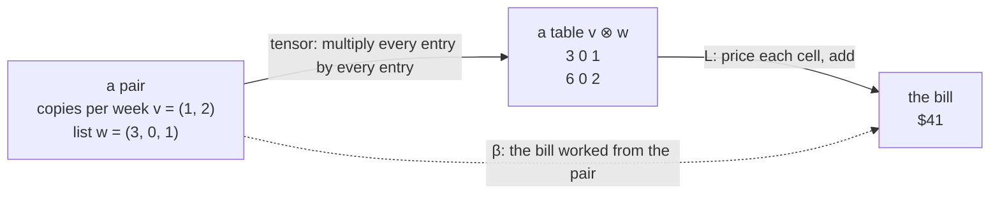

# Tensor products: pair every basis vector of one space with every basis vector of another, so a 2-space and a 3-space make a 6-space, and most of its members are not simple pairs

[Syllabus](../../../SYLLABUS.md) → [Algebra](../README.md) → [Duals, Quotients and Tensors](../README.md#s11) → Tensor products

---

## General Overview

A household records its shop over two weeks. Three goods are on the list: loaves, milks and dozens of eggs. The record is a table with 2 rows (weeks) and 3 columns (goods): six numbers.

One kind of record repeats a single list: 3 loaves, 0 milks, 1 dozen eggs, bought once in week 1 and twice in week 2. Every entry is (copies that week) × (amount on the list):

```
            loaves  milks  eggs
week 1         3      0      1      1 copy of (3, 0, 1)
week 2         6      0      2      2 copies of (3, 0, 1)
```

Another record is 1 loaf in week 1 and 1 milk in week 2. No list, repeated per week, makes it. The tensor product is the space of all such tables. Tables made from one list and one count of copies per week are the **simple** ones, a thin slice.

The same split matters in quantum computing. Two qubits (quantum bits) have a 2-by-2 table of amplitudes (numbers whose squared sizes are the chances), and when it is not simple the qubits are **entangled**: neither has a state of its own.

**The tensor product of a 2-space and a 3-space is the 6-space of 2-by-3 tables, built so that every rule on pairs that is linear in each slot becomes a linear rule on tables; a table is a single product exactly when its rank is at most 1.**

**What kind of fact this is:** a construction with two theorems attached, the universal property and the rank test, both proved in Why it works.

### The picture: a bill on pairs is a bill on tables

Prices: $3 a loaf, $2 a milk, $4 a dozen eggs ($5 in week 2). A bill may depend on the week.



Solid arrows: build the table, then price it. Dotted: the same $41 straight from the pair.

---

## The formula

- $`V`$ holds week counts. Its basis is $`e_1 = (1, 0)`$, week 1 only, and $`e_2 = (0, 1)`$, week 2 only. Its dimension, the length of a basis ([Basis and dimension](../03-Vectors/05-basis-and-dimension.md)), is $`m = 2`$.
- $`W`$ holds lists. Its basis is $`f_1`$ (one loaf), $`f_2`$ (one milk), $`f_3`$ (one dozen eggs), so $`n = 3`$.
- $`V \otimes W`$, read "V tensor W", has one basis table $`e_i \otimes f_j`$ per pair: a 1 in row $`i`$, column $`j`$, and 0 elsewhere.
- Two tables carry the card: $`T = (1, 2) \otimes (3, 0, 1)`$, the repeated list, and $`S = e_1 \otimes f_1 + e_2 \otimes f_2`$, 1 loaf then 1 milk.

A pair becomes the table whose entry in row $`i`$, column $`j`$ is $`v_i w_j`$:

```math
v \otimes w = \sum_{i=1}^{m} \sum_{j=1}^{n} v_i w_j \, (e_i \otimes f_j), \qquad \dim (V \otimes W) = mn
```

**Read it aloud:** multiply every entry of the first vector by every entry of the second, one product per cell; there are m times n cells.

A **bilinear map** takes a pair to a number (or a vector) and is linear in each slot while the other is held fixed ([Bilinear forms](../07-Eigenvalues%20and%20Symmetric%20Matrices/12-bilinear-forms-and-sylvesters-law.md)). The **universal property**: each one is a linear map on tables, in exactly one way.

```math
\beta(v, w) = L(v \otimes w), \qquad L(T) = \sum_{i,j} \beta(e_i, f_j)\, T_{ij}
```

**Read it aloud:** a rule on pairs, linear in each slot, is a linear rule on tables, fixed by its values on the basis tables.

Maps on both sides act through the **Kronecker product**, and rank decides simplicity:

```math
(A \otimes B)(v \otimes w) = Av \otimes Bw, \qquad T = v \otimes w \text{ for some } v, w \iff \mathrm{rank}\, T \le 1
```

**Read it aloud:** change the week side by A and the goods side by B; a table is one product exactly when it has at most one independent row.

| Symbol | Plain meaning | In our example | Push it up and the answer… |
| --- | --- | --- | --- |
| $`V`$, $`W`$; $`m`$, $`n`$ | the two spaces; their dimensions | weeks, 2; goods, 3 | one more week adds 3 cells, not 1 |
| $`e_i`$, $`f_j`$ | basis vectors of each space | week 2 only; one dozen eggs | — |
| $`v`$, $`w`$; $`v_i`$, $`w_j`$ | a vector of each space; its entries | copies (1, 2); list (3, 0, 1) | double either and every cell doubles |
| $`T`$, $`S`$; $`T_{ij}`$ | tensors (2-by-3 tables); an entry | `[[3, 0, 1], [6, 0, 2]]` and `[[1, 0, 0], [0, 1, 0]]` | — |
| $`\beta`$ | a bilinear map: the bill of a pair | prices $3, $2, $4; week 2 eggs $5; bill $41 | dearer goods, bigger bill |
| $`L`$ | the linear map on tables that equals it | $41 on $`T`$, $5 on $`S`$ | — |
| $`A`$, $`B`$, $`A \otimes B`$; $`a_{ij}`$, $`B^{\mathsf T}`$ | a map on each side; the Kronecker product; an entry of A; B with rows and columns swapped | running totals; dozens to eggs; 6 by 6 | — |
| rank, $`r`$ | the number of independent rows ([Rank and nullity](../05-Solving%20Systems/05-rank-nullity.md)) | 1 for $`T`$, 2 for $`S`$ | above 1: no single product |

### When it holds

- **The rule is linear in each slot.** A flat $1 delivery fee per order is not: it charges for the empty list, and no linear rule on tables matches it.
- **Factors come back only up to scale.** (2, 4) ⊗ (1.5, 0, 0.5) is the same table as (1, 2) ⊗ (3, 0, 1).
- **Factor order is kept.** W ⊗ V holds the 3-by-2 transposes, and B ⊗ A is a different matrix from A ⊗ B.

---

## Why it works

### Step 0: a bilinear rule only sees the products

Expand $`v = v_1 e_1 + v_2 e_2`$ and $`w = w_1 f_1 + w_2 f_2 + w_3 f_3`$. Linearity in each slot pulls every number out:

```math
\beta(v, w) = \sum_{i,j} v_i w_j \, \beta(e_i, f_j)
```

So the bill sees the pair only through six products $`v_i w_j`$. The idea: build a space whose coordinates are those six numbers. Then the bill is linear in them.

### Step 1: build the space and count it

Give $`V \otimes W`$ one basis table per pair. Each has its 1 in its own cell, so the six are independent: dimension 2 × 3 = 6.

The step from pairs to tables is bilinear: double $`v`$ and every row doubles.

### Step 2: the universal property

Define $`L`$ on each basis table by the bill of its pair, $`L(e_i \otimes f_j) = \beta(e_i, f_j)`$: the six prices `[[3, 2, 4], [3, 2, 5]]`. Extend linearly, so $`L`$ prices each cell and adds.

On a simple table this is Step 0's formula, so $`L(v \otimes w) = \beta(v, w)`$. On $`T`$: $13 in week 1 plus $28 in week 2, $41 both ways.

No other choice works. The basis tables are simple, so any matching linear map must give them the six prices, and a linear map is fixed by its values on a basis. A vector output works one coordinate at a time.

### Step 3: maps on each side make a Kronecker product

Let $`A`$ turn week counts into running totals and $`B`$ turn dozens into single eggs:

```math
A = \begin{pmatrix} 1 & 0 \\ 1 & 1 \end{pmatrix}, \qquad B = \begin{pmatrix} 1 & 0 & 0 \\ 0 & 1 & 0 \\ 0 & 0 & 12 \end{pmatrix}
```

On a table, the week side changes by $`A`$ on the left and the goods side by $`B^{\mathsf T}`$ on the right: $`T \mapsto A T B^{\mathsf T}`$ ([Matrix multiplication](../04-Matrices/03-matrix-multiplication.md)). On a simple table that is $`Av \otimes Bw`$ = (1, 3) ⊗ (3, 0, 12).

Write the table as one list of six, row after row. The same change is one 6-by-6 matrix whose blocks are $`a_{ij} B`$:

```math
A \otimes B = \begin{pmatrix} 1 \cdot B & 0 \cdot B \\ 1 \cdot B & 1 \cdot B \end{pmatrix}
```

Times the flat table (3, 0, 1, 6, 0, 2), it gives (3, 0, 12, 9, 0, 36), the same as $`Av \otimes Bw`$.

### Step 4: the rank test

If $`T = v \otimes w`$, row $`i`$ is $`v_i`$ times $`w`$: every row is a multiple of one row, so the rank is at most 1.

Conversely, if the rank is 1, every row is a multiple of one non-zero row. Call it $`w`$ and the multipliers $`v_i`$; then $`T = v \otimes w`$.

With two rows, "proportional" means every 2-by-2 cross-difference $`T_{1j} T_{2k} - T_{1k} T_{2j}`$ is 0. The code calls these `minors`. For $`T`$ all three are 0. For $`S`$ the first is 1 × 1 − 0 × 0 = 1, so $`S`$ is no single product.

<details>
<summary>Detailed proof: rank r means r simple tables, and no fewer</summary>

If the rows of $`T`$ have rank $`r`$, each row is a combination of $`r`$ independent rows. Collect the multipliers of the k-th of those rows into a column $`c_k`$, and call that row $`u_k`$. Then

$`\displaystyle T = c_1 \otimes u_1 + \dots + c_r \otimes u_r`$

which is $`r`$ simple tables. Fewer simple tables put every row in the span of fewer vectors, so the rank would be below $`r`$. A change of basis multiplies $`T`$ by invertible matrices, as in Step 3, which keeps the rank.

</details>

### Step 5: most tables are not simple

A simple table has 4 free numbers (2 + 3, less one for scale) in a 6-space. Of the 729 tables with entries 0, 1 or 2, only 93 are simple.

Two qubits work alike ([Qubits](../../24-Computability%20and%20complexity/05-Algebraic%2C%20Interactive%20and%20Quantum/05-qubits-superposition-and-measurement.md)). Their 2-by-2 table has one cross-difference, the qubit card's product test. The pair $`(e_1 \otimes e_1 + e_2 \otimes e_2)/\sqrt{2}`$ gives 0.5000, not 0: rank 2, entangled.

---

## Worked numbers, by hand

| Step | Arithmetic | Value |
| --- | --- | --- |
| the table $`T`$ | 1 × (3, 0, 1); 2 × (3, 0, 1) | `[[3, 0, 1], [6, 0, 2]]` |
| cross-differences | 3 × 0 − 0 × 6; 3 × 2 − 1 × 6; 0 × 2 − 1 × 0 | 0, 0, 0 |
| rank of $`T`$ | row 2 = 2 × row 1 | **1: a single product** |
| rank of $`S`$ | 1 × 1 − 0 × 0 = 1 | **2: not a product** |
| week 1 bill | 3 × 3 + 2 × 0 + 4 × 1 | $13 |
| week 2 bill | 3 × 6 + 2 × 0 + 5 × 2 | $28 |
| $`L(T)`$ | 13 + 28 | **$41**, equal to the bill of the pair |
| $`Av`$, $`Bw`$ | (1, 1 + 2); (3, 0, 12 × 1) | (1, 3) and (3, 0, 12) |
| $`(A \otimes B)(T)`$ | 1 × (3, 0, 12); 3 × (3, 0, 12) | **`[[3, 0, 12], [9, 0, 36]]`** |

The record costs $41 by either route; in running totals it reads 12 eggs by week 1 and 36 by week 2.

### What breaks if you drop a piece

| Mistake | Comes out at | What went wrong |
| --- | --- | --- |
| Dimension taken as 2 + 3 | 5, not 6 | That is the direct sum, pairs side by side; tables need a cell per pair of basis vectors |
| $`(e_1 + e_2) \otimes (f_1 + f_2)`$ for $`S`$ | `[[1, 1, 0], [1, 1, 0]]`, rank 1 | A product of sums adds the cross terms $`e_1 \otimes f_2`$ and $`e_2 \otimes f_1`$ |
| B ⊗ A for A ⊗ B | (3, 3, 1, 7, 0, 24) | Its blocks follow B, so it reads the flat table in the wrong order |


---

## Code, from first principles, and it actually runs

Nothing is imported. The dimension comes from counting basis tables and from elimination. Simplicity is tested three ways: rank by elimination, the cross-differences, and a search over small products. The bill is worked from the pair and from the table; the Kronecker matrix is checked against $`Av \otimes Bw`$.

### Python

```python
# Tensor products -- the check behind the card.  Nothing is imported.  V holds
# week counts (2 weeks), W holds shopping lists (3 goods), and a tensor in
# V (x) W is a 2-by-3 table: how many of each good were bought each week.
def tensor(v, w):                          # v (x) w: every entry of v times every entry of w
    return [[a * b for b in w] for a in v]

def rank(rows):                            # road one: count pivots, whole numbers only
    rows, r = [list(x) for x in rows], 0
    for c in range(len(rows[0])):
        p = next((i for i in range(r, len(rows)) if rows[i][c]), None)
        if p is None: continue
        rows[r], rows[p] = rows[p], rows[r]
        for i in range(len(rows)):
            if i != r: rows[i] = [rows[i][k] * rows[r][c] - rows[r][k] * rows[i][c] for k in range(len(rows[0]))]
        r += 1
    return r

def minors(t):                             # road two: every 2-by-2 cross-difference
    return [t[0][j] * t[1][k] - t[0][k] * t[1][j] for j in range(3) for k in range(j + 1, 3)]

def kron(a, b):                            # the Kronecker product, block by block
    return [[x * y for x in ra for y in rb] for ra in a for rb in b]
def mat(a, v): return [sum(x * y for x, y in zip(r, v)) for r in a]
def flat(t): return [x for r in t for x in r]

e, f = [[1, 0], [0, 1]], [[1, 0, 0], [0, 1, 0], [0, 0, 1]]
v, w, P = [1, 2], [3, 0, 1], [[3, 2, 4], [3, 2, 5]]       # P: each week's prices, in dollars
T = tensor(v, w)
S = [[x + y for x, y in zip(r, q)] for r, q in zip(tensor(e[0], f[0]), tensor(e[1], f[1]))]
basis = [flat(tensor(a, b)) for a in e for b in f]
g = range(-3, 4)
found = lambda t: [(a, b, c, d, h) for a in g for b in g for c in g for d in g for h in g if tensor([a, b], [c, d, h]) == t]
tables = [[[n // 3 ** (3 * i + j) % 3 for j in range(3)] for i in range(2)] for n in range(3 ** 6)]
simple = sum(rank(t) <= 1 for t in tables)
beta = lambda x, y: sum(P[i][j] * x[i] * y[j] for i in range(2) for j in range(3))   # bill of a pair
L = lambda t: sum(P[i][j] * t[i][j] for i in range(2) for j in range(3))           # bill of a table
A, B = [[1, 0], [1, 1]], [[1, 0, 0], [0, 1, 0], [0, 0, 12]]   # running totals; dozens to eggs
K = kron(A, B)
via_k, via_sides = mat(K, flat(T)), flat(tensor(mat(A, v), mat(B, w)))
q = [[0.5 ** 0.5 * x for x in r] for r in e]                 # two qubits: amplitude 1/sqrt 2 twice
print(f"basis tables e_i (x) f_j: {len(basis)}; their rank: {rank(basis)}; 2 x 3 = {2 * 3}")
print(f"(1, 2) (x) (3, 0, 1) = {T}; rank {rank(T)}; minors {minors(T)}")
print(f"e1 (x) f1 + e2 (x) f2 = {S}; rank {rank(S)}; minors {minors(S)}")
print(f"product search, entries -3 to 3: first table {len(found(T))} ways, second {len(found(S))}")
print(f"tables with entries 0, 1, 2: {len(tables)}; simple (rank 0 or 1): {simple}")
print(f"basis bills beta(e_i, f_j): {[[beta(a, b) for b in f] for a in e]}")
print(f"bill from the pair: {beta(v, w)}; from the table: {L(T)} (weeks {L(T[:1] + [[0] * 3])}, {L([[0] * 3] + T[1:])}); second table: {L(S)}")
print(f"A (x) B is {len(K)} x {len(K[0])}; times the flat table: {via_k}")
print(f"(Av) (x) (Bw) = {mat(A, v)} (x) {mat(B, w)} -> {via_sides}")
print(f"qubit pair (e1 (x) e1 + e2 (x) e2)/sqrt 2: product test {q[0][0] * q[1][1] - q[0][1] * q[1][0]:.4f}, rank {rank(e)}")
print(f"mistake 1, dimension as 2 + 3: {2 + 3}, not {len(basis)}")
print(f"mistake 2, (e1 + e2) (x) (f1 + f2) = {tensor([1, 1], [1, 1, 0])}, rank {rank(tensor([1, 1], [1, 1, 0]))}")
print(f"mistake 3, B (x) A in place of A (x) B: {mat(kron(B, A), flat(T))}")
assert rank(basis) == len(basis) == 2 * 3                     # dimension mn, two roads
assert rank(T) == 1 and minors(T) == [0, 0, 0] and len(found(T)) > 0
assert rank(S) == 2 and minors(S)[0] != 0 and found(S) == []  # no product in the search
assert simple == sum(all(m == 0 for m in minors(t)) for t in tables)
assert beta(v, w) == L(T) == 41
assert via_k == via_sides == flat([[3, 0, 12], [9, 0, 36]])
print("ALL CHECKS PASS")
```

**Ran 2026-11-23 on macOS, Python 3.14.10, standard library only. All checks passed. Output, pasted from the run:**

```
basis tables e_i (x) f_j: 6; their rank: 6; 2 x 3 = 6
(1, 2) (x) (3, 0, 1) = [[3, 0, 1], [6, 0, 2]]; rank 1; minors [0, 0, 0]
e1 (x) f1 + e2 (x) f2 = [[1, 0, 0], [0, 1, 0]]; rank 2; minors [1, 0, 0]
product search, entries -3 to 3: first table 2 ways, second 0
tables with entries 0, 1, 2: 729; simple (rank 0 or 1): 93
basis bills beta(e_i, f_j): [[3, 2, 4], [3, 2, 5]]
bill from the pair: 41; from the table: 41 (weeks 13, 28); second table: 5
A (x) B is 6 x 6; times the flat table: [3, 0, 12, 9, 0, 36]
(Av) (x) (Bw) = [1, 3] (x) [3, 0, 12] -> [3, 0, 12, 9, 0, 36]
qubit pair (e1 (x) e1 + e2 (x) e2)/sqrt 2: product test 0.5000, rank 2
mistake 1, dimension as 2 + 3: 5, not 6
mistake 2, (e1 + e2) (x) (f1 + f2) = [[1, 1, 0], [1, 1, 0]], rank 1
mistake 3, B (x) A in place of A (x) B: [3, 3, 1, 7, 0, 24]
ALL CHECKS PASS
```

### Rust

Same numbers, same labels, built with `rustc --edition 2021 -O`.

```rust
// Tensor products -- the same check as the Python, in Rust.  No crates.  V
// holds week counts (2 weeks), W holds shopping lists (3 goods), and a tensor
// in V (x) W is a 2-by-3 table: how many of each good were bought each week.
type M = Vec<Vec<i64>>;
fn tensor(v: &[i64], w: &[i64]) -> M {     // v (x) w: every entry of v times every entry of w
    v.iter().map(|a| w.iter().map(|b| a * b).collect()).collect()
}
fn rank(rows: &M) -> usize {               // road one: count pivots, whole numbers only
    let (mut rows, mut r) = (rows.clone(), 0);
    for c in 0..rows[0].len() {
        let Some(p) = (r..rows.len()).find(|&i| rows[i][c] != 0) else { continue };
        rows.swap(r, p);
        for i in 0..rows.len() {
            if i != r {
                let (a, b) = (rows[r][c], rows[i][c]);
                rows[i] = (0..rows[0].len()).map(|k| rows[i][k] * a - rows[r][k] * b).collect();
            }
        }
        r += 1;
    }
    r
}
fn minors(t: &M) -> Vec<i64> {             // road two: every 2-by-2 cross-difference
    let mut out = vec![];
    for j in 0..3 { for k in j + 1..3 { out.push(t[0][j] * t[1][k] - t[0][k] * t[1][j]) } }
    out
}
fn kron(a: &M, b: &M) -> M {               // the Kronecker product, block by block
    a.iter().flat_map(|ra| b.iter().map(move |rb| ra.iter().flat_map(|x| rb.iter().map(move |y| x * y)).collect())).collect()
}
fn mat(a: &M, v: &[i64]) -> Vec<i64> { a.iter().map(|r| r.iter().zip(v).map(|(x, y)| x * y).sum()).collect() }
fn flat(t: &M) -> Vec<i64> { t.concat() }

fn found(t: &M) -> usize {                 // road three: search every small product
    let mut n = 0;
    for a in -3..4 { for b in -3..4 { for c in -3..4 { for d in -3..4 { for h in -3..4 {
        if tensor(&[a, b], &[c, d, h]) == *t { n += 1 }
    } } } } }
    n
}

fn main() {
    let (e, f): (M, M) = (vec![vec![1, 0], vec![0, 1]], vec![vec![1, 0, 0], vec![0, 1, 0], vec![0, 0, 1]]);
    let (v, w, p): (Vec<i64>, Vec<i64>, M) = (vec![1, 2], vec![3, 0, 1], vec![vec![3, 2, 4], vec![3, 2, 5]]);
    let t = tensor(&v, &w);
    let (s1, s2) = (tensor(&e[0], &f[0]), tensor(&e[1], &f[1]));
    let s: M = (0..2).map(|i| (0..3).map(|j| s1[i][j] + s2[i][j]).collect()).collect();
    let basis: M = e.iter().flat_map(|a| f.iter().map(|b| flat(&tensor(a, b)))).collect();
    let tables: Vec<M> = (0..729).map(|n: i64| (0..2).map(|i| (0..3).map(|j| n / 3_i64.pow(3 * i + j) % 3).collect()).collect()).collect();
    let simple = tables.iter().filter(|t| rank(t) <= 1).count();
    let beta = |x: &[i64], y: &[i64]| -> i64 { (0..2).map(|i| (0..3).map(|j| p[i][j] * x[i] * y[j]).sum::<i64>()).sum() };
    let bill = |t: &M| -> i64 { (0..2).map(|i| (0..3).map(|j| p[i][j] * t[i][j]).sum::<i64>()).sum() };
    let basis_bills: M = e.iter().map(|a| f.iter().map(|b| beta(a, b)).collect()).collect();
    let (a, b): (M, M) = (vec![vec![1, 0], vec![1, 1]], vec![vec![1, 0, 0], vec![0, 1, 0], vec![0, 0, 12]]);
    let k = kron(&a, &b);
    let (via_k, via_sides) = (mat(&k, &flat(&t)), flat(&tensor(&mat(&a, &v), &mat(&b, &w))));
    let q: Vec<Vec<f64>> = e.iter().map(|r| r.iter().map(|&x| 0.5_f64.sqrt() * x as f64).collect()).collect();
    let wrong = tensor(&[1, 1], &[1, 1, 0]);
    println!("basis tables e_i (x) f_j: {}; their rank: {}; 2 x 3 = {}", basis.len(), rank(&basis), 2 * 3);
    println!("(1, 2) (x) (3, 0, 1) = {:?}; rank {}; minors {:?}", t, rank(&t), minors(&t));
    println!("e1 (x) f1 + e2 (x) f2 = {:?}; rank {}; minors {:?}", s, rank(&s), minors(&s));
    println!("product search, entries -3 to 3: first table {} ways, second {}", found(&t), found(&s));
    println!("tables with entries 0, 1, 2: {}; simple (rank 0 or 1): {}", tables.len(), simple);
    println!("basis bills beta(e_i, f_j): {:?}", basis_bills);
    println!("bill from the pair: {}; from the table: {} (weeks {}, {}); second table: {}", beta(&v, &w), bill(&t),
             bill(&vec![t[0].clone(), vec![0; 3]]), bill(&vec![vec![0; 3], t[1].clone()]), bill(&s));
    println!("A (x) B is {} x {}; times the flat table: {:?}", k.len(), k[0].len(), via_k);
    println!("(Av) (x) (Bw) = {:?} (x) {:?} -> {:?}", mat(&a, &v), mat(&b, &w), via_sides);
    println!("qubit pair (e1 (x) e1 + e2 (x) e2)/sqrt 2: product test {:.4}, rank {}", q[0][0] * q[1][1] - q[0][1] * q[1][0], rank(&e));
    println!("mistake 1, dimension as 2 + 3: {}, not {}", 2 + 3, basis.len());
    println!("mistake 2, (e1 + e2) (x) (f1 + f2) = {:?}, rank {}", wrong, rank(&wrong));
    println!("mistake 3, B (x) A in place of A (x) B: {:?}", mat(&kron(&b, &a), &flat(&t)));
    assert!(rank(&basis) == basis.len() && basis.len() == 2 * 3);
    assert!(rank(&t) == 1 && minors(&t) == vec![0, 0, 0] && found(&t) > 0);
    assert!(rank(&s) == 2 && minors(&s)[0] != 0 && found(&s) == 0);
    assert!(simple == tables.iter().filter(|t| minors(t).iter().all(|&m| m == 0)).count());
    assert!(beta(&v, &w) == 41 && bill(&t) == 41);
    assert!(via_k == via_sides && via_k == vec![3, 0, 12, 9, 0, 36]);
    println!("ALL CHECKS PASS");
}
```

**Ran 2026-11-23 on macOS, rustc 1.98.1, no crates. All checks passed. Output, pasted from the run:**

```
basis tables e_i (x) f_j: 6; their rank: 6; 2 x 3 = 6
(1, 2) (x) (3, 0, 1) = [[3, 0, 1], [6, 0, 2]]; rank 1; minors [0, 0, 0]
e1 (x) f1 + e2 (x) f2 = [[1, 0, 0], [0, 1, 0]]; rank 2; minors [1, 0, 0]
product search, entries -3 to 3: first table 2 ways, second 0
tables with entries 0, 1, 2: 729; simple (rank 0 or 1): 93
basis bills beta(e_i, f_j): [[3, 2, 4], [3, 2, 5]]
bill from the pair: 41; from the table: 41 (weeks 13, 28); second table: 5
A (x) B is 6 x 6; times the flat table: [3, 0, 12, 9, 0, 36]
(Av) (x) (Bw) = [1, 3] (x) [3, 0, 12] -> [3, 0, 12, 9, 0, 36]
qubit pair (e1 (x) e1 + e2 (x) e2)/sqrt 2: product test 0.5000, rank 2
mistake 1, dimension as 2 + 3: 5, not 6
mistake 2, (e1 + e2) (x) (f1 + f2) = [[1, 1, 0], [1, 1, 0]], rank 1
mistake 3, B (x) A in place of A (x) B: [3, 3, 1, 7, 0, 24]
ALL CHECKS PASS
```


### Lean

Lean proves the card's three general facts for spaces of every size, and checks the shop's numbers exactly.

- The rank test: a table is a single product of two vectors exactly when its rank is at most 1.
- The universal property: every rule on pairs that is linear in each slot is a linear rule on tables, in exactly one way.
- The dimension count: take V of dimension m and W of dimension n. Then V ⊗ W has dimension mn.
- (1, 2) ⊗ (3, 0, 1) is the table `[[3, 0, 1], [6, 0, 2]]`, and its three cross-differences are 0.
- S is `[[1, 0, 0], [0, 1, 0]]`, and its first cross-difference is 1, not 0.
- The bill is $41 from the pair and $41 from the table.
- Av is (1, 3) and Bw is (3, 0, 12). A ⊗ B times the flat table gives (3, 0, 12, 9, 0, 36), the flat Av ⊗ Bw.
- (e1 + e2) ⊗ (f1 + f2) is `[[1, 1, 0], [1, 1, 0]]`, not S.

The product search, the 729-table count, the qubit test and mistake 3 are left to the Python and Rust checks.

```lean
-- Tensor products: a table is a single product v ⊗ w exactly when its rank is at most 1, every bilinear map is one linear map on V ⊗ W, and V ⊗ W has dimension mn.
import Mathlib.LinearAlgebra.TensorProduct.Basic
import Mathlib.LinearAlgebra.Dimension.Constructions
import Mathlib.LinearAlgebra.Matrix.Rank
import Mathlib.LinearAlgebra.Matrix.Kronecker

open Matrix TensorProduct

/-- The rank test: an m-by-n table T over a field is a single product v ⊗ w
(the table whose entry in row i, column j is v_i w_j) exactly when its rank is at most 1. -/
theorem exists_tensor_eq_iff_rank_le_one {K : Type*} [Field K] {m n : ℕ}
    (T : Matrix (Fin m) (Fin n) K) :
    (∃ (v : Fin m → K) (w : Fin n → K), T = vecMulVec v w) ↔ T.rank ≤ 1 := by
  constructor
  · rintro ⟨v, w, rfl⟩
    exact rank_vecMulVec_le v w
  · intro h
    rw [rank_eq_finrank_span_cols, Submodule.finrank_le_one_iff_isPrincipal] at h
    obtain ⟨v, hv⟩ := h.principal
    have hcol : ∀ j, ∃ c : K, c • v = T.col j := by
      intro j
      have hj : T.col j ∈ Submodule.span K (Set.range T.col) :=
        Submodule.subset_span ⟨j, rfl⟩
      rw [hv] at hj
      exact Submodule.mem_span_singleton.mp hj
    choose w hw using hcol
    refine ⟨v, w, ?_⟩
    ext i j
    have := congrFun (hw j) i
    simp only [Matrix.col_apply, Pi.smul_apply, smul_eq_mul] at this
    rw [vecMulVec_apply, ← this, mul_comm]

/-- The universal property: every rule β on pairs that is linear in each slot is a linear
rule L on V ⊗ W with L (v ⊗ w) = β(v, w), in exactly one way. -/
theorem bilinear_eq_linear_on_tensor_unique {K V W U : Type*} [Field K]
    [AddCommGroup V] [Module K V] [AddCommGroup W] [Module K W]
    [AddCommGroup U] [Module K U] (β : V →ₗ[K] W →ₗ[K] U) :
    ∃! L : V ⊗[K] W →ₗ[K] U, ∀ v w, L (v ⊗ₜ w) = β v w := by
  refine ⟨TensorProduct.lift β, fun v w => TensorProduct.lift.tmul v w, ?_⟩
  intro L hL
  exact TensorProduct.lift.unique hL

/-- The dimension count: if V has dimension m and W has dimension n,
then V ⊗ W has dimension mn. -/
theorem finrank_tensor_eq_mul {K V W : Type*} [Field K]
    [AddCommGroup V] [Module K V] [FiniteDimensional K V]
    [AddCommGroup W] [Module K W] [FiniteDimensional K W] :
    Module.finrank K (V ⊗[K] W) = Module.finrank K V * Module.finrank K W := by
  exact Module.finrank_tensorProduct

-- The repeated list: (1, 2) ⊗ (3, 0, 1) is the table [[3, 0, 1], [6, 0, 2]].
example : vecMulVec ![(1 : ℤ), 2] ![3, 0, 1] = !![3, 0, 1; 6, 0, 2] := by decide

-- All three cross-differences of that table are 0.
example : (fun T : Matrix (Fin 2) (Fin 3) ℤ =>
      ![T 0 0 * T 1 1 - T 0 1 * T 1 0, T 0 0 * T 1 2 - T 0 2 * T 1 0, T 0 1 * T 1 2 - T 0 2 * T 1 1])
    !![3, 0, 1; 6, 0, 2] = ![0, 0, 0] := by decide

-- S = e1 ⊗ f1 + e2 ⊗ f2 is [[1, 0, 0], [0, 1, 0]], and its first cross-difference is 1, not 0.
example : vecMulVec ![(1 : ℤ), 0] ![1, 0, 0] + vecMulVec ![0, 1] ![0, 1, 0]
    = !![1, 0, 0; 0, 1, 0] := by decide
example : (fun S : Matrix (Fin 2) (Fin 3) ℤ => S 0 0 * S 1 1 - S 0 1 * S 1 0)
    !![1, 0, 0; 0, 1, 0] = 1 := by decide

-- The bill: prices [[3, 2, 4], [3, 2, 5]] give $41 from the pair and $41 from the table.
example : ∑ i : Fin 2, ∑ j : Fin 3, !![(3 : ℤ), 2, 4; 3, 2, 5] i j * (![1, 2] i * ![3, 0, 1] j) = 41 := by decide
example : ∑ i : Fin 2, ∑ j : Fin 3, !![(3 : ℤ), 2, 4; 3, 2, 5] i j * !![3, 0, 1; 6, 0, 2] i j = 41 := by decide

-- The Kronecker product: Av = (1, 3), Bw = (3, 0, 12), and (A ⊗ B) times the flat table
-- (3, 0, 1, 6, 0, 2) is (3, 0, 12, 9, 0, 36), the flat (Av) ⊗ (Bw).
example : !![(1 : ℤ), 0; 1, 1] *ᵥ ![1, 2] = ![1, 3] ∧
    !![(1 : ℤ), 0, 0; 0, 1, 0; 0, 0, 12] *ᵥ ![3, 0, 1] = ![3, 0, 12] := by decide
example : (kroneckerMap (· * ·) !![(1 : ℤ), 0; 1, 1] !![1, 0, 0; 0, 1, 0; 0, 0, 12])
      *ᵥ (fun p : Fin 2 × Fin 3 => !![(3 : ℤ), 0, 1; 6, 0, 2] p.1 p.2)
    = fun p => vecMulVec ![(1 : ℤ), 3] ![3, 0, 12] p.1 p.2 := by decide
example : (fun p : Fin 2 × Fin 3 => vecMulVec ![(1 : ℤ), 3] ![3, 0, 12] p.1 p.2)
    = fun p => !![(3 : ℤ), 0, 12; 9, 0, 36] p.1 p.2 := by decide

-- Mistake 2: (e1 + e2) ⊗ (f1 + f2) is [[1, 1, 0], [1, 1, 0]], not S.
example : vecMulVec ![(1 : ℤ), 1] ![1, 1, 0] = !![1, 1, 0; 1, 1, 0] ∧
    vecMulVec ![(1 : ℤ), 1] ![1, 1, 0] ≠ !![1, 0, 0; 0, 1, 0] := by decide

#print axioms exists_tensor_eq_iff_rank_le_one
#print axioms bilinear_eq_linear_on_tensor_unique
#print axioms finrank_tensor_eq_mul
```

**Checked 2026-11-23 on macOS, Lean 4.36.0-rc2, Mathlib v4.36.0-rc2. Every proof is complete and uses only Lean's standard axioms. Output, pasted from the run:**

```
'exists_tensor_eq_iff_rank_le_one' depends on axioms: [propext, Classical.choice, Quot.sound]
'bilinear_eq_linear_on_tensor_unique' depends on axioms: [propext, Quot.sound]
'finrank_tensor_eq_mul' depends on axioms: [propext, Classical.choice, Quot.sound]
```

> [!TIP]
> **Try changing**
> Guess first, then run it.
> - **A different list.** Set `w = [3, 1, 1]`. The table is still rank 1, but the bill is $47 and the bill assert stops it.
> - **Old egg prices.** Set week 2's eggs back to 4 in `P`. The bill falls to $39; the same assert stops it.
> - **A simple second table.** Replace `tensor(e[1], f[1])` with `tensor([0, 2], f[0])`. It becomes `[[1, 0, 0], [2, 0, 0]]`, rank 1, found 2 ways: the third assert stops it.
> - **A wider grid.** In the `tables` line, change only the base, `3 **` twice and `% 3`, to 4. Of 4,096 tables, 232 are simple: a thinner slice still.

---

## The usual mistake

> [!warning]
> **Treating every tensor as a pair.** A tensor is a whole table. Only rank-1 tables are pairs; the rest are sums of them. $`S`$ has rank 2, and the search finds 0 pairs that make it.
>
> - **Adding dimensions.** 2 + 3 = 5 is the direct sum; the tensor product has 6.
> - **Expanding a product of sums too early.** $`(e_1 + e_2) \otimes (f_1 + f_2)`$ is `[[1, 1, 0], [1, 1, 0]]`, not $`S`$.
> - **Swapping the Kronecker factors.** B ⊗ A gives (3, 3, 1, 7, 0, 24), not (3, 0, 12, 9, 0, 36).
> - **Reading the factors back exactly.** The search finds $`T`$ 2 ways: (1, 2) ⊗ (3, 0, 1) and its sign-flipped twin.

---

## Where you meet it in real life

- **Quantum computing.** Several qubits live in the tensor product of their spaces, and entanglement is failing the rank test.
- **Recommendation systems.** Low-rank methods write a ratings table as a few simple tables, each one taste pattern scaled per customer.
- **Image processing.** A blur applied to rows, then columns, is a Kronecker product of two small matrices, far cheaper than one large one.
- **Physics and engineering.** Stress in a material and curvature of space are tensors built the same way.

> **Say it back**
> The tensor product of a 2-space and a 3-space is the 6-space of 2-by-3 tables, one cell per pair of basis vectors. A pair becomes the table of all its products. Every rule on pairs that is linear in each slot becomes a linear rule on tables. Maps on each side act together as the Kronecker product. A table is a single pair exactly when its rank is at most 1, and most tables are not.

---

## What this builds on

- [Dual spaces](02-dual-spaces.md): a price list reads a basket; the bill here is one reading per week.
- [Basis and dimension](../03-Vectors/05-basis-and-dimension.md): bases and their lengths, which multiply here.
- [Matrix multiplication](../04-Matrices/03-matrix-multiplication.md): the rule behind $`A T B^{\mathsf T}`$ and the Kronecker blocks.
- [Bilinear forms](../07-Eigenvalues%20and%20Symmetric%20Matrices/12-bilinear-forms-and-sylvesters-law.md): rules linear in each slot, which become linear maps here.
- [Direct sums and quotient spaces](01-direct-sums-and-quotient-spaces.md): joining two spaces side by side, dimension m + n.

## Where this goes next

- [Qubits](../../24-Computability%20and%20complexity/05-Algebraic%2C%20Interactive%20and%20Quantum/05-qubits-superposition-and-measurement.md): two-qubit states as tensors, entanglement as rank 2.
- [Covectors and tensor fields](../../23-Differential%20geometry%20and%20Lie%20groups/03-Manifolds/05-covectors-and-tensor-fields.md): tensors that vary from point to point.
- [Monoidal categories](../../24-Computability%20and%20complexity/07-Category%20Theory%20in%20Outline/09-monoidal-categories-and-string-diagrams.md): the tensor product as one case of placing things side by side.
- [Two particles](../../13-Engineering%20mathematics/09-Quantum%20Mechanics%20in%20Outline/11-two-particle-states-and-entanglement.md): product states, the singlet, and the CHSH bound.
- [Universal coefficients and Kunneth](../../17-Topology/05-Homology/11-universal-coefficients-and-kunneth.md): change the number system, or multiply two spaces, and see what twists survive.
- [Quasi-coherent sheaves](../../22-Algebraic%20geometry/06-Schemes%20and%20Modern%20Language/11-quasi-coherent-and-coherent-sheaves.md): modules spread over a scheme, and the line bundles O(d) as shifted graded modules.
- [Projective, injective and flat](../../22-Algebraic%20geometry/07-Exact%20Sequences%2C%20Ext%20and%20Tor/02-projective-injective-and-flat-modules.md): the modules that keep Hom and tensor exact.
- [Kahler differentials](../../22-Algebraic%20geometry/08-Sheaf%20Cohomology%20and%20Differentials/01-kahler-differentials.md): derivatives built from algebra alone.
- [Chern classes and Hirzebruch-Riemann-Roch](../../22-Algebraic%20geometry/09-Intersection%20Theory%20and%20Surfaces/02-chern-classes-and-hirzebruch-riemann-roch.md): the Euler characteristic of a bundle from its classes.

A weeks-by-goods-by-shops table has three indices and no row rank; what replaces rank there is the question this card leaves open.

---

## Sources

Verified 2026-11-23: every link below resolves to the publisher's page.

- Axler, Sheldon. *Linear Algebra Done Right*, 4th ed. Springer, 2024. [DOI 10.1007/978-3-031-41026-0](https://doi.org/10.1007/978-3-031-41026-0). Section 9D defines $`V \otimes W`$, its basis and dimension, and turns bilinear maps into linear maps.
- Dummit, David S., and Richard M. Foote. *Abstract Algebra*, 3rd ed. Wiley, 2003. [Publisher page](https://www.wiley.com/en-us/Abstract+Algebra%2C+3rd+Edition-p-9780471433347). The tensor product defined by its universal property, for modules and vector spaces alike.
- Horn, Roger A., and Charles R. Johnson. *Topics in Matrix Analysis*. Cambridge University Press, 1991. [DOI 10.1017/CBO9780511840371](https://doi.org/10.1017/CBO9780511840371). Chapter 4 on the Kronecker product and its rules.
