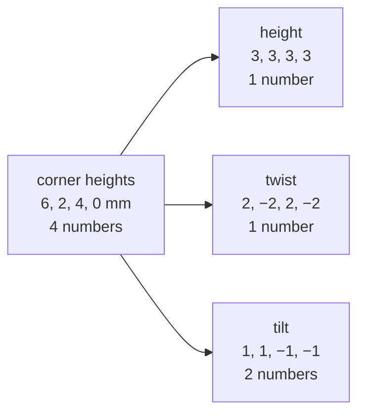

# Representations: a group acting by matrices, and Maschke's theorem that every one splits into pieces that cannot split further

[Syllabus](../../../SYLLABUS.md) → [Algebra](../README.md) → [Group Representations](../README.md#s12) → Representations

---

## General Overview

A square tile drops into a square recess eight ways: four turns r0 to r3 (by 0, 1, 2 and 3 quarters), and the same four after a flip, r0f to r3f ([Group actions](../08-Groups/08-group-actions-and-counting.md)). Its corners are numbered 0 to 3, clockwise from the top left.

A hand-cut stone tile varies in thickness. With its back on a flat bench, a tiler measures each corner's height above the thinnest corner: 6, 2, 4 and 0 mm. Each height is extra thickness, so it travels with its corner. Turn the tile, or flip it face down, and the same heights land on other corners. So each move shuffles a list of four numbers, and a shuffle of a list is a matrix ([Linear maps](../04-Matrices/04-linear-maps-as-matrices.md)). A group acting by matrices like this is a **representation**.

The heights split into three parts that no move can mix:

- **height**, 3 mm on every corner;
- **twist**, +2 mm on corners 0 and 2, −2 mm on corners 1 and 3: the part no flat plane can fit;
- **tilt**, the slope: two numbers, (1, 1), one per diagonal (corner 0 up, 2 down; corner 1 up, 3 down), giving the list (1, 1, −1, −1).

They add back: (3, 3, 3, 3) + (2, −2, 2, −2) + (1, 1, −1, −1) = (6, 2, 4, 0). Heinrich Maschke proved in 1899 that such a split always exists.

**A representation turns each member of a group into a matrix, so that combining members matches multiplying matrices; Maschke's theorem says that for a finite group over the complex numbers the space splits into kept pieces that cannot split further.**

**What kind of fact this is:** representation, kept subspace and irreducible are definitions; Maschke's theorem is proved on this card in Why it works.

### The picture: four numbers, three pieces



Four numbers in, 1 + 1 + 2 out. No move sends part of one box into another.

---

## The formula

G is the group of eight moves, with members g and h. V is the space of four-number lists, one number per corner. A **representation** gives each move g an invertible matrix ρ(g), and respects combining:

```math
\rho(g\,h) = \rho(g)\,\rho(h) \quad \text{for all } g, h \text{ in } G
```

**Read it aloud:** doing h, then g, written as one matrix, is the product of their two matrices.

For the tile, ρ(g) carries the number on each corner to where g sends that corner. Any group acting on a finite set gives such a **permutation representation**.

A **kept subspace** W is one that every ρ(g) maps into itself. Books call it a sub-representation or an invariant subspace. A representation is **irreducible** when its space is not zero and nothing but zero and the whole space is kept.

The theorem builds the split by averaging. A **projection** P onto W sends every list into W and leaves members of W unchanged. Average its copies over the group:

```math
P^{\circ} = \frac{1}{\lvert G\rvert} \sum_{g \text{ in } G} \rho(g)\, P\, \rho(g)^{-1}
```

**Read it aloud:** undo a move, project, redo the move, and take the mean over every move.

The lists that the average sends to zero form a kept partner W′. Every list is one member of W plus one of W′, in one way only ([Direct sums and quotient spaces](../11-Duals%2C%20Quotients%20and%20Tensors/01-direct-sums-and-quotient-spaces.md)). Repeating inside each piece gives

```math
V = W_1 \oplus W_2 \oplus \cdots \oplus W_k, \quad \text{each piece irreducible}
```

For the tile, 4 = 1 + 1 + 2.

| Symbol | Plain meaning | In our example | Push it up and the answer… |
| --- | --- | --- | --- |
| $`G`$, $`\lvert G\rvert`$ | the group; its number of members | the tile's moves; 8 | a bigger group keeps fewer subspaces |
| $`g`$, $`h`$ | members of the group | r1, a quarter turn; r0f, a flip | — |
| $`V`$, $`x`$, $`x_0`$ | the lists of corner numbers; one list; its corner-0 entry | $`x`$ = (6, 2, 4, 0) mm, $`x_0`$ = 6 | more corners, more pieces |
| $`e_0`$ to $`e_3`$, $`u`$, $`w`$ | the list with 1 at one corner, 0 elsewhere; $`u = e_0 - e_2`$, $`w = e_1 - e_3`$ | $`u + w`$ = (1, 1, −1, −1), the tilt | — |
| $`\rho(g)`$ | the matrix of move $`g`$ | r1 sends (6, 2, 4, 0) to (0, 6, 2, 4) | — |
| $`W`$, $`y`$, $`W'`$, $`W_1`$ to $`W_k`$, $`\oplus`$ | a kept subspace and a member of it; its kept partner; the $`k`$ final pieces; ⊕ joins pieces sharing only zero | height line, twist line, tilt plane | — |
| $`P`$, $`P^{\circ}`$, $`\sum`$ | a projection onto $`W`$; its average; Σ adds over every move | copy $`x_0`$ to every corner; put the mean, 3, on every corner | — |
| $`c`$, $`i`$ | the line through (1, $`c`$) in the tilt plane; the complex number with $`i^2 = -1`$ | $`c = i`$ or $`c = -i`$ | — |

### When it holds

- **A finite group.** The average needs a count. The shears `[[1, 1], [0, 1]]`, `[[1, 2], [0, 1]]` and so on keep the horizontal line, and no other line, so it has no kept partner.
- **Division by the group's size.** In arithmetic mod 2, where 1 + 1 = 0, swapping two coordinates keeps the line through (1, 1) and neither of its 2 partner lines.
- **Complex numbers, for "cannot split further".** The split works over the real numbers too, but a real piece may split again once complex numbers are allowed. The four turns alone keep no real line in the tilt plane, yet keep the complex lines through (1, −i) and (1, i). Over the complex numbers, every equation like 1 + c² = 0 has a root, so a piece found irreducible there stays irreducible.

---

## Why it works

### Step 0: an average over a group ignores one more move

As g runs over all eight moves, h combined with g also runs over all eight, once each, because h can be undone. So applying h to every term of an average only reorders the terms. The average is already symmetric.

### Step 1: the corner shuffles are a representation

Doing h then g carries each corner first where h puts it, then where g puts that. The combined move gh sends it to the same place, so ρ(gh) = ρ(g)ρ(h). The code checks all 64 pairs.

### Step 2: three kept pieces in the tile

- **Height.** A list with all corners equal stays equal under any shuffle.
- **Twist.** Corners 0 and 2 form one diagonal, 1 and 3 the other. Quarter turns and edge flips swap the diagonals, so they act on (1, −1, 1, −1) as −1. Doing nothing, the half turn and the diagonal flips act as +1.
- **Tilt.** The lists at right angles to both are the mixes of u and w. In the diagonal basis u, w, the quarter turn acts as `[[0, -1], [1, 0]]` and the diagonal flip r0f as `[[1, 0], [0, -1]]`: the tile's own 2 by 2 matrices on the floor.

The traces agree. The trace of ρ(g), the sum of its diagonal, counts the corners g leaves put: 4, 0, 0, 0, 2, 0, 2, 0. Move by move, that is 1 plus the twist sign plus the trace on the tilt plane. Reading pieces from traces alone is [Schur's lemma and orthogonality](02-schurs-lemma-and-character-orthogonality.md).

### Step 3: average a projection to get a kept partner

Start lopsided: copy corner 0's number to every corner. The zero set of that projection, the lists with $`x_0 = 0`$, is a partner for the height line, but only 2 of 8 moves keep it.

Average it. Each corner is where 2 of the 8 moves send corner 0, so the average puts the mean on every corner: every matrix entry is 1/4. Its zero set, the lists adding to 0, is kept by all 8 moves.

In general, the average still maps into W and fixes W. By Step 0 it also commutes with every move: multiplying by the move before or after gives the same matrix. So its zero set is kept.

<details>
<summary>Detailed proof: the averaged projection gives a kept partner</summary>

Into W: each term first lands in W by P, then stays there, since ρ(g) keeps W.

Fixes W: for y in W, the undo of g keeps y in W, P leaves it alone, and ρ(g) brings it back. Every term is y, so the mean is y. With the line above, the average squared is itself.

Commutes: as g runs over G, so does hg, once each, so

$`\displaystyle \rho(h)\, P^{\circ}\, \rho(h)^{-1} = \frac{1}{\lvert G\rvert} \sum_{g \text{ in } G} \rho(hg)\, P\, \rho(hg)^{-1} = P^{\circ}`$

Kept zero set: if $`P^{\circ} x = 0`$, then $`P^{\circ} \rho(h) x = \rho(h) P^{\circ} x = 0`$.

Direct sum: $`x = P^{\circ} x + (x - P^{\circ} x)`$, and the second part goes to zero. A list y in both W and W′ is $`y = P^{\circ} y = 0`$.

The only division is by the group's size, so that number must be invertible.

</details>

### Step 4: repeat until nothing splits

Each split makes pieces of smaller dimension (fewer numbers name a member), so splitting stops. The final pieces keep nothing inside: they are irreducible.

For the tile, lines cannot split. Suppose the tilt plane keeps the line through (1, c), in coordinates along u and w:

1. The quarter turn sends (1, c) to (−c, 1). Same line only if 1 + c² = 0, so c = i or −i.
2. The flip sends (1, c) to (1, −c), a different line, since c is not 0.
3. The one line not of the form (1, c) is the line through w alone, and the quarter turn sends w to −u, off that line.

No line survives both, so the tilt plane is irreducible. A brute-force search over lists with entries −1, 0, 1 finds only two kept lines: height and twist.

---

## Worked numbers, by hand

| Step | Arithmetic | Value |
| --- | --- | --- |
| height | (6 + 2 + 4 + 0) / 4 | 3 |
| twist | (6 − 2 + 4 − 0) / 4 | 2 |
| tilt along u, along w | (6 − 4) / 2, (2 − 0) / 2 | (1, 1) |
| pieces add back | (3, 3, 3, 3) + (2, −2, 2, −2) + (1, 1, −1, −1) | (6, 2, 4, 0) |
| squared sizes | 36 + 16 + 4, against 6² + 2² + 4² + 0² | **56** |
| after r1 | heights (0, 6, 2, 4) | **height 3, twist −2, tilt (−1, 1)** |

The pieces meet at right angles (each pair's dot product is 0), so their squared sizes add to the whole ([Projection](../06-Dot%20Products%20and%20Best%20Fits/02-orthogonal-projection.md)). After a quarter turn the height holds, the twist flips sign, and the tilt turns: the floor's quarter-turn matrix at work.

### What breaks if you drop a piece

| Mistake | Comes out at | What went wrong |
| --- | --- | --- |
| No average: partner $`x_0 = 0`$ | kept by 2 of 8 moves | a partner, not a kept one |
| Sum without the 1/8 | trace 8; squares to 8 times itself | not a projection |
| Split the tilt plane along u | kept by 4 of 8 moves | the quarter turn sends u to w |
| Mod 2, swapping two coordinates | 0 of 2 partner lines kept | 1/2 does not exist when 1 + 1 = 0 |

---

## Code, from first principles, and it actually runs

Nothing is imported, and all arithmetic is exact: averages are kept as 8 times the true matrices, and the tilt-plane search uses complex numbers with whole-number parts. Two roads reach the split: dot products with fixed patterns, and Maschke's averaged projections built from lopsided ones. Searches for kept lines and a trace count cross-check the pieces.

### Python

```python
# Representations and Maschke's theorem -- the check behind the card.  Nothing is imported.
# The tile's eight moves (sign, shift) send corner i to sign*i + shift, wrapped at 4, each a
# 4 by 4 shuffle matrix.  Two roads split corner heights: dot products, and Maschke's average.
MOVES = [(s, k) for s in (1, -1) for k in range(4)]
ONES, TWIST, U, W = [1, 1, 1, 1], [1, -1, 1, -1], [1, 0, -1, 0], [0, 1, 0, -1]
def name(a): return f"r{a[1]}" + ("f" if a[0] == -1 else "")
def rho(a): return [[int((a[0] * j + a[1]) % 4 == i) for j in range(4)] for i in range(4)]
def mul(A, B): return [[sum(A[i][k] * B[k][j] for k in range(len(B))) for j in range(len(B[0]))] for i in range(len(A))]
def act(A, x): return [r[0] for r in mul(A, [[v] for v in x])]
def tr(A): return sum(A[i][i] for i in range(len(A)))
def par(v, w): return all(v[i] * w[j] == v[j] * w[i] for i in range(4) for j in range(4))
def row(t, vals): print(f"{t:<25}" + "".join(f"{v:>5}" for v in vals))
def yn(claim): return "yes" if claim else "no"
def average(col):           # 8 x Maschke's average of the skewed projection whose column 0
    Cs = [mul(mul(g, [[c, 0, 0, 0] for c in col]), [list(r) for r in zip(*g)]) for g in R]
    return [[sum(C[i][j] for C in Cs) for j in range(4)] for i in range(4)]   # is col
def plane(g): return [list(r) for r in zip(act(g, U), act(g, W))][:2]   # the move in the basis u = e0 - e2, w = e1 - e3
def keeps(A, c): return (A[0][0] + A[0][1] * c) * c == A[1][0] + A[1][1] * c   # A sends (1, c) along (1, c)
def split(x):               # road one: dot products with the fixed patterns
    return sum(x) // 4, (x[0] - x[1] + x[2] - x[3]) // 4, (x[0] - x[2]) // 2, (x[1] - x[3]) // 2
R = [rho(a) for a in MOVES]
M, T = average(ONES), average(TWIST)
signs, ptr = [act(g, TWIST)[0] for g in R], [tr(plane(g)) for g in R]
row("move", [name(a) for a in MOVES])
row("corners 0 1 2 3 go to", ["".join(str((a[0] * i + a[1]) % 4) for i in range(4)) for a in MOVES])
row("trace: corners left put", [tr(g) for g in R])
row("twist piece acts as", signs)
row("trace on the plane", ptr)
hom = all(mul(rho(a), rho(b)) == rho((a[0] * b[0], (a[0] * b[1] + a[1]) % 4)) for a in MOVES for b in MOVES)
print(f"rho(a * b) = rho(a) rho(b) for all 64 pairs: {yn(hom)}")
print(f"on the plane, basis u = e0 - e2, w = e1 - e3: r1 -> {plane(R[1])}, r0f -> {plane(R[4])}")
grid = [[a, b, c, d] for a in (-1, 0, 1) for b in (-1, 0, 1) for c in (-1, 0, 1) for d in (-1, 0, 1)]
lines = [v for v in grid if any(v) and [e for e in v if e][0] == 1 and all(par(act(g, v), v) for g in R)]
print(f"lines kept by all 8 moves, entries -1, 0, 1 searched: {lines}")
roots = [complex(p, q) for p in range(-2, 3) for q in range(-2, 3) if keeps(plane(R[1]), complex(p, q))]
flip = [c for c in roots if keeps(plane(R[4]), c)]  # of those, the lines the flip r0f keeps too
print(f"plane lines (1, c) the quarter turn keeps: c = {', '.join('-i' if c.imag < 0 else 'i' for c in roots)}; the flip keeps {len(flip)}")
ok = all(mul(A, g) == mul(g, A) for A in (M, T) for g in R) and all(mul(A, A) == [[8 * v for v in r] for r in A] for A in (M, T))
print(f"8 x averaged projection, height: {M}")
print(f"8 x averaged projection, twist: {T}; both commute with all 8 moves and are projections: {yn(ok)}")
agree, X = [], [6, 2, 4, 0]
for label, x in (("heights", X), ("after r1, heights", act(R[1], X))):
    h, t, a, b = split(x)
    m, s = act(M, x), act(T, x)                                     # road two, times 8
    pieces = [[h] * 4, [t * e for e in TWIST], [a, b, -a, -b]]
    agree.append([8 * v for v in sum(pieces, [])] == m + s + [8 * v - p - q for v, p, q in zip(x, m, s)])
    print(f"{label} {x} mm: height {h}, twist {t}, tilt ({a}, {b}); road two agrees: {yn(agree[-1])}")
    sq, dots = [sum(v * v for v in p) for p in pieces], [sum(v * w for v, w in zip(pieces[i], pieces[j])) for i, j in ((0, 1), (0, 2), (1, 2))]
    print(f"  pieces {' + '.join(str(p) for p in pieces)}; dot products {', '.join(map(str, dots))}; squared sizes {' + '.join(map(str, sq))} = {sum(sq)}")
    assert dots == [0, 0, 0] and sum(sq) == sum(v * v for v in x)     # at right angles, so the squares add
print(f"mistake 1, complement x0 = 0 without averaging: kept by {sum(par(g[0], [1, 0, 0, 0]) for g in R)} of 8 moves")
print(f"mistake 2, sum without the 1/8: trace {tr(M)}, square = 8 x itself: {yn(mul(M, M) == [[8 * v for v in r] for r in M])}")
print(f"mistake 3, splitting the plane along u = e0 - e2: kept by {sum(par(act(g, U), U) for g in R)} of 8 moves")
two = [(p, q) for p in (0, 1) for q in (0, 1) if p or q]           # the 3 lines mod 2; the swap
kept = [v for v in two if (v[1], v[0]) == v]                        # keeps one, not its complements
print(f"mistake 4, swap on two coordinates mod 2: kept line {kept[0]}, its complements kept: {len(kept) - 1} of {len(two) - 1}")
assert all(agree) and hom and ok and lines == [TWIST, ONES]     # two roads; brute force finds two lines
assert [tr(g) for g in R] == [1 + s + p for s, p in zip(signs, ptr)]                       # 4 = 1 + 1 + 2
assert plane(R[1]) == [[0, -1], [1, 0]] and plane(R[4]) == [[1, 0], [0, -1]] and roots == [-1j, 1j] and not flip
print("ALL CHECKS PASS")
```

**Ran 2026-11-23 on macOS, Python 3.14.10, standard library only. All checks passed. Output, pasted from the run:**

```
move                        r0   r1   r2   r3  r0f  r1f  r2f  r3f
corners 0 1 2 3 go to     0123 1230 2301 3012 0321 1032 2103 3210
trace: corners left put      4    0    0    0    2    0    2    0
twist piece acts as          1   -1    1   -1    1   -1    1   -1
trace on the plane           2    0   -2    0    0    0    0    0
rho(a * b) = rho(a) rho(b) for all 64 pairs: yes
on the plane, basis u = e0 - e2, w = e1 - e3: r1 -> [[0, -1], [1, 0]], r0f -> [[1, 0], [0, -1]]
lines kept by all 8 moves, entries -1, 0, 1 searched: [[1, -1, 1, -1], [1, 1, 1, 1]]
plane lines (1, c) the quarter turn keeps: c = -i, i; the flip keeps 0
8 x averaged projection, height: [[2, 2, 2, 2], [2, 2, 2, 2], [2, 2, 2, 2], [2, 2, 2, 2]]
8 x averaged projection, twist: [[2, -2, 2, -2], [-2, 2, -2, 2], [2, -2, 2, -2], [-2, 2, -2, 2]]; both commute with all 8 moves and are projections: yes
heights [6, 2, 4, 0] mm: height 3, twist 2, tilt (1, 1); road two agrees: yes
  pieces [3, 3, 3, 3] + [2, -2, 2, -2] + [1, 1, -1, -1]; dot products 0, 0, 0; squared sizes 36 + 16 + 4 = 56
after r1, heights [0, 6, 2, 4] mm: height 3, twist -2, tilt (-1, 1); road two agrees: yes
  pieces [3, 3, 3, 3] + [-2, 2, -2, 2] + [-1, 1, 1, -1]; dot products 0, 0, 0; squared sizes 36 + 16 + 4 = 56
mistake 1, complement x0 = 0 without averaging: kept by 2 of 8 moves
mistake 2, sum without the 1/8: trace 8, square = 8 x itself: yes
mistake 3, splitting the plane along u = e0 - e2: kept by 4 of 8 moves
mistake 4, swap on two coordinates mod 2: kept line (1, 1), its complements kept: 0 of 2
ALL CHECKS PASS
```

### Rust

Same numbers, same labels, built with `rustc --edition 2021 -O`.

```rust
// Representations and Maschke's theorem -- the same check as the Python, in Rust.  No crates.
// The tile's eight moves (sign, shift) send corner i to sign*i + shift, wrapped at 4, each a
// 4 by 4 shuffle matrix.  Two roads split corner heights: dot products, and Maschke's average.
type Mat = Vec<Vec<i64>>;
const ONES: [i64; 4] = [1, 1, 1, 1]; const TWIST: [i64; 4] = [1, -1, 1, -1];
const U: [i64; 4] = [1, 0, -1, 0];   const W: [i64; 4] = [0, 1, 0, -1];
fn home(a: (i64, i64), i: i64) -> i64 { (a.0 * i + a.1).rem_euclid(4) }
fn name(a: (i64, i64)) -> String { format!("r{}{}", a.1, if a.0 == -1 { "f" } else { "" }) }
fn rho(a: (i64, i64)) -> Mat { (0..4).map(|i| (0..4).map(|j| (home(a, j) == i) as i64).collect()).collect() }
fn mul(a: &Mat, b: &Mat) -> Mat { (0..a.len()).map(|i| (0..b[0].len()).map(|j| (0..b.len()).map(|k| a[i][k] * b[k][j]).sum()).collect()).collect() }
fn act(a: &Mat, x: &[i64]) -> Vec<i64> { a.iter().map(|r| r.iter().zip(x).map(|(p, q)| p * q).sum()).collect() }
fn tr(a: &Mat) -> i64 { (0..a.len()).map(|i| a[i][i]).sum() }
fn par(v: &[i64], w: &[i64]) -> bool { (0..4).all(|i| (0..4).all(|j| v[i] * w[j] == v[j] * w[i])) }
fn times8(a: &Mat) -> Mat { a.iter().map(|r| r.iter().map(|v| 8 * v).collect()).collect() }
fn row(t: &str, vals: &[String]) { println!("{:<25}{}", t, vals.iter().map(|v| format!("{:>5}", v)).collect::<String>()) }
fn yn(c: bool) -> &'static str { if c { "yes" } else { "no" } }
fn average(rs: &[Mat], col: &[i64]) -> Mat {    // 8 x Maschke's average of the skewed projection
    let p: Mat = col.iter().map(|&c| vec![c, 0, 0, 0]).collect();      // whose column 0 is col
    let cs: Vec<Mat> = rs.iter().map(|g| {          // rho(g) P rho(g)^-1; inverse = transpose
        mul(&mul(g, &p), &(0..4).map(|i| (0..4).map(|j| g[j][i]).collect()).collect()) }).collect();
    (0..4).map(|i| (0..4).map(|j| cs.iter().map(|c| c[i][j]).sum()).collect()).collect()
}
fn plane(g: &Mat) -> Mat { let (cu, cw) = (act(g, &U), act(g, &W)); vec![vec![cu[0], cw[0]], vec![cu[1], cw[1]]] } // basis u, w
fn keeps(a: &Mat, (p, q): (i64, i64)) -> bool { let (x, y) = (a[0][0] + a[0][1] * p, a[0][1] * q); (x * p - y * q, x * q + y * p) == (a[1][0] + a[1][1] * p, a[1][1] * q) } // A sends (1, c) along (1, c); c = p + q i
fn split(x: &[i64]) -> (i64, i64, i64, i64) {       // road one: dot products with fixed patterns
    (x.iter().sum::<i64>() / 4, (x[0] - x[1] + x[2] - x[3]) / 4, (x[0] - x[2]) / 2, (x[1] - x[3]) / 2) }
fn s<T: ToString>(v: &[T]) -> Vec<String> { v.iter().map(|x| x.to_string()).collect() }
fn main() {
    let moves: Vec<(i64, i64)> = [1i64, -1].iter().flat_map(|&s| (0..4).map(move |k| (s, k))).collect();
    let r: Vec<Mat> = moves.iter().map(|&a| rho(a)).collect();
    let (m, t) = (average(&r, &ONES), average(&r, &TWIST));
    let signs: Vec<i64> = r.iter().map(|g| act(g, &TWIST)[0]).collect();
    let ptr: Vec<i64> = r.iter().map(|g| tr(&plane(g))).collect();
    let traces: Vec<i64> = r.iter().map(|g| tr(g)).collect();
    row("move", &moves.iter().map(|&a| name(a)).collect::<Vec<_>>());
    row("corners 0 1 2 3 go to", &moves.iter().map(|&a| (0..4).map(|i| home(a, i).to_string()).collect()).collect::<Vec<String>>());
    row("trace: corners left put", &s(&traces));
    row("twist piece acts as", &s(&signs));
    row("trace on the plane", &s(&ptr));
    let hom = moves.iter().all(|&a| moves.iter().all(|&b| mul(&rho(a), &rho(b)) == rho((a.0 * b.0, home(a, b.1)))));
    println!("rho(a * b) = rho(a) rho(b) for all 64 pairs: {}", yn(hom));
    println!("on the plane, basis u = e0 - e2, w = e1 - e3: r1 -> {:?}, r0f -> {:?}", plane(&r[1]), plane(&r[4]));
    let grid: Vec<Vec<i64>> = (0..81).map(|n| vec![n / 27 - 1, n / 9 % 3 - 1, n / 3 % 3 - 1, n % 3 - 1]).collect();
    let lines: Vec<Vec<i64>> = grid.into_iter().filter(|v| v.iter().any(|&e| e != 0)
        && *v.iter().find(|&&e| e != 0).unwrap() == 1 && r.iter().all(|g| par(&act(g, v), v))).collect();
    println!("lines kept by all 8 moves, entries -1, 0, 1 searched: {:?}", lines);
    let roots: Vec<(i64, i64)> = (-2..3).flat_map(|p| (-2..3).map(move |q| (p, q)))
        .filter(|&c| keeps(&plane(&r[1]), c)).collect();
    let flip: Vec<&(i64, i64)> = roots.iter().filter(|&&c| keeps(&plane(&r[4]), c)).collect();  // of those, kept by r0f too
    let rs: Vec<&str> = roots.iter().map(|&(_, q)| if q < 0 { "-i" } else { "i" }).collect();
    println!("plane lines (1, c) the quarter turn keeps: c = {}; the flip keeps {}", rs.join(", "), flip.len());
    let ok = [&m, &t].iter().all(|a| r.iter().all(|g| mul(a, g) == mul(g, a)) && mul(a, a) == times8(a));
    println!("8 x averaged projection, height: {:?}", m);
    println!("8 x averaged projection, twist: {:?}; both commute with all 8 moves and are projections: {}", t, yn(ok));
    let (x0, mut agree): (Vec<i64>, Vec<bool>) = (vec![6, 2, 4, 0], vec![]);
    for (label, xx) in [("heights", x0.clone()), ("after r1, heights", act(&r[1], &x0))] {
        let (h, tw, a, b) = split(&xx);
        let (mv, sv) = (act(&m, &xx), act(&t, &xx));                          // road two, times 8
        let pieces: Vec<Vec<i64>> = vec![vec![h; 4], TWIST.iter().map(|e| tw * e).collect(), vec![a, b, -a, -b]];
        let lhs: Vec<i64> = pieces.concat().iter().map(|v| 8 * v).collect();
        let rest: Vec<i64> = (0..4).map(|i| 8 * xx[i] - mv[i] - sv[i]).collect();
        let sq: Vec<i64> = pieces.iter().map(|p| p.iter().map(|v| v * v).sum::<i64>()).collect();
        let dots: Vec<i64> = [(0, 1), (0, 2), (1, 2)].iter().map(|&(i, j)| (0..4).map(|k| pieces[i][k] * pieces[j][k]).sum()).collect();
        agree.push(lhs == [mv.clone(), sv.clone(), rest].concat());
        println!("{} {:?} mm: height {}, twist {}, tilt ({}, {}); road two agrees: {}", label, xx, h, tw, a, b, yn(*agree.last().unwrap()));
        println!("  pieces {}; dot products {}; squared sizes {} = {}", pieces.iter().map(|p| format!("{:?}", p)).collect::<Vec<_>>().join(" + "),
                 s(&dots).join(", "), s(&sq).join(" + "), sq.iter().sum::<i64>());
        assert!(dots == vec![0, 0, 0] && sq.iter().sum::<i64>() == xx.iter().map(|v| v * v).sum::<i64>()); // at right angles, so the squares add
    }
    println!("mistake 1, complement x0 = 0 without averaging: kept by {} of 8 moves", r.iter().filter(|g| par(&g[0], &[1, 0, 0, 0])).count());
    println!("mistake 2, sum without the 1/8: trace {}, square = 8 x itself: {}", tr(&m), yn(mul(&m, &m) == times8(&m)));
    println!("mistake 3, splitting the plane along u = e0 - e2: kept by {} of 8 moves", r.iter().filter(|g| par(&act(g, &U), &U)).count());
    let two: Vec<(i64, i64)> = vec![(0, 1), (1, 0), (1, 1)];               // the 3 lines mod 2; the swap
    let kept: Vec<&(i64, i64)> = two.iter().filter(|v| (v.1, v.0) == **v).collect();   // keeps one only
    println!("mistake 4, swap on two coordinates mod 2: kept line {:?}, its complements kept: {} of {}", kept[0], kept.len() - 1, two.len() - 1);
    assert!(agree.iter().all(|&b| b) && hom && ok && lines == vec![TWIST.to_vec(), ONES.to_vec()]);
    assert!((0..8).all(|i| traces[i] == 1 + signs[i] + ptr[i]));                      // 4 = 1 + 1 + 2
    assert!(plane(&r[1]) == vec![vec![0, -1], vec![1, 0]] && plane(&r[4]) == vec![vec![1, 0], vec![0, -1]] && roots == vec![(0, -1), (0, 1)] && flip.is_empty());
    println!("ALL CHECKS PASS");
}
```

**Ran 2026-11-23 on macOS, rustc 1.98.1, no crates. All checks passed. Output, pasted from the run:**

```
move                        r0   r1   r2   r3  r0f  r1f  r2f  r3f
corners 0 1 2 3 go to     0123 1230 2301 3012 0321 1032 2103 3210
trace: corners left put      4    0    0    0    2    0    2    0
twist piece acts as          1   -1    1   -1    1   -1    1   -1
trace on the plane           2    0   -2    0    0    0    0    0
rho(a * b) = rho(a) rho(b) for all 64 pairs: yes
on the plane, basis u = e0 - e2, w = e1 - e3: r1 -> [[0, -1], [1, 0]], r0f -> [[1, 0], [0, -1]]
lines kept by all 8 moves, entries -1, 0, 1 searched: [[1, -1, 1, -1], [1, 1, 1, 1]]
plane lines (1, c) the quarter turn keeps: c = -i, i; the flip keeps 0
8 x averaged projection, height: [[2, 2, 2, 2], [2, 2, 2, 2], [2, 2, 2, 2], [2, 2, 2, 2]]
8 x averaged projection, twist: [[2, -2, 2, -2], [-2, 2, -2, 2], [2, -2, 2, -2], [-2, 2, -2, 2]]; both commute with all 8 moves and are projections: yes
heights [6, 2, 4, 0] mm: height 3, twist 2, tilt (1, 1); road two agrees: yes
  pieces [3, 3, 3, 3] + [2, -2, 2, -2] + [1, 1, -1, -1]; dot products 0, 0, 0; squared sizes 36 + 16 + 4 = 56
after r1, heights [0, 6, 2, 4] mm: height 3, twist -2, tilt (-1, 1); road two agrees: yes
  pieces [3, 3, 3, 3] + [-2, 2, -2, 2] + [-1, 1, 1, -1]; dot products 0, 0, 0; squared sizes 36 + 16 + 4 = 56
mistake 1, complement x0 = 0 without averaging: kept by 2 of 8 moves
mistake 2, sum without the 1/8: trace 8, square = 8 x itself: yes
mistake 3, splitting the plane along u = e0 - e2: kept by 4 of 8 moves
mistake 4, swap on two coordinates mod 2: kept line (1, 1), its complements kept: 0 of 2
ALL CHECKS PASS
```

The two outputs match line for line.

### Lean

Lean proves Maschke's theorem and the averaging step for every finite group, and checks the tile's numbers.

- Take a finite group acting by a representation on a space of finite dimension over the complex numbers. Then the space is a direct sum of irreducible kept pieces.
- Suppose the group is finite and dividing by its size is allowed. Then every kept subspace W has a kept partner W′.
- Suppose, under those two conditions, that P is a projection onto a kept subspace W. Then $`P^{\circ}`$ maps into W, fixes W, and commutes with every ρ(h).
- The pieces (3, 3, 3, 3), (2, −2, 2, −2) and (1, 1, −1, −1) add back to (6, 2, 4, 0).
- Each pair of pieces has dot product 0, and the squared sizes add: 36 + 16 + 4 = 56.
- The quarter turn r1 sends (6, 2, 4, 0) to (0, 6, 2, 4): height 3, twist −2, tilt (−1, 1).
- In the basis u, w, the quarter turn acts as `[[0, -1], [1, 0]]` and the diagonal flip r0f as `[[1, 0], [0, -1]]`.
- 8 times the averaged height projection is the all-2 matrix, and it squares to 8 times itself.

The 64 pairs, the traces, the search for kept lines and the mod 2 case are left to the Python and Rust checks.

```lean
-- Representations: a finite group's representation over the complex numbers splits into irreducible kept pieces, because averaging a projection over the group gives every kept subspace a kept partner.
import Mathlib.RepresentationTheory.Maschke
import Mathlib.LinearAlgebra.FiniteDimensional.Defs
import Mathlib.Algebra.DirectSum.Module
import Mathlib.Basic.Complex.Basic
import Mathlib.Data.Matrix.Mul
import Mathlib.LinearAlgebra.Matrix.Notation

open scoped BigOperators

theorem avg_proj_aux
    {k G V : Type*} [Field k] [Group G] [Fintype G] [AddCommGroup V] [Module k V]
    (ρ : Representation k G V) (hG : (Fintype.card G : k) ≠ 0)
    (W : Submodule k V) (hW : ∀ g : G, ∀ v ∈ W, ρ g v ∈ W)
    (P : V →ₗ[k] V) (hPW : ∀ v, P v ∈ W) (hPfix : ∀ w ∈ W, P w = w) :
    let Pavg : V →ₗ[k] V := (Fintype.card G : k)⁻¹ • ∑ g : G, ρ g ∘ₗ P ∘ₗ ρ g⁻¹
    (∀ h : G, ρ h ∘ₗ Pavg = Pavg ∘ₗ ρ h) ∧ (∀ v, Pavg v ∈ W) ∧ (∀ w ∈ W, Pavg w = w) := by
  intro Pavg
  have hfix : ∀ w ∈ W, ∀ g : G, (ρ g ∘ₗ P ∘ₗ ρ g⁻¹) w = w := by
    intro w hw g
    simp only [LinearMap.comp_apply]
    rw [hPfix _ (hW _ _ hw), ← Module.End.mul_apply, ← map_mul, mul_inv_cancel, map_one,
      Module.End.one_apply]
  refine ⟨?_, ?_, ?_⟩
  · intro h
    ext v
    simp only [Pavg, LinearMap.comp_apply, LinearMap.smul_apply, LinearMap.sum_apply, map_smul,
      map_sum]
    congr 1
    have hinv : ∀ x, ρ h⁻¹ (ρ h x) = x := fun x => by
      rw [← Module.End.mul_apply, ← map_mul, inv_mul_cancel, map_one, Module.End.one_apply]
    conv_rhs => rw [← Equiv.sum_comp (Equiv.mulLeft h)]
    refine Finset.sum_congr rfl fun g _ => ?_
    simp only [Equiv.coe_mulLeft, mul_inv_rev, map_mul, Module.End.mul_apply, hinv]
  · intro v
    simp only [Pavg, LinearMap.smul_apply, LinearMap.sum_apply]
    exact W.smul_mem _ (W.sum_mem fun g _ => hW g _ (hPW _))
  · intro w hw
    simp only [Pavg, LinearMap.smul_apply, LinearMap.sum_apply]
    rw [Finset.sum_congr rfl fun g _ => hfix w hw g, Finset.sum_const, Finset.card_univ,
      ← Nat.cast_smul_eq_nsmul k, smul_smul, inv_mul_cancel₀ hG, one_smul]

#print axioms avg_proj_aux

theorem kept_partner_aux
    {k G V : Type*} [Field k] [Group G] [Fintype G] [AddCommGroup V] [Module k V]
    (ρ : Representation k G V) (hG : (Fintype.card G : k) ≠ 0)
    (W : Submodule k V) (hW : ∀ g : G, ∀ v ∈ W, ρ g v ∈ W) :
    ∃ W' : Submodule k V, (∀ g : G, ∀ v ∈ W', ρ g v ∈ W') ∧ IsCompl W W' := by
  obtain ⟨W₀, hW₀⟩ := W.exists_isCompl
  let P : V →ₗ[k] V := W.subtype ∘ₗ W.projectionOnto W₀ hW₀
  have hPW : ∀ v, P v ∈ W := fun v => (W.projectionOnto W₀ hW₀ v).2
  have hPfix : ∀ w ∈ W, P w = w := fun w hw => by
    simp [P, Submodule.projectionOnto_apply_left hW₀ ⟨w, hw⟩]
  obtain ⟨h1, h2, h3⟩ := avg_proj_aux ρ hG W hW P hPW hPfix
  set Pavg : V →ₗ[k] V := (Fintype.card G : k)⁻¹ • ∑ g : G, ρ g ∘ₗ P ∘ₗ ρ g⁻¹ with hPavg
  refine ⟨LinearMap.ker Pavg, ?_, ?_⟩
  · intro g v hv
    rw [LinearMap.mem_ker] at hv ⊢
    have := LinearMap.congr_fun (h1 g) v
    simp only [LinearMap.comp_apply] at this
    rw [← this, hv, map_zero]
  · have := LinearMap.isCompl_of_proj (f := Pavg.codRestrict W h2) (fun x => Subtype.ext (h3 x x.2))
    rwa [LinearMap.ker_codRestrict] at this

#print axioms kept_partner_aux

/-- Maschke's theorem: for a finite group G acting by a representation ρ on a finite-dimensional
complex space V, the space is a direct sum V = W₁ ⊕ ⋯ ⊕ Wₖ of kept subspaces (each ρ(g) maps each
piece into itself), and each piece is irreducible: it is not zero, and the only kept subspaces
inside it are zero and the whole piece. -/
theorem finite_group_rep_splits_into_irreducibles
    {G V : Type*} [Group G] [Finite G] [AddCommGroup V] [Module ℂ V] [FiniteDimensional ℂ V]
    (ρ : Representation ℂ G V) :
    ∃ (k : ℕ) (W : Fin k → Submodule ℂ V),
      DirectSum.IsInternal W ∧
      ∀ i, (∀ g : G, ∀ v ∈ W i, ρ g v ∈ W i) ∧ W i ≠ ⊥ ∧
        ∀ U : Submodule ℂ V, (∀ g : G, ∀ v ∈ U, ρ g v ∈ U) → U ≤ W i → U = ⊥ ∨ U = W i := by
  classical
  have : Fintype G := Fintype.ofFinite G
  have hG : (Fintype.card G : ℂ) ≠ 0 := by exact_mod_cast Fintype.card_ne_zero
  -- induction on dimension: every kept subspace U is an independent family of irreducible pieces
  have key : ∀ (n : ℕ) (U : Submodule ℂ V), Module.finrank ℂ U = n →
      (∀ g : G, ∀ v ∈ U, ρ g v ∈ U) →
      ∃ s : Finset (Submodule ℂ V), s.SupIndep id ∧ s.sup id = U ∧
        ∀ X ∈ s, (∀ g : G, ∀ v ∈ X, ρ g v ∈ X) ∧ X ≠ ⊥ ∧
          ∀ U' : Submodule ℂ V, (∀ g : G, ∀ v ∈ U', ρ g v ∈ U') → U' ≤ X → U' = ⊥ ∨ U' = X := by
    intro n
    induction n using Nat.strong_induction_on with
    | _ n ih =>
    intro U hUn hU
    by_cases hU0 : U = ⊥
    · exact ⟨∅, Finset.supIndep_empty _, by simp [hU0], by simp⟩
    let S : Set (Submodule ℂ V) := {X | (∀ g : G, ∀ v ∈ X, ρ g v ∈ X) ∧ X ≠ ⊥ ∧ X ≤ U}
    obtain ⟨X, ⟨hXinv, hX0, hXU⟩, hXmin⟩ :=
      (measure fun X : Submodule ℂ V => Module.finrank ℂ X).wf.has_min S ⟨U, hU, hU0, le_rfl⟩
    have hXirr : ∀ U' : Submodule ℂ V, (∀ g : G, ∀ v ∈ U', ρ g v ∈ U') → U' ≤ X →
        U' = ⊥ ∨ U' = X := by
      intro U' hU' hU'X
      by_cases h0 : U' = ⊥
      · exact Or.inl h0
      · right
        by_contra hne
        exact hXmin U' ⟨hU', h0, hU'X.trans hXU⟩
          (Submodule.finrank_lt_finrank_of_lt (lt_of_le_of_ne hU'X hne))
    obtain ⟨Y, hYinv, hXY⟩ := kept_partner_aux ρ hG X hXinv
    have hU'inv : ∀ g : G, ∀ v ∈ U ⊓ Y, ρ g v ∈ U ⊓ Y := fun g v hv =>
      ⟨hU g v hv.1, hYinv g v hv.2⟩
    have hlt : U ⊓ Y < U := by
      refine lt_of_le_of_ne inf_le_left fun h => hX0 ?_
      have : X ≤ Y := hXU.trans (h ▸ inf_le_right)
      exact hXY.disjoint.eq_bot_of_le this
    obtain ⟨s, hs, hsup, hsprop⟩ := ih _ (hUn ▸ Submodule.finrank_lt_finrank_of_lt hlt)
      (U ⊓ Y) rfl hU'inv
    have hdisj : Disjoint X (s.sup id) := by
      rw [hsup]; exact hXY.disjoint.mono_right inf_le_right
    have hXs : X ∉ s := by
      intro hm
      have : X ≤ s.sup id := Finset.le_sup (f := id) hm
      exact hX0 (hdisj.eq_bot_of_le this)
    refine ⟨insert X s, hs.insert hdisj, ?_, ?_⟩
    · rw [Finset.sup_insert, hsup, id, inf_comm, ← sup_inf_assoc_of_le _ hXU, hXY.sup_eq_top,
        top_inf_eq]
    · intro Z hZ
      rcases Finset.mem_insert.mp hZ with rfl | hZ
      · exact ⟨hXinv, hX0, hXirr⟩
      · exact hsprop Z hZ
  obtain ⟨s, hs, hsup, hsprop⟩ := key _ ⊤ rfl (fun _ _ _ => Submodule.mem_top)
  let e := s.equivFin
  refine ⟨s.card, fun i => (e.symm i : Submodule ℂ V), ?_, fun i => hsprop _ (e.symm i).2⟩
  have hind : iSupIndep (id ∘ ((↑) : s → Submodule ℂ V)) := hs.independent
  apply DirectSum.isInternal_submodule_of_iSupIndep_of_iSup_eq_top
  · exact hind.comp e.symm.injective
  · rw [← hsup, Finset.sup_eq_iSup]
    rw [show (⨆ i, ((e.symm i : s) : Submodule ℂ V)) = ⨆ x : s, (x : Submodule ℂ V) from
      e.symm.iSup_comp (g := fun x : s => (x : Submodule ℂ V))]
    rw [iSup_subtype']
    rfl

/-- The splitting step: when the group is finite and its size can be divided by in the field k,
every kept subspace W has a kept partner W′, so that every vector is one member of W plus one of
W′ in exactly one way (W and W′ are complements). -/
theorem kept_subspace_has_kept_partner
    {k G V : Type*} [Field k] [Group G] [Fintype G] [AddCommGroup V] [Module k V]
    (ρ : Representation k G V) (hG : (Fintype.card G : k) ≠ 0)
    (W : Submodule k V) (hW : ∀ g : G, ∀ v ∈ W, ρ g v ∈ W) :
    ∃ W' : Submodule k V, (∀ g : G, ∀ v ∈ W', ρ g v ∈ W') ∧ IsCompl W W' := by
  exact kept_partner_aux ρ hG W hW

/-- The averaging trick: if P is a projection onto a kept subspace W (it sends every vector into W
and leaves members of W unchanged), then its average P° = (1/|G|) Σ_g ρ(g) P ρ(g)⁻¹ is still a
projection onto W and commutes with every ρ(h). -/
theorem averaged_projection_commutes
    {k G V : Type*} [Field k] [Group G] [Fintype G] [AddCommGroup V] [Module k V]
    (ρ : Representation k G V) (hG : (Fintype.card G : k) ≠ 0)
    (W : Submodule k V) (hW : ∀ g : G, ∀ v ∈ W, ρ g v ∈ W)
    (P : V →ₗ[k] V) (hPW : ∀ v, P v ∈ W) (hPfix : ∀ w ∈ W, P w = w) :
    let Pavg : V →ₗ[k] V := (Fintype.card G : k)⁻¹ • ∑ g : G, ρ g ∘ₗ P ∘ₗ ρ g⁻¹
    (∀ h : G, ρ h ∘ₗ Pavg = Pavg ∘ₗ ρ h) ∧ (∀ v, Pavg v ∈ W) ∧ (∀ w ∈ W, Pavg w = w) := by
  exact avg_proj_aux ρ hG W hW P hPW hPfix

-- The tile's heights 6, 2, 4, 0 mm split as height + twist + tilt.
example : (![3, 3, 3, 3] : Fin 4 → ℤ) + ![2, -2, 2, -2] + ![1, 1, -1, -1] = ![6, 2, 4, 0] := by
  decide

-- The three pieces meet at right angles, and their squared sizes add: 36 + 16 + 4 = 56.
example : (∑ i, (![3, 3, 3, 3] : Fin 4 → ℤ) i * ![2, -2, 2, -2] i) = 0 ∧
    (∑ i, (![3, 3, 3, 3] : Fin 4 → ℤ) i * ![1, 1, -1, -1] i) = 0 ∧
    (∑ i, (![2, -2, 2, -2] : Fin 4 → ℤ) i * ![1, 1, -1, -1] i) = 0 ∧
    (∑ i, (![3, 3, 3, 3] : Fin 4 → ℤ) i ^ 2) = 36 ∧ (∑ i, (![2, -2, 2, -2] : Fin 4 → ℤ) i ^ 2) = 16 ∧
    (∑ i, (![1, 1, -1, -1] : Fin 4 → ℤ) i ^ 2) = 4 ∧
    (36 + 16 + 4 : ℤ) = ∑ i, (![6, 2, 4, 0] : Fin 4 → ℤ) i ^ 2 := by
  decide

-- The quarter turn r1 as a corner shuffle: (6, 2, 4, 0) goes to (0, 6, 2, 4), which splits as
-- height 3, twist −2, tilt (−1, 1).
example : (!![0, 0, 0, 1; 1, 0, 0, 0; 0, 1, 0, 0; 0, 0, 1, 0] : Matrix (Fin 4) (Fin 4) ℤ).mulVec
      ![6, 2, 4, 0] = ![0, 6, 2, 4] ∧
    (![3, 3, 3, 3] : Fin 4 → ℤ) + ![-2, 2, -2, 2] + ![-1, 1, 1, -1] = ![0, 6, 2, 4] := by
  decide

-- On the tilt plane, with u = e0 − e2 and w = e1 − e3: the quarter turn sends u to w and w to −u
-- (matrix [[0, −1], [1, 0]]); the flip r0f keeps u and sends w to −w (matrix [[1, 0], [0, −1]]).
example :
    (!![0, 0, 0, 1; 1, 0, 0, 0; 0, 1, 0, 0; 0, 0, 1, 0] : Matrix (Fin 4) (Fin 4) ℤ).mulVec
      ![1, 0, -1, 0] = ![0, 1, 0, -1] ∧
    (!![0, 0, 0, 1; 1, 0, 0, 0; 0, 1, 0, 0; 0, 0, 1, 0] : Matrix (Fin 4) (Fin 4) ℤ).mulVec
      ![0, 1, 0, -1] = -![1, 0, -1, 0] ∧
    (!![1, 0, 0, 0; 0, 0, 0, 1; 0, 0, 1, 0; 0, 1, 0, 0] : Matrix (Fin 4) (Fin 4) ℤ).mulVec
      ![1, 0, -1, 0] = ![1, 0, -1, 0] ∧
    (!![1, 0, 0, 0; 0, 0, 0, 1; 0, 0, 1, 0; 0, 1, 0, 0] : Matrix (Fin 4) (Fin 4) ℤ).mulVec
      ![0, 1, 0, -1] = -![0, 1, 0, -1] := by
  decide

-- 8 times the averaged height projection is the all-2 matrix; it squares to 8 times itself.
example : (!![2, 2, 2, 2; 2, 2, 2, 2; 2, 2, 2, 2; 2, 2, 2, 2] : Matrix (Fin 4) (Fin 4) ℤ) *
      !![2, 2, 2, 2; 2, 2, 2, 2; 2, 2, 2, 2; 2, 2, 2, 2] =
    8 • !![2, 2, 2, 2; 2, 2, 2, 2; 2, 2, 2, 2; 2, 2, 2, 2] := by
  decide

#print axioms finite_group_rep_splits_into_irreducibles
#print axioms kept_subspace_has_kept_partner
#print axioms averaged_projection_commutes
```

**Checked 2026-11-25 on macOS, Lean 4.36.0-rc2, Mathlib v4.36.0-rc2. Every proof is complete and uses only Lean's standard axioms. Output, pasted from the run:**

```
'avg_proj_aux' depends on axioms: [propext, Classical.choice, Quot.sound]
'kept_partner_aux' depends on axioms: [propext, Classical.choice, Quot.sound]
'finite_group_rep_splits_into_irreducibles' depends on axioms: [propext, Classical.choice, Quot.sound]
'kept_subspace_has_kept_partner' depends on axioms: [propext, Classical.choice, Quot.sound]
'averaged_projection_commutes' depends on axioms: [propext, Classical.choice, Quot.sound]
```

> [!TIP]
> **Try changing**
> - **A flat tile.** Guess first: with `X` set to `[4, 4, 2, 2]`, what is the twist? It is 0: these corners lie on one plane. The squared sizes read 36 + 0 + 4 = 40.
> - **Another starting corner.** Guess first: in `average`, change `[c, 0, 0, 0]` to `[0, 0, c, 0]`. Does the output change? Not one character: the average forgets its start.
> - **Turns only.** Guess first: change `for g in R]` in `average` to `for g in R[:4]]`. The sums now cover 4 moves, so each matrix squares to 4 times itself; "are projections" reads "no" and an assert stops the run.

---

## The usual mistake

> [!warning]
> **Taking any partner instead of a kept one.** The lists with $`x_0 = 0`$ are a partner for the height line, but only 2 of the 8 moves keep them. The theorem promises a kept partner, and the average makes it kept.
>
> - **Forgetting the 1/8.** The sum has trace 8 and squares to 8 times itself.
> - **Splitting along a handy line.** The line through u is kept by only 4 of 8 moves.
> - **Dividing where you cannot.** Mod 2, the swap keeps the line through (1, 1) and 0 of its 2 partners.

---

## Where you meet it in real life

- **Molecular vibrations.** A molecule's symmetries shuffle its atoms' small movements. The irreducible pieces sort the vibrations into types, which predicts which ones show in an infrared spectrum.
- **Energy levels.** An irreducible piece of dimension 2, like the tilt plane, means two quantum states the symmetry forces to share one energy.
- **Fourier analysis.** Cyclic shifts of a list act by matrices; over the complex numbers their pieces are lines, and splitting into them is the discrete Fourier transform.
- **Checking a slab.** Four corner readings split into height, tilt and twist; the twist measures warp.

> **Say it back**
> A representation writes each member of a group as a matrix, so combining matches multiplying. A kept subspace is mapped into itself by every matrix; an irreducible representation keeps only zero and everything. Averaging a projection over the group makes it commute with every move, so its zero set is a kept partner. Repeating splits any finite-group representation over the complex numbers into irreducible pieces. The tile's heights split as height, twist and tilt: 4 = 1 + 1 + 2.

---

## What this builds on

- [Group actions](../08-Groups/08-group-actions-and-counting.md): the tile's moves on its corners, which become the shuffle matrices.
- [Linear maps](../04-Matrices/04-linear-maps-as-matrices.md): each move as a matrix, and combining as multiplying.
- [Direct sums and quotient spaces](../11-Duals%2C%20Quotients%20and%20Tensors/01-direct-sums-and-quotient-spaces.md): pieces that share only zero.
- [Projection](../06-Dot%20Products%20and%20Best%20Fits/02-orthogonal-projection.md): pieces at right angles, whose squared sizes add.

## Where this goes next

- [Schur's lemma and orthogonality](02-schurs-lemma-and-character-orthogonality.md): which matrices commute with every move on an irreducible piece, and reading the pieces from traces alone.
- [Character tables](03-character-tables.md): how many irreducible pieces a group has, and its table of traces.
- [Representation](../../23-Differential%20geometry%20and%20Lie%20groups/06-Lie%20Groups/05-representations-in-outline.md): a snow crystal's symmetries on six arm lengths, quoting the theorem proved here.
- [Representations of sl(2)](../../23-Differential%20geometry%20and%20Lie%20groups/08-Roots%2C%20Weights%20and%20Representations/01-representations-of-sl2.md): every one is a ladder of weights that steps by two.

This card shows a split exists, but not how many different irreducible pieces a group has, or whether the split is unique.

---

## Sources

Verified 2026-11-23: every link below resolves to the publisher's page.

- Maschke, Heinrich. "Beweis des Satzes, dass diejenigen endlichen linearen Substitutionsgruppen, in welchen einige durchgehends verschwindende Coefficienten auftreten, intransitiv sind." *Mathematische Annalen* 52 (1899), 363–368. [doi:10.1007/BF01476165](https://doi.org/10.1007/BF01476165). The original paper.
- Serre, Jean-Pierre. *Linear Representations of Finite Groups*. Springer, 1977. [doi:10.1007/978-1-4684-9458-7](https://doi.org/10.1007/978-1-4684-9458-7). Chapter 1 proves the split by averaging a projection.
- Artin, Michael. *Algebra*, Classic Version, 2nd ed. Pearson. [Publisher page](https://www.pearson.com/en-us/subject-catalog/p/Artin-Algebra-Classic-Version-2nd-Edition/P200000006078/9780137980994). Chapter 10 on group representations.
- Dummit, David S., and Richard M. Foote. *Abstract Algebra*, 3rd ed. Wiley, 2003. [Publisher page](https://www.wiley.com/en-us/Abstract+Algebra%2C+3rd+Edition-p-9780471433347). Chapter 18 on representations and Maschke's theorem.
