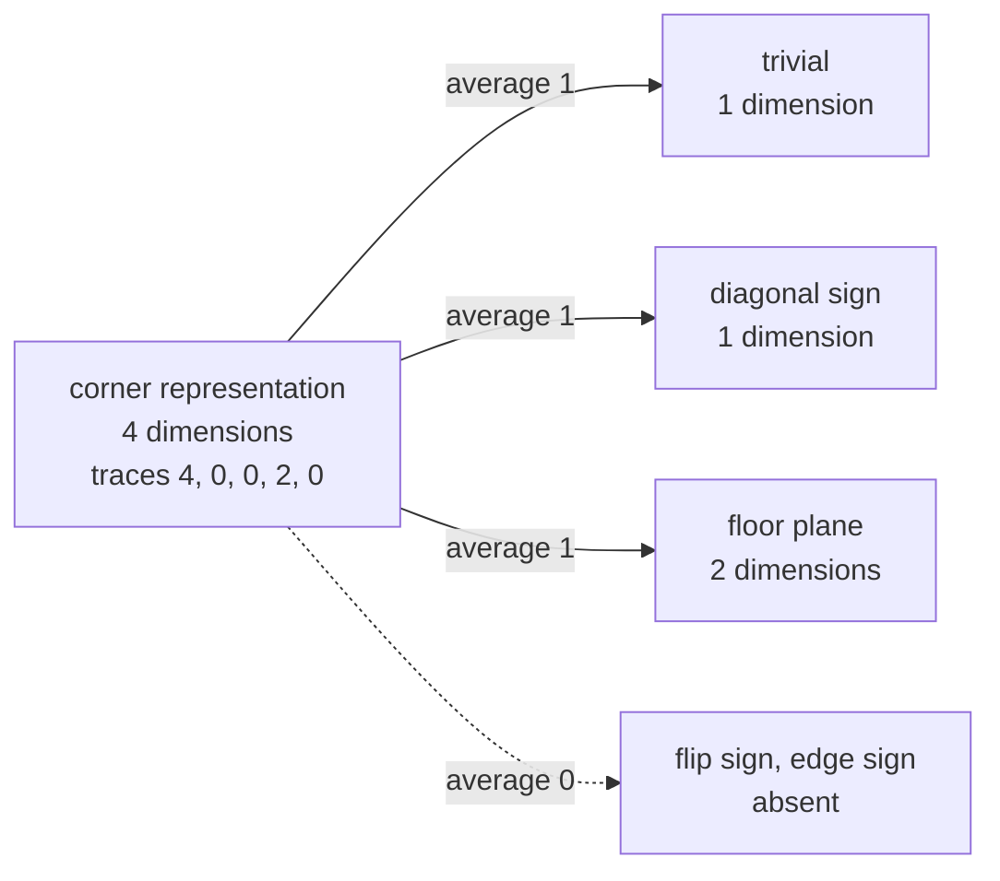

# Schur's lemma and orthogonality: a map between two irreducible pieces is zero or an isomorphism, so their traces are perpendicular

[Syllabus](../../../SYLLABUS.md) → [Algebra](../README.md) → [Group Representations](../README.md#s12) → Schur's lemma and orthogonality

---

## General Overview

A square tile drops into a square recess eight ways: four turns and four flips ([Conjugacy and the class equation](../08-Groups/10-conjugacy-and-the-class-equation.md)). Each move shuffles the tile's 4 corners. Written as 4 by 4 matrices of 0s and 1s, those shuffles are the **corner representation**: the group acting on 4 numbers, one per corner.

[Representations](01-representations-and-maschkes-theorem.md) splits it by hand into three pieces that cannot split further: the height line, the twist line and the 2-dimensional tilt plane. Here they are called trivial, diagonal sign and floor.

This card finds them with one number per move: the **trace**, the sum of a matrix's diagonal. For a corner shuffle it counts the corners left in place. Average that list against each piece's own list to count how often the piece appears: 1, 1 and 1.

Look-alike moves have equal traces. They form five **conjugacy classes**: doing nothing (1 move), the half turn (1), quarter turns (2), diagonal flips (2) and edge flips (2). In that order, the corner traces are 4, 0, 0, 2, 0.

**A map that respects the moves between two irreducible pieces is zero or an isomorphism, so the trace lists of different pieces are perpendicular, and averaging any representation's trace list against them counts its pieces.**

**What kind of fact this is:** a theorem, proved on this card in Why it works; the character and its inner product are definitions.

### The picture: one trace list, three pieces



Dimensions add 1 + 1 + 2 = 4. Trivial: every move acts as 1. Diagonal sign: quarter turns and edge flips act as −1. Flip sign: flips act as −1. Edge sign: quarter turns and diagonal flips act as −1.

---

## The formula

- A **representation** gives each move $`g`$ of a group $`G`$ an invertible matrix $`\rho(g)`$, with $`\rho(g h) = \rho(g)\rho(h)`$ ([Representations](01-representations-and-maschkes-theorem.md)). $`V`$ is the space the matrices act on, and $`d`$ its dimension.
- It is **irreducible** when no subspace except zero and all of $`V`$ is kept in place by every move.
- A **map that respects the moves** from $`V`$ to $`W`$ is a matrix $`T`$ with $`T\rho_V(g) = \rho_W(g)T`$ for every move: moving then mapping gives what mapping then moving gives.

**Schur's lemma** is two sentences:

```math
T\rho_V(g) = \rho_W(g)\,T \text{ for every } g, \ V \text{ and } W \text{ irreducible} \;\Longrightarrow\; T = 0 \text{ or } T \text{ is invertible}; \quad \text{and if } \rho_W = \rho_V, \ T = \lambda I
```

**Read it aloud:** a respectful map between two irreducible pieces is nothing or a perfect match; from a piece to itself it is a multiple of the identity matrix.

The **character** of a representation is its trace list, $`\chi_V(g) = \mathrm{tr}\,\rho_V(g)`$, the sum of the diagonal entries. The Greek letter $`\chi`$ (chi) also names the Euler characteristic in topology; the two are unrelated. Two characters $`\chi`$ and $`\psi`$ have an inner product, an average over the group:

```math
\langle \chi, \psi \rangle = \frac{1}{\lvert G\rvert} \sum_{g \text{ in } G} \chi(g)\,\psi(g^{-1}), \qquad \langle \chi_i, \chi_j \rangle = \delta_{ij}, \qquad m_i = \langle \chi_V, \chi_i \rangle
```

**Read it aloud:** average one character times the other at the undo, over all moves; two irreducible characters give 1 if they are the same piece and 0 if not, so this average counts a piece's copies.

On the tile every move shares a class with its undo, so $`\psi(g^{-1}) = \psi(g)`$. Weighting each class by its size, the corner character (4, 0, 0, 2, 0) against the trivial one (1, 1, 1, 1, 1) gives (1 × 4 + 2 × 2)/8 = 1. For groups with complex characters, $`\psi(g^{-1})`$ is the complex conjugate of $`\psi(g)`$ (the sign of its imaginary part flipped).

| Symbol | Plain meaning | In our example | Push it up and the answer… |
| --- | --- | --- | --- |
| $`G`$, $`\lvert G\rvert`$, $`g`$, $`h`$, $`g^{-1}`$ | the group, its size, two moves, the undo of $`g`$ | the tile's moves, 8 | more terms to average |
| $`\rho_V(g)`$, $`V`$, $`W`$, $`v`$, $`d`$ | a move's matrix, the space it acts on, a second space, a vector in $`V`$, its dimension | corner shuffles, 4 numbers, 4 | — |
| $`T`$, $`T_0`$, $`E`$, $`a`$, $`b`$, $`k`$, $`l`$ | a map between two representations; its group average; a single 1 at row $`a`$, column $`b`$; an entry's row and column | `[[3, 1], [4, 1]]`, before averaging | — |
| $`\lambda`$, $`I`$, $`p`$, $`q`$ | a plain number; the identity matrix; Step 2's matrix entries | 2, after averaging | a bigger multiple of $`I`$ |
| $`\chi_V`$, $`\mathrm{tr}`$, $`\psi`$ | the character: the trace list; a second character | corner: 4, 0, 0, 2, 0 | — |
| $`\langle \chi, \psi\rangle`$ | the inner product: the average over all moves | 8/8 = 1 | — |
| $`\delta_{ij}`$, $`i`$, $`j`$ | 1 when $`i = j`$, else 0; labels of irreducible pieces | 5 pieces on the tile | — |
| $`m_i`$ | copies of piece $`i`$ | 1 each: trivial, diagonal sign, floor | a bigger representation |

### When it holds

- **Irreducible on both sides.** The corner representation is not, and its map onto its fixed line respects the moves without being a multiple of $`I`$.
- **The complex numbers, for the second sentence.** It needs an eigenvalue. Over real numbers it can fail: the four turns alone keep no line in the floor plane, yet the quarter turn commutes with them and is no multiple of $`I`$.
- **A finite group.** The average divides by $`\lvert G\rvert`$.

---

## Why it works

### Step 0: what a respectful map destroys or reaches is itself kept

The vectors a respectful map $`T`$ sends to zero are its **kernel**; the vectors it reaches are its **image**. If $`T v = 0`$, then $`T\rho_V(g)v = \rho_W(g)Tv = 0`$, so every move keeps the kernel in place. The same line of algebra keeps the image in place.

An irreducible space has only two subspaces kept in place: zero and everything.

### Step 1: zero or a perfect match

The kernel of $`T`$ is zero or all of $`V`$. If it is all of $`V`$, $`T = 0`$.

Otherwise only zero is lost, and the image is a non-zero subspace of $`W`$ kept in place, so it is all of $`W`$. Losing nothing and reaching everything, $`T`$ is invertible: an **isomorphism**, a perfect match.

### Step 2: from a piece to itself, a plain number

Now let $`\rho_W = \rho_V`$: one piece on both sides. Over the complex numbers every square matrix has an eigenvalue $`\lambda`$: a number with $`Tv = \lambda v`$ for some non-zero vector $`v`$. It exists because the characteristic polynomial $`\det(T - \lambda I)`$ has a root ([The fundamental theorem of algebra](../10-For%20the%20Curious/01-fundamental-theorem-of-algebra.md), [Eigenvalues and eigenvectors](../07-Eigenvalues%20and%20Symmetric%20Matrices/02-eigenvalues-and-eigenvectors.md)).

Then $`T - \lambda I`$ also respects the moves and sends an eigenvector to zero, so it is not invertible. By Step 1, $`T - \lambda I = 0`$.

On the floor plane, a matrix commuting with the quarter turn `[[0, -1], [1, 0]]` has the form `[[p, -q], [q, p]]`. Commuting with the flip `[[1, 0], [0, -1]]` then forces $`q = 0`$. Only $`pI`$ survives: of the 625 matrices with entries from −2 to 2, exactly 5 commute with all 8 floor moves.

### Step 3: a character is the same on look-alike moves

Trace ignores the order of a product: $`\mathrm{tr}(AB) = \mathrm{tr}(BA)`$. So

```math
\chi(h g h^{-1}) = \mathrm{tr}\big(\rho(h)\,\rho(g)\rho(h)^{-1}\big) = \mathrm{tr}\big(\rho(g)\rho(h)^{-1}\rho(h)\big) = \chi(g)
```

Look-alike moves form a conjugacy class, so a character needs one value per class: 5 for the tile, not 8. At doing-nothing it is the trace of $`I`$, the dimension $`d`$.

A shuffle matrix has a diagonal 1 exactly where a corner stays put, so the corner character counts fixed corners: 4, 0, 0, 2, 0.

### Step 4: averaging any map makes a respectful one

Take any matrix $`T`$ from $`V`$ to $`W`$, and average it around the group:

```math
T_0 = \frac{1}{\lvert G\rvert}\sum_{g \text{ in } G} \rho_W(g)\,T\,\rho_V(g^{-1})
```

Replacing $`g`$ by $`hg`$ reorders the sum, so $`T_0`$ respects the moves, and Schur's lemma decides it:

- **Different pieces,** with no isomorphism between them: $`T_0 = 0`$. From the floor to the trivial piece, the row `[5, 7]` averages to `[0, 0]`.
- **The same piece:** $`T_0 = \lambda I`$, and the trace is unchanged by averaging, so $`\lambda = \mathrm{tr}\,T / d`$. On the floor, `[[3, 1], [4, 1]]` has trace 4 and averages to `[[2, 0], [0, 2]]`, that is 4/2 = 2 times $`I`$.

Choose $`T`$ with a single 1 in it and add entries along the diagonal: the averages of entries become averages of traces, the orthogonality relation.

<details>
<summary>Detailed proof: from averaged maps to the inner product of characters</summary>

Let $`E`$ be the matrix with a 1 in row $`a`$, column $`b`$, and 0 elsewhere. Entry $`(k, l)`$ of the average of $`E`$ is

$`\displaystyle \frac{1}{\lvert G\rvert}\sum_{g} \rho_W(g)_{ka}\,\rho_V(g^{-1})_{bl}`$

If $`V`$ and $`W`$ are different irreducible pieces, Step 4 makes this 0. Put $`k = a`$, $`l = b`$ and add over all $`a`$ and $`b`$: the diagonal sums are $`\chi_W(g)`$ and $`\chi_V(g^{-1})`$, so

$`\displaystyle \frac{1}{\lvert G\rvert}\sum_{g} \chi_W(g)\,\chi_V(g^{-1}) = 0`$

If $`\rho_W = \rho_V`$ with dimension $`d`$, the average of $`E`$ is $`(\mathrm{tr}\,E/d)\,I`$. Putting $`k = a`$, $`l = b`$ again, entry $`(a, b)`$ is $`1/d`$ when $`a = b`$ and 0 otherwise. Adding the $`d`$ diagonal terms gives $`d \times 1/d`$:

$`\displaystyle \frac{1}{\lvert G\rvert}\sum_{g} \chi_V(g)\,\chi_V(g^{-1}) = 1`$

Those two lines are $`\langle \chi_i, \chi_j\rangle = \delta_{ij}`$.

</details>

### Step 5: decompose by inner products

Maschke's theorem ([Representations](01-representations-and-maschkes-theorem.md)) splits every representation into irreducible pieces: $`m_1`$ copies of the first, $`m_2`$ of the second, and so on. In a basis that follows the split, each matrix is block-diagonal (one square block per piece, zeros elsewhere), so traces add:

```math
\chi_V = m_1\chi_1 + m_2\chi_2 + \cdots \quad\Longrightarrow\quad \langle \chi_V, \chi_j\rangle = m_j, \qquad \langle \chi_V, \chi_V\rangle = m_1^2 + m_2^2 + \cdots
```

**Read it aloud:** against one piece the inner product returns that piece's copy count; against itself, the sum of squared counts.

So the trace list alone decides the split. The corner character gives 24/8 = 3 = 1 + 1 + 1: three different pieces, each once.

---

## Worked numbers, by hand

Classes in the overview's order, sizes 1, 1, 2, 2, 2. Each value is weighted by its class size.

| Step | Arithmetic | Value |
| --- | --- | --- |
| corner character | fixed corners per class | 4, 0, 0, 2, 0 |
| against trivial (1, 1, 1, 1, 1) | (1 × 4 + 2 × 2 × 1)/8 | 8/8 = 1 |
| against diagonal sign (1, 1, −1, 1, −1) | (1 × 4 + 2 × 2 × 1)/8 | 8/8 = 1 |
| against floor (2, −2, 0, 0, 0) | (1 × 4 × 2)/8 | 8/8 = 1 |
| against flip sign (1, 1, 1, −1, −1) | (1 × 4 − 2 × 2 × 1)/8 | 0 |
| against edge sign (1, 1, −1, −1, 1) | (1 × 4 − 2 × 2 × 1)/8 | 0 |
| corner against itself | (4 × 4 + 2 × 2 × 2)/8 | 24/8 = 3 |
| dimensions | 1 + 1 + 2 | **4: trivial + diagonal sign + floor** |

The corner representation holds three different pieces, once each, read from 5 traces.

### What breaks if you drop a piece

| Mistake | Comes out at | What went wrong |
| --- | --- | --- |
| Class sizes dropped, against trivial | 6/8 = 0.75 | The two diagonal flips each count; a copy count must be whole |
| Divided by 5 classes, not 8 moves | 8/5 = 1.6 | The average is over moves, not over classes |
| Against trivial + floor (3, −1, 1, 1, 1) | 2 | Not irreducible: the 2 is one copy each of two pieces |

---

## Code, from first principles, and it actually runs

The 8 moves come from multiplying the quarter turn and the flip until nothing new appears, the classes from conjugating every move by every move. Each inner product takes two roads: by classes with class sizes, and by moves with each undo found by search. Schur's lemma is checked by averaging two maps and by brute force over 625 integer matrices.

### Python

```python
# Schur's lemma and character orthogonality -- the check behind the card.  Nothing
# is imported.  The tile's 8 moves are built from the quarter turn R and the flip
# F as 2 by 2 matrices; each move also shuffles the 4 corners, a 4 by 4 matrix.
def mul(a, b):
    return tuple(tuple(sum(a[i][k] * b[k][j] for k in range(len(b)))
                       for j in range(len(b[0]))) for i in range(len(a)))

def tr(m):
    return sum(m[i][i] for i in range(len(m)))
I2, R, F = ((1, 0), (0, 1)), ((0, -1), (1, 0)), ((1, 0), (0, -1))
G = [I2]
for g in G:                                   # close up under R and F
    G += [h for h in (mul(R, g), mul(F, g)) if h not in G]
inv = {g: next(h for h in G if mul(g, h) == I2) for g in G}
CORNERS = [(-1, 1), (1, 1), (1, -1), (-1, -1)]  # clockwise from top left
act = lambda g, p: (g[0][0] * p[0] + g[0][1] * p[1], g[1][0] * p[0] + g[1][1] * p[1])
corner = lambda g: tuple(tuple(int(act(g, CORNERS[j]) == CORNERS[i]) for j in range(4)) for i in range(4))
det = lambda g: g[0][0] * g[1][1] - g[0][1] * g[1][0]
def diag_sign(g):                             # how g acts on (1, -1, 1, -1)
    s = [1, -1, 1, -1]
    v = [sum(c * x for c, x in zip(row, s)) for row in corner(g)]
    assert v in (s, [-x for x in s])
    return v[0]
name = lambda g: 0 if g == I2 else 1 if tr(g) == -2 else 2 if det(g) == 1 else 3 if g[0][0] == 0 else 4
classes = sorted({frozenset(mul(mul(h, g), inv[h]) for h in G) for g in G}, key=lambda c: name(min(c)))
assert all({name(g) for g in c} == {k} for k, c in enumerate(classes))   # conjugation agrees with names
size, rep = [len(c) for c in classes], [min(c) for c in classes]
chars = {"trivial": lambda g: 1, "flip sign": det, "diagonal sign": diag_sign,
         "edge sign": lambda g: det(g) * diag_sign(g), "floor": tr}
by_classes = lambda a, b: sum(n * a(g) * b(g) for n, g in zip(size, rep))   # 8 x inner product
by_moves = lambda a, b: sum(a(g) * b(inv[g]) for g in G)                     # every move, b at the undo
chi = lambda g: tr(corner(g))
print(f"{len(G)} moves; classes by conjugation, sizes {size}")
print(f"corner character, trace of each shuffle: {[chi(g) for g in rep]}")
for k, (n, a) in enumerate(chars.items()):
    row = [by_classes(a, b) for b in chars.values()]
    assert row == [by_moves(a, b) for b in chars.values()] == [8 * (j == k) for j in range(5)]   # two roads; 8 x identity
    print(f"{n:13} {[a(g) for g in rep]}  8 x inner products: {row}")
m = [by_classes(chi, b) // 8 for b in chars.values()]
assert [by_moves(chi, b) for b in chars.values()] == [8 * x for x in m]
print(f"corner against each, by classes and by moves: {[by_classes(chi, b) for b in chars.values()]} / 8 = {m}")
dims = sum(x * a(I2) for x, a in zip(m, chars.values()))
print(f"<corner, corner> = {by_classes(chi, chi)}/8 = {by_classes(chi, chi) // 8}; dimensions {dims}")
T, S = ((3, 1), (4, 1)), ((5, 7),)
avg = [[sum(mul(mul(g, T), inv[g])[i][j] for g in G) // 8 for j in range(2)] for i in range(2)]
print(f"Schur average, floor to floor, of {[list(r) for r in T]}: {avg}, trace {tr(T)}/2 = {tr(T) // 2}")
avg_s = [sum(mul(S, inv[g])[0][j] for g in G) for j in range(2)]          # 8 x the average, floor to trivial
print(f"Schur average, floor to trivial, of {list(S[0])}: {[v // 8 for v in avg_s]}")
grid = [((a, b), (c, d)) for a in range(-2, 3) for b in range(-2, 3) for c in range(-2, 3) for d in range(-2, 3)]
comm = [t for t in grid if all(mul(t, g) == mul(g, t) for g in G)]
print(f"of {len(grid)} small matrices, {len(comm)} commute with all 8 floor moves: {[t[0][0] for t in comm]} times I")
print(f"mistake 1, class sizes dropped: {sum(chi(g) for g in rep)} / 8 = {sum(chi(g) for g in rep) / 8}")
print(f"mistake 2, divided by 5 classes: 8 / 5 = {by_classes(chi, chars['trivial']) / 5}")
pair = lambda g: 1 + tr(g)                     # trivial and floor together, not irreducible
print(f"mistake 3, against trivial + floor {[pair(g) for g in rep]}: {by_classes(chi, pair) // 8}")
assert size == [1, 1, 2, 2, 2] and m == [1, 0, 1, 0, 1] and dims == 4            # corner = trivial + diagonal sign + floor
assert by_classes(chi, chi) == 8 * sum(x * x for x in m)                         # <chi, chi> = sum of squares
assert avg == [[2, 0], [0, 2]] and avg_s == [0, 0] and [t[0][0] for t in comm] == [-2, -1, 0, 1, 2]  # Schur: trace / 2, or 0
assert all(t[0][1] == t[1][0] == 0 and t[0][0] == t[1][1] for t in comm)        # only multiples of I commute
print("ALL CHECKS PASS")
```

**Ran 2026-11-23 on macOS, Python 3.14.10, standard library only. All checks passed. Output, pasted from the run:**

```
8 moves; classes by conjugation, sizes [1, 1, 2, 2, 2]
corner character, trace of each shuffle: [4, 0, 0, 2, 0]
trivial       [1, 1, 1, 1, 1]  8 x inner products: [8, 0, 0, 0, 0]
flip sign     [1, 1, 1, -1, -1]  8 x inner products: [0, 8, 0, 0, 0]
diagonal sign [1, 1, -1, 1, -1]  8 x inner products: [0, 0, 8, 0, 0]
edge sign     [1, 1, -1, -1, 1]  8 x inner products: [0, 0, 0, 8, 0]
floor         [2, -2, 0, 0, 0]  8 x inner products: [0, 0, 0, 0, 8]
corner against each, by classes and by moves: [8, 0, 8, 0, 8] / 8 = [1, 0, 1, 0, 1]
<corner, corner> = 24/8 = 3; dimensions 4
Schur average, floor to floor, of [[3, 1], [4, 1]]: [[2, 0], [0, 2]], trace 4/2 = 2
Schur average, floor to trivial, of [5, 7]: [0, 0]
of 625 small matrices, 5 commute with all 8 floor moves: [-2, -1, 0, 1, 2] times I
mistake 1, class sizes dropped: 6 / 8 = 0.75
mistake 2, divided by 5 classes: 8 / 5 = 1.6
mistake 3, against trivial + floor [3, -1, 1, 1, 1]: 2
ALL CHECKS PASS
```

### Rust

Same numbers and labels; built with `rustc --edition 2021 -O`.

```rust
// Schur's lemma and character orthogonality -- the same check as the Python, in
// Rust.  No crates.  The tile's 8 moves are built from the quarter turn R and the
// flip F as 2 by 2 matrices; each move also shuffles the 4 corners, a 4 by 4 matrix.
type M = Vec<Vec<i64>>; type Ch = Box<dyn Fn(&M) -> i64>;
fn mul(a: &M, b: &M) -> M {
    (0..a.len()).map(|i| (0..b[0].len()).map(|j| (0..b.len()).map(|k| a[i][k] * b[k][j]).sum()).collect()).collect()
}
fn tr(m: &M) -> i64 { (0..m.len()).map(|i| m[i][i]).sum() }
fn det(g: &M) -> i64 { g[0][0] * g[1][1] - g[0][1] * g[1][0] }
const CORNERS: [(i64, i64); 4] = [(-1, 1), (1, 1), (1, -1), (-1, -1)]; // clockwise from top left
fn corner(g: &M) -> M {                          // column j: where corner j lands
    let act = |p: (i64, i64)| (g[0][0] * p.0 + g[0][1] * p.1, g[1][0] * p.0 + g[1][1] * p.1);
    (0..4).map(|i| (0..4).map(|j| (act(CORNERS[j]) == CORNERS[i]) as i64).collect()).collect()
}
fn diag_sign(g: &M) -> i64 {                     // how g acts on (1, -1, 1, -1)
    let s = vec![1, -1, 1, -1];
    let v: Vec<i64> = corner(g).iter().map(|row| row.iter().zip(&s).map(|(c, x)| c * x).sum()).collect();
    assert!(v == s || v == s.iter().map(|x| -x).collect::<Vec<i64>>());
    v[0]
}
fn name(g: &M) -> usize { if tr(g) == 2 { 0 } else if tr(g) == -2 { 1 } else if det(g) == 1 { 2 } else if g[0][0] == 0 { 3 } else { 4 } }
fn main() {
    let (i2, r, f): (M, M, M) = (vec![vec![1, 0], vec![0, 1]], vec![vec![0, -1], vec![1, 0]], vec![vec![1, 0], vec![0, -1]]);
    let (mut g_all, mut n): (Vec<M>, usize) = (vec![i2.clone()], 0);
    while n < g_all.len() {                      // close up under R and F
        for h in [mul(&r, &g_all[n]), mul(&f, &g_all[n])] { if !g_all.contains(&h) { g_all.push(h) } }
        n += 1;
    }
    let inv = |g: &M| -> M { g_all.iter().find(|h| mul(g, h) == i2).unwrap().clone() };
    let mut classes: Vec<Vec<M>> = Vec::new();
    for g in &g_all {
        let mut c: Vec<M> = Vec::new();
        for h in &g_all { let x = mul(&mul(h, g), &inv(h)); if !c.contains(&x) { c.push(x) } }
        c.sort();
        if !classes.contains(&c) { classes.push(c) }
    }
    classes.sort_by_key(|c| name(&c[0]));
    assert!(classes.iter().enumerate().all(|(k, c)| c.iter().all(|g| name(g) == k))); // conjugation agrees with names
    let (size, rep): (Vec<i64>, Vec<M>) = (classes.iter().map(|c| c.len() as i64).collect(), classes.iter().map(|c| c[0].clone()).collect());
    let chars: Vec<(&str, Ch)> = vec![("trivial", Box::new(|_: &M| 1)), ("flip sign", Box::new(det)),
        ("diagonal sign", Box::new(diag_sign)), ("edge sign", Box::new(|g: &M| det(g) * diag_sign(g))), ("floor", Box::new(tr))];
    let by_classes = |a: &dyn Fn(&M) -> i64, b: &dyn Fn(&M) -> i64| -> i64 { size.iter().zip(&rep).map(|(n, g)| n * a(g) * b(g)).sum() };
    let by_moves = |a: &dyn Fn(&M) -> i64, b: &dyn Fn(&M) -> i64| -> i64 { g_all.iter().map(|g| a(g) * b(&inv(g))).sum() };
    let chi = |g: &M| tr(&corner(g));
    let on = |a: &dyn Fn(&M) -> i64| -> Vec<i64> { rep.iter().map(|g| a(g)).collect() };
    println!("{} moves; classes by conjugation, sizes {:?}", g_all.len(), size);
    println!("corner character, trace of each shuffle: {:?}", on(&chi));
    for (k, (n, a)) in chars.iter().enumerate() {
        let row: Vec<i64> = chars.iter().map(|(_, b)| by_classes(a, b)).collect();
        assert!(row == chars.iter().map(|(_, b)| by_moves(a, b)).collect::<Vec<i64>>() && row == (0..5).map(|j| 8 * (j == k) as i64).collect::<Vec<i64>>()); // two roads; 8 x identity
        println!("{:13} {:?}  8 x inner products: {:?}", n, on(a), row);
    }
    let raw: Vec<i64> = chars.iter().map(|(_, b)| by_classes(&chi, b)).collect();
    let m: Vec<i64> = raw.iter().map(|x| x / 8).collect();
    assert!(chars.iter().map(|(_, b)| by_moves(&chi, b)).collect::<Vec<i64>>() == m.iter().map(|x| 8 * x).collect::<Vec<i64>>());
    println!("corner against each, by classes and by moves: {:?} / 8 = {:?}", raw, m);
    let dims: i64 = m.iter().zip(&chars).map(|(x, (_, a))| x * a(&i2)).sum();
    println!("<corner, corner> = {}/8 = {}; dimensions {}", by_classes(&chi, &chi), by_classes(&chi, &chi) / 8, dims);
    let (t, s): (M, M) = (vec![vec![3, 1], vec![4, 1]], vec![vec![5, 7]]);
    let avg: M = (0..2).map(|i| (0..2).map(|j| g_all.iter().map(|g| mul(&mul(g, &t), &inv(g))[i][j]).sum::<i64>() / 8).collect()).collect();
    println!("Schur average, floor to floor, of {:?}: {:?}, trace {}/2 = {}", t, avg, tr(&t), tr(&t) / 2);
    let avg_s: Vec<i64> = (0..2).map(|j| g_all.iter().map(|g| mul(&s, &inv(g))[0][j]).sum::<i64>()).collect(); // 8 x the average
    println!("Schur average, floor to trivial, of {:?}: {:?}", s[0], avg_s.iter().map(|v| v / 8).collect::<Vec<i64>>());
    let mut grid: Vec<M> = Vec::new();
    for a in -2..3 { for b in -2..3 { for c in -2..3 { for d in -2..3 { grid.push(vec![vec![a, b], vec![c, d]]) } } } }
    let comm: Vec<&M> = grid.iter().filter(|t| g_all.iter().all(|g| mul(t, g) == mul(g, t))).collect();
    let diag: Vec<i64> = comm.iter().map(|t| t[0][0]).collect();
    println!("of {} small matrices, {} commute with all 8 floor moves: {:?} times I", grid.len(), comm.len(), diag);
    let dropped: i64 = rep.iter().map(|g| chi(g)).sum();
    println!("mistake 1, class sizes dropped: {} / 8 = {}", dropped, dropped as f64 / 8.0);
    println!("mistake 2, divided by 5 classes: 8 / 5 = {}", by_classes(&chi, &chars[0].1) as f64 / 5.0);
    let pair = |g: &M| 1 + tr(g);                // trivial and floor together, not irreducible
    println!("mistake 3, against trivial + floor {:?}: {}", on(&pair), by_classes(&chi, &pair) / 8);
    assert!(size == vec![1, 1, 2, 2, 2] && m == vec![1, 0, 1, 0, 1] && dims == 4); // corner = trivial + diagonal sign + floor
    assert!(by_classes(&chi, &chi) == 8 * m.iter().map(|x| x * x).sum::<i64>()); // <chi, chi> = sum of squares
    assert!(avg == vec![vec![2, 0], vec![0, 2]] && avg_s == vec![0, 0] && diag == vec![-2, -1, 0, 1, 2]); // Schur: trace / 2, or 0
    assert!(comm.iter().all(|t| t[0][1] == 0 && t[1][0] == 0 && t[0][0] == t[1][1])); // only multiples of I commute
    println!("ALL CHECKS PASS");
}
```

**Ran 2026-11-23 on macOS, rustc 1.98.1, no crates. All checks passed. Output, pasted from the run:**

```
8 moves; classes by conjugation, sizes [1, 1, 2, 2, 2]
corner character, trace of each shuffle: [4, 0, 0, 2, 0]
trivial       [1, 1, 1, 1, 1]  8 x inner products: [8, 0, 0, 0, 0]
flip sign     [1, 1, 1, -1, -1]  8 x inner products: [0, 8, 0, 0, 0]
diagonal sign [1, 1, -1, 1, -1]  8 x inner products: [0, 0, 8, 0, 0]
edge sign     [1, 1, -1, -1, 1]  8 x inner products: [0, 0, 0, 8, 0]
floor         [2, -2, 0, 0, 0]  8 x inner products: [0, 0, 0, 0, 8]
corner against each, by classes and by moves: [8, 0, 8, 0, 8] / 8 = [1, 0, 1, 0, 1]
<corner, corner> = 24/8 = 3; dimensions 4
Schur average, floor to floor, of [[3, 1], [4, 1]]: [[2, 0], [0, 2]], trace 4/2 = 2
Schur average, floor to trivial, of [5, 7]: [0, 0]
of 625 small matrices, 5 commute with all 8 floor moves: [-2, -1, 0, 1, 2] times I
mistake 1, class sizes dropped: 6 / 8 = 0.75
mistake 2, divided by 5 classes: 8 / 5 = 1.6
mistake 3, against trivial + floor [3, -1, 1, 1, 1]: 2
ALL CHECKS PASS
```

### Lean

Lean proves Schur's lemma, orthogonality and decomposition for every finite group acting by complex matrices, then rechecks the tile's numbers.

- Take a map $`T`$ that respects the moves between two irreducible representations. Then $`T = 0`$ or $`T`$ is invertible.
- Take a map that respects the moves from an irreducible piece to itself. Then it is a plain number $`\lambda`$ times $`I`$.
- Take two irreducible characters $`\chi_i`$ and $`\chi_j`$. Then $`\langle \chi_i, \chi_j \rangle`$ is 1 if an isomorphism matches the pieces, and 0 if not.
- Suppose a representation splits into irreducible pieces. Then its inner product with an irreducible character $`\chi_i`$ is $`m_i`$, the copies of piece $`i`$.
- The corner character is 4, 0, 0, 2, 0. Its inner products with trivial, floor and itself are 1, 1 and 3.
- By classes, the corner character gives 1, 1, 1, 0, 0 against trivial, diagonal sign, floor, flip sign and edge sign.
- Take the matrix `[[3, 1], [4, 1]]`. Then its average over the 8 floor moves is `[[2, 0], [0, 2]]`.
- Take the 625 matrices with entries from −2 to 2. Then exactly 5 commute with all 8 floor moves.

The Python and Rust checks build the moves and classes from scratch, test the full table of five characters, and rerun the mistakes.

```lean
-- Schur's lemma and orthogonality: a map that respects the moves between two irreducible complex representations of a finite group is zero or invertible (and a multiple of the identity from a piece to itself), so irreducible characters are orthonormal and the inner product of characters counts copies of each piece.
import Mathlib.RepresentationTheory.Character
import Mathlib.RepresentationTheory.Irreducible
import Mathlib.Analysis.Complex.Polynomial.Basic
import Mathlib.Algebra.DirectSum.Module
import Mathlib.GroupTheory.SpecificGroups.Dihedral
import Mathlib.Data.Matrix.Mul
import Mathlib.Order.Interval.Finset.Defs
import Mathlib.Data.Int.Interval

open Representation DihedralGroup

namespace SchursLemmaAndCharacterOrthogonality

variable {G V W : Type*} [Group G] [Fintype G]
  [AddCommGroup V] [Module ℂ V] [FiniteDimensional ℂ V]
  [AddCommGroup W] [Module ℂ W] [FiniteDimensional ℂ W]

/-- The character of a direct sum is the sum of the characters. -/
lemma char_directSum {ι : Type*} [Fintype ι] [DecidableEq ι] {U : ι → Type*}
    [∀ i, AddCommGroup (U i)] [∀ i, Module ℂ (U i)] [∀ i, FiniteDimensional ℂ (U i)]
    (τ : ∀ i, Representation ℂ G (U i)) (g : G) :
    (Representation.directSum τ).character g = ∑ i, (τ i).character g := by
  have h : (Representation.directSum τ) g = ∑ i, (DirectSum.lof ℂ ι U i) ∘ₗ (τ i g) ∘ₗ
      (DirectSum.component ℂ ι U i) := by
    ext x j
    simp [DirectSum.component]
    rw [Finset.sum_eq_single x]
    · simp only [DirectSum.lof_eq_of]
      erw [DFinsupp.lapply_apply, DirectSum.of_eq_same]
    · intro b _ hb
      simp only [DirectSum.lof_eq_of]
      erw [DFinsupp.lapply_apply, DirectSum.of_eq_of_ne _ _ _ hb]
      simp
    · simp
  rw [character, h, map_sum]
  refine Finset.sum_congr rfl fun i _ => ?_
  rw [LinearMap.trace_comp_comm', LinearMap.comp_assoc]
  have hc : DirectSum.component ℂ ι U i ∘ₗ DirectSum.lof ℂ ι U i = LinearMap.id := by
    ext y; simp
  rw [hc, LinearMap.comp_id]
  rfl

#print axioms char_directSum

/-- **Schur's lemma.** For a finite group acting by complex matrices on `V` and `W`, both
irreducible, a map `T` from `V` to `W` with `T ρ_V(g) = ρ_W(g) T` for every move `g` is zero or
invertible; and a map `S` from `V` to itself that respects the moves is a plain number `λ` times
the identity. -/
theorem schurs_lemma (ρ : Representation ℂ G V) (σ : Representation ℂ G W)
    [ρ.IsIrreducible] [σ.IsIrreducible]
    (T : V →ₗ[ℂ] W) (hT : ∀ g : G, T ∘ₗ ρ g = σ g ∘ₗ T) :
    (T = 0 ∨ Function.Bijective T) ∧
      ∀ S : V →ₗ[ℂ] V, (∀ g : G, S ∘ₗ ρ g = ρ g ∘ₗ S) →
        ∃ c : ℂ, S = c • LinearMap.id := by
  refine ⟨?_, fun S hS => ?_⟩
  · let f : IntertwiningMap ρ σ := ⟨T, hT⟩
    rcases IsIrreducible.bijective_or_eq_zero f with h | h
    · exact Or.inr h
    · left
      have := congrArg IntertwiningMap.toLinearMap h
      exact this
  · let f : IntertwiningMap ρ ρ := ⟨S, hS⟩
    obtain ⟨c, hc⟩ := (IsIrreducible.algebraMap_intertwiningMap_bijective_of_isAlgClosed
      (ρ := ρ)).2 f
    refine ⟨c, ?_⟩
    ext v
    have := congrArg (fun F : IntertwiningMap ρ ρ => F v) hc
    exact this.symm

open scoped Classical in
/-- **Orthogonality of characters.** For two irreducible complex representations of a finite
group, the average over all moves of `χ_V(g) χ_W(g⁻¹)` is 1 when they are the same piece (an
isomorphism respecting the moves joins them) and 0 when they are different pieces:
`⟨χ_i, χ_j⟩ = δ_ij`. -/
theorem character_orthogonality (ρ : Representation ℂ G V) (σ : Representation ℂ G W)
    [ρ.IsIrreducible] [σ.IsIrreducible] :
    (Fintype.card G : ℂ)⁻¹ * ∑ g : G, ρ.character g * σ.character g⁻¹ =
      if Nonempty (ρ.Equiv σ) then 1 else 0 := by
  have : Invertible (Nat.card G : ℂ) := invertibleOfNonzero (by simp)
  rw [Fintype.card_eq_nat_card, char_orthonormal]
  have : Nonempty (σ.Equiv ρ) ↔ Nonempty (ρ.Equiv σ) :=
    ⟨fun ⟨e⟩ => ⟨e.symm⟩, fun ⟨e⟩ => ⟨e.symm⟩⟩
  simp [this]

open scoped Classical in
/-- **Decomposition by inner products.** If a complex representation `V` of a finite group splits
(respecting the moves) as a direct sum of irreducible pieces `U i`, then for any irreducible
representation `W` the inner product `⟨χ_V, χ_W⟩` is the number of pieces `U i` that are copies
of `W`: `m_W = ⟨χ_V, χ_W⟩`. -/
theorem inner_product_counts_copies {ι : Type*} [Fintype ι] [DecidableEq ι] {U : ι → Type*}
    [∀ i, AddCommGroup (U i)] [∀ i, Module ℂ (U i)] [∀ i, FiniteDimensional ℂ (U i)]
    (τ : ∀ i, Representation ℂ G (U i)) [∀ i, (τ i).IsIrreducible]
    (ρ : Representation ℂ G V) (e : ρ.Equiv (Representation.directSum τ))
    (σ : Representation ℂ G W) [σ.IsIrreducible] :
    (Fintype.card G : ℂ)⁻¹ * ∑ g : G, ρ.character g * σ.character g⁻¹ =
      ((Finset.univ.filter fun i => Nonempty ((τ i).Equiv σ)).card : ℂ) := by
  rw [char_iso e]
  simp_rw [char_directSum, Finset.sum_mul]
  rw [Finset.sum_comm, Finset.mul_sum]
  simp_rw [character_orthogonality]
  rw [Finset.sum_boole]

/-! ### The card's worked numbers on the square tile

The tile group is `DihedralGroup 4`: `r k` is the turn by `k` quarter turns and `sr k` a flip.
The corners are numbered 0 to 3 round the tile, as `ZMod 4`. -/

/-- Where the move `g` sends corner `i`. -/
def cornerMove : DihedralGroup 4 → ZMod 4 → ZMod 4
  | r k, i => i + k
  | sr k, i => k - i

/-- The corner character: the trace of a corner shuffle, which counts the corners left in place. -/
def cornerChar (g : DihedralGroup 4) : ℤ :=
  ((Finset.univ.filter fun i : ZMod 4 => cornerMove g i = i).card : ℤ)

/-- The corner character on the five classes (identity, half turn, quarter turns, diagonal flips,
edge flips) is 4, 0, 0, 2, 0. -/
example : cornerChar (r 0) = 4 ∧ cornerChar (r 2) = 0 ∧ cornerChar (r 1) = 0 ∧
    cornerChar (r 3) = 0 ∧ cornerChar (sr 0) = 2 ∧ cornerChar (sr 2) = 2 ∧
    cornerChar (sr 1) = 0 ∧ cornerChar (sr 3) = 0 := by decide

/-- The floor plane's moves as 2 by 2 matrices: the quarter turn `[[0, -1], [1, 0]]` to the power
`k`, and that times the flip `[[1, 0], [0, -1]]`. -/
def floorMat : DihedralGroup 4 → Matrix (Fin 2) (Fin 2) ℤ
  | r k => !![0, -1; 1, 0] ^ k.val
  | sr k => !![0, -1; 1, 0] ^ k.val * !![1, 0; 0, -1]

/-- The floor character, the trace of each floor matrix. -/
def floorChar (g : DihedralGroup 4) : ℤ := (floorMat g).trace

/-- The inner product over the 8 moves is the sum of `χ(g) ψ(g⁻¹)`, divided by 8.
Corner against trivial: 8/8 = 1. -/
example : ∑ g : DihedralGroup 4, cornerChar g * 1 = 8 := by decide

/-- Corner against the floor character (2, -2, 0, 0, 0): 8/8 = 1. -/
example : ∑ g : DihedralGroup 4, cornerChar g * floorChar g⁻¹ = 8 := by decide

/-- Corner against itself: 24/8 = 3, the sum of squared counts 1 + 1 + 1. -/
example : ∑ g : DihedralGroup 4, cornerChar g * cornerChar g⁻¹ = 24 := by decide

/-- By classes with class sizes 1, 1, 2, 2, 2: against trivial, diagonal sign, floor, flip sign
and edge sign the corner character (4, 0, 0, 2, 0) gives 1, 1, 1, 0, 0. -/
example :
    ((1 * 4 * 1 + 1 * 0 * 1 + 2 * 0 * 1 + 2 * 2 * 1 + 2 * 0 * 1 : ℤ) : ℚ) / 8 = 1 ∧
    ((1 * 4 * 1 + 1 * 0 * 1 + 2 * 0 * (-1) + 2 * 2 * 1 + 2 * 0 * (-1) : ℤ) : ℚ) / 8 = 1 ∧
    ((1 * 4 * 2 + 1 * 0 * (-2) + 2 * 0 * 0 + 2 * 2 * 0 + 2 * 0 * 0 : ℤ) : ℚ) / 8 = 1 ∧
    ((1 * 4 * 1 + 1 * 0 * 1 + 2 * 0 * 1 + 2 * 2 * (-1) + 2 * 0 * (-1) : ℤ) : ℚ) / 8 = 0 ∧
    ((1 * 4 * 1 + 1 * 0 * 1 + 2 * 0 * (-1) + 2 * 2 * (-1) + 2 * 0 * 1 : ℤ) : ℚ) / 8 = 0 ∧
    ((1 * 4 * 4 + 1 * 0 * 0 + 2 * 0 * 0 + 2 * 2 * 2 + 2 * 0 * 0 : ℤ) : ℚ) / 8 = 3 := by
  norm_num

/-- Step 4 on the floor: averaging `[[3, 1], [4, 1]]` over the 8 moves gives `[[2, 0], [0, 2]]`,
trace 4 divided by dimension 2 times the identity (the sum is 8 times that). -/
example : ∑ g : DihedralGroup 4, floorMat g * !![3, 1; 4, 1] * floorMat g⁻¹ = !![16, 0; 0, 16] := by
  decide

/-- Step 2 on the floor: of the 625 matrices with entries from -2 to 2, exactly 5 commute with all
8 floor moves. -/
example : ((Finset.Icc (-2 : ℤ) 2 ×ˢ Finset.Icc (-2 : ℤ) 2 ×ˢ Finset.Icc (-2 : ℤ) 2 ×ˢ
    Finset.Icc (-2 : ℤ) 2).filter fun x : ℤ × ℤ × ℤ × ℤ =>
      ∀ g : DihedralGroup 4, !![x.1, x.2.1; x.2.2.1, x.2.2.2] * floorMat g =
        floorMat g * !![x.1, x.2.1; x.2.2.1, x.2.2.2]).card = 5 := by
  decide

#print axioms schurs_lemma
#print axioms character_orthogonality
#print axioms inner_product_counts_copies

end SchursLemmaAndCharacterOrthogonality
```

**Checked 2026-11-23 on macOS, Lean 4.36.0-rc2, Mathlib v4.36.0-rc2. Every proof is complete and uses only Lean's standard axioms. Output, pasted from the run:**

```
'SchursLemmaAndCharacterOrthogonality.char_directSum' depends on axioms: [propext, Classical.choice, Quot.sound]
'SchursLemmaAndCharacterOrthogonality.schurs_lemma' depends on axioms: [propext, Classical.choice, Quot.sound]
'SchursLemmaAndCharacterOrthogonality.character_orthogonality' depends on axioms: [propext, Classical.choice, Quot.sound]
'SchursLemmaAndCharacterOrthogonality.inner_product_counts_copies' depends on axioms: [propext, Classical.choice, Quot.sound]
```

> [!TIP]
> **Try changing**
> Guess first. The asserts are pinned to the card's numbers.
> - **Same piece.** Set `T` to `((1, 5), (0, 7))`. Answer: `[[4, 0], [0, 4]]`, trace 8/2 = 4; an assert stops it.
> - **A line that is no piece.** In `diag_sign`, set `s` to `[1, 1, -1, -1]`. Answer: its assert stops it; a quarter turn does not send that vector to plus or minus itself.
> - **A wider search.** Change every `range(-2, 3)` to `range(-3, 4)`. Answer: 2401 matrices, 7 commute, all multiples of $`I`$; an assert stops it.

---

## The usual mistake

> [!warning]
> **Averaging over the 5 classes instead of the 8 moves.** A character has one value per class, but the inner product averages over moves: each class value counts once per move, and the total divides by 8. Divide by 5 and the corner character against trivial gives 8/5 = 1.6 copies.
>
> - **Dropping the class sizes.** Add 4 + 0 + 0 + 2 + 0 = 6 and divide by 8: 0.75 copies, not a whole count.
> - **Testing against a piece that splits.** Against trivial plus floor, (3, −1, 1, 1, 1), the corner character gives 2: one copy each of two pieces.
> - **Reading 3 as three copies.** The corner character against itself gives 3, the sum of squared counts 1 + 1 + 1.

---

## Where you meet it in real life

- **Chemistry.** A molecule's symmetries form a group, and its vibrations are a representation. Chemists count vibration types by inner products of traces.
- **Quantum physics.** The energy operator of a symmetric system respects its symmetries, so by Schur's lemma it is one plain number on each irreducible piece that appears once: energy levels come in equal-energy groups.
- **Signal processing.** For a clock's turns, the characters are the discrete Fourier waves; their orthogonality splits a signal into frequencies.

> **Say it back**
> A respectful map keeps its kernel and image in place, so between irreducible pieces it is zero or a perfect match, and from a piece to itself a multiple of the identity. Averaging maps around the group turns that into orthogonality of characters: different pieces give 0, the same piece 1. So a trace list, averaged against each irreducible character, counts the pieces. The tile's corner character (4, 0, 0, 2, 0) gives trivial, diagonal sign and floor, once each.

---

## What this builds on

- [Representations](01-representations-and-maschkes-theorem.md): irreducible pieces, the corner representation, and Maschke's split.
- [Conjugacy and the class equation](../08-Groups/10-conjugacy-and-the-class-equation.md): the tile's five classes, sizes 1, 1, 2, 2, 2.
- [Eigenvalues and eigenvectors](../07-Eigenvalues%20and%20Symmetric%20Matrices/02-eigenvalues-and-eigenvectors.md): the eigenvalue that Step 2 uses.
- [The fundamental theorem of algebra](../10-For%20the%20Curious/01-fundamental-theorem-of-algebra.md): why that eigenvalue exists over the complex numbers.

## Where this goes next

- [Character tables](03-character-tables.md): as many irreducible pieces as classes, and the full tables of the tile group and the rearrangements of three things.
- [Complex vectors and matrices](../../07-Complex%20analysis/01-Complex%20Numbers%20and%20the%20Plane/07-complex-vectors-and-matrices.md): the complex inner product, which replaces the undo when characters are complex.
- [Fourier analysis on a finite abelian group](../../20-Harmonic%20analysis/08-Harmonic%20Analysis%20on%20Groups/01-fourier-analysis-on-finite-abelian-groups.md): characters as the waves, and the transform on bit strings.

The tile has five irreducible characters and five classes: does every group have as many irreducible pieces as classes?

---

## Sources

Verified 2026-11-23: every link below resolves to the publisher's page.

- Serre, Jean-Pierre. *Linear Representations of Finite Groups*. Springer, 1977. [doi:10.1007/978-1-4684-9458-7](https://doi.org/10.1007/978-1-4684-9458-7). Chapter 2 proves Schur's lemma, the orthogonality relations and decomposition by inner products.
- Artin, Michael. *Algebra*, Classic Version, 2nd ed. Pearson. [Publisher page](https://www.pearson.com/en-us/subject-catalog/p/Artin-Algebra-Classic-Version-2nd-Edition/P200000006078/9780137980994). Chapter 10: characters (10.4), Schur's lemma (10.7) and the proof of the orthogonality relations (10.8).
- Dummit, David S., and Richard M. Foote. *Abstract Algebra*, 3rd ed. Wiley, 2003. [Publisher page](https://www.wiley.com/en-us/Abstract+Algebra%2C+3rd+Edition-p-9780471433347). Chapter 18, representation theory and character theory.
