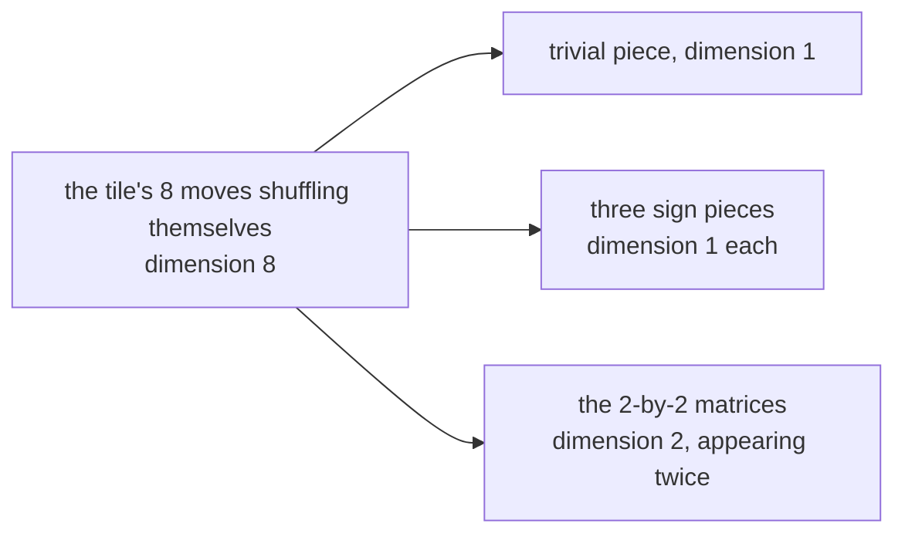

# Character tables: as many irreducible pieces as conjugacy classes, their sizes squared add up to the group's size, and the table fingerprints the group

[Syllabus](../../../SYLLABUS.md) → [Algebra](../README.md) → [Group Representations](../README.md#s12) → Character tables

---

## General Overview

A square tile fits its recess eight ways: four quarter turns and four flips. As 2-by-2 matrices, with the corners on the axes, the quarter turn is `[[0, -1], [1, 0]]` and the diagonal flip is `[[1, 0], [0, -1]]`. Giving each move a matrix this way is a **representation** ([Representations](01-representations-and-maschkes-theorem.md)).

Representations split into pieces; one that cannot split again is **irreducible**, and its **dimension** is the size of its matrices.

The tile has five irreducible pieces: four of dimension 1 and one of dimension 2, the matrices above. Two counts predict this:

- The eight moves fall into five **conjugacy classes**, families of look-alike moves ([Conjugacy and the class equation](../08-Groups/10-conjugacy-and-the-class-equation.md)). Five classes, five pieces.
- The squared dimensions add to the number of moves: 1 + 1 + 1 + 1 + 4 = 8.

The six moves of a triangle, the group S3, work the same way: 3 classes, pieces of dimension 1, 1 and 2, and 1 + 1 + 4 = 6.

A piece's **character** lists the **trace** (sum of the diagonal) of each move's matrix. One row per piece and one column per class make the **character table**, a fingerprint of the group. It is not perfect: Q8, a different group of eight quaternions, has the same table.

**A finite group has exactly as many irreducible pieces as conjugacy classes, their dimensions squared add up to the group's size, and the table of their traces identifies the group closely but not completely.**

**What kind of fact this is:** a theorem, proved on this card in Why it works from the orthogonality of characters; the tables are finite computations.

### The picture: the tile acting on itself splits into its pieces



Each piece appears as often as its dimension: 1 + 1 + 1 + 1 + 2 × 2 = 8. Step 1 proves this.

---

## The formula

Write $`G`$ for the group and $`\lvert G\rvert`$ for its size. The irreducible pieces are numbered 1 to $`s`$, with dimensions $`d_1, \ldots, d_s`$ and characters $`\chi_1, \ldots, \chi_s`$. The character of a move $`g`$ is $`\chi(g)`$, the trace of its matrix.

```math
s = \text{number of conjugacy classes of } G, \qquad d_1^2 + d_2^2 + \cdots + d_s^2 = \lvert G\rvert
```

**Read it aloud:** there are as many irreducible pieces as classes of look-alike moves, and the squares of their dimensions add up to the group's size.

The rows obey the orthogonality from [Schur's lemma and orthogonality](02-schurs-lemma-and-character-orthogonality.md). For a class $`C`$ with $`\lvert C\rvert`$ members:

```math
\langle \chi_i, \chi_j \rangle = \frac{1}{\lvert G\rvert} \sum_{\text{classes } C} \lvert C\rvert \, \chi_i(C) \, \overline{\chi_j(C)} = \begin{cases} 1 & i = j \\ 0 & i \neq j \end{cases}
```

**Read it aloud:** multiply two rows entry by entry, weight each column by its class size, add, and divide by the group's size; a row against itself gives 1, two different rows give 0. The bar is the complex conjugate (the sign of the imaginary part flipped); on these whole-number tables it changes nothing.

| Symbol | Plain meaning | In our example | Push it up and the answer… |
| --- | --- | --- | --- |
| $`G`$, $`\lvert G\rvert`$ | the group, and its number of members | the tile's moves, 8 | squared dimensions add to more |
| $`g`$, $`h`$, $`x`$, $`y`$, $`e`$ | members; $`e`$ does nothing | the quarter turn $`r`$ | — |
| $`r`$, $`f`$; $`a`$, $`b`$; $`i`$, $`j`$, $`k`$ | generators; the signs a dimension-1 piece gives them; Q8's units | quarter turn, diagonal flip; $`\pm 1`$; $`i j = k`$ | — |
| $`C`$, $`\lvert C\rvert`$; $`s`$ | a conjugacy class, its size; the number of classes | $`r`$ and $`r^3`$, size 2; $`s = 5`$ | more rows and columns |
| $`d_i`$ | dimension of piece $`i`$: its matrix size | 1, 1, 1, 1, 2 | it takes more of $`\lvert G\rvert`$ |
| $`\chi_i(g)`$, $`\chi_{\mathrm{reg}}`$ | trace of $`g`$'s matrix in piece $`i`$; in the regular representation | $`\chi_5(r^2) = -2`$; 8 at $`e`$ | — |
| $`\langle \chi_i, \chi_j\rangle`$ | weighted inner product of two rows | 1 for a row with itself, else 0 | — |
| $`\rho`$, $`T`$, $`\lambda`$, $`\psi`$; $`q_0`$ to $`q_3`$ | Step 3's fold: representation, summed matrix, number, class function; quaternion coefficients | — | — |

### When it holds

- **A finite group.** The rotations of a circle have infinitely many pieces.
- **Complex numbers allowed in the matrices.** Over the real numbers alone some pieces cannot split, and pieces fall short of classes.
- **Division by $`\lvert G\rvert`$ possible.** Modulo a prime that divides $`\lvert G\rvert`$, pieces stop splitting cleanly and both counts fail.
- **Fingerprint, not proof of sameness.** Equal tables mean the same pieces, not the same group.

---

## Why it works

### Step 0: the group acting on itself contains every piece

Let move $`g`$ send each member $`x`$ to $`g x`$. With one coordinate per member, this is the **regular representation**, of dimension $`\lvert G\rvert`$. Its trace counts the members left in place: all of them for $`e`$, none for any other move.

```math
\chi_{\mathrm{reg}}(e) = \lvert G\rvert, \qquad \chi_{\mathrm{reg}}(g) = 0 \text{ for } g \neq e
```

### Step 1: each piece appears as often as its dimension

A representation holds piece $`i`$ as many times as its inner product with $`\chi_i`$ (orthogonality). For the regular representation only the column of $`e`$ is nonzero, so the count is $`\frac{1}{\lvert G\rvert} \cdot \lvert G\rvert \cdot d_i = d_i`$.

So piece $`i`$ appears $`d_i`$ times, each of dimension $`d_i`$:

```math
\lvert G\rvert = \chi_{\mathrm{reg}}(e) = d_1 \cdot d_1 + d_2 \cdot d_2 + \cdots + d_s \cdot d_s
```

For the tile: 8 = 1 + 1 + 1 + 1 + 2 × 2. The code checks this at every class: the rows, weighted by dimension, add to the regular character.

### Step 2: a character is constant on each class, so there are at most s pieces

A character takes one value per class ([Schur's lemma and orthogonality](02-schurs-lemma-and-character-orthogonality.md)): it is a list of $`s`$ numbers.

Orthogonality makes the rows $`s`$-long lists at right angles to each other. At most $`s`$ such lists exist.

### Step 3: there are at least s pieces

A function with one value per class is a **class function**. No nonzero class function is at right angles to every irreducible character, so the rows fill all $`s`$ directions.

<details>
<summary>Detailed proof: a class function at right angles to every character is zero</summary>

Let $`\psi`$ (psi) be a class function with $`\langle \psi, \chi_i\rangle = 0`$ for every piece $`i`$. For any representation $`\rho`$ (rho), form one matrix:

$`\displaystyle T = \sum_{g \in G} \overline{\psi(g)} \, \rho(g)`$

As $`\psi`$ is constant on classes, $`\rho(h) \, T \, \rho(h)^{-1} = T`$ for every $`h`$.

On an irreducible piece, Schur's lemma says $`T`$ is a number $`\lambda`$ times the identity. Its trace is $`\lambda d_i = \lvert G\rvert \, \overline{\langle \psi, \chi_i\rangle} = 0`$, so $`T = 0`$ there.

The regular representation is built from irreducible pieces (Step 1), so $`T = 0`$ on it too. Apply $`T`$ to the coordinate of $`e`$: it lands on the coordinate of each $`g`$ with weight $`\overline{\psi(g)}`$. The result is zero, so every $`\psi(g)`$ is zero.

</details>

### Step 4: build the tile's table by hand

The tile has generators $`r`$ (quarter turn) and $`f`$ (flip across a diagonal) with $`r^4 = e`$, $`f^2 = e`$ and $`f r f = r^{-1}`$ ([Presentations](../08-Groups/15-group-presentations.md)). Its five classes are $`e`$; $`r^2`$; $`r, r^3`$; $`f, r^2 f`$; $`r f, r^3 f`$.

1. **Dimension-1 pieces.** A 1-by-1 matrix is a number. Send $`r`$ to a number $`a`$ and $`f`$ to $`b`$. Numbers commute, so $`f r f = r^{-1}`$ gives $`a = a^{-1}`$ and $`f^2 = e`$ gives $`b^2 = 1`$: both are signs, $`\pm 1`$. All four choices work: four pieces.
2. **What is left.** They use 4 of the 8. The remaining 4 is $`2^2`$: exactly one more piece, of dimension 2.
3. **The dimension-2 piece.** The house matrices, with traces 2 at $`e`$, $`-2`$ at the half turn, 0 elsewhere.

Second road to the four dimension-1 pieces. The **commutators** $`x y x^{-1} y^{-1}`$ generate a normal subgroup (conjugates of commutators are commutators), the **commutator subgroup**, here $`e`$ and $`r^2`$. Numbers commute, so dimension-1 pieces send every commutator to 1 and are exactly those of the group of cosets. There $`x y`$ and $`y x`$ differ by a commutator, so order never matters, each class is one member, and Steps 1 to 3 give one piece per member, all of dimension 1: 8 / 2 = 4.

### Step 5: the triangle group S3, and Q8

**S3.** Generators: $`r`$, a third of a turn, and $`f`$, a swap of two corners. Classes: $`e`$; the two turns; the three swaps. The tile's relations, with $`r^3 = e`$, make $`a`$ a sign with $`a^3 = 1`$: $`a = 1`$. Only $`f`$ has a choice. Two dimension-1 pieces leave $`6 - 2 = 2^2`$: one dimension-2 piece, row (2, −1, 0).

Second road: shuffling the three corners has trace (3, 0, 1), the corners left in place. Remove the trivial piece (1, 1, 1) and (2, −1, 0) remains.

**Q8.** The eight quaternions ±1, ±i, ±j, ±k multiply by $`i^2 = j^2 = k^2 = -1`$ and $`i j = k`$. Classes, in the tile's column order: $`1`$; $`-1`$; $`\pm i`$; $`\pm j`$; $`\pm k`$. Signs for $`i`$ and $`j`$ give four dimension-1 pieces. The quaternion $`q_0 + q_1 i + q_2 j + q_3 k`$, with numbers $`q_0`$ to $`q_3`$, acts on pairs of complex numbers by the matrix `[[q0 + q1 i, q2 + q3 i], [-q2 + q3 i, q0 - q1 i]]`, where this i is the complex number, with trace $`2 q_0`$: the row (2, −2, 0, 0, 0).

That is the tile's table, entry for entry. Yet the tile has 5 members of order 2 (done twice they give $`e`$), and Q8 has only $`-1`$.

---

## Worked numbers, by hand

The tile's table, with class sizes in brackets.

| Piece | $`e`$ (1) | $`r^2`$ (1) | $`r, r^3`$ (2) | $`f, r^2 f`$ (2) | $`r f, r^3 f`$ (2) |
| --- | ---: | ---: | ---: | ---: | ---: |
| trivial, $`a = b = 1`$ | 1 | 1 | 1 | 1 | 1 |
| flip sign, $`a = 1, b = -1`$ | 1 | 1 | 1 | −1 | −1 |
| diagonal sign, $`a = -1, b = 1`$ | 1 | 1 | −1 | 1 | −1 |
| edge sign, $`a = b = -1`$ | 1 | 1 | −1 | −1 | 1 |
| the 2-by-2 matrices | 2 | −2 | 0 | 0 | 0 |

S3, on $`e`$ (1), turns (2), swaps (3): rows (1, 1, 1), (1, 1, −1), (2, −1, 0).

| Step | Arithmetic | Value |
| --- | --- | --- |
| tile: classes, by conjugating every move | five classes, sizes 1, 1, 2, 2, 2 | **5** |
| tile: squared dimensions | 1 + 1 + 1 + 1 + 4 | **8** |
| tile: dimension-1 pieces, by commutators | 8 / 2 | **4** |
| S3: squared dimensions | 1 + 1 + 4 | **6** |
| S3: trivial against sign, weighted | (1 + 2 − 3) / 6 | **0** |
| tile's 4-by-4 corner shuffle | corners left in place: 4, 0, 0, 2, 0 | **one trivial, one diagonal sign, one 2-by-2** |
| order-2 members | tile against Q8 | **5 against 1** |

So the table alone splits the corner shuffle into pieces of dimensions 1, 1 and 2.

### What breaks if you drop a piece

| Mistake | Comes out at | What went wrong |
| --- | --- | --- |
| Dimensions added, not squared | tile 6, S3 4, not 8 and 6 | Each piece appears $`d_i`$ times in the regular representation |
| Class sizes dropped from the inner product | S3 trivial against sign: 1/6, not 0 | Each column stands for a whole class of moves |
| One piece per member | 8 dimension-1 pieces needed, 4 found | Pieces match classes, not members |
| Equal tables taken as equal groups | tile has 5 order-2 members, Q8 has 1 | A table hides how members multiply |

---

## Code, from first principles, and it actually runs

The tile and S3 are integer matrices, Q8 quaternions. Three roads build each table: classes by conjugating, dimension-1 pieces by trying signs, the dimension-2 row from traces. Independent counts check it: the regular representation's fixed points, the commutator subgroup, and fixed corners.

### Python

```python
# Character tables -- the check behind the card.  Nothing is imported.  Each group is the
# list r^k f^m built from two generators.  Road one finds the classes by conjugating; road
# two finds the one-dimensional pieces by trying signs for r and f; road three is the trace
# of a 2-by-2 action.  Orthogonality, the regular representation and commutators cross-check.
def mat(p, q):                                  # 2-by-2 matrices, stored row by row
    return (p[0]*q[0] + p[1]*q[2], p[0]*q[1] + p[1]*q[3], p[2]*q[0] + p[3]*q[2], p[2]*q[1] + p[3]*q[3])
def quat(p, q):                                 # quaternions a + b i + c j + d k
    return (p[0]*q[0] - p[1]*q[1] - p[2]*q[2] - p[3]*q[3], p[0]*q[1] + p[1]*q[0] + p[2]*q[3] - p[3]*q[2],
            p[0]*q[2] - p[1]*q[3] + p[2]*q[0] + p[3]*q[1], p[0]*q[3] + p[1]*q[2] - p[2]*q[1] + p[3]*q[0])
def fixed(g, corners):                          # corners a matrix sends to themselves
    return sum((g[0]*x + g[1]*y, g[2]*x + g[3]*y) == (x, y) for x, y in corners)
def ip(sizes, u, v):                            # sum over classes of size x row u x row v
    return sum(s * a * b for s, a, b in zip(sizes, u, v))
yn = lambda c: "yes" if c else "no"
def table(name, r, f, n, mul, one, chi2):
    pw = lambda x, k: one if k == 0 else mul(pw(x, k - 1), x)
    G = [mul(pw(r, k), pw(f, m)) for m in (0, 1) for k in range(n)]
    inv = {x: next(y for y in G if mul(x, y) == one) for x in G}
    reps, classes = [], []                      # road one: conjugate each member by all
    for x in G:
        if not any(x in c for c in classes):
            reps.append(x); classes.append({mul(mul(h, x), inv[h]) for h in G})
    reps, classes = zip(*sorted(zip(reps, classes), key=lambda rc: len(rc[1])))   # smaller classes first
    sizes, rows = [len(c) for c in classes], []                 # road two: a sign for r, a sign for f
    for a, b in ((1, 1), (1, -1), (-1, 1), (-1, -1)):
        val = {G[m * n + k]: a**k * b**m for m in (0, 1) for k in range(n)}
        if all(val[mul(x, y)] == val[x] * val[y] for x in G for y in G):
            rows.append([val[x] for x in reps])
    ones = len(rows)
    rows.append([chi2(x) for x in reps])        # road three: trace of the 2-by-2 action
    dims, big = [row[0] for row in rows], len(G)
    orth = all(ip(sizes, u, v) == (big if i == j else 0) for i, u in enumerate(rows) for j, v in enumerate(rows))
    reg = [sum(mul(h, x) == x for x in G) for h in reps]        # the regular representation
    split = [sum(d * row[c] for d, row in zip(dims, rows)) for c in range(len(reps))]
    comm = {mul(mul(x, y), mul(inv[x], inv[y])) for x in G for y in G}
    while any(mul(a, b) not in comm for a in comm for b in comm):
        comm |= {mul(a, b) for a in comm for b in comm}
    print(f"{name}: {big} members, {len(reps)} classes of sizes {sizes}, commutator subgroup of size {len(comm)}")
    print(f"{name} table: " + " ".join(str(row) for row in rows))
    print(f"{name}: {len(rows)} pieces, " + " + ".join(str(d * d) for d in dims) + f" = {sum(d * d for d in dims)}; "
          f"one-dim {ones} = {big} / {len(comm)}; rows orthonormal: {yn(orth)}; regular = dims x rows: {yn(reg == split)}")
    assert len(rows) == len(reps) and sum(d * d for d in dims) == big   # pieces = classes, squares add to |G|
    assert orth and reg == split and ones * len(comm) == big and all(mul(mul(x, y), z) == mul(x, mul(y, z)) for x in G for y in G for z in G)
    return reps, sizes, rows, sum(mul(x, x) == one for x in G) - 1
tr, ts, trows, t2 = table("tile", (0, -1, 1, 0), (1, 0, 0, -1), 4, mat, (1, 0, 0, 1), lambda g: g[0] + g[3])
sr, ss, srows, _ = table("S3", (0, -1, 1, -1), (0, 1, 1, 0), 3, mat, (1, 0, 0, 1), lambda g: g[0] + g[3])
qr, qs, qrows, q2 = table("Q8", (0, 1, 0, 0), (0, 0, 1, 0), 4, quat, (1, 0, 0, 0), lambda q: 2 * q[0])
by_corners = [fixed(g, [(1, 0), (0, 1), (-1, -1)]) - 1 for g in sr]
shuffle = [fixed(g, [(1, 0), (0, 1), (-1, 0), (0, -1)]) for g in tr]   # corners on the axes
holds = [ip(ts, shuffle, row) // 8 for row in trows]
rebuilt = [sum(h * row[c] for h, row in zip(holds, trows)) for c in range(5)]
print(f"S3 two-dim row by fixed corners minus 1: {by_corners}")
print(f"tile 4-by-4 corner shuffle by fixed corners: {shuffle}; copies of each piece: {holds}")
print(f"tile and Q8 tables identical: {yn(trows == qrows and ts == qs)}; members of order 2: tile {t2}, Q8 {q2}")
print(f"mistake 1, dimensions added, not squared: tile {sum(r[0] for r in trows)}, S3 {sum(r[0] for r in srows)}")
print(f"mistake 2, S3 trivial against sign without class sizes: {sum(a * b for a, b in zip(srows[0], srows[1]))}/6, not {ip(ss, srows[0], srows[1])}")
print(f"mistake 3, one piece per member: 8 one-dim pieces needed, {sum(r[0] == 1 for r in trows)} found")
assert by_corners == srows[-1] and rebuilt == shuffle            # two roads to the same rows
assert trows == qrows and ts == qs and (t2, q2) == (5, 1)          # one table, two different groups
print("ALL CHECKS PASS")
```

**Ran 2026-11-23 on macOS, Python 3.14.10, standard library only. All checks passed. Output, pasted from the run:**

```
tile: 8 members, 5 classes of sizes [1, 1, 2, 2, 2], commutator subgroup of size 2
tile table: [1, 1, 1, 1, 1] [1, 1, 1, -1, -1] [1, 1, -1, 1, -1] [1, 1, -1, -1, 1] [2, -2, 0, 0, 0]
tile: 5 pieces, 1 + 1 + 1 + 1 + 4 = 8; one-dim 4 = 8 / 2; rows orthonormal: yes; regular = dims x rows: yes
S3: 6 members, 3 classes of sizes [1, 2, 3], commutator subgroup of size 3
S3 table: [1, 1, 1] [1, 1, -1] [2, -1, 0]
S3: 3 pieces, 1 + 1 + 4 = 6; one-dim 2 = 6 / 3; rows orthonormal: yes; regular = dims x rows: yes
Q8: 8 members, 5 classes of sizes [1, 1, 2, 2, 2], commutator subgroup of size 2
Q8 table: [1, 1, 1, 1, 1] [1, 1, 1, -1, -1] [1, 1, -1, 1, -1] [1, 1, -1, -1, 1] [2, -2, 0, 0, 0]
Q8: 5 pieces, 1 + 1 + 1 + 1 + 4 = 8; one-dim 4 = 8 / 2; rows orthonormal: yes; regular = dims x rows: yes
S3 two-dim row by fixed corners minus 1: [2, -1, 0]
tile 4-by-4 corner shuffle by fixed corners: [4, 0, 0, 2, 0]; copies of each piece: [1, 0, 1, 0, 1]
tile and Q8 tables identical: yes; members of order 2: tile 5, Q8 1
mistake 1, dimensions added, not squared: tile 6, S3 4
mistake 2, S3 trivial against sign without class sizes: 1/6, not 0
mistake 3, one piece per member: 8 one-dim pieces needed, 4 found
ALL CHECKS PASS
```

### Rust

```rust
// Character tables -- the same check as the Python, in Rust.  No crates.  Each group is the
// list r^k f^m built from two generators.  Road one finds the classes by conjugating; road
// two finds the one-dimensional pieces by trying signs for r and f; road three is the trace
// of a 2-by-2 action.  Orthogonality, the regular representation and commutators cross-check.
type E = [i64; 4];                                // a 2-by-2 matrix row by row, or a quaternion
fn mat(p: E, q: E) -> E { [p[0]*q[0] + p[1]*q[2], p[0]*q[1] + p[1]*q[3], p[2]*q[0] + p[3]*q[2], p[2]*q[1] + p[3]*q[3]] }
fn quat(p: E, q: E) -> E {                        // quaternions a + b i + c j + d k
    [p[0]*q[0] - p[1]*q[1] - p[2]*q[2] - p[3]*q[3], p[0]*q[1] + p[1]*q[0] + p[2]*q[3] - p[3]*q[2],
     p[0]*q[2] - p[1]*q[3] + p[2]*q[0] + p[3]*q[1], p[0]*q[3] + p[1]*q[2] - p[2]*q[1] + p[3]*q[0]]
}
fn fixed(g: E, corners: &[(i64, i64)]) -> i64 {   // corners a matrix sends to themselves
    corners.iter().filter(|&&(x, y)| (g[0]*x + g[1]*y, g[2]*x + g[3]*y) == (x, y)).count() as i64
}
fn ip(sizes: &[i64], u: &[i64], v: &[i64]) -> i64 { (0..sizes.len()).map(|c| sizes[c] * u[c] * v[c]).sum() }
fn yn(c: bool) -> &'static str { if c { "yes" } else { "no" } }
struct T { reps: Vec<E>, sizes: Vec<i64>, rows: Vec<Vec<i64>>, twos: i64 }
fn table(name: &str, r: E, f: E, n: usize, mul: fn(E, E) -> E, one: E, chi2: fn(E) -> i64) -> T {
    let pw = |x: E, k: usize| (0..k).fold(one, |acc, _| mul(acc, x));
    let mut g: Vec<E> = vec![];
    for m in 0..2 { for k in 0..n { g.push(mul(pw(r, k), pw(f, m))) } }
    let inv = |x: E| *g.iter().find(|&&y| mul(x, y) == one).unwrap();
    let (mut reps, mut classes): (Vec<E>, Vec<Vec<E>>) = (vec![], vec![]);
    for &x in &g {                                // road one: conjugate each member by all
        if classes.iter().any(|c| c.contains(&x)) { continue }
        let mut c: Vec<E> = vec![];
        for &h in &g { let y = mul(mul(h, x), inv(h)); if !c.contains(&y) { c.push(y) } }
        reps.push(x); classes.push(c);
    }
    classes.sort_by_key(|c| c.len()); reps = classes.iter().map(|c| c[0]).collect();   // smaller classes first
    let sizes: Vec<i64> = classes.iter().map(|c| c.len() as i64).collect();
    let mut rows: Vec<Vec<i64>> = vec![];         // road two: a sign for r, a sign for f
    for (a, b) in [(1i64, 1i64), (1, -1), (-1, 1), (-1, -1)] {
        let val = |x: E| { let i = g.iter().position(|&y| y == x).unwrap(); a.pow((i % n) as u32) * b.pow((i / n) as u32) };
        if g.iter().all(|&x| g.iter().all(|&y| val(mul(x, y)) == val(x) * val(y))) {
            rows.push(reps.iter().map(|&x| val(x)).collect());
        }
    }
    let ones = rows.len();
    rows.push(reps.iter().map(|&x| chi2(x)).collect());   // road three: trace of the 2-by-2 action
    let (dims, big): (Vec<i64>, i64) = (rows.iter().map(|row| row[0]).collect(), g.len() as i64);
    let orth = (0..rows.len()).all(|i| (0..rows.len()).all(|j| ip(&sizes, &rows[i], &rows[j]) == if i == j { big } else { 0 }));
    let reg: Vec<i64> = reps.iter().map(|&h| g.iter().filter(|&&x| mul(h, x) == x).count() as i64).collect();
    let split: Vec<i64> = (0..reps.len()).map(|c| (0..rows.len()).map(|i| dims[i] * rows[i][c]).sum()).collect();
    let mut comm: Vec<E> = vec![];
    for &x in &g { for &y in &g { let z = mul(mul(x, y), mul(inv(x), inv(y))); if !comm.contains(&z) { comm.push(z) } } }
    loop {
        let before = comm.len();
        for i in 0..before { for j in 0..before { let z = mul(comm[i], comm[j]); if !comm.contains(&z) { comm.push(z) } } }
        if comm.len() == before { break }
    }
    let (sq, tab): (Vec<String>, Vec<String>) = (dims.iter().map(|d| (d * d).to_string()).collect(), rows.iter().map(|row| format!("{:?}", row)).collect());
    let total: i64 = dims.iter().map(|d| d * d).sum();
    println!("{}: {} members, {} classes of sizes {:?}, commutator subgroup of size {}", name, big, reps.len(), sizes, comm.len());
    println!("{} table: {}", name, tab.join(" "));
    println!("{}: {} pieces, {} = {}; one-dim {} = {} / {}; rows orthonormal: {}; regular = dims x rows: {}",
             name, rows.len(), sq.join(" + "), total, ones, big, comm.len(), yn(orth), yn(reg == split));
    assert!(rows.len() == reps.len() && total == big);           // pieces = classes, squares add to |G|
    assert!(orth && reg == split && ones * comm.len() == g.len() && g.iter().all(|&x| g.iter().all(|&y| g.iter().all(|&z| mul(mul(x, y), z) == mul(x, mul(y, z))))));
    T { reps, sizes, rows, twos: g.iter().filter(|&&x| mul(x, x) == one).count() as i64 - 1 }
}
fn main() {
    let t = table("tile", [0, -1, 1, 0], [1, 0, 0, -1], 4, mat, [1, 0, 0, 1], |g| g[0] + g[3]);
    let s = table("S3", [0, -1, 1, -1], [0, 1, 1, 0], 3, mat, [1, 0, 0, 1], |g| g[0] + g[3]);
    let q = table("Q8", [0, 1, 0, 0], [0, 0, 1, 0], 4, quat, [1, 0, 0, 0], |q| 2 * q[0]);
    let by_corners: Vec<i64> = s.reps.iter().map(|&g| fixed(g, &[(1, 0), (0, 1), (-1, -1)]) - 1).collect();
    let shuffle: Vec<i64> = t.reps.iter().map(|&g| fixed(g, &[(1, 0), (0, 1), (-1, 0), (0, -1)])).collect();   // corners on the axes
    let holds: Vec<i64> = t.rows.iter().map(|row| ip(&t.sizes, &shuffle, row) / 8).collect();
    let rebuilt: Vec<i64> = (0..5).map(|c| (0..5).map(|i| holds[i] * t.rows[i][c]).sum()).collect();
    let dimsum = |rows: &Vec<Vec<i64>>| rows.iter().map(|r| r[0]).sum::<i64>();
    println!("S3 two-dim row by fixed corners minus 1: {:?}", by_corners);
    println!("tile 4-by-4 corner shuffle by fixed corners: {:?}; copies of each piece: {:?}", shuffle, holds);
    println!("tile and Q8 tables identical: {}; members of order 2: tile {}, Q8 {}", yn(t.rows == q.rows && t.sizes == q.sizes), t.twos, q.twos);
    println!("mistake 1, dimensions added, not squared: tile {}, S3 {}", dimsum(&t.rows), dimsum(&s.rows));
    println!("mistake 2, S3 trivial against sign without class sizes: {}/6, not {}",
             (0..3).map(|c| s.rows[0][c] * s.rows[1][c]).sum::<i64>(), ip(&s.sizes, &s.rows[0], &s.rows[1]));
    println!("mistake 3, one piece per member: 8 one-dim pieces needed, {} found", t.rows.iter().filter(|r| r[0] == 1).count());
    assert!(by_corners == s.rows[2] && rebuilt == shuffle);             // two roads to the same rows
    assert!(t.rows == q.rows && t.sizes == q.sizes && (t.twos, q.twos) == (5, 1));   // one table, two groups
    println!("ALL CHECKS PASS");
}
```

**Ran 2026-11-23 on macOS, rustc 1.98.1, no crates. All checks passed. Output, pasted from the run:**

```
tile: 8 members, 5 classes of sizes [1, 1, 2, 2, 2], commutator subgroup of size 2
tile table: [1, 1, 1, 1, 1] [1, 1, 1, -1, -1] [1, 1, -1, 1, -1] [1, 1, -1, -1, 1] [2, -2, 0, 0, 0]
tile: 5 pieces, 1 + 1 + 1 + 1 + 4 = 8; one-dim 4 = 8 / 2; rows orthonormal: yes; regular = dims x rows: yes
S3: 6 members, 3 classes of sizes [1, 2, 3], commutator subgroup of size 3
S3 table: [1, 1, 1] [1, 1, -1] [2, -1, 0]
S3: 3 pieces, 1 + 1 + 4 = 6; one-dim 2 = 6 / 3; rows orthonormal: yes; regular = dims x rows: yes
Q8: 8 members, 5 classes of sizes [1, 1, 2, 2, 2], commutator subgroup of size 2
Q8 table: [1, 1, 1, 1, 1] [1, 1, 1, -1, -1] [1, 1, -1, 1, -1] [1, 1, -1, -1, 1] [2, -2, 0, 0, 0]
Q8: 5 pieces, 1 + 1 + 1 + 1 + 4 = 8; one-dim 4 = 8 / 2; rows orthonormal: yes; regular = dims x rows: yes
S3 two-dim row by fixed corners minus 1: [2, -1, 0]
tile 4-by-4 corner shuffle by fixed corners: [4, 0, 0, 2, 0]; copies of each piece: [1, 0, 1, 0, 1]
tile and Q8 tables identical: yes; members of order 2: tile 5, Q8 1
mistake 1, dimensions added, not squared: tile 6, S3 4
mistake 2, S3 trivial against sign without class sizes: 1/6, not 0
mistake 3, one piece per member: 8 one-dim pieces needed, 4 found
ALL CHECKS PASS
```

### Lean

Lean proves the two counts and the dimension-1 count for every finite group, and that the tile and Q8 differ.

- Take a finite group $`G`$ and numbers like the complex numbers, where division by $`\lvert G\rvert`$ is possible. Then $`G`$ has exactly $`s`$ different irreducible pieces, one per conjugacy class.
- Take the same group and numbers. Then $`d_1^2 + d_2^2 + \cdots + d_s^2 = \lvert G\rvert`$.
- Take the same group and numbers. Then the dimension-1 pieces number $`\lvert G\rvert`$ divided by the size of the commutator subgroup.
- The tile and Q8 are different groups: no relabelling turns one into the other.
- The tile has 8 members in 5 classes, Q8 has 8 in 5, and S3 has 6 in 3.
- The commutator subgroups have size 2 for the tile and Q8, and size 3 for S3.
- The squared dimensions add to 8 for the tile and 6 for S3.
- The tile has 5 members of order 2, and Q8 has 1.
- The house matrices obey $`r^4 = e`$, $`f^2 = e`$ and $`f r f = r^3`$. Their traces give the 2-by-2 row: 2, −2, 0, 0, 0.
- Weighted by class sizes, the tile's rows give 8 for a row against itself and 0 for two different rows.
- The tile's rows, weighted by dimension, add to 8 at $`e`$ and 0 at every other class.
- The corner shuffle's traces (4, 0, 0, 2, 0) give one trivial, one diagonal sign and one 2-by-2 piece.
- For S3, trivial against sign gives 1 + 2 − 3 = 0, and (3, 0, 1) − (1, 1, 1) = (2, −1, 0).
- Adding dimensions without squaring gives 6 for the tile and 4 for S3.
- Dropping class sizes, S3's trivial row against its sign row gives 1, not 0.

Building each table from its group, and Q8's table matching the tile's, are left to the Python and Rust checks.

```lean
-- Character tables: a finite group has as many irreducible representations as conjugacy classes and their squared dimensions add up to its size, its dimension-1 pieces number the index of its commutator subgroup, and the tile group and Q8 are different groups although they share one character table.
import Mathlib.RepresentationTheory.Character
import Mathlib.FieldTheory.IsAlgClosed.Basic
import Mathlib.Algebra.Group.ConjFinite
import Mathlib.GroupTheory.Commutator.Basic
import Mathlib.GroupTheory.Index
import Mathlib.GroupTheory.SpecificGroups.Dihedral
import Mathlib.GroupTheory.SpecificGroups.Quaternion
import Mathlib.GroupTheory.Perm.Fin
import Mathlib.LinearAlgebra.Matrix.Trace
import Mathlib.RepresentationTheory.FinGroupCharZero
import Mathlib.RingTheory.SimpleModule.IsAlgClosed
import Mathlib.Algebra.Central.Matrix
import Mathlib.Algebra.Central.End
import Mathlib.Algebra.Algebra.Subalgebra.Pi
import Mathlib.GroupTheory.FiniteAbelian.Duality
import Mathlib.RingTheory.RootsOfUnity.AlgebraicallyClosed

open CategoryTheory

namespace CharacterTables

theorem mem_center_monoidAlgebra_iff {k G : Type} [Field k] [Group G] (x : MonoidAlgebra k G) :
    x ∈ Subalgebra.center k (MonoidAlgebra k G) ↔
      ∀ g h : G, x.coeff (h * g * h⁻¹) = x.coeff g := by
  rw [Subalgebra.mem_center_iff]
  constructor
  · intro hx g h
    have := congrArg (fun y => y.coeff (h * g)) (hx (MonoidAlgebra.single h 1))
    simp at this
    simpa [mul_assoc] using this.symm
  · intro hx a
    induction a using MonoidAlgebra.induction_linear with
    | zero => simp
    | add a b ha hb => rw [add_mul, mul_add, ha, hb]
    | single m r =>
      ext y
      have := hx (m⁻¹ * y) m
      simp only [mul_inv_cancel_left] at this
      simp [this, mul_comm]

#print axioms mem_center_monoidAlgebra_iff

theorem finrank_center_monoidAlgebra {k G : Type} [Field k] [Group G] [Finite G] :
    Module.finrank k (Subalgebra.center k (MonoidAlgebra k G)) = Nat.card (ConjClasses G) := by
  classical
  have := Fintype.ofFinite G
  let ψ : (ConjClasses G → k) →ₗ[k] MonoidAlgebra k G :=
    (MonoidAlgebra.coeffLinearEquiv k).symm.toLinearMap ∘ₗ
      (Finsupp.linearEquivFunOnFinite k k G).symm.toLinearMap ∘ₗ
      LinearMap.funLeft k k ConjClasses.mk
  have hψ : ∀ f g, (ψ f).coeff g = f (ConjClasses.mk g) := fun f g => rfl
  have hinj : Function.Injective ψ := by
    intro f f' h
    funext c
    obtain ⟨g, rfl⟩ := ConjClasses.mk_surjective c
    have := congrArg (fun y => y.coeff g) h
    simpa only [hψ] using this
  have hrange : LinearMap.range ψ = Subalgebra.toSubmodule (Subalgebra.center k _) := by
    ext x
    simp only [LinearMap.mem_range, Subalgebra.mem_toSubmodule, mem_center_monoidAlgebra_iff]
    constructor
    · rintro ⟨f, rfl⟩ g h
      rw [hψ, hψ]
      exact congrArg f (ConjClasses.mk_eq_mk_iff_isConj.mpr (isConj_iff.mpr ⟨h, rfl⟩).symm)
    · intro hx
      refine ⟨fun c => x.coeff (Function.surjInv ConjClasses.mk_surjective c), ?_⟩
      ext g
      rw [hψ]
      set s := Function.surjInv ConjClasses.mk_surjective (ConjClasses.mk g) with hs
      have h1 := Function.surjInv_eq ConjClasses.mk_surjective (ConjClasses.mk g)
      rw [← hs, ConjClasses.mk_eq_mk_iff_isConj, isConj_iff] at h1
      obtain ⟨c, hc⟩ := h1
      show x.coeff s = x.coeff g
      rw [← hc, hx]
  rw [← Subalgebra.finrank_toSubmodule, ← hrange, LinearMap.finrank_range_of_inj hinj,
    Module.finrank_fintype_fun_eq_card, Nat.card_eq_fintype_card]

#print axioms finrank_center_monoidAlgebra

theorem finrank_center_pi_matrix {k : Type} [Field k] (n : ℕ) (d : Fin n → ℕ)
    (hd : ∀ i, NeZero (d i)) :
    Module.finrank k (Subalgebra.center k (Π i, Matrix (Fin (d i)) (Fin (d i)) k)) = n := by
  let ψ : (Fin n → k) →ₗ[k] (Π i, Matrix (Fin (d i)) (Fin (d i)) k) :=
    LinearMap.pi (fun i => (Algebra.linearMap k _) ∘ₗ LinearMap.proj i)
  have hψ : ∀ c i, ψ c i = algebraMap k _ (c i) := fun c i => rfl
  have hinj : Function.Injective ψ := by
    intro c c' h
    funext i
    have := congrFun h i
    rw [hψ, hψ] at this
    exact (algebraMap k (Matrix (Fin (d i)) (Fin (d i)) k)).injective this
  have hrange : LinearMap.range ψ = Subalgebra.toSubmodule (Subalgebra.center k _) := by
    ext z
    simp only [LinearMap.mem_range, Subalgebra.mem_toSubmodule, Subalgebra.center_pi,
      Subalgebra.mem_pi, Set.mem_univ, true_implies, Algebra.IsCentral.mem_center_iff]
    constructor
    · rintro ⟨c, rfl⟩ i
      exact ⟨c i, rfl⟩
    · intro h
      choose c hc using h
      exact ⟨c, funext fun i => (hc i).symm⟩
  rw [← Subalgebra.finrank_toSubmodule, ← hrange, LinearMap.finrank_range_of_inj hinj,
    Module.finrank_fin_fun]

#print axioms finrank_center_pi_matrix

theorem finrank_center_eq_of_algEquiv {k A B : Type} [Field k] [Ring A] [Ring B] [Algebra k A]
    [Algebra k B] (e : A ≃ₐ[k] B) :
    Module.finrank k (Subalgebra.center k A) = Module.finrank k (Subalgebra.center k B) := by
  have h : (Subalgebra.center k A).map e.toAlgHom = Subalgebra.center k B := by
    ext y
    simp only [Subalgebra.mem_map, Subalgebra.mem_center_iff]
    constructor
    · rintro ⟨x, hx, rfl⟩ b
      have := congrArg e (hx (e.symm b))
      simpa using this
    · intro hy
      refine ⟨e.symm y, fun b => ?_, by simp⟩
      have := congrArg e.symm (hy (e b))
      simpa using this
  rw [← h]
  exact (Subalgebra.equivMapOfInjective _ e.toAlgHom e.injective).toLinearEquiv.finrank_eq

#print axioms finrank_center_eq_of_algEquiv

theorem fdrep_hom_comm {k G : Type} [Field k] [Group G] {V W : FDRep k G} (f : V ⟶ W) (g : G) :
    f.hom.hom.hom ∘ₗ V.ρ g = W.ρ g ∘ₗ f.hom.hom.hom := by
  simpa using congrArg (fun x => x.hom.hom) (f.comm g)

#print axioms fdrep_hom_comm

theorem algHom_single {k G V : Type} [Field k] [Group G] [AddCommGroup V] [Module k V]
    (φ : MonoidAlgebra k G →ₐ[k] Module.End k V) (m : G) (r : k) :
    φ (MonoidAlgebra.single m r) = r • φ (MonoidAlgebra.of k G m) := by
  rw [MonoidAlgebra.of_apply, ← map_smul, MonoidAlgebra.smul_single', mul_one]

#print axioms algHom_single

theorem simple_of_surjective {k G V : Type} [Field k] [IsAlgClosed k] [Group G] [Finite G]
    [NeZero (Nat.card G : k)] [AddCommGroup V] [Module k V] [FiniteDimensional k V]
    [Nontrivial V] (φ : MonoidAlgebra k G →ₐ[k] Module.End k V) (hφ : Function.Surjective φ) :
    Simple (FDRep.of ((φ : MonoidAlgebra k G →* Module.End k V).comp (MonoidAlgebra.of k G))) := by
  set U := FDRep.of ((φ : MonoidAlgebra k G →* Module.End k V).comp (MonoidAlgebra.of k G))
  rw [FDRep.simple_iff_end_is_rank_one]
  apply le_antisymm
  · apply finrank_le_one (𝟙 U)
    intro f
    let L : V →ₗ[k] V := f.hom.hom.hom
    have hL : ∀ a, L ∘ₗ φ a = φ a ∘ₗ L := by
      intro a
      induction a using MonoidAlgebra.induction_linear with
      | zero => simp
      | add a b ha hb => rw [map_add, LinearMap.comp_add, LinearMap.add_comp, ha, hb]
      | single m r =>
        rw [algHom_single, LinearMap.comp_smul, LinearMap.smul_comp]
        congr 1
        exact fdrep_hom_comm f m
    have hc : L ∈ Subalgebra.center k (Module.End k V) := by
      rw [Subalgebra.mem_center_iff]
      intro T
      obtain ⟨a, rfl⟩ := hφ T
      exact (hL a).symm
    obtain ⟨c, hc⟩ := (Algebra.IsCentral.mem_center_iff k).mp hc
    refine ⟨c, ?_⟩
    ext x
    show c • x = L x
    rw [hc]
    simp [Algebra.algebraMap_eq_smul_one]
  · rw [Nat.one_le_iff_ne_zero, ← Nat.pos_iff_ne_zero, Module.finrank_pos_iff_exists_ne_zero]
    refine ⟨𝟙 U, fun h => ?_⟩
    obtain ⟨v, hv⟩ := exists_ne (0 : V)
    apply hv
    have := congrArg (fun f : U ⟶ U => f.hom.hom.hom v) h
    simpa using this

#print axioms simple_of_surjective

theorem not_iso_of_separating {k G V W : Type} [Field k] [Group G] [AddCommGroup V] [Module k V]
    [FiniteDimensional k V] [Nontrivial V] [AddCommGroup W] [Module k W] [FiniteDimensional k W]
    (φ : MonoidAlgebra k G →ₐ[k] Module.End k V) (ψ : MonoidAlgebra k G →ₐ[k] Module.End k W)
    (ε : MonoidAlgebra k G) (h1 : φ ε = 1) (h2 : ψ ε = 0) :
    ¬ Nonempty (FDRep.of ((φ : MonoidAlgebra k G →* Module.End k V).comp (MonoidAlgebra.of k G)) ≅
      FDRep.of ((ψ : MonoidAlgebra k G →* Module.End k W).comp (MonoidAlgebra.of k G))) := by
  rintro ⟨I⟩
  let L : V ≃ₗ[k] W := FDRep.isoToLinearEquiv I
  have hρ : ∀ g, ψ (MonoidAlgebra.of k G g) = L.conj (φ (MonoidAlgebra.of k G g)) :=
    fun g => FDRep.Iso.conj_ρ I g
  have hall : ∀ a, ψ a = L.conj (φ a) := by
    intro a
    induction a using MonoidAlgebra.induction_linear with
    | zero => simp
    | add a b ha hb => rw [map_add, map_add, map_add, ha, hb]
    | single m r => rw [algHom_single, algHom_single, map_smul, hρ]
  have h3 := hall ε
  rw [h1, h2, Module.End.one_eq_id, LinearEquiv.conj_id, ← Module.End.one_eq_id] at h3
  have : Nontrivial W := L.symm.toEquiv.nontrivial
  exact zero_ne_one h3

#print axioms not_iso_of_separating

theorem card_le_card_conjClasses {k G ι : Type} [Field k] [IsAlgClosed k] [Group G] [Fintype G]
    [Invertible (Nat.card G : k)] [Fintype ι] (U : ι → FDRep k G) [hU : ∀ i, Simple (U i)]
    (h : ∀ i j, Nonempty (U i ≅ U j) → i = j) :
    Fintype.card ι ≤ Nat.card (ConjClasses G) := by
  classical
  let v : ι → (ConjClasses G → k) :=
    fun i c => (U i).character (Function.surjInv ConjClasses.mk_surjective c)
  have hv : ∀ i x, v i (ConjClasses.mk x) = (U i).character x := by
    intro i x
    set s := Function.surjInv ConjClasses.mk_surjective (ConjClasses.mk x) with hs
    have h1 := Function.surjInv_eq ConjClasses.mk_surjective (ConjClasses.mk x)
    rw [← hs, ConjClasses.mk_eq_mk_iff_isConj, isConj_iff] at h1
    obtain ⟨c, hc⟩ := h1
    have := FDRep.char_conj (U i) s c
    rw [hc] at this
    exact this.symm
  have hli : LinearIndependent k v := by
    rw [Fintype.linearIndependent_iff]
    intro c hc b
    have hx : ∀ x : G, ∑ a, c a * (U a).character x = 0 := by
      intro x
      have := congrFun hc (ConjClasses.mk x)
      simpa [Finset.sum_apply, hv] using this
    have orth : ∀ a, (Nat.card G : k)⁻¹ * ∑ x : G, (U a).character x * (U b).character x⁻¹ =
        if a = b then 1 else 0 := by
      intro a
      rw [FDRep.char_orthonormal]
      by_cases hab : a = b
      · subst hab; simp [Nonempty.intro (Iso.refl (U a))]
      · have : ¬ Nonempty (U a ≅ U b) := fun hn => hab (h a b hn)
        simp [hab, this]
    calc c b = ∑ a, c a * (if a = b then 1 else 0) := by simp
      _ = ∑ a, ∑ x : G, (Nat.card G : k)⁻¹ * (c a * (U a).character x * (U b).character x⁻¹) := by
          refine Finset.sum_congr rfl fun a _ => ?_
          rw [← orth, Finset.mul_sum, Finset.mul_sum]
          refine Finset.sum_congr rfl fun x _ => ?_
          ring
      _ = ∑ x : G, ∑ a, (Nat.card G : k)⁻¹ * (c a * (U a).character x * (U b).character x⁻¹) :=
          Finset.sum_comm
      _ = (Nat.card G : k)⁻¹ * ∑ x : G, (∑ a, c a * (U a).character x) * (U b).character x⁻¹ := by
          rw [Finset.mul_sum]
          refine Finset.sum_congr rfl fun x _ => ?_
          rw [Finset.sum_mul, Finset.mul_sum]
      _ = 0 := by simp [hx]
  have := hli.fintype_card_le_finrank
  rw [Module.finrank_fintype_fun_eq_card] at this
  simpa only [Nat.card_eq_fintype_card] using this

#print axioms card_le_card_conjClasses

/-- If every commutator is a power of `x` and `x` itself is a commutator, then the commutator
subgroup is the subgroup generated by `x`. -/
theorem commutator_eq_zpowers_of {G : Type} [Group G] (x : G) (n : ℕ)
    (h1 : ∀ a b : G, ∃ m : Fin n, a * b * a⁻¹ * b⁻¹ = x ^ (m : ℕ)) (h2 : ∃ a b : G, a * b * a⁻¹ * b⁻¹ = x) :
    commutator G = Subgroup.zpowers x := by
  apply le_antisymm
  · rw [commutator_def, Subgroup.commutator_le]
    intro a _ b _
    obtain ⟨m, hm⟩ := h1 a b
    rw [commutatorElement_def, hm]; exact Subgroup.npow_mem_zpowers x m
  · rw [Subgroup.zpowers_le]
    obtain ⟨a, b, hab⟩ := h2
    rw [← hab, commutator_def]
    have := Subgroup.commutator_mem_commutator (Subgroup.mem_top a) (Subgroup.mem_top b)
    rwa [commutatorElement_def] at this

#print axioms commutator_eq_zpowers_of

/-- **As many irreducible pieces as conjugacy classes, and their dimensions squared add up to
the group's size.** Let `G` be a finite group and `k` a field in which every polynomial has a
root (like the complex numbers) and in which one can divide by `|G|`. Then there is a list of
irreducible (simple) finite-dimensional representations `V i` of `G` over `k`, no two of them
isomorphic, such that every irreducible representation is isomorphic to one on the list; the
list has exactly as many entries as `G` has conjugacy classes; and
`d₁² + d₂² + ⋯ + d_s² = |G|`, where `dᵢ` is the dimension of `V i`. -/
theorem irreducibles_count_classes_and_squares_sum_to_card
    {k : Type} [Field k] [IsAlgClosed k] {G : Type} [Group G] [Fintype G]
    [Invertible (Nat.card G : k)] :
    ∃ (ι : Type) (_ : Fintype ι) (V : ι → FDRep k G),
      (∀ i, Simple (V i)) ∧
      (∀ i j, Nonempty (V i ≅ V j) → i = j) ∧
      (∀ W : FDRep k G, Simple W → ∃ i, Nonempty (W ≅ V i)) ∧
      Fintype.card ι = Nat.card (ConjClasses G) ∧
      ∑ i, Module.finrank k (V i) ^ 2 = Fintype.card G := by
  classical
  have hG : NeZero (Nat.card G : k) := ⟨(isUnit_of_invertible (Nat.card G : k)).ne_zero⟩
  obtain ⟨n, d, hd, ⟨e⟩⟩ :=
    IsSemisimpleRing.exists_algEquiv_pi_matrix_of_isAlgClosed k (MonoidAlgebra k G)
  let φ : ∀ i : Fin n, MonoidAlgebra k G →ₐ[k] Module.End k (Fin (d i) → k) := fun i =>
    (Matrix.toLinAlgEquiv' : Matrix (Fin (d i)) (Fin (d i)) k ≃ₐ[k] _).toAlgHom.comp
      ((Pi.evalAlgHom k (fun j => Matrix (Fin (d j)) (Fin (d j)) k) i).comp e.toAlgHom)
  have hφ : ∀ i a, φ i a = Matrix.toLin' (e a i) := fun i a => rfl
  have hsurj : ∀ i, Function.Surjective (φ i) := by
    intro i T
    refine ⟨e.symm (Pi.single i (LinearMap.toMatrix' T)), ?_⟩
    rw [hφ]
    simp
  let V : Fin n → FDRep k G := fun i =>
    FDRep.of ((φ i : MonoidAlgebra k G →* Module.End k (Fin (d i) → k)).comp
      (MonoidAlgebra.of k G))
  have hsimple : ∀ i, Simple (V i) := fun i => simple_of_surjective (φ i) (hsurj i)
  have hiso : ∀ i j, Nonempty (V i ≅ V j) → i = j := by
    intro i j hij
    by_contra hne
    refine not_iso_of_separating (φ i) (φ j) (e.symm (Pi.single i 1)) ?_ ?_ hij
    · rw [hφ]
      simp [Module.End.one_eq_id]
    · rw [hφ]
      simp [Ne.symm hne]
  have hcard : n = Nat.card (ConjClasses G) := by
    rw [← finrank_center_pi_matrix (k := k) n d hd, ← finrank_center_eq_of_algEquiv e,
      finrank_center_monoidAlgebra]
  have hdim : ∀ i, Module.finrank k (V i) = d i := fun i => Module.finrank_fin_fun k
  refine ⟨Fin n, inferInstance, V, hsimple, hiso, ?_, ?_, ?_⟩
  · intro W hW
    by_contra hno
    simp only [not_exists] at hno
    let U : Option (Fin n) → FDRep k G := fun a => a.elim W V
    have hU : ∀ a, Simple (U a) := by
      rintro (_ | i)
      exacts [hW, hsimple i]
    have hUiso : ∀ a b, Nonempty (U a ≅ U b) → a = b := by
      rintro (_ | i) (_ | j) h
      · rfl
      · exact absurd h (hno j)
      · exact absurd (h.map Iso.symm) (hno i)
      · exact congrArg some (hiso i j h)
    have := card_le_card_conjClasses U hUiso
    simp only [Fintype.card_option, Fintype.card_fin] at this
    omega
  · simp [hcard]
  · have hA : Module.finrank k (MonoidAlgebra k G) = Fintype.card G := by
      rw [(MonoidAlgebra.coeffLinearEquiv k).finrank_eq, Module.finrank_finsupp_self]
    rw [← hA, e.toLinearEquiv.finrank_eq, Module.finrank_pi_fintype]
    simp [hdim, Module.finrank_matrix, sq]

/-- **Dimension-1 pieces, by commutators.** A dimension-1 piece sends each member of `G` to a
nonzero number, multiplicatively: a group homomorphism `G →* kˣ`. Over the same fields as
above, the number of these equals `|G|` divided by the size of the commutator subgroup, that is,
the commutator subgroup's index. For the tile: 8 / 2 = 4. -/
theorem card_one_dim_pieces_eq_index_commutator
    {k : Type} [Field k] [IsAlgClosed k] {G : Type} [Group G] [Fintype G]
    [Invertible (Nat.card G : k)] :
    Nat.card (G →* kˣ) = (commutator G).index := by
  have hA : Nat.card (Abelianization G) = (commutator G).index := rfl
  have hdvd : Monoid.exponent (Abelianization G) ∣ Nat.card G :=
    (Group.exponent_dvd_nat_card).trans (hA ▸ Subgroup.index_dvd_card _)
  have : NeZero ((Monoid.exponent (Abelianization G) : ℕ) : k) := by
    refine ⟨fun h => ?_⟩
    obtain ⟨c, hc⟩ := hdvd
    have : ((Nat.card G : ℕ) : k) = 0 := by rw [hc, Nat.cast_mul, h, zero_mul]
    exact (isUnit_of_invertible (Nat.card G : k)).ne_zero this
  have : Finite (Abelianization G) := Finite.of_surjective _ (QuotientGroup.mk_surjective)
  rw [← hA, ← CommGroup.card_monoidHom_of_hasEnoughRootsOfUnity (Abelianization G) k]
  exact Nat.card_congr Abelianization.lift

/-- **The table is a fingerprint, not proof of sameness.** The tile group (the eight moves of a
square, `DihedralGroup 4`) and Q8 (the eight quaternions ±1, ±i, ±j, ±k, `QuaternionGroup 2`)
share one character table (checked entry by entry below), yet no relabelling turns one group
into the other. -/
theorem tile_group_not_iso_quaternion :
    IsEmpty (DihedralGroup 4 ≃* QuaternionGroup 2) := by
  refine ⟨fun e => ?_⟩
  have h1 : (Finset.univ.filter
    (fun g : DihedralGroup 4 => g ≠ 1 ∧ g * g = 1)).card = 5 := by decide
  have h2 : (Finset.univ.filter
    (fun g : QuaternionGroup 2 => g ≠ 1 ∧ g * g = 1)).card = 1 := by decide
  have : (Finset.univ.filter
    (fun g : DihedralGroup 4 => g ≠ 1 ∧ g * g = 1)).card = (Finset.univ.filter
    (fun g : QuaternionGroup 2 => g ≠ 1 ∧ g * g = 1)).card := by
    refine Finset.card_bij (fun g _ => e g) ?_ ?_ ?_
    · intro g hg
      simp only [Finset.mem_filter, Finset.mem_univ, true_and] at hg ⊢
      exact ⟨by simpa using hg.1, by rw [← map_mul, hg.2, map_one]⟩
    · intro a _ b _ h; exact e.injective h
    · intro b hb
      refine ⟨e.symm b, ?_, by simp⟩
      simp only [Finset.mem_filter, Finset.mem_univ, true_and] at hb ⊢
      exact ⟨by simpa using hb.1, by rw [← map_mul, hb.2, map_one]⟩
  omega

/-! ### The card's worked numbers -/

/-- Squared dimensions: the tile, 1 + 1 + 1 + 1 + 4 = 8; S3, 1 + 1 + 4 = 6. -/
example : (1 : ℕ) ^ 2 + 1 ^ 2 + 1 ^ 2 + 1 ^ 2 + 2 ^ 2 = 8 := by norm_num
example : (1 : ℕ) ^ 2 + 1 ^ 2 + 2 ^ 2 = 6 := by norm_num

/-- Mistake 1, dimensions added, not squared: tile 6, S3 4. -/
example : (1 : ℕ) + 1 + 1 + 1 + 2 = 6 ∧ (1 : ℕ) + 1 + 2 = 4 := by norm_num

/-- Group sizes and class counts: the tile has 8 members in 5 classes, Q8 has 8 in 5,
S3 has 6 in 3. -/
example : Fintype.card (DihedralGroup 4) = 8 := by decide
example : Fintype.card (QuaternionGroup 2) = 8 := by decide
example : Fintype.card (Equiv.Perm (Fin 3)) = 6 := by decide
example : Fintype.card (ConjClasses (DihedralGroup 4)) = 5 := by decide
example : Fintype.card (ConjClasses (QuaternionGroup 2)) = 5 := by decide
example : Fintype.card (ConjClasses (Equiv.Perm (Fin 3))) = 3 := by decide

/-- The commutator subgroups: size 2 for the tile and Q8, size 3 for S3; so the tile has
8 / 2 = 4 dimension-1 pieces and S3 has 6 / 3 = 2. -/
example : Nat.card (commutator (DihedralGroup 4)) = 2 := by
  rw [commutator_eq_zpowers_of (DihedralGroup.r 2) 2 (by decide)
    ⟨DihedralGroup.r 1, DihedralGroup.sr 0, by decide⟩, Nat.card_zpowers]
  exact orderOf_eq_prime (by decide) (by decide)
example : Nat.card (commutator (QuaternionGroup 2)) = 2 := by
  rw [commutator_eq_zpowers_of (QuaternionGroup.a 2) 2 (by decide)
    ⟨QuaternionGroup.a 1, QuaternionGroup.xa 0, by decide⟩, Nat.card_zpowers]
  exact orderOf_eq_prime (by decide) (by decide)
example : Nat.card (commutator (Equiv.Perm (Fin 3))) = 3 := by
  rw [commutator_eq_zpowers_of (finRotate 3) 3 (by decide)
    ⟨Equiv.swap 0 1, Equiv.swap 0 2, by decide⟩, Nat.card_zpowers]
  have : Fact (Nat.Prime 3) := ⟨Nat.prime_three⟩
  exact orderOf_eq_prime (by decide) (by decide)

/-- Members of order 2 (not `e`, but done twice give `e`): 5 in the tile, 1 in Q8. -/
example : (Finset.univ.filter
    (fun g : DihedralGroup 4 => g ≠ 1 ∧ g * g = 1)).card = 5 := by decide
example : (Finset.univ.filter
    (fun g : QuaternionGroup 2 => g ≠ 1 ∧ g * g = 1)).card = 1 := by decide

/-- The house matrices: the quarter turn `[[0, -1], [1, 0]]` and the diagonal flip
`[[1, 0], [0, -1]]` obey `r⁴ = e`, `f² = e` and `f r f = r⁻¹ = r³`. -/
example :
    let r : Matrix (Fin 2) (Fin 2) ℤ := !![0, -1; 1, 0]
    let f : Matrix (Fin 2) (Fin 2) ℤ := !![1, 0; 0, -1]
    r ^ 4 = 1 ∧ f ^ 2 = 1 ∧ f * r * f = r ^ 3 := by
  intro r f
  refine ⟨?_, ?_, ?_⟩ <;> ext i j <;> fin_cases i <;> fin_cases j <;>
    simp [r, f, pow_succ, Matrix.mul_apply, Fin.sum_univ_two]

/-- The 2-by-2 row of the tile's table from the house matrices: traces 2 at `e`, −2 at `r²`,
0 at `r`, at `f` and at `r f`. -/
example :
    let r : Matrix (Fin 2) (Fin 2) ℤ := !![0, -1; 1, 0]
    let f : Matrix (Fin 2) (Fin 2) ℤ := !![1, 0; 0, -1]
    ((1 : Matrix (Fin 2) (Fin 2) ℤ).trace, (r ^ 2).trace, r.trace, f.trace, (r * f).trace)
      = (2, -2, 0, 0, 0) := by
  intro r f
  simp [r, f, pow_two, Matrix.trace_fin_two]

/-- The tile's table (rows: trivial, flip sign, diagonal sign, edge sign, 2-by-2), columns
`e`, `r²`, `r`, `f`, `r f`. Q8's table, columns `1`, `−1`, `±i`, `±j`, `±k`, is the same. -/
def tileTable : Fin 5 → Fin 5 → ℤ :=
  ![![1, 1, 1, 1, 1],
    ![1, 1, 1, -1, -1],
    ![1, 1, -1, 1, -1],
    ![1, 1, -1, -1, 1],
    ![2, -2, 0, 0, 0]]

/-- The tile's class sizes, 1, 1, 2, 2, 2. -/
def tileSizes : Fin 5 → ℤ := ![1, 1, 2, 2, 2]

/-- Orthogonality of the tile's rows: weighted by class sizes, a row against itself gives
|G| = 8 and two different rows give 0 (so `⟨χᵢ, χⱼ⟩` is 1 or 0 after dividing by 8). -/
example : ∀ i j : Fin 5,
    ∑ c, tileSizes c * tileTable i c * tileTable j c = if i = j then 8 else 0 := by decide

/-- The regular representation: the rows weighted by their dimensions add to 8 at `e` and 0
at every other class. -/
example : ∀ c : Fin 5,
    ∑ i, tileTable i 0 * tileTable i c = if c = 0 then 8 else 0 := by decide

/-- The tile's 4-by-4 corner shuffle has character (4, 0, 0, 2, 0): one trivial piece, one
diagonal sign piece and one 2-by-2 piece, found by inner products with the rows. -/
example : (fun i => ∑ c, tileSizes c * tileTable i c * ![4, 0, 0, 2, 0] c)
    = ![8, 0, 8, 0, 8] := by
  funext i; fin_cases i <;> decide

/-- S3's table on `e` (1), turns (2), swaps (3): rows (1, 1, 1), (1, 1, −1), (2, −1, 0);
trivial against sign, weighted: 1 + 2 − 3 = 0; the same sum without class sizes is 1, so
mistake 2 gives 1/6, not 0. -/
example : (1 : ℤ) * 1 * 1 + 2 * 1 * 1 + 3 * 1 * (-1) = 0 := by norm_num
example : (1 : ℤ) * 1 + 1 * 1 + 1 * (-1) = 1 := by norm_num

/-- S3's two-dimensional row by fixed corners minus the trivial row:
(3, 0, 1) − (1, 1, 1) = (2, −1, 0). -/
example : (3 - 1, 0 - 1, 1 - 1) = ((2 : ℤ), (-1 : ℤ), (0 : ℤ)) := by norm_num

#print axioms irreducibles_count_classes_and_squares_sum_to_card
#print axioms card_one_dim_pieces_eq_index_commutator
#print axioms tile_group_not_iso_quaternion

end CharacterTables
```

**Checked 2026-11-23 on macOS, Lean 4.36.0-rc2, Mathlib v4.36.0-rc2. Every proof is complete and uses only Lean's standard axioms. Output, pasted from the run:**

```
'CharacterTables.mem_center_monoidAlgebra_iff' depends on axioms: [propext, Classical.choice, Quot.sound]
'CharacterTables.finrank_center_monoidAlgebra' depends on axioms: [propext, Classical.choice, Quot.sound]
'CharacterTables.finrank_center_pi_matrix' depends on axioms: [propext, Classical.choice, Quot.sound]
'CharacterTables.finrank_center_eq_of_algEquiv' depends on axioms: [propext, Classical.choice, Quot.sound]
'CharacterTables.fdrep_hom_comm' depends on axioms: [propext, Classical.choice, Quot.sound]
'CharacterTables.algHom_single' depends on axioms: [propext, Classical.choice, Quot.sound]
'CharacterTables.simple_of_surjective' depends on axioms: [propext, Classical.choice, Quot.sound]
'CharacterTables.not_iso_of_separating' depends on axioms: [propext, Classical.choice, Quot.sound]
'CharacterTables.card_le_card_conjClasses' depends on axioms: [propext, Classical.choice, Quot.sound]
'CharacterTables.commutator_eq_zpowers_of' depends on axioms: [propext, Classical.choice, Quot.sound]
'CharacterTables.irreducibles_count_classes_and_squares_sum_to_card' depends on axioms: [propext, Classical.choice, Quot.sound]
'CharacterTables.card_one_dim_pieces_eq_index_commutator' depends on axioms: [propext, Classical.choice, Quot.sound]
'CharacterTables.tile_group_not_iso_quaternion' depends on axioms: [propext, Classical.choice, Quot.sound]
```

> [!TIP]
> **Try changing**
> Guess first, then run it.
> - **Use the other flip.** Give the tile `(0, 1, 1, 0)` in place of `(1, 0, 0, -1)`. Does the table change? No: same group, same table, every check passes. Only the corner shuffle moves, to `[4, 0, 0, 0, 2]`, as the flip classes trade columns.
> - **Forget the factor 2 for Q8.** Change `2 * q[0]` to `q[0]`. Is (1, −1, 0, 0, 0) a piece? No: squares add to 5, not 8, and an assert stops the run.
> - **Drop the class sizes.** In `ip`, change `s * a * b` to `a * b`. Which test fails? The tile's rows stop being orthonormal.

---

## The usual mistake

> [!warning]
> **Reading equal character tables as equal groups.** The tile and Q8 share all five rows. But the tile has 5 members of order 2 and Q8 has 1, so no relabelling matches them. The table records one trace per class, not which class a product lands in.
>
> - **Adding dimensions instead of squares.** The tile gives 6 and S3 gives 4, short of 8 and 6.
> - **Dropping the class sizes.** The trivial and sign rows of S3 give 1/6, not 0.
> - **One piece per member.** Eight members would need eight dimension-1 pieces; trying signs finds only 4.

---

## Where you meet it in real life

- **Chemistry.** Chemists read a molecule's character table to predict which vibrations show in an infrared spectrum and which orbitals can bond.
- **Fourier analysis.** When order never matters, every class has one member and every piece has dimension 1. The characters are the waves of a discrete Fourier transform.

> **Say it back**
> A character lists the traces of a representation's matrices, one per class. The group shuffling its own members holds each irreducible piece as often as its dimension, so squared dimensions add to the group's size. Orthogonality and Schur's lemma give one irreducible character per class. The tile: 1 + 1 + 1 + 1 + 4 = 8; S3: 1 + 1 + 4 = 6. Q8 shares the tile's table without being the same group.

---

## What this builds on

- [Schur's lemma and orthogonality](02-schurs-lemma-and-character-orthogonality.md): the weighted inner product, and Schur's lemma for Step 3.
- [Presentations](../08-Groups/15-group-presentations.md): generators and relations, which list the sign pieces, and the group Q8.
- [Representations](01-representations-and-maschkes-theorem.md): Maschke's theorem, that every representation splits into irreducible pieces.
- [Conjugacy and the class equation](../08-Groups/10-conjugacy-and-the-class-equation.md): the tile's five classes of look-alike moves.

## Where this goes next

Natural next topics: building a group's pieces from a subgroup's (induced representations), and extra data that separates equal tables, such as where a member's square lands.

The open question: what, beyond the table, pins down a finite group completely?

---

## Sources

Verified 2026-11-23: every link below resolves to the publisher's page.

- Serre, Jean-Pierre. *Linear Representations of Finite Groups*. Springer, Graduate Texts in Mathematics 42, 1977. [DOI 10.1007/978-1-4684-9458-7](https://doi.org/10.1007/978-1-4684-9458-7). Sections 2.4 and 2.5: the regular representation, and pieces matching classes.
- James, Gordon, and Martin Liebeck. *Representations and Characters of Groups*, 2nd ed. Cambridge University Press, 2001. [DOI 10.1017/CBO9780511814532](https://doi.org/10.1017/CBO9780511814532). Character tables of small groups built by hand.
- Artin, Michael. *Algebra*, Classic Version, 2nd ed. Pearson. [Publisher page](https://www.pearson.com/en-us/subject-catalog/p/Artin-Algebra-Classic-Version-2nd-Edition/P200000006078/9780137980994). Chapter Group Representations: characters and their tables.
- Dummit, David S., and Richard M. Foote. *Abstract Algebra*, 3rd ed. Wiley, 2003. [Publisher page](https://www.wiley.com/en-us/Abstract+Algebra%2C+3rd+Edition-p-9780471433347). Character theory and its uses.
