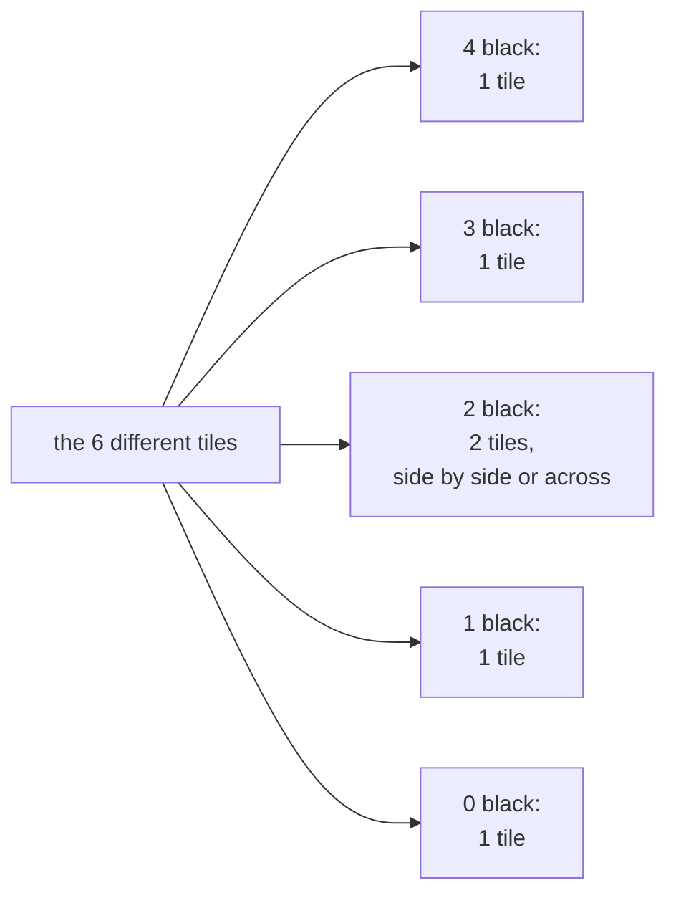

# Polya counting: record each move's cycles in one polynomial, the cycle index, and substitute colours to count patterns by type

[Syllabus](../../../SYLLABUS.md) → [Combinatorics and graphs](../README.md) → [Repeats, Groups and Double Counting](../README.md#s02) → Polya counting

---

## General Overview

A tile factory paints the four corners of a square tile right through to the back. The tile drops into its recess eight ways: four turns, and those four again after a flip. Two painted tiles that differ by one of those moves are one product.

With black and white paint there are 16 ways to paint the corners, but only 6 different tiles. With three colours there are 81 ways and 21 tiles. The [Group actions](../../03-Algebra/08-Groups/08-group-actions-and-counting.md) card reached 6 by listing every orbit (a family of patterns that the moves turn into each other), and by Burnside's average.

A sharper question: of the 6 tiles, how many have exactly two black corners? Listing works for 4 corners, but not by hand on a ring of 20 beads. Pólya's method answers with one polynomial.

The trick: a move rearranges the corners in loops, called **cycles**. Record each move's cycle lengths as a product of letters and average over the moves: the result is the **cycle index**.

**Record each move's cycle lengths, average them into one polynomial, and substitute numbers or colour markers to count distinct patterns in total or by colour.**

**What kind of fact this is:** a theorem, Pólya's enumeration theorem, proved on this card in Why it works from Burnside's lemma.

### The picture: the six tiles, sorted by black corners



The cycle index below gives these without listing.

---

## The formula

A move $`g`$ splits the corners into cycles. $`c_i(g)`$ is how many of those cycles have length $`i`$. The letter $`x_i`$ is a slot that stands for "one cycle of length $`i`$". $`\lvert G\rvert`$ is the number of moves.

The cycle index adds one product of slots per move, then averages:

```math
Z = \frac{1}{\lvert G\rvert} \sum_{g \text{ in } G} x_1^{c_1(g)}\, x_2^{c_2(g)}\, x_3^{c_3(g)} \cdots
```

**Read it aloud:** for each move, multiply one slot per cycle, labelled by the cycle's length; add over all moves; divide by the number of moves.

For the tile it is:

```math
Z = \tfrac{1}{8}\left(x_1^4 + 2\,x_4 + 3\,x_2^2 + 2\,x_1^2 x_2\right)
```

Two substitutions turn it into counts, with entry $`i`$ of $`Z(\ldots)`$ filling slot $`x_i`$. Put $`k`$ in every slot, or, to sort by colour, the colour markers raised to the slot's number and added, $`x_i = y_1^i + \cdots + y_k^i`$:

```math
\text{tiles} = Z(k, k, k, k), \qquad \text{tiles by colour count} = Z(b + w,\; b^2 + w^2,\; b^3 + w^3,\; b^4 + w^4)
```

**Read it aloud:** set every slot to the number of colours to count the different tiles; in the second, the coefficient of $`b^2 w^2`$ counts the tiles with two corners of each colour.

| Symbol | Plain meaning | In our example | Push it up and the answer… |
| --- | --- | --- | --- |
| $`G`$, $`\lvert G\rvert`$ | the moves; how many there are | the tile's 8 ways down | more moves merge more patterns |
| $`g`$ | one move | r2, the half turn | — |
| $`c_i(g)`$ | cycles of length $`i`$ in move $`g`$ | the half turn: two cycles of length 2 | more cycles, more patterns it leaves alone |
| $`x_i`$ | a slot for one cycle of length $`i`$ | $`x_2^2`$ for the half turn | — |
| $`Z`$ | the cycle index: the average of the moves' slot products | the tile's $`Z`$ above | — |
| $`k`$ | how many colours | 2 gives 6 tiles, 3 gives 21 | 4 colours give 55 |
| $`y_j`$; $`b`$, $`w`$ | colour $`j`$'s marker; the power of $`b`$ counts black corners, of $`w`$ white ones | $`b^2 w^2`$: two of each | a third colour adds a third marker |

### When it holds

- **The moves form a group.** Burnside needs every move's undo and every combination of moves. With only three of the four turns, the average is not a count.
- **Each move rearranges the positions, and colours ride with the positions.** If a move could also swap black for white, a pattern it leaves unchanged need not be one colour per cycle, and the slots miscount.
- **Any colour may go anywhere.** A rule like "no two black corners side by side" is not a colour count, and no substitution captures it.
- **Every move is counted, the do-nothing move included.** Its $`x_1^4`$ term is 16 of the 48 at two colours.

---

## Why it works

### Step 0: a pattern a move leaves alone is one colour on each cycle

A move carries each corner's paint to the next corner along its cycle. For the pattern to look unchanged, every corner on a cycle must hold the same colour. So a fixed pattern (one the move leaves unchanged) is a free choice of one colour per cycle.

With $`k`$ colours, a move therefore fixes $`k`$ to the power of its cycle count. The quarter turn r1 is one cycle of all four corners, so at two colours it fixes only the 2 one-colour tiles.

### Step 1: Burnside turns fixed patterns into the count

Burnside's lemma, proved on the [Group actions](../../03-Algebra/08-Groups/08-group-actions-and-counting.md) card, says: the number of different patterns is the average, over the moves, of how many patterns each move fixes.

Putting $`k`$ in every slot of a move's product gives $`k`$ to the power of its cycle count: its fixed count from Step 0. So the average is $`Z(k, k, \ldots)`$.

### Step 2: the same argument works inside one colour count

A move never changes how many corners are black. So the patterns with two black corners form a set the moves keep to themselves, and Burnside applies to that set alone.

A fixed pattern paints each cycle one colour, and a black cycle of length $`i`$ adds $`i`$ black corners: the slot $`x_i = b^i + w^i`$ records that choice. Multiplying a move's slots lists its fixed patterns by colour count; averaging over the moves gives Burnside's count for every colour count at once.

<details>
<summary>Detailed proof: why multiplying the slots lists the fixed patterns</summary>

Take a move $`g`$ whose cycles have lengths $`\ell_1, \ldots, \ell_m`$. By Step 0, its fixed patterns are the choices of one colour per cycle.

Expand the product of the slots:

$`\displaystyle (b^{\ell_1} + w^{\ell_1})(b^{\ell_2} + w^{\ell_2}) \cdots (b^{\ell_m} + w^{\ell_m})`$

Each term picks $`b`$ or $`w`$ from every bracket: one colour per cycle. The term is $`b^{B} w^{W}`$ with $`B`$ the corners on black cycles and $`W`$ on white ones. So the coefficient of $`b^B w^W`$ counts the fixed patterns of $`g`$ with $`B`$ black corners.

The set $`X_B`$ of patterns with $`B`$ black corners is carried to itself by every move. Burnside on $`X_B`$:

$`\displaystyle \text{orbits in } X_B = \frac{1}{\lvert G\rvert} \sum_{g} \#\{\text{patterns in } X_B \text{ fixed by } g\} = [\,b^B w^W\,]\; Z(b + w,\, b^2 + w^2, \ldots)`$

The bracket $`[\,b^B w^W\,]`$ means "the coefficient of". Setting $`b = w = 1`$ adds the colour counts back up: Step 1. More colours only add terms to each bracket.

</details>

### Step 3: the tile's moves, cycle by cycle

Number the corners 0, 1, 2, 3 clockwise from the top left, as on the [Group actions](../../03-Algebra/08-Groups/08-group-actions-and-counting.md) card. Cycle notation, from [Permutations](../../03-Algebra/08-Groups/03-permutations-and-the-symmetric-group.md), writes each loop in brackets.

| Move | Cycles of the corners | Slot product |
| --- | --- | --- |
| r0, do nothing | (0)(1)(2)(3) | $`x_1^4`$ |
| r1, r3, quarter turns | (0 1 2 3), (0 3 2 1) | $`x_4`$ each |
| r2, half turn | (0 2)(1 3) | $`x_2^2`$ |
| r1f, r3f, flips across a side | (0 1)(2 3), (0 3)(1 2) | $`x_2^2`$ each |
| r0f, r2f, flips along a diagonal | (0)(2)(1 3), (1)(3)(0 2) | $`x_1^2 x_2`$ each |

Eight moves, four different products: that is the tile's $`Z`$.

---

## Worked numbers, by hand

| Step | Arithmetic | Value |
| --- | --- | --- |
| two colours: $`k = 2`$ in each term | $`2^4 + 2 \times 2 + 3 \times 2^2 + 2 \times 2^3 = 16 + 4 + 12 + 16`$ | 48 |
| divide by the 8 moves | 48 / 8 | **6** |
| three colours | (81 + 6 + 27 + 54) / 8 | **21** |
| $`b^2 w^2`$ in $`x_1^4 = (b + w)^4`$ | choose the 2 black corners of 4 | 6 |
| $`b^2 w^2`$ in $`2\,x_4 = 2(b^4 + w^4)`$ | one cycle is all one colour | 0 |
| $`b^2 w^2`$ in $`3\,x_2^2 = 3(b^2 + w^2)^2`$ | 3 × 2 | 6 |
| $`b^2 w^2`$ in $`2\,x_1^2 x_2 = 2(b + w)^2(b^2 + w^2)`$ | 2 × 2 | 4 |
| tiles with two black corners | (6 + 0 + 6 + 4) / 8 | **2** |

The two are the pair side by side and the pair across a diagonal. The whole second substitution is

```math
Z(b + w, b^2 + w^2, b^3 + w^3, b^4 + w^4) = b^4 + b^3 w + 2\,b^2 w^2 + b w^3 + w^4
```

so the factory's 6 tiles are 1, 1, 2, 1 and 1 by black-corner count.

A ring of 6 beads has 12 moves and this cycle index:

```math
Z = \tfrac{1}{12}\left(x_1^6 + 2\,x_6 + 2\,x_3^2 + 4\,x_2^3 + 3\,x_1^2 x_2^2\right)
```

- **Six beads R R B B G Y.** Doing nothing fixes all 180 orders. Only the 3 flips through opposite beads fix any more, 4 each: G and Y on those two fixed beads (2 ways), and R and B on the two 2-cycles (2 ways). That gives (180 + 4 + 4 + 4) / 12 = **16 bracelets**.
- **Two chlorines on a 6-carbon benzene ring.** Doing nothing fixes C(6, 2) = 15 placements. The half turn and all 6 flips fix 3 each: both chlorines on one 2-cycle, or on the two carbons a flip holds still. That gives (15 + 7 × 3) / 12 = **3 compounds**.

### What breaks if you drop a piece

| Mistake | Comes out at | What went wrong |
| --- | --- | --- |
| Not dividing by the moves | 48 | That is the total of fixed patterns, not a tile count |
| $`b + w`$ in every slot, not $`b^i + w^i`$ | 0.75 tiles with two black corners | A cycle of length 2 then adds one corner, not two |
| The half turn read as one 4-cycle, $`x_4`$ | 5.75 tiles at two colours | (0 2)(1 3) is two cycles; a count that is not whole signals a misread cycle |

The code prints all three.

---

## Code, from first principles, and it actually runs

Road one splits every move into cycles, builds the cycle index and substitutes: numbers for totals, colour markers (polynomials stored by their powers) for counts by type. Road two paints every pattern, lists the orbits by brute force and sorts them by colour. A third check counts each move's fixed patterns one by one against $`k`$ to the power of its cycles. It also re-derives the ring counts above.

### Python

```python
# Polya counting -- the check behind the card.  Nothing is imported.  A move is a list: the
# corner in position i goes to position move[i].  Road one: cycles, cycle index, colours in its
# slots.  Road two: paint every pattern, list the orbits by brute force, sort them by colour.
def group(n, flips=True):                      # the turns of an n-sided shape, then flips
    return [[(s * i + k) % n for i in range(n)] for s in ((1, -1) if flips else (1,)) for k in range(n)]
def cycles(m):                                 # cycle lengths of one move: r2 gives [2, 2]
    seen, out = set(), []
    for i in range(len(m)):
        j, n = i, 0
        while j not in seen: seen.add(j); j, n = m[j], n + 1
        if n: out.append(n)
    return out
def term(m):                                   # the move's term, written like x1^2x2
    c = cycles(m)
    return "".join(f"x{n}" + (f"^{c.count(n)}" if c.count(n) > 1 else "") for n in sorted(set(c)))
def mul(p, q):                                 # multiply two polynomials in the colours
    out = {}
    for (a, u), (b, v) in ((s, t) for s in p.items() for t in q.items()):
        e = tuple(x + y for x, y in zip(a, b)); out[e] = out.get(e, 0) + u * v
    return out
def fill(m, k, e, power=True):                 # each slot xn becomes y1^n + ... + yk^n;
    p = {(0,) * k: 1}                          # return the coefficient of the type e
    for n in cycles(m):
        p = mul(p, {tuple((n if power else 1) * (c == d) for d in range(k)): 1 for c in range(k)})
    return p.get(e, 0)
def paints(n, k): return [()] if n == 0 else [p + (c,) for p in paints(n - 1, k) for c in range(k)]
def act(m, p): return tuple(p[m.index(j)] for j in range(len(m)))   # paint rides with corner
def orbits(G, k): return {min(act(m, p) for m in G) for p in paints(len(G[0]), k)}
def by_type(G, k, e): return sum(1 for o in orbits(G, k) if tuple(o.count(c) for c in range(k)) == e)
def row(t, v): print(f"{t:<22}" + "".join(f"{x:>8}" for x in v))
def index(G): return {t: list(map(term, G)).count(t) for t in map(term, G)}   # each term: how many moves
def zline(G): return "Z = (" + " + ".join((f"{c} " if c > 1 else "") + t for t, c in index(G).items()) + f") / {len(G)}"
def avg(v, G, listed):                         # Burnside's average: must divide exactly, and match the listing
    assert sum(v) % len(G) == 0 and sum(v) // len(G) == listed, (v, listed); return sum(v) // len(G)
T = group(4); terms = index(T)
def parts(f): return [c * f(next(m for m in T if term(m) == t)) for t, c in terms.items()]
row("move", [f"r{k}" for k in range(4)] + [f"r{k}f" for k in range(4)])
row("its cycle term", [term(m) for m in T])
for k in (2, 3): row(f"k^cycles, k = {k}", [k ** len(cycles(m)) for m in T])
print(zline(T))
for k in (2, 3, 4):
    pk, n = parts(lambda m: k ** len(cycles(m))), len(orbits(T, k))
    print(f"k = {k}: ({' + '.join(map(str, pk))}) / 8 = {avg(pk, T, n)}; listing the orbits gives {n}")
types = [(b, 4 - b) for b in (4, 3, 2, 1, 0)]
inv, two = [sum(fill(m, 2, e) for m in T) for e in types], parts(lambda m: fill(m, 2, (2, 2)))
print(f"two black corners: ({' + '.join(map(str, two))}) / 8 = {avg(two, T, by_type(T, 2, (2, 2)))}")
row("4,3,2,1,0 black: Z", [avg([v], T, by_type(T, 2, e)) for v, e in zip(inv, types)])
row("4,3,2,1,0 black: list", [by_type(T, 2, e) for e in types])
H, N, rb = group(6), group(6, False), (2, 2, 1, 1)
br, nk, bz = [fill(m, 4, rb) for m in H], [fill(m, 4, rb) for m in N], [fill(m, 2, (4, 2)) for m in H]
print("hexagon: " + zline(H))
print(f"R R B B G Y bracelets: ({' + '.join(str(v) for v in br if v)}) / {len(H)} = {avg(br, H, by_type(H, 4, rb))}, "
      f"listing {by_type(H, 4, rb)}; necklaces {avg(nk, N, by_type(N, 4, rb))}, listing {by_type(N, 4, rb)}")
print(f"benzene, 4 H, 2 Cl: ({' + '.join(str(v) for v in bz if v)}) / {len(H)} = {avg(bz, H, by_type(H, 2, (4, 2)))}, listing "
      f"{by_type(H, 2, (4, 2))}; every H/Cl mix {avg([2 ** len(cycles(m)) for m in H], H, len(orbits(H, 2)))}, listing {len(orbits(H, 2))}")
print(f"mistakes: no division {sum(2 ** len(cycles(m)) for m in T)}, b + w in every slot {sum(fill(m, 2, (2, 2), False) for m in T) / 8},"
      f" half turn as x4 {sum(2 if m == T[2] else 2 ** len(cycles(m)) for m in T) / 8}, halving the necklaces {sum(nk) // len(N) // 2}")
assert all(k ** len(cycles(m)) == sum(1 for p in paints(4, k) if act(m, p) == p) for k in (2, 3) for m in T)
assert sum(inv) == sum(parts(lambda m: 2 ** len(cycles(m))))   # b = w = 1 adds the colour counts back up
print("ALL CHECKS PASS")
```

**Ran 2026-11-23 on macOS, Python 3.14.10, standard library only. All checks passed. Output, pasted from the run:**

```
move                        r0      r1      r2      r3     r0f     r1f     r2f     r3f
its cycle term            x1^4      x4    x2^2      x4  x1^2x2    x2^2  x1^2x2    x2^2
k^cycles, k = 2             16       2       4       2       8       4       8       4
k^cycles, k = 3             81       3       9       3      27       9      27       9
Z = (x1^4 + 2 x4 + 3 x2^2 + 2 x1^2x2) / 8
k = 2: (16 + 4 + 12 + 16) / 8 = 6; listing the orbits gives 6
k = 3: (81 + 6 + 27 + 54) / 8 = 21; listing the orbits gives 21
k = 4: (256 + 8 + 48 + 128) / 8 = 55; listing the orbits gives 55
two black corners: (6 + 0 + 6 + 4) / 8 = 2
4,3,2,1,0 black: Z           1       1       2       1       1
4,3,2,1,0 black: list        1       1       2       1       1
hexagon: Z = (x1^6 + 2 x6 + 2 x3^2 + 4 x2^3 + 3 x1^2x2^2) / 12
R R B B G Y bracelets: (180 + 4 + 4 + 4) / 12 = 16, listing 16; necklaces 30, listing 30
benzene, 4 H, 2 Cl: (15 + 3 + 3 + 3 + 3 + 3 + 3 + 3) / 12 = 3, listing 3; every H/Cl mix 13, listing 13
mistakes: no division 48, b + w in every slot 0.75, half turn as x4 5.75, halving the necklaces 15
ALL CHECKS PASS
```

### Rust

Same numbers, same labels, built with `rustc --edition 2021 -O`.

```rust
// Polya counting -- the same check as the Python, in Rust.  No crates.  A move is a list: the
// corner in position i goes to position move[i].  Road one: cycles, cycle index, colours in its
// slots.  Road two: paint every pattern, list the orbits by brute force, sort them by colour.
use std::collections::{BTreeMap, BTreeSet};
type Poly = BTreeMap<Vec<usize>, usize>;
fn group(n: i64, flips: bool) -> Vec<Vec<usize>> {     // the turns of an n-sided shape, then flips
    let signs: Vec<i64> = if flips { vec![1, -1] } else { vec![1] };
    signs.iter().flat_map(|&s| (0..n).map(move |k| (0..n).map(|i| ((s * i + k) % n + n) as usize % n as usize).collect())).collect()
}
fn cycles(m: &[usize]) -> Vec<usize> {                  // cycle lengths of one move: r2 gives [2, 2]
    let (mut seen, mut out) = (vec![false; m.len()], vec![]);
    for i in 0..m.len() { let (mut j, mut n) = (i, 0);
        while !seen[j] { seen[j] = true; j = m[j]; n += 1; }
        if n > 0 { out.push(n); } }
    out
}
fn term(m: &[usize]) -> String {                        // the move's term, written like x1^2x2
    let c = cycles(m);
    let lens: BTreeSet<usize> = c.iter().cloned().collect();
    lens.iter().map(|&n| { let k = c.iter().filter(|&&x| x == n).count();
        if k > 1 { format!("x{}^{}", n, k) } else { format!("x{}", n) } }).collect()
}
fn mul(p: &Poly, q: &Poly) -> Poly {                     // multiply two polynomials in the colours
    let mut out = Poly::new();
    for (a, u) in p { for (b, v) in q { *out.entry(a.iter().zip(b).map(|(x, y)| x + y).collect()).or_insert(0) += u * v; } }
    out
}
fn fill(m: &[usize], k: usize, e: &[usize], power: bool) -> usize {   // slot xn -> y1^n + ... + yk^n,
    let mut p: Poly = [(vec![0; k], 1)].into_iter().collect();          // then the coefficient of type e
    for n in cycles(m) { p = mul(&p, &(0..k).map(|c| ((0..k).map(|d| if c != d { 0 } else if power { n } else { 1 }).collect(), 1)).collect()); }
    *p.get(e).unwrap_or(&0)
}
fn paints(n: usize, k: usize) -> Vec<Vec<usize>> { if n == 0 { return vec![vec![]]; }   // every way to paint
    paints(n - 1, k).into_iter().flat_map(|p| (0..k).map(move |c| { let mut q = p.clone(); q.push(c); q })).collect() }
fn act(m: &[usize], p: &[usize]) -> Vec<usize> { (0..m.len()).map(|j| p[m.iter().position(|&x| x == j).unwrap()]).collect() }
fn orbits(g: &[Vec<usize>], k: usize) -> BTreeSet<Vec<usize>> {
    paints(g[0].len(), k).iter().map(|p| g.iter().map(|m| act(m, p)).min().unwrap()).collect() }
fn by_type(g: &[Vec<usize>], k: usize, e: &[usize]) -> usize {
    orbits(g, k).iter().filter(|o| (0..k).map(|c| o.iter().filter(|&&x| x == c).count()).collect::<Vec<_>>() == e).count()
}
fn row(t: &str, v: &[String]) { println!("{:<22}{}", t, v.iter().map(|x| format!("{:>8}", x)).collect::<String>()); }
fn pw(k: usize, m: &[usize]) -> usize { k.pow(cycles(m).len() as u32) }
fn plus(v: &[usize], zeros: bool) -> String { v.iter().filter(|&&x| zeros || x > 0).map(|x| x.to_string()).collect::<Vec<_>>().join(" + ") }
fn index(g: &[Vec<usize>]) -> Vec<(String, usize)> {     // each term, and how many moves have it
    let ts: Vec<String> = g.iter().map(|m| term(m)).collect();
    ts.iter().enumerate().filter(|(i, s)| !ts[..*i].contains(s)).map(|(_, s)| (s.clone(), ts.iter().filter(|x| *x == s).count())).collect() }
fn zline(g: &[Vec<usize>]) -> String {
    format!("Z = ({}) / {}", index(g).iter().map(|(s, c)| if *c > 1 { format!("{} {}", c, s) } else { s.clone() }).collect::<Vec<_>>().join(" + "), g.len()) }
fn avg(v: &[usize], g: &[Vec<usize>], listed: usize) -> usize {   // Burnside's average, divided exactly
    let s: usize = v.iter().sum(); assert!(s % g.len() == 0 && s / g.len() == listed, "{:?} {}", v, listed); s / g.len() }
fn main() {
    let t = group(4, true); let terms = index(&t);
    row("move", &(0..8).map(|i| format!("r{}{}", i % 4, if i < 4 { "" } else { "f" })).collect::<Vec<_>>());
    row("its cycle term", &t.iter().map(|m| term(m)).collect::<Vec<_>>());
    for k in [2, 3] { row(&format!("k^cycles, k = {}", k), &t.iter().map(|m| pw(k, m).to_string()).collect::<Vec<_>>()); }
    println!("{}", zline(&t));
    let parts = |f: &dyn Fn(&[usize]) -> usize| -> Vec<usize> { terms.iter().map(|(s, c)| c * f(t.iter().find(|m| term(m) == *s).unwrap())).collect() };
    for k in [2, 3, 4] { let (pk, list) = (parts(&|m| pw(k, m)), orbits(&t, k).len());
        println!("k = {}: ({}) / 8 = {}; listing the orbits gives {}", k, plus(&pk, true), avg(&pk, &t, list), list); }
    let types: Vec<Vec<usize>> = [4, 3, 2, 1, 0].iter().map(|&b| vec![b, 4 - b]).collect();
    let inv: Vec<usize> = types.iter().map(|e| t.iter().map(|m| fill(m, 2, e, true)).sum()).collect();
    let (listed, two) = (types.iter().map(|e| by_type(&t, 2, e)).collect::<Vec<_>>(), parts(&|m| fill(m, 2, &[2, 2], true)));
    println!("two black corners: ({}) / 8 = {}", plus(&two, true), avg(&two, &t, by_type(&t, 2, &[2, 2])));
    row("4,3,2,1,0 black: Z", &inv.iter().zip(&listed).map(|(v, l)| avg(&[*v], &t, *l).to_string()).collect::<Vec<_>>());
    row("4,3,2,1,0 black: list", &listed.iter().map(|v| v.to_string()).collect::<Vec<_>>());
    let (h, nk, rb) = (group(6, true), group(6, false), [2, 2, 1, 1]);
    let fills = |g: &[Vec<usize>], k: usize, e: &[usize]| -> Vec<usize> { g.iter().map(|m| fill(m, k, e, true)).collect() };
    let (br, nl, bz, hc) = (fills(&h, 4, &rb), fills(&nk, 4, &rb), fills(&h, 2, &[4, 2]), h.iter().map(|m| pw(2, m)).collect::<Vec<_>>());
    println!("hexagon: {}", zline(&h));
    println!("R R B B G Y bracelets: ({}) / {} = {}, listing {}; necklaces {}, listing {}", plus(&br, false), h.len(),
             avg(&br, &h, by_type(&h, 4, &rb)), by_type(&h, 4, &rb), avg(&nl, &nk, by_type(&nk, 4, &rb)), by_type(&nk, 4, &rb));
    println!("benzene, 4 H, 2 Cl: ({}) / {} = {}, listing {}; every H/Cl mix {}, listing {}", plus(&bz, false), h.len(),
             avg(&bz, &h, by_type(&h, 2, &[4, 2])), by_type(&h, 2, &[4, 2]), avg(&hc, &h, orbits(&h, 2).len()), orbits(&h, 2).len());
    let half: usize = t.iter().map(|m| if *m != t[2] { pw(2, m) } else { 2 }).sum();   // r2 misread as one 4-cycle
    println!("mistakes: no division {}, b + w in every slot {}, half turn as x4 {}, halving the necklaces {}", t.iter().map(|m| pw(2, m)).sum::<usize>(),
             t.iter().map(|m| fill(m, 2, &[2, 2], false)).sum::<usize>() as f64 / 8.0, half as f64 / 8.0, nl.iter().sum::<usize>() / nk.len() / 2);
    for k in [2, 3] { assert!(t.iter().all(|m| pw(k, m) == paints(4, k).iter().filter(|p| act(m, p) == **p).count())); }
    assert!(inv.iter().sum::<usize>() == parts(&|m| pw(2, m)).iter().sum::<usize>());   // b = w = 1 adds the colour counts back up
    println!("ALL CHECKS PASS");
}
```

**Ran 2026-11-23 on macOS, rustc 1.98.1, no crates. All checks passed. Output, pasted from the run:**

```
move                        r0      r1      r2      r3     r0f     r1f     r2f     r3f
its cycle term            x1^4      x4    x2^2      x4  x1^2x2    x2^2  x1^2x2    x2^2
k^cycles, k = 2             16       2       4       2       8       4       8       4
k^cycles, k = 3             81       3       9       3      27       9      27       9
Z = (x1^4 + 2 x4 + 3 x2^2 + 2 x1^2x2) / 8
k = 2: (16 + 4 + 12 + 16) / 8 = 6; listing the orbits gives 6
k = 3: (81 + 6 + 27 + 54) / 8 = 21; listing the orbits gives 21
k = 4: (256 + 8 + 48 + 128) / 8 = 55; listing the orbits gives 55
two black corners: (6 + 0 + 6 + 4) / 8 = 2
4,3,2,1,0 black: Z           1       1       2       1       1
4,3,2,1,0 black: list        1       1       2       1       1
hexagon: Z = (x1^6 + 2 x6 + 2 x3^2 + 4 x2^3 + 3 x1^2x2^2) / 12
R R B B G Y bracelets: (180 + 4 + 4 + 4) / 12 = 16, listing 16; necklaces 30, listing 30
benzene, 4 H, 2 Cl: (15 + 3 + 3 + 3 + 3 + 3 + 3 + 3) / 12 = 3, listing 3; every H/Cl mix 13, listing 13
mistakes: no division 48, b + w in every slot 0.75, half turn as x4 5.75, halving the necklaces 15
ALL CHECKS PASS
```

The two outputs match line for line.

### Lean

Lean proves Pólya's theorem for any finite group of moves on finite positions, and checks the square tile by machine.

- Take any move and $`k`$ colours. Then the move fixes $`k`$ to the power of its cycle count.
- Take $`k`$ colours. Then the number of different patterns is $`Z(k, k, \ldots)`$.
- Put $`x_i = y_1^i + \cdots + y_k^i`$ in every slot. Then the coefficient of $`y_1^{e_1} \cdots y_k^{e_k}`$ counts the different patterns where colour $`j`$ covers $`e_j`$ positions.
- On the square tile, Lean lists the orbits by machine. It finds 6 tiles at two colours, 21 at three, and 2 with two black corners.
- Lean also checks the tile's second substitution: it gives $`b^4 + b^3 w + 2\,b^2 w^2 + b w^3 + w^4`$.

The six-bead ring, the benzene counts and the mistakes table are left to the Python and Rust checks.

```lean
-- Polya counting: for a finite group of moves rearranging a finite set of positions, putting k in every slot of the cycle index counts the k-colourings up to the moves, and putting y_1^i + ... + y_k^i in slot x_i counts them by how many positions get each colour.
import Mathlib.GroupTheory.GroupAction.Quotient
import Mathlib.GroupTheory.Perm.Cycle.Type
import Mathlib.GroupTheory.SpecificGroups.Dihedral
import Mathlib.Algebra.MvPolynomial.Eval
import Mathlib.Tactic.NormNum
import Mathlib.Tactic.Ring

open MulAction

-- A move `g` acts on colourings `f : α → Fin k` by `(g • f) x = f (g⁻¹ • x)`: the paint rides
-- with the positions.
attribute [local instance] arrowAction

open Finset in
/-- Which cycle of `σ` a point lies on: a fixed point names itself, a moved point names its cycle. -/
def cycleTag {α : Type*} [Fintype α] [DecidableEq α] (σ : Equiv.Perm α) (x : α) :
    α ⊕ Equiv.Perm α :=
  if x ∈ σ.support then .inr (σ.cycleOf x) else .inl x

theorem cycleTag_eq_iff {α : Type*} [Fintype α] [DecidableEq α] (σ : Equiv.Perm α) (x y : α) :
    cycleTag σ x = cycleTag σ y ↔ σ.SameCycle x y := by
  unfold cycleTag
  by_cases hx : x ∈ σ.support <;> by_cases hy : y ∈ σ.support <;>
    simp only [hx, hy, ite_true, ite_false]
  · rw [Equiv.Perm.sameCycle_iff_cycleOf_eq_of_mem_support hx hy, Sum.inr.injEq]
  · simp only [reduceCtorEq, false_iff]
    intro h; exact hy (h.mem_support_iff.1 hx)
  · simp only [reduceCtorEq, false_iff]
    intro h; exact hx (h.mem_support_iff.2 hy)
  · rw [Sum.inl.injEq]
    constructor
    · rintro rfl; exact Equiv.Perm.SameCycle.refl _ _
    · intro h; exact h.eq_of_left (Equiv.Perm.notMem_support.1 hx)

theorem fixed_iff_const {α C : Type*} [Fintype α] [DecidableEq α] (σ : Equiv.Perm α)
    (f : α → C) :
    (∀ x, f (σ⁻¹ x) = f x) ↔ ∀ x y, cycleTag σ x = cycleTag σ y → f x = f y := by
  simp only [cycleTag_eq_iff]
  constructor
  · rintro h x y ⟨i, rfl⟩
    have key : ∀ n : ℤ, f ((σ ^ n) x) = f x := by
      intro n
      induction n using Int.induction_on with
      | zero => simp
      | succ n ih =>
        rw [← ih, add_comm, zpow_add, zpow_one, Equiv.Perm.mul_apply]
        simpa using (h (σ ((σ ^ (n : ℤ)) x))).symm
      | pred n ih =>
        rw [← ih, sub_eq_add_neg, add_comm, zpow_add, zpow_neg_one, Equiv.Perm.mul_apply, h]
    exact (key i).symm
  · intro h x
    exact h _ _ ⟨1, by simp⟩

open Finset in
theorem sum_const_on_fibres {α β C R : Type*} [Fintype α] [DecidableEq α] [DecidableEq β] [Fintype C]
    [DecidableEq C] [CommSemiring R] (φ : α → β) (w : C → R)
    [DecidablePred fun f : α → C => ∀ x y, φ x = φ y → f x = f y] :
    ∑ f ∈ univ.filter (fun f : α → C => ∀ x y, φ x = φ y → f x = f y), ∏ x, w (f x) =
      ∏ b ∈ univ.image φ, ∑ c, w c ^ #{x | φ x = b} := by
  classical
  have hmem : ∀ x, φ x ∈ univ.image φ := fun x => mem_image_of_mem φ (mem_univ x)
  let e : (univ.image φ → C) ≃ {f : α → C // ∀ x y, φ x = φ y → f x = f y} :=
    { toFun := fun F => ⟨fun x => F ⟨φ x, hmem x⟩, fun x y h => by simp only [h]⟩
      invFun := fun f q => f.1 (Classical.choose (mem_image.1 q.2))
      left_inv := fun F => by
        funext q
        have := (Classical.choose_spec (mem_image.1 q.2)).2
        exact congrArg F (Subtype.ext this)
      right_inv := fun f => by
        apply Subtype.ext; funext x
        exact f.2 _ _ (Classical.choose_spec (mem_image.1 (hmem x))).2 }
  rw [Finset.sum_subtype (univ.filter _) (p := fun f : α → C => ∀ x y, φ x = φ y → f x = f y)
    (by intro f; simp only [mem_filter, mem_univ, true_and])]
  rw [← Finset.prod_coe_sort (univ.image φ), Fintype.prod_sum]
  symm
  refine Fintype.sum_equiv e _ _ (fun F => ?_)
  let G : β → R := fun b => if hb : b ∈ univ.image φ then w (F ⟨b, hb⟩) else 1
  have h1 : ∏ x, w ((e F).1 x) = ∏ x, G (φ x) := by
    refine prod_congr rfl (fun x _ => ?_)
    simp only [G, hmem x, ↓reduceDIte]
    rfl
  rw [h1, prod_comp, ← Finset.prod_coe_sort (univ.image φ)]
  refine prod_congr rfl (fun q _ => ?_)
  simp only [G, q.2, ↓reduceDIte]

open Finset in
theorem prod_fibres_cycleTag {α M : Type*} [Fintype α] [DecidableEq α] [CommMonoid M]
    (σ : Equiv.Perm α) (h : ℕ → M) :
    ∏ b ∈ univ.image (cycleTag σ), h #{x | cycleTag σ x = b} =
      (σ.partition.parts.map h).prod := by
  have himg : univ.image (cycleTag σ) = σ.supportᶜ.disjSum σ.cycleFactorsFinset := by
    ext b
    rcases b with x | c
    · simp only [mem_image, mem_univ, true_and, inl_mem_disjSum, mem_compl]
      constructor
      · rintro ⟨y, hy⟩
        unfold cycleTag at hy
        split_ifs at hy with hs
        rw [Sum.inl.injEq] at hy; rw [← hy]; exact hs
      · intro hx; exact ⟨x, by simp [cycleTag, hx]⟩
    · simp only [mem_image, mem_univ, true_and, inr_mem_disjSum]
      constructor
      · rintro ⟨y, hy⟩
        unfold cycleTag at hy
        split_ifs at hy with hs
        rw [Sum.inr.injEq] at hy
        exact hy ▸ Equiv.Perm.cycleOf_mem_cycleFactorsFinset_iff.2 hs
      · intro hc
        obtain ⟨a, ha⟩ := (Equiv.Perm.mem_cycleFactorsFinset_iff.1 hc).1.nonempty_support
        have ha' : a ∈ σ.support := Equiv.Perm.mem_cycleFactorsFinset_support_le hc ha
        exact ⟨a, by simp [cycleTag, ha', ← Equiv.Perm.cycle_is_cycleOf ha hc]⟩
  have h1 : ∀ x ∈ σ.supportᶜ, #{y | cycleTag σ y = .inl x} = 1 := by
    intro x hx
    rw [card_eq_one]
    refine ⟨x, ?_⟩
    ext y
    simp only [mem_filter, mem_univ, true_and, mem_singleton]
    unfold cycleTag
    split_ifs with hy
    · simp only [false_iff]
      rintro rfl; exact (mem_compl.1 hx) hy
    · rw [Sum.inl.injEq]
  have h2 : ∀ c ∈ σ.cycleFactorsFinset, #{y | cycleTag σ y = .inr c} = #c.support := by
    intro c hc
    congr 1
    ext y
    simp only [mem_filter, mem_univ, true_and]
    unfold cycleTag
    split_ifs with hy
    · rw [Sum.inr.injEq]
      constructor
      · rintro rfl
        exact Equiv.Perm.mem_support_cycleOf_iff.2 ⟨Equiv.Perm.SameCycle.refl _ _, hy⟩
      · intro hy'
        exact (Equiv.Perm.cycle_is_cycleOf hy' hc).symm
    · simp only [false_iff]
      intro hy'
      exact hy (Equiv.Perm.mem_cycleFactorsFinset_support_le hc hy')
  have h1' : ∀ x ∈ σ.supportᶜ, h #{y | cycleTag σ y = .inl x} = h 1 :=
    fun x hx => by rw [h1 x hx]
  have h2' : ∀ c ∈ σ.cycleFactorsFinset, h #{y | cycleTag σ y = .inr c} = h #c.support :=
    fun c hc => by rw [h2 c hc]
  rw [himg, prod_disjSum, prod_congr rfl h1', prod_congr rfl h2', prod_const, card_compl,
    Equiv.Perm.parts_partition, Multiset.map_add, Multiset.prod_add, Equiv.Perm.cycleType_def,
    Multiset.map_replicate, Multiset.prod_replicate, Multiset.map_map, mul_comm]
  rfl

open Finset in
theorem sum_fixed_prod_eq {α C R : Type*} [Fintype α] [DecidableEq α] [Fintype C]
    [DecidableEq C] [CommSemiring R] (σ : Equiv.Perm α) (w : C → R) :
    ∑ f ∈ univ.filter (fun f : α → C => ∀ x, f (σ⁻¹ x) = f x), ∏ x, w (f x) =
      (σ.partition.parts.map fun i => ∑ c, w c ^ i).prod := by
  classical
  rw [← prod_fibres_cycleTag σ (fun i => ∑ c, w c ^ i), ← sum_const_on_fibres]
  refine sum_congr ?_ (fun _ _ => rfl)
  ext f
  simp only [mem_filter, mem_univ, true_and]
  exact fixed_iff_const σ f


open Finset in
theorem coeff_sum_prod_X {α : Type*} [Fintype α] [DecidableEq α] {k : ℕ}
    (S : Finset (α → Fin k)) (e : Fin k → ℕ) :
    (∑ f ∈ S, ∏ x, (MvPolynomial.X (f x) : MvPolynomial (Fin k) ℚ)).coeff
        (Finsupp.equivFunOnFinite.symm e) =
      ((S.filter fun f => ∀ j, (univ.filter fun x => f x = j).card = e j).card : ℚ) := by
  rw [MvPolynomial.coeff_sum, Finset.card_filter, Nat.cast_sum]
  refine sum_congr rfl (fun f _ => ?_)
  have hX : ∏ x, (MvPolynomial.X (f x) : MvPolynomial (Fin k) ℚ) =
      MvPolynomial.monomial (∑ x, Finsupp.single (f x) 1) 1 := by
    rw [MvPolynomial.monomial_sum_one]; rfl
  have hiff : (∑ x, Finsupp.single (f x) 1 = Finsupp.equivFunOnFinite.symm e) ↔
      ∀ j, (univ.filter fun x => f x = j).card = e j := by
    rw [Finsupp.ext_iff]
    refine forall_congr' (fun j => ?_)
    rw [Finsupp.finsetSum_apply, Finsupp.coe_equivFunOnFinite_symm]
    simp only [Finsupp.single_apply, sum_boole, Nat.cast_id]
  rw [hX, MvPolynomial.coeff_monomial]
  by_cases h : ∀ j, (univ.filter fun x => f x = j).card = e j
  · simp [hiff.2 h, h]
  · simp [mt hiff.1 h, h]

#print axioms cycleTag_eq_iff
#print axioms fixed_iff_const
#print axioms sum_const_on_fibres
#print axioms prod_fibres_cycleTag
#print axioms sum_fixed_prod_eq
#print axioms coeff_sum_prod_X

section Polya

variable (G α : Type*) [Group G] [Fintype G] [MulAction G α] [Fintype α] [DecidableEq α]

/-- The lengths of the cycles into which move `g` splits the positions, one entry per cycle,
the fixed positions (cycles of length 1) included. -/
def cycleLengths (g : G) : Multiset ℕ :=
  (MulAction.toPerm g : Equiv.Perm α).partition.parts

/-- The cycle index `Z`: for each move, multiply one slot `x_i` per cycle of length `i`; add over
all moves; divide by the number of moves. The slot `x_i` is the variable `MvPolynomial.X i`. -/
noncomputable def cycleIndex : MvPolynomial ℕ ℚ :=
  (Fintype.card G : ℚ)⁻¹ •
    ∑ g : G, ((cycleLengths G α g).map fun i => (MvPolynomial.X i : MvPolynomial ℕ ℚ)).prod


omit [Fintype G] [Fintype α] [DecidableEq α] in
theorem mem_fixedBy_iff_perm {k : ℕ} (g : G) (f : α → Fin k) :
    f ∈ fixedBy (α → Fin k) g ↔ ∀ x, f ((MulAction.toPerm g : Equiv.Perm α)⁻¹ x) = f x := by
  rw [mem_fixedBy, funext_iff]; rfl

omit [Fintype G] in
open Finset in
theorem natCard_fixedBy_eq (k : ℕ) (g : G) :
    Nat.card (fixedBy (α → Fin k) g) = k ^ (cycleLengths G α g).card := by
  have hset : fixedBy (α → Fin k) g = ↑(univ.filter fun f : α → Fin k =>
      ∀ x, f ((MulAction.toPerm g : Equiv.Perm α)⁻¹ x) = f x) := by
    ext f
    simp only [Finset.coe_filter, Finset.mem_univ, true_and, Set.mem_ofPred_eq]
    exact mem_fixedBy_iff_perm G α g f
  rw [hset, Finset.coe_sort_coe, Nat.card_eq_finsetCard]
  have h := sum_fixed_prod_eq (MulAction.toPerm g : Equiv.Perm α) (fun _ : Fin k => (1 : ℕ))
  simp only [prod_const_one, one_pow, sum_const, card_univ, Fintype.card_fin, smul_eq_mul,
    mul_one, Multiset.map_const', Multiset.prod_replicate] at h
  rw [h]; rfl

/-- The colourings with colour count `e`; the moves keep them together. -/
def colourClass (k : ℕ) (e : Fin k → ℕ) : SubMulAction G (α → Fin k) where
  carrier := {f | ∀ j, (Finset.univ.filter fun x => f x = j).card = e j}
  smul_mem' g f hf j := by
    rw [← hf j]
    refine Finset.card_nbij' (fun x => g⁻¹ • x) (fun x => g • x) ?_ ?_ ?_ ?_
    · intro x hx
      simp only [Finset.coe_filter, Finset.mem_univ, true_and, Set.mem_ofPred_eq] at hx ⊢
      exact hx
    · intro x hx
      simp only [Finset.coe_filter, Finset.mem_univ, true_and, Set.mem_ofPred_eq] at hx ⊢
      show f (g⁻¹ • g • x) = j
      rw [inv_smul_smul]; exact hx
    · intro x _; simp
    · intro x _; simp

omit [Fintype G] [DecidableEq α] in
theorem natCard_orbits_colourClass (k : ℕ) (e : Fin k → ℕ) :
    Nat.card {o : orbitRel.Quotient G (α → Fin k) //
        ∃ f : α → Fin k, (Quotient.mk'' f : orbitRel.Quotient G (α → Fin k)) = o ∧
          ∀ j, (Finset.univ.filter fun x => f x = j).card = e j} =
      Nat.card (orbitRel.Quotient G (colourClass G α k e)) := by
  symm
  apply Nat.card_congr
  let ψ0 : orbitRel.Quotient G (colourClass G α k e) → orbitRel.Quotient G (α → Fin k) :=
    Quotient.map' Subtype.val (fun a b h => by
      obtain ⟨g, hg⟩ := h
      exact ⟨g, by rw [← hg]; rfl⟩)
  have hψ : ∀ q, ∃ f : α → Fin k, (Quotient.mk'' f : orbitRel.Quotient G (α → Fin k)) = ψ0 q ∧
      ∀ j, (Finset.univ.filter fun x => f x = j).card = e j := by
    intro q
    induction q using Quotient.inductionOn' with
    | h y => exact ⟨y.1, rfl, y.2⟩
  refine Equiv.ofBijective (fun q => ⟨ψ0 q, hψ q⟩) ⟨?_, ?_⟩
  · intro q1 q2 h
    induction q1 using Quotient.inductionOn'
    induction q2 using Quotient.inductionOn'
    rename_i a b
    have h' := congrArg Subtype.val h
    simp only [ψ0, Quotient.map'_mk''] at h'
    obtain ⟨g, hg⟩ := Quotient.exact' h'
    apply Quotient.sound'
    exact ⟨g, Subtype.ext hg⟩
  · rintro ⟨o, f, rfl, hf⟩
    exact ⟨Quotient.mk'' ⟨f, hf⟩, rfl⟩

omit [Fintype G] in
open Finset in
theorem natCard_fixedBy_colourClass (k : ℕ) (e : Fin k → ℕ) (g : G) :
    Nat.card (fixedBy (colourClass G α k e) g) =
      (univ.filter fun f : α → Fin k => (∀ x, f ((MulAction.toPerm g : Equiv.Perm α)⁻¹ x) = f x) ∧
        ∀ j, (univ.filter fun x => f x = j).card = e j).card := by
  rw [← Nat.card_eq_finsetCard]
  exact Nat.card_congr
    { toFun := fun y => ⟨y.1.1, mem_filter.2 ⟨mem_univ _,
        (mem_fixedBy_iff_perm G α g _).1 (congrArg Subtype.val y.2), y.1.2⟩⟩
      invFun := fun f => ⟨⟨f.1, (mem_filter.1 f.2).2.2⟩,
        Subtype.ext ((mem_fixedBy_iff_perm G α g f.1).2 (mem_filter.1 f.2).2.1)⟩
      left_inv := fun _ => rfl
      right_inv := fun _ => rfl }

#print axioms mem_fixedBy_iff_perm
#print axioms natCard_fixedBy_eq
#print axioms natCard_orbits_colourClass
#print axioms natCard_fixedBy_colourClass

/-- Pólya's theorem, the count: for a finite group of moves rearranging a finite set of
positions, with `k` colours free to go on any position and riding with the positions, the number
of different patterns (each orbit of colourings counted once) is the cycle index with `k` put in
every slot, `Z(k, k, k, …)`. -/
theorem card_patterns_eq_cycle_index_at_k (k : ℕ) :
    (Nat.card (orbitRel.Quotient G (α → Fin k)) : ℚ) =
      MvPolynomial.eval (fun _ => (k : ℚ)) (cycleIndex G α) := by
  classical
  have hB := MulAction.sum_card_fixedBy_eq_card_orbits_mul_card_group G (α → Fin k)
  simp only [← Nat.card_eq_fintype_card, natCard_fixedBy_eq] at hB
  have hG : (Nat.card G : ℚ) ≠ 0 := Nat.cast_ne_zero.2 Nat.card_pos.ne'
  simp only [cycleIndex, MvPolynomial.smul_eval, map_sum, map_multiset_prod, Multiset.map_map,
    Function.comp_def, MvPolynomial.eval_X, Multiset.map_const', Multiset.prod_replicate,
    ← Nat.card_eq_fintype_card]
  rw [eq_inv_mul_iff_mul_eq₀ hG, mul_comm]
  exact_mod_cast hB.symm

/-- Step 0: a colouring that a move leaves unchanged is one colour on each of its cycles, so with
`k` colours the move fixes exactly `k` to the power of its number of cycles. -/
theorem card_fixed_colourings_eq_pow_cycles (k : ℕ) (g : G) :
    Nat.card (fixedBy (α → Fin k) g) = k ^ (cycleLengths G α g).card := by
  exact natCard_fixedBy_eq G α k g

/-- Pólya's theorem, colour by colour: put `x_i = y_1^i + ⋯ + y_k^i` in every slot of the cycle
index. Then for every colour count `e` (colour `j` used on `e j` positions), the coefficient of
`y_1^(e 1) ⋯ y_k^(e k)` is the number of different patterns with exactly that colour count. -/
theorem card_patterns_of_colour_count_eq_coeff (k : ℕ) (e : Fin k → ℕ) :
    (Nat.card {o : orbitRel.Quotient G (α → Fin k) //
        ∃ f : α → Fin k, (Quotient.mk'' f : orbitRel.Quotient G (α → Fin k)) = o ∧
          ∀ j, (Finset.univ.filter fun x => f x = j).card = e j} : ℚ) =
      (MvPolynomial.aeval
          (fun i : ℕ => ∑ j : Fin k, (MvPolynomial.X j : MvPolynomial (Fin k) ℚ) ^ i)
          (cycleIndex G α)).coeff (Finsupp.equivFunOnFinite.symm e) := by
  classical
  rw [natCard_orbits_colourClass]
  have hB := MulAction.sum_card_fixedBy_eq_card_orbits_mul_card_group G (colourClass G α k e)
  simp only [← Nat.card_eq_fintype_card, natCard_fixedBy_colourClass] at hB
  have hg : ∀ g : G, (MvPolynomial.aeval
          (fun i : ℕ => ∑ j : Fin k, (MvPolynomial.X j : MvPolynomial (Fin k) ℚ) ^ i)
          ((cycleLengths G α g).map fun i => (MvPolynomial.X i : MvPolynomial ℕ ℚ)).prod).coeff
        (Finsupp.equivFunOnFinite.symm e) =
      ((Finset.univ.filter fun f : α → Fin k =>
        (∀ x, f ((MulAction.toPerm g : Equiv.Perm α)⁻¹ x) = f x) ∧
          ∀ j, (Finset.univ.filter fun x => f x = j).card = e j).card : ℚ) := by
    intro g
    rw [map_multiset_prod, Multiset.map_map]
    simp only [Function.comp_def, MvPolynomial.aeval_X]
    rw [cycleLengths, ← sum_fixed_prod_eq (MulAction.toPerm g : Equiv.Perm α)
      (fun j : Fin k => (MvPolynomial.X j : MvPolynomial (Fin k) ℚ)), coeff_sum_prod_X,
      Finset.filter_filter]
  have hG : (Nat.card G : ℚ) ≠ 0 := Nat.cast_ne_zero.2 Nat.card_pos.ne'
  rw [cycleIndex, map_smul, map_sum, MvPolynomial.coeff_smul, MvPolynomial.coeff_sum,
    Finset.sum_congr rfl (fun g _ => hg g), smul_eq_mul, Fintype.card_eq_nat_card,
    eq_inv_mul_iff_mul_eq₀ hG, mul_comm]
  exact_mod_cast hB.symm

end Polya

/-! ### The card's square tile, checked exactly

The tile's eight moves are Mathlib's `DihedralGroup 4`: `r k` turns by `k` quarters, sending
corner `i` to position `i + k`, and `sr k` flips, sending corner `i` to `-i - k`. A pattern paints
corners `0, 1, 2, 3`; a move carries every corner's colour to the position that corner lands on. -/

/-- Pattern `p` after move `a`: position `j` receives the colour of the corner `a` sends to `j`. -/
def tileMove {C : Type} : DihedralGroup 4 → (ZMod 4 → C) → (ZMod 4 → C)
  | .r k, p => fun j => p (j - k)
  | .sr k, p => fun j => p (-j - k)

-- Two colours: the eight moves fix 16 + 2 + 4 + 2 + 8 + 4 + 8 + 4 = 48 patterns, 48 / 8 = 6.
example : (∑ a : DihedralGroup 4,
    (Finset.univ.filter fun p : ZMod 4 → Fin 2 => tileMove a p = p).card) = 48 := by decide
example : ((16 + 4 + 12 + 16) / 8 : ℚ) = 6 := by norm_num

-- Listing the orbits of the 16 two-colour patterns gives the same 6 tiles.
example : (Finset.univ.image fun p : ZMod 4 → Fin 2 =>
    Finset.univ.image fun a : DihedralGroup 4 => tileMove a p).card = 6 := by decide

-- Three colours: (81 + 6 + 27 + 54) / 8 = 21, and four colours give 55.
example : ((81 + 6 + 27 + 54) / 8 : ℚ) = 21 := by norm_num
example : ((256 + 8 + 48 + 128) / 8 : ℚ) = 55 := by norm_num
set_option maxRecDepth 100000 in
example : (Finset.univ.image fun p : ZMod 4 → Fin 3 =>
    Finset.univ.image fun a : DihedralGroup 4 => tileMove a p).card = 21 := by decide

-- The colour substitution x_i = b^i + w^i in the tile's cycle index gives the inventory
-- b^4 + b^3 w + 2 b^2 w^2 + b w^3 + w^4.
example (b w : ℚ) :
    ((b + w) ^ 4 + 2 * (b ^ 4 + w ^ 4) + 3 * (b ^ 2 + w ^ 2) ^ 2
        + 2 * (b + w) ^ 2 * (b ^ 2 + w ^ 2)) / 8 =
      b ^ 4 + b ^ 3 * w + 2 * b ^ 2 * w ^ 2 + b * w ^ 3 + w ^ 4 := by ring

-- Two black corners: (6 + 0 + 6 + 4) / 8 = 2, and listing finds the same 2 tiles.
example : ((6 + 0 + 6 + 4) / 8 : ℚ) = 2 := by norm_num
example : ((Finset.univ.filter fun p : ZMod 4 → Fin 2 =>
    (Finset.univ.filter fun x => p x = 0).card = 2).image fun p =>
      Finset.univ.image fun a : DihedralGroup 4 => tileMove a p).card = 2 := by decide

-- The R R B B G Y bracelet: (180 + 4 + 4 + 4) / 12 = 16.
example : ((180 + 4 + 4 + 4) / 12 : ℚ) = 16 := by norm_num

#print axioms card_patterns_eq_cycle_index_at_k
#print axioms card_fixed_colourings_eq_pow_cycles
#print axioms card_patterns_of_colour_count_eq_coeff
```

**Checked 2026-11-23 on macOS, Lean 4.36.0-rc2, Mathlib v4.36.0-rc2. Every proof is complete and uses only Lean's standard axioms. Output, pasted from the run:**

```
'cycleTag_eq_iff' depends on axioms: [propext, Classical.choice, Quot.sound]
'fixed_iff_const' depends on axioms: [propext, Classical.choice, Quot.sound]
'sum_const_on_fibres' depends on axioms: [propext, Classical.choice, Quot.sound]
'prod_fibres_cycleTag' depends on axioms: [propext, Classical.choice, Quot.sound]
'sum_fixed_prod_eq' depends on axioms: [propext, Classical.choice, Quot.sound]
'coeff_sum_prod_X' depends on axioms: [propext, Classical.choice, Quot.sound]
'mem_fixedBy_iff_perm' depends on axioms: [propext, Quot.sound]
'natCard_fixedBy_eq' depends on axioms: [propext, Classical.choice, Quot.sound]
'natCard_orbits_colourClass' depends on axioms: [propext, Classical.choice, Quot.sound]
'natCard_fixedBy_colourClass' depends on axioms: [propext, Classical.choice, Quot.sound]
'card_patterns_eq_cycle_index_at_k' depends on axioms: [propext, Classical.choice, Quot.sound]
'card_fixed_colourings_eq_pow_cycles' depends on axioms: [propext, Classical.choice, Quot.sound]
'card_patterns_of_colour_count_eq_coeff' depends on axioms: [propext, Classical.choice, Quot.sound]
```

> [!TIP]
> **Try changing**
> Guess first, then run it.
> - **Let the bracelet only turn.** Change `group(6)` to `group(6, False)` where `H` is built. Guess the bracelet line: it reads (180) / 6 = 30, the necklace count. The benzene count stays at 3, because each of the three dichlorobenzenes is its own mirror image, and every H/Cl mix becomes 14, the two-colour necklaces. Nothing stops the run: both roads change together.
> - **Put three chlorines on the ring.** Change every `(4, 2)` to `(3, 3)`. Guess first: the count is 3 again, the three trichlorobenzenes.
> - **Forget the do-nothing move.** Change `T = group(4)` to `T = group(4)[1:]`. The index loses its 16, no longer matches the listing, and the first assert stops the run.

---

## The usual mistake

> [!warning]
> **Putting the same colour sum in every slot.** The slot $`x_i`$ must become $`b^i + w^i`$, not $`b + w`$. A cycle of length 2 painted black is two black corners, so it must add 2 to the power of $`b`$. With $`b + w`$ everywhere, two black corners come out at 0.75 tiles, not a whole number.
>
> - **Forgetting to divide by the number of moves.** Two colours then give 48, the total of fixed patterns, not 6 tiles.
> - **Misreading a cycle.** The half turn is (0 2)(1 3), two cycles. Read as one 4-cycle, the two-colour count is 5.75.
> - **Halving when beads repeat.** Halving the 30 R R B B G Y necklaces gives 15; [Round tables and bracelets](04-circular-arrangements.md) finds 16.

---

## Where you meet it in real life

- **Chemistry.** Pólya built the method in 1937 to count chemical compounds. Benzene's 6 carbons each hold hydrogen (H) or another group; the 3 compounds above with two chlorines (Cl) are what chemists call ortho, meta and para. All mixes of H and Cl give 13.
- **Jewellery.** Six beads R R B B G Y on a bracelet make 16 designs, matching the brute force on [Round tables and bracelets](04-circular-arrangements.md).
- **Counting networks.** Pólya's paper also counts graphs and trees whose points carry no names.

> **Say it back**
> A move rearranges a shape's positions in cycles. A pattern it leaves unchanged is one colour per cycle, so with $`k`$ colours it fixes $`k`$ to the power of its cycle count. Averaging the moves' slot products gives the cycle index, and by Burnside's lemma $`Z(k, k, \ldots)`$ counts the different patterns. Putting $`b^i + w^i`$ into each slot sorts that count by colour. The tile gives 6 in two colours, 21 in three, and 2 with two black corners.

---

## What this builds on

- [Round tables and bracelets](04-circular-arrangements.md): dividing by turns and flips, and the R R B B G Y bracelets where dividing failed.
- [Bijections and double counting](05-bijection-and-double-counting.md): counting pairs (move, fixed pattern) two ways proves Burnside's lemma.
- [Group actions](../../03-Algebra/08-Groups/08-group-actions-and-counting.md): the tile's eight moves, orbits, and Burnside's average, stated and proved.
- [Permutations](../../03-Algebra/08-Groups/03-permutations-and-the-symmetric-group.md): cycle notation, the way each move is written here.

## Where this goes next

- [Pascal's rule](../03-Binomial%20Coefficients%20and%20Identities/01-pascals-rule-and-the-triangle.md): opens the next shelf, turning from symmetry and grouping to the choose counts themselves and the triangle that builds them.
- [Counting by multiplying series](../07-Generating%20Functions/02-counting-with-generating-functions.md): the colour-count polynomial is a generating function, read by that card's tools.
- [Counting shuffles by their loops](../08-Partitions/05-permutations-by-cycles.md): all shuffles sorted by their cycles, the cycle index of the full symmetric group.
- [Graphs](../09-Graphs%20-%20Dots%20and%20Lines/01-graphs-vertices-and-edges.md): when two drawings are the same graph, the question Pólya's method counts.

The cycle index needs each cycle type counted. For a group with millions of moves like the full symmetric group, [Counting shuffles by their loops](../08-Partitions/05-permutations-by-cycles.md) groups moves by cycle type without listing them. That closes this shelf on repeats, groups and symmetry; the next shelf turns to binomial coefficients, starting with [Pascal's rule](../03-Binomial%20Coefficients%20and%20Identities/01-pascals-rule-and-the-triangle.md).

---

## Sources

Verified 2026-11-23: every link below resolves to the publisher's page.

- Pólya, George. "Kombinatorische Anzahlbestimmungen für Gruppen, Graphen und chemische Verbindungen." *Acta Mathematica* 68 (1937), 145–254. [doi:10.1007/BF02546665](https://doi.org/10.1007/BF02546665). The original: the cycle index, the substitution, compounds and graphs.
- van Lint, J. H., and R. M. Wilson. *A Course in Combinatorics*, 2nd ed. Cambridge University Press, 2001. Chapter 37, "Pólya theory of counting". [doi:10.1017/CBO9780511987045.039](https://doi.org/10.1017/CBO9780511987045.039). The theorem with colour weights, proved from Burnside.
- Brualdi, Richard A. *Introductory Combinatorics* (Classic Version), 5th ed. Pearson. Chapter 14, "Pólya Counting". [Publisher page](https://www.pearson.com/en-us/subject-catalog/p/introductory-combinatorics-classic-version/P200000006138/9780137981045). Pólya counting at an introductory level.
- Judson, Thomas W. *Abstract Algebra: Theory and Applications*, section 14.3, on the author's site. [Textbook section](https://judsonbooks.org/aata-files/aata-html/actions-section-burnsides-counting-theorem.html). Burnside's theorem on a square's corners in black and white, and the fixed count of Step 0.
