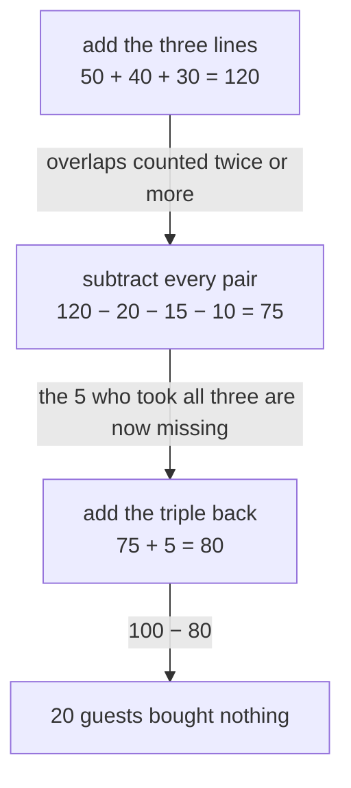

# Inclusion-exclusion for any number of sets: add, subtract the pairs, add the triples, and every element ends up counted once

[Syllabus](../../../SYLLABUS.md) → [Combinatorics and graphs](../README.md) → [Inclusion-Exclusion and Pigeonhole](../README.md#s04) → Inclusion-exclusion for any number of sets

---

## General Overview

A hotel closes its June books on 100 guests. The extras ledger has three lines: 50 took breakfast, 40 parking, 30 the spa. How many bought no extra?

Adding the lines gives 120 in a hotel of 100. Impossible: a guest who took breakfast and parking is written on two lines.

The overlaps are on record: 20 took breakfast and parking, 15 breakfast and spa, 10 parking and spa, 5 took all three. Subtracting the pairs gives 75 — too low, since the 5 who took everything came off once too often. Add them back: 80 bought something, 20 bought nothing.

Two sets and three were settled earlier ([Inclusion-exclusion](../../01-Foundations/07-Sets/04-inclusion-exclusion.md)); this card takes any number. The method is also called a sieve: it filters a pool down to the members in none of the sets.

**Add the sets, subtract every pair, add every triple, flipping the sign to the last overlap: each member of at least one set then contributes exactly 1, each member of none 0.**

**What kind of fact this is:** a theorem, proved on this card in Why it works.

### The picture: three corrections, in order



Each arrow names the damage the next box repairs.

---

## The formula

Notation first. Bars count members: $\lvert A\rvert$ is the size of a set A. The cup ∪ means "in at least one", and what it collects is the union; the cap ∩ means "in all", an overlap ([Set operations](../../01-Foundations/07-Sets/03-set-operations.md)). Sigma is the add-up sign, and C(n, j), "n choose j", counts the ways to pick j from n.

Call the sets $A_i$, numbered 1 up to $n$: breakfast, parking, spa, so $n$ is 3. Layer j takes the sets j at a time and adds up those overlaps' sizes.

$$S_j = \sum_{1 \le i_1 < i_2 < \cdots < i_j \le n} \lvert A_{i_1} \cap A_{i_2} \cap \cdots \cap A_{i_j}\rvert$$

**Read it aloud:** count what lies in all j of the sets chosen, for every choice of j sets.

Layer 1 is 120, layer 2 45, layer 3 the lone triple, 5. Layer j holds C(n, j) counts, so the layers hold $2^n - 1$ in all.

$$\lvert A_1 \cup A_2 \cup \cdots \cup A_n\rvert = S_1 - S_2 + S_3 - \cdots + (-1)^{n+1} S_n$$

**Read it aloud:** the count in at least one set is the layers added and subtracted in turn, starting with a plus.

What lies in *none* of them is the pool of 100 minus that union: 20 guests.

| Symbol | Plain meaning | In our example | Push it up and the answer… |
| --- | --- | --- | --- |
| $A_i$ | one of the sets combined | breakfast, parking, spa | — |
| $n$ | how many sets | 3 here, 4 in the sieve below | the overlap list doubles |
| $\lvert A\rvert$ | the size of a set | breakfast holds 50 | the union grows, by less |
| $S_j$ | layer j: the j-at-a-time overlaps, added | 120, 45, 5 | odd layers lift, even lower |
| $k$ | how many sets a member sits in | all-three guest: k = 3 | more repairs, net 1 |

### When it holds

- **Finite sets.** Every layer must be a whole number; subtracting one infinite count from another settles nothing.
- **Sets, not tallies.** Nine breakfasts make one member of the breakfast set; repeated rows break layer 1 before the repairs begin.
- **Every overlap knowable.** It asks for $2^n - 1$ counts: 7 for three sets, 15 for four, doubling after. Out of reach, the sum is cut short and becomes a bound ([Stopping the sieve early](04-union-bound-and-bonferroni.md)).

---

## Why it works

### Step 0: watch one member, not the sets

A total is right when every member contributes what it should: 1 for a member of at least one set, 0 otherwise. Test one guest.

Take the guest who took breakfast and parking, not the spa. Layer 1 counts them twice, on two lines; layer 2 once, in the breakfast-and-parking overlap; layer 3 not at all: 2 − 1 = 1.

### Step 1: how often one member is counted

Write $k$ for how many sets a member belongs to; that guest's $k$ is 2. Which overlaps hold them? Only those built from their own sets — an overlap naming the spa cannot hold a guest who skipped it.

So the layer-j overlaps holding a member are the ways to choose j of their own k sets: C(k, j) of them. For this guest that is C(2, 1) = 2 in layer 1 and C(2, 2) = 1 in layer 2.

That is what makes n sets no harder than three: only a member's own $k$ matters.

### Step 2: the alternating sum of those counts is 1

A member in k sets therefore contributes

$$C(k, 1) - C(k, 2) + C(k, 3) - \cdots + (-1)^{k+1} C(k, k)$$

which comes to 1 for every $k$ of 1 or more. Off Pascal's triangle: 1; 2 − 1 = 1; 3 − 3 + 1 = 1; 4 − 6 + 4 − 1 = 1. The code runs it to $k$ = 8. The binomial theorem is the reason ([Alternating sums](../03-Binomial%20Coefficients%20and%20Identities/06-alternating-sums-and-binomial-inversion.md)).

<details>
<summary>Detailed proof: why the alternating sum collapses</summary>

The binomial theorem expands $(1 + x)^k$ as $C(k, 0) + C(k, 1)x + \cdots + C(k, k)x^k$. Set x to −1: the left side is $(1 - 1)^k$, which is 0 for every k of 1 or more.

$$0 = C(k, 0) - C(k, 1) + C(k, 2) - \cdots + (-1)^k C(k, k)$$

C(k, 0) is 1, one way to choose nothing. Move it across and multiply by −1: what remains is the member's contribution, 1 for any k, with no mention of n. Added over the pool, that is the theorem. Only k = 0 is excluded, $(1-1)^0$ being 1.

</details>

### Step 3: members in no set never appear

If $k$ is 0 the member lies in no set, so in no overlap, so in no layer: it contributes 0. The 20 who bought nothing never enter the sum.

### Step 4: take the union off the pool

80 from 100 leaves 20 — usually the question actually asked.

<details>
<summary>Euler's totient is this sieve on the divisors</summary>

Sieve the first 30 numbers by 2, 3 and 5: 8 escape, the 8 the code prints. That count is the totient, written with the Greek letter phi: phi(30) = 8 ([Euler's totient](../../02-Number%20theory/04-Powers%20on%20the%20Clock/03-eulers-totient.md)). Its usual form, 30 × (1 − 1/2) × (1 − 1/3) × (1 − 1/5) = 8, is one bracket per divisor; multiplying out gives the signed sum term for term.

</details>

Induction on the number of sets reaches the theorem too, but hides where the signs come from.

---

## Worked numbers, by hand

| Step | Arithmetic | Value |
| --- | --- | --- |
| layer 1, the lines | 50 + 40 + 30 | 120 |
| layer 2, the pairs | 20 + 15 + 10 | 45 |
| layer 3, the triple | 5 | 5 |
| the union | 120 − 45 + 5 | **80** |
| bought nothing | 100 − 80 | **20** |

Eighty of the hundred June guests bought an extra, twenty none.

### Four properties at once

How many of 1 to 1,000 are divisible by none of 2, 3, 5 and 7? The four share no factor, so an overlap is divisibility by their product, and each count is a division with the remainder dropped. For example, 500 are divisible by 2, and 166 by 2 and 3 together.

| Layer | Overlaps counted | Total |
| --- | --- | --- |
| 1, the four singles | 500 + 333 + 200 + 142 | 1,175 |
| 2, the six pairs | 166 + 100 + 71 + 66 + 47 + 28 | 478 |
| 3, the four triples | 33 + 23 + 14 + 9 | 79 |
| 4, the one quadruple | 4 | 4 |
| divisible by something | 1,175 − 478 + 79 − 4 | **772** |
| divisible by none | 1,000 − 772 | **228** |

Drop the 7 and the same machine gives layers 1,033, 332 and 33, a union of 734, so 266 survivors. That 266 has a check with no sieve in it: survivors repeat every 30, 8 to a block — 33 × 8 + 2 = 266.

### What breaks if you drop a piece

| Mistake | Comes out at | What went wrong |
| --- | --- | --- |
| Add the lines and stop | 120 | No repair, and more than the hotel holds |
| Stop after the pairs | 75 | The 5 all-three guests: added 3 times, subtracted 3 |
| Subtract the triple, not add | 70 | The last sign flipped: those 5 count −1 each |

The code prints all three.

---

## Code, from first principles, and it actually runs

Nothing is imported, and every count is reached twice. The roster is built guest by guest from the eight groups the ledger makes; the union comes from the signed sum of overlaps, and again from walking the roster. The sieve runs by layers, then by testing every number.

### Python

```python
# Inclusion-exclusion for any number of sets -- the check behind the card.  Nothing
# is imported.  A hotel of 100 guests with three amenities, then the numbers 1 to
# 1000 sieved by 2, 3, 5 and by 2, 3, 5, 7.  Every count is reached twice: by the
# signed sum of overlaps, and by walking the members one at a time.
REGIONS = {("B", "P", "S"): 5, ("B", "P"): 15, ("B", "S"): 10, ("P", "S"): 5,
           ("B",): 20, ("P",): 15, ("S",): 10, (): 20}
ROSTER = [set(r) for r, n in REGIONS.items() for _ in range(n)]

def pick(items, j):                      # every j of the items, order kept
    if j == 0: return [()]
    return [(x,) + r for i, x in enumerate(items) for r in pick(items[i + 1:], j - 1)]

def overlaps(items, size):               # every j-at-a-time overlap, layer by layer
    return [[size(c) for c in pick(items, j)] for j in range(1, len(items) + 1)]

def union(ls):                           # S_1 - S_2 + S_3 - ...
    return sum((-1) ** j * sum(layer) for j, layer in enumerate(ls))

def choose(n, k):                        # Pascal's triangle, built here
    row = [1]
    for _ in range(n): row = [a + b for a, b in zip([0] + row, row + [0])]
    return row[k]

def guests_with(names):                  # guests holding every amenity named
    return sum(1 for g in ROSTER if set(names) <= g)
def prod(ds): return ds[0] * prod(ds[1:]) if ds else 1
def multiples_of_all(ds): return 1000 // prod(ds)     # 1 to 1000 divisible by all of ds
def none_of(ds, limit):                  # road two: test every number in turn
    return sum(1 for x in range(1, limit + 1) if all(x % d for d in ds))
def yn(claim): return "yes" if claim else "no"

th = overlaps(list("BPS"), guests_with)
hl = [sum(layer) for layer in th]
hotel, walk = union(th), sum(1 for g in ROSTER if g)
ones = [sum((-1) ** (j + 1) * choose(k, j) for j in range(1, k + 1)) for k in range(1, 9)]
t3, t4 = overlaps([2, 3, 5], multiples_of_all), overlaps([2, 3, 5, 7], multiples_of_all)
l3, l4 = [sum(x) for x in t3], [sum(x) for x in t4]
none3, none4 = 1000 - union(t3), 1000 - union(t4)
blocks, per, spare = 1000 // 30, none_of([2, 3, 5], 30), sum(1 for x in range(991, 1001) if all(x % d for d in (2, 3, 5)))
print(f"hotel: {len(ROSTER)} guests; singles {th[0]}, pairs {th[1]}, all three {th[2]}")
print(f"layers S1 {hl[0]}, S2 {hl[1]}, S3 {hl[2]}  ->  union {hl[0]} - {hl[1]} + {hl[2]} = {hotel}")
print(f"the same {hotel}, by walking the roster guest by guest: {yn(hotel == walk)}")
print(f"guests who took nothing: {len(ROSTER)} - {hotel} = {len(ROSTER) - hotel}")
print(f"a guest in k of the amenities is counted, for k = 1 to 8: {ones}")
print(f"Pascal's row for k = 4, the counts that alternate: {[choose(4, j) for j in range(5)]}")
print(f"mistake 1, add the three counts and stop: {hl[0]}, not {hotel}")
print(f"mistake 2, stop after the pairs: {hl[0] - hl[1]}, not {hotel}")
print(f"mistake 3, subtract the triple instead of adding: {hl[0] - hl[1] - hl[2]}, not {hotel}")
print(f"1 to 1000, none of 2, 3, 5: layers {l3}  ->  union {union(t3)}, none {none3}")
print(f"1 to 1000, none of 2, 3, 5: by testing each number {none_of([2, 3, 5], 1000)}")
print(f"1 to 1000, none of 2, 3, 5: {blocks} blocks of 30 x {per} + {spare} left over = {blocks * per + spare}")
print(f"1 to 1000, by 2, 3, 5, 7: singles {t4[0]}, pairs {t4[1]}, triples {t4[2]}, all four {t4[3]}")
print(f"1 to 1000, none of 2, 3, 5, 7: layers {l4}  ->  union {union(t4)}, none {none4}")
print(f"1 to 1000, none of 2, 3, 5, 7: by testing each number {none_of([2, 3, 5, 7], 1000)}")
assert hotel == walk and hotel == 80                       # sieve against a head count
assert len(ROSTER) - hotel == 20 and hl == [120, 45, 5]    # the layers, one at a time
assert none3 == none_of([2, 3, 5], 1000) and none3 == blocks * per + spare
assert none4 == none_of([2, 3, 5, 7], 1000) and ones == [1] * 8
print("ALL CHECKS PASS")
```

**Ran 2026-09-14 on macOS, Python 3.14.6, standard library only. All checks passed. Output, pasted from the run:**

```
hotel: 100 guests; singles [50, 40, 30], pairs [20, 15, 10], all three [5]
layers S1 120, S2 45, S3 5  ->  union 120 - 45 + 5 = 80
the same 80, by walking the roster guest by guest: yes
guests who took nothing: 100 - 80 = 20
a guest in k of the amenities is counted, for k = 1 to 8: [1, 1, 1, 1, 1, 1, 1, 1]
Pascal's row for k = 4, the counts that alternate: [1, 4, 6, 4, 1]
mistake 1, add the three counts and stop: 120, not 80
mistake 2, stop after the pairs: 75, not 80
mistake 3, subtract the triple instead of adding: 70, not 80
1 to 1000, none of 2, 3, 5: layers [1033, 332, 33]  ->  union 734, none 266
1 to 1000, none of 2, 3, 5: by testing each number 266
1 to 1000, none of 2, 3, 5: 33 blocks of 30 x 8 + 2 left over = 266
1 to 1000, by 2, 3, 5, 7: singles [500, 333, 200, 142], pairs [166, 100, 71, 66, 47, 28], triples [33, 23, 14, 9], all four [4]
1 to 1000, none of 2, 3, 5, 7: layers [1175, 478, 79, 4]  ->  union 772, none 228
1 to 1000, none of 2, 3, 5, 7: by testing each number 228
ALL CHECKS PASS
```

### Rust

Same numbers, same labels, built with `rustc --edition 2021 -O`.

```rust
// Inclusion-exclusion for any number of sets -- the same check as the Python, in Rust.
// No crates.  A hotel of 100 guests with three amenities, then the numbers 1 to 1000
// sieved by 2, 3, 5 and by 2, 3, 5, 7.  Every count is reached twice: by the signed
// sum of overlaps, and by walking the members one at a time.
const REGIONS: [(u8, i64); 8] = [(7, 5), (3, 15), (5, 10), (6, 5), (1, 20), (2, 15), (4, 10), (0, 20)];

fn roster() -> Vec<u8> {                              // one entry per guest: which amenities
    let mut out = Vec::new();
    for (mask, n) in REGIONS { for _ in 0..n { out.push(mask) } }
    out
}
fn pick(items: &[i64], j: usize) -> Vec<Vec<i64>> {   // every j of the items, order kept
    if j == 0 { return vec![Vec::new()] }
    let mut out = Vec::new();
    for (i, &x) in items.iter().enumerate() {
        for rest in pick(&items[i + 1..], j - 1) { out.push([vec![x], rest].concat()) }
    }
    out
}
fn overlaps(items: &[i64], size: &dyn Fn(&[i64]) -> i64) -> Vec<Vec<i64>> {   // layer by layer
    (1..=items.len()).map(|j| pick(items, j).iter().map(|c| size(c)).collect()).collect()
}
fn union(ls: &[Vec<i64>]) -> i64 {                    // S_1 - S_2 + S_3 - ...
    ls.iter().enumerate().map(|(j, r)| { let s: i64 = r.iter().sum(); if j % 2 == 0 { s } else { -s } }).sum()
}
fn choose(n: i64, k: i64) -> i64 {                    // Pascal's triangle, built here
    let mut row = vec![1i64];
    for _ in 0..n {
        let mut next = vec![0i64; row.len() + 1];
        for (i, &v) in row.iter().enumerate() { next[i] += v; next[i + 1] += v }
        row = next;
    }
    row[k as usize]
}
fn guests_with(bits: &[i64], all: &[u8]) -> i64 {     // guests holding every amenity named
    let mask: u8 = bits.iter().map(|&t| 1u8 << t).sum();
    all.iter().filter(|&&g| g & mask == mask).count() as i64
}
fn prod(ds: &[i64]) -> i64 { ds.iter().product() }
fn multiples_of_all(ds: &[i64]) -> i64 { 1000 / prod(ds) }   // 1 to 1000 divisible by all of ds
fn none_of(ds: &[i64], limit: i64) -> i64 {           // road two: test every number in turn
    (1..=limit).filter(|x| ds.iter().all(|d| x % d != 0)).count() as i64
}
fn yn(claim: bool) -> &'static str { if claim { "yes" } else { "no" } }
fn totals(ls: &[Vec<i64>]) -> Vec<i64> { ls.iter().map(|r| r.iter().sum()).collect() }

fn main() {
    let (all, amen) = (roster(), vec![0i64, 1, 2]);
    let th = overlaps(&amen, &|c: &[i64]| guests_with(c, &all));
    let hl = totals(&th);
    let (hotel, walk) = (union(&th), all.iter().filter(|&&m| m != 0).count() as i64);
    let ones: Vec<i64> = (1..=8).map(|k| (1..=k).map(|j| if j % 2 == 1 { choose(k, j) } else { -choose(k, j) }).sum()).collect();
    let pascal: Vec<i64> = (0..=4).map(|j| choose(4, j)).collect();
    let (t3, t4) = (overlaps(&[2, 3, 5], &multiples_of_all), overlaps(&[2, 3, 5, 7], &multiples_of_all));
    let (l3, l4) = (totals(&t3), totals(&t4));
    let (none3, none4) = (1000 - union(&t3), 1000 - union(&t4));
    let (blocks, per) = (1000 / 30, none_of(&[2, 3, 5], 30));
    let spare = (991..=1000).filter(|x: &i64| [2, 3, 5].iter().all(|d| x % d != 0)).count() as i64;
    println!("hotel: {} guests; singles {:?}, pairs {:?}, all three {:?}", all.len(), th[0], th[1], th[2]);
    println!("layers S1 {}, S2 {}, S3 {}  ->  union {} - {} + {} = {}", hl[0], hl[1], hl[2], hl[0], hl[1], hl[2], hotel);
    println!("the same {}, by walking the roster guest by guest: {}", hotel, yn(hotel == walk));
    println!("guests who took nothing: {} - {} = {}", all.len(), hotel, all.len() as i64 - hotel);
    println!("a guest in k of the amenities is counted, for k = 1 to 8: {:?}", ones);
    println!("Pascal's row for k = 4, the counts that alternate: {:?}", pascal);
    println!("mistake 1, add the three counts and stop: {}, not {}", hl[0], hotel);
    println!("mistake 2, stop after the pairs: {}, not {}", hl[0] - hl[1], hotel);
    println!("mistake 3, subtract the triple instead of adding: {}, not {}", hl[0] - hl[1] - hl[2], hotel);
    println!("1 to 1000, none of 2, 3, 5: layers {:?}  ->  union {}, none {}", l3, union(&t3), none3);
    println!("1 to 1000, none of 2, 3, 5: by testing each number {}", none_of(&[2, 3, 5], 1000));
    println!("1 to 1000, none of 2, 3, 5: {} blocks of 30 x {} + {} left over = {}", blocks, per, spare, blocks * per + spare);
    println!("1 to 1000, by 2, 3, 5, 7: singles {:?}, pairs {:?}, triples {:?}, all four {:?}", t4[0], t4[1], t4[2], t4[3]);
    println!("1 to 1000, none of 2, 3, 5, 7: layers {:?}  ->  union {}, none {}", l4, union(&t4), none4);
    println!("1 to 1000, none of 2, 3, 5, 7: by testing each number {}", none_of(&[2, 3, 5, 7], 1000));
    assert!(hotel == walk && hotel == 80);                              // sieve against a head count
    assert!(all.len() as i64 - hotel == 20 && hl == vec![120, 45, 5]);  // the layers, one at a time
    assert!(none3 == none_of(&[2, 3, 5], 1000) && none3 == blocks * per + spare);
    assert!(none4 == none_of(&[2, 3, 5, 7], 1000) && ones == vec![1i64; 8]);
    println!("ALL CHECKS PASS");
}
```

**Ran 2026-09-14 on macOS, rustc 1.98.1, no crates. All checks passed. Output, pasted from the run:**

```
hotel: 100 guests; singles [50, 40, 30], pairs [20, 15, 10], all three [5]
layers S1 120, S2 45, S3 5  ->  union 120 - 45 + 5 = 80
the same 80, by walking the roster guest by guest: yes
guests who took nothing: 100 - 80 = 20
a guest in k of the amenities is counted, for k = 1 to 8: [1, 1, 1, 1, 1, 1, 1, 1]
Pascal's row for k = 4, the counts that alternate: [1, 4, 6, 4, 1]
mistake 1, add the three counts and stop: 120, not 80
mistake 2, stop after the pairs: 75, not 80
mistake 3, subtract the triple instead of adding: 70, not 80
1 to 1000, none of 2, 3, 5: layers [1033, 332, 33]  ->  union 734, none 266
1 to 1000, none of 2, 3, 5: by testing each number 266
1 to 1000, none of 2, 3, 5: 33 blocks of 30 x 8 + 2 left over = 266
1 to 1000, by 2, 3, 5, 7: singles [500, 333, 200, 142], pairs [166, 100, 71, 66, 47, 28], triples [33, 23, 14, 9], all four [4]
1 to 1000, none of 2, 3, 5, 7: layers [1175, 478, 79, 4]  ->  union 772, none 228
1 to 1000, none of 2, 3, 5, 7: by testing each number 228
ALL CHECKS PASS
```

The two outputs match line for line.

### Lean

Lean proves the formula for any number of finite sets, and checks the card's own numbers.

- For any number of finite sets, the size of the union is the layers added and subtracted in turn, starting with a plus.
- A member in k sets, for any k of 1 or more, is counted C(k, 1) − C(k, 2) + C(k, 3) − … times: exactly 1.
- Inside a finite pool holding all the sets, the count in none of them is the pool minus that union.
- The hotel's layers are 120, 45 and 5, so 80 guests bought an extra and 20 none. The three mistakes come out at 120, 75 and 70.
- Sieving 1 to 1,000 by 2, 3, 5 and 7 leaves 228, both by layers and by testing every number.
- Sieving by 2, 3 and 5 leaves 266, which matches 33 × 8 + 2. Of the first 30 numbers, 8 escape.

Building the hotel roster guest by guest, and testing every number for the 266, are left to the Python and Rust checks.

<details>
<summary>The Lean proof, 152 lines</summary>

```lean
-- Inclusion-exclusion for any number of sets: for finite sets A₁, …, Aₙ the size of their union is S₁ − S₂ + S₃ − ⋯ ± Sₙ, where Sⱼ adds the sizes of all j-at-a-time overlaps, because a member of k ≥ 1 sets is counted C(k, 1) − C(k, 2) + ⋯ = 1 time.
import Mathlib.Data.Set.Card
import Mathlib.Data.Finset.Powerset
import Mathlib.Data.Nat.Choose.Basic
import Mathlib.Algebra.BigOperators.Group.Finset.Basic
import Mathlib.Algebra.Order.Ring.Int
import Mathlib.Order.Interval.Finset.Nat
import Mathlib.Tactic.NormNum

import Mathlib.Combinatorics.Enumerative.InclusionExclusion
import Mathlib.Data.Nat.Choose.Sum

open Finset

/-- The intersection of the sets indexed by a nonempty `t`, as a `Finset` infimum. -/
lemma ie_helper_inter_ncard {α : Type*} [DecidableEq α] {n : ℕ} (A : Fin n → Set α) (hA : ∀ i, (A i).Finite)
    (t : Finset (Fin n)) (ht : t.Nonempty) :
    ((t.inf' ht (fun i => (hA i).toFinset)).card : ℤ) = ((⋂ i ∈ t, A i).ncard : ℤ) := by
  rw [← Set.ncard_coe_finset]
  congr 2
  ext x
  simp [Finset.mem_inf']


/-- **Inclusion-exclusion for `n` sets.** For finite sets `A₁, …, Aₙ`, let layer `Sⱼ` add up the
sizes `|A_{i₁} ∩ ⋯ ∩ A_{iⱼ}|` over every choice of `j` of the sets. Then the number of members in at
least one set is `|A₁ ∪ ⋯ ∪ Aₙ| = S₁ − S₂ + S₃ − ⋯ + (−1)^(n+1) Sₙ`: add the sets, subtract every
pair, add every triple, flipping the sign down to the last overlap. -/
theorem card_union_eq_alternating_sum_of_layers {α : Type*} (n : ℕ) (A : Fin n → Set α)
    (hA : ∀ i, (A i).Finite) :
    ((⋃ i, A i).ncard : ℤ) =
      ∑ j ∈ Icc 1 n, (-1 : ℤ) ^ (j + 1) *
        ∑ t ∈ (univ : Finset (Fin n)).powersetCard j, ((⋂ i ∈ t, A i).ncard : ℤ) := by
  classical
  have hU : (⋃ i, A i) = ((univ : Finset (Fin n)).biUnion (fun i => (hA i).toFinset) : Set α) := by
    ext x; simp
  rw [hU, Set.ncard_coe_finset, inclusion_exclusion_card_biUnion]
  rw [Fintype.sum_congr _ (fun t => (-1 : ℤ) ^ (t.1.card + 1) * ((⋂ i ∈ t.1, A i).ncard : ℤ))
    (fun t => by rw [ie_helper_inter_ncard])]
  rw [Finset.sum_coe_sort ((univ : Finset (Fin n)).powerset.filter (·.Nonempty))
    (fun t => (-1 : ℤ) ^ (t.card + 1) * ((⋂ i ∈ t, A i).ncard : ℤ))]
  rw [← Finset.sum_fiberwise_of_maps_to (g := Finset.card) (t := Icc 1 n)]
  · apply Finset.sum_congr rfl
    intro j hj
    rw [Finset.mul_sum]
    have hj1 : 1 ≤ j := (Finset.mem_Icc.1 hj).1
    have hs : ((univ : Finset (Fin n)).powerset.filter (·.Nonempty)).filter (fun t => t.card = j)
        = (univ : Finset (Fin n)).powersetCard j := by
      ext t
      simp only [Finset.mem_filter, Finset.mem_powerset, Finset.mem_powersetCard]
      constructor
      · rintro ⟨⟨h1, _⟩, h3⟩; exact ⟨h1, h3⟩
      · rintro ⟨h1, h3⟩
        refine ⟨⟨h1, ?_⟩, h3⟩
        rw [← Finset.card_pos]; omega
    rw [hs]
    apply Finset.sum_congr rfl
    intro t ht
    rw [(Finset.mem_powersetCard.1 ht).2]
  · intro t ht
    simp only [Finset.mem_filter, Finset.mem_powerset] at ht
    rw [Finset.mem_Icc]
    refine ⟨Finset.card_pos.2 ht.2, ?_⟩
    simpa using Finset.card_le_card ht.1

/-- **One member's count.** A member that lies in exactly `k` of the sets, with `k` at least 1, is
counted `C(k, 1) − C(k, 2) + C(k, 3) − ⋯ + (−1)^(k+1) C(k, k)` times by the layers, and that
alternating sum is always exactly 1. -/
theorem alternating_sum_choose_eq_one (k : ℕ) (hk : 1 ≤ k) :
    ∑ j ∈ Icc 1 k, (-1 : ℤ) ^ (j + 1) * (k.choose j : ℤ) = 1 := by
  have h := Int.alternating_sum_range_choose (n := k)
  rw [ite_eq_right_iff.2 (fun h0 => absurd h0 (by omega))] at h
  have hr : range (k + 1) = insert 0 (Icc 1 k) := by
    ext x; simp; omega
  rw [hr, Finset.sum_insert (by simp)] at h
  have h2 : ∑ j ∈ Icc 1 k, (-1 : ℤ) ^ (j + 1) * (k.choose j : ℤ)
      = - ∑ j ∈ Icc 1 k, (-1 : ℤ) ^ j * (k.choose j : ℤ) := by
    rw [← Finset.sum_neg_distrib]
    apply Finset.sum_congr rfl
    intro j _
    ring
  rw [h2]
  simp at h
  linarith

/-- **The sieve: members in none of the sets.** Inside a finite pool `P` holding the sets
`A₁, …, Aₙ`, the members in none of them number `|P| − S₁ + S₂ − S₃ + ⋯ + (−1)ⁿ Sₙ`, the pool
minus the union. -/
theorem card_pool_diff_union_eq_sieve {α : Type*} (n : ℕ) (P : Set α) (hP : P.Finite)
    (A : Fin n → Set α) (hAP : ∀ i, A i ⊆ P) :
    ((P \ ⋃ i, A i).ncard : ℤ) =
      (P.ncard : ℤ) + ∑ j ∈ Icc 1 n, (-1 : ℤ) ^ j *
        ∑ t ∈ (univ : Finset (Fin n)).powersetCard j, ((⋂ i ∈ t, A i).ncard : ℤ) := by
  have hU : (⋃ i, A i) ⊆ P := Set.iUnion_subset hAP
  have hA : ∀ i, (A i).Finite := fun i => hP.subset (hAP i)
  have hUf : (⋃ i, A i).Finite := hP.subset hU
  have h1 := card_union_eq_alternating_sum_of_layers n A hA
  have h2 : (P \ ⋃ i, A i).ncard + (⋃ i, A i).ncard = P.ncard := by
    rw [← Set.ncard_union_eq Set.disjoint_sdiff_left (hP.sdiff) hUf, Set.sdiff_union_of_subset hU]
  have h3 : ∑ j ∈ Icc 1 n, (-1 : ℤ) ^ j *
        ∑ t ∈ (univ : Finset (Fin n)).powersetCard j, ((⋂ i ∈ t, A i).ncard : ℤ)
      = - ∑ j ∈ Icc 1 n, (-1 : ℤ) ^ (j + 1) *
        ∑ t ∈ (univ : Finset (Fin n)).powersetCard j, ((⋂ i ∈ t, A i).ncard : ℤ) := by
    rw [← Finset.sum_neg_distrib]
    apply Finset.sum_congr rfl
    intro j _
    ring
  rw [h3, ← h1]
  have h2' : ((P \ ⋃ i, A i).ncard : ℤ) + ((⋃ i, A i).ncard : ℤ) = (P.ncard : ℤ) := by
    exact_mod_cast h2
  linarith

-- The hotel: layers 50 + 40 + 30 = 120, 20 + 15 + 10 = 45, and 5; union 120 − 45 + 5 = 80; none 20.
example : (50 + 40 + 30 : ℤ) = 120 ∧ (20 + 15 + 10 : ℤ) = 45 ∧ (120 - 45 + 5 : ℤ) = 80 ∧
    (100 - 80 : ℤ) = 20 := by norm_num

-- The three mistakes: stop after adding 120, stop after the pairs 75, subtract the triple 70.
example : (120 - 45 : ℤ) = 75 ∧ (120 - 45 - 5 : ℤ) = 70 := by norm_num

-- One member's count off Pascal's triangle: 1; 2 − 1; 3 − 3 + 1; 4 − 6 + 4 − 1 all equal 1.
example : (1 : ℤ) = 1 ∧ (2 - 1 : ℤ) = 1 ∧ (3 - 3 + 1 : ℤ) = 1 ∧ (4 - 6 + 4 - 1 : ℤ) = 1 := by
  norm_num

-- Overlaps holding the breakfast-and-parking guest: C(2, 1) = 2 in layer 1, C(2, 2) = 1 in layer 2.
example : Nat.choose 2 1 = 2 ∧ Nat.choose 2 2 = 1 := by decide

-- Layers hold C(n, j) counts, 2ⁿ − 1 in all: 7 for three sets, 15 for four, 31 for five.
example : Nat.choose 3 1 + Nat.choose 3 2 + Nat.choose 3 3 = 7 ∧ 2 ^ 4 - 1 = 15 ∧
    2 ^ 5 - 1 = 31 := by decide

-- Sieve 1 to 1000 by 2, 3, 5, 7: layers 1175, 478, 79, 4; union 772; none 228.
example : 1000 / 2 + 1000 / 3 + 1000 / 5 + 1000 / 7 = 1175 ∧
    1000 / 6 + 1000 / 10 + 1000 / 14 + 1000 / 15 + 1000 / 21 + 1000 / 35 = 478 ∧
    1000 / 30 + 1000 / 42 + 1000 / 70 + 1000 / 105 = 79 ∧ 1000 / 210 = 4 ∧
    (1175 - 478 + 79 - 4 : ℤ) = 772 ∧ (1000 - 772 : ℤ) = 228 := by norm_num

-- The same 228, by testing every number from 1 to 1000.
example : ((Icc 1 1000).filter (fun x => ¬ 2 ∣ x ∧ ¬ 3 ∣ x ∧ ¬ 5 ∣ x ∧ ¬ 7 ∣ x)).card = 228 := by
  decide +kernel

-- Sieve 1 to 1000 by 2, 3, 5: layers 1033, 332, 33; union 734; none 266 = 33 × 8 + 2.
example : 1000 / 2 + 1000 / 3 + 1000 / 5 = 1033 ∧ 1000 / 6 + 1000 / 10 + 1000 / 15 = 332 ∧
    1000 / 30 = 33 ∧ (1033 - 332 + 33 : ℤ) = 734 ∧ (1000 - 734 : ℤ) = 266 ∧
    33 * 8 + 2 = 266 := by norm_num

-- Euler's totient by the sieve: 8 of 1 to 30 dodge 2, 3 and 5.
example : ((Icc 1 30).filter (fun x => ¬ 2 ∣ x ∧ ¬ 3 ∣ x ∧ ¬ 5 ∣ x)).card = 8 := by decide

#print axioms ie_helper_inter_ncard
#print axioms card_union_eq_alternating_sum_of_layers
#print axioms alternating_sum_choose_eq_one
#print axioms card_pool_diff_union_eq_sieve
```

</details>

**Checked 2026-11-11 on macOS, Lean 4.36.0-rc2, Mathlib v4.36.0-rc2. Every proof is complete and uses only Lean's standard axioms. Output, pasted from the run:**

```
'ie_helper_inter_ncard' depends on axioms: [propext, Classical.choice, Quot.sound]
'card_union_eq_alternating_sum_of_layers' depends on axioms: [propext, Classical.choice, Quot.sound]
'alternating_sum_choose_eq_one' depends on axioms: [propext, Classical.choice, Quot.sound]
'card_pool_diff_union_eq_sieve' depends on axioms: [propext, Classical.choice, Quot.sound]
```

> [!TIP]
> **Try changing**
> Guess first, then run it. The asserts are pinned to the ledger and the two sieves, so expect one to stop the program.
> - **Break the sign.** In `union`, change `(-1) ** j` to `(-1) ** (j + 1)`: every layer flips and the hotel reads −80.
> - **Stop early.** Make `union` return the first layer minus the second: 75, below the truth — a Bonferroni bound, a cut-short sum that is sure to fall on one side of the answer ([Stopping the sieve early](04-union-bound-and-bonferroni.md)).
> - **Sieve by 2, 3, 5, 7, 11.** Add 11 to the four-divisor list: 31 overlap counts replace 15, and the roads still agree, on 207 survivors.

---

## The usual mistake

> [!warning]
> **Stopping after the pairs.** With two sets one subtraction finishes the repair, and the habit sticks. With three it does not: the hotel reads 75, not 80, because the 5 who took all three were added three times in layer 1 and subtracted three times in layer 2, netting zero.
>
> - **Adding the lines and stopping.** 120 for a hotel of 100; wrong totals are not always this visible.
> - **Flipping the last sign.** Subtracting the triple rather than adding gives 70. Odd layers are added, even layers subtracted, all the way down.
> - **Reading a pair count as "these two only".** The 20 includes the 5 who also took the spa; feed in "only" counts and the sum repairs damage never done.

---

## Where you meet it in real life

- **Audits and database counts.** "Matching at least one of these flags" is this sum; five flags means thirty-one overlaps, which is why query tools walk the rows instead.
- **Number sieves.** What survives division by a list of primes is the same sum: 266 of the first thousand dodge 2, 3 and 5. Run over every prime below a bound, it is analytic number theory's oldest tool (Sieving by inclusion-exclusion).
- **Shuffles that put nothing back in place.** Arrangements with no item in its own slot are counted by this sieve, one property per slot ([Derangements](02-derangements.md)).

> **Say it back**
> Overlapping groups cannot be added: shared members land on more than one line. The fix is a run of repairs — add the groups, subtract every pair, add every triple, flipping the sign to the last overlap. It works one member at a time: a member in k groups is counted C(k, 1) − C(k, 2) + C(k, 3) − … times, which is 1 for every k of 1 or more. At the hotel, 120 − 45 + 5 = 80.

---

## What this builds on

- [Alternating sums](../03-Binomial%20Coefficients%20and%20Identities/06-alternating-sums-and-binomial-inversion.md): the identity collapsing each member's repairs to 1.
- [Inclusion-exclusion](../../01-Foundations/07-Sets/04-inclusion-exclusion.md): the two-set and three-set rules this card generalises.
- [Set operations](../../01-Foundations/07-Sets/03-set-operations.md): union, intersection, and the size of a set.
- [Euler's totient](../../02-Number%20theory/04-Powers%20on%20the%20Clock/03-eulers-totient.md): the count the divisor sieve reproduces.

## Where this goes next

- [Derangements](02-derangements.md): the sieve's flagship count.
- [Onto functions](03-counting-surjections.md): the same layers, on onto functions.
- [Stopping the sieve early](04-union-bound-and-bonferroni.md): what a truncated sum is worth.
- Sieving by inclusion-exclusion: the sieve run over the primes, and where it stalls.
- Sum-product: counting overlaps far too many to list.

The formula is exact but doubles in length with each property added; what a partial sum is worth is the next question ([Stopping the sieve early](04-union-bound-and-bonferroni.md)).

---

## Sources

Verified 14 Sep 2026: every link below resolves to the publisher's page.

- *NIST Digital Library of Mathematical Functions*, section 26.18, "Inclusion-Exclusion". [Section page](https://dlmf.nist.gov/26.18). Both forms of the identity, for any n.
- Stanley, Richard P. *Enumerative Combinatorics, Volume 1*, 2nd ed. Cambridge University Press. [Author's full text](https://math.mit.edu/~rstan/ec/ec1.pdf). Chapter 2 sets the sieve out in general.
- van Lint, J. H., and R. M. Wilson. *A Course in Combinatorics*, 2nd ed. Cambridge University Press, 2001. [doi:10.1017/CBO9780511987045](https://doi.org/10.1017/CBO9780511987045). Proves it one element at a time, the route followed here.
- Levin, Oscar. *Discrete Mathematics: An Open Introduction*, 3rd ed. [Advanced counting](https://discrete.openmathbooks.org/dmoi3/sec_advPIE.html). Free, with the three- and four-property cases worked.
