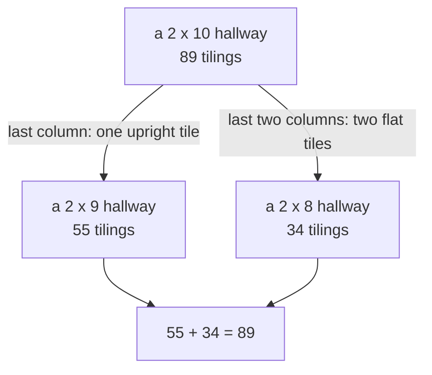

# Recurrences: a rule for the next term from the last few, with Fibonacci as the first example

[Syllabus](../../../SYLLABUS.md) → [Combinatorics and graphs](../README.md) → [Recurrences](../README.md#s05) → Recurrences

---

## General Overview

A hallway is 2 tiles wide and 10 tiles long. Its floor tiles are 1 × 2: each covers two neighbouring squares, standing upright across the width or lying flat along the length. How many floors, or tilings, can a tiler lay? Listing them all is possible and useless: a list carries no reason.

Ask one question instead: what covers the far end? Two answers, no others. One upright tile fills the last column, leaving a hallway one tile shorter; or two flat tiles cover the last two columns, one per row, leaving a hallway two shorter.

So the count at length 10 is the count at 9 plus the count at 8, and the same holds at every length. A rule of that shape — a term written out of the terms just behind it — is a **recurrence**, the term used from here on. Count the two shortest hallways by hand, 1 floor and 2, and the rule walks forward alone: 1, 2, 3, 5, 8, 13, 21, 34, 55, 89, so a 2 × 10 hallway has 89 floors.

Those counts are the Fibonacci numbers, written down by Leonardo of Pisa in 1202 while counting rabbits. They arrive here out of floor tiles because a step rule follows a problem's shape, not its subject.

**A recurrence is a step rule plus its seeds: say how a term follows from the terms behind it, fix enough terms at the start, and every later term is fixed too.**

**What kind of fact this is:** a definition; the two counts claimed here, for tilings and for the Tower of Hanoi (a disc puzzle set out in The formula), are proved in Why it works.

### The picture: what covers the far end



Every floor goes down one branch only, so the counts add.

---

## The formula

Notation first, in words. $T(n)$ names the number in position n of a sequence: the brackets are an address, not a multiplication. Here n is a hallway's length and T(n) counts its floors; an unnamed sequence has terms a(n).

$$T(n) = T(n-1) + T(n-2) \quad \text{for } n \ge 3, \qquad T(1) = 1, \quad T(2) = 2$$

**Read it aloud:** the floors at length n number those one tile shorter plus those two tiles shorter, with two counts by hand to start.

The rule on the left is the **step rule**; the fixed T(1) and T(2) beside it are the **seeds**. Both belong to the definition: "add the two behind it" alone describes endlessly many lists.

The same machinery counts elsewhere. Ten discs of different sizes stand on one peg, largest at the bottom, two empty pegs beside it. Move the stack to the far peg, one disc per move, never a larger disc onto a smaller. This puzzle is the Tower of Hanoi. Write h(n) for the fewest moves:

$$h(n) = 2\,h(n-1) + 1 \quad \text{for } n \ge 1, \qquad h(0) = 0$$

**Read it aloud:** shift the top n − 1 discs to the spare peg, move the largest once, shift the n − 1 back on top.

| Symbol | Plain meaning | In our example | Push it up and the answer… |
| --- | --- | --- | --- |
| $n$ | the position: a hallway's length, or a disc count | 10 | the count grows fast: 55 at 9 tiles, 89 at 10 |
| $T(n)$ | ways a 2 × n hallway takes 1 × 2 tiles | T(10) = 89 | — |
| $T(1)$, $T(2)$ | the seeds, fixed before the rule starts | 1 and 2 | move a seed, every later term moves |
| $F(n)$ | the nth Fibonacci number, seeds 1 and 1 | F(11) = 89 | — |
| $h(n)$ | fewest moves shifting n discs across | h(10) = 1023 | one disc more than doubles the work |
| $a(n)$ | a term of an unnamed sequence | — | — |

### When it holds

- **The question must split the collection.** Every floor falls under one answer only; a missed case counts short, an overlap counts long.
- **What is left is the same problem, smaller.** Rubbing out the last column must leave an ordinary shorter hallway, not a notched shape.
- **One seed per place the rule reaches back.** Two places back needs two starting terms; the wrong pair slides the whole sequence, 55 instead of 89. The rule starts at n = 3: at n = 2 it would call for T(0), never fixed.

---

## Why it works

### Step 0: one question about the end shrinks the problem

A count too large to list is still pinned down if the collection splits into smaller copies of itself, and one question about the end does the splitting.

### Step 1: the two answers split the floors, with no overlap

Look at the tile covering the top square of the far column: it either stands upright and fills the column, or lies flat and reaches back a column. In that second case only a flat tile can cover the square below, reaching back as well. So the far end is one upright tile or two stacked flat tiles, never both, never neither: the counts add rather than multiply ([The rules of sum and product](../01-Counting%20Principles/01-rules-of-sum-and-product.md)).

### Step 2: each part is a shorter hallway, matched one for one

Rub the upright tile out of a floor that ends in one: a tiled 2 × 9 hallway is left, and adding it back returns the original. The two moves undo each other, so floors ending upright number exactly T(9), 55. Rubbing out the flat pair leaves a tiled 2 × 8 hallway, so those number T(8), 34. Adding: 55 + 34 = 89, and nothing there mentioned 10.

### Step 3: the seeds, and why exactly two

A 2 × 1 hallway takes one upright tile and nothing else: T(1) = 1. A 2 × 2 takes two uprights side by side or two flats stacked: T(2) = 2. Fibonacci's sequence uses the same rule with seeds 1 and 1, putting these counts one place along: T(10) = F(11) = 89.

### Step 4: another rule, a guessed closed form, a proof

The largest disc must move at some point, and at that moment the other n − 1 sit stacked on the one remaining peg. Getting them there costs h(n − 1) at best, the largest costs 1, rebuilding costs h(n − 1) again. That is h(n) = 2h(n−1) + 1, with h(0) = 0 because no discs need no moves.

Run it forward: 1, 3, 7, 15, 31, every term one short of a power of 2. That suggests the **closed form** h(n) = 2^n − 1, computed straight from the position. Five numbers are a guess; induction settles it, by checking the start and checking that the rule carries the guess onward ([Induction](../../01-Foundations/06-Proof/04-proof-by-induction.md)), so h(10) = 1023.

<details>
<summary>Detailed proof: the closed form h(n) = 2^n − 1, by induction</summary>

**The claim.** For every whole number n ≥ 0, h(0) = 0 with h(n) = 2h(n−1) + 1 gives h(n) = 2^n − 1.

**The first step.** At n = 0 the seed gives 0, and 2^0 − 1 is 1 − 1, also 0.

**The step onward.** Suppose h(n−1) = 2^(n−1) − 1. Then h(n) = 2h(n−1) + 1 = 2 × (2^(n−1) − 1) + 1 = 2^n − 2 + 1 = 2^n − 1. Holding at n − 1 forces it at n, so holding at 0 it holds everywhere after ([Strong induction and the least element](../../01-Foundations/06-Proof/05-strong-induction-and-well-ordering.md)).

</details>

A forward run costs one step per position. Escaping it is the rest of this shelf:

- read as an equation in an unknown growth factor, the rule gives a closed form ([The characteristic equation](04-characteristic-equation-and-binet.md));
- read as a matrix, it gives one power ([A recurrence is a matrix](06-recurrences-as-matrix-powers.md));
- read as one function, it gives a fraction ([Generating functions](../07-Generating%20Functions/01-ordinary-generating-functions.md)).

---

## Worked numbers, by hand

| Step | Arithmetic | Value |
| --- | --- | --- |
| the seeds, by hand | one upright tile; two uprights or two flats | 1, 2 |
| lengths 3, 4, 5 | 2 + 1, 3 + 2, 5 + 3 | 3, 5, 8 |
| lengths 6, 7 | 8 + 5, 13 + 8 | 13, 21 |
| lengths 8, 9 | 21 + 13, 34 + 21 | 34, 55 |
| length 10 | 55 + 34 | **89** |
| Hanoi, 10 discs | 2 × 511 + 1, and the closed form 2^10 − 1 | **1023** |

A tiler chooses between 89 floors; the Hanoi row splits the same way, 511 + 1 + 511 = 1023.

### What breaks if you drop a piece

| Mistake | Comes out at | What went wrong |
| --- | --- | --- |
| Seeds 1 and 1, not 1 and 2 | 55 | Fibonacci's seeds answer a hallway one tile shorter |
| The flat pair counted once per row | 512 | two flat tiles fill both rows together: one arrangement |
| Guessing h(n) = 2^n | 1024 | a closed form failing at the start fails after it |

The code prints all three.

---

## Code, from first principles, and it actually runs

Nothing is imported. The hallway is counted by two roads sharing no arithmetic: the step rule run forward, and a search that fills the first empty square every legal way and counts the finished floors. The discs are counted three ways: the rule, the recipe walked move by move with every move checked legal, and the closed form. The wrong answers above are computed, not asserted.

### Python

```python
# Recurrences and Fibonacci -- the check behind the card.  Nothing is imported.  A hallway
# 2 tiles wide and n tiles long is laid with 1 x 2 tiles; its tilings are counted twice, by
# the step rule and by laying tiles every legal way.  Hanoi is counted three ways.
N, DISCS = 10, 10
def by_rule(n, seeds=(1, 2), w=1):            # road one: the step rule, run forward
    a = list(seeds)
    while len(a) < n: a.append(a[-1] + w * a[-2])
    return a[:n]
def by_listing(n):                            # road two: lay tiles, count the finishes
    cells = [[0] * n for _ in range(2)]
    def fill():                               # fill the first empty square, two ways
        spot = next(((r, c) for c in range(n) for r in range(2) if not cells[r][c]), None)
        if spot is None: return 1
        r, c, total = spot[0], spot[1], 0
        upright = ((0, c), (1, c)) if r == 0 and not cells[1][c] else ()
        flat = ((r, c), (r, c + 1)) if c + 1 < n and not cells[r][c + 1] else ()
        for pair in (upright, flat):
            if not pair: continue
            for y, x in pair: cells[y][x] = 1
            total += fill()
            for y, x in pair: cells[y][x] = 0
        return total
    return fill()
def hanoi_by_rule(k):                         # road one: h(n) = 2 h(n-1) + 1, forward
    h = 0
    for _ in range(k): h = 2 * h + 1
    return h
def hanoi_by_moving(k):                       # road two: shift the discs one at a time
    pegs, count, legal = {"A": list(range(k, 0, -1)), "B": [], "C": []}, 0, True
    def shift(m, src, dst, spare):
        nonlocal count, legal
        if m == 0: return
        shift(m - 1, src, spare, dst)
        d = pegs[src].pop(); legal = legal and (not pegs[dst] or pegs[dst][-1] > d)
        pegs[dst].append(d); count += 1
        shift(m - 1, spare, dst, src)
    shift(k, "A", "C", "B")
    return count, legal and pegs["C"] == list(range(k, 0, -1))
rule, listed = by_rule(N), [by_listing(n) for n in range(1, N + 1)]
fib, (moves, legal) = by_rule(N + 1, (1, 1)), hanoi_by_moving(DISCS)
hanoi, closed_h = [hanoi_by_rule(k) for k in range(1, DISCS + 1)], 2 ** DISCS - 1
print("hallway 2 tiles wide, 1 x 2 tiles; n is its length in tiles, or the number of discs")
for label, xs in (("n", list(range(1, N + 1))), ("tilings by the rule", rule), ("tilings by listing", listed), ("Hanoi moves by rule", hanoi)):
    print(f"{label:<21}:" + "".join(f"{x:5d}" for x in xs))
print(f"the two tiling roads agree: {'yes' if rule == listed else 'no'}")
print(f"a 2 x {N} hallway has {listed[-1]} tilings")
print(f"the last column: {rule[-2]} end in one upright tile, {rule[-3]} end in two flat tiles, {rule[-2]} + {rule[-3]} = {rule[-2] + rule[-3]}")
print(f"Fibonacci from seeds 1, 1: F({N + 1}) = {fib[-1]}, so T(n) = F(n+1)")
print(f"Tower of Hanoi, {DISCS} discs")
print(f"{'moves by the rule h(n) = 2 h(n-1) + 1':<39}: {hanoi[-1]}")
print(f"{'moves by shifting the discs one by one':<39}: {moves}, legal solve: {'yes' if legal else 'no'}")
print(f"{f'moves by the closed form 2^{DISCS} - 1':<39}: {closed_h}")
print(f"mistake 1, seeds 1 and 1 instead of 1 and 2: {fib[N - 1]}, not {listed[-1]}")
print(f"mistake 2, the flat pair counted once per row: {by_rule(N, (1, 2), 2)[-1]}, not {listed[-1]}")
print(f"mistake 3, guessing h(n) = 2^n, first step unchecked: {2 ** DISCS}, not {hanoi[-1]}")
assert rule == listed                                    # two roads, one sequence
assert listed[-1] == 89 and rule[-2] + rule[-3] == listed[-1]
assert fib[-1] == listed[-1] and fib[N - 1] == 55        # Fibonacci, one place along
assert hanoi[-1] == 1023 and moves == hanoi[-1] and closed_h == hanoi[-1] and legal
print("ALL CHECKS PASS")
```

**Ran 2026-09-14 on macOS, Python 3.14.6, standard library only. All checks passed. Output, pasted from the run:**

```
hallway 2 tiles wide, 1 x 2 tiles; n is its length in tiles, or the number of discs
n                    :    1    2    3    4    5    6    7    8    9   10
tilings by the rule  :    1    2    3    5    8   13   21   34   55   89
tilings by listing   :    1    2    3    5    8   13   21   34   55   89
Hanoi moves by rule  :    1    3    7   15   31   63  127  255  511 1023
the two tiling roads agree: yes
a 2 x 10 hallway has 89 tilings
the last column: 55 end in one upright tile, 34 end in two flat tiles, 55 + 34 = 89
Fibonacci from seeds 1, 1: F(11) = 89, so T(n) = F(n+1)
Tower of Hanoi, 10 discs
moves by the rule h(n) = 2 h(n-1) + 1  : 1023
moves by shifting the discs one by one : 1023, legal solve: yes
moves by the closed form 2^10 - 1      : 1023
mistake 1, seeds 1 and 1 instead of 1 and 2: 55, not 89
mistake 2, the flat pair counted once per row: 512, not 89
mistake 3, guessing h(n) = 2^n, first step unchecked: 1024, not 1023
ALL CHECKS PASS
```

### Rust

Same rows, same labels, built with `rustc --edition 2021 -O`.

```rust
// Recurrences and Fibonacci -- the same check as the Python, in Rust.  No crates.  A hallway
// 2 tiles wide and n tiles long is laid with 1 x 2 tiles; its tilings are counted twice, by
// the step rule and by laying tiles every legal way.  Hanoi is counted three ways.
const N: usize = 10;
const DISCS: u32 = 10;

fn by_rule(n: usize, seeds: (i64, i64), w: i64) -> Vec<i64> {   // road one: the rule, forward
    let mut a = vec![seeds.0, seeds.1];
    while a.len() < n { let k = a.len(); a.push(a[k - 1] + w * a[k - 2]) }
    a[..n].to_vec()
}

fn fill(cells: &mut [[u8; N]; 2], n: usize) -> i64 {   // fill the first empty square, two ways
    let mut spot = None;
    'scan: for c in 0..n { for r in 0..2 { if cells[r][c] == 0 { spot = Some((r, c)); break 'scan } } }
    let (r, c) = match spot { None => return 1, Some(p) => p };
    let mut pairs: Vec<[(usize, usize); 2]> = Vec::new();
    if r == 0 && cells[1][c] == 0 { pairs.push([(0, c), (1, c)]) }              // one tile upright
    if c + 1 < n && cells[r][c + 1] == 0 { pairs.push([(r, c), (r, c + 1)]) }   // one tile flat
    let mut total = 0;
    for pair in pairs {
        for &(y, x) in pair.iter() { cells[y][x] = 1 }
        total += fill(cells, n);
        for &(y, x) in pair.iter() { cells[y][x] = 0 }
    }
    total
}

fn by_listing(n: usize) -> i64 { fill(&mut [[0u8; N]; 2], n) }   // road two: lay tiles, count finishes
fn hanoi_by_rule(k: u32) -> i64 { let mut h = 0; for _ in 0..k { h = 2 * h + 1 } h }   // road one, forward

fn shift(m: u32, src: usize, dst: usize, spare: usize, pegs: &mut [Vec<i64>; 3], count: &mut i64, legal: &mut bool) {
    if m == 0 { return }
    shift(m - 1, src, spare, dst, pegs, count, legal);
    let d = pegs[src].pop().unwrap();
    if let Some(&top) = pegs[dst].last() { if top < d { *legal = false } }
    pegs[dst].push(d); *count += 1;
    shift(m - 1, spare, dst, src, pegs, count, legal);
}

fn hanoi_by_moving(k: u32) -> (i64, bool) {            // road two: shift the discs one at a time
    let mut pegs: [Vec<i64>; 3] = [(1..=k as i64).rev().collect(), Vec::new(), Vec::new()];
    let (mut count, mut legal) = (0i64, true);
    shift(k, 0, 2, 1, &mut pegs, &mut count, &mut legal);
    (count, legal && pegs[2] == (1..=k as i64).rev().collect::<Vec<i64>>())
}

fn main() {
    let (rule, fib) = (by_rule(N, (1, 2), 1), by_rule(N + 1, (1, 1), 1));
    let listed: Vec<i64> = (1..=N).map(by_listing).collect();
    let hanoi: Vec<i64> = (1..=DISCS).map(hanoi_by_rule).collect();
    let ((moves, legal), closed_h) = (hanoi_by_moving(DISCS), 2i64.pow(DISCS) - 1);
    let ns: Vec<i64> = (1..=N as i64).collect();
    println!("hallway 2 tiles wide, 1 x 2 tiles; n is its length in tiles, or the number of discs");
    for (label, xs) in [("n", &ns), ("tilings by the rule", &rule), ("tilings by listing", &listed), ("Hanoi moves by rule", &hanoi)] {
        let mut s = format!("{:<21}:", label);
        for x in xs { s += &format!("{:5}", x) }
        println!("{}", s);
    }
    println!("the two tiling roads agree: {}", if rule == listed { "yes" } else { "no" });
    println!("a 2 x {} hallway has {} tilings", N, listed[N - 1]);
    println!("the last column: {} end in one upright tile, {} end in two flat tiles, {} + {} = {}",
             rule[N - 2], rule[N - 3], rule[N - 2], rule[N - 3], rule[N - 2] + rule[N - 3]);
    println!("Fibonacci from seeds 1, 1: F({}) = {}, so T(n) = F(n+1)", N + 1, fib[N]);
    println!("Tower of Hanoi, {} discs", DISCS);
    println!("{:<39}: {}", "moves by the rule h(n) = 2 h(n-1) + 1", hanoi[N - 1]);
    println!("{:<39}: {}, legal solve: {}", "moves by shifting the discs one by one", moves,
             if legal { "yes" } else { "no" });
    println!("{:<39}: {}", format!("moves by the closed form 2^{} - 1", DISCS), closed_h);
    println!("mistake 1, seeds 1 and 1 instead of 1 and 2: {}, not {}", fib[N - 1], listed[N - 1]);
    println!("mistake 2, the flat pair counted once per row: {}, not {}", by_rule(N, (1, 2), 2)[N - 1], listed[N - 1]);
    println!("mistake 3, guessing h(n) = 2^n, first step unchecked: {}, not {}", 2i64.pow(DISCS), hanoi[N - 1]);
    assert!(rule == listed);                                  // two roads, one sequence
    assert!(listed[N - 1] == 89 && rule[N - 2] + rule[N - 3] == listed[N - 1]);
    assert!(fib[N] == listed[N - 1] && fib[N - 1] == 55);      // Fibonacci, one place along
    assert!(hanoi[N - 1] == 1023 && moves == hanoi[N - 1] && closed_h == hanoi[N - 1] && legal);
    println!("ALL CHECKS PASS");
}
```

**Ran 2026-09-14 on macOS, rustc 1.98.1, no crates. All checks passed. Output, pasted from the run:**

```
hallway 2 tiles wide, 1 x 2 tiles; n is its length in tiles, or the number of discs
n                    :    1    2    3    4    5    6    7    8    9   10
tilings by the rule  :    1    2    3    5    8   13   21   34   55   89
tilings by listing   :    1    2    3    5    8   13   21   34   55   89
Hanoi moves by rule  :    1    3    7   15   31   63  127  255  511 1023
the two tiling roads agree: yes
a 2 x 10 hallway has 89 tilings
the last column: 55 end in one upright tile, 34 end in two flat tiles, 55 + 34 = 89
Fibonacci from seeds 1, 1: F(11) = 89, so T(n) = F(n+1)
Tower of Hanoi, 10 discs
moves by the rule h(n) = 2 h(n-1) + 1  : 1023
moves by shifting the discs one by one : 1023, legal solve: yes
moves by the closed form 2^10 - 1      : 1023
mistake 1, seeds 1 and 1 instead of 1 and 2: 55, not 89
mistake 2, the flat pair counted once per row: 512, not 89
mistake 3, guessing h(n) = 2^n, first step unchecked: 1024, not 1023
ALL CHECKS PASS
```

The two outputs match line for line.

### Lean

Lean proves the tiling rule and the Hanoi closed form for every length and every number of discs.

- A floor is the hallway's squares split into pairs of neighbouring squares, one pair per tile. Counted that way, T(1) = 1 and T(2) = 2.
- From n = 3 on, T(n) = T(n−1) + T(n−2): the floors at length n number those one tile shorter plus those two tiles shorter.
- The floor counts are the Fibonacci numbers one place along: T(n) = F(n+1) at every length.
- Any sequence with h(0) = 0 and h(n) = 2h(n−1) + 1 has the closed form h(n) = 2^n − 1.
- The worked numbers check out too: 89 floors, F(11) = 89, 1023 moves, and the mistakes' 55, 512 and 1024.

Walking the Hanoi recipe move by move, and laying every floor by search, are left to the Python and Rust checks.

```lean
-- Recurrences: the tilings of a 2 x n hallway by 1 x 2 tiles obey T(n) = T(n-1) + T(n-2) with seeds T(1) = 1 and T(2) = 2, so they are the Fibonacci numbers F(n+1), and the Tower of Hanoi rule h(n) = 2h(n-1) + 1 with h(0) = 0 gives h(n) = 2^n - 1.
import Mathlib.Combinatorics.SimpleGraph.Hasse
import Mathlib.Combinatorics.SimpleGraph.Prod
import Mathlib.Data.Nat.Fib.Basic
import Mathlib.Order.Partition.Finpartition
import Mathlib.SetTheory.Cardinal.Finite
import Mathlib.Tactic.NormNum

open SimpleGraph

/-- The squares of a hallway 2 tiles wide and `n` tiles long are the pairs (row, column) in
`Fin 2 × Fin n`; two squares are neighbours when they are joined in the grid graph
`pathGraph 2 □ pathGraph n` (same column and the other row, or same row and the next column).
A 1 x 2 tile covers two neighbouring squares, and a floor (a tiling) splits all the squares into
such tiles: a partition of the board whose every part is a pair of neighbours.
`hallwayTilings n` is T(n), the number of floors. -/
noncomputable def hallwayTilings (n : ℕ) : ℕ :=
  Nat.card {P : Finpartition (Finset.univ : Finset (Fin 2 × Fin n)) //
    ∀ p ∈ P.parts, ∃ a b, (pathGraph 2 □ pathGraph n).Adj a b ∧ p = {a, b}}

section TilingHelpers

variable {α : Type*} [Fintype α] [DecidableEq α]

theorem tiling_finpartition_eq_of_part_eq (P Q : Finpartition (Finset.univ : Finset α))
    (h : ∀ a, P.part a = Q.part a) : P = Q := by
  ext t
  constructor
  · intro ht
    obtain ⟨x, hx⟩ := P.nonempty_of_mem_parts ht
    rw [← P.part_eq_of_mem ht hx, h]
    exact Q.part_mem.2 (Finset.mem_univ _)
  · intro ht
    obtain ⟨x, hx⟩ := Q.nonempty_of_mem_parts ht
    rw [← Q.part_eq_of_mem ht hx, ← h]
    exact P.part_mem.2 (Finset.mem_univ _)

theorem tiling_part_pair (G : SimpleGraph α) (P : Finpartition (Finset.univ : Finset α))
    (hP : ∀ p ∈ P.parts, ∃ a b, G.Adj a b ∧ p = {a, b}) (a b : α) (hb : b ∈ P.part a)
    (hne : b ≠ a) : P.part a = {a, b} ∧ G.Adj a b := by
  obtain ⟨x, y, hxy, hp⟩ := hP _ (P.part_mem.2 (Finset.mem_univ a))
  have ha : a ∈ P.part a := P.mem_part (Finset.mem_univ a)
  rw [hp] at ha hb ⊢
  simp only [Finset.mem_insert, Finset.mem_singleton] at ha hb
  rcases ha with rfl | rfl <;> rcases hb with rfl | rfl
  · exact absurd rfl hne
  · exact ⟨rfl, hxy⟩
  · exact ⟨Finset.pair_comm _ _, hxy.symm⟩
  · exact absurd rfl hne

theorem tiling_exists_partner (G : SimpleGraph α) (P : Finpartition (Finset.univ : Finset α))
    (hP : ∀ p ∈ P.parts, ∃ a b, G.Adj a b ∧ p = {a, b}) (a : α) :
    ∃ b, b ∈ P.part a ∧ b ≠ a := by
  obtain ⟨x, y, hxy, hp⟩ := hP _ (P.part_mem.2 (Finset.mem_univ a))
  have ha : a ∈ P.part a := P.mem_part (Finset.mem_univ a)
  rw [hp] at ha ⊢
  simp only [Finset.mem_insert, Finset.mem_singleton] at ha
  rcases ha with rfl | rfl
  · exact ⟨y, by simp, hxy.ne.symm⟩
  · exact ⟨x, by simp, hxy.ne⟩

/-- The setoid whose classes are the pairs `{a, σ a}` of an involution `σ`. -/
def tilingSetoid (σ : α → α) (hσ : ∀ a, σ (σ a) = a) : Setoid α where
  r a b := b = a ∨ b = σ a
  iseqv := by
    refine ⟨fun a => Or.inl rfl, ?_, ?_⟩
    · rintro a b (rfl | rfl)
      · exact Or.inl rfl
      · exact Or.inr (hσ a).symm
    · rintro a b c (rfl | rfl) (rfl | rfl)
      · exact Or.inl rfl
      · exact Or.inr rfl
      · exact Or.inr rfl
      · exact Or.inl (hσ a)

instance tilingSetoid_decRel (σ : α → α) (hσ : ∀ a, σ (σ a) = a) :
    DecidableRel (tilingSetoid σ hσ).r :=
  fun a b => inferInstanceAs (Decidable (b = a ∨ b = σ a))

theorem tiling_part_ofSetoid (σ : α → α) (hσ : ∀ a, σ (σ a) = a)
    (a : α) : (Finpartition.ofSetoid (tilingSetoid σ hσ)).part a = {a, σ a} := by
  ext b
  rw [Finpartition.mem_part_ofSetoid_iff_rel]
  simp only [Finset.mem_insert, Finset.mem_singleton]
  rfl

/-- Tilings of a graph by pairs of neighbours are the same as fixed-point-free involutions along
edges. -/
noncomputable def tilingEquiv (G : SimpleGraph α) :
    {P : Finpartition (Finset.univ : Finset α) // ∀ p ∈ P.parts, ∃ a b, G.Adj a b ∧ p = {a, b}} ≃
    {σ : α → α // ∀ a, G.Adj a (σ a) ∧ σ (σ a) = a} where
  toFun P := ⟨fun a => Classical.choose (tiling_exists_partner G P.1 P.2 a), fun a => by
    have h1 := Classical.choose_spec (tiling_exists_partner G P.1 P.2 a)
    set b := Classical.choose (tiling_exists_partner G P.1 P.2 a)
    have h2 := Classical.choose_spec (tiling_exists_partner G P.1 P.2 b)
    set c := Classical.choose (tiling_exists_partner G P.1 P.2 b)
    obtain ⟨hpa, hab⟩ := tiling_part_pair G P.1 P.2 a b h1.1 h1.2
    refine ⟨hab, ?_⟩
    have hpb : P.1.part b = P.1.part a :=
      P.1.part_eq_of_mem (P.1.part_mem.2 (Finset.mem_univ a)) h1.1
    have hc := h2.1
    rw [hpb, hpa] at hc
    simp only [Finset.mem_insert, Finset.mem_singleton] at hc
    rcases hc with hc | hc
    · exact hc
    · exact absurd hc h2.2⟩
  invFun σ := ⟨Finpartition.ofSetoid (tilingSetoid σ.1 (fun a => (σ.2 a).2)), by
    intro p hp
    obtain ⟨x, hx⟩ := Finpartition.nonempty_of_mem_parts _ hp
    refine ⟨x, σ.1 x, (σ.2 x).1, ?_⟩
    rw [← Finpartition.part_eq_of_mem _ hp hx]
    exact tiling_part_ofSetoid _ _ x⟩
  left_inv P := by
    apply Subtype.ext
    apply tiling_finpartition_eq_of_part_eq
    intro a
    rw [tiling_part_ofSetoid]
    have h1 := Classical.choose_spec (tiling_exists_partner G P.1 P.2 a)
    exact (tiling_part_pair G P.1 P.2 a _ h1.1 h1.2).1.symm
  right_inv σ := by
    apply Subtype.ext
    funext a
    have key : ∀ b, b ∈ (Finpartition.ofSetoid (tilingSetoid σ.1 (fun a => (σ.2 a).2))).part a →
        b ≠ a → b = σ.1 a := by
      intro b hb hne
      rw [tiling_part_ofSetoid] at hb
      simp only [Finset.mem_insert, Finset.mem_singleton] at hb
      rcases hb with hb | hb
      · exact absurd hb hne
      · exact hb
    have h1 := Classical.choose_spec (tiling_exists_partner G
      (Finpartition.ofSetoid (tilingSetoid σ.1 (fun a => (σ.2 a).2)))
      (by
        intro p hp
        obtain ⟨x, hx⟩ := Finpartition.nonempty_of_mem_parts _ hp
        refine ⟨x, σ.1 x, (σ.2 x).1, ?_⟩
        rw [← Finpartition.part_eq_of_mem _ hp hx]
        exact tiling_part_ofSetoid _ _ x) a)
    exact key _ h1.1 h1.2

end TilingHelpers

/-- Neighbouring squares, with squares written as pairs of whole numbers (row, column). -/
def hallAdj (a b : ℕ × ℕ) : Prop :=
  ((a.1 + 1 = b.1 ∨ b.1 + 1 = a.1) ∧ a.2 = b.2) ∨ ((a.2 + 1 = b.2 ∨ b.2 + 1 = a.2) ∧ a.1 = b.1)

/-- A floor of the 2 x n hallway as a partner map on all pairs of whole numbers: on the board each
square goes to a neighbouring square on the board and back; off the board nothing moves. -/
def hallGood (n : ℕ) (f : ℕ × ℕ → ℕ × ℕ) : Prop :=
  ∀ a : ℕ × ℕ, (a.1 < 2 ∧ a.2 < n → (f a).1 < 2 ∧ (f a).2 < n ∧ hallAdj a (f a) ∧ f (f a) = a) ∧
    (¬ (a.1 < 2 ∧ a.2 < n) → f a = a)

theorem hallGood_last_vert {n : ℕ} {f : ℕ × ℕ → ℕ × ℕ} (hf : hallGood (n + 2) f)
    (hA : f (0, n + 1) = (1, n + 1)) : f (1, n + 1) = (0, n + 1) := by
  have := ((hf (0, n + 1)).1 ⟨by norm_num, by omega⟩).2.2.2
  rwa [hA] at this

theorem hallGood_last_flat {n : ℕ} {f : ℕ × ℕ → ℕ × ℕ} (hf : hallGood (n + 2) f)
    (hA : f (0, n + 1) ≠ (1, n + 1)) : f (0, n + 1) = (0, n) ∧ f (1, n + 1) = (1, n) := by
  obtain ⟨h1, h2, h3, h4⟩ := (hf (0, n + 1)).1 ⟨by norm_num, by omega⟩
  obtain ⟨k1, k2, k3, k4⟩ := (hf (1, n + 1)).1 ⟨by norm_num, by omega⟩
  have hA' : f (0, n + 1) = (0, n) := by
    simp only [ne_eq, Prod.ext_iff] at hA ⊢
    simp only [hallAdj] at h3
    omega
  refine ⟨hA', ?_⟩
  by_cases hB : f (1, n + 1) = (0, n + 1)
  · rw [hB] at k4
    exact absurd k4 hA
  · simp only [Prod.ext_iff] at hB ⊢
    simp only [hallAdj] at k3
    omega

/-- Floors of the 2 x (n+2) hallway ending in an upright tile are floors of the 2 x (n+1)
hallway. -/
def hallE1 (n : ℕ) :
    {x : {f // hallGood (n + 2) f} // x.1 (0, n + 1) = (1, n + 1)} ≃ {f // hallGood (n + 1) f} where
  toFun x := ⟨fun a => if a.1 < 2 ∧ a.2 < n + 1 then x.1.1 a else a, by
    obtain ⟨⟨f, hf⟩, hA⟩ := x
    change f (0, n + 1) = (1, n + 1) at hA
    have hB := hallGood_last_vert hf hA
    intro a
    constructor
    · intro ha
      obtain ⟨h1, h2, h3, h4⟩ := (hf a).1 ⟨ha.1, by omega⟩
      have h2' : (f a).2 < n + 1 := by
        by_contra hc
        have : f a = (0, n + 1) ∨ f a = (1, n + 1) := by
          rw [Prod.ext_iff, Prod.ext_iff]; omega
        rcases this with he | he
        · rw [he, hA] at h4; rw [← h4] at ha; simp at ha
        · rw [he, hB] at h4; rw [← h4] at ha; simp at ha
      dsimp only
      rw [ite_eq_left ha, ite_eq_left (And.intro h1 h2')]
      exact ⟨h1, h2', h3, h4⟩
    · intro ha
      dsimp only
      rw [ite_eq_right ha]⟩
  invFun g := ⟨⟨fun a => if a = (0, n + 1) then (1, n + 1) else
      if a = (1, n + 1) then (0, n + 1) else g.1 a, by
    obtain ⟨g, hg⟩ := g
    intro a
    constructor
    · intro ha
      by_cases hA : a = (0, n + 1)
      · subst hA
        simp [hallAdj]
      by_cases hB : a = (1, n + 1)
      · subst hB
        simp [hallAdj]
      have ha' : a.1 < 2 ∧ a.2 < n + 1 := by
        simp only [Prod.ext_iff] at hA hB; omega
      obtain ⟨h1, h2, h3, h4⟩ := (hg a).1 ha'
      have gA : g a ≠ (0, n + 1) := by rw [Ne, Prod.ext_iff]; omega
      have gB : g a ≠ (1, n + 1) := by rw [Ne, Prod.ext_iff]; omega
      dsimp only
      rw [ite_eq_right hA, ite_eq_right hB, ite_eq_right gA, ite_eq_right gB]
      exact ⟨h1, by omega, h3, h4⟩
    · intro ha
      have hA : a ≠ (0, n + 1) := by rintro rfl; simp at ha
      have hB : a ≠ (1, n + 1) := by rintro rfl; simp at ha
      dsimp only
      rw [ite_eq_right hA, ite_eq_right hB]
      exact (hg a).2 (by omega)⟩, by simp⟩
  left_inv x := by
    obtain ⟨⟨f, hf⟩, hA⟩ := x
    change f (0, n + 1) = (1, n + 1) at hA
    have hB := hallGood_last_vert hf hA
    apply Subtype.ext; apply Subtype.ext
    funext a
    dsimp only
    by_cases h1 : a = (0, n + 1)
    · rw [ite_eq_left h1, h1, hA]
    rw [ite_eq_right h1]
    by_cases h2 : a = (1, n + 1)
    · rw [ite_eq_left h2, h2, hB]
    rw [ite_eq_right h2]
    by_cases h3 : a.1 < 2 ∧ a.2 < n + 1
    · rw [ite_eq_left h3]
    · rw [ite_eq_right h3]
      refine ((hf a).2 ?_).symm
      simp only [Prod.ext_iff] at h1 h2
      omega
  right_inv g := by
    obtain ⟨g, hg⟩ := g
    apply Subtype.ext
    funext a
    dsimp only
    by_cases h3 : a.1 < 2 ∧ a.2 < n + 1
    · rw [ite_eq_left h3]
      have hA : a ≠ (0, n + 1) := by rw [Ne, Prod.ext_iff]; omega
      have hB : a ≠ (1, n + 1) := by rw [Ne, Prod.ext_iff]; omega
      rw [ite_eq_right hA, ite_eq_right hB]
    · rw [ite_eq_right h3]
      exact ((hg a).2 h3).symm

/-- Floors of the 2 x (n+2) hallway ending in two flat tiles are floors of the 2 x n hallway. -/
def hallE2 (n : ℕ) :
    {x : {f // hallGood (n + 2) f} // ¬ x.1 (0, n + 1) = (1, n + 1)} ≃ {f // hallGood n f} where
  toFun x := ⟨fun a => if a.1 < 2 ∧ a.2 < n then x.1.1 a else a, by
    obtain ⟨⟨f, hf⟩, hA⟩ := x
    change ¬ f (0, n + 1) = (1, n + 1) at hA
    obtain ⟨hA', hB'⟩ := hallGood_last_flat hf hA
    have hC : f (0, n) = (0, n + 1) := by
      have := ((hf (0, n + 1)).1 ⟨by norm_num, by omega⟩).2.2.2
      rwa [hA'] at this
    have hD : f (1, n) = (1, n + 1) := by
      have := ((hf (1, n + 1)).1 ⟨by norm_num, by omega⟩).2.2.2
      rwa [hB'] at this
    intro a
    constructor
    · intro ha
      obtain ⟨h1, h2, h3, h4⟩ := (hf a).1 ⟨ha.1, by omega⟩
      have h2' : (f a).2 < n := by
        by_contra hc
        have : f a = (0, n + 1) ∨ f a = (1, n + 1) ∨ f a = (0, n) ∨ f a = (1, n) := by
          simp only [Prod.ext_iff]; omega
        rcases this with he | he | he | he
        · rw [he, hA'] at h4; rw [← h4] at ha; simp at ha
        · rw [he, hB'] at h4; rw [← h4] at ha; simp at ha
        · rw [he, hC] at h4; rw [← h4] at ha; simp at ha
        · rw [he, hD] at h4; rw [← h4] at ha; simp at ha
      dsimp only
      rw [ite_eq_left ha, ite_eq_left (And.intro h1 h2')]
      exact ⟨h1, h2', h3, h4⟩
    · intro ha
      dsimp only
      rw [ite_eq_right ha]⟩
  invFun g := ⟨⟨fun a => if a = (0, n + 1) then (0, n) else if a = (0, n) then (0, n + 1) else
      if a = (1, n + 1) then (1, n) else if a = (1, n) then (1, n + 1) else g.1 a, by
    obtain ⟨g, hg⟩ := g
    intro a
    constructor
    · intro ha
      by_cases hA : a = (0, n + 1)
      · subst hA; simp [hallAdj]
      by_cases hC : a = (0, n)
      · subst hC; simp [hallAdj]
      by_cases hB : a = (1, n + 1)
      · subst hB; simp [hallAdj]
      by_cases hD : a = (1, n)
      · subst hD; simp [hallAdj]
      have ha' : a.1 < 2 ∧ a.2 < n := by
        simp only [Prod.ext_iff] at hA hB hC hD; omega
      obtain ⟨h1, h2, h3, h4⟩ := (hg a).1 ha'
      have gA : g a ≠ (0, n + 1) := by rw [Ne, Prod.ext_iff]; omega
      have gB : g a ≠ (1, n + 1) := by rw [Ne, Prod.ext_iff]; omega
      have gC : g a ≠ (0, n) := by rw [Ne, Prod.ext_iff]; omega
      have gD : g a ≠ (1, n) := by rw [Ne, Prod.ext_iff]; omega
      dsimp only
      rw [ite_eq_right hA, ite_eq_right hC, ite_eq_right hB, ite_eq_right hD,
        ite_eq_right gA, ite_eq_right gC, ite_eq_right gB, ite_eq_right gD]
      exact ⟨h1, by omega, h3, h4⟩
    · intro ha
      have hA : a ≠ (0, n + 1) := by rintro rfl; simp at ha
      have hB : a ≠ (1, n + 1) := by rintro rfl; simp at ha
      have hC : a ≠ (0, n) := by rintro rfl; simp at ha
      have hD : a ≠ (1, n) := by rintro rfl; simp at ha
      dsimp only
      rw [ite_eq_right hA, ite_eq_right hC, ite_eq_right hB, ite_eq_right hD]
      exact (hg a).2 (by omega)⟩, by simp⟩
  left_inv x := by
    obtain ⟨⟨f, hf⟩, hA⟩ := x
    change ¬ f (0, n + 1) = (1, n + 1) at hA
    obtain ⟨hA', hB'⟩ := hallGood_last_flat hf hA
    have hC : f (0, n) = (0, n + 1) := by
      have := ((hf (0, n + 1)).1 ⟨by norm_num, by omega⟩).2.2.2
      rwa [hA'] at this
    have hD : f (1, n) = (1, n + 1) := by
      have := ((hf (1, n + 1)).1 ⟨by norm_num, by omega⟩).2.2.2
      rwa [hB'] at this
    apply Subtype.ext; apply Subtype.ext
    funext a
    dsimp only
    by_cases h1 : a = (0, n + 1)
    · rw [ite_eq_left h1, h1, hA']
    rw [ite_eq_right h1]
    by_cases h2 : a = (0, n)
    · rw [ite_eq_left h2, h2, hC]
    rw [ite_eq_right h2]
    by_cases h3 : a = (1, n + 1)
    · rw [ite_eq_left h3, h3, hB']
    rw [ite_eq_right h3]
    by_cases h4 : a = (1, n)
    · rw [ite_eq_left h4, h4, hD]
    rw [ite_eq_right h4]
    by_cases h5 : a.1 < 2 ∧ a.2 < n
    · rw [ite_eq_left h5]
    · rw [ite_eq_right h5]
      refine ((hf a).2 ?_).symm
      simp only [Prod.ext_iff] at h1 h2 h3 h4
      omega
  right_inv g := by
    obtain ⟨g, hg⟩ := g
    apply Subtype.ext
    funext a
    dsimp only
    by_cases h3 : a.1 < 2 ∧ a.2 < n
    · rw [ite_eq_left h3]
      have hA : a ≠ (0, n + 1) := by rw [Ne, Prod.ext_iff]; omega
      have hB : a ≠ (1, n + 1) := by rw [Ne, Prod.ext_iff]; omega
      have hC : a ≠ (0, n) := by rw [Ne, Prod.ext_iff]; omega
      have hD : a ≠ (1, n) := by rw [Ne, Prod.ext_iff]; omega
      rw [ite_eq_right hA, ite_eq_right hC, ite_eq_right hB, ite_eq_right hD]
    · rw [ite_eq_right h3]
      exact ((hg a).2 h3).symm

theorem hallGood_card_zero : Nat.card {f // hallGood 0 f} = 1 := by
  rw [Nat.card_eq_one_iff_unique]
  refine ⟨⟨fun f g => ?_⟩, ⟨⟨id, fun a => ⟨fun h => absurd h.2 (Nat.not_lt_zero _),
    fun _ => rfl⟩⟩⟩⟩
  apply Subtype.ext
  funext a
  rw [(f.2 a).2 (fun h => absurd h.2 (Nat.not_lt_zero _)),
    (g.2 a).2 (fun h => absurd h.2 (Nat.not_lt_zero _))]

/-- The one floor of the 2 x 1 hallway: a single upright tile. -/
def hallOne (a : ℕ × ℕ) : ℕ × ℕ :=
  if a = (0, 0) then (1, 0) else if a = (1, 0) then (0, 0) else a

theorem hallGood_one_eq {f : ℕ × ℕ → ℕ × ℕ} (hf : hallGood 1 f) : f = hallOne := by
  funext a
  unfold hallOne
  by_cases h1 : a = (0, 0)
  · subst h1
    rw [ite_eq_left rfl]
    obtain ⟨k1, k2, k3, -⟩ := (hf (0, 0)).1 (by norm_num)
    simp only [hallAdj] at k3
    rw [Prod.ext_iff]
    omega
  by_cases h2 : a = (1, 0)
  · subst h2
    rw [ite_eq_right (by decide), ite_eq_left rfl]
    obtain ⟨k1, k2, k3, -⟩ := (hf (1, 0)).1 (by norm_num)
    simp only [hallAdj] at k3
    rw [Prod.ext_iff]
    omega
  rw [ite_eq_right h1, ite_eq_right h2]
  apply (hf a).2
  simp only [Prod.ext_iff] at h1 h2
  omega

theorem hallGood_hallOne : hallGood 1 hallOne := by
  intro a
  constructor
  · intro ha
    have : a = (0, 0) ∨ a = (1, 0) := by simp only [Prod.ext_iff]; omega
    rcases this with rfl | rfl <;> simp [hallOne, hallAdj]
  · intro ha
    have h1 : a ≠ (0, 0) := by rintro rfl; simp at ha
    have h2 : a ≠ (1, 0) := by rintro rfl; simp at ha
    simp [hallOne, h1, h2]

theorem hallGood_card_one : Nat.card {f // hallGood 1 f} = 1 := by
  rw [Nat.card_eq_one_iff_unique]
  refine ⟨⟨fun f g => ?_⟩, ⟨⟨hallOne, hallGood_hallOne⟩⟩⟩
  apply Subtype.ext
  rw [hallGood_one_eq f.2, hallGood_one_eq g.2]

theorem hallGood_card : ∀ n, Nat.card {f // hallGood n f} = Nat.fib (n + 1)
  | 0 => by rw [hallGood_card_zero]; simp
  | 1 => by rw [hallGood_card_one]; simp
  | n + 2 => by
    have h1 := hallGood_card (n + 1)
    have h0 := hallGood_card n
    have : Finite {f // hallGood (n + 1) f} :=
      Nat.finite_of_card_ne_zero (by rw [h1]; exact (Nat.fib_pos.2 (by omega)).ne')
    have : Finite {f // hallGood n f} :=
      Nat.finite_of_card_ne_zero (by rw [h0]; exact (Nat.fib_pos.2 (by omega)).ne')
    rw [Nat.card_congr ((Equiv.sumCompl (fun x : {f // hallGood (n + 2) f} =>
        x.1 (0, n + 1) = (1, n + 1))).symm.trans (Equiv.sumCongr (hallE1 n) (hallE2 n))),
      Nat.card_sum, h1, h0, show n + 2 + 1 = (n + 1) + 2 by ring, Nat.fib_add_two (n := n + 1)]
    ring

/-- A square of the hallway written as a pair of whole numbers (row, column). -/
def hallToN {n : ℕ} (x : Fin 2 × Fin n) : ℕ × ℕ := (x.1.val, x.2.val)

theorem hall_adj_iff {n : ℕ} (x y : Fin 2 × Fin n) :
    (pathGraph 2 □ pathGraph n).Adj x y ↔ hallAdj (hallToN x) (hallToN y) := by
  simp only [boxProd_adj, pathGraph_adj, hallAdj, hallToN, Fin.ext_iff]

/-- Partner maps on the hallway squares are the same as partner maps on pairs of whole numbers
that fix everything off the board. -/
def hallEquivN (n : ℕ) :
    {σ : Fin 2 × Fin n → Fin 2 × Fin n //
      ∀ a, (pathGraph 2 □ pathGraph n).Adj a (σ a) ∧ σ (σ a) = a} ≃ {f // hallGood n f} where
  toFun σ := ⟨fun a => if h : a.1 < 2 ∧ a.2 < n then
      hallToN (σ.1 (⟨a.1, h.1⟩, ⟨a.2, h.2⟩)) else a, by
    obtain ⟨σ, hσ⟩ := σ
    intro a
    constructor
    · intro h
      dsimp only
      rw [dite_eq_left h]
      set y := σ (⟨a.1, h.1⟩, ⟨a.2, h.2⟩) with hy
      have hb : (hallToN y).1 < 2 ∧ (hallToN y).2 < n := ⟨y.1.isLt, y.2.isLt⟩
      refine ⟨hb.1, hb.2, ?_, ?_⟩
      · exact (hall_adj_iff (⟨a.1, h.1⟩, ⟨a.2, h.2⟩) y).1 (hσ _).1
      · rw [dite_eq_left hb]
        have : ((⟨(hallToN y).1, hb.1⟩, ⟨(hallToN y).2, hb.2⟩) : Fin 2 × Fin n) = y := rfl
        rw [this, hy, (hσ _).2]
        rfl
    · intro h
      dsimp only
      rw [dite_eq_right h]⟩
  invFun g := ⟨fun x => (⟨(g.1 (hallToN x)).1, ((g.2 (hallToN x)).1 ⟨x.1.isLt, x.2.isLt⟩).1⟩,
      ⟨(g.1 (hallToN x)).2, ((g.2 (hallToN x)).1 ⟨x.1.isLt, x.2.isLt⟩).2.1⟩), by
    obtain ⟨g, hg⟩ := g
    intro x
    obtain ⟨h1, h2, h3, h4⟩ := (hg (hallToN x)).1 ⟨x.1.isLt, x.2.isLt⟩
    constructor
    · rw [hall_adj_iff]; exact h3
    · apply Prod.ext <;> apply Fin.ext
      · show (g (g (hallToN x))).1 = x.1.val
        rw [h4]; rfl
      · show (g (g (hallToN x))).2 = x.2.val
        rw [h4]; rfl⟩
  left_inv σ := by
    apply Subtype.ext
    funext x
    have hx : (x.1 : ℕ) ≤ 1 := Nat.le_of_lt_succ x.1.isLt
    apply Prod.ext <;> apply Fin.ext <;> simp [hallToN, hx]
  right_inv g := by
    apply Subtype.ext
    funext a
    dsimp only
    by_cases h : a.1 < 2 ∧ a.2 < n
    · rw [dite_eq_left h]; rfl
    · rw [dite_eq_right h]; exact ((g.2 a).2 h).symm

theorem hallwayTilings_eq_card (n : ℕ) : hallwayTilings n = Nat.card {f // hallGood n f} :=
  Nat.card_congr ((tilingEquiv _).trans (hallEquivN n))

#print axioms tiling_finpartition_eq_of_part_eq
#print axioms tiling_part_pair
#print axioms tiling_exists_partner
#print axioms tiling_part_ofSetoid
#print axioms hallGood_last_vert
#print axioms hallGood_last_flat
#print axioms hallGood_card_zero
#print axioms hallGood_one_eq
#print axioms hallGood_hallOne
#print axioms hallGood_card_one
#print axioms hallGood_card
#print axioms hall_adj_iff
#print axioms hallwayTilings_eq_card

/-- The card's recurrence: a 2 x n hallway has as many floors as the hallway one tile shorter
plus the hallway two tiles shorter, for every length n ≥ 3, and the two seeds counted by hand are
T(1) = 1 and T(2) = 2. -/
theorem hallway_tilings_recurrence :
    hallwayTilings 1 = 1 ∧ hallwayTilings 2 = 2 ∧
      ∀ n, 3 ≤ n → hallwayTilings n = hallwayTilings (n - 1) + hallwayTilings (n - 2) := by
  refine ⟨?_, ?_, ?_⟩
  · rw [hallwayTilings_eq_card, hallGood_card_one]
  · rw [hallwayTilings_eq_card, hallGood_card]
    rfl
  · intro n hn
    obtain ⟨m, rfl⟩ : ∃ m, n = m + 2 := ⟨n - 2, by omega⟩
    simp only [hallwayTilings_eq_card, hallGood_card, show m + 2 - 1 = m + 1 by omega,
      show m + 2 - 2 = m by omega]
    rw [show m + 2 + 1 = (m + 1) + 2 by ring, Nat.fib_add_two (n := m + 1)]
    ring

/-- The tiling counts are the Fibonacci numbers one place along: T(n) = F(n + 1), where `Nat.fib`
has seeds F(1) = F(2) = 1. -/
theorem hallway_tilings_eq_fib_succ (n : ℕ) : hallwayTilings n = Nat.fib (n + 1) := by
  rw [hallwayTilings_eq_card, hallGood_card]

/-- The Tower of Hanoi closed form: for every whole number n ≥ 0, a sequence with h(0) = 0 and
h(n) = 2h(n − 1) + 1 for n ≥ 1 has h(n) = 2^n − 1. -/
theorem hanoi_moves_closed_form (h : ℕ → ℕ) (h0 : h 0 = 0)
    (hstep : ∀ n, 1 ≤ n → h n = 2 * h (n - 1) + 1) (n : ℕ) : h n = 2 ^ n - 1 := by
  induction n with
  | zero => simp [h0]
  | succ k ih =>
    rw [hstep (k + 1) (by omega), Nat.add_sub_cancel, ih, pow_succ]
    have : 0 < 2 ^ k := by positivity
    omega

-- The worked numbers: T(1) to T(10) are F(2) to F(11): 1 2 3 5 8 13 21 34 55 89.
example : (List.range 10).map (fun n => Nat.fib (n + 2)) = [1, 2, 3, 5, 8, 13, 21, 34, 55, 89] := by
  decide

-- The far end of a 2 x 10 hallway: 55 end in one upright tile, 34 in two flat tiles.
example : Nat.fib 10 + Nat.fib 9 = 89 ∧ 55 + 34 = 89 := by decide

-- Fibonacci's seeds 1 and 1: F(11) = 89, and F(10) = 55, the count one tile shorter (mistake 1).
example : Nat.fib 1 = 1 ∧ Nat.fib 2 = 1 ∧ Nat.fib 11 = 89 ∧ Nat.fib 10 = 55 := by decide

-- Mistake 2: the flat pair counted once per row, a(n) = a(n-1) + 2 a(n-2) from 1 and 2, ends at 512.
example : (List.range 8).foldl (fun (p : ℕ × ℕ) _ => (p.2, p.2 + 2 * p.1)) (1, 2) = (256, 512) := by
  decide

-- Hanoi: h(1) to h(10) by the rule are 1 3 7 15 31 63 127 255 511 1023.
example : (List.range 10).map (fun k => Nat.iterate (fun h => 2 * h + 1) (k + 1) 0) =
    [1, 3, 7, 15, 31, 63, 127, 255, 511, 1023] := by decide

-- Hanoi, ten discs: 2 x 511 + 1 = 511 + 1 + 511 = 2^10 - 1 = 1023.
example : 2 * 511 + 1 = 1023 ∧ 511 + 1 + 511 = 1023 ∧ 2 ^ 10 - 1 = 1023 := by norm_num

-- Mistake 3: the guess h(n) = 2^n fails at the start (2^0 = 1, not 0) and claims 1024.
example : 2 ^ 0 ≠ 0 ∧ 2 ^ 10 = 1024 := by norm_num

#print axioms hallway_tilings_recurrence
#print axioms hallway_tilings_eq_fib_succ
#print axioms hanoi_moves_closed_form
```

**Checked 2026-11-11 on macOS, Lean 4.36.0-rc2, Mathlib v4.36.0-rc2. Every proof is complete and uses only Lean's standard axioms. Output, pasted from the run:**

```
'tiling_finpartition_eq_of_part_eq' depends on axioms: [propext, Classical.choice, Quot.sound]
'tiling_part_pair' depends on axioms: [propext, Classical.choice, Quot.sound]
'tiling_exists_partner' depends on axioms: [propext, Classical.choice, Quot.sound]
'tiling_part_ofSetoid' depends on axioms: [propext, Classical.choice, Quot.sound]
'hallGood_last_vert' depends on axioms: [propext, Classical.choice, Quot.sound]
'hallGood_last_flat' depends on axioms: [propext, Classical.choice, Quot.sound]
'hallGood_card_zero' depends on axioms: [propext, Classical.choice, Quot.sound]
'hallGood_one_eq' depends on axioms: [propext, Classical.choice, Quot.sound]
'hallGood_hallOne' depends on axioms: [propext, Classical.choice, Quot.sound]
'hallGood_card_one' depends on axioms: [propext, Classical.choice, Quot.sound]
'hallGood_card' depends on axioms: [propext, Classical.choice, Quot.sound]
'hall_adj_iff' depends on axioms: [propext, Classical.choice, Quot.sound]
'hallwayTilings_eq_card' depends on axioms: [propext, Classical.choice, Quot.sound]
'hallway_tilings_recurrence' depends on axioms: [propext, Classical.choice, Quot.sound]
'hallway_tilings_eq_fib_succ' depends on axioms: [propext, Classical.choice, Quot.sound]
'hanoi_moves_closed_form' depends on axioms: [propext, Classical.choice, Quot.sound]
```

> [!TIP]
> **Try changing**
> Guess first, then run it. Each change below stops the program at an assert.
> - **Move a seed.** Set `seeds` in `by_rule` to `(1, 1)`: the rule ends at 55, the search still finds 89.
> - **Forbid the flat tiles.** Replace the `flat` line in `by_listing` with `flat = ()`: one floor at every length.
> - **Drop the single move.** Change `h = 2 * h + 1` to `h = 2 * h`: the rule stops matching the discs actually shifted.

---

## The usual mistake

> [!warning]
> **Treating the step rule as the whole definition.** "Each term is the sum of the two behind it" names endlessly many sequences. The tiling counts and the Fibonacci numbers obey that rule and are not the same list: seeds 1 and 2 reach 89 at position 10, seeds 1 and 1 reach 55 there.
>
> - **Cases that overlap.** Counting the flat pair once for the top row and again for the bottom turns every step into a doubling and ends at 512.
> - **Trusting a pattern as a proof.** Terms running 1, 3, 7, 15, 31 make a closed form look certain; the guess h(n) = 2^n fits none and claims 1024.
> - **Working each term out from scratch.** Recomputing T(n−1) and T(n−2) from the beginning repeats the same work over and over; keeping the last two answers gets there in n steps ([Dynamic programming](../../08-Differential%20equations%20and%20dynamics/12-Calculus%20of%20Variations%20and%20Optimal%20Control/07-dynamic-programming-and-the-bellman-equation.md)).

---

## Where you meet it in real life

- **Loan balances.** Next month's balance is this month's, grown by the rate and cut by the payment: a rule reaching back one place ([First-order recurrences](03-first-order-recurrences-and-loans.md)).
- **Arrangements with a ban.** Strings of 0s and 1s with no two 1s in a row obey the same rule, found by the same question: what sits at the end?
- **Running times.** Code halving its input and calling itself gives a recurrence for the work done ([Divide-and-conquer recurrences](07-divide-and-conquer-recurrences.md), [Recurrences](../../14-Applied%20and%20computational/01-Algorithms%20and%20Growth/04-recurrences-and-the-master-theorem.md)).

> **Say it back**
> A recurrence writes each term out of the terms just behind it, and it is a definition only once the first terms are fixed by hand. Asking what covers the far end of a 2 × 10 hallway splits its floors in two, so the count at length 10 is the count at 9 plus the count at 8. Seeded with 1 and 2 the rule reaches 89: the Fibonacci numbers, one place along. Hanoi obeys h(n) = 2h(n−1) + 1, whose closed form 2^n − 1 is guessed and proved by induction: 1023 moves for ten discs.

---

## What this builds on

- [The rules of sum and product](../01-Counting%20Principles/01-rules-of-sum-and-product.md): why two cases that never overlap are added.
- [Induction](../../01-Foundations/06-Proof/04-proof-by-induction.md): what turns a closed-form guess into a fact.
- [Strong induction and the least element](../../01-Foundations/06-Proof/05-strong-induction-and-well-ordering.md): why stepping forward reaches every position.

## Where this goes next

- [Finite differences](02-finite-differences-and-telescoping-sums.md): rules that collapse when terms are subtracted in pairs.
- [First-order recurrences](03-first-order-recurrences-and-loans.md): rules reaching back one place.
- [The characteristic equation](04-characteristic-equation-and-binet.md): this rule's closed form, from an equation's roots.
- [Divide-and-conquer recurrences](07-divide-and-conquer-recurrences.md): rules reaching back by halving, not stepping.
- [Generating functions](../07-Generating%20Functions/01-ordinary-generating-functions.md): a whole sequence carried by one function.
- [The chromatic polynomial](../12-Planarity%20and%20Colouring/04-chromatic-polynomial.md): a recurrence on networks, from deleting a link.
- [Recurrences](../../14-Applied%20and%20computational/01-Algorithms%20and%20Growth/04-recurrences-and-the-master-theorem.md): a running time read off a recurrence unsolved.
- [Dynamic programming](../../08-Differential%20equations%20and%20dynamics/12-Calculus%20of%20Variations%20and%20Optimal%20Control/07-dynamic-programming-and-the-bellman-equation.md): storing what a recurrence computed instead of recomputing it.

Stepping forward costs one step per position, hopeless far out; the next cards reach the answer in one jump.

---

## Sources

Verified 14 Sep 2026: every link below resolves to the publisher's page.

- Graham, Ronald L., Donald E. Knuth, and Oren Patashnik. *Concrete Mathematics*, 2nd ed. Addison-Wesley, 1994. [Publisher page](https://www.informit.com/store/concrete-mathematics-a-foundation-for-computer-science-9780201558029). Opens on the Tower of Hanoi and the step to a closed form.
- Benjamin, Arthur T., and Jennifer J. Quinn. *Proofs that Really Count*. Mathematical Association of America, 2003. [Publisher page](https://www.cambridge.org/core/books/proofs-that-really-count/ECB4C706EE09779201F1499B2F312AC6). Counts tilings and reads the Fibonacci rule off them.
- Sigler, Laurence E., trans. *Fibonacci's Liber Abaci*. Springer, 2002. [Publisher page](https://link.springer.com/book/10.1007/978-1-4613-0079-3). The 1202 rabbits.
