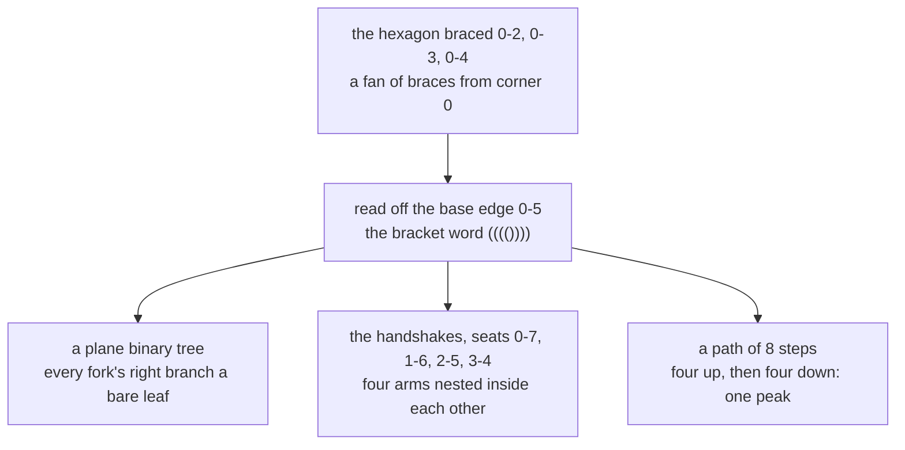

# Catalan everywhere: brackets, mountain ranges, binary trees, polygon triangulations and non-crossing handshakes are the same count

[Syllabus](../../../SYLLABUS.md) → [Combinatorics and graphs](../README.md) → [Lattice Paths and Catalan Numbers](../README.md#s06) → Catalan everywhere

---

## General Overview

A hexagonal tabletop rests on six corners, numbered 0 to 5 round the rim. To stiffen it a joiner runs three straight braces corner to corner, never letting two cross. They cut the hexagon into four triangles, and there are 14 ways to place them.

Eight people sit at that table. On a signal each takes one other person's hand, all at once, no two arms crossing. Again 14 ways.

Nothing about a tabletop resembles a handshake, and the shared 14 is not luck. Both are Cat(4), the Catalan number for four bracket pairs ([Catalan numbers](03-catalan-numbers.md)). This card writes the recipes that carry a bracing to a handshake pattern and back. The recipes go on to three more collections: those bracket words, the never-dipping paths of the last card, and branching shapes called plane binary trees.

A plane binary tree is built from forks. Each fork has a left branch and a right branch, and each branch ends in a bare leaf or in another fork.

**Five collections of unlike things carry one count because explicit recipes match them up one for one, so any structure that splits the way a bracket word splits is counted by Cat(n).**

**What kind of fact this is:** a theorem — the five counts are equal, proved on this card in Why it works; each recipe is a method, run on one object by hand.

### The picture: one object, five costumes



The bracket word is the common currency; every arrow reverses.

---

## The formula

Notation first, in words. Cat(n) is the Catalan number at size n, as on the previous card, and upright bars round a collection count its members. Four letters cover five families: words and paths are the same objects relabelled.

$$\lvert D_n\rvert = \lvert T_n\rvert = \lvert G_n\rvert = \lvert H_n\rvert = \mathrm{Cat}(n)$$

**Read it aloud:** at one size those four collections hold the same number of things, the Catalan number. The tabletop is size 4: 6 corners, 8 seats, all counts 14.

A word becomes a tree by cutting at the **first return**, where its opening bracket meets its partner: that bracket, a stretch P, the partner, then the rest Q.

$$\mathrm{tree}\big(\texttt{(}P\texttt{)}Q\big) = \big(\mathrm{tree}(P),\ \mathrm{tree}(Q)\big), \qquad \mathrm{tree}(\text{the empty word}) = \text{a bare leaf}$$

One fork, the inside hanging left, the rest hanging right.

A cut polygon becomes a word the same way. Corners $a$ and $b$ end the edge being read, and the triangle on it points at a third corner $c$ between them, its **apex**:

$$\mathrm{word}(a,b) = \texttt{(}\,\mathrm{word}(a,c)\,\texttt{)}\,\mathrm{word}(c,b), \qquad \mathrm{word}(a,\,a{+}1) = \text{the empty word}$$

One pair of brackets for that triangle, round the left piece's word, then the right piece's word; a plain side carries nothing.

The third recipe needs no formula: a seat opens when its partner sits further round, closes otherwise. Read from the base edge, the braces 0-2, 0-3, 0-4 and the handshakes 0-7, 1-6, 2-5, 3-4 both give (((()))).

| Symbol | Plain meaning | In our example | Push it up and the answer… |
| --- | --- | --- | --- |
| $n$ | the size: bracket pairs, forks, triangles | 4 | all counts climb |
| $\mathrm{Cat}(n)$ | the Catalan number of that size | 14 | — |
| $D_n$ | bracket words of n pairs, or paths of 2n steps that never dip | 14 | — |
| $T_n$ | plane binary trees with n forks | 14 | — |
| $G_n$ | cuttings of a polygon of n + 2 corners into triangles by braces that never cross | 14 | — |
| $H_n$ | handshakes among 2n seats, none crossing | 14 | — |
| $P$, $Q$ | the word inside the first pair, and the word after it | ((())) and empty | — |
| $a$, $b$ | the ends of the edge being read | 0 and 5 | — |
| $c$ | the apex on that edge | 1, 2, 3 or 4 | — |

### When it holds

- **The sizes line up.** n pairs, n forks, n + 2 corners, 2n seats; a hexagon is size 4, not 6.
- **The polygon is convex.** A dent can hide the triangle the recipe reads.
- **The trees are plane:** left and right told apart. Swap a fork's branches freely and 14 shapes collapse to 3.
- **Each recipe runs both ways.** A one-way rule gives half an equality.

---

## Why it works

### Step 0: to prove two counts equal, match the things

Comparing two counts says nothing about why they agree. A recipe that turns each member of one into one member of the other and can be undone settles it: the members come in pairs. That is a bijection ([Bijections and double counting](../02-Repeats%2C%20Groups%20and%20Double%20Counting/05-bijection-and-double-counting.md)).

### Step 1: the first return cuts a word into a fork

Read each opening bracket as a step up and each closing as a step down. A word of 4 pairs is then a path of 8 steps ending level, a mountain range. Never dipping is never closing a bracket that was not opened.

A non-empty word opens with a bracket whose partner is the first return. That splits the rest into the stretch inside the pair and the stretch after, both words themselves. Hang the inside left of a fork and the rest right: the word is a plane binary tree.

The undo writes a fork back as an opening bracket, the left branch, a closing bracket, the right branch; each step is forced, so the two directions undo each other.

### Step 2: the base edge's triangle cuts a polygon in two

Take corner 0 to corner 5 as the base edge. Exactly one triangle stands on it; its third corner is the apex, and it splits the rest of the hexagon into two smaller polygons already cut by the remaining braces. The fan 0-2, 0-3, 0-4 takes apexes 4, 3, 2 and 1 in turn, and reads (((()))): four triangles nested one inside the next.

<details>
<summary>Detailed proof: the polygon recipe runs both ways</summary>

**Forward.** A piece runs from corner $a$ to corner $b$ along the rim. If $b$ is $a + 1$ its word is empty; otherwise the base triangle's apex $c$ splits it into two pieces with fewer corners, so the recipe ends. A piece of k corners gives k − 2 pairs, so the hexagon gives 4.

**Backward.** A word of 4 pairs splits at the first bracket's partner into an inside word of i pairs and one of 3 − i after. Put the apex at corner i + 1, draw the two braces where they are not already sides, repeat inside each piece. No brace crosses another, each lying inside a piece no earlier brace enters.

**They undo each other.** Both act on the base edge and its apex, so both cut at the same triangle: a two-sided inverse pairs the collections off exactly.

</details>

### Step 3: a handshake pattern read as opens and closes

Number the seats 0 to 7. A seat opens when its partner sits later, closes otherwise. Every close has its open before it, so the word never dips — true of any pairing, crossing or not.

Non-crossing is what makes it reversible: the partner of a close is then the most recent open still waiting. An open between the two, left unmatched, would have to reach past the close and cross it.

So the undo pairs off the most recent open at every close and hands back the chords the word came from. A chord is one handshake, drawn as a straight line between two seats. Let arms cross and two patterns can share one word: 105 pairings onto 14.

### Step 4: one splitting rule under all five

Every recipe is one sentence in a new accent: a pair, a fork, a base triangle, seat 0's chord, each holding two smaller copies of its kind. That is the Catalan recurrence of the previous card, and why a structure splitting this way is Catalan without further argument.

Sorting the 14 cuttings by their base triangle's apex shows the split at work: 5, 2, 2, 5, which is Cat(0)×Cat(3), Cat(1)×Cat(2), Cat(2)×Cat(1) and Cat(3)×Cat(0).

---

## Worked numbers, by hand

| Step | Arithmetic | Value |
| --- | --- | --- |
| brace the hexagon, shake hands | three non-crossing braces; four non-crossing chords | **14** |
| write every word, grow every tree | 8 marks, 4 opens, never dipping; 4 forks | **14** |
| the closed form | C(8, 4) = 70 ways to place 4 opens among 8 marks, divided by 4 + 1 | **14** |
| the fan 0-2, 0-3, 0-4, and the handshakes 0-7, 1-6, 2-5, 3-4 | read from the base edge 0-5 | (((()))) |
| split by the apex | 5 + 2 + 2 + 5 | **14** |
| the shelf's 10-step paths | of 252 level words, those that never dip | **42** |

Five unlike collections share one count, and the recipes say which member answers to which.

### What breaks if you drop a piece

| Mistake | Comes out at | What went wrong |
| --- | --- | --- |
| A hexagon read as size 6 | 132 | The size counts pairs; a hexagon is 4 + 2 corners |
| Arms allowed to cross | 105 | Every pairing of 8 people, crossings included |
| A fork's branches treated as alike | 3 | Plane trees tell left from right |
| Every word with four opens, dips included | 70 | The count before the never-dip rule |

The code prints all four.

---

## Code, from first principles, and it actually runs

Nothing is imported. Each family is built by its own rule, no formula:

- words filtered by a running height, then again by deleting `()` until nothing is left;
- trees grown fork by fork;
- cuttings from every subset of the hexagon's diagonals;
- handshakes from every pairing of the seats.

The recipes are the second road, carrying cuttings and handshakes to words, and words to trees and back.

### Python

```python
# Catalan bijections -- the check behind the card.  Nothing is imported.  At size 4 five families are counted
# separately, each by its own rule: 8-step paths that never dip, bracket words that cancel away, plane binary
# trees, cuttings of a hexagon, handshakes among 8 with no arms crossing.  The recipes then carry each across.
dips = lambda w: min([0] + [2 * w[:i].count("(") - i for i in range(1, len(w) + 1)]) < 0
cancels = lambda w: cancels(w.replace("()", "")) if "()" in w else w == ""
cross = lambda p, q: p[0] < q[0] < p[1] < q[1] or q[0] < p[0] < q[1] < p[1]
untree = lambda t: "" if t is None else "(" + untree(t[0]) + ")" + untree(t[1])
fold = lambda t: "." if t is None else "(" + "".join(sorted([fold(t[0]), fold(t[1])])) + ")"
shakeword = lambda p, k: "".join("(" if i in {a for a, _ in p} else ")" for i in range(k))
fact = lambda j: 1 if j == 0 else j * fact(j - 1)
cat = lambda j: fact(2 * j) // fact(j) ** 2 // (j + 1)
yn = lambda c: "yes" if c else "no"
def grow(n):                                   # rule three: plane binary trees, grown as trees
    return [None] if n == 0 else [(l, r) for i in range(n) for l in grow(i) for r in grow(n - 1 - i)]
def tree(w):                                   # a bracket word -> a tree, cut at the first return
    if w == "": return None
    i = next(j for j in range(len(w)) if 2 * w[:j + 1].count("(") == j + 1)
    return tree(w[1:i]), tree(w[i + 1:])
def cuttings(m):                               # rule four: sets of m-3 diagonals, none crossing
    ds = [(a, b) for a in range(m) for b in range(a + 2, m) if (a, b) != (0, m - 1)]
    sub = ([ds[i] for i in range(len(ds)) if j >> i & 1] for j in range(1 << len(ds)))
    return [p for p in sub if len(p) == m - 3 and not any(cross(x, y) for x in p for y in p)]
def apex(cut, m, a, b):                        # the corner the triangle on edge a-b points at
    side = lambda p, q: q == p + 1 or (p, q) in cut or (p, q) == (0, m - 1)
    return next(c for c in range(a + 1, b) if side(a, c) and side(c, b))
def cutword(cut, m, a, b):                     # one piece of the cut polygon, read as brackets
    if b == a + 1: return ""
    c = apex(cut, m, a, b); return "(" + cutword(cut, m, a, c) + ")" + cutword(cut, m, c, b)
def pairings(s):                               # rule five: every pairing of the seats, crossings and all
    return [()] if not s else [((s[0], b),) + r for i, b in enumerate(s[1:]) for r in pairings(s[1:i + 1] + s[i + 2:])]
def census(n):                                 # the five families at size n, each on its own terms
    ws = ["".join("()"[j >> i & 1] for i in range(2 * n)) for j in range(1 << (2 * n))]
    level = [w for w in ws if w.count("(") == n]
    sh = [p for p in pairings(tuple(range(2 * n))) if not any(cross(x, y) for x in p for y in p)]
    return level, [w for w in level if not dips(w)], [w for w in ws if cancels(w)], grow(n), cuttings(n + 2), sh
level, dyck, brack, forest, cuts, shakes = census(4); l5, d5, b5, f5, c5, s5 = census(5)   # and the case at five pairs
fan, nest = [(0, 2), (0, 3), (0, 4)], [(0, 7), (1, 6), (2, 5), (3, 4)]   # one named cutting, one named handshake
cw, sw = sorted(cutword(c, 6, 0, 5) for c in cuts), sorted(shakeword(p, 8) for p in shakes)
back, ds, byapex = sorted(untree(t) for t in forest), sorted(dyck), [sum(1 for c in cuts if apex(c, 6, 0, 5) == j + 1) for j in range(4)]
print("size 4: a hexagon, corners 0 to 5, base edge 0-5, 3 diagonals, 4 triangles; 8 seats; 8 steps")
print(f"words of 8 marks with 4 opens: {len(level)}; of those, never dipping below the start: {len(dyck)}")
print(f"each family by its own rule -- paths {len(dyck)}, words that cancel away {len(brack)}, trees {len(forest)}, "
      f"cuttings {len(cuts)}, handshakes {len(shakes)}; and by the closed form, {len(level)} divided by 4 + 1 = {cat(4)}")
print(f"the {cat(4)} bracket words in order: {' '.join(ds)}")
print(f"word -> tree -> word returns every one of them: {yn(all(untree(tree(w)) == w for w in dyck))}; the {len(forest)} "
      f"grown trees give back those same {cat(4)} words: {yn(back == ds)}; the fan cut from corner 0, diagonals {fan}, "
      f"reads {cutword(fan, 6, 0, 5)}, and so do the nested handshakes {nest}: {yn(shakeword(nest, 8) == cutword(fan, 6, 0, 5))}")
print(f"every cutting's word, and every handshake's word, lands on all {cat(4)}, one apiece: {yn(cw == ds)} and {yn(sw == ds)}")
print(f"the {cat(4)} cuttings by the corner the base triangle points at (1, 2, 3, 4): {byapex}; Cat(i) x Cat(3-i): {[cat(i) * cat(3 - i) for i in range(4)]}")
print(f"at size 5, the shelf's 10-step paths: {len(l5)} words come back level, {len(d5)} never dip, and paths, "
      f"words, trees, cuttings of a 7-gon, handshakes among 10 count {len(d5)}, {len(b5)}, {len(f5)}, {len(c5)}, {len(s5)}")
print(f"mistake 1, a hexagon read as size 6: {cat(6)}, not {cat(4)}; mistake 2, arms allowed to cross: "
      f"{len(pairings(tuple(range(8))))} pairings of 8 people, not {len(shakes)}")
print(f"mistake 3, both branches of every fork swapped freely: {len({fold(t) for t in forest})} shapes, not "
      f"{len(forest)}; mistake 4, every word with 4 opens, dips included: {len(level)}, not {len(dyck)}")
assert len(dyck) == len(brack) == len(forest) == len(cuts) == len(shakes) == cat(4) and len(level) == fact(8) // fact(4) ** 2
assert cw == ds and sw == ds and back == ds and all(untree(tree(w)) == w for w in dyck)
assert fan in cuts and tuple(nest) in shakes and cutword(fan, 6, 0, 5) == shakeword(nest, 8) and all(shakeword(p, 8) in ds for p in pairings(tuple(range(8))))
assert byapex == [cat(i) * cat(3 - i) for i in range(4)] and len(d5) == len(b5) == len(f5) == len(c5) == len(s5) == cat(5)
print("ALL CHECKS PASS")
```

**Ran 2026-09-14 on macOS, Python 3.14.6, standard library only. All checks passed. Output, pasted from the run:**

```
size 4: a hexagon, corners 0 to 5, base edge 0-5, 3 diagonals, 4 triangles; 8 seats; 8 steps
words of 8 marks with 4 opens: 70; of those, never dipping below the start: 14
each family by its own rule -- paths 14, words that cancel away 14, trees 14, cuttings 14, handshakes 14; and by the closed form, 70 divided by 4 + 1 = 14
the 14 bracket words in order: (((()))) ((()())) ((())()) ((()))() (()(())) (()()()) (()())() (())(()) (())()() ()((())) ()(()()) ()(())() ()()(()) ()()()()
word -> tree -> word returns every one of them: yes; the 14 grown trees give back those same 14 words: yes; the fan cut from corner 0, diagonals [(0, 2), (0, 3), (0, 4)], reads (((()))), and so do the nested handshakes [(0, 7), (1, 6), (2, 5), (3, 4)]: yes
every cutting's word, and every handshake's word, lands on all 14, one apiece: yes and yes
the 14 cuttings by the corner the base triangle points at (1, 2, 3, 4): [5, 2, 2, 5]; Cat(i) x Cat(3-i): [5, 2, 2, 5]
at size 5, the shelf's 10-step paths: 252 words come back level, 42 never dip, and paths, words, trees, cuttings of a 7-gon, handshakes among 10 count 42, 42, 42, 42, 42
mistake 1, a hexagon read as size 6: 132, not 14; mistake 2, arms allowed to cross: 105 pairings of 8 people, not 14
mistake 3, both branches of every fork swapped freely: 3 shapes, not 14; mistake 4, every word with 4 opens, dips included: 70, not 14
ALL CHECKS PASS
```

### Rust

Same numbers, same labels, built with `rustc --edition 2021 -O`.

```rust
// Catalan bijections -- the same check as the Python, in Rust.  No crates.  At size 4 five families are counted
// separately, each by its own rule: 8-step paths that never dip, bracket words that cancel away, plane binary
// trees, cuttings of a hexagon, handshakes among 8 with no arms crossing.  The recipes then carry each across.
#[derive(Clone)] enum T { Leaf, Fork(Box<T>, Box<T>) }
type P = (usize, usize);
fn dips(w: &str) -> bool { let (mut h, mut lo) = (0i32, 0i32); for c in w.bytes() { h += if c == b'(' { 1 } else { -1 }; if h < lo { lo = h } } lo < 0 }
fn cancels(w: &str) -> bool { let mut w = w.to_string(); while let Some(i) = w.find("()") { w.replace_range(i..i + 2, "") } w.is_empty() }
fn cross(p: P, q: P) -> bool { (p.0 < q.0 && q.0 < p.1 && p.1 < q.1) || (q.0 < p.0 && p.0 < q.1 && q.1 < p.1) }
fn untree(t: &T) -> String { match t { T::Leaf => String::new(), T::Fork(l, r) => format!("({}){}", untree(l), untree(r)) } }
fn fold(t: &T) -> String { match t { T::Leaf => ".".to_string(), T::Fork(l, r) => { let (a, b) = (fold(l), fold(r)); if a <= b { format!("({}{})", a, b) } else { format!("({}{})", b, a) } } } }
fn shakeword(p: &[P], k: usize) -> String { (0..k).map(|i| if p.iter().any(|&(a, _)| a == i) { '(' } else { ')' }).collect() }
fn fact(j: u64) -> u64 { if j == 0 { 1 } else { j * fact(j - 1) } }
fn cat(j: u64) -> u64 { fact(2 * j) / (fact(j) * fact(j)) / (j + 1) }
fn yn(c: bool) -> &'static str { if c { "yes" } else { "no" } }
fn sorted(mut v: Vec<String>) -> Vec<String> { v.sort(); v }
fn grow(n: usize) -> Vec<T> {                  // rule three: plane binary trees, grown as trees
    if n == 0 { return vec![T::Leaf] }         // a fork for every split of n - 1 between the two branches
    let mut out = Vec::new();
    for i in 0..n { for l in grow(i) { for r in grow(n - 1 - i) { out.push(T::Fork(Box::new(l.clone()), Box::new(r))) } } } out
}
fn tree(w: &str) -> T {                        // a bracket word -> a tree, cut at the first return
    if w.is_empty() { return T::Leaf }         let (b, mut h, mut i) = (w.as_bytes(), 0i32, 0usize);
    for j in 0..b.len() { h += if b[j] == b'(' { 1 } else { -1 }; if h == 0 { i = j; break } }
    T::Fork(Box::new(tree(&w[1..i])), Box::new(tree(&w[i + 1..])))
}
fn cuttings(m: usize) -> Vec<Vec<P>> {         // rule four: sets of m-3 diagonals, none crossing
    let ds: Vec<P> = (0..m).flat_map(|a| (a + 2..m).map(move |b| (a, b))).filter(|&d| d != (0, m - 1)).collect();
    (0..(1u32 << ds.len())).map(|j| (0..ds.len()).filter(|i| j >> i & 1 == 1).map(|i| ds[i]).collect::<Vec<P>>())
        .filter(|p| p.len() == m - 3 && !p.iter().any(|&x| p.iter().any(|&y| cross(x, y)))).collect()
}
fn apex(cut: &[P], m: usize, a: usize, b: usize) -> usize {     // the corner the triangle on edge a-b points at
    let side = |p: usize, q: usize| q == p + 1 || cut.contains(&(p, q)) || (p, q) == (0, m - 1);
    (a + 1..b).find(|&c| side(a, c) && side(c, b)).unwrap()
}
fn cutword(cut: &[P], m: usize, a: usize, b: usize) -> String {  // one piece of the cut polygon, read as brackets
    if b == a + 1 { return String::new() }
    let c = apex(cut, m, a, b); format!("({}){}", cutword(cut, m, a, c), cutword(cut, m, c, b))
}
fn pairings(s: &[usize]) -> Vec<Vec<P>> {      // rule five: every pairing of the seats, crossings and all
    if s.is_empty() { return vec![Vec::new()] }  let mut out = Vec::new();   // the lowest free seat takes each partner
    for i in 1..s.len() { let mut rest = s[1..i].to_vec(); rest.extend_from_slice(&s[i + 1..]);
        for mut r in pairings(&rest) { r.insert(0, (s[0], s[i])); out.push(r) } }
    out
}
fn census(n: usize) -> (Vec<String>, Vec<String>, usize, Vec<T>, Vec<Vec<P>>, Vec<Vec<P>>) {
    let ws: Vec<String> = (0..(1u32 << (2 * n))).map(|j| (0..2 * n).map(|i| if j >> i & 1 == 1 { ')' } else { '(' }).collect()).collect();
    let level: Vec<String> = ws.iter().filter(|w| w.matches('(').count() == n).cloned().collect();
    let sh: Vec<Vec<P>> = pairings(&(0..2 * n).collect::<Vec<usize>>()).into_iter().filter(|p| !p.iter().any(|&x| p.iter().any(|&y| cross(x, y)))).collect();
    (level.clone(), level.iter().filter(|w| !dips(w)).cloned().collect(), ws.iter().filter(|w| cancels(w)).count(), grow(n), cuttings(n + 2), sh)
}
fn main() {
    let (level, dyck, brack, forest, cuts, shakes) = census(4);
    let (l5, d5, b5, f5, c5, s5) = census(5);  // the second worked case, at five pairs
    let (fan, nest): (Vec<P>, Vec<P>) = (vec![(0, 2), (0, 3), (0, 4)], vec![(0, 7), (1, 6), (2, 5), (3, 4)]);
    let (cw, sw) = (sorted(cuts.iter().map(|c| cutword(c, 6, 0, 5)).collect()), sorted(shakes.iter().map(|p| shakeword(p, 8)).collect()));
    let (back, ds) = (sorted(forest.iter().map(untree).collect()), sorted(dyck.clone()));
    let (byapex, prods): (Vec<u64>, Vec<u64>) = ((1..=4).map(|j| cuts.iter().filter(|c| apex(c, 6, 0, 5) == j).count() as u64).collect(), (0..4u64).map(|i| cat(i) * cat(3 - i)).collect());
    let mut shapes = sorted(forest.iter().map(fold).collect()); shapes.dedup();
    println!("size 4: a hexagon, corners 0 to 5, base edge 0-5, 3 diagonals, 4 triangles; 8 seats; 8 steps");
    println!("words of 8 marks with 4 opens: {}; of those, never dipping below the start: {}", level.len(), dyck.len());
    println!("each family by its own rule -- paths {}, words that cancel away {}, trees {}, cuttings {}, handshakes {}; \
and by the closed form, {} divided by 4 + 1 = {}", dyck.len(), brack, forest.len(), cuts.len(), shakes.len(), level.len(), cat(4));
    println!("the {} bracket words in order: {}", cat(4), ds.join(" "));
    println!("word -> tree -> word returns every one of them: {}; the {} grown trees give back those same {} words: {}; \
the fan cut from corner 0, diagonals {:?}, reads {}, and so do the nested handshakes {:?}: {}", yn(dyck.iter().all(|w| untree(&tree(w)) == *w)),
             forest.len(), cat(4), yn(back == ds), fan, cutword(&fan, 6, 0, 5), nest, yn(shakeword(&nest, 8) == cutword(&fan, 6, 0, 5)));
    println!("every cutting's word, and every handshake's word, lands on all {}, one apiece: {} and {}", cat(4), yn(cw == ds), yn(sw == ds));
    println!("the {} cuttings by the corner the base triangle points at (1, 2, 3, 4): {:?}; Cat(i) x Cat(3-i): {:?}", cat(4), byapex, prods);
    println!("at size 5, the shelf's 10-step paths: {} words come back level, {} never dip, and paths, words, trees, \
cuttings of a 7-gon, handshakes among 10 count {}, {}, {}, {}, {}", l5.len(), d5.len(), d5.len(), b5, f5.len(), c5.len(), s5.len());
    println!("mistake 1, a hexagon read as size 6: {}, not {}; mistake 2, arms allowed to cross: {} pairings of 8 people, not {}",
             cat(6), cat(4), pairings(&(0..8).collect::<Vec<usize>>()).len(), shakes.len());
    println!("mistake 3, both branches of every fork swapped freely: {} shapes, not {}; mistake 4, every word with 4 opens, \
dips included: {}, not {}", shapes.len(), forest.len(), level.len(), dyck.len());
    assert!(dyck.len() == brack && brack == forest.len() && forest.len() == cuts.len() && cuts.len() == shakes.len() && shakes.len() as u64 == cat(4) && level.len() as u64 == fact(8) / (fact(4) * fact(4)));
    assert!(cw == ds && sw == ds && back == ds && dyck.iter().all(|w| untree(&tree(w)) == *w));
    assert!(cuts.contains(&fan) && shakes.contains(&nest) && cutword(&fan, 6, 0, 5) == shakeword(&nest, 8) && pairings(&(0..8).collect::<Vec<usize>>()).iter().all(|p| ds.contains(&shakeword(p, 8))));
    assert!(byapex == prods && d5.len() == b5 && b5 == f5.len() && f5.len() == c5.len() && c5.len() == s5.len() && s5.len() as u64 == cat(5));
    println!("ALL CHECKS PASS");
}
```

**Ran 2026-09-14 on macOS, rustc 1.98.1, no crates. All checks passed. Output, pasted from the run:**

```
size 4: a hexagon, corners 0 to 5, base edge 0-5, 3 diagonals, 4 triangles; 8 seats; 8 steps
words of 8 marks with 4 opens: 70; of those, never dipping below the start: 14
each family by its own rule -- paths 14, words that cancel away 14, trees 14, cuttings 14, handshakes 14; and by the closed form, 70 divided by 4 + 1 = 14
the 14 bracket words in order: (((()))) ((()())) ((())()) ((()))() (()(())) (()()()) (()())() (())(()) (())()() ()((())) ()(()()) ()(())() ()()(()) ()()()()
word -> tree -> word returns every one of them: yes; the 14 grown trees give back those same 14 words: yes; the fan cut from corner 0, diagonals [(0, 2), (0, 3), (0, 4)], reads (((()))), and so do the nested handshakes [(0, 7), (1, 6), (2, 5), (3, 4)]: yes
every cutting's word, and every handshake's word, lands on all 14, one apiece: yes and yes
the 14 cuttings by the corner the base triangle points at (1, 2, 3, 4): [5, 2, 2, 5]; Cat(i) x Cat(3-i): [5, 2, 2, 5]
at size 5, the shelf's 10-step paths: 252 words come back level, 42 never dip, and paths, words, trees, cuttings of a 7-gon, handshakes among 10 count 42, 42, 42, 42, 42
mistake 1, a hexagon read as size 6: 132, not 14; mistake 2, arms allowed to cross: 105 pairings of 8 people, not 14
mistake 3, both branches of every fork swapped freely: 3 shapes, not 14; mistake 4, every word with 4 opens, dips included: 70, not 14
ALL CHECKS PASS
```

The two outputs match line for line.

### Lean

Lean proves three facts for every size n: n pairs, n forks, n + 2 corners, 2n seats.

- Bracket words that never dip, plane binary trees, cuttings of a convex polygon, and handshakes with no arms crossing each number Cat(n).
- For i below n, the cuttings whose base triangle points at corner i + 1 number Cat(i) × Cat(n − 1 − i).
- The handshake recipe runs both ways: reading each seat as an open or a close matches handshakes one for one with bracket words.

The Python and Rust checks cover the rest: the tree and polygon recipes running both ways, the words that cancel away, and the four mistakes.

```lean
-- Catalan everywhere: for every n, never-dipping bracket words, plane binary trees, triangulations of a convex (n + 2)-gon and non-crossing handshakes among 2n seats all number Cat(n), with the base-triangle split and the handshake-to-word recipe proved too.
import Mathlib.Combinatorics.Enumerative.DyckWord
import Mathlib.SetTheory.Cardinal.Finite
import Mathlib.Tactic.NormNum

namespace CatalanEverywhere

/-- Two chords `p = (a, b)` and `q = (c, d)` (with `a < b`, `c < d`) between points round a
circle, or corners of a convex polygon, cross when their ends interleave: one end of each lies
strictly between the ends of the other. Chords that share an end do not cross. -/
def Crosses (p q : ℕ × ℕ) : Prop :=
  (p.1 < q.1 ∧ q.1 < p.2 ∧ p.2 < q.2) ∨ (q.1 < p.1 ∧ p.1 < q.2 ∧ q.2 < p.2)

instance (p q : ℕ × ℕ) : Decidable (Crosses p q) :=
  inferInstanceAs (Decidable ((p.1 < q.1 ∧ q.1 < p.2 ∧ p.2 < q.2) ∨ (q.1 < p.1 ∧ p.1 < q.2 ∧ q.2 < p.2)))

/-- A set of chords no two of which cross. -/
def NonCrossing (S : Finset (ℕ × ℕ)) : Prop :=
  ∀ p ∈ S, ∀ q ∈ S, ¬ Crosses p q

instance (S : Finset (ℕ × ℕ)) : Decidable (NonCrossing S) :=
  inferInstanceAs (Decidable (∀ p ∈ S, ∀ q ∈ S, ¬ Crosses p q))

/-- The diagonals (braces) of a convex polygon with corners `0, 1, …, m - 1` round the rim:
the pairs `(a, b)` with `a + 2 ≤ b` that are not the rim edge `(0, m - 1)`. -/
def diagonals (m : ℕ) : Finset (ℕ × ℕ) :=
  ((Finset.range m) ×ˢ (Finset.range m)).filter
    (fun d => d.1 + 2 ≤ d.2 ∧ ¬ (d.1 = 0 ∧ d.2 = m - 1))

/-- A cutting of the convex polygon with corners `0, 1, …, m - 1` into triangles by braces that
never cross: a set of diagonals, no two crossing, to which no further diagonal can be added
without a crossing (every diagonal left out crosses one that is in). -/
def IsTriangulation (m : ℕ) (S : Finset (ℕ × ℕ)) : Prop :=
  S ⊆ diagonals m ∧ NonCrossing S ∧ ∀ d ∈ diagonals m, d ∉ S → ∃ e ∈ S, Crosses d e

instance (m : ℕ) (S : Finset (ℕ × ℕ)) : Decidable (IsTriangulation m S) :=
  inferInstanceAs (Decidable
    (S ⊆ diagonals m ∧ NonCrossing S ∧ ∀ d ∈ diagonals m, d ∉ S → ∃ e ∈ S, Crosses d e))

/-- `G_n`: the cuttings of a convex polygon with `n + 2` corners into triangles by braces that
never cross. -/
def triangulations (n : ℕ) : Finset (Finset (ℕ × ℕ)) :=
  (diagonals (n + 2)).powerset.filter (IsTriangulation (n + 2))

/-- In a cutting `S` of the `(n + 2)`-gon, corner `c` is the apex of the triangle standing on the
base edge `0`–`(n + 1)`: both other sides, `0`–`c` and `c`–`(n + 1)`, are rim edges or braces of `S`. -/
def IsBaseApex (n : ℕ) (S : Finset (ℕ × ℕ)) (c : ℕ) : Prop :=
  0 < c ∧ c < n + 1 ∧ (c = 1 ∨ (0, c) ∈ S) ∧ (c = n ∨ (c, n + 1) ∈ S)

instance (n : ℕ) (S : Finset (ℕ × ℕ)) (c : ℕ) : Decidable (IsBaseApex n S c) :=
  inferInstanceAs (Decidable (0 < c ∧ c < n + 1 ∧ (c = 1 ∨ (0, c) ∈ S) ∧ (c = n ∨ (c, n + 1) ∈ S)))

/-- All possible handshakes (chords) among seats `0, 1, …, k - 1`, written `(a, b)` with `a < b`. -/
def chords (k : ℕ) : Finset (ℕ × ℕ) :=
  ((Finset.range k) ×ˢ (Finset.range k)).filter (fun p => p.1 < p.2)

/-- A way for the people in seats `0, 1, …, k - 1` round a table to shake hands all at once:
a set of chords in which every seat is an end of exactly one chord, and no two chords cross. -/
def IsHandshake (k : ℕ) (M : Finset (ℕ × ℕ)) : Prop :=
  M ⊆ chords k ∧ (∀ i ∈ Finset.range k, (M.filter (fun p => p.1 = i ∨ p.2 = i)).card = 1) ∧
    NonCrossing M

instance (k : ℕ) (M : Finset (ℕ × ℕ)) : Decidable (IsHandshake k M) :=
  inferInstanceAs (Decidable (M ⊆ chords k ∧
    (∀ i ∈ Finset.range k, (M.filter (fun p => p.1 = i ∨ p.2 = i)).card = 1) ∧ NonCrossing M))

/-- `H_n`: the ways for `2n` people seated round a table to shake hands all at once, each with
exactly one other person, with no two arms crossing. -/
def handshakes (n : ℕ) : Finset (Finset (ℕ × ℕ)) :=
  (chords (2 * n)).powerset.filter (IsHandshake (2 * n))

open DyckWord DyckStep BinaryTree

/-- The handshake recipe: seat `i` opens a bracket (`U`) when its partner sits further round,
and closes one (`D`) otherwise. -/
def seatWord (n : ℕ) (M : Finset (ℕ × ℕ)) : List DyckStep :=
  (List.range (2 * n)).map (fun i => if ∃ p ∈ M, p.1 = i then U else D)

/-! ### Helpers: cuttings of the polygon with corners `s, s + 1, …, t` -/

/-- Diagonals of the polygon with corners `s, …, t`. -/
def Dg (s t : ℕ) : Finset (ℕ × ℕ) :=
  ((Finset.Icc s t) ×ˢ (Finset.Icc s t)).filter
    (fun d => d.1 + 2 ≤ d.2 ∧ ¬ (d.1 = s ∧ d.2 = t))

lemma mem_Dg {s t a b : ℕ} : (a, b) ∈ Dg s t ↔ s ≤ a ∧ b ≤ t ∧ a + 2 ≤ b ∧ ¬ (a = s ∧ b = t) := by
  simp only [Dg, Finset.mem_filter, Finset.mem_product, Finset.mem_Icc]
  omega

/-- A cutting of the polygon with corners `s, …, t` into triangles. -/
def IsT (s t : ℕ) (S : Finset (ℕ × ℕ)) : Prop :=
  S ⊆ Dg s t ∧ NonCrossing S ∧ ∀ d ∈ Dg s t, d ∉ S → ∃ e ∈ S, Crosses d e

instance (s t : ℕ) (S : Finset (ℕ × ℕ)) : Decidable (IsT s t S) :=
  inferInstanceAs (Decidable (S ⊆ Dg s t ∧ NonCrossing S ∧ ∀ d ∈ Dg s t, d ∉ S → ∃ e ∈ S, Crosses d e))

/-- All cuttings of the polygon with corners `s, …, t`. -/
def Tg (s t : ℕ) : Finset (Finset (ℕ × ℕ)) :=
  (Dg s t).powerset.filter (IsT s t)

lemma mem_Tg {s t : ℕ} {S : Finset (ℕ × ℕ)} : S ∈ Tg s t ↔ IsT s t S := by
  simp only [Tg, Finset.mem_filter, Finset.mem_powerset]
  exact ⟨fun h => h.2, fun h => ⟨h.1, h⟩⟩

/-- Corner `c` is the apex of the triangle on the base `s`–`t`. -/
def Apex (s t : ℕ) (S : Finset (ℕ × ℕ)) (c : ℕ) : Prop :=
  s < c ∧ c < t ∧ (c = s + 1 ∨ (s, c) ∈ S) ∧ (c + 1 = t ∨ (c, t) ∈ S)

instance (s t : ℕ) (S : Finset (ℕ × ℕ)) (c : ℕ) : Decidable (Apex s t S c) :=
  inferInstanceAs (Decidable (s < c ∧ c < t ∧ (c = s + 1 ∨ (s, c) ∈ S) ∧ (c + 1 = t ∨ (c, t) ∈ S)))

lemma crosses_iff {a b c d : ℕ} :
    Crosses (a, b) (c, d) ↔ (a < c ∧ c < b ∧ b < d) ∨ (c < a ∧ a < d ∧ d < b) := Iff.rfl

lemma isT_nc {s t : ℕ} {S : Finset (ℕ × ℕ)} (h : IsT s t S) {a b c d : ℕ}
    (h1 : (a, b) ∈ S) (h2 : (c, d) ∈ S) :
    ¬ ((a < c ∧ c < b ∧ b < d) ∨ (c < a ∧ a < d ∧ d < b)) :=
  h.2.1 _ h1 _ h2

lemma isT_mem {s t : ℕ} {S : Finset (ℕ × ℕ)} (h : IsT s t S) {a b : ℕ} (h1 : (a, b) ∈ S) :
    s ≤ a ∧ b ≤ t ∧ a + 2 ≤ b ∧ ¬ (a = s ∧ b = t) :=
  mem_Dg.1 (h.1 h1)

lemma isT_max {s t : ℕ} {S : Finset (ℕ × ℕ)} (h : IsT s t S) {a b : ℕ} (h1 : (a, b) ∈ Dg s t)
    (h2 : (a, b) ∉ S) : ∃ c d, (c, d) ∈ S ∧ ((a < c ∧ c < b ∧ b < d) ∨ (c < a ∧ a < d ∧ d < b)) := by
  obtain ⟨⟨c, d⟩, he, hc⟩ := h.2.2 _ h1 h2
  exact ⟨c, d, he, hc⟩

/-- The left piece of a cutting. -/
def leftPart (s c : ℕ) (S : Finset (ℕ × ℕ)) : Finset (ℕ × ℕ) :=
  S.filter (fun d => d.2 ≤ c ∧ ¬ (d.1 = s ∧ d.2 = c))

/-- The right piece of a cutting. -/
def rightPart (c t : ℕ) (S : Finset (ℕ × ℕ)) : Finset (ℕ × ℕ) :=
  S.filter (fun d => c ≤ d.1 ∧ ¬ (d.1 = c ∧ d.2 = t))

/-- Glue two cuttings along the base triangle with apex `c`. -/
def glue (s c t : ℕ) (L R : Finset (ℕ × ℕ)) : Finset (ℕ × ℕ) :=
  L ∪ R ∪ (Dg s t).filter (fun d => (d.1 = s ∧ d.2 = c) ∨ (d.1 = c ∧ d.2 = t))

lemma mem_glue {s c t a b : ℕ} {L R : Finset (ℕ × ℕ)} :
    (a, b) ∈ glue s c t L R ↔ (a, b) ∈ L ∨ (a, b) ∈ R ∨
      ((a, b) ∈ Dg s t ∧ ((a = s ∧ b = c) ∨ (a = c ∧ b = t))) := by
  simp only [glue, Finset.mem_union, Finset.mem_filter, or_assoc]

lemma isT_left {s c t : ℕ} {S : Finset (ℕ × ℕ)} (h : IsT s t S) (ha : Apex s t S c) :
    IsT s c (leftPart s c S) := by
  obtain ⟨h1, h2, h3, h4⟩ := ha
  refine ⟨?_, ?_, ?_⟩
  · rintro ⟨a, b⟩ hp
    simp only [leftPart, Finset.mem_filter] at hp
    have := isT_mem h hp.1
    rw [mem_Dg]
    omega
  · intro p hp q hq
    exact h.2.1 p (Finset.mem_filter.1 hp).1 q (Finset.mem_filter.1 hq).1
  · rintro ⟨a, b⟩ hd hn
    have hd' := mem_Dg.1 hd
    have hS : (a, b) ∉ S := by
      intro hS
      apply hn
      simp only [leftPart, Finset.mem_filter]
      exact ⟨hS, by omega, by omega⟩
    obtain ⟨x, y, he, hc⟩ := isT_max h (mem_Dg.2 (by omega)) hS
    refine ⟨(x, y), ?_, hc⟩
    simp only [leftPart, Finset.mem_filter]
    have := isT_mem h he
    refine ⟨he, ?_, ?_⟩
    · by_contra hy
      rcases h3 with h3 | h3
      · omega
      · have := isT_nc h h3 he
        omega
    · omega

lemma isT_right {s c t : ℕ} {S : Finset (ℕ × ℕ)} (h : IsT s t S) (ha : Apex s t S c) :
    IsT c t (rightPart c t S) := by
  obtain ⟨h1, h2, h3, h4⟩ := ha
  refine ⟨?_, ?_, ?_⟩
  · rintro ⟨a, b⟩ hp
    simp only [rightPart, Finset.mem_filter] at hp
    have := isT_mem h hp.1
    rw [mem_Dg]
    omega
  · intro p hp q hq
    exact h.2.1 p (Finset.mem_filter.1 hp).1 q (Finset.mem_filter.1 hq).1
  · rintro ⟨a, b⟩ hd hn
    have hd' := mem_Dg.1 hd
    have hS : (a, b) ∉ S := by
      intro hS
      apply hn
      simp only [rightPart, Finset.mem_filter]
      exact ⟨hS, by omega, by omega⟩
    obtain ⟨x, y, he, hc⟩ := isT_max h (mem_Dg.2 (by omega)) hS
    refine ⟨(x, y), ?_, hc⟩
    simp only [rightPart, Finset.mem_filter]
    have := isT_mem h he
    refine ⟨he, ?_, ?_⟩
    · by_contra hy
      rcases h4 with h4 | h4
      · omega
      · have := isT_nc h h4 he
        omega
    · omega

lemma isT_glue {s c t : ℕ} {L R : Finset (ℕ × ℕ)} (hsc : s < c) (hct : c < t)
    (hL : IsT s c L) (hR : IsT c t R) :
    IsT s t (glue s c t L R) ∧ Apex s t (glue s c t L R) c := by
  have key : ∀ a b, (a, b) ∈ glue s c t L R →
      ((a, b) ∈ L ∧ s ≤ a ∧ b ≤ c ∧ a + 2 ≤ b ∧ ¬ (a = s ∧ b = c)) ∨
      ((a, b) ∈ R ∧ c ≤ a ∧ b ≤ t ∧ a + 2 ≤ b ∧ ¬ (a = c ∧ b = t)) ∨
      (s ≤ a ∧ b ≤ t ∧ a + 2 ≤ b ∧ ¬ (a = s ∧ b = t) ∧ ((a = s ∧ b = c) ∨ (a = c ∧ b = t))) := by
    intro a b hp
    rcases mem_glue.1 hp with hp | hp | ⟨hp, hp'⟩
    · exact Or.inl ⟨hp, isT_mem hL hp⟩
    · exact Or.inr (Or.inl ⟨hp, isT_mem hR hp⟩)
    · exact Or.inr (Or.inr ⟨(mem_Dg.1 hp).1, (mem_Dg.1 hp).2.1, (mem_Dg.1 hp).2.2.1,
        (mem_Dg.1 hp).2.2.2, hp'⟩)
  refine ⟨⟨?_, ?_, ?_⟩, hsc, hct, ?_, ?_⟩
  · rintro ⟨a, b⟩ hp
    rw [mem_Dg]
    rcases key a b hp with h | h | h <;> omega
  · rintro ⟨a, b⟩ hp ⟨x, y⟩ hq
    rw [crosses_iff]
    rcases key a b hp with h | h | h <;> rcases key x y hq with h' | h' | h'
    · exact isT_nc hL h.1 h'.1
    all_goals first
      | omega
      | exact isT_nc hR h.1 h'.1
  · rintro ⟨a, b⟩ hd hn
    have hd' := mem_Dg.1 hd
    rcases Nat.lt_or_ge c b with hb | hb
    · rcases Nat.lt_or_ge a c with ha | ha
      · -- the diagonal straddles the apex
        rcases Nat.lt_or_ge s a with ha' | ha'
        · refine ⟨(s, c), mem_glue.2 (Or.inr (Or.inr ⟨mem_Dg.2 (by omega), by omega⟩)), ?_⟩
          rw [crosses_iff]
          omega
        · refine ⟨(c, t), mem_glue.2 (Or.inr (Or.inr ⟨mem_Dg.2 (by omega), by omega⟩)), ?_⟩
          rw [crosses_iff]
          omega
      · -- right piece
        have hR' : (a, b) ∈ Dg c t := by
          rw [mem_Dg]
          refine ⟨ha, hd'.2.1, hd'.2.2.1, ?_⟩
          rintro ⟨rfl, rfl⟩
          exact hn (mem_glue.2 (Or.inr (Or.inr ⟨hd, by omega⟩)))
        obtain ⟨x, y, he, hc⟩ := isT_max hR hR' (fun h => hn (mem_glue.2 (Or.inr (Or.inl h))))
        exact ⟨(x, y), mem_glue.2 (Or.inr (Or.inl he)), hc⟩
    · -- left piece
      have hL' : (a, b) ∈ Dg s c := by
        rw [mem_Dg]
        refine ⟨hd'.1, hb, hd'.2.2.1, ?_⟩
        rintro ⟨rfl, rfl⟩
        exact hn (mem_glue.2 (Or.inr (Or.inr ⟨hd, by omega⟩)))
      obtain ⟨x, y, he, hc⟩ := isT_max hL hL' (fun h => hn (mem_glue.2 (Or.inl h)))
      exact ⟨(x, y), mem_glue.2 (Or.inl he), hc⟩
  · by_cases h : c = s + 1
    · exact Or.inl h
    · exact Or.inr (mem_glue.2 (Or.inr (Or.inr ⟨mem_Dg.2 (by omega), by omega⟩)))
  · by_cases h : c + 1 = t
    · exact Or.inl h
    · exact Or.inr (mem_glue.2 (Or.inr (Or.inr ⟨mem_Dg.2 (by omega), by omega⟩)))

lemma card_apex (s c t : ℕ) (hsc : s < c) (hct : c < t) :
    ((Tg s t).filter (fun S => Apex s t S c)).card = (Tg s c).card * (Tg c t).card := by
  rw [← Finset.card_product]
  refine Finset.card_nbij' (fun S => (leftPart s c S, rightPart c t S))
    (fun P => glue s c t P.1 P.2) ?_ ?_ ?_ ?_
  · intro S hS
    simp only [Finset.coe_filter, Set.mem_ofPred_eq, mem_Tg] at hS
    simp only [Finset.coe_product, Set.mem_prod, Finset.mem_coe, mem_Tg]
    exact ⟨isT_left hS.1 hS.2, isT_right hS.1 hS.2⟩
  · rintro ⟨L, R⟩ hP
    simp only [Finset.coe_product, Set.mem_prod, Finset.mem_coe, mem_Tg] at hP
    simp only [Finset.coe_filter, Set.mem_ofPred_eq, mem_Tg]
    exact isT_glue hsc hct hP.1 hP.2
  · intro S hS
    simp only [Finset.coe_filter, Set.mem_ofPred_eq, mem_Tg] at hS
    obtain ⟨h, -, -, h3, h4⟩ := hS
    ext ⟨a, b⟩
    simp only [mem_glue, leftPart, rightPart, Finset.mem_filter]
    constructor
    · rintro (hp | hp | ⟨hp, hp'⟩)
      · exact hp.1
      · exact hp.1
      · have := mem_Dg.1 hp
        rcases hp' with ⟨rfl, rfl⟩ | ⟨rfl, rfl⟩
        · rcases h3 with h3 | h3
          · omega
          · exact h3
        · rcases h4 with h4 | h4
          · omega
          · exact h4
    · intro hp
      have hab := isT_mem h hp
      rcases Nat.lt_or_ge c b with hb | hb
      · rcases Nat.lt_or_ge a c with ha | ha
        · exfalso
          rcases Nat.lt_or_ge s a with ha' | ha'
          · rcases h3 with h3 | h3
            · omega
            · have := isT_nc h h3 hp
              omega
          · rcases h4 with h4 | h4
            · omega
            · have := isT_nc h h4 hp
              omega
        · by_cases e : a = c ∧ b = t
          · exact Or.inr (Or.inr ⟨h.1 hp, Or.inr e⟩)
          · exact Or.inr (Or.inl ⟨hp, ha, e⟩)
      · by_cases e : a = s ∧ b = c
        · exact Or.inr (Or.inr ⟨h.1 hp, Or.inl e⟩)
        · exact Or.inl ⟨hp, hb, e⟩
  · rintro ⟨L, R⟩ hP
    simp only [Finset.coe_product, Set.mem_prod, Finset.mem_coe, mem_Tg] at hP
    obtain ⟨hL, hR⟩ := hP
    simp only [Prod.mk.injEq]
    constructor
    · ext ⟨a, b⟩
      simp only [leftPart, Finset.mem_filter, mem_glue]
      constructor
      · rintro ⟨hp | hp | ⟨hp, hp'⟩, h1, h2⟩
        · exact hp
        · have := isT_mem hR hp
          omega
        · have := mem_Dg.1 hp
          omega
      · intro hp
        have := isT_mem hL hp
        exact ⟨Or.inl hp, by omega, by omega⟩
    · ext ⟨a, b⟩
      simp only [rightPart, Finset.mem_filter, mem_glue]
      constructor
      · rintro ⟨hp | hp | ⟨hp, hp'⟩, h1, h2⟩
        · have := isT_mem hL hp
          omega
        · exact hp
        · have := mem_Dg.1 hp
          omega
      · intro hp
        have := isT_mem hR hp
        exact ⟨Or.inr (Or.inl hp), by omega, by omega⟩

lemma apex_exists {s t : ℕ} {S : Finset (ℕ × ℕ)} (h : IsT s t S) (hst : s + 2 ≤ t) :
    ∃ c, Apex s t S c := by
  set c := Nat.findGreatest (fun b => b = s + 1 ∨ (s, b) ∈ S) t with hcdef
  have hc : c = s + 1 ∨ (s, c) ∈ S := Nat.findGreatest_spec (P := fun b => b = s + 1 ∨ (s, b) ∈ S) (m := s + 1) (n := t) (by omega) (Or.inl rfl)
  have hmax : ∀ b, (s, b) ∈ S → b ≤ c := fun b hb =>
    Nat.le_findGreatest (P := fun b => b = s + 1 ∨ (s, b) ∈ S) (isT_mem h hb).2.1 (Or.inr hb)
  have hsc : s + 1 ≤ c := Nat.le_findGreatest (P := fun b => b = s + 1 ∨ (s, b) ∈ S) (m := s + 1) (n := t) (by omega) (Or.inl rfl)
  have hct : c < t := by
    rcases hc with hc | hc
    · omega
    · have := isT_mem h hc
      omega
  refine ⟨c, by omega, hct, hc, ?_⟩
  by_contra hn
  simp only [not_or] at hn
  obtain ⟨x, y, he, hcr⟩ := isT_max h (mem_Dg.2 (by omega)) hn.2
  have hxy := isT_mem h he
  rcases Nat.lt_or_ge s x with hx | hx
  · rcases hc with hc | hc
    · omega
    · have := isT_nc h hc he
      omega
  · have hxs : x = s := by omega
    subst hxs
    have := hmax y he
    omega

lemma apex_unique {s t c c' : ℕ} {S : Finset (ℕ × ℕ)} (h : IsT s t S) (h1 : Apex s t S c)
    (h2 : Apex s t S c') : c = c' := by
  have key : ∀ c c', Apex s t S c → Apex s t S c' → ¬ c < c' := by
    intro c c' h1 h2 hlt
    obtain ⟨a1, a2, a3, a4⟩ := h1
    obtain ⟨b1, b2, b3, b4⟩ := h2
    rcases a4 with a4 | a4
    · omega
    rcases b3 with b3 | b3
    · omega
    have := isT_nc h b3 a4
    omega
  have := key c c' h1 h2
  have := key c' c h2 h1
  omega

lemma Tg_base (s : ℕ) : Tg s (s + 1) = {∅} := by
  have hD : Dg s (s + 1) = ∅ := by
    rw [Finset.eq_empty_iff_forall_notMem]
    rintro ⟨a, b⟩ h
    rw [mem_Dg] at h
    omega
  ext S
  rw [mem_Tg, Finset.mem_singleton]
  constructor
  · intro h
    have := h.1
    rw [hD] at this
    exact Finset.subset_empty.1 this
  · rintro rfl
    refine ⟨Finset.empty_subset _, by simp [NonCrossing], ?_⟩
    intro d hd
    rw [hD] at hd
    simp at hd

lemma card_Tg (n : ℕ) : ∀ s, (Tg s (s + n + 1)).card = catalan n := by
  induction n using Nat.strong_induction_on with
  | _ n ih =>
  intro s
  rcases n with _ | m
  · simp [Tg_base]
  · have hU : Tg s (s + (m + 1) + 1) = (Finset.range (m + 1)).biUnion
        (fun i => (Tg s (s + (m + 1) + 1)).filter (fun S => Apex s (s + (m + 1) + 1) S (s + 1 + i))) := by
      ext S
      simp only [Finset.mem_biUnion, Finset.mem_filter, Finset.mem_range]
      constructor
      · intro hS
        obtain ⟨c, hc⟩ := apex_exists (mem_Tg.1 hS) (by omega)
        refine ⟨c - s - 1, by have := hc.2.1; have := hc.1; omega, hS, ?_⟩
        have e : s + 1 + (c - s - 1) = c := by have := hc.1; omega
        rw [e]
        exact hc
      · rintro ⟨i, -, hS, -⟩
        exact hS
    rw [hU, Finset.card_biUnion]
    · rw [catalan_succ, Fin.sum_univ_eq_sum_range (fun i => catalan i * catalan (m - i)) (m + 1)]
      apply Finset.sum_congr rfl
      intro i hi
      rw [Finset.mem_range] at hi
      have e1 := ih i (by omega) s
      have e2 := ih (m - i) (by omega) (s + 1 + i)
      rw [show s + i + 1 = s + 1 + i by omega] at e1
      rw [show s + 1 + i + (m - i) + 1 = s + (m + 1) + 1 by omega] at e2
      rw [card_apex s (s + 1 + i) (s + (m + 1) + 1) (by omega) (by omega), e1, e2]
    · intro i hi j hj hij
      simp only [Function.onFun]
      rw [Finset.disjoint_left]
      intro S h1 h2
      simp only [Finset.mem_filter] at h1 h2
      have := apex_unique (mem_Tg.1 h1.1) h1.2 h2.2
      omega

/-! ### Helpers: handshakes on a block of seats -/

/-- Handshake on the seats `s, …, s + k - 1`. -/
def HS (s k : ℕ) (M : Finset (ℕ × ℕ)) : Prop :=
  (∀ p ∈ M, s ≤ p.1 ∧ p.1 < p.2 ∧ p.2 < s + k) ∧
  (∀ i, s ≤ i → i < s + k → ∃ p ∈ M, p.1 = i ∨ p.2 = i) ∧
  (∀ p ∈ M, ∀ q ∈ M, (p.1 = q.1 ∨ p.1 = q.2 ∨ p.2 = q.1 ∨ p.2 = q.2) → p = q) ∧
  NonCrossing M

/-- The seat word of the block of seats `s, …, s + k - 1`. -/
def hw (s k : ℕ) (M : Finset (ℕ × ℕ)) : List DyckStep :=
  (List.range' s k).map (fun i => if ∃ p ∈ M, p.1 = i then U else D)

lemma hw_length (s k : ℕ) (M : Finset (ℕ × ℕ)) : (hw s k M).length = k := by
  simp [hw]

lemma hw_congr (s k : ℕ) (M M' : Finset (ℕ × ℕ))
    (h : ∀ i, s ≤ i → i < s + k → ((∃ p ∈ M, p.1 = i) ↔ (∃ p ∈ M', p.1 = i))) :
    hw s k M = hw s k M' := by
  unfold hw
  apply List.map_congr_left
  intro i hi
  rw [List.mem_range'_1] at hi
  rw [if_congr (h i hi.1 hi.2) rfl rfl]

lemma hw_split (s b K : ℕ) (M : Finset (ℕ × ℕ)) (hsb : s < b) (hbK : b < s + K) :
    hw s K M = (if ∃ p ∈ M, p.1 = s then U else D) :: (hw (s + 1) (b - s - 1) M ++
      (if ∃ p ∈ M, p.1 = b then U else D) :: hw (b + 1) (s + K - b - 1) M) := by
  have : List.range' s K = s :: (List.range' (s + 1) (b - s - 1) ++
      b :: List.range' (b + 1) (s + K - b - 1)) := by
    obtain ⟨k1, rfl⟩ : ∃ k1, b = s + 1 + k1 := ⟨b - s - 1, by omega⟩
    obtain ⟨k2, rfl⟩ : ∃ k2, K = k1 + k2 + 2 := ⟨K - k1 - 2, by omega⟩
    have e1 : s + 1 + k1 - s - 1 = k1 := by omega
    have e2 : s + (k1 + k2 + 2) - (s + 1 + k1) - 1 = k2 := by omega
    rw [e1, e2, show k1 + k2 + 2 = (k1 + (k2 + 1)) + 1 by omega, List.range'_succ,
      ← List.range'_append_1, List.range'_succ (s := s + 1 + k1)]
  unfold hw
  rw [this]
  simp

lemma hs_zero {s : ℕ} {M : Finset (ℕ × ℕ)} (h : HS s 0 M) : M = ∅ := by
  rw [Finset.eq_empty_iff_forall_notMem]
  intro p hp
  have := h.1 p hp
  omega

lemma hs_empty (s : ℕ) : HS s 0 ∅ := by
  refine ⟨by simp, fun i h1 h2 => by omega, by simp, by simp [NonCrossing]⟩

/-- The partner of the first seat. -/
lemma hs_first {s K : ℕ} {M : Finset (ℕ × ℕ)} (h : HS s K M) (hK : 0 < K) :
    ∃ b, (s, b) ∈ M ∧ s < b ∧ b < s + K := by
  obtain ⟨p, hp, hp'⟩ := h.2.1 s le_rfl (by omega)
  have := h.1 p hp
  refine ⟨p.2, ?_, by omega, by omega⟩
  have : p.1 = s := by omega
  rw [← this]
  exact hp

lemma hs_share {s K : ℕ} {M : Finset (ℕ × ℕ)} (h : HS s K M) {a b c d : ℕ}
    (h1 : (a, b) ∈ M) (h2 : (c, d) ∈ M) (h3 : a = c ∨ a = d ∨ b = c ∨ b = d) :
    a = c ∧ b = d := by
  have := h.2.2.1 _ h1 _ h2 h3
  simp only [Prod.mk.injEq] at this
  exact this

lemma hs_nc {s K : ℕ} {M : Finset (ℕ × ℕ)} (h : HS s K M) {a b c d : ℕ}
    (h1 : (a, b) ∈ M) (h2 : (c, d) ∈ M) :
    ¬ ((a < c ∧ c < b ∧ b < d) ∨ (c < a ∧ a < d ∧ d < b)) :=
  h.2.2.2 _ h1 _ h2

lemma hs_bd {s K : ℕ} {M : Finset (ℕ × ℕ)} (h : HS s K M) {a b : ℕ} (h1 : (a, b) ∈ M) :
    s ≤ a ∧ a < b ∧ b < s + K :=
  h.1 _ h1

lemma hs_inner {s K b : ℕ} {M : Finset (ℕ × ℕ)} (h : HS s K M) (hb : (s, b) ∈ M) :
    HS (s + 1) (b - s - 1) (M.filter (fun p => s < p.1 ∧ p.1 < b)) := by
  have hsb := hs_bd h hb
  refine ⟨?_, ?_, ?_, ?_⟩
  · rintro ⟨x, y⟩ hp
    simp only [Finset.mem_filter] at hp
    obtain ⟨hp, h1, h2⟩ := hp
    have := hs_bd h hp
    have hne : y ≠ b := by
      intro e
      have := hs_share h hp hb (by omega)
      omega
    have := hs_nc h hb hp
    simp only
    omega
  · intro i h1 h2
    obtain ⟨⟨x, y⟩, hp, hxy⟩ := h.2.1 i (by omega) (by omega)
    refine ⟨(x, y), ?_, hxy⟩
    simp only [Finset.mem_filter] at hxy ⊢
    have := hs_bd h hp
    refine ⟨hp, ?_, ?_⟩
    · by_contra hc
      have := hs_share h hp hb (by omega)
      omega
    · omega
  · intro p hp q hq
    exact h.2.2.1 p (Finset.mem_filter.1 hp).1 q (Finset.mem_filter.1 hq).1
  · intro p hp q hq
    exact h.2.2.2 p (Finset.mem_filter.1 hp).1 q (Finset.mem_filter.1 hq).1

lemma hs_outer {s K b : ℕ} {M : Finset (ℕ × ℕ)} (h : HS s K M) (hb : (s, b) ∈ M) :
    HS (b + 1) (s + K - b - 1) (M.filter (fun p => b < p.1)) := by
  have hsb := hs_bd h hb
  refine ⟨?_, ?_, ?_, ?_⟩
  · rintro ⟨x, y⟩ hp
    simp only [Finset.mem_filter] at hp
    obtain ⟨hp, h1⟩ := hp
    have := hs_bd h hp
    simp only
    omega
  · intro i h1 h2
    obtain ⟨⟨x, y⟩, hp, hxy⟩ := h.2.1 i (by omega) (by omega)
    refine ⟨(x, y), ?_, hxy⟩
    simp only [Finset.mem_filter] at hxy ⊢
    have := hs_bd h hp
    refine ⟨hp, ?_⟩
    by_contra hc
    have hnc := hs_nc h hb hp
    rcases Nat.lt_or_ge s x with hx | hx
    · rcases Nat.lt_or_ge x b with hx' | hx'
      · omega
      · have := hs_share h hp hb (by omega)
        omega
    · have := hs_share h hp hb (by omega)
      omega
  · intro p hp q hq
    exact h.2.2.1 p (Finset.mem_filter.1 hp).1 q (Finset.mem_filter.1 hq).1
  · intro p hp q hq
    exact h.2.2.2 p (Finset.mem_filter.1 hp).1 q (Finset.mem_filter.1 hq).1

lemma hs_cases {s K b : ℕ} {M : Finset (ℕ × ℕ)} (h : HS s K M) (hb : (s, b) ∈ M)
    {x y : ℕ} (hp : (x, y) ∈ M) :
    (x = s ∧ y = b) ∨ (s < x ∧ x < b) ∨ b < x := by
  have := hs_bd h hp
  have := hs_bd h hb
  rcases Nat.lt_or_ge s x with hx | hx
  · rcases Nat.lt_or_ge x b with hx' | hx'
    · omega
    · rcases Nat.lt_or_ge b x with h3 | h3
      · omega
      · have := hs_share h hp hb (by omega)
        omega
  · have := hs_share h hp hb (by omega)
    omega

lemma hs_compose {s k1 k2 : ℕ} {A B : Finset (ℕ × ℕ)} (hA : HS (s + 1) k1 A)
    (hB : HS (s + k1 + 2) k2 B) :
    HS s (k1 + k2 + 2) (insert (s, s + k1 + 1) (A ∪ B)) := by
  have key : ∀ x y, (x, y) ∈ insert (s, s + k1 + 1) (A ∪ B) →
      (x = s ∧ y = s + k1 + 1) ∨ ((x, y) ∈ A ∧ s + 1 ≤ x ∧ x < y ∧ y < s + 1 + k1) ∨
      ((x, y) ∈ B ∧ s + k1 + 2 ≤ x ∧ x < y ∧ y < s + k1 + 2 + k2) := by
    intro x y hp
    simp only [Finset.mem_insert, Finset.mem_union, Prod.mk.injEq] at hp
    rcases hp with hp | hp | hp
    · exact Or.inl hp
    · exact Or.inr (Or.inl ⟨hp, hA.1 _ hp⟩)
    · exact Or.inr (Or.inr ⟨hp, hB.1 _ hp⟩)
  refine ⟨?_, ?_, ?_, ?_⟩
  · rintro ⟨x, y⟩ hp
    simp only
    rcases key x y hp with h | h | h <;> omega
  · intro i h1 h2
    rcases Nat.lt_or_ge s i with hi | hi
    · rcases Nat.lt_or_ge i (s + k1 + 1) with hi' | hi'
      · obtain ⟨p, hp, hp'⟩ := hA.2.1 i (by omega) (by omega)
        exact ⟨p, by simp [hp], hp'⟩
      · rcases Nat.lt_or_ge (s + k1 + 1) i with h3 | h3
        · obtain ⟨p, hp, hp'⟩ := hB.2.1 i (by omega) (by omega)
          exact ⟨p, by simp [hp], hp'⟩
        · exact ⟨(s, s + k1 + 1), by simp, by simp only; omega⟩
    · exact ⟨(s, s + k1 + 1), by simp, by simp only; omega⟩
  · rintro ⟨x, y⟩ hp ⟨u, v⟩ hq hs
    simp only at hs
    rcases key x y hp with h | h | h <;> rcases key u v hq with h' | h' | h'
    · simp only [Prod.mk.injEq]; omega
    · omega
    · omega
    · omega
    · exact hA.2.2.1 _ h.1 _ h'.1 hs
    · omega
    · omega
    · omega
    · exact hB.2.2.1 _ h.1 _ h'.1 hs
  · rintro ⟨x, y⟩ hp ⟨u, v⟩ hq
    unfold Crosses
    simp only
    rcases key x y hp with h | h | h <;> rcases key u v hq with h' | h' | h'
    · omega
    · omega
    · omega
    · omega
    · exact hA.2.2.2 _ h.1 _ h'.1
    · omega
    · omega
    · omega
    · exact hB.2.2.2 _ h.1 _ h'.1

/-- Unique decomposition of a word `U a D b` with `a` a Dyck word. -/
lemma dyck_not_prefix (p : DyckWord) (a rest : List DyckStep) (ha : a.count U = a.count D) :
    p.toList ≠ a ++ D :: rest := by
  intro h
  have := p.count_D_le_count_U (a.length + 1)
  rw [h] at this
  have e : (a ++ D :: rest).take (a.length + 1) = a ++ [D] := by
    simp [List.take_append, List.take_of_length_le]
  rw [e] at this
  simp at this
  omega

lemma dyck_decomp_unique (p p' : DyckWord) (b b' : List DyckStep)
    (h : p.toList ++ D :: b = p'.toList ++ D :: b') : p.toList = p'.toList ∧ b = b' := by
  rcases List.append_eq_append_iff.1 h with ⟨c, h1, h2⟩ | ⟨c, h1, h2⟩
  · cases c with
    | nil => simp_all
    | cons x c =>
      simp only [List.cons_append, List.cons.injEq] at h2
      rw [← h2.1] at h1
      exact absurd h1 (dyck_not_prefix p' p.toList c p.count_U_eq_count_D)
  · cases c with
    | nil => simp_all
    | cons x c =>
      simp only [List.cons_append, List.cons.injEq] at h2
      rw [← h2.1] at h1
      exact absurd h1 (dyck_not_prefix p p'.toList c p'.count_U_eq_count_D)

lemma hw_filter (s k : ℕ) (M : Finset (ℕ × ℕ)) (P : ℕ × ℕ → Prop) [DecidablePred P]
    (hP : ∀ i, s ≤ i → i < s + k → ∀ p ∈ M, p.1 = i → P p) :
    hw s k (M.filter P) = hw s k M := by
  apply hw_congr
  intro i h1 h2
  constructor
  · rintro ⟨p, hp, e⟩
    exact ⟨p, (Finset.mem_filter.1 hp).1, e⟩
  · rintro ⟨p, hp, e⟩
    exact ⟨p, Finset.mem_filter.2 ⟨hp, hP i h1 h2 p hp e⟩, e⟩

lemma hs_no_open {s K b : ℕ} {M : Finset (ℕ × ℕ)} (h : HS s K M) (hb : (s, b) ∈ M) :
    ¬ ∃ p ∈ M, p.1 = b := by
  rintro ⟨⟨x, y⟩, hp, e⟩
  simp only at e
  have := hs_share h hp hb (by omega)
  have := hs_bd h hb
  omega

lemma hs_bij (K : ℕ) : ∀ s, Set.BijOn (hw s K) {M | HS s K M}
    {l | ∃ p : DyckWord, p.toList = l ∧ l.length = K} := by
  induction K using Nat.strong_induction_on with
  | _ K ih =>
  intro s
  rcases Nat.eq_zero_or_pos K with rfl | hK
  · refine ⟨?_, ?_, ?_⟩
    · intro M hM
      exact ⟨0, by simp [hw]; rfl, by simp [hw]⟩
    · intro M hM M' hM' _
      rw [hs_zero hM, hs_zero hM']
    · rintro l ⟨p, rfl, hl⟩
      refine ⟨∅, hs_empty s, ?_⟩
      simp only [List.length_eq_zero_iff] at hl
      simp [hw, hl]
  -- general facts on decomposing
  have dec : ∀ M, HS s K M → ∃ b, (s, b) ∈ M ∧ s < b ∧ b < s + K ∧
      ∃ pA pB : DyckWord, hw s K M = U :: (pA.toList ++ D :: pB.toList) ∧
        pA.toList.length = b - s - 1 ∧
        hw (s + 1) (b - s - 1) (M.filter (fun p => s < p.1 ∧ p.1 < b)) = pA.toList ∧
        hw (b + 1) (s + K - b - 1) (M.filter (fun p => b < p.1)) = pB.toList := by
    intro M hM
    obtain ⟨b, hb, hsb, hbK⟩ := hs_first hM hK
    refine ⟨b, hb, hsb, hbK, ?_⟩
    obtain ⟨pA, hpA, -⟩ := (ih (b - s - 1) (by omega) (s + 1)).1 (hs_inner hM hb)
    obtain ⟨pB, hpB, -⟩ := (ih (s + K - b - 1) (by omega) (b + 1)).1 (hs_outer hM hb)
    refine ⟨pA, pB, ?_, by rw [hpA, hw_length], hpA.symm, hpB.symm⟩
    rw [hw_split s b K M hsb hbK, ite_eq_left ⟨(s, b), hb, rfl⟩, ite_eq_right (hs_no_open hM hb),
      ← hw_filter (s + 1) (b - s - 1) M (fun p => s < p.1 ∧ p.1 < b)
        (fun i h1 h2 p _ e => by omega),
      ← hw_filter (b + 1) (s + K - b - 1) M (fun p => b < p.1) (fun i h1 h2 p _ e => by omega),
      ← hpA, ← hpB]
  have sub : ∀ N N' b, HS s K N → HS s K N' → (s, b) ∈ N → (s, b) ∈ N' →
      N.filter (fun p => s < p.1 ∧ p.1 < b) = N'.filter (fun p => s < p.1 ∧ p.1 < b) →
      N.filter (fun p => b < p.1) = N'.filter (fun p => b < p.1) → N ⊆ N' := by
    intro N N' b hN hN' hb hb' e1 e2 ⟨x, y⟩ hp
    rcases hs_cases hN hb hp with ⟨rfl, rfl⟩ | h | h
    · exact hb'
    · have : (x, y) ∈ N.filter (fun p => s < p.1 ∧ p.1 < b) := Finset.mem_filter.2 ⟨hp, h⟩
      rw [e1] at this
      exact (Finset.mem_filter.1 this).1
    · have : (x, y) ∈ N.filter (fun p => b < p.1) := Finset.mem_filter.2 ⟨hp, h⟩
      rw [e2] at this
      exact (Finset.mem_filter.1 this).1
  refine ⟨?_, ?_, ?_⟩
  · intro M hM
    obtain ⟨b, hb, hsb, hbK, pA, pB, e, -, -, -⟩ := dec M hM
    refine ⟨pA.nest + pB, ?_, hw_length _ _ _⟩
    rw [e]
    show ([U] ++ pA.toList ++ [D]) ++ pB.toList = _
    simp
  · intro M hM M' hM' heq
    obtain ⟨b, hb, hsb, hbK, pA, pB, e, hl, hA, hB⟩ := dec M hM
    obtain ⟨b', hb', hsb', hbK', pA', pB', e', hl', hA', hB'⟩ := dec M' hM'
    rw [e, e'] at heq
    simp only [List.cons.injEq, true_and] at heq
    obtain ⟨h1, h2⟩ := dyck_decomp_unique pA pA' _ _ heq
    have hbb : b = b' := by
      have := congrArg List.length h1
      omega
    subst hbb
    have eA := (ih (b - s - 1) (by omega) (s + 1)).2.1 (hs_inner hM hb) (hs_inner hM' hb')
      (by rw [hA, hA', h1])
    have eB := (ih (s + K - b - 1) (by omega) (b + 1)).2.1 (hs_outer hM hb) (hs_outer hM' hb')
      (by rw [hB, hB', h2])
    exact Finset.Subset.antisymm (sub M M' b hM hM' hb hb' eA eB)
      (sub M' M b hM' hM hb' hb eA.symm eB.symm)
  · rintro l ⟨p, rfl, hl⟩
    have hp0 : p ≠ 0 := by
      rw [← DyckWord.toList_ne_nil]
      intro h
      rw [h] at hl
      simp at hl
      omega
    have hp := DyckWord.nest_insidePart_add_outsidePart hp0
    set pA := p.insidePart
    set pB := p.outsidePart
    have hpl : p.toList = U :: (pA.toList ++ D :: pB.toList) := by
      rw [← hp]
      show ([U] ++ pA.toList ++ [D]) ++ pB.toList = _
      simp
    set k1 := pA.toList.length
    set k2 := pB.toList.length
    have hK2 : K = k1 + k2 + 2 := by
      rw [← hl, hpl]
      simp
      omega
    obtain ⟨A, hA, hwA⟩ := (ih k1 (by omega) (s + 1)).2.2 ⟨pA, rfl, rfl⟩
    obtain ⟨B, hB, hwB⟩ := (ih k2 (by omega) (s + k1 + 2)).2.2 ⟨pB, rfl, rfl⟩
    have hM := hs_compose hA hB
    rw [← hK2] at hM
    refine ⟨_, hM, ?_⟩
    have hb : (s, s + k1 + 1) ∈ insert (s, s + k1 + 1) (A ∪ B) := Finset.mem_insert_self _ _
    rw [hpl, hw_split s (s + k1 + 1) K _ (by omega) (by omega), ite_eq_left ⟨_, hb, rfl⟩,
      ite_eq_right (hs_no_open hM hb)]
    have e1 : s + k1 + 1 - s - 1 = k1 := by omega
    have e2 : s + K - (s + k1 + 1) - 1 = k2 := by omega
    rw [e1, e2, ← hwA, ← hwB]
    congr 2
    · apply hw_congr
      intro i h1 h2
      constructor
      · rintro ⟨⟨x, y⟩, hp, e⟩
        simp only at e
        simp only [Finset.mem_insert, Finset.mem_union, Prod.mk.injEq] at hp
        rcases hp with hp | hp | hp
        · omega
        · exact ⟨_, hp, e⟩
        · have := hB.1 _ hp
          simp only at this
          omega
      · rintro ⟨q, hq, e⟩
        exact ⟨q, by simp [hq], e⟩
    · congr 1
      apply hw_congr
      intro i h1 h2
      constructor
      · rintro ⟨⟨x, y⟩, hp, e⟩
        simp only at e
        simp only [Finset.mem_insert, Finset.mem_union, Prod.mk.injEq] at hp
        rcases hp with hp | hp | hp
        · omega
        · have := hA.1 _ hp
          simp only at this
          omega
        · exact ⟨_, hp, e⟩
      · rintro ⟨q, hq, e⟩
        exact ⟨q, by simp [hq], e⟩

lemma seatWord_eq_hw (n : ℕ) : seatWord n = hw 0 (2 * n) := by
  funext M
  simp [seatWord, hw, List.range_eq_range']

lemma handshakes_eq (n : ℕ) : (handshakes n : Set (Finset (ℕ × ℕ))) = {M | HS 0 (2 * n) M} := by
  ext M
  simp only [handshakes, IsHandshake, Finset.coe_filter, Finset.mem_powerset, Set.mem_ofPred_eq]
  constructor
  · rintro ⟨-, hsub, hcard, hnc⟩
    have bd : ∀ p ∈ M, 0 ≤ p.1 ∧ p.1 < p.2 ∧ p.2 < 0 + 2 * n := by
      intro p hp
      have := hsub hp
      simp only [chords, Finset.mem_filter, Finset.mem_product, Finset.mem_range] at this
      omega
    refine ⟨bd, ?_, ?_, hnc⟩
    · intro i _ h2
      have := hcard i (Finset.mem_range.2 (by omega))
      obtain ⟨p, hp⟩ := Finset.card_pos.1 (by omega : 0 < (M.filter (fun p => p.1 = i ∨ p.2 = i)).card)
      exact ⟨p, (Finset.mem_filter.1 hp).1, (Finset.mem_filter.1 hp).2⟩
    · intro p hp q hq hs
      have hp' := bd p hp
      have hq' := bd q hq
      have key : ∀ i, (p.1 = i ∨ p.2 = i) → (q.1 = i ∨ q.2 = i) → p = q := by
        intro i h1 h2
        have hi : i < 2 * n := by omega
        have := hcard i (Finset.mem_range.2 hi)
        exact Finset.card_le_one.1 this.le p (Finset.mem_filter.2 ⟨hp, h1⟩) q
          (Finset.mem_filter.2 ⟨hq, h2⟩)
      rcases hs with h | h | h | h
      · exact key p.1 (Or.inl rfl) (Or.inl h.symm)
      · exact key p.1 (Or.inl rfl) (Or.inr h.symm)
      · exact key p.2 (Or.inr rfl) (Or.inl h.symm)
      · exact key p.2 (Or.inr rfl) (Or.inr h.symm)
  · rintro ⟨bd, cov, uniq, hnc⟩
    have hsub : M ⊆ chords (2 * n) := by
      intro p hp
      have := bd p hp
      simp only [chords, Finset.mem_filter, Finset.mem_product, Finset.mem_range]
      omega
    refine ⟨hsub, hsub, ?_, hnc⟩
    intro i hi
    rw [Finset.mem_range] at hi
    apply le_antisymm
    · apply Finset.card_le_one.2
      intro a ha b hb
      have ha' := Finset.mem_filter.1 ha
      have hb' := Finset.mem_filter.1 hb
      exact uniq a ha'.1 b hb'.1 (by omega)
    · obtain ⟨p, hp, e⟩ := cov i (by omega) (by omega)
      exact Finset.card_pos.2 ⟨p, Finset.mem_filter.2 ⟨hp, e⟩⟩

lemma dyck_set_eq (n : ℕ) : { l | ∃ p : DyckWord, p.semilength = n ∧ p.toList = l } =
    {l | ∃ p : DyckWord, p.toList = l ∧ l.length = 2 * n} := by
  ext l
  simp only [Set.mem_ofPred_eq]
  constructor
  · rintro ⟨p, h1, rfl⟩
    exact ⟨p, rfl, by rw [← DyckWord.two_mul_semilength_eq_length, h1]⟩
  · rintro ⟨p, rfl, h⟩
    refine ⟨p, ?_, rfl⟩
    have := DyckWord.two_mul_semilength_eq_length (p := p)
    omega

theorem seatWord_bij (n : ℕ) :
    Set.BijOn (seatWord n) (handshakes n : Set (Finset (ℕ × ℕ)))
      { l | ∃ p : DyckWord, p.semilength = n ∧ p.toList = l } := by
  rw [seatWord_eq_hw, handshakes_eq, dyck_set_eq]
  exact hs_bij (2 * n) 0

theorem card_handshakes (n : ℕ) : (handshakes n).card = catalan n := by
  have e := (seatWord_bij n).equiv
  have h1 := Nat.card_congr e
  have h2 : Nat.card ↑(↑(handshakes n) : Set (Finset (ℕ × ℕ))) = (handshakes n).card :=
    Nat.card_eq_finsetCard _
  rw [← h2, h1, ← DyckWord.card_dyckWord_semilength_eq_catalan, ← Nat.card_eq_fintype_card]
  have : { l | ∃ p : DyckWord, p.semilength = n ∧ p.toList = l } =
      DyckWord.toList '' {p | p.semilength = n} := by
    ext l
    simp
  rw [this, Nat.card_image_of_injective (fun p q h => DyckWord.ext h)]
  rfl

/-! ### Helpers: back to the polygon with corners `0, …, n + 1` -/

lemma diagonals_eq (n : ℕ) : diagonals (n + 2) = Dg 0 (n + 1) := by
  ext ⟨a, b⟩
  simp only [diagonals, Finset.mem_filter, Finset.mem_product, Finset.mem_range, mem_Dg]
  omega

lemma triangulations_eq (n : ℕ) : triangulations n = Tg 0 (n + 1) := by
  ext S
  simp only [triangulations, Finset.mem_filter, Finset.mem_powerset, mem_Tg, IsTriangulation,
    IsT, diagonals_eq]
  tauto

lemma apex_filter_eq (n c : ℕ) :
    (triangulations n).filter (fun S => IsBaseApex n S c) =
      (Tg 0 (n + 1)).filter (fun S => Apex 0 (n + 1) S c) := by
  rw [triangulations_eq]
  apply Finset.filter_congr
  intro S _
  simp only [IsBaseApex, Apex, zero_add, Nat.add_right_cancel_iff]

lemma card_trees (n : ℕ) : Nat.card { t : BinaryTree Unit // t.numNodes = n } = catalan n := by
  have : Nat.card { t : BinaryTree Unit // t.numNodes = n } = Nat.card (treesOfNumNodesEq n) :=
    Nat.card_congr (Equiv.subtypeEquivRight (fun t => mem_treesOfNumNodesEq.symm))
  rw [this, Nat.card_eq_finsetCard, treesOfNumNodesEq_card_eq_catalan]

/-- Catalan everywhere: for every size `n`, the bracket words of `n` pairs that never dip
(Dyck words, the same as never-dipping mountain paths of `2n` steps), the plane binary trees
with `n` forks (left and right told apart), the cuttings of a convex polygon with `n + 2`
corners into triangles by non-crossing braces, and the non-crossing handshakes among `2n`
seats all number the Catalan number `Cat(n)`. -/
theorem catalan_everywhere (n : ℕ) :
    Nat.card { p : DyckWord // p.semilength = n } = catalan n ∧
    Nat.card { t : BinaryTree Unit // t.numNodes = n } = catalan n ∧
    (triangulations n).card = catalan n ∧
    (handshakes n).card = catalan n := by
  exact ⟨by rw [Nat.card_eq_fintype_card, DyckWord.card_dyckWord_semilength_eq_catalan],
    card_trees n, by rw [triangulations_eq]; simpa using card_Tg n 0, card_handshakes n⟩

/-- The base triangle splits a cutting in two: among the cuttings of the `(n + 2)`-gon, those
whose base triangle points at corner `i + 1` number `Cat(i) × Cat(n - 1 - i)`, a cutting of the
left piece (`i + 2` corners) times a cutting of the right piece (`n + 1 - i` corners). -/
theorem card_triangulations_with_apex (n i : ℕ) (hi : i < n) :
    ((triangulations n).filter (fun S => IsBaseApex n S (i + 1))).card =
      catalan i * catalan (n - 1 - i) := by
  rw [apex_filter_eq, card_apex 0 (i + 1) (n + 1) (by omega) (by omega)]
  have e1 := card_Tg i 0
  have e2 := card_Tg (n - 1 - i) (i + 1)
  rw [show 0 + i + 1 = i + 1 by omega] at e1
  rw [show i + 1 + (n - 1 - i) + 1 = n + 1 by omega] at e2
  rw [e1, e2]

/-- The handshake recipe runs both ways: reading each seat as an open (partner further round) or
a close carries the non-crossing handshakes among `2n` seats one for one onto the never-dipping
bracket words of `n` pairs. -/
theorem seatWord_bijOn_dyckWords (n : ℕ) :
    Set.BijOn (seatWord n) (handshakes n : Set (Finset (ℕ × ℕ)))
      { l | ∃ p : DyckWord, p.semilength = n ∧ p.toList = l } := by
  exact seatWord_bij n

-- The hexagon (size 4): 14 cuttings, and also 14 by the closed form C(8, 4) / (4 + 1) = 70 / 5.
example : (triangulations 4).card = 14 := by decide
example : catalan 4 = 14 := by simp [catalan_eq_centralBinom_div, Nat.centralBinom, Nat.choose]
example : Nat.choose 8 4 = 70 ∧ 70 / (4 + 1) = 14 := by decide

-- The fan 0-2, 0-3, 0-4 is a cutting of the hexagon, and the nested handshakes 0-7, 1-6, 2-5, 3-4
-- are a non-crossing handshake among 8 seats that reads (((()))).
example : IsTriangulation 6 {(0, 2), (0, 3), (0, 4)} := by decide
example : IsHandshake 8 {(0, 7), (1, 6), (2, 5), (3, 4)} := by decide
example : seatWord 4 {(0, 7), (1, 6), (2, 5), (3, 4)} = [U, U, U, U, D, D, D, D] := by decide

-- Sorting the 14 cuttings by apex 1, 2, 3, 4 gives 5, 2, 2, 5 = Cat(i) x Cat(3 - i).
example : ((List.range 4).map fun i =>
    ((triangulations 4).filter (fun S => IsBaseApex 4 S (i + 1))).card) = [5, 2, 2, 5] := by decide
example : 5 + 2 + 2 + 5 = 14 := by norm_num

-- Size 5: 252 level words, 42 never dip, and 252 / 6 = 42.
example : Nat.choose 10 5 = 252 ∧ 252 / (5 + 1) = 42 := by decide

-- Mistake 1: a hexagon read as size 6 gives Cat(6) = C(12, 6) / 7 = 132.
example : Nat.choose 12 6 / (6 + 1) = 132 := by decide

#print axioms mem_Dg
#print axioms mem_Tg
#print axioms crosses_iff
#print axioms isT_nc
#print axioms isT_mem
#print axioms isT_max
#print axioms mem_glue
#print axioms isT_left
#print axioms isT_right
#print axioms isT_glue
#print axioms card_apex
#print axioms apex_exists
#print axioms apex_unique
#print axioms Tg_base
#print axioms card_Tg
#print axioms hw_length
#print axioms hw_congr
#print axioms hw_split
#print axioms hs_zero
#print axioms hs_empty
#print axioms hs_first
#print axioms hs_share
#print axioms hs_nc
#print axioms hs_bd
#print axioms hs_inner
#print axioms hs_outer
#print axioms hs_cases
#print axioms hs_compose
#print axioms dyck_not_prefix
#print axioms dyck_decomp_unique
#print axioms hw_filter
#print axioms hs_no_open
#print axioms hs_bij
#print axioms seatWord_eq_hw
#print axioms handshakes_eq
#print axioms dyck_set_eq
#print axioms seatWord_bij
#print axioms card_handshakes
#print axioms diagonals_eq
#print axioms triangulations_eq
#print axioms apex_filter_eq
#print axioms card_trees
#print axioms catalan_everywhere
#print axioms card_triangulations_with_apex
#print axioms seatWord_bijOn_dyckWords

end CatalanEverywhere
```

**Checked 2026-11-11 on macOS, Lean 4.36.0-rc2, Mathlib v4.36.0-rc2. Every proof is complete and uses only Lean's standard axioms. Output, pasted from the run:**

```
'CatalanEverywhere.mem_Dg' depends on axioms: [propext, Classical.choice, Quot.sound]
'CatalanEverywhere.mem_Tg' depends on axioms: [propext, Classical.choice, Quot.sound]
'CatalanEverywhere.crosses_iff' does not depend on any axioms
'CatalanEverywhere.isT_nc' depends on axioms: [propext, Classical.choice, Quot.sound]
'CatalanEverywhere.isT_mem' depends on axioms: [propext, Classical.choice, Quot.sound]
'CatalanEverywhere.isT_max' depends on axioms: [propext, Classical.choice, Quot.sound]
'CatalanEverywhere.mem_glue' depends on axioms: [propext, Classical.choice, Quot.sound]
'CatalanEverywhere.isT_left' depends on axioms: [propext, Classical.choice, Quot.sound]
'CatalanEverywhere.isT_right' depends on axioms: [propext, Classical.choice, Quot.sound]
'CatalanEverywhere.isT_glue' depends on axioms: [propext, Classical.choice, Quot.sound]
'CatalanEverywhere.card_apex' depends on axioms: [propext, Classical.choice, Quot.sound]
'CatalanEverywhere.apex_exists' depends on axioms: [propext, Classical.choice, Quot.sound]
'CatalanEverywhere.apex_unique' depends on axioms: [propext, Classical.choice, Quot.sound]
'CatalanEverywhere.Tg_base' depends on axioms: [propext, Classical.choice, Quot.sound]
'CatalanEverywhere.card_Tg' depends on axioms: [propext, Classical.choice, Quot.sound]
'CatalanEverywhere.hw_length' depends on axioms: [propext, Classical.choice, Quot.sound]
'CatalanEverywhere.hw_congr' depends on axioms: [propext, Classical.choice, Quot.sound]
'CatalanEverywhere.hw_split' depends on axioms: [propext, Classical.choice, Quot.sound]
'CatalanEverywhere.hs_zero' depends on axioms: [propext, Classical.choice, Quot.sound]
'CatalanEverywhere.hs_empty' depends on axioms: [propext, Classical.choice, Quot.sound]
'CatalanEverywhere.hs_first' depends on axioms: [propext, Classical.choice, Quot.sound]
'CatalanEverywhere.hs_share' depends on axioms: [propext, Classical.choice, Quot.sound]
'CatalanEverywhere.hs_nc' depends on axioms: [propext, Classical.choice, Quot.sound]
'CatalanEverywhere.hs_bd' depends on axioms: [propext, Classical.choice, Quot.sound]
'CatalanEverywhere.hs_inner' depends on axioms: [propext, Classical.choice, Quot.sound]
'CatalanEverywhere.hs_outer' depends on axioms: [propext, Classical.choice, Quot.sound]
'CatalanEverywhere.hs_cases' depends on axioms: [propext, Classical.choice, Quot.sound]
'CatalanEverywhere.hs_compose' depends on axioms: [propext, Classical.choice, Quot.sound]
'CatalanEverywhere.dyck_not_prefix' depends on axioms: [propext, Classical.choice, Quot.sound]
'CatalanEverywhere.dyck_decomp_unique' depends on axioms: [propext, Classical.choice, Quot.sound]
'CatalanEverywhere.hw_filter' depends on axioms: [propext, Classical.choice, Quot.sound]
'CatalanEverywhere.hs_no_open' depends on axioms: [propext, Classical.choice, Quot.sound]
'CatalanEverywhere.hs_bij' depends on axioms: [propext, Classical.choice, Quot.sound]
'CatalanEverywhere.seatWord_eq_hw' depends on axioms: [propext, Classical.choice, Quot.sound]
'CatalanEverywhere.handshakes_eq' depends on axioms: [propext, Classical.choice, Quot.sound]
'CatalanEverywhere.dyck_set_eq' depends on axioms: [propext, Quot.sound]
'CatalanEverywhere.seatWord_bij' depends on axioms: [propext, Classical.choice, Quot.sound]
'CatalanEverywhere.card_handshakes' depends on axioms: [propext, Classical.choice, Quot.sound]
'CatalanEverywhere.diagonals_eq' depends on axioms: [propext, Classical.choice, Quot.sound]
'CatalanEverywhere.triangulations_eq' depends on axioms: [propext, Classical.choice, Quot.sound]
'CatalanEverywhere.apex_filter_eq' depends on axioms: [propext, Classical.choice, Quot.sound]
'CatalanEverywhere.card_trees' depends on axioms: [propext, Classical.choice, Quot.sound]
'CatalanEverywhere.catalan_everywhere' depends on axioms: [propext, Classical.choice, Quot.sound]
'CatalanEverywhere.card_triangulations_with_apex' depends on axioms: [propext, Classical.choice, Quot.sound]
'CatalanEverywhere.seatWord_bijOn_dyckWords' depends on axioms: [propext, Classical.choice, Quot.sound]
```

> [!TIP]
> **Try changing**
> Guess first, then run it. The asserts are pinned to the hexagon and eight seats, so expect one to stop.
> - **Move up a size.** Put `census(6)` for `census(4)`, and `8, 0, 7` for every `6, 0, 5`: every family reaches 132.
> - **Allow the arms to cross.** Drop the crossing filter from the handshakes in `census`: the count jumps to 105.
> - **Forget left from right.** Replace `untree` with `fold`, which sorts a fork's branches: the 14 words collapse to 3.

---

## The usual mistake

> [!warning]
> **Admiring the shared count instead of writing down the recipe.** Equal sizes are a fact; a recipe carrying each brace pattern to one handshake pattern and back is a tool, and it works where neither count is known.
>
> - **Counting corners instead of pairs.** A hexagon is size 4, not 6; read as 6 it gives 132.
> - **Letting the arms cross.** Every way 8 people pair off numbers 105; only the 14 without crossings are Catalan.
> - **Expecting one recipe to cover every family.** Each pair of collections needs its own; only the splitting rule is shared.

---

## Where you meet it in real life

- **Compilers and calculators.** An expression parses into a tree by the first-return cut of Step 1, so one with n operations has Cat(n) shapes.
- **Molecular biology.** RNA folds by pairing bases; when every base pairs, the patterns with no two arcs crossing are the handshakes of Step 3.
- **The rest of this shelf.** A word is also a legal run of pushes and pops on a stack, its height the walk of [Lattice paths](01-lattice-paths.md). The mirror argument behind the count is [The reflection principle](02-reflection-principle-and-ballot-problem.md); the same paths as coin flips, [Counting coin-flip paths](05-random-walk-path-counts.md).

> **Say it back**
> A hexagon braced into triangles 14 ways, eight people shaking hands without crossing arms 14 ways, and 14 bracket words of four pairs are one fact, not three. A word splits at its first return, a tree into two branches, a cut polygon at its base triangle, a handshake at seat 0's chord. Each split is the same sentence, so a recipe carries any object to any other and back. The shared count is Cat(n): 14 at size 4, 42 at size 5.

---

## What this builds on

- [Catalan numbers](03-catalan-numbers.md): the count, its closed form, and the splitting recurrence every recipe here reproduces.

## Where this goes next

- [The Catalan generating function](../07-Generating%20Functions/05-catalan-generating-function.md): turns the splitting rule under all five recipes into one equation that holds the whole sequence.

The recipes leave size open: five collections are proved equal without saying how fast the shared count grows.

---

## Sources

Verified 14 Sep 2026: every link below resolves to the publisher's page.

- Stanley, Richard P. *Catalan Numbers*. Cambridge University Press, 2015. [doi:10.1017/CBO9781139871495](https://doi.org/10.1017/CBO9781139871495). Two hundred and fourteen collections counted by these numbers, with recipes between many.
- Stanley, Richard P. *Enumerative Combinatorics*, Volume 2. Cambridge University Press, 1999. [doi:10.1017/CBO9780511609589](https://doi.org/10.1017/CBO9780511609589). Exercise 6.19 lists sixty-six of them.
- Olver, F. W. J., et al., eds. "Lattice Paths: Catalan Numbers." *NIST Digital Library of Mathematical Functions*, section 26.5. [dlmf.nist.gov/26.5](https://dlmf.nist.gov/26.5). Closed form, splitting recurrence, index convention.
- Sloane, N. J. A., et al. "A000108: Catalan numbers." *The On-Line Encyclopedia of Integer Sequences*. [oeis.org/A000108](https://oeis.org/A000108). The sequence and what it counts.
