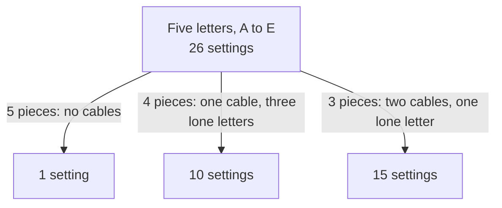

# The exponential formula: if the connected pieces have generating function C(x), the structures built from sets of them have generating function e^C(x)

[Syllabus](../../../SYLLABUS.md) → [Combinatorics and graphs](../README.md) → [Generating Functions](../README.md#s07) → The exponential formula

---

## General Overview

A cipher machine's plugboard, as on the wartime Enigma, joins letters in pairs with short cables. A cabled pair swaps: type A and B comes out. A letter with no cable passes through unchanged.

Type a message through the board twice and the message comes back. A shuffle that undoes itself like this is an **involution**: every letter either stays put or swaps with one partner.

Take a small board with five letters, A to E. No cable gives 1 setting. One cable gives 10, one for each pair of letters. Two cables give 15. That is 26 settings in all.

Every setting is a set of pieces: lone letters and cabled pairs. The **exponential formula** turns a count of the pieces into a count of the settings, for every board size at once.

A lone letter is one piece on one label and a cable is one piece on two, so the pieces' series, with $`x`$ marking one label, is $`x + x^2/2`$. Raise e to that series, multiply the coefficient of $`x^n`$ by $`n!`$, and read off 1, 1, 2, 4, 10, 26 settings on 0 to 5 letters.

The rule also runs backwards. Four computers have 6 possible cables between them, each in or out: 64 networks. A logarithm turns that 64 into 38: the networks in which every computer can reach every other.

**When every structure splits into connected pieces on separate labels, the structures' exponential generating function is e raised to the pieces' series, and the logarithm turns it back.**

**What kind of fact this is:** a theorem, proved on this card in Why it works.

### The picture: 26 settings, sorted by pieces



Each setting lands in one branch, so 1 + 10 + 15 = 26.

---

## The formula

A **label** is one of the named things being arranged: a letter, a computer. A **connected piece** is a structure that cannot be split into two smaller structures on separate labels. On a plugboard these are lone letters and cabled pairs.

Write $`c_n`$ for the number of connected pieces on $`n`$ given labels, and $`a_n`$ for the number of whole structures on them. Hang each list on its exponential generating function: the count for $`n`$ labels rides on $`x^n/n!`$ ([Exponential generating functions](04-exponential-generating-functions.md)).

```math
C(x) = c_1\frac{x}{1!} + c_2\frac{x^2}{2!} + c_3\frac{x^3}{3!} + \cdots \qquad A(x) = 1 + a_1\frac{x}{1!} + a_2\frac{x^2}{2!} + \cdots
```

The series for $`e^y`$ is $`1 + y + y^2/2! + y^3/3! + \cdots`$, built in wing 06, calculus and analysis. The exponential formula puts $`C(x)`$ in place of $`y`$:

```math
A(x) = e^{C(x)} = 1 + C(x) + \frac{C(x)^2}{2!} + \frac{C(x)^3}{3!} + \cdots
```

**Read it aloud:** a structure is no piece, or one piece, or two pieces, or three, and the $`k!`$ under the $`k`$-th power forgets the order of the $`k`$ pieces.

The logarithm $`\ln`$ is the series that undoes $`e`$, and it runs the formula backwards:

```math
C(x) = \ln A(x) = \big(A(x) - 1\big) - \frac{\big(A(x) - 1\big)^2}{2} + \frac{\big(A(x) - 1\big)^3}{3} - \cdots
```

On the plugboard, $`c_1 = 1`$ and $`c_2 = 1`$ and every other $`c_n`$ is 0, so $`C(x) = x + x^2/2`$. Then $`5!`$ times the coefficient of $`x^5`$ in $`e^{x + x^2/2}`$ is 120 × 13/60 = 26.

| Symbol | Plain meaning | In our example | Push it up and the answer… |
| --- | --- | --- | --- |
| $`x`$ | the peg; its power records the number of labels | never given a value | — |
| $`n`$, $`n!`$ | labels, and their orderings | 5 letters, 5! = 120 | climbs fast |
| $`c_n`$, $`C(x)`$ | connected pieces on $`n`$ labels, and their series | 1, 1, then 0; $`x + x^2/2`$ | more structures at every size |
| $`a_n`$, $`A(x)`$ | whole structures on $`n`$ labels, and their series | 26 at $`n = 5`$; $`e^{x + x^2/2}`$ | — |
| $`k`$ | the number of pieces in one structure | 3, 4 or 5 at $`n = 5`$ | more orders for the $`k!`$ to forget |
| $`j`$ | size of the piece holding the newest label (Steps 3 and 4) | 1 or 2 | — |
| $`\binom{m}{j}`$ | "m choose j", ways to pick $`j`$ of $`m`$; earlier cards write C(m, j) | $`\binom{3}{1} = 3`$ | — |
| $`e^y`$, $`\ln`$ | the series $`1 + y + y^2/2! + \cdots`$, and the logarithm that undoes it | $`e^{C(x)}`$; $`\ln`$ of the graphs' series | — |

### When it holds

- **Each structure splits into connected pieces in exactly one way.** Two ways would count it twice.
- **Pieces sit on separate labels and are never empty.** Two empty pieces look alike, so Step 2's division by $`k!`$ fails, and the sum over $`k`$ never ends: one empty shape turns each count into e times it, which is not a count.
- **A piece's count depends only on how many labels it gets.** A rule like "A may not cable to B" breaks this.
- **Any set of pieces is allowed.** A rule such as "at most three pieces" keeps only some powers of $`C(x)`$, so the full $`e^{C(x)}`$ overcounts.

---

## Why it works

### Step 0: a structure is a set of pieces, and a set has no order

The labelled product (multiplying exponential generating functions, which shares the labels out) counts pieces placed in a row. A set is a row with the order forgotten. So count rows of $`k`$ pieces, then divide by $`k!`$, the number of orders.

### Step 1: rows of k pieces are the k-th power

By the labelled product ([Exponential generating functions](04-exponential-generating-functions.md)), $`n!`$ times the coefficient of $`x^n`$ in $`C(x)^k`$ counts rows of $`k`$ connected pieces that use all $`n`$ labels.

On five letters with three pieces, the $`x^5`$ term of $`(x + x^2/2)^3`$ takes $`x`$ from one factor and $`x^2/2`$ from the other two. That is 3 × 1/4 = 3/4, and 120 × 3/4 = 90 rows.

### Step 2: each set appears exactly k! times

The pieces in a structure sit on different labels, so no two are the same. Each set of $`k`$ pieces can be put in a row in $`k!`$ ways, and every row comes from one set. So sets number rows divided by $`k!`$: 90 / 6 = 15 settings with two cables.

Adding over $`k`$ gives every structure once:

```math
A(x) = \sum_{k \ge 0} \frac{C(x)^k}{k!} = e^{C(x)}
```

Each coefficient is a finite sum: $`C(x)^k`$ starts at $`x^k`$, so $`k`$ never passes $`n`$.

### Step 3: a second road, through the newest label

Label $`n`$ sits in exactly one piece. Say that piece has $`j`$ labels. Pick its other $`j - 1`$ labels in $`\binom{n-1}{j-1}`$ ways, give it one of $`c_j`$ shapes, and build any structure on the $`n - j`$ labels left:

```math
a_n = \sum_{j=1}^{n} \binom{n-1}{j-1}\, c_j\, a_{n-j} \qquad (n \ge 1)
```

On the plugboard only $`j = 1`$ and $`j = 2`$ count, so $`a_n = a_{n-1} + (n - 1)\,a_{n-2}`$ for $`n \ge 2`$ (from $`a_0 = a_1 = 1`$). That gives 1, 1, 2, 4, 10 and 10 + 4 × 4 = 26, the same list.

### Step 4: running it backwards

Step 3's sum has $`c_n`$ in exactly one term, $`j = n`$, where it meets $`a_0 = 1`$. So any list of structures fixes its list of pieces, one size at a time:

```math
c_n = a_n - \sum_{j=1}^{n-1} \binom{n-1}{j-1}\, c_j\, a_{n-j} \qquad (n \ge 1)
```

That peeling is what $`\ln A(x)`$ does in one stroke. Graphs are the case: on $`n`$ computers there are $`n(n-1)/2`$ possible cables, each in or out, so $`a_n = 2^{n(n-1)/2}`$. Every network splits into connected parts, so $`\ln`$ of $`\sum 2^{n(n-1)/2} x^n / n!`$ counts connected networks: 1, 1, 4, 38, 728 on 1 to 5 computers.

### Step 5: three more counts from one formula

| Pieces | $`c_n`$ | $`C(x)`$ | $`A(x)`$ | $`a_0`$ to $`a_5`$ |
| --- | --- | --- | --- | --- |
| lone letters and cables | 1, 1, then 0 | $`x + x^2/2`$ | $`e^{x + x^2/2}`$ | 1, 1, 2, 4, 10, 26 |
| groups of people, any size | 1 at every size | $`e^x - 1`$ | $`e^{e^x - 1}`$ | 1, 1, 2, 5, 15, 52 |
| loops of a shuffle | $`(n-1)!`$ | $`-\ln(1 - x)`$ | $`1/(1 - x)`$ | 1, 1, 2, 6, 24, 120 |
| connected networks | 1, 1, 4, 38, 728 | $`\ln A(x)`$ | $`\sum 2^{n(n-1)/2} x^n/n!`$ | 1, 1, 2, 8, 64, 1024 |

- **Groups.** Splitting named people into unnamed groups is a **set partition**. A given set of people forms one group one way, so $`c_n = 1`$. The counts are the Bell numbers.
- **Loops.** Any shuffle splits into **loops**: follow where each item goes until the trail closes. A loop through $`n`$ given items can be drawn in $`(n-1)!`$ ways: start it at the smallest, then order the rest. Then $`\sum (n-1)!\, x^n/n! = \sum x^n/n = -\ln(1 - x)`$, by the logarithm's series with $`A = 1 - x`$, and $`e`$ to that is $`1/(1 - x) = 1 + x + x^2 + \cdots`$. So $`a_n = n!`$: every shuffle once, a check rather than a new count.

---

## Worked numbers, by hand

| Step | Arithmetic | Value |
| --- | --- | --- |
| pieces' series | a lone letter on 1 label, a cable on 2 | $`x + x^2/2`$ |
| 3 pieces | 120 × 3 × (1/2)², then ÷ 3! | 90, then 15 |
| 4 pieces | 120 × 4 × 1/2, then ÷ 4! | 240, then 10 |
| 5 pieces | 120 × 1, then ÷ 5! | 120, then 1 |
| plugboard settings | 15 + 10 + 1 | **26** |
| all networks on 4 computers | 2 to the power 6 | 64 |
| computer 4 alone, or with 1 or 2 others | 1 × 1 × 8, 3 × 1 × 2, 3 × 4 × 1 | 8, 6, 12 |
| connected networks | 64 − (8 + 6 + 12) | **38** |

Five letters allow 26 self-undoing settings; 38 of the 64 networks on four computers are connected.

### What breaks if you drop a piece

| Mistake | Comes out at | What went wrong |
| --- | --- | --- |
| Pieces taken as a row, no $`k!`$ | 450 | Each setting counted once per order of its pieces |
| A cable counted as an ordered pair | 81 | A–B and B–A are the same cable; the 1/2 in $`x^2/2`$ fixes that |
| The coefficient read as the count | 13/60 | It is the count over 5! |
| Only a lone computer counts as cut off | 41 | Two separate pairs are cut off with no lone computer |

---

## Code, from first principles, and it actually runs

A series is kept as whole-number counts, $`n!`$ times each coefficient. Three roads reach the involutions and the connected networks: adding up $`C(x)^k/k!`$ (or the logarithm's terms), running the newest-label recurrence forwards and backwards, and checking every map or graph by brute force.

The groups take the first two roads, and the loops are checked against $`n!`$. The 26-letter plugboard is also counted cable by cable.

### Python

```python
# The exponential formula -- the check behind the card.  Nothing is imported.  A series
# is kept as its counts: entry n is n! times the coefficient of x^n.  Multiplying two
# series is then the labelled product, C(n, k) ways to share the labels, in whole numbers.
N = 6                                                  # sizes 0 to 5
def fact(n): return 1 if n < 2 else n * fact(n - 1)
def choose(n, k): return fact(n) // (fact(k) * fact(n - k))
def gcd(a, b): return a if b == 0 else gcd(b, a % b)
def times(a, b, n): return [sum(choose(m, k) * a[k] * b[m - k] for k in range(m + 1)) for m in range(n)]
def power(c, k, n): return [1] + [0] * (n - 1) if k == 0 else times(power(c, k - 1, n), c, n)
def exp(c, n=N):                                       # road 1: add up C^k / k!
    return [sum(power(c, k, n)[m] // fact(k) for k in range(m + 1)) for m in range(n)]
def log(a, n=N):                                       # add up (-1)^(k+1) (A - 1)^k / k
    return [sum((-1) ** (k + 1) * (power([0] + a[1:n], k, n)[m] // fact(k)) * fact(k - 1)
                for k in range(1, m + 1)) for m in range(n)]
def newest(c, n=N):                                    # road 2: the piece holding label n
    a = [1]
    for m in range(1, n): a.append(sum(choose(m - 1, k - 1) * c[k] * a[m - k] for k in range(1, m + 1)))
    return a
def peel(a, n=N):                                      # road 2 run backwards
    c = [0]
    for m in range(1, n): c.append(a[m] - sum(choose(m - 1, k - 1) * c[k] * a[m - k] for k in range(1, m)))
    return c
def selfundo(n):                                       # road 3: try every map, keep p(p(i)) = i
    maps = ([code // n ** i % n for i in range(n)] for code in range(n ** n))
    return sum(all(p[p[i]] == i for i in range(n)) for p in maps)
def graphs(n):                                         # road 3: every graph, flood from vertex 0
    pairs, conn, bare = [(i, j) for i in range(n) for j in range(i + 1, n)], 0, 0
    for mask in range(2 ** len(pairs)):
        e, seen = [p for b, p in enumerate(pairs) if mask >> b & 1], {0}
        for _ in range(n): seen |= {j for i, j in e if i in seen} | {i for i, j in e if j in seen}
        conn, bare = conn + (len(seen) == n), bare + all(any(v in p for p in e) for v in range(n))
    return conn, bare
inv = [0, 1, 1, 0, 0, 0]                               # a lone letter, or one cable
I, G, R = exp(inv), [2 ** (n * (n - 1) // 2) for n in range(N)], newest(inv)
ordered, g = [power(inv, k, N)[5] for k in (3, 4, 5)], gcd(I[5], fact(5))
print(f"involutions, e^(x + x^2/2), n = 0..5: {I}")
print(f"  same by the newest-letter recurrence: {R}, a_5 = {R[4]} + 4 x {R[3]} = {R[4] + 4 * R[3]}")
print(f"  same by trying every map:             {[selfundo(n) for n in range(N)]}")
print(f"n = 5 by pieces k = 3, 4, 5: ordered {ordered}, {ordered[0]} = 120 x {ordered[0] // gcd(ordered[0], 120)}/{120 // gcd(ordered[0], 120)}; divided by k! {[o // fact(k) for o, k in zip(ordered, (3, 4, 5))]}")
print(f"coefficient of x^5: {I[5]}/120 = {I[5] // g}/{120 // g}, and 120 x {I[5] // g}/{120 // g} = {I[5]}")
print(f"set partitions, e^(e^x - 1): {exp([0] + [1] * 5)}")
print(f"shuffles by cycles, e^(-ln(1 - x)): {exp([0] + [fact(n - 1) for n in range(1, N)])}")
L, brute = log(G), [graphs(n) for n in range(1, N)]
hand = [(choose(3, k - 1), L[k], G[4 - k]) for k in (1, 2, 3)]       # pieces holding computer 4
print(f"graphs on n = 1..5 vertices:        {G[1:]}")
print(f"  connected, by the logarithm:      {L[1:]}")
print(f"  connected, by peeling backwards:  {peel(G)[1:]}")
print(f"  connected, by searching them all: {[b[0] for b in brute]}")
print(f"n = 4 by hand: 2^{4 * 3 // 2} = {G[4]}, and {G[4]} - ({' + '.join(f'{a} x {b} x {c}' for a, b, c in hand)}) = {G[4]} - ({' + '.join(str(a * b * c) for a, b, c in hand)}) = {G[4] - sum(a * b * c for a, b, c in hand)}")
P, ten = newest([0, 1, 1] + [0] * 24, 27)[26], fact(26) // (fact(6) * fact(10) * 2 ** 10)
print(f"plugboard, 26 letters: 10 cables {ten}; any number of cables {P}")
print(f"mistake 1, pieces as a list (no 1/k!): {sum(power(inv, k, N)[5] for k in range(6))}")
print(f"mistake 2, a cable counted as an ordered pair: {exp([0, 1, 2, 0, 0, 0])[5]}")
print(f"mistake 3, only a lone computer counts as cut off: {brute[3][1]}")
assert I == newest(inv) == [selfundo(n) for n in range(N)] == [1, 1, 2, 4, 10, 26]
assert exp([0] + [1] * 5) == newest([0] + [1] * 5) == [1, 1, 2, 5, 15, 52]
assert exp([0] + [fact(n - 1) for n in range(1, N)]) == [fact(n) for n in range(N)]
assert L == peel(G) == [0] + [b[0] for b in brute] and L[4] == 38 and exp(L) == G
assert P == sum(fact(26) // (fact(26 - 2 * j) * fact(j) * 2 ** j) for j in range(14))
print("ALL CHECKS PASS")
```

**Ran 2026-11-23 on macOS, Python 3.14.10, standard library only. All checks passed. Output, pasted from the run:**

```
involutions, e^(x + x^2/2), n = 0..5: [1, 1, 2, 4, 10, 26]
  same by the newest-letter recurrence: [1, 1, 2, 4, 10, 26], a_5 = 10 + 4 x 4 = 26
  same by trying every map:             [1, 1, 2, 4, 10, 26]
n = 5 by pieces k = 3, 4, 5: ordered [90, 240, 120], 90 = 120 x 3/4; divided by k! [15, 10, 1]
coefficient of x^5: 26/120 = 13/60, and 120 x 13/60 = 26
set partitions, e^(e^x - 1): [1, 1, 2, 5, 15, 52]
shuffles by cycles, e^(-ln(1 - x)): [1, 1, 2, 6, 24, 120]
graphs on n = 1..5 vertices:        [1, 2, 8, 64, 1024]
  connected, by the logarithm:      [1, 1, 4, 38, 728]
  connected, by peeling backwards:  [1, 1, 4, 38, 728]
  connected, by searching them all: [1, 1, 4, 38, 728]
n = 4 by hand: 2^6 = 64, and 64 - (1 x 1 x 8 + 3 x 1 x 2 + 3 x 4 x 1) = 64 - (8 + 6 + 12) = 38
plugboard, 26 letters: 10 cables 150738274937250; any number of cables 532985208200576
mistake 1, pieces as a list (no 1/k!): 450
mistake 2, a cable counted as an ordered pair: 81
mistake 3, only a lone computer counts as cut off: 41
ALL CHECKS PASS
```

### Rust

Same numbers, same labels, built with `rustc --edition 2021 -O`.

```rust
// The exponential formula -- the same check as the Python, in Rust.  No crates.  A series
// is kept as its counts: entry n is n! times the coefficient of x^n.  Multiplying two
// series is then the labelled product, C(n, k) ways to share the labels, in whole numbers.
type V = Vec<i128>;
const N: usize = 6;                                    // sizes 0 to 5
fn fact(n: usize) -> i128 { (1..=n as i128).product() }
fn choose(n: usize, k: usize) -> i128 { fact(n) / (fact(k) * fact(n - k)) }
fn gcd(a: i128, b: i128) -> i128 { if b == 0 { a } else { gcd(b, a % b) } }
fn times(a: &V, b: &V, n: usize) -> V { (0..n).map(|m| (0..=m).map(|k| choose(m, k) * a[k] * b[m - k]).sum()).collect() }
fn power(c: &V, k: usize, n: usize) -> V {             // C(x) to the k, as counts
    if k == 0 { (0..n).map(|m| (m == 0) as i128).collect() } else { times(&power(c, k - 1, n), c, n) }
}
fn exp(c: &V, n: usize) -> V {                         // road 1: add up C^k / k!
    (0..n).map(|m| (0..=m).map(|k| power(c, k, n)[m] / fact(k)).sum()).collect()
}
fn log(a: &V, n: usize) -> V {                         // add up (-1)^(k+1) (A - 1)^k / k
    let d: V = (0..n).map(|m| if m == 0 { 0 } else { a[m] }).collect();
    (0..n).map(|m| (1..=m).map(|k| (if k % 2 == 1 { 1 } else { -1 })
        * (power(&d, k, n)[m] / fact(k)) * fact(k - 1)).sum()).collect()
}
fn newest(c: &V, n: usize) -> V {                      // road 2: the piece holding label n
    let mut a: V = vec![1];
    for m in 1..n { let s = (1..=m).map(|k| choose(m - 1, k - 1) * c[k] * a[m - k]).sum(); a.push(s) }
    a
}
fn peel(a: &V, n: usize) -> V {                        // road 2 run backwards
    let mut c: V = vec![0];
    for m in 1..n { let s: i128 = (1..m).map(|k| choose(m - 1, k - 1) * c[k] * a[m - k]).sum(); c.push(a[m] - s) }
    c
}
fn selfundo(n: usize) -> i128 {                        // road 3: try every map, keep p(p(i)) = i
    (0..n.pow(n as u32)).filter(|code| { let p: Vec<usize> = (0..n).map(|i| code / n.pow(i as u32) % n).collect();
        (0..n).all(|i| p[p[i]] == i) }).count() as i128
}
fn graphs(n: usize) -> (i128, i128) {                  // road 3: every graph, flood from vertex 0
    let pairs: Vec<(usize, usize)> = (0..n).flat_map(|i| (i + 1..n).map(move |j| (i, j))).collect();
    let (mut conn, mut bare) = (0, 0);
    for mask in 0..1usize << pairs.len() {
        let e: Vec<&(usize, usize)> = pairs.iter().enumerate().filter(|(b, _)| mask >> b & 1 == 1).map(|(_, p)| p).collect();
        let mut seen: Vec<bool> = (0..n).map(|v| v == 0).collect();
        for _ in 0..n { for &&(i, j) in &e { if seen[i] || seen[j] { seen[i] = true; seen[j] = true } } }
        if seen.iter().all(|&s| s) { conn += 1 }
        if (0..n).all(|v| e.iter().any(|&&(i, j)| i == v || j == v)) { bare += 1 }
    }
    (conn, bare)
}
fn main() {
    let inv: V = vec![0, 1, 1, 0, 0, 0];               // a lone letter, or one cable
    let (i5, g5, r): (V, V, V) = (exp(&inv, N), (0..N).map(|n| 1i128 << (n * (n - 1) / 2)).collect(), newest(&inv, N));
    let (ordered, g): (V, i128) = ([3, 4, 5].iter().map(|&k| power(&inv, k, N)[5]).collect(), gcd(i5[5], fact(5)));
    let tries: V = (0..N).map(selfundo).collect();
    println!("involutions, e^(x + x^2/2), n = 0..5: {:?}", i5);
    println!("  same by the newest-letter recurrence: {:?}, a_5 = {} + 4 x {} = {}", r, r[4], r[3], r[4] + 4 * r[3]);
    println!("  same by trying every map:             {:?}", tries);
    let split: V = ordered.iter().zip([3, 4, 5]).map(|(o, k)| o / fact(k)).collect();
    println!("n = 5 by pieces k = 3, 4, 5: ordered {:?}, {} = 120 x {}/{}; divided by k! {:?}", ordered, ordered[0], ordered[0] / gcd(ordered[0], 120), 120 / gcd(ordered[0], 120), split);
    println!("coefficient of x^5: {}/120 = {}/{}, and 120 x {}/{} = {}", i5[5], i5[5] / g, 120 / g, i5[5] / g, 120 / g, i5[5]);
    let (ones, cyc): (V, V) = ((0..N).map(|n| (n > 0) as i128).collect(), (0..N).map(|n| if n > 0 { fact(n - 1) } else { 0 }).collect());
    println!("set partitions, e^(e^x - 1): {:?}", exp(&ones, N));
    println!("shuffles by cycles, e^(-ln(1 - x)): {:?}", exp(&cyc, N));
    let (l, brute): (V, Vec<(i128, i128)>) = (log(&g5, N), (1..N).map(graphs).collect());
    let (hand, conn): (Vec<[i128; 3]>, V) = ([1, 2, 3].iter().map(|&k| [choose(3, k - 1), l[k], g5[4 - k]]).collect(), brute.iter().map(|b| b.0).collect());
    println!("graphs on n = 1..5 vertices:        {:?}", &g5[1..]);
    println!("  connected, by the logarithm:      {:?}", &l[1..]);
    println!("  connected, by peeling backwards:  {:?}", &peel(&g5, N)[1..]);
    println!("  connected, by searching them all: {:?}", conn);
    println!("n = 4 by hand: 2^{} = {}, and {} - ({}) = {} - ({}) = {}", 4 * 3 / 2, g5[4], g5[4], hand.iter().map(|h| format!("{} x {} x {}", h[0], h[1], h[2])).collect::<Vec<_>>().join(" + "), g5[4], hand.iter().map(|h| (h[0] * h[1] * h[2]).to_string()).collect::<Vec<_>>().join(" + "), g5[4] - hand.iter().map(|h| h[0] * h[1] * h[2]).sum::<i128>());
    let pc: V = (0..27).map(|n| (n == 1 || n == 2) as i128).collect();
    let (p, ten) = (newest(&pc, 27)[26], fact(26) / (fact(6) * fact(10) * 1024));
    println!("plugboard, 26 letters: 10 cables {}; any number of cables {}", ten, p);
    println!("mistake 1, pieces as a list (no 1/k!): {}", (0..6).map(|k| power(&inv, k, N)[5]).sum::<i128>());
    println!("mistake 2, a cable counted as an ordered pair: {}", exp(&vec![0, 1, 2, 0, 0, 0], N)[5]);
    println!("mistake 3, only a lone computer counts as cut off: {}", brute[3].1);
    assert!(i5 == newest(&inv, N) && i5 == tries && i5 == vec![1, 1, 2, 4, 10, 26]);
    assert!(exp(&ones, N) == newest(&ones, N) && exp(&ones, N) == vec![1, 1, 2, 5, 15, 52]);
    assert!(exp(&cyc, N) == (0..N).map(fact).collect::<V>());
    assert!(l == peel(&g5, N) && l[1..] == conn[..] && l[0] == 0 && l[4] == 38 && exp(&l, N) == g5);
    assert!(p == (0..14).map(|j| fact(26) / (fact(26 - 2 * j) * fact(j) * (1i128 << j))).sum::<i128>());
    println!("ALL CHECKS PASS");
}
```

**Ran 2026-11-23 on macOS, rustc 1.98.1, no crates. All checks passed. Output, pasted from the run:**

```
involutions, e^(x + x^2/2), n = 0..5: [1, 1, 2, 4, 10, 26]
  same by the newest-letter recurrence: [1, 1, 2, 4, 10, 26], a_5 = 10 + 4 x 4 = 26
  same by trying every map:             [1, 1, 2, 4, 10, 26]
n = 5 by pieces k = 3, 4, 5: ordered [90, 240, 120], 90 = 120 x 3/4; divided by k! [15, 10, 1]
coefficient of x^5: 26/120 = 13/60, and 120 x 13/60 = 26
set partitions, e^(e^x - 1): [1, 1, 2, 5, 15, 52]
shuffles by cycles, e^(-ln(1 - x)): [1, 1, 2, 6, 24, 120]
graphs on n = 1..5 vertices:        [1, 2, 8, 64, 1024]
  connected, by the logarithm:      [1, 1, 4, 38, 728]
  connected, by peeling backwards:  [1, 1, 4, 38, 728]
  connected, by searching them all: [1, 1, 4, 38, 728]
n = 4 by hand: 2^6 = 64, and 64 - (1 x 1 x 8 + 3 x 1 x 2 + 3 x 4 x 1) = 64 - (8 + 6 + 12) = 38
plugboard, 26 letters: 10 cables 150738274937250; any number of cables 532985208200576
mistake 1, pieces as a list (no 1/k!): 450
mistake 2, a cable counted as an ordered pair: 81
mistake 3, only a lone computer counts as cut off: 41
ALL CHECKS PASS
```

The two outputs match line for line.

### Lean

Lean proves the exponential formula both ways for any piece counts, then its involution and network cases, and checks the worked numbers.

- Take any counts $`c_n`$ of connected pieces, and let a structure be any set of pieces on separate labels. Then $`A(x) = e^{C(x)}`$ and $`C(x) = \ln A(x)`$.
- Take the involutions on $`n`$ letters. Then their exponential generating function is $`e^{x + x^2/2}`$.
- Take $`a_n = 2^{n(n-1)/2}`$, the count of all networks on $`n`$ computers. Then $`\ln A(x)`$ counts the connected networks.
- The involution counts on 0 to 5 letters are 1, 1, 2, 4, 10, 26, by direct search.
- The hand arithmetic holds: the 15, 10 and 1 settings, 120 × 13/60 = 26, and 64 − (8 + 6 + 12) = 38.

Network counts by size, the groups and loops rows, and the full 26-letter plugboard total are left to the Python and Rust checks.

```lean
-- The exponential formula: when every structure is a set of connected pieces whose count depends only on their size, the structures' exponential generating function is e raised to the pieces' series and the logarithm turns it back, which counts involutions by e^(x + x^2/2) and connected graphs by the logarithm of the all-graphs series.
import Mathlib.Order.Partition.Finpartition
import Mathlib.RingTheory.PowerSeries.Exp
import Mathlib.RingTheory.PowerSeries.Log
import Mathlib.RingTheory.PowerSeries.Substitution
import Mathlib.Combinatorics.SimpleGraph.Connectivity.Connected
import Mathlib.Data.Fintype.Perm
import Mathlib.Data.Nat.Choose.Basic
import Mathlib.Algebra.BigOperators.Field
import Mathlib.Data.Nat.Choose.Cast
import Mathlib.Data.Nat.Choose.Sum
import Mathlib.GroupTheory.Perm.Centralizer
import Mathlib.GroupTheory.Perm.Cycle.Type

open PowerSeries Nat

/-- The structures on the labels `Fin n` built from connected pieces: a set partition of the
labels into nonempty blocks (so each structure splits into pieces in exactly one way, on
separate labels), and on each block one of `c j` connected shapes, where `j` is the block's size
(so a piece's count depends only on how many labels it gets). Any set of blocks is allowed. -/
abbrev Structures (c : ℕ → ℕ) (n : ℕ) : Type :=
  Σ π : Finpartition (Finset.univ : Finset (Fin n)), ∀ B : π.parts, Fin (c (B : Finset (Fin n)).card)

/-- The exponential generating function of the structures: `A(x) = ∑ a_n x^n / n!`. -/
noncomputable abbrev structuresSeries (c : ℕ → ℕ) : PowerSeries ℚ :=
  PowerSeries.mk fun n => (Fintype.card (Structures c n) : ℚ) / n !

/-- The pieces' series: `C(x) = ∑ c_j x^j / j!` over `j ≥ 1` (pieces are never empty). -/
noncomputable abbrev piecesSeries (c : ℕ → ℕ) : PowerSeries ℚ :=
  PowerSeries.mk fun n => if n = 0 then 0 else (c n : ℚ) / n !

-- Helper lemmas for the proofs below.

def egfSeq (c : ℕ → ℕ) : ℕ → ℕ
  | 0 => 1
  | m + 1 => ∑ k : Fin (m + 1), m.choose k * c (k + 1) * egfSeq c (m - k)
decreasing_by omega

theorem egfSeq_zero (c : ℕ → ℕ) : egfSeq c 0 = 1 := by rw [egfSeq]

theorem egfSeq_succ (c : ℕ → ℕ) (m : ℕ) : egfSeq c (m + 1) =
    ∑ k ∈ Finset.range (m + 1), m.choose k * c (k + 1) * egfSeq c (m - k) := by
  rw [egfSeq, Fin.sum_univ_eq_sum_range (fun k => m.choose k * c (k + 1) * egfSeq c (m - k))]

def ef_F {α : Type*} [DecidableEq α] (c : ℕ → ℕ) (s : Finset α) : ℕ :=
  ∑ π : Finpartition s, ∏ B ∈ π.parts, c B.card

theorem ef_F_empty {α : Type*} [DecidableEq α] (c : ℕ → ℕ) : ef_F c (∅ : Finset α) = 1 := by
  have h : ∀ π : Finpartition (∅ : Finset α), π.parts = ∅ := fun π => π.parts_eq_empty_iff.mpr rfl
  unfold ef_F
  simp only [h, Finset.prod_empty, Finset.sum_const, Finset.card_univ, smul_eq_mul, mul_one]
  exact Fintype.card_eq_one_iff.mpr ⟨Finpartition.empty _, fun π => Finpartition.ext (by
    rw [h π]; rfl)⟩

theorem ef_F_insert {α : Type*} [DecidableEq α] (c : ℕ → ℕ) (a : α) (t : Finset α)
    (ha : a ∉ t) :
    ef_F c (insert a t) = ∑ u ∈ t.powerset, c (u.card + 1) * ef_F c (t \ u) := by
  unfold ef_F
  rw [← Finset.sum_fiberwise_of_maps_to (s := Finset.univ) (t := t.powerset)
      (g := fun π : Finpartition (insert a t) => (π.part a).erase a) ?maps]
  case maps =>
    intro π _
    simp only [Finset.mem_powerset]
    intro x hx
    have hx' := Finset.mem_of_mem_erase hx
    rcases Finset.mem_insert.mp (π.part_subset a hx') with h | h
    · exact absurd h (Finset.ne_of_mem_erase hx)
    · exact h
  apply Finset.sum_congr rfl
  intro u hu
  rw [Finset.mem_powerset] at hu
  have hau : a ∉ u := fun h => ha (hu h)
  have haI : a ∈ insert a t := Finset.mem_insert_self a t
  rw [Finset.mul_sum]
  have hdisj : Disjoint (t \ u) (insert a u) := by
    rw [Finset.disjoint_left]; intro x hx hx'
    rcases Finset.mem_insert.mp hx' with h | h
    · subst h; exact ha (Finset.mem_sdiff.mp hx).1
    · exact (Finset.mem_sdiff.mp hx).2 h
  have hsup : t \ u ⊔ insert a u = insert a t := by
    ext x
    simp only [Finset.sup_eq_union, Finset.mem_union, Finset.mem_sdiff, Finset.mem_insert]
    constructor
    · rintro (⟨h1, _⟩ | h | h)
      · exact Or.inr h1
      · exact Or.inl h
      · exact Or.inr (hu h)
    · rintro (h | h)
      · exact Or.inr (Or.inl h)
      · by_cases hxu : x ∈ u
        · exact Or.inr (Or.inr hxu)
        · exact Or.inl ⟨h, hxu⟩
  have hne : insert a u ≠ ⊥ := Finset.insert_ne_empty a u
  have key : ∀ π : Finpartition (insert a t), (π.part a).erase a = u → π.part a = insert a u := by
    intro π h
    rw [← h, Finset.insert_erase (π.mem_part_self.mpr haI)]
  have supE : ∀ π : Finpartition (insert a t), (π.part a).erase a = u →
      (π.parts.erase (π.part a)).sup id = t \ u := by
    intro π h
    have hp := key π h
    ext x
    rw [Finset.mem_sup]
    constructor
    · rintro ⟨B, hB, hxB⟩
      rw [Finset.mem_erase] at hB
      have hxs : x ∈ insert a t := π.subset hB.2 hxB
      have hxp : x ∉ insert a u := by
        intro hxp
        rw [← hp] at hxp
        exact hB.1 (π.eq_of_mem_parts hB.2 (π.part_mem.mpr haI) hxB hxp)
      rw [Finset.mem_sdiff]
      rcases Finset.mem_insert.mp hxs with h' | h'
      · exact absurd (h' ▸ Finset.mem_insert_self a u) hxp
      · exact ⟨h', fun hh => hxp (Finset.mem_insert_of_mem hh)⟩
    · intro hx
      rw [Finset.mem_sdiff] at hx
      have hxs : x ∈ insert a t := Finset.mem_insert_of_mem hx.1
      refine ⟨π.part x, Finset.mem_erase.mpr ⟨?_, π.part_mem.mpr hxs⟩, π.mem_part_self.mpr hxs⟩
      intro heq
      have : x ∈ π.part a := heq ▸ π.mem_part_self.mpr hxs
      rw [hp] at this
      rcases Finset.mem_insert.mp this with h' | h'
      · exact ha (h' ▸ hx.1)
      · exact hx.2 h'
  have partE : ∀ ρ : Finpartition (t \ u), (ρ.extend hne hdisj hsup).part a = insert a u :=
    fun ρ => Finpartition.part_eq_of_mem _ (Finset.mem_insert_self _ _) (Finset.mem_insert_self _ _)
  refine Finset.sum_bij'
    (fun π hπ => π.ofSubset (parts := π.parts.erase (π.part a)) (Finset.erase_subset _ _)
      (supE π (Finset.mem_filter.mp hπ).2))
    (fun ρ _ => ρ.extend hne hdisj hsup) ?hi ?hj ?li ?ri ?h
  · intro π _; exact Finset.mem_univ _
  · intro ρ _
    refine Finset.mem_filter.mpr ⟨Finset.mem_univ _, ?_⟩
    show ((ρ.extend hne hdisj hsup).part a).erase a = u
    rw [partE, Finset.erase_insert hau]
  · intro π hπ
    have h := (Finset.mem_filter.mp hπ).2
    apply Finpartition.ext
    show insert (insert a u) (π.parts.erase (π.part a)) = π.parts
    rw [← key π h, Finset.insert_erase (π.part_mem.mpr haI)]
  · intro ρ _
    apply Finpartition.ext
    show (insert (insert a u) ρ.parts).erase ((ρ.extend hne hdisj hsup).part a) = ρ.parts
    rw [partE, Finset.erase_insert]
    intro hm
    have := ρ.subset hm (Finset.mem_insert_self a u)
    exact ha (Finset.mem_sdiff.mp this).1
  · intro π hπ
    have h := (Finset.mem_filter.mp hπ).2
    show ∏ B ∈ π.parts, c B.card = c (u.card + 1) * ∏ B ∈ π.parts.erase (π.part a), c B.card
    rw [← Finset.mul_prod_erase π.parts _ (π.part_mem.mpr haI), key π h,
      Finset.card_insert_of_notMem hau]

theorem ef_F_eq {α : Type*} [DecidableEq α] (c : ℕ → ℕ) :
    ∀ n, ∀ s : Finset α, s.card = n → ef_F c s = egfSeq c n := by
  intro n
  induction n using Nat.strong_induction_on with
  | _ n ih =>
    intro s hs
    cases n with
    | zero =>
      rw [Finset.card_eq_zero] at hs
      subst hs
      rw [ef_F_empty, egfSeq_zero]
    | succ m =>
      obtain ⟨a, has⟩ : s.Nonempty := Finset.card_pos.mp (by omega)
      have hst : s = insert a (s.erase a) := (Finset.insert_erase has).symm
      have hcard : (s.erase a).card = m := by rw [Finset.card_erase_of_mem has]; omega
      rw [hst, ef_F_insert c a _ (Finset.notMem_erase a s), egfSeq_succ]
      have : ∀ u ∈ (s.erase a).powerset, c (u.card + 1) * ef_F c (s.erase a \ u) =
          c (u.card + 1) * egfSeq c (m - u.card) := by
        intro u hu
        rw [Finset.mem_powerset] at hu
        rw [ih (m - u.card) (by omega) _ (by rw [Finset.card_sdiff_of_subset hu, hcard])]
      rw [Finset.sum_congr rfl this,
        Finset.sum_powerset_apply_card (fun k => c (k + 1) * egfSeq c (m - k)), hcard]
      apply Finset.sum_congr rfl
      intro k _
      rw [smul_eq_mul, mul_assoc]

theorem ef_card_structures (c : ℕ → ℕ) (n : ℕ) :
    Fintype.card (Structures c n) = egfSeq c n := by
  rw [← ef_F_eq c n (Finset.univ : Finset (Fin n)) (by simp), Fintype.card_sigma, ef_F]
  apply Finset.sum_congr rfl
  intro π _
  rw [Fintype.card_pi]
  simp only [Fintype.card_fin]
  exact Finset.prod_coe_sort π.parts (fun B => c B.card)

theorem ef_ode_unique (P F G : ℚ⟦X⟧) (hF : d⁄dX F = P * F) (hG : d⁄dX G = P * G)
    (h0 : constantCoeff F = constantCoeff G) : F = G := by
  have hH : d⁄dX (F - G) = P * (F - G) := by rw [map_sub, hF, hG, mul_sub]
  suffices h : ∀ n, coeff n (F - G) = 0 by
    ext n; have := h n; rw [map_sub, sub_eq_zero] at this; exact this
  intro n
  induction n using Nat.strong_induction_on with
  | _ n ih =>
    cases n with
    | zero => simp [coeff_zero_eq_constantCoeff_apply, h0]
    | succ k =>
      have h1 := congrArg (coeff k) hH
      rw [coeff_derivative, coeff_mul, Finset.sum_eq_zero] at h1
      · have : (k:ℚ) + 1 ≠ 0 := by positivity
        exact (mul_eq_zero.mp h1).resolve_right this
      · intro x hx
        rw [ih x.2 (by have := Finset.mem_antidiagonal.mp hx; omega), mul_zero]

theorem ef_deriv_exp_subst (f : ℚ⟦X⟧) (hf : constantCoeff f = 0) :
    d⁄dX ((exp ℚ).subst f) = d⁄dX f * (exp ℚ).subst f := by
  rw [derivative_subst (HasSubst.of_constantCoeff_zero' hf), derivative_exp, mul_comm]

theorem ef_cc_exp_subst (f : ℚ⟦X⟧) (hf : constantCoeff f = 0) :
    constantCoeff ((exp ℚ).subst f) = 1 := by
  rw [constantCoeff_eq, constantCoeff_subst_of_constantCoeff_zero hf, constantCoeff_exp, map_one]

theorem ef_logOf_exp_subst (f : ℚ⟦X⟧) (hf : constantCoeff f = 0) :
    logOf ((exp ℚ).subst f) = f := by
  have hs : HasSubst f := HasSubst.of_constantCoeff_zero' hf
  have h1 : (exp ℚ).subst f - 1 = (exp ℚ - 1).subst f := by
    rw [subst_sub hs, ← coe_substAlgHom hs (R := ℚ), map_one]
  rw [logOf_eq, h1, ← subst_comp_subst_apply HasSubst.exp_sub_one hs, subst_log_exp_sub_one,
    subst_X hs]

theorem ef_egf_eq (c : ℕ → ℕ) :
    PowerSeries.mk (fun n => (egfSeq c n : ℚ) / n !) = (exp ℚ).subst (piecesSeries c) := by
  have hC : constantCoeff (piecesSeries c) = 0 := by
    simp [← coeff_zero_eq_constantCoeff_apply]
  apply ef_ode_unique (d⁄dX (piecesSeries c))
  · ext m
    rw [coeff_derivative, coeff_mk, coeff_mul,
      Finset.Nat.sum_antidiagonal_eq_sum_range_succ
        (fun i j => coeff i (d⁄dX (piecesSeries c)) * coeff j (PowerSeries.mk _)),
      egfSeq_succ]
    push_cast
    rw [Finset.sum_div, Finset.sum_mul]
    apply Finset.sum_congr rfl
    intro k hk
    have hk' : k ≤ m := by simp at hk; omega
    simp only [coeff_derivative, coeff_mk]
    rw [ite_eq_right (by omega), Nat.cast_choose ℚ hk']
    push_cast [Nat.factorial_succ]
    field_simp
  · rw [ef_deriv_exp_subst _ hC]
  · rw [ef_cc_exp_subst _ hC]; simp [← coeff_zero_eq_constantCoeff_apply, egfSeq_zero]

theorem ef_invol_iff {α : Type*} [Fintype α] [DecidableEq α] (σ : Equiv.Perm α) :
    σ * σ = 1 ↔ ∀ k ∈ σ.cycleType, k = 2 := by
  rw [← pow_two, ← orderOf_dvd_iff_pow_eq_one, ← Equiv.Perm.lcm_cycleType, Multiset.lcm_dvd]
  refine forall₂_congr fun k hk => ⟨fun h => ?_, fun h => h ▸ dvd_rfl⟩
  exact le_antisymm (Nat.le_of_dvd two_pos h) (Equiv.Perm.two_le_of_mem_cycleType hk)

theorem ef_invol_fiber {α : Type*} [Fintype α] [DecidableEq α] (j : ℕ) (σ : Equiv.Perm α) :
    (σ * σ = 1 ∧ σ.support.card = j) ↔ (Even j ∧ σ.cycleType = Multiset.replicate (j / 2) 2) := by
  rw [ef_invol_iff, ← Multiset.eq_replicate_card, ← Equiv.Perm.sum_cycleType]
  constructor
  · rintro ⟨h1, h2⟩
    rw [h1, Multiset.sum_replicate, smul_eq_mul] at h2
    refine ⟨⟨σ.cycleType.card, by omega⟩, ?_⟩
    rw [h1]; congr 1; omega
  · rintro ⟨⟨r, hr⟩, h⟩
    rw [h, Multiset.card_replicate, Multiset.sum_replicate, smul_eq_mul]
    exact ⟨rfl, by omega⟩

theorem ef_card_cycleType_two {α : Type*} [Fintype α] [DecidableEq α] (k : ℕ)
    (hk : 2 * k ≤ Fintype.card α) :
    ((Finset.univ.filter fun σ : Equiv.Perm α => σ.cycleType = Multiset.replicate k 2).card : ℚ) *
      ((Fintype.card α - 2 * k)! * 2 ^ k * k !) = (Fintype.card α)! := by
  have h := Equiv.Perm.card_of_cycleType_mul_eq α (Multiset.replicate k 2)
  rw [ite_eq_left ⟨by rw [Multiset.sum_replicate, smul_eq_mul]; omega,
    fun a ha => (Multiset.eq_of_mem_replicate ha).symm ▸ le_rfl⟩] at h
  have hp : ∏ n ∈ (Multiset.replicate k 2).toFinset, ((Multiset.replicate k 2).count n)! = k ! := by
    rw [Finset.prod_subset (s₂ := {2})]
    · rw [Finset.prod_singleton, Multiset.count_replicate_self]
    · intro x hx
      rw [Multiset.mem_toFinset] at hx
      rw [Finset.mem_singleton, Multiset.eq_of_mem_replicate hx]
    · intro x _ hx
      rw [Multiset.mem_toFinset] at hx
      rw [Multiset.count_eq_zero_of_notMem hx, Nat.factorial_zero]
  rw [hp, Multiset.sum_replicate, Multiset.prod_replicate, smul_eq_mul, mul_comm k 2] at h
  exact_mod_cast h

noncomputable def ef_e (j : ℕ) : ℚ := if Even j then 1 / (2 ^ (j / 2) * (j / 2)! : ℚ) else 0

theorem ef_invol_count (n : ℕ) :
    (Fintype.card {σ : Equiv.Perm (Fin n) // σ * σ = 1} : ℚ) / n ! =
      ∑ p ∈ Finset.antidiagonal n, (1 / p.1 ! : ℚ) * ef_e p.2 := by
  rw [Fintype.card_subtype, Finset.card_eq_sum_card_fiberwise
    (f := fun σ : Equiv.Perm (Fin n) => (n - σ.support.card, σ.support.card))
    (t := Finset.antidiagonal n)]
  · push_cast
    rw [Finset.sum_div]
    apply Finset.sum_congr rfl
    rintro ⟨i, j⟩ hij
    rw [Finset.mem_antidiagonal] at hij
    rw [Finset.filter_filter]
    have hfe : (Finset.univ.filter fun σ : Equiv.Perm (Fin n) =>
        σ * σ = 1 ∧ (n - σ.support.card, σ.support.card) = (i, j)) =
        Finset.univ.filter fun σ : Equiv.Perm (Fin n) => σ * σ = 1 ∧ σ.support.card = j := by
      apply Finset.filter_congr
      intro σ _
      simp only [Prod.mk.injEq]
      constructor
      · rintro ⟨h1, _, h3⟩; exact ⟨h1, h3⟩
      · rintro ⟨h1, h3⟩; exact ⟨h1, by omega, h3⟩
    rw [hfe]
    simp only [ef_e]
    by_cases hj : Even j
    · have hfe2 : (Finset.univ.filter fun σ : Equiv.Perm (Fin n) =>
          σ * σ = 1 ∧ σ.support.card = j) =
          Finset.univ.filter fun σ : Equiv.Perm (Fin n) =>
            σ.cycleType = Multiset.replicate (j / 2) 2 := by
        apply Finset.filter_congr
        intro σ _
        rw [ef_invol_fiber]
        exact ⟨fun h => h.2, fun h => ⟨hj, h⟩⟩
      rw [hfe2, ite_eq_left hj]
      have h := ef_card_cycleType_two (α := Fin n) (j / 2) (by rw [Fintype.card_fin]; omega)
      rw [Fintype.card_fin] at h
      obtain ⟨r, hr⟩ := hj
      have hi : i = n - 2 * (j / 2) := by omega
      rw [hi]
      have h1 : ((n - 2 * (j / 2))! : ℚ) ≠ 0 := by positivity
      have h2 : ((j / 2)! : ℚ) ≠ 0 := by positivity
      have h3 : (n ! : ℚ) ≠ 0 := by positivity
      have h4 : ((Finset.univ.filter fun σ : Equiv.Perm (Fin n) =>
          σ.cycleType = Multiset.replicate (j / 2) 2).card : ℚ) ≠ 0 := by
        intro h0; rw [h0, zero_mul] at h; exact h3 h.symm
      rw [← h]
      field_simp
    · have hfe2 : (Finset.univ.filter fun σ : Equiv.Perm (Fin n) =>
          σ * σ = 1 ∧ σ.support.card = j) = ∅ := by
        apply Finset.filter_false_of_mem
        intro σ _ h
        exact hj ((ef_invol_fiber j σ).mp h).1
      rw [hfe2, ite_eq_right hj]
      simp
  · intro σ _
    simp only [Finset.mem_coe, Finset.mem_antidiagonal]
    have := σ.support.card_le_univ
    rw [Fintype.card_fin] at this
    omega

theorem ef_exp_invol :
    (exp ℚ).subst (X + (2⁻¹ : ℚ) • X ^ 2 : PowerSeries ℚ) = exp ℚ * PowerSeries.mk ef_e := by
  have hq : constantCoeff (X + (2⁻¹ : ℚ) • X ^ 2 : PowerSeries ℚ) = 0 := by simp
  have hdq : d⁄dX (X + (2⁻¹ : ℚ) • X ^ 2 : PowerSeries ℚ) = 1 + X := by
    ext n
    rw [coeff_derivative]
    rcases n with _ | _ | n <;> simp [coeff_X, coeff_X_pow]; norm_num
  have hde : d⁄dX (PowerSeries.mk ef_e) = X * PowerSeries.mk ef_e := by
    ext m
    rw [coeff_derivative, coeff_mk]
    rcases m with _ | k
    · simp [ef_e]
    · rw [coeff_succ_X_mul, coeff_mk]
      rcases Nat.even_or_odd k with ⟨i, rfl⟩ | ⟨i, rfl⟩
      · have he1 : Even (i + i + 1 + 1) := ⟨i + 1, by ring⟩
        have he2 : Even (i + i) := ⟨i, rfl⟩
        have hd1 : (i + i + 1 + 1) / 2 = i + 1 := by omega
        have hd2 : (i + i) / 2 = i := by omega
        simp only [ef_e, ite_eq_left he1, ite_eq_left he2, hd1, hd2]
        push_cast [Nat.factorial_succ, pow_succ]
        field_simp
        ring
      · have he1 : ¬ Even (2 * i + 1 + 1 + 1) := by
          rw [Nat.not_even_iff_odd]; exact ⟨i + 1, by ring⟩
        have he2 : ¬ Even (2 * i + 1) := by rw [Nat.not_even_iff_odd]; exact ⟨i, rfl⟩
        simp only [ef_e, ite_eq_right he1, ite_eq_right he2]
        simp
  apply ef_ode_unique (1 + X)
  · rw [ef_deriv_exp_subst _ hq, hdq]
  · rw [Derivation.leibniz, derivative_exp, hde, smul_eq_mul, smul_eq_mul]
    ring
  · rw [ef_cc_exp_subst _ hq, map_mul, constantCoeff_exp]
    simp [← coeff_zero_eq_constantCoeff_apply, ef_e]

theorem ef_card_graphs (V : Type*) [Fintype V] [DecidableEq V] :
    Nat.card (SimpleGraph V) = 2 ^ (Fintype.card V).choose 2 := by
  let e : SimpleGraph V ≃ Set {x : Sym2 V // ¬ x.IsDiag} :=
    { toFun := fun G => {x | x.1 ∈ G.edgeSet}
      invFun := fun s => SimpleGraph.fromEdgeSet (Subtype.val '' s)
      left_inv := fun G => by
        ext u v
        simp only [SimpleGraph.fromEdgeSet_adj, Set.mem_image, Set.mem_ofPred_eq, Subtype.exists,
          exists_and_right, exists_eq_right, SimpleGraph.mem_edgeSet]
        constructor
        · rintro ⟨⟨_, h⟩, _⟩; exact h
        · intro h; exact ⟨⟨by simpa using G.ne_of_adj h, h⟩, G.ne_of_adj h⟩
      right_inv := fun s => by
        ext ⟨x, hx⟩
        simp only [Set.mem_ofPred_eq, SimpleGraph.edgeSet_fromEdgeSet, Set.mem_sdiff,
          Set.mem_image, Subtype.exists, exists_and_right, exists_eq_right]
        constructor
        · rintro ⟨⟨_, h⟩, _⟩; exact h
        · intro h; exact ⟨⟨hx, h⟩, hx⟩ }
  rw [Nat.card_congr e, Nat.card_eq_fintype_card, Fintype.card_set, Sym2.card_subtype_not_diag]

theorem ef_card_conn {V : Type*} [Fintype V] [DecidableEq V] (B : Finset V) :
    Nat.card {H : SimpleGraph B // H.Connected} =
      Nat.card {G : SimpleGraph (Fin B.card) // G.Connected} := by
  let e := B.equivFin
  let f : SimpleGraph B ≃ SimpleGraph (Fin B.card) :=
    { toFun := fun H => H.comap e.symm
      invFun := fun G => G.comap e
      left_inv := fun H => by ext; simp
      right_inv := fun G => by ext; simp }
  apply Nat.card_congr
  refine f.subtypeEquiv ?_
  intro H
  exact (SimpleGraph.Iso.comap e.symm H).connected_iff.symm

noncomputable def ef_comp {V : Type*} [Fintype V] [DecidableEq V] (G : SimpleGraph V) :
    Finpartition (Finset.univ : Finset V) := by
  classical exact Finpartition.ofSetoid G.reachableSetoid

theorem ef_mem_comp {V : Type*} [Fintype V] [DecidableEq V] (G : SimpleGraph V) (a b : V) :
    b ∈ (ef_comp G).part a ↔ G.Reachable a b := by
  classical
  unfold ef_comp
  convert Finpartition.mem_part_ofSetoid_iff_rel (s := G.reachableSetoid) (a := a) (b := b)

theorem ef_fp_ext {V : Type*} [Fintype V] [DecidableEq V]
    (P Q : Finpartition (Finset.univ : Finset V))
    (h : ∀ a b, b ∈ P.part a ↔ b ∈ Q.part a) : P = Q := by
  have hp : ∀ a, P.part a = Q.part a := fun a => Finset.ext (h a)
  apply Finpartition.ext
  ext B
  constructor
  · intro hB
    obtain ⟨a, ha⟩ := P.nonempty_of_mem_parts hB
    rw [← P.part_eq_of_mem hB ha, hp]
    exact Q.part_mem.mpr (Finset.mem_univ a)
  · intro hB
    obtain ⟨a, ha⟩ := Q.nonempty_of_mem_parts hB
    rw [← Q.part_eq_of_mem hB ha, ← hp]
    exact P.part_mem.mpr (Finset.mem_univ a)

theorem ef_comp_eq_iff {V : Type*} [Fintype V] [DecidableEq V] (G : SimpleGraph V)
    (π : Finpartition (Finset.univ : Finset V)) :
    ef_comp G = π ↔ ∀ a b, G.Reachable a b ↔ b ∈ π.part a :=
  ⟨fun h a b => by rw [← h, ef_mem_comp],
    fun h => ef_fp_ext _ _ (fun a b => by rw [ef_mem_comp, h])⟩

theorem ef_lift {V : Type*} (G : SimpleGraph V) (S : Finset V)
    (hS : ∀ x y, x ∈ S → G.Adj x y → y ∈ S) {u v : V} (p : G.Walk u v) :
    ∀ (hu : u ∈ S) (hv : v ∈ S),
      (G.comap (Subtype.val : S → V)).Reachable ⟨u, hu⟩ ⟨v, hv⟩ := by
  induction p with
  | nil => intro hu hv; rfl
  | cons h p ih =>
    intro hu hv
    have hb := hS _ _ hu h
    have hadj : (G.comap (Subtype.val : S → V)).Adj ⟨_, hu⟩ ⟨_, hb⟩ := by simpa using h
    exact hadj.reachable.trans (ih hb hv)

theorem ef_comp_conn {V : Type*} [Fintype V] [DecidableEq V]
    (π : Finpartition (Finset.univ : Finset V)) (G : SimpleGraph V) (hG : ef_comp G = π)
    (B : π.parts) : (G.comap (Subtype.val : B.1 → V)).Connected := by
  rw [ef_comp_eq_iff] at hG
  have hpart : ∀ x ∈ B.1, π.part x = B.1 := fun x hx => π.part_eq_of_mem B.2 hx
  rw [SimpleGraph.connected_iff]
  refine ⟨fun x y => ?_, ?_⟩
  · obtain ⟨p⟩ := (hG x y).mpr (by rw [hpart x x.2]; exact y.2)
    refine ef_lift G B.1 (fun a b ha hab => ?_) p x.2 y.2
    rw [← hpart a ha, ← hG]; exact hab.reachable
  · obtain ⟨a, ha⟩ := π.nonempty_of_mem_parts B.2
    exact ⟨⟨a, ha⟩⟩

def ef_glue {V : Type*} [Fintype V] [DecidableEq V]
    (π : Finpartition (Finset.univ : Finset V))
    (Hs : ∀ B : π.parts, {H : SimpleGraph B.1 // H.Connected}) : SimpleGraph V where
  Adj x y := ∃ B : π.parts, ∃ (hx : x ∈ B.1) (hy : y ∈ B.1), (Hs B).1.Adj ⟨x, hx⟩ ⟨y, hy⟩
  symm := ⟨fun _ _ ⟨B, hx, hy, h⟩ => ⟨B, hy, hx, h.symm⟩⟩
  loopless := ⟨fun _ ⟨B, _, _, h⟩ => (Hs B).1.loopless.irrefl _ h⟩

theorem ef_glue_comp {V : Type*} [Fintype V] [DecidableEq V]
    (π : Finpartition (Finset.univ : Finset V))
    (Hs : ∀ B : π.parts, {H : SimpleGraph B.1 // H.Connected}) :
    ef_comp (ef_glue π Hs) = π := by
  rw [ef_comp_eq_iff]
  intro a b
  constructor
  · rintro ⟨p⟩
    induction p with
    | nil => exact π.mem_part_self.mpr (Finset.mem_univ _)
    | cons h p ih =>
      obtain ⟨B, hx, hy, _⟩ := h
      rw [π.part_eq_of_mem B.2 hx]
      rw [π.part_eq_of_mem B.2 hy] at ih
      exact ih
  · intro hb
    have hB : π.part a ∈ π.parts := π.part_mem.mpr (Finset.mem_univ a)
    let B : π.parts := ⟨π.part a, hB⟩
    have ha : a ∈ B.1 := π.mem_part_self.mpr (Finset.mem_univ a)
    have hr : (Hs B).1.Reachable ⟨a, ha⟩ ⟨b, hb⟩ := (Hs B).2.preconnected _ _
    let f : (Hs B).1 →g ef_glue π Hs := ⟨Subtype.val, fun {x y} h => ⟨B, x.2, y.2, h⟩⟩
    exact hr.map f

noncomputable def ef_fiberEquiv {V : Type*} [Fintype V] [DecidableEq V]
    (π : Finpartition (Finset.univ : Finset V)) :
    {G : SimpleGraph V // ef_comp G = π} ≃ ∀ B : π.parts, {H : SimpleGraph B.1 // H.Connected} where
  toFun G B := ⟨G.1.comap (Subtype.val : B.1 → V), ef_comp_conn π G.1 G.2 B⟩
  invFun Hs := ⟨ef_glue π Hs, ef_glue_comp π Hs⟩
  left_inv G := by
    obtain ⟨G, hG⟩ := G
    apply Subtype.ext
    ext x y
    show (∃ B : π.parts, ∃ (hx : x ∈ B.1) (hy : y ∈ B.1), G.Adj x y) ↔ G.Adj x y
    constructor
    · rintro ⟨_, _, _, h⟩; exact h
    · intro h
      have hB : π.part x ∈ π.parts := π.part_mem.mpr (Finset.mem_univ x)
      refine ⟨⟨π.part x, hB⟩, π.mem_part_self.mpr (Finset.mem_univ x), ?_, h⟩
      show y ∈ π.part x
      rw [← hG, ef_mem_comp]; exact h.reachable
  right_inv Hs := by
    funext B
    apply Subtype.ext
    ext x y
    show (∃ B' : π.parts, ∃ (hx : x.1 ∈ B'.1) (hy : y.1 ∈ B'.1), (Hs B').1.Adj ⟨x, hx⟩ ⟨y, hy⟩) ↔
      (Hs B).1.Adj x y
    constructor
    · rintro ⟨B', hx, hy, h⟩
      have : B' = B := Subtype.ext (π.eq_of_mem_parts B'.2 B.2 hx x.2)
      subst this
      exact h
    · intro h; exact ⟨B, x.2, y.2, h⟩

theorem ef_card_graph_structures (n : ℕ) :
    Nat.card (Structures (fun j => Nat.card {G : SimpleGraph (Fin j) // G.Connected}) n) =
      2 ^ (n * (n - 1) / 2) := by
  rw [← Nat.choose_two_right, ← Fintype.card_fin n, ← ef_card_graphs, Fintype.card_fin,
    Nat.card_congr ((Equiv.sigmaFiberEquiv (ef_comp (V := Fin n))).symm.trans
      (Equiv.sigmaCongrRight ef_fiberEquiv)), Nat.card_sigma, Nat.card_sigma]
  apply Finset.sum_congr rfl
  intro π _
  rw [Nat.card_pi, Nat.card_pi]
  apply Finset.prod_congr rfl
  intro B _
  rw [ef_card_conn, Nat.card_eq_fintype_card, Fintype.card_fin]

#print axioms egfSeq_zero
#print axioms egfSeq_succ
#print axioms ef_F_empty
#print axioms ef_F_insert
#print axioms ef_F_eq
#print axioms ef_card_structures
#print axioms ef_ode_unique
#print axioms ef_deriv_exp_subst
#print axioms ef_cc_exp_subst
#print axioms ef_logOf_exp_subst
#print axioms ef_egf_eq
#print axioms ef_invol_iff
#print axioms ef_invol_fiber
#print axioms ef_card_cycleType_two
#print axioms ef_invol_count
#print axioms ef_exp_invol
#print axioms ef_card_graphs
#print axioms ef_card_conn
#print axioms ef_mem_comp
#print axioms ef_fp_ext
#print axioms ef_comp_eq_iff
#print axioms ef_lift
#print axioms ef_comp_conn
#print axioms ef_glue_comp
#print axioms ef_card_graph_structures

/-- The exponential formula. Let `c j` count the connected pieces on `j` given labels, with
series `C(x) = ∑ c_j x^j / j!`, and let `a_n` count the whole structures on `n` labels, with
series `A(x) = ∑ a_n x^n / n!`. Then `A(x) = e^{C(x)}`, and the logarithm turns it back:
`C(x) = ln A(x) = (A - 1) - (A - 1)^2/2 + (A - 1)^3/3 - ⋯`. -/
theorem exponential_formula (c : ℕ → ℕ) :
    structuresSeries c = (exp ℚ).subst (piecesSeries c) ∧
      logOf (structuresSeries c) = piecesSeries c := by
  have hC : constantCoeff (piecesSeries c) = 0 := by
    simp [← coeff_zero_eq_constantCoeff_apply]
  have h1 : structuresSeries c = (exp ℚ).subst (piecesSeries c) := by
    rw [← ef_egf_eq]
    ext n
    rw [coeff_mk, coeff_mk, ef_card_structures]
  exact ⟨h1, by rw [h1, ef_logOf_exp_subst _ hC]⟩

/-- Involutions (shuffles that undo themselves: every label stays put or swaps with one partner)
have exponential generating function `e^(x + x^2/2)`. -/
theorem involutions_egf :
    PowerSeries.mk (fun n => (Fintype.card {σ : Equiv.Perm (Fin n) // σ * σ = 1} : ℚ) / n !) =
      (exp ℚ).subst (X + (2⁻¹ : ℚ) • X ^ 2 : PowerSeries ℚ) := by
  rw [ef_exp_invol]
  ext n
  rw [coeff_mk, ef_invol_count, coeff_mul]
  apply Finset.sum_congr rfl
  intro p _
  rw [coeff_exp, coeff_mk]
  simp

/-- Running the formula backwards on graphs: the logarithm of `∑ 2^(n(n-1)/2) x^n / n!`,
the series of all labelled graphs, is the series of the connected labelled graphs. -/
theorem connected_graphs_egf :
    PowerSeries.mk (fun n => (Nat.card {G : SimpleGraph (Fin n) // G.Connected} : ℚ) / n !) =
      logOf (PowerSeries.mk fun n => ((2 : ℚ) ^ (n * (n - 1) / 2)) / n !) := by
  have hS : structuresSeries (fun j => Nat.card {G : SimpleGraph (Fin j) // G.Connected}) =
      PowerSeries.mk fun n => ((2 : ℚ) ^ (n * (n - 1) / 2)) / n ! := by
    ext n
    rw [coeff_mk, coeff_mk, ← Nat.card_eq_fintype_card, ef_card_graph_structures]
    push_cast
    rfl
  have hP : piecesSeries (fun j => Nat.card {G : SimpleGraph (Fin j) // G.Connected}) =
      PowerSeries.mk (fun n => (Nat.card {G : SimpleGraph (Fin n) // G.Connected} : ℚ) / n !) := by
    ext n
    rw [coeff_mk, coeff_mk]
    split_ifs with h
    · subst h
      have h0 : Nat.card {G : SimpleGraph (Fin 0) // G.Connected} = 0 := by
        rw [Nat.card_eq_zero]
        left
        exact ⟨fun ⟨_, hG⟩ => hG.nonempty.some.elim0⟩
      rw [h0]
      simp
    · rfl
  rw [← hP, ← hS, (exponential_formula _).2]

-- involutions (self-undoing shuffles) on 0 to 5 letters: 1, 1, 2, 4, 10, 26
example : Fintype.card {σ : Equiv.Perm (Fin 0) // σ * σ = 1} = 1 ∧
    Fintype.card {σ : Equiv.Perm (Fin 1) // σ * σ = 1} = 1 ∧
    Fintype.card {σ : Equiv.Perm (Fin 2) // σ * σ = 1} = 2 ∧
    Fintype.card {σ : Equiv.Perm (Fin 3) // σ * σ = 1} = 4 ∧
    Fintype.card {σ : Equiv.Perm (Fin 4) // σ * σ = 1} = 10 ∧
    Fintype.card {σ : Equiv.Perm (Fin 5) // σ * σ = 1} = 26 := by decide
-- Five letters by number of pieces: rows of 3, 4, 5 pieces are 90, 240, 120; divided by k!
example : 90 / 3 ! = 15 ∧ 240 / 4 ! = 10 ∧ 120 / 5 ! = 1 := by decide
-- 1 + 10 + 15 = 26 plugboard settings on five letters
example : 1 + 10 + 15 = 26 := by norm_num
-- the x^5 coefficient of e^(x + x^2/2) is 13/60, and 5! times it is 26
example : (5 ! : ℚ) * (13 / 60) = 26 := by norm_num [Nat.factorial]
-- the newest-letter recurrence a_n = a_(n-1) + (n-1) a_(n-2) gives 1, 1, 2, 4, 10, 26
example : 1 + 0 * 1 = 1 ∧ 1 + 1 * 1 = 2 ∧ 2 + 2 * 1 = 4 ∧ 4 + 3 * 2 = 10 ∧ 10 + 4 * 4 = 26 := by
  norm_num
-- four computers: 2^6 = 64 networks, and 64 - (1·1·8 + 3·1·2 + 3·4·1) = 38 connected
example : 2 ^ (4 * 3 / 2) = 64 ∧ 64 - (1 * 1 * 8 + 3 * 1 * 2 + 3 * 4 * 1) = 38 := by norm_num
-- 26-letter plugboard with exactly 10 cables: 26! / (6! · 10! · 2^10) settings
example : 26 ! / (6 ! * 10 ! * 2 ^ 10) = 150738274937250 := by norm_num [Nat.factorial]

#print axioms exponential_formula
#print axioms involutions_egf
#print axioms connected_graphs_egf
```

**Checked 2026-11-23 on macOS, Lean 4.36.0-rc2, Mathlib v4.36.0-rc2. Every proof is complete and uses only Lean's standard axioms. Output, pasted from the run:**

```
'egfSeq_zero' depends on axioms: [propext, Classical.choice, Quot.sound]
'egfSeq_succ' depends on axioms: [propext, Classical.choice, Quot.sound]
'ef_F_empty' depends on axioms: [propext, Classical.choice, Quot.sound]
'ef_F_insert' depends on axioms: [propext, Classical.choice, Quot.sound]
'ef_F_eq' depends on axioms: [propext, Classical.choice, Quot.sound]
'ef_card_structures' depends on axioms: [propext, Classical.choice, Quot.sound]
'ef_ode_unique' depends on axioms: [propext, Classical.choice, Quot.sound]
'ef_deriv_exp_subst' depends on axioms: [propext, Classical.choice, Quot.sound]
'ef_cc_exp_subst' depends on axioms: [propext, Classical.choice, Quot.sound]
'ef_logOf_exp_subst' depends on axioms: [propext, Classical.choice, Quot.sound]
'ef_egf_eq' depends on axioms: [propext, Classical.choice, Quot.sound]
'ef_invol_iff' depends on axioms: [propext, Classical.choice, Quot.sound]
'ef_invol_fiber' depends on axioms: [propext, Classical.choice, Quot.sound]
'ef_card_cycleType_two' depends on axioms: [propext, Classical.choice, Quot.sound]
'ef_invol_count' depends on axioms: [propext, Classical.choice, Quot.sound]
'ef_exp_invol' depends on axioms: [propext, Classical.choice, Quot.sound]
'ef_card_graphs' depends on axioms: [propext, Classical.choice, Quot.sound]
'ef_card_conn' depends on axioms: [propext, Classical.choice, Quot.sound]
'ef_mem_comp' depends on axioms: [propext, Classical.choice, Quot.sound]
'ef_fp_ext' depends on axioms: [propext, Classical.choice, Quot.sound]
'ef_comp_eq_iff' depends on axioms: [propext, Classical.choice, Quot.sound]
'ef_lift' depends on axioms: [propext, Classical.choice, Quot.sound]
'ef_comp_conn' depends on axioms: [propext, Classical.choice, Quot.sound]
'ef_glue_comp' depends on axioms: [propext, Classical.choice, Quot.sound]
'ef_card_graph_structures' depends on axioms: [propext, Classical.choice, Quot.sound]
'exponential_formula' depends on axioms: [propext, Classical.choice, Quot.sound]
'involutions_egf' depends on axioms: [propext, Classical.choice, Quot.sound]
'connected_graphs_egf' depends on axioms: [propext, Classical.choice, Quot.sound]
```

> [!TIP]
> **Try changing**
> Guess first, then run it.
> - **Allow three-letter loops.** Set `inv` to `[0, 1, 1, 2, 0, 0]`: a loop through three given letters can run two ways. Guess the count on five letters. It is 66, and the first assert stops it.
> - **Forget the order.** In `exp`, drop `// fact(k)`. Rows of pieces replace sets: 1, 1, 3, 12, 66, 450, and the first assert stops it.
> - **Peel the Bell numbers.** Add `print(log([1, 1, 2, 5, 15, 52])[1:])`. Guess first: it prints `[1, 1, 1, 1, 1]`, one group on each set of people.
> - **Peel the shuffles.** Do the same with `[1, 1, 2, 6, 24, 120]`. It prints `[1, 1, 2, 6, 24]`: the loop counts $`(n-1)!`$.

---

## The usual mistake

> [!warning]
> **Counting rows of pieces instead of sets.** $`C(x)^k`$ alone counts the $`k`$ pieces in every order. A plugboard setting does not care which cable is "first", so each set must be divided by $`k!`$. Without it, five letters give 450 instead of 26.
>
> - **A cable counted as an ordered pair.** Writing $`x + x^2`$ counts A–B and B–A apart, and gives 81.
> - **The coefficient read as the count.** The $`x^5`$ term of $`e^{x + x^2/2}`$ carries 13/60. The count is 5! times it, 26.
> - **Only a lone computer counts as cut off.** Removing networks with an unlinked computer leaves 41, not 38. Two separate cabled pairs are cut off too, and the logarithm catches them.

---

## Where you meet it in real life

- **Cipher plugboards.** A 26-letter board with exactly 10 cables, the wartime Enigma rule, has 150,738,274,937,250 settings. Any number of cables gives 532,985,208,200,576.
- **Network reliability.** Counting connected networks is the first step to the chance that a random network is connected. The logarithm turns the easy count into the hard one.
- **Physics.** In statistical mechanics, the logarithm of a sum over all diagrams keeps only the connected ones: this card's backwards step.

> **Say it back**
> Many structures are sets of connected pieces on separate labels. Rows of $`k`$ pieces are counted by the $`k`$-th power of the pieces' series, and dividing by $`k!`$ forgets the order. Adding over $`k`$ gives $`e^{C(x)}`$. With lone letters and cables, $`C(x) = x + x^2/2`$ and five letters give 26 settings. Run backwards, the logarithm turns the 64 networks on four computers into the 38 connected ones.

---

## What this builds on

- [Exponential generating functions](04-exponential-generating-functions.md): counts hung on $`x^n/n!`$, and the product that shares labels out — Step 1 of this card.

## Where this goes next

- [Set partitions and Bell numbers](../08-Partitions/03-set-partitions-and-bell-numbers.md): the groups row of Step 5, counted directly by who shares a group with the newest person.
- [Counting shuffles by their loops](../08-Partitions/05-permutations-by-cycles.md): the loops row, now sorted by how many loops each shuffle makes.
- [Lagrange inversion](07-lagrange-inversion.md): coefficients of a series known only through an equation it satisfies.

Left open: a labelled rooted tree is a root with a set of smaller rooted trees hanging off it, so its series satisfies $`T(x) = x\, e^{T(x)}`$. The formula gives the equation but not its coefficients; reading them off is Lagrange inversion.

---

## Sources

Verified 23 Nov 2026: every link below resolves to the publisher's page.

- Wilf, Herbert S. *generatingfunctionology*, 3rd ed. A K Peters/CRC Press, 2005. [doi:10.1201/b10576](https://doi.org/10.1201/b10576). Chapter 3 proves the exponential formula, opening with the count of connected labelled graphs.
- Stanley, Richard P. *Enumerative Combinatorics*, Volume 2. Cambridge University Press, 1999. [doi:10.1017/CBO9780511609589](https://doi.org/10.1017/CBO9780511609589). Section 5.1 states and proves the exponential formula in general.
- Flajolet, Philippe, and Robert Sedgewick. *Analytic Combinatorics*. Cambridge University Press, 2009. [doi:10.1017/CBO9780511801655](https://doi.org/10.1017/CBO9780511801655). Chapter II builds the set construction behind $`e^{C(x)}`$.
- "A001187: Number of connected labeled graphs with n nodes." On-Line Encyclopedia of Integer Sequences. [Sequence page](https://oeis.org/A001187). Lists 1, 1, 4, 38, 728.
