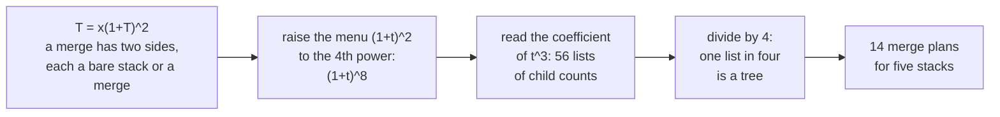

# Lagrange inversion: when a series is defined by T = x phi(T), its coefficients come straight from powers of phi

[Syllabus](../../../SYLLABUS.md) → [Combinatorics and graphs](../README.md) → [Generating Functions](../README.md#s07) → Lagrange inversion

---

## General Overview

Take the mailroom bench from [The Catalan generating function](05-catalan-generating-function.md) with five sorted stacks of envelopes in a row. A machine merges two neighbouring stacks, so four merges finish the job. The order of the merges, written as brackets, is a **plan**, and five stacks allow 14 plans.

That card found the 14 by iterating $`C = 1 + x\,C^2`$, one round per merge.

Lagrange inversion skips the rounds. Each of a merge's two sides holds a bare stack, 1, or a merge, $`t`$: its menu is $`(1 + t)^2`$. Its fourth power is $`(1 + t)^8`$, whose coefficient at $`t^3`$ is 56. Divide by 4: the answer is 14.

The same recipe counts other trees:

- A machine merging **three** neighbouring stacks: nine stacks, four merges, 55 plans.
- Four villages, Ayle, Brook, Crag and Dale, joined by three roads with no loop, one village the depot: 64 layouts.

**When a series is fixed by $`T = x\,\varphi(T)`$, with $`\varphi`$ a node's menu, its coefficient at $`x^n`$ is the coefficient of $`t^{n-1}`$ in $`\varphi(t)^n`$, divided by $`n`$: the power lists every way the $`n`$ nodes can hold their children, and exactly one list in $`n`$ is a real tree.**

**What kind of fact this is:** a theorem, proved on this card in Why it works for every formal power series φ.

### The picture: from the equation to the count



---

## The formula

A **formal power series** is a list of numbers hung on a marker's powers, for bookkeeping only ([Generating functions](01-ordinary-generating-functions.md)). The bracket $`[x^n]\,F`$ means "the coefficient of $`x^n`$ in the series $`F`$".

A **tree** here is a root node above an ordered row of smaller trees, its **children**. The series $`\varphi(t)`$ ("phi of t") is the **menu** of one node: its coefficient $`\varphi_k`$ at $`t^k`$ is the number of ways a node can hold $`k`$ children. The series $`T(x)`$ counts trees by their number of nodes. It is fixed by one equation:

```math
T(x) = x\,\varphi\big(T(x)\big) \quad\Longrightarrow\quad [x^n]\,T = \frac{1}{n}\,[t^{n-1}]\,\varphi(t)^n \qquad (n \ge 1)
```

**Read it aloud:** if a tree is one node holding a menu-shaped bundle of trees, then the trees with n nodes number one n-th of the coefficient of t to the n − 1 in the menu raised to the n-th power.

Three menus, three counts at $`n = 4`$:

| Trees | Menu $`\varphi(t)`$ | Lagrange at $`n = 4`$ | Count |
| --- | --- | --- | --- |
| two-way merge plans | $`(1 + t)^2`$ | $`\tfrac14 \times 56`$, from $`(1 + t)^8`$ | 14 |
| three-way merge plans | $`(1 + t)^3`$ | $`\tfrac14 \times 220`$, from $`(1 + t)^{12}`$ | 55 |
| rooted labelled trees | $`e^t`$ | $`4! \times \tfrac14 \times \tfrac{64}{6}`$, from $`e^{4t}`$ | 64 |

In general the two-way menu gives $`\tfrac1n\binom{2n}{n-1} = \binom{2n}{n}/(n + 1)`$, the Catalan card's closed count, with no square root.

| Symbol | Plain meaning | In our example | Push it up and the answer… |
| --- | --- | --- | --- |
| $`x`$ | the marker in $`T`$: one factor per node | $`x^4`$ holds the four-merge plans | — |
| $`t`$ | the marker inside the menu: one factor per child | $`(1 + t)^8`$ | — |
| $`T(x)`$ | the tree counts as one series | $`x + 2x^2 + 5x^3 + 14x^4 + \cdots`$ | — |
| $`\varphi(t)`$, $`\varphi_k`$, $`d`$ | the menu, its ways to hold $`k`$ children; $`d`$ sides per merge | $`(1 + t)^2`$: 1, 2, 1 | 14 becomes 55 at $`d = 3`$ |
| $`c`$ | a node's number of children | 2, 1, 0, 0 | — |
| $`n`$ | nodes in a tree; merges in a plan | 4 | the counts grow fast |
| $`[x^n]`$, $`n!\,[x^n]\,T`$ | "the coefficient of $`x^n`$ in"; times $`n!`$, a labelled count | $`[x^4]\,T = 14`$; 64 rooted trees at $`n = 4`$ | — |
| $`\binom{a}{b}`$ | "a choose b"; earlier cards write C(a, b) | $`\binom{8}{3} = 56`$ | — |

### When it holds

- **The x stands outside.** The equation must read $`T = x\,\varphi(T)`$. The Catalan equation $`C = 1 + x\,C^2`$ does not; put $`T = C - 1`$ first, giving $`T = x(1 + T)^2`$.
- **A node may be a leaf.** If $`\varphi_0 = 0`$, no finite tree exists, and the formula rightly returns 0.
- **n is at least 1.** No tree is empty, and $`\tfrac10`$ means nothing.
- **Formal series, any coefficients.** The menu may hold fractions, such as $`\tfrac{1}{k!}`$ in $`e^t`$. Nothing is summed, so convergence never matters.
- **Labelled trees read back with n!.** For an exponential series ([Exponential generating functions](04-exponential-generating-functions.md)), the count is $`n!`$ times the coefficient.

---

## Why it works

### Step 0: count lists, which is easy, then keep the trees

Write a tree as a list of each node's number of children, root first. Each node picks its number on its own, so a power of the menu counts the lists. Each list, turned round in a circle, has exactly one starting point that gives a tree. So trees are one n-th of the lists.

### Step 1: the equation describes the trees

Give each tree a **weight**: the product of $`\varphi_c`$ over its nodes, $`c`$ being a node's number of children. In $`(1 + t)^2`$, $`\varphi_1 = 2`$: a merge with one merge below it has two choices of side.

A tree is a root, the $`x`$, holding $`c`$ smaller trees in a row, with weight $`\varphi_c`$. A product of series counts a row of independent pieces ([Counting by multiplying series](02-counting-with-generating-functions.md)), so $`c`$ subtrees give $`T^c`$; summing over $`c`$ gives $`x\,\varphi(T)`$, the right side of the equation.

Only one series solves the equation: with the $`x`$ in front, each coefficient on the right uses only lower ones.

### Step 2: a tree becomes a list of child counts

Take the five-stack plan ((AB)C)(DE). Its merges, root first: the last merge, with a merge on each side; ((AB)C), with one; (AB) and (DE), with none. The child counts are 2, 1, 0, 0.

Keep a running count of **open slots**, places waiting for a node, starting at 1 for the root. Each node fills one slot and opens $`c`$, so the count changes by $`c - 1`$. For 2, 1, 0, 0 it reads 2, 2, 1, 0.

A list is a tree exactly when the count first reaches 0 at the end. Its $`n`$ entries add to $`n - 1`$: every node but the root is someone's child.

### Step 3: the power of the menu counts every list

Write $`\varphi(t)^n`$ as $`n`$ factors, one per node in order. Each picks a child count $`c`$, with weight $`\varphi_c`$ and power $`t^c`$, so the coefficient of $`t^{n-1}`$ collects every weighted list adding to $`n - 1`$.

For four merges, $`(1 + t)^8`$ has 56 at $`t^3`$. Most fail the open-slot test: 0, 0, 2, 1 closes at once.

### Step 4: exactly one turn of each list is a tree

Turn a list round in a circle: 2, 1, 0, 0 gives 1, 0, 0, 2, then 0, 0, 2, 1, then 0, 2, 1, 0. Only the first passes. The **cycle lemma**: for every list adding to $`n - 1`$, exactly one of its $`n`$ turns is a tree code.

The turns of one list all differ and share one weight, so the 56 lists fall into groups of 4, one tree per group: $`56 / 4 = 14`$.

<details>
<summary>Detailed proof: the cycle lemma, and why the turns are all different</summary>

Write $`s_k`$ for the sum of $`c_i - 1`$ over the first $`k`$ entries, so $`s_n = (n - 1) - n = -1`$. The open-slot count after $`k`$ entries is $`1 + s_k`$, and a list is a tree code when $`s_k \ge 0`$ for every $`k < n`$.

Let $`m`$ be the **first** position from 1 to $`n`$ where $`s_k`$ is lowest. Start the list just after position $`m`$. Up to the end of the old list, the new sums are $`s_k - s_m \ge 0`$, because $`s_m`$ is the lowest.

After wrapping round to position $`i < m`$, the new sum is $`-1 - s_m + s_i \ge 0`$, because $`s_i > s_m`$ strictly before the first lowest point. The last step lands on $`-1`$. So this turn is a tree code.

Any other start fails: a start after position $`m'`$ passes only if $`s_{m'}`$ is no higher than every later sum and lower than every earlier one, which makes $`m' = m`$.

The turns differ. A list equal to one of its own turns repeats a block of length $`p < n`$, so $`n/p`$ divides both $`n`$ and the sum $`n - 1`$, which forces $`n/p = 1`$.

Nothing here needs the menu's numbers to be whole, so for any formal series $`\varphi`$:

$`\displaystyle [x^n]\,T \;=\; \sum_{\text{tree codes}} \prod_i \varphi_{c_i} \;=\; \frac{1}{n} \sum_{\text{all lists}} \prod_i \varphi_{c_i} \;=\; \frac{1}{n}\,[t^{n-1}]\,\varphi(t)^n`$

</details>

### Step 5: the three families

Two sides per merge give the menu $`(1 + t)^2`$, three give $`(1 + t)^3`$: 14 and 55 plans at four merges.

A **rooted labelled tree** is a tree on named vertices with one marked as the **root**, here the depot. It is the root, $`x`$, holding a set of rooted trees on the other names.

The exponential formula turns "a set of labelled pieces" into $`e^T`$ ([The exponential formula](06-exponential-formula.md)), so $`T = x\,e^T`$. The theorem needs only the equation, which one series solves (Step 1), so it holds here too.

With $`\varphi = e^t`$, the power is $`e^{nt}`$, whose coefficient at $`t^{n-1}`$ is $`n^{n-1}/(n-1)!`$. Then:

```math
n!\,[x^n]\,T = n! \times \frac{1}{n} \times \frac{n^{n-1}}{(n-1)!} = n^{n-1}
```

At $`n = 4`$ that is $`4^3 = 64`$. Any of the 4 villages can be the depot, so layouts without a depot number $`64 / 4 = 16`$. In general $`n^{n-1} / n = n^{n-2}`$: Cayley's formula, the subject of [Spanning trees](../10-Trees%20and%20Cheapest%20Routes/03-spanning-trees-and-cayleys-formula.md).

---

## Worked numbers, by hand

| Step | Arithmetic | Value |
| --- | --- | --- |
| two-way menu, four merges | $`(1 + t)^2`$ to the 4th power | $`(1 + t)^8`$ |
| its coefficient at $`t^3`$ | $`\binom{8}{3} = (8 \times 7 \times 6) / (3 \times 2 \times 1)`$ | 56 |
| divide by $`n`$ | 56 / 4 | **14** |
| three-way menu | $`\binom{12}{3} = 220`$, then 220 / 4 | **55** |
| exponential menu | $`e^{4t}`$ at $`t^3`$: $`4^3 / 3!`$ | 64/6 |
| read back with $`n!`$ | $`4! \times \tfrac14 \times \tfrac{64}{6}`$ | **64** |
| drop the depot | 64 / 4 | **16** |

### What breaks if you drop a piece

| Mistake | Comes out at | What went wrong |
| --- | --- | --- |
| No $`\tfrac1n`$ | 56 | Counts every list, not every tree: each tree hides 4 turns |
| $`t^n`$ in place of $`t^{n-1}`$ | 70 / 4 = 17.5 | A count that is not whole is a sure sign of a slip |
| No $`n!`$ for labelled trees | 64 / 24 = 2.667 | An exponential series stores count over $`n!`$ |
| Rooted trees read as road layouts | 64, not 16 | Each layout appears once per choice of depot |

---

## Code, from first principles, and it actually runs

Nothing is imported. Each family is counted for 1 to 6 nodes three ways: Lagrange via powers of the menu, solving the equation round by round, and building every tree as child-count codes or parent maps. For $`e^T`$, the second road splits off the piece holding the smallest name.

The first two roads share only the series product. The code also tests the cycle lemma on all 16 lists and checks the series product on the shelf's two dice.

### Python

```python
# Lagrange inversion -- the check behind the card.  Nothing is imported.  T = x phi(T) fixes a series T,
# and Lagrange reads its coefficients as (1/n) [t^(n-1)] phi(t)^n.  Three tree families, n = 1 to 6, three
# roads each: Lagrange, iterating the equation, and building every tree as a child-count code or parent map.
N = 6
def choose(n, k): return 1 if k == 0 else choose(n, k - 1) * (n - k + 1) // k   # C(n, k), "n choose k"
def mul(a, b, lab=False, cut=N):         # series product cut above x^cut; lab: labelled (EGF) counts
    out = [0] * (cut + 1)
    for i in range(cut + 1):
        for j in range(cut + 1 - i): out[i + j] += a[i] * b[j] * (choose(i + j, i) if lab else 1)
    return out
def power(phi, n, lab=False):            # phi(t)^n
    out = [1] + [0] * N
    for _ in range(n): out = mul(out, phi, lab)
    return out
def digits(m, base, n): return [m // base ** i % base for i in range(n)]
def slots(cs): return [1 + sum(c - 1 for c in cs[:k + 1]) for k in range(len(cs))]   # open slots after each node
def is_code(cs): run = slots(cs); return run[-1] == 0 and min(run[:-1], default=1) > 0   # closes one tree, at the end only
def listed(d, left, need=1):             # build every tree code node by node, weighted by the slots it fills
    if need == 0 or left == 0: return int(need == left == 0)
    return sum(choose(d, c) * listed(d, left - 1, need + c - 1) for c in range(d + 1))
def iterate(d):                          # rounds of T <- x (1 + T)^d
    t = [0] * (N + 1)
    for _ in range(N): t = [0] + power([1] + t[1:], d)[:N]
    return t[1:]
def climb(f, v, k): return v if k == 0 else climb(f, f[v], k - 1)
def parent_maps(n):                      # every map v -> parent(v); a rooted tree's upward walks share one end
    trees, roads = 0, set()
    for m in range(n ** n):
        if len({climb(f := digits(m, n, n), v, n) for v in range(n)}) == 1:
            trees, roads = trees + 1, roads | {frozenset(frozenset((v, f[v])) for v in range(n) if f[v] != v)}
    return trees, len(roads)
def row(label, vals): print(f"{label:<44}" + "".join(f"{v:>7}" for v in vals))
ones = [1] * (N + 1)                     # e^t as labelled counts: one way to make a set of any size
lag = {d: [power(power([1, 1] + [0] * (N - 1), d), n)[n - 1] // n for n in range(1, N + 1)] for d in (2, 3)}
lab = [power(ones, n, True)[n - 1] for n in range(1, N + 1)]   # n! (1/n) [t^(n-1)] e^(nt), kept whole
sets, rec = [1] + [0] * N, [0] * (N + 1)                       # road two for x e^T: grow e^T and T together
for n in range(1, N + 1):
    rec[n] = n * sets[n - 1]
    sets[n] = sum(choose(n - 1, k) * rec[k + 1] * sets[n - 1 - k] for k in range(n))
maps = [parent_maps(n) for n in range(1, N + 1)]
for d, name in ((2, "binary, T = x(1+T)^2"), (3, "ternary, T = x(1+T)^3")):
    row(name + ", by Lagrange", lag[d]); row("  by iterating the equation", iterate(d)); row("  by listing tree codes", [listed(d, n) for n in range(1, N + 1)])
row("rooted labelled, T = x e^T, n! [x^n] T", lab); row("  by the exponential formula", rec[1:]); row("  by listing parent maps", [t for t, _ in maps])
b8, t12, e4, turns = choose(8, 3), choose(12, 3), power(ones, 4, True)[3], [[2, 1, 0, 0][k:] + [2, 1, 0, 0][:k] for k in range(4)]
rotations = [sum(is_code(cs[k:] + cs[:k]) for k in range(4)) for m in range(81) if sum(cs := digits(m, 3, 4)) == 3]
dice = mul(die := [0] + [1] * 6 + [0] * 6, die, cut=12)        # the shelf's two dice, by the series product up to x^12
print(f"n = 4: (1+t)^8 has 8 x 7 x 6 / (3 x 2 x 1) = {b8} at t^3, {b8} / 4 = {b8 // 4}; (1+t)^12 has {t12} at t^3, {t12} / 4 = {t12 // 4}")
print(f"n = 4: e^(4t) has {e4}/6 at t^3, and 4! x (1/4) x {e4}/6 = {24 * e4 // 4 // 6}")
print(f"lists of 4 child counts from 0 to 2 summing to 3: {len(rotations)}; each has one tree rotation: {'yes' if set(rotations) == {1} else 'no'}")
print(f"turns of 2, 1, 0, 0: {turns}; open slots of the first {slots(turns[0])}; trees {[int(is_code(t)) for t in turns]}")
print(f"4 villages: {maps[3][0]} rooted trees, {maps[3][1]} distinct road sets; Cayley 4^2 = {4 ** 2}")
print(f"the shelf's two dice: {dice[7]} ways at x^7, {sum(dice)} in all")
print(f"mistake 1, no 1/n: {b8}; mistake 2, t^4 not t^3: {choose(8, 4)} / 4 = {choose(8, 4) / 4:.1f}")
print(f"mistake 3, no n! for labelled trees: {e4} / 24 = {e4 / 24:.3f}")
print(f"mistake 4, rooted trees read as road plans: {maps[3][0]}, not {maps[3][1]}")
assert lag[2] == iterate(2) == [listed(2, n) for n in range(1, N + 1)] and lag[2][3] == 14   # three roads, binary
assert lag[3] == iterate(3) == [listed(3, n) for n in range(1, N + 1)] and lag[3][3] == 55   # three roads, ternary
assert lab == rec[1:] == [t for t, _ in maps] == [n ** (n - 1) for n in range(1, N + 1)]    # three roads, labelled
assert set(rotations) == {1} and maps[3][1] == 4 ** 2 and dice == [sum(a + b == s for a in range(1, 7) for b in range(1, 7)) for s in range(13)]   # cycle lemma, Cayley, dice by listing
print("ALL CHECKS PASS")
```

**Ran 2026-11-23 on macOS, Python 3.14.10, standard library only. All checks passed. Output, pasted from the run:**

```
binary, T = x(1+T)^2, by Lagrange                 1      2      5     14     42    132
  by iterating the equation                       1      2      5     14     42    132
  by listing tree codes                           1      2      5     14     42    132
ternary, T = x(1+T)^3, by Lagrange                1      3     12     55    273   1428
  by iterating the equation                       1      3     12     55    273   1428
  by listing tree codes                           1      3     12     55    273   1428
rooted labelled, T = x e^T, n! [x^n] T            1      2      9     64    625   7776
  by the exponential formula                      1      2      9     64    625   7776
  by listing parent maps                          1      2      9     64    625   7776
n = 4: (1+t)^8 has 8 x 7 x 6 / (3 x 2 x 1) = 56 at t^3, 56 / 4 = 14; (1+t)^12 has 220 at t^3, 220 / 4 = 55
n = 4: e^(4t) has 64/6 at t^3, and 4! x (1/4) x 64/6 = 64
lists of 4 child counts from 0 to 2 summing to 3: 16; each has one tree rotation: yes
turns of 2, 1, 0, 0: [[2, 1, 0, 0], [1, 0, 0, 2], [0, 0, 2, 1], [0, 2, 1, 0]]; open slots of the first [2, 2, 1, 0]; trees [1, 0, 0, 0]
4 villages: 64 rooted trees, 16 distinct road sets; Cayley 4^2 = 16
the shelf's two dice: 6 ways at x^7, 36 in all
mistake 1, no 1/n: 56; mistake 2, t^4 not t^3: 70 / 4 = 17.5
mistake 3, no n! for labelled trees: 64 / 24 = 2.667
mistake 4, rooted trees read as road plans: 64, not 16
ALL CHECKS PASS
```

### Rust

Same numbers, same labels, built with `rustc --edition 2021 -O`.

```rust
// Lagrange inversion -- the same check as the Python, in Rust.  No crates.  T = x phi(T) fixes a series T,
// and Lagrange reads its coefficients as (1/n) [t^(n-1)] phi(t)^n.  Three tree families, n = 1 to 6, three
// roads each: Lagrange, iterating the equation, and building every tree as a child-count code or parent map.
use std::collections::BTreeSet;
const N: usize = 6;
fn choose(n: i64, k: i64) -> i64 { if k == 0 { 1 } else { choose(n, k - 1) * (n - k + 1) / k } }
fn mul(a: &[i64], b: &[i64], lab: bool, cut: usize) -> Vec<i64> {   // series product cut above x^cut; lab: labelled counts
    let mut out = vec![0i64; cut + 1];
    for i in 0..=cut { for j in 0..=cut - i { out[i + j] += a[i] * b[j] * if lab { choose((i + j) as i64, i as i64) } else { 1 } } }
    out
}
fn power(phi: &[i64], n: usize, lab: bool) -> Vec<i64> {  // phi(t)^n
    let mut out = vec![0i64; N + 1]; out[0] = 1;
    for _ in 0..n { out = mul(&out, phi, lab, N) }
    out
}
fn digits(m: usize, base: usize, n: usize) -> Vec<usize> { (0..n).map(|i| m / base.pow(i as u32) % base).collect() }
fn slots(cs: &[usize]) -> Vec<i64> { cs.iter().scan(1i64, |r, &c| { *r += c as i64 - 1; Some(*r) }).collect() }   // open slots after each node
fn is_code(cs: &[usize]) -> bool { let run = slots(cs); run[run.len() - 1] == 0 && run[..run.len() - 1].iter().all(|&r| r > 0) }   // closes one tree, at the end only
fn listed(d: i64, left: usize, need: i64) -> i64 {        // build every tree code node by node, weighted
    if need == 0 || left == 0 { return (need == 0 && left == 0) as i64 }
    (0..=d).map(|c| choose(d, c) * listed(d, left - 1, need + c - 1)).sum()
}
fn iterate(d: usize) -> Vec<i64> {                        // rounds of T <- x (1 + T)^d
    let mut t = vec![0i64; N + 1];
    for _ in 0..N { let mut one = t.clone(); one[0] = 1; let p = power(&one, d, false); t = vec![0]; t.extend_from_slice(&p[..N]) }
    t[1..].to_vec()
}
fn parent_maps(n: usize) -> (i64, usize) {                // every map v -> parent(v); upward walks share one end
    let (mut trees, mut roads) = (0i64, BTreeSet::new());
    for m in 0..n.pow(n as u32) {
        let f = digits(m, n, n);
        let ends: BTreeSet<usize> = (0..n).map(|v| (0..n).fold(v, |w, _| f[w])).collect();
        if ends.len() == 1 {
            trees += 1;
            roads.insert((0..n).filter(|&v| f[v] != v).map(|v| (v.min(f[v]), v.max(f[v]))).collect::<BTreeSet<(usize, usize)>>());
        }
    }
    (trees, roads.len())
}
fn row(label: &str, vals: &[i64]) { println!("{:<44}{}", label, vals.iter().map(|v| format!("{:>7}", v)).collect::<String>()) }
fn main() {
    let ones = vec![1i64; N + 1];                         // e^t as labelled counts: one set of each size
    let mut lin = vec![0i64; N + 1]; lin[0] = 1; lin[1] = 1;
    let lag = |d: usize| -> Vec<i64> { (1..=N).map(|n| power(&power(&lin, d, false), n, false)[n - 1] / n as i64).collect() };
    let lab: Vec<i64> = (1..=N).map(|n| power(&ones, n, true)[n - 1]).collect();
    let (mut sets, mut rec) = (vec![0i64; N + 1], vec![0i64; N + 1]); sets[0] = 1;   // road two for x e^T
    for n in 1..=N {
        rec[n] = n as i64 * sets[n - 1];
        sets[n] = (0..n).map(|k| choose(n as i64 - 1, k as i64) * rec[k + 1] * sets[n - 1 - k]).sum();
    }
    let maps: Vec<(i64, usize)> = (1..=N).map(parent_maps).collect();
    let mapped: Vec<i64> = maps.iter().map(|m| m.0).collect();
    let codes = |d: usize| -> Vec<i64> { (1..=N).map(|n| listed(d as i64, n, 1)).collect() };
    for (d, name) in [(2usize, "binary, T = x(1+T)^2"), (3, "ternary, T = x(1+T)^3")] {
        row(&format!("{}, by Lagrange", name), &lag(d)); row("  by iterating the equation", &iterate(d)); row("  by listing tree codes", &codes(d));
    }
    row("rooted labelled, T = x e^T, n! [x^n] T", &lab); row("  by the exponential formula", &rec[1..]); row("  by listing parent maps", &mapped);
    let (b8, t12, e4) = (choose(8, 3), choose(12, 3), power(&ones, 4, true)[3]);
    let rotations: Vec<usize> = (0..81).map(|m| digits(m, 3, 4)).filter(|cs| cs.iter().sum::<usize>() == 3)
        .map(|cs| (0..4).filter(|&k| is_code(&[&cs[k..], &cs[..k]].concat())).count()).collect();
    let die: Vec<i64> = (0..13).map(|i| (1..7).contains(&i) as i64).collect(); let dice = mul(&die, &die, false, 12);   // the two dice, by the series product
    let tc = [2usize, 1, 0, 0]; let turns: Vec<Vec<usize>> = (0..4).map(|k| [&tc[k..], &tc[..k]].concat()).collect();
    println!("n = 4: (1+t)^8 has 8 x 7 x 6 / (3 x 2 x 1) = {} at t^3, {} / 4 = {}; (1+t)^12 has {} at t^3, {} / 4 = {}", b8, b8, b8 / 4, t12, t12, t12 / 4);
    println!("n = 4: e^(4t) has {}/6 at t^3, and 4! x (1/4) x {}/6 = {}", e4, e4, 24 * e4 / 4 / 6);
    println!("lists of 4 child counts from 0 to 2 summing to 3: {}; each has one tree rotation: {}", rotations.len(), if rotations.iter().all(|&r| r == 1) { "yes" } else { "no" });
    println!("turns of 2, 1, 0, 0: {:?}; open slots of the first {:?}; trees {:?}", turns, slots(&turns[0]), turns.iter().map(|t| is_code(t) as i64).collect::<Vec<i64>>());
    println!("4 villages: {} rooted trees, {} distinct road sets; Cayley 4^2 = {}", maps[3].0, maps[3].1, 4i64.pow(2));
    println!("the shelf's two dice: {} ways at x^7, {} in all", dice[7], dice.iter().sum::<i64>());
    println!("mistake 1, no 1/n: {}; mistake 2, t^4 not t^3: {} / 4 = {:.1}", b8, choose(8, 4), choose(8, 4) as f64 / 4.0);
    println!("mistake 3, no n! for labelled trees: {} / 24 = {:.3}", e4, e4 as f64 / 24.0);
    println!("mistake 4, rooted trees read as road plans: {}, not {}", maps[3].0, maps[3].1);
    assert!(lag(2) == iterate(2) && iterate(2) == codes(2) && lag(2)[3] == 14);     // three roads, binary
    assert!(lag(3) == iterate(3) && iterate(3) == codes(3) && lag(3)[3] == 55);     // three roads, ternary
    assert!(lab == rec[1..].to_vec() && lab == mapped && mapped == (1..=N as u32).map(|n| (n as i64).pow(n - 1)).collect::<Vec<i64>>());           // three roads, labelled
    assert!(rotations.iter().all(|&r| r == 1) && maps[3].1 == 4usize.pow(2)                        // cycle lemma, Cayley, dice by listing
        && dice == (0..13).map(|s| (1..7).flat_map(|a| (1..7).map(move |b| a + b)).filter(|&t| t == s).count() as i64).collect::<Vec<i64>>());
    println!("ALL CHECKS PASS");
}
```

**Ran 2026-11-23 on macOS, rustc 1.98.1, no crates. All checks passed. Output, pasted from the run:**

```
binary, T = x(1+T)^2, by Lagrange                 1      2      5     14     42    132
  by iterating the equation                       1      2      5     14     42    132
  by listing tree codes                           1      2      5     14     42    132
ternary, T = x(1+T)^3, by Lagrange                1      3     12     55    273   1428
  by iterating the equation                       1      3     12     55    273   1428
  by listing tree codes                           1      3     12     55    273   1428
rooted labelled, T = x e^T, n! [x^n] T            1      2      9     64    625   7776
  by the exponential formula                      1      2      9     64    625   7776
  by listing parent maps                          1      2      9     64    625   7776
n = 4: (1+t)^8 has 8 x 7 x 6 / (3 x 2 x 1) = 56 at t^3, 56 / 4 = 14; (1+t)^12 has 220 at t^3, 220 / 4 = 55
n = 4: e^(4t) has 64/6 at t^3, and 4! x (1/4) x 64/6 = 64
lists of 4 child counts from 0 to 2 summing to 3: 16; each has one tree rotation: yes
turns of 2, 1, 0, 0: [[2, 1, 0, 0], [1, 0, 0, 2], [0, 0, 2, 1], [0, 2, 1, 0]]; open slots of the first [2, 2, 1, 0]; trees [1, 0, 0, 0]
4 villages: 64 rooted trees, 16 distinct road sets; Cayley 4^2 = 16
the shelf's two dice: 6 ways at x^7, 36 in all
mistake 1, no 1/n: 56; mistake 2, t^4 not t^3: 70 / 4 = 17.5
mistake 3, no n! for labelled trees: 64 / 24 = 2.667
mistake 4, rooted trees read as road plans: 64, not 16
ALL CHECKS PASS
```

### Lean

Lean proves the card's formula for every menu $`\varphi`$ and every $`n \ge 1`$, then the three families and the worked counts.

- Take any menu $`\varphi`$, even one with fractions, and any series $`T`$ fixed by $`T = x\,\varphi(T)`$. Then $`[x^n]\,T = \frac{1}{n}\,[t^{n-1}]\,\varphi(t)^n`$ for every $`n \ge 1`$.
- Suppose a merge has $`d`$ sides, so $`T = x(1 + T)^d`$. Then $`n`$ times $`[x^n]\,T`$ equals $`\binom{dn}{n-1}`$, for every $`d`$ and every $`n \ge 1`$.
- Take $`T`$ fixed by $`T = x\,e^T`$. Then $`n!\,[x^n]\,T = n^{n-1}`$ for every $`n \ge 1`$.
- At four merges, $`\binom{8}{3} = 56`$ and 56 / 4 = 14, matching the Catalan card's $`\binom{8}{4} / 5`$.
- Three-way merges give $`\binom{12}{3} = 220`$ and 220 / 4 = 55.
- Four villages give 64 rooted trees, and dropping the depot leaves 64 / 4 = 16 road layouts.
- Reading $`t^4`$ in place of $`t^3`$ gives 70 / 4, not a whole number.

That each series really counts its trees, the cycle lemma and the remaining mistakes are left to the Python and Rust checks.

```lean
-- Lagrange inversion: if a formal power series T satisfies T = x phi(T), then for every n at least 1 its coefficient at x^n is (1/n) times the coefficient of t^(n-1) in phi(t)^n, which counts d-way merge plans as (1/n) C(dn, n - 1) and rooted labelled trees as n^(n-1).
import Mathlib.RingTheory.PowerSeries.Substitution
import Mathlib.RingTheory.PowerSeries.Exp
import Mathlib.RingTheory.PowerSeries.Derivative
import Mathlib.Combinatorics.Enumerative.Catalan.Basic
import Mathlib.Tactic.NormNum

open PowerSeries Nat

theorem lagrange_coeff_X_mul_derivative {R : Type*} [CommSemiring R] (A : R⟦X⟧) (j : ℕ) :
    coeff j (X * d⁄dX A) = (j : R) * coeff j A := by
  rcases j with _ | i
  · simp
  · rw [coeff_succ_X_mul, coeff_derivative]
    push_cast; ring

#print axioms lagrange_coeff_X_mul_derivative

theorem lagrange_weighted_sum {R : Type*} [CommSemiring R] (A B : R⟦X⟧) (m : ℕ) :
    ∑ j ∈ Finset.range (m + 1), coeff j A * ((j : R) * coeff (m - j) B) =
      coeff m (X * d⁄dX A * B) := by
  rw [coeff_mul, Finset.Nat.sum_antidiagonal_eq_sum_range_succ
    (fun i l => coeff i (X * d⁄dX A) * coeff l B)]
  refine Finset.sum_congr rfl fun j _ => ?_
  rw [lagrange_coeff_X_mul_derivative]; ring

#print axioms lagrange_weighted_sum

theorem lagrange_key_identity {R : Type*} [CommSemiring R] (φ : R⟦X⟧) (k m : ℕ) (hk : 1 ≤ k) :
    ((k + m : ℕ) : R⟦X⟧) * (X * d⁄dX (φ ^ k) * φ ^ m) = (k : R⟦X⟧) * (X * d⁄dX (φ ^ (k + m))) := by
  obtain ⟨k', rfl⟩ : ∃ k', k = k' + 1 := ⟨k - 1, by omega⟩
  rw [derivative_pow, derivative_pow, show k' + 1 + m - 1 = k' + m by omega,
    show k' + 1 - 1 = k' by omega, pow_add]
  push_cast; ring

#print axioms lagrange_key_identity

theorem lagrange_core {R : Type*} [CommSemiring R]
    (hcancel : ∀ (m : ℕ) (a b : R), m ≠ 0 → (m : R) * a = m * b → a = b)
    (φ T : R⟦X⟧)
    (hrec : ∀ n k : ℕ, 1 ≤ k → k ≤ n → coeff n (T ^ k) =
      ∑ j ∈ Finset.range (n - k + 1), coeff j (φ ^ k) * coeff (n - k) (T ^ j)) :
    ∀ n k : ℕ, k ≤ n → (n : R) * coeff n (T ^ k) = k * coeff (n - k) (φ ^ n) := by
  intro n
  induction n using Nat.strong_induction_on with
  | _ n ih =>
  intro k hk
  rcases Nat.eq_zero_or_pos k with rfl | hk1
  · rcases Nat.eq_zero_or_pos n with rfl | hn
    · simp
    · simp [coeff_one, hn.ne']
  obtain ⟨m, rfl⟩ : ∃ m, n = k + m := ⟨n - k, by omega⟩
  rw [hrec _ _ hk1 hk, show k + m - k = m by omega]
  rcases Nat.eq_zero_or_pos m with rfl | hm
  · simp
  apply hcancel m _ _ hm.ne'
  have hsum : (m : R) * ∑ j ∈ Finset.range (m + 1), coeff j (φ ^ k) * coeff m (T ^ j) =
      ∑ j ∈ Finset.range (m + 1), coeff j (φ ^ k) * ((j : R) * coeff (m - j) (φ ^ m)) := by
    rw [Finset.mul_sum]
    refine Finset.sum_congr rfl fun j hj => ?_
    have hj' : j ≤ m := Nat.lt_succ_iff.mp (Finset.mem_range.mp hj)
    rw [← ih m (by omega) j hj']; ring
  have hkey := congrArg (coeff m) (lagrange_key_identity φ k m hk1)
  rw [← map_natCast (C (R := R)), ← map_natCast (C (R := R)), coeff_C_mul, coeff_C_mul,
    lagrange_coeff_X_mul_derivative] at hkey
  calc (m : R) * (((k + m : ℕ) : R) * ∑ j ∈ Finset.range (m + 1), coeff j (φ ^ k) * coeff m (T ^ j))
      = ((k + m : ℕ) : R) * ((m : R) * ∑ j ∈ Finset.range (m + 1), coeff j (φ ^ k) * coeff m (T ^ j)) := by ring
    _ = ((k + m : ℕ) : R) * coeff m (X * d⁄dX (φ ^ k) * φ ^ m) := by
        rw [hsum, lagrange_weighted_sum]
    _ = (k : R) * ((m : R) * coeff m (φ ^ (k + m))) := hkey
    _ = (m : R) * ((k : R) * coeff m (φ ^ (k + m))) := by ring

#print axioms lagrange_core

theorem lagrange_coeff_pow_vanish {R : Type*} [CommSemiring R] (T : R⟦X⟧)
    (h0 : constantCoeff T = 0) (m j : ℕ) (hmj : m < j) : coeff m (T ^ j) = 0 := by
  obtain ⟨U, hU⟩ := X_dvd_iff.mpr h0
  rw [hU, mul_pow, coeff_X_pow_mul', ite_eq_right (by omega)]

#print axioms lagrange_coeff_pow_vanish

/-- Lagrange inversion. Let `φ` be any formal power series over a field of characteristic zero
(its coefficients may be fractions) and let `T` be a formal power series fixed by the equation
`T = x φ(T)`. Then for every `n ≥ 1` the coefficient of `x ^ n` in `T` is the coefficient of
`t ^ (n - 1)` in `φ(t) ^ n`, divided by `n`. -/
theorem lagrange_inversion {K : Type*} [Field K] [CharZero K] (φ T : K⟦X⟧)
    (hT : T = X * PowerSeries.subst T φ) (n : ℕ) (hn : 1 ≤ n) :
    coeff n T = (1 / (n : K)) * coeff (n - 1) (φ ^ n) := by
  have h0 : constantCoeff T = 0 := by rw [hT]; simp
  have hS : HasSubst T := HasSubst.of_constantCoeff_zero' h0
  have hsub : ∀ (ψ : K⟦X⟧) (m : ℕ), coeff m (subst T ψ) =
      ∑ j ∈ Finset.range (m + 1), coeff j ψ * coeff m (T ^ j) := by
    intro ψ m
    rw [coeff_subst' hS, finsum_eq_sum_of_support_subset (s := Finset.range (m + 1))]
    · simp only [smul_eq_mul]
    · intro j hj
      rw [Function.mem_support] at hj
      simp only [Finset.coe_range, Set.mem_Iio]
      by_contra hc
      exact hj (by rw [lagrange_coeff_pow_vanish T h0 m j (by omega), smul_zero])
  have hrec : ∀ n k : ℕ, 1 ≤ k → k ≤ n → coeff n (T ^ k) =
      ∑ j ∈ Finset.range (n - k + 1), coeff j (φ ^ k) * coeff (n - k) (T ^ j) := by
    intro n k _ hkn
    have hTk : T ^ k = X ^ k * subst T (φ ^ k) := by
      rw [subst_pow hS]
      conv_lhs => rw [hT]
      rw [mul_pow]
    rw [hTk, coeff_X_pow_mul', ite_eq_left hkn, hsub]
  have hcancel : ∀ (m : ℕ) (a b : K), m ≠ 0 → (m : K) * a = m * b → a = b :=
    fun m a b hm h => mul_left_cancel₀ (Nat.cast_ne_zero.mpr hm) h
  have h := lagrange_core hcancel φ T hrec n 1 hn
  rw [pow_one, Nat.cast_one, one_mul] at h
  have hn' : (n : K) ≠ 0 := Nat.cast_ne_zero.mpr (by omega)
  rw [← h]; field_simp

/-- Merge plans. A machine merges `d` neighbouring stacks, so a merge has `d` sides, each a bare
stack or another merge, and the plan series satisfies `T = x (1 + T) ^ d`. Then the number of plans
with `n ≥ 1` merges is `(1/n) C(dn, n - 1)`: `n` times the coefficient of `x ^ n` in `T` is the
binomial coefficient `C(dn, n - 1)`. At `d = 2` this is 14 at four merges; at `d = 3` it is 55. -/
theorem merge_plans_lagrange (d : ℕ) (T : ℕ⟦X⟧) (hT : T = X * (1 + T) ^ d) (n : ℕ) (hn : 1 ≤ n) :
    n * coeff n T = (d * n).choose (n - 1) := by
  have h0 : constantCoeff T = 0 := by rw [hT]; simp
  have hcoefX : ∀ N j : ℕ, coeff j (((1 : ℕ⟦X⟧) + X) ^ N) = N.choose j := by
    intro N j
    rw [add_comm, add_pow, map_sum]
    simp only [one_pow, mul_one, coeff_mul_natCast, coeff_X_pow]
    rw [Finset.sum_eq_single j]
    · simp
    · intro b _ hb; simp [Ne.symm hb]
    · intro hj; simp only [Finset.mem_range, not_lt] at hj
      simp [Nat.choose_eq_zero_of_lt (by omega : N < j)]
  have hpow : ∀ N m : ℕ, coeff m ((1 + T) ^ N) =
      ∑ j ∈ Finset.range (m + 1), coeff j (((1 : ℕ⟦X⟧) + X) ^ N) * coeff m (T ^ j) := by
    intro N m
    simp only [hcoefX]
    rw [add_comm, add_pow, map_sum]
    simp only [one_pow, mul_one, coeff_mul_natCast, Nat.cast_id]
    have e1 : ∑ j ∈ Finset.range (N + 1), coeff m (T ^ j) * N.choose j =
        ∑ j ∈ Finset.range (N + m + 1), coeff m (T ^ j) * N.choose j := by
      apply Finset.sum_subset
      · intro j hj; simp only [Finset.mem_range] at hj ⊢; omega
      · intro j _ hj; simp only [Finset.mem_range, not_lt] at hj
        simp [Nat.choose_eq_zero_of_lt (by omega : N < j)]
    have e2 : ∑ j ∈ Finset.range (m + 1), N.choose j * coeff m (T ^ j) =
        ∑ j ∈ Finset.range (N + m + 1), coeff m (T ^ j) * N.choose j := by
      simp only [mul_comm (N.choose _ : ℕ)]
      apply Finset.sum_subset
      · intro j hj; simp only [Finset.mem_range] at hj ⊢; omega
      · intro j _ hj; simp only [Finset.mem_range, not_lt] at hj
        simp [lagrange_coeff_pow_vanish T h0 m j (by omega)]
    rw [e1, e2]
  have hrec : ∀ n k : ℕ, 1 ≤ k → k ≤ n → coeff n (T ^ k) =
      ∑ j ∈ Finset.range (n - k + 1), coeff j ((((1 : ℕ⟦X⟧) + X) ^ d) ^ k) * coeff (n - k) (T ^ j) := by
    intro n k _ hkn
    have hTk : T ^ k = X ^ k * (1 + T) ^ (d * k) := by
      conv_lhs => rw [hT]
      rw [mul_pow, pow_mul]
    rw [hTk, coeff_X_pow_mul', ite_eq_left hkn, hpow, ← pow_mul]
  have hcancel : ∀ (m : ℕ) (a b : ℕ), m ≠ 0 → (m : ℕ) * a = m * b → a = b :=
    fun m a b hm h => Nat.eq_of_mul_eq_mul_left (Nat.pos_of_ne_zero hm) h
  have h := lagrange_core hcancel _ T hrec n 1 hn
  rw [pow_one, Nat.cast_one, one_mul, ← pow_mul, hcoefX] at h
  simpa using h

/-- Rooted labelled trees. If `T` is the exponential series fixed by `T = x e^T`, then for every
`n ≥ 1` the number `n! [x^n] T` of rooted trees on `n` labelled vertices is `n ^ (n - 1)`. -/
theorem rooted_labelled_trees_lagrange (T : ℚ⟦X⟧) (hT : T = X * PowerSeries.subst T (exp ℚ))
    (n : ℕ) (hn : 1 ≤ n) :
    (n ! : ℚ) * coeff n T = (n : ℚ) ^ (n - 1) := by
  rw [lagrange_inversion (exp ℚ) T hT n hn, exp_pow_eq_rescale_exp, coeff_rescale, coeff_exp]
  obtain ⟨k, rfl⟩ : ∃ k, n = k + 1 := ⟨n - 1, by omega⟩
  rw [Nat.add_sub_cancel, Nat.factorial_succ]
  simp only [Algebra.algebraMap_self, RingHom.id_apply]
  have : (k ! : ℚ) ≠ 0 := by positivity
  push_cast
  field_simp

-- Two-way merges, four merges: (1 + t)^8 has C(8, 3) = 56 at t^3, and 56 / 4 = 14, the Catalan number.
example : Nat.choose 8 3 = 56 ∧ 56 / 4 = 14 ∧ 4 * 14 = 56 := by decide

example : catalan 4 = 14 := by
  simp only [catalan_eq_centralBinom_div, Nat.centralBinom]
  decide

-- The general two-way count (1/n) C(2n, n - 1) agrees with the Catalan card's C(2n, n)/(n + 1) at n = 4.
example : Nat.choose 8 3 / 4 = Nat.choose 8 4 / (4 + 1) := by decide

-- Three-way merges, four merges: (1 + t)^12 has C(12, 3) = 220 at t^3, and 220 / 4 = 55.
example : Nat.choose 12 3 = 220 ∧ 220 / 4 = 55 ∧ 4 * 55 = 220 := by decide

-- Rooted labelled trees on 4 vertices: e^(4t) has 4^3/3! = 64/6 at t^3, and 4! x (1/4) x 64/6 = 64.
example : (4 : ℚ) ^ 3 / (3 ! : ℚ) = 64 / 6 := by norm_num [Nat.factorial]

example : (4 ! : ℚ) * (1 / 4) * (64 / 6) = 64 ∧ (4 : ℚ) ^ 3 = 64 := by norm_num [Nat.factorial]

-- Dropping the depot: 64 / 4 = 16 = 4^2 road layouts on four villages.
example : 4 ^ 3 / 4 = 16 ∧ 4 ^ 2 = 16 := by decide

-- The mistakes: no 1/n gives 56; reading t^4 gives C(8, 4) / 4 = 70/4, not whole.
example : Nat.choose 8 4 = 70 ∧ 70 % 4 ≠ 0 := by decide

#print axioms lagrange_inversion
#print axioms merge_plans_lagrange
#print axioms rooted_labelled_trees_lagrange
```

**Checked 2026-11-23 on macOS, Lean 4.36.0-rc2, Mathlib v4.36.0-rc2. Every proof is complete and uses only Lean's standard axioms. Output, pasted from the run:**

```
'lagrange_coeff_X_mul_derivative' depends on axioms: [propext, Classical.choice, Quot.sound]
'lagrange_weighted_sum' depends on axioms: [propext, Classical.choice, Quot.sound]
'lagrange_key_identity' depends on axioms: [propext, Classical.choice, Quot.sound]
'lagrange_core' depends on axioms: [propext, Classical.choice, Quot.sound]
'lagrange_coeff_pow_vanish' depends on axioms: [propext, Classical.choice, Quot.sound]
'lagrange_inversion' depends on axioms: [propext, Classical.choice, Quot.sound]
'merge_plans_lagrange' depends on axioms: [propext, Classical.choice, Quot.sound]
'rooted_labelled_trees_lagrange' depends on axioms: [propext, Classical.choice, Quot.sound]
```

> [!TIP]
> **Try changing**
> Guess first, then run it.
> - **Seven nodes.** Set `N = 7`. Answer: 429 two-way plans, 7752 three-way plans and $`7^6 = 117649`$ rooted trees, after about ten seconds of parent maps.
> - **Drop the 1/n.** Change `[n - 1] // n` to `[n - 1] // 1`. Answer: 56 at four merges, and the first assert stops the run.
> - **Forget the root's name.** Change `rec[n] = n * sets[n - 1]` to `rec[n] = sets[n - 1]`. Answer: 1, 1, 2, 6, 24, 120, and the third assert stops the run.

---

## The usual mistake

> [!warning]
> **Dropping the 1/n.** The coefficient of $`t^{n-1}`$ in $`\varphi(t)^n`$ counts lists, not trees. Each tree hides among $`n`$ turns of its list, so the bare coefficient is $`n`$ times too big: 56 in place of 14.
>
> - **Reading $`t^n`$.** The child counts add to $`n - 1`$. Reading $`t^4`$ gives 70 / 4 = 17.5, not a whole count.
> - **Forgetting the $`n!`$.** The bare exponential coefficient is 64 / 24 = 2.667, not a count.
> - **Rooted for unrooted.** $`n^{n-1}`$ counts trees with a chosen root; layouts with no depot are 64 / 4 = 16.

---

## Where you meet it in real life

- **Bracketing a calculation.** A product of five matrices can be bracketed in 14 ways, each with its own cost: the two-way merge plans.
- **Chains of infection.** When each case infects a random number of others, the chance a chain has exactly n cases is a Lagrange coefficient, with that number's law as the menu.
- **Orbits.** Lagrange built the formula in 1770 to solve equations by series, such as Kepler's equation for a planet's place on its orbit.

> **Say it back**
> The equation $`T = x\,\varphi(T)`$ says a tree is one node holding a menu-shaped bundle of trees. Written as lists of child counts, trees are counted by a power of the menu. Exactly one turn of each list is a tree, so dividing by n gives the trees. Two-way merges give 14 plans for five stacks, three-way merges 55 for nine. The exponential menu gives $`n^{n-1}`$ rooted labelled trees, 64 for four villages.

---

## What this builds on

- [The Catalan generating function](05-catalan-generating-function.md): the equation $`C = 1 + x\,C^2`$ and its round-by-round solution, replaced here by one binomial coefficient.
- [The exponential formula](06-exponential-formula.md): why a set of labelled pieces becomes the exponential of their series, which gives $`T = x\,e^T`$.

## Where this goes next

- [Integer partitions](../08-Partitions/01-integer-partitions.md): opens the next shelf, counting ways to split a number into whole parts before Euler's product turns those counts back into a generating function.
- [Spanning trees](../10-Trees%20and%20Cheapest%20Routes/03-spanning-trees-and-cayleys-formula.md): proves Cayley's $`n^{n-2}`$ directly, by Prüfer codes, on the same four villages; this card's 64 / 4 = 16 is another road to it.

The counts here are exact but grow fast — how fast, for a general menu, this card leaves open. Next, shelf 08 turns to integer partitions, where generating functions meet sums of whole parts.

---

## Sources

Verified 23 Nov 2026: every link below resolves to the publisher's page.

- Stanley, Richard P. *Enumerative Combinatorics*, Volume 2. Cambridge University Press, 1999. [doi:10.1017/CBO9780511609589](https://doi.org/10.1017/CBO9780511609589). Section 5.4 proves Lagrange inversion for formal power series.
- Flajolet, Philippe, and Robert Sedgewick. *Analytic Combinatorics*. Cambridge University Press, 2009. [doi:10.1017/CBO9780511801655](https://doi.org/10.1017/CBO9780511801655). Appendix A.6 states the theorem; the book applies it to $`T = x\,e^T`$.
- Wilf, Herbert S. *generatingfunctionology*, 3rd ed. A K Peters/CRC Press, 2005. [doi:10.1201/b10576](https://doi.org/10.1201/b10576). Chapter 5 opens with the formula and worked examples.
- Gessel, Ira M. "Lagrange inversion." *Journal of Combinatorial Theory, Series A* 144 (2016). [doi:10.1016/j.jcta.2016.06.018](https://doi.org/10.1016/j.jcta.2016.06.018). A survey of the formula's proofs and history.
