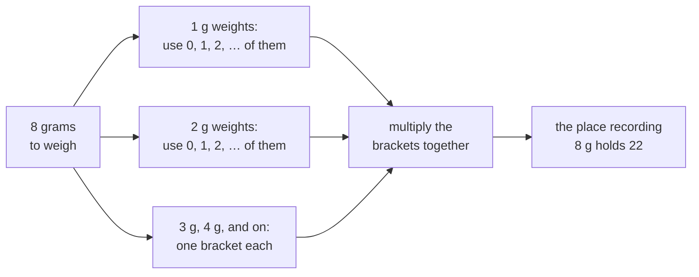

# Euler's product: one geometric factor per part size, and the coefficients count partitions

[Syllabus](../../../SYLLABUS.md) → [Combinatorics and graphs](../README.md) → [Partitions](../README.md#s08) → Euler's product

---

## General Overview

A lab balance needs 8 grams on its pan, built from whole-gram brass weights: 1 g, 2 g, 3 g, and up. Only the list of weight sizes — the **parts** — matters: 5 g, 2 g and 1 g is the same load as 1 g, 2 g and 5 g. Any number of weights can sit on the pan, from one 8 g weight to eight 1 g weights.

There are 22 ways. Listing them is a chore at 8 grams and hopeless at 50 grams, where the count is 204,226.

Euler's move trades the listing for a multiplication. Write one bracket per weight size — 1 g weights, 2 g weights, 3 g weights — each offering any number of weights of that size, and multiply. The count for any target mass then sits at the place recording that total.

Cancelling brackets against each other answers harder questions. A single-piece set (at most one weight of each size) makes 8 grams in 6 ways, and an unlimited supply of odd-gram weights (1 g, 3 g, 5 g, 7 g) also makes 8 grams in 6 ways. The two counts agree at every target mass, not only at eight.

**One endless bracket per part size, multiplied together, carries the partition counts as its coefficients; cancelling the even brackets against the odd ones turns "no size twice" into "every size odd".**

**What kind of fact this is:** a theorem, proved below in Why it works; the product itself is a definition, read one coefficient at a time.

### The picture: one bracket per weight size, not one per weight



Weights heavier than eight grams cannot help make eight, so their brackets leave that place alone.

---

## The formula

Three pieces of notation, in words first.

- A power of $`x`$ is a tally mark for a total, never a number to plug in. $`x^8`$ means "this load weighs eight grams", and the **coefficient of $`x^n`$** is the number standing at the $`x^n`$ place ([Counting by multiplying series](../07-Generating%20Functions/02-counting-with-generating-functions.md)).
- The sign $`\prod`$ is sigma's twin for multiplying. Where $`\sum`$ adds one term per whole number in a range, $`\prod`$ multiplies in one factor per whole number: here $`k = 1`$, then 2, and on without stopping.
- $`1/(1 - x^k)`$ is shorthand for a list, not a division. It is the endless $`1 + x^k + x^{2k} + \cdots`$, whose product with $`1 - x^k`$ is 1 and nothing else. Each term is the one before times $`x^k`$, which is what **geometric** means.

```math
\sum_{n \ge 0} p(n)\,x^n \;=\; \prod_{k \ge 1} \frac{1}{1 - x^k}
```

**Read it aloud:** one endless bracket per part size, each offering any number of parts of that size; the number at the $`x^n`$ place counts the partitions of $`n`$.

The second statement trims every bracket to two terms:

```math
\prod_{k \ge 1}\left(1 + x^k\right) \;=\; \prod_{k \ge 1}\frac{1}{1 - x^{2k-1}}
```

**Read it aloud:** each size at most once, or odd sizes freely, come to the same count at every total.

| Symbol | Plain meaning | In our example | Push it up and the answer… |
| --- | --- | --- | --- |
| $`n`$ | the target mass | 8 grams | 204,226 ways at 50 g |
| $`p(n)`$ | partitions of $`n`$: weight sizes, order ignored | $`p(8) = 22`$ | — |
| $`k`$ | one weight size, one bracket | 1 g, 2 g, …, 8 g | more brackets |
| $`m_k`$ | how many $`k`$-gram weights sit on the pan | 3+3+2 uses two 3 g weights | each adds $`k`$ to the total |
| $`x`$ | a tally mark, never a number | $`x^8`$ marks a total of 8 g | — |
| $`d(n)`$, $`o(n)`$ | no size twice; odd sizes only | $`d(8) = o(8) = 6`$ | always equal |

### When it holds

- **$`x`$ is a mark, not a number.** The identity is an agreement between coefficients; nothing converges, and setting $`x`$ to 2 says nothing.
- **Every coefficient finishes after finitely many brackets.** A weight heavier than $`n`$ grams cannot appear in a load of $`n`$ grams, so its bracket adds only its leading 1 there. Stop early and the count is short: sizes 1 g to 4 g give 15 of the 22.
- **Weights are positive and unordered.** Zero-gram weights would make every count endless; counting the order weights go onto the pan gives 128 sequences for 8 g, not 22.
- **The pentagonal recurrence is borrowed, not proved here.** It builds each count from earlier ones: $`p(n) = p(n - 1) + p(n - 2) - p(n - 5) - p(n - 7) + \cdots`$, with the signs in pairs. It rests on Euler's separate theorem that the coefficients of $`(1 - x)(1 - x^2)(1 - x^3)\cdots`$ run 1, −1, −1, 0, 0, 1 and on. The code uses it only as a third road.

---

## Why it works

### Step 0: a load is a tally of sizes

Take 3 + 3 + 2. Nothing of it survives but a tally: no 1 g weights, one 2 g weight, two 3 g weights, none heavier.

So a load of $`n`$ grams is a choice, for every size $`k`$, of a count $`m_k`$: how many $`k`$-gram weights go on the pan. One times the ones, plus two times the twos, and on, must add to $`n`$. Sizes constrain each other only through that total, and independent choices under one total are what a product does.

### Step 1: one bracket per size, and multiplying out does the bookkeeping

The bracket for size $`k`$ is $`1 + x^k + x^{2k} + \cdots`$, one term per count of $`k`$-gram weights: $`x^{km}`$ says "use $`m`$ of them, adding $`km`$ grams".

Multiplying brackets takes one term from each and adds the exponents ([Counting by multiplying series](../07-Generating%20Functions/02-counting-with-generating-functions.md)). One term from every bracket picks every count, and the exponents add to the total mass. So each load of $`n`$ grams puts 1 into the $`x^n`$ place and nothing else does: the coefficient there is $`p(n)`$.

At 8 grams, $`x^8`$ is reached 22 ways. One way takes $`x^2`$ from the 2 g bracket, $`x^6`$ from the 3 g bracket, and the leading 1 from the rest — the load 3 + 3 + 2.

### Step 2: why an endless product has a definite coefficient

Every bracket begins with 1 and its next term is $`x^k`$, so a bracket for a size above $`n`$ contributes only its 1 at the $`x^n`$ place. Multiply the first $`n`$ brackets and the number there has stopped moving. That settled value is what the endless product's coefficient means, and since no load of $`n`$ grams uses a weight over $`n`$ grams, it is $`p(n)`$.

Leading 1s alone would not do it. In $`(1 + x)(1 + x)(1 + x)\cdots`$ the coefficient of $`x`$ never settles, but here bracket $`k`$ first moves at $`x^k`$, further out every time.

### Step 3: the product run as arithmetic

Multiplying the brackets one at a time, keeping only the places up to $`n`$, is short work: start with 1 at $`x^0`$ and 0 elsewhere, then multiply in size 1, size 2, and on. After size $`m`$ the $`x^8`$ place holds the loads of 8 grams using no weight over $`m`$ grams:

1, 5, 10, 15, 18, 20, 21, 22.

It reaches 22 at size 8 and cannot move after. Carried to fifty places the same run gives $`p(50) = 204,226`$.

### Step 4: cancel the even brackets, and "no size twice" becomes "every size odd"

Trim each bracket to two terms. Then $`1 + x^k`$ offers a $`k`$-gram weight once or not at all, and the trimmed product counts the loads with no size repeated, $`d(n)`$ — 6 at 8 grams.

Since $`1 - x^k`$ times $`1 + x^k`$ is $`1 - x^{2k}`$, that bracket is the list $`1 - x^{2k}`$ over $`1 - x^k`$. Multiply over the sizes: the numerators $`1 - x^2`$, $`1 - x^4`$, $`1 - x^6`$, … are exactly the even denominators, each cancelling its twin below and leaving the odd ones alone:

```math
\prod_{k \ge 1}\left(1 + x^k\right) \;=\; \prod_{k \ge 1}\frac{1 - x^{2k}}{1 - x^k} \;=\; \prod_{k \ge 1}\frac{1}{1 - x^{2k-1}}
```

The right side is Step 1's product with the even sizes struck out, so its coefficient of $`x^n`$ counts the loads built from odd sizes only, $`o(n)`$. One list of coefficients, so $`d(n) = o(n)`$ always; the code lists both families at 8 grams, 6 each.

<details>
<summary>Detailed proof: the cancellation, with only finitely many brackets</summary>

Cancelling endlessly many factors needs care, so work one place at a time. Fix $`n`$ and keep only the brackets for sizes 1 to $`n`$; by Step 2 nothing up to $`x^n`$ can move after that.

Let $`A`$ be $`(1 + x)\cdots(1 + x^n)`$, and let $`D`$ be $`(1 - x)\cdots(1 - x^n)`$ split into odd-size factors $`D_1`$ and even-size factors $`D_2`$. Multiplying $`A`$ by $`D`$ pairs each $`1 + x^k`$ with $`1 - x^k`$, giving $`(1 - x^2)(1 - x^4)\cdots(1 - x^{2n})`$. Its factors of exponent above $`n`$ first move beyond $`x^n`$, so through $`x^n`$ that product equals $`D_2`$.

So $`A \cdot D_1 \cdot D_2`$ agrees with $`D_2`$ there, and a list starting with 1 has one inverse only, so $`D_2`$ cancels: $`A \cdot D_1 = 1`$ through $`x^n`$. The inverse of $`D_1`$ is the geometric brackets over the odd sizes, so $`A`$ agrees with them through $`x^n`$ — and $`n`$ was any total.

</details>

---

## Worked numbers, by hand

Eight grams, reading the $`x^8`$ place as each weight size goes in.

| Step | Arithmetic | Value |
| --- | --- | --- |
| 1 g weights, then 2 g weights | eight 1 g weights; then 0, 1, 2, 3 or 4 of 2 g | 1, 5 |
| add 3 g, then 4 g, then 5 g | one size at a time | 10, 15, 18 |
| add 6 g, then 7 g, then 8 g | one size at a time | 20, 21, **22** |
| the same, by the pentagonal recurrence | p(7) + p(6) − p(3) − p(1) = 15 + 11 − 3 − 1 | **22** |
| fifty grams, sizes 1 to 50 g | the $`x^{50}`$ place | **204,226** |

Eight grams balance 22 ways, fifty grams 204,226 ways, and the product names no load on the way.

### What breaks if you drop a piece

| Mistake | Comes out at | What went wrong |
| --- | --- | --- |
| Counting the order of the weights | 128 | All six orders of 5+2+1 count |
| Stopping the brackets at 4 g | 15 | Weights of 5 g or more ruled out |
| Trimming every bracket to $`1 + x^k`$ | 6 | The all-different count |
| Pentagonal signs all plus | 46 | The signs run plus, plus, minus, minus |

The code prints all four.

---

## Code, from first principles, and it actually runs

Nothing is imported. Eight grams are counted three ways sharing no arithmetic: every load listed, the brackets multiplied as coefficient lists, and the pentagonal recurrence, which mentions no bracket. All-different and all-odd come from listing and from their own two products.

### Python

```python
# Euler's product -- the check behind the card.  Nothing is imported.  Weighing 8 grams on a
# balance pan with whole-gram brass weights: 22 ways.  The count is reached twice, by listing
# every load and by multiplying one geometric bracket per weight size, and a third time at n = 50
# by Euler's pentagonal recurrence.  All-different and all-odd loads are counted by listing and by products.
N, TARGET = 50, 8
def splits(total, largest):                  # every non-increasing list of weights summing to total
    if total == 0: return [()]
    return [(k,) + rest for k in range(min(largest, total), 0, -1) for rest in splits(total - k, k)]
def times(a, b):                             # multiply two coefficient lists, degrees over N dropped
    return [sum(a[i] * b[d - i] for i in range(d + 1)) for d in range(N + 1)]
def product(factors):                        # multiply a run of brackets, starting from 1
    out = [1] + [0] * N
    for f in factors: out = times(out, f)
    return out
def any_number_of(k):                        # 1 + x^k + x^(2k) + ... : any number of k-gram weights
    return [1 if d % k == 0 else 0 for d in range(N + 1)]
def at_most_one(k):                          # 1 + x^k : a k-gram weight used once or not at all
    return [1 if d in (0, k) else 0 for d in range(N + 1)]
def pentagonal(upto, paired=True):           # p(n) = p(n-1) + p(n-2) - p(n-5) - p(n-7) + ...
    p = [1] + [0] * upto
    for n in range(1, upto + 1):
        total, j = 0, 1
        while j * (3 * j - 1) // 2 <= n:
            s = -1 if paired and j % 2 == 0 else 1
            total += sum(s * p[n - w] for w in (j * (3 * j - 1) // 2, j * (3 * j + 1) // 2) if w <= n)
            j += 1
        p[n] = total
    return p
def grid(name, values): print(f"{name:<40}" + "".join(f"{v:>6}" for v in values))
def show(rows): return "; ".join("+".join(str(k) for k in r) for r in rows)
euler, pent = product(any_number_of(k) for k in range(1, N + 1)), pentagonal(N)
listed, all8 = [len(splits(n, n)) for n in range(11)], splits(TARGET, TARGET)
distinct, odd = product(at_most_one(k) for k in range(1, N + 1)), product(any_number_of(k) for k in range(1, N + 1, 2))
diff8, odd8 = [s for s in all8 if len(set(s)) == len(s)], [s for s in all8 if all(k % 2 for k in s)]
running = [product(any_number_of(k) for k in range(1, m + 1))[TARGET] for m in range(1, TARGET + 1)]
comps = [1] + [0] * TARGET
for n in range(1, TARGET + 1): comps[n] = sum(comps[n - k] for k in range(1, n + 1))
print(f"weighing {TARGET} grams with whole-gram weights, order ignored; weight sizes 1 to {TARGET} g")
grid("target mass in grams, n", list(range(11)))
grid("loads listed one by one", listed)
grid("coefficient of x^n in the product", euler[:11])
grid("the same, by the pentagonal recurrence", pent[:11])
grid("all weights different, from 1+x^k", distinct[:11])
grid("all weights odd, from odd sizes only", odd[:11])
print(f"the x^{TARGET} coefficient as sizes 1 to {TARGET} g are added: {running}")
print(f"the {len(diff8)} all-different loads of {TARGET} g: {show(diff8)}")
print(f"the {len(odd8)} all-odd loads of {TARGET} g: {show(odd8)}")
print(f"p({N}) from the product: {euler[N]}")
print(f"p({N}) from the pentagonal recurrence: {pent[N]}")
print(f"mistake 1, order counted: {comps[TARGET]} ordered sequences for {TARGET} g, not {euler[TARGET]}")
print(f"mistake 2, sizes stopped at 4 g: {running[3]}, not {euler[TARGET]}")
print(f"mistake 3, every size at most once: {distinct[TARGET]}, not {euler[TARGET]}")
print(f"mistake 4, pentagonal signs all plus: {pentagonal(TARGET, False)[TARGET]}, not {euler[TARGET]}")
assert listed == euler[:11] and euler[:11] == pent[:11]              # listing, product, recurrence
assert euler[TARGET] == 22 and euler[N] == 204226                    # the published partition numbers
assert distinct == odd and distinct[TARGET] == len(diff8) == len(odd8) == 6
assert running == [1, 5, 10, 15, 18, 20, 21, 22] and comps[TARGET] == 2 ** (TARGET - 1)
print("ALL CHECKS PASS")
```

**Ran 2026-11-25 on macOS, Python 3.14.10, standard library only. All checks passed. Output, pasted from the run:**

```
weighing 8 grams with whole-gram weights, order ignored; weight sizes 1 to 8 g
target mass in grams, n                      0     1     2     3     4     5     6     7     8     9    10
loads listed one by one                      1     1     2     3     5     7    11    15    22    30    42
coefficient of x^n in the product            1     1     2     3     5     7    11    15    22    30    42
the same, by the pentagonal recurrence       1     1     2     3     5     7    11    15    22    30    42
all weights different, from 1+x^k            1     1     1     2     2     3     4     5     6     8    10
all weights odd, from odd sizes only         1     1     1     2     2     3     4     5     6     8    10
the x^8 coefficient as sizes 1 to 8 g are added: [1, 5, 10, 15, 18, 20, 21, 22]
the 6 all-different loads of 8 g: 8; 7+1; 6+2; 5+3; 5+2+1; 4+3+1
the 6 all-odd loads of 8 g: 7+1; 5+3; 5+1+1+1; 3+3+1+1; 3+1+1+1+1+1; 1+1+1+1+1+1+1+1
p(50) from the product: 204226
p(50) from the pentagonal recurrence: 204226
mistake 1, order counted: 128 ordered sequences for 8 g, not 22
mistake 2, sizes stopped at 4 g: 15, not 22
mistake 3, every size at most once: 6, not 22
mistake 4, pentagonal signs all plus: 46, not 22
ALL CHECKS PASS
```

### Rust

Same numbers, same labels, built with `rustc --edition 2021 -O`.

```rust
// Euler's product -- the same check as the Python, in Rust.  No crates.  Weighing 8 grams on a
// balance pan with whole-gram brass weights: 22 ways.  The count is reached twice, by listing
// every load and by multiplying one geometric bracket per weight size, and a third time at n = 50
// by Euler's pentagonal recurrence.  All-different and all-odd loads are counted by listing and by products.
const N: usize = 50; const TARGET: usize = 8;
fn splits(total: usize, largest: usize) -> Vec<Vec<usize>> {   // non-increasing lists summing to total
    if total == 0 { return vec![vec![]] }
    (1..=largest.min(total)).rev().flat_map(|k| splits(total - k, k).into_iter()
        .map(move |rest| { let mut s = vec![k]; s.extend(rest); s })).collect()
}
fn times(a: &[i128], b: &[i128]) -> Vec<i128> {                // coefficient lists, degrees over N dropped
    (0..=N).map(|d| (0..=d).map(|i| a[i] * b[d - i]).sum()).collect()
}
fn product(factors: Vec<Vec<i128>>) -> Vec<i128> {             // multiply a run of brackets, from 1
    let mut out = vec![0i128; N + 1]; out[0] = 1;
    for f in factors { out = times(&out, &f) }
    out
}
fn any_number_of(k: usize) -> Vec<i128> { (0..=N).map(|d| i128::from(d % k == 0)).collect() }
fn at_most_one(k: usize) -> Vec<i128> { (0..=N).map(|d| i128::from(d == 0 || d == k)).collect() }
fn pentagonal(upto: usize, paired: bool) -> Vec<i128> {        // p(n) = p(n-1) + p(n-2) - p(n-5) - ...
    let mut p = vec![0i128; upto + 1]; p[0] = 1;
    for n in 1..=upto {
        let (mut total, mut j) = (0i128, 1usize);
        while j * (3 * j - 1) / 2 <= n {
            let s: i128 = if paired && j % 2 == 0 { -1 } else { 1 };
            total += [j * (3 * j - 1) / 2, j * (3 * j + 1) / 2].iter()
                .filter(|&&w| w <= n).map(|&w| s * p[n - w]).sum::<i128>();
            j += 1;
        }
        p[n] = total;
    }
    p
}
fn grid(name: &str, values: &[i128]) {
    println!("{:<40}{}", name, values.iter().map(|v| format!("{:>6}", v)).collect::<String>());
}
fn show(rows: &[Vec<usize>]) -> String {
    rows.iter().map(|r| r.iter().map(|k| k.to_string()).collect::<Vec<String>>().join("+"))
        .collect::<Vec<String>>().join("; ")
}
fn main() {
    let euler = product((1..=N).map(any_number_of).collect());
    let pent = pentagonal(N, true);
    let listed: Vec<i128> = (0..11).map(|n| splits(n, n).len() as i128).collect();
    let distinct = product((1..=N).map(at_most_one).collect());
    let odd = product((1..=N).step_by(2).map(any_number_of).collect());
    let all8 = splits(TARGET, TARGET);
    let diff8: Vec<Vec<usize>> = all8.iter().filter(|s| s.windows(2).all(|w| w[0] != w[1])).cloned().collect();
    let odd8: Vec<Vec<usize>> = all8.iter().filter(|s| s.iter().all(|k| k % 2 == 1)).cloned().collect();
    let running: Vec<i128> = (1..=TARGET).map(|m| product((1..=m).map(any_number_of).collect())[TARGET]).collect();
    let mut comps = vec![0i128; TARGET + 1]; comps[0] = 1;
    for n in 1..=TARGET { comps[n] = (1..=n).map(|k| comps[n - k]).sum() }
    println!("weighing {} grams with whole-gram weights, order ignored; weight sizes 1 to {} g", TARGET, TARGET);
    grid("target mass in grams, n", &(0..11).collect::<Vec<i128>>());
    grid("loads listed one by one", &listed);
    grid("coefficient of x^n in the product", &euler[..11]);
    grid("the same, by the pentagonal recurrence", &pent[..11]);
    grid("all weights different, from 1+x^k", &distinct[..11]);
    grid("all weights odd, from odd sizes only", &odd[..11]);
    println!("the x^{} coefficient as sizes 1 to {} g are added: {:?}", TARGET, TARGET, running);
    println!("the {} all-different loads of {} g: {}", diff8.len(), TARGET, show(&diff8));
    println!("the {} all-odd loads of {} g: {}", odd8.len(), TARGET, show(&odd8));
    println!("p({}) from the product: {}", N, euler[N]);
    println!("p({}) from the pentagonal recurrence: {}", N, pent[N]);
    println!("mistake 1, order counted: {} ordered sequences for {} g, not {}", comps[TARGET], TARGET, euler[TARGET]);
    println!("mistake 2, sizes stopped at 4 g: {}, not {}", running[3], euler[TARGET]);
    println!("mistake 3, every size at most once: {}, not {}", distinct[TARGET], euler[TARGET]);
    println!("mistake 4, pentagonal signs all plus: {}, not {}", pentagonal(TARGET, false)[TARGET], euler[TARGET]);
    assert!(listed == euler[..11].to_vec() && euler[..11] == pent[..11]);   // listing, product, recurrence
    assert!(euler[TARGET] == 22 && euler[N] == 204226);                     // the published partition numbers
    assert!(distinct == odd && distinct[TARGET] == diff8.len() as i128 && diff8.len() == odd8.len() && odd8.len() == 6);
    assert!(running == vec![1, 5, 10, 15, 18, 20, 21, 22] && comps[TARGET] == 1i128 << (TARGET - 1));
    println!("ALL CHECKS PASS");
}
```

**Ran 2026-11-25 on macOS, rustc 1.98.1, no crates. All checks passed. Output, pasted from the run:**

```
weighing 8 grams with whole-gram weights, order ignored; weight sizes 1 to 8 g
target mass in grams, n                      0     1     2     3     4     5     6     7     8     9    10
loads listed one by one                      1     1     2     3     5     7    11    15    22    30    42
coefficient of x^n in the product            1     1     2     3     5     7    11    15    22    30    42
the same, by the pentagonal recurrence       1     1     2     3     5     7    11    15    22    30    42
all weights different, from 1+x^k            1     1     1     2     2     3     4     5     6     8    10
all weights odd, from odd sizes only         1     1     1     2     2     3     4     5     6     8    10
the x^8 coefficient as sizes 1 to 8 g are added: [1, 5, 10, 15, 18, 20, 21, 22]
the 6 all-different loads of 8 g: 8; 7+1; 6+2; 5+3; 5+2+1; 4+3+1
the 6 all-odd loads of 8 g: 7+1; 5+3; 5+1+1+1; 3+3+1+1; 3+1+1+1+1+1; 1+1+1+1+1+1+1+1
p(50) from the product: 204226
p(50) from the pentagonal recurrence: 204226
mistake 1, order counted: 128 ordered sequences for 8 g, not 22
mistake 2, sizes stopped at 4 g: 15, not 22
mistake 3, every size at most once: 6, not 22
mistake 4, pentagonal signs all plus: 46, not 22
ALL CHECKS PASS
```

The two outputs match line for line.

### Lean

Lean proves both product formulas for every total $`n`$, and checks the eight-gram numbers exactly.

- One endless bracket $`1/(1 - x^k)`$ per size $`k`$, multiplied together, has $`p(n)`$ at the $`x^n`$ place.
- The brackets for sizes 1 to $`m`$ already give $`p(n)`$ at the $`x^n`$ place, whenever $`m`$ is at least $`n`$.
- The trimmed brackets $`1 + x^k`$ give $`d(n)`$, the odd-size brackets give $`o(n)`$, and $`d(n) = o(n)`$ for every $`n`$.
- Weighing 8 grams takes 22 loads, and the $`x^8`$ place runs 1, 5, 10, 15, 18, 20, 21, 22 as sizes go in.
- At 8 grams $`d(8) = o(8) = 6`$, the pentagonal step gives 15 + 11 − 3 − 1 = 22, and counting the order gives 128.

The count $`p(50) = 204,226`$, the general pentagonal recurrence and the all-plus 46 are left to the Python and Rust checks.

```lean
-- Euler's product: multiplying one geometric bracket 1/(1 - x^k) for every part size k gives the power series whose coefficient of x^n is the number of partitions of n, and the product of the brackets 1 + x^k equals the product of 1/(1 - x^k) over odd k, so partitions into distinct parts and into odd parts are equally many for every n.
import Mathlib.Combinatorics.Enumerative.Partition.GenFun
import Mathlib.Combinatorics.Enumerative.Partition.Glaisher
import Mathlib.Combinatorics.Enumerative.Composition
import Mathlib.RingTheory.PowerSeries.Inverse
import Mathlib.Topology.Instances.Rat

open PowerSeries Nat Nat.Partition
open scoped PowerSeries.WithPiTopology

theorem tsum_X_pow_mul_eq_inv (k : ℕ) (hk : 0 < k) :
    (∑' j : ℕ, (X : ℚ⟦X⟧) ^ (k * j)) = (1 - X ^ k)⁻¹ := by
  rw [PowerSeries.eq_inv_iff_mul_eq_one (by simp [hk.ne'])]
  simp_rw [pow_mul]
  exact PowerSeries.WithPiTopology.tsum_pow_mul_one_sub_of_constantCoeff_eq_zero (by simp [hk.ne'])

#print axioms tsum_X_pow_mul_eq_inv

theorem hasProd_restricted_inv (p : ℕ → Prop) [DecidablePred p] :
    HasProd (fun i : ℕ => if p (i + 1) then (1 - X ^ (i + 1) : ℚ⟦X⟧)⁻¹ else 1)
      (PowerSeries.mk fun n => ((restricted n p).card : ℚ)) := by
  convert hasProd_powerSeriesMk_card_restricted ℚ p using 2 with i
  split_ifs
  · exact (tsum_X_pow_mul_eq_inv (i + 1) i.succ_pos).symm
  · rfl

#print axioms hasProd_restricted_inv

/-- The multisets with every part in `1, …, k` and total `n`, listed by how many copies of the
largest allowed part they use. -/

def genParts : ℕ → ℕ → List (Multiset ℕ)
  | n, 0 => if n = 0 then [0] else []
  | n, k + 1 => (List.range (n / (k + 1) + 1)).flatMap fun c =>
      (genParts (n - c * (k + 1)) k).map fun m => Multiset.replicate c (k + 1) + m

theorem mem_genParts (k : ℕ) : ∀ (n : ℕ) (m : Multiset ℕ), (∀ x ∈ m, 0 < x ∧ x ≤ k) →
    m.sum = n → m ∈ genParts n k := by
  induction k with
  | zero =>
    intro n m hm hsum
    have h0 : m = 0 := Multiset.eq_zero_of_forall_notMem fun x hx => by
      have := hm x hx; omega
    subst h0
    simp only [Multiset.sum_zero] at hsum
    subst hsum
    simp [genParts]
  | succ k ih =>
    intro n m hm hsum
    set c := m.count (k + 1)
    set m' := m.filter (· ≠ k + 1)
    have hsplit : m = Multiset.replicate c (k + 1) + m' := by
      rw [← Multiset.filter_eq' m (k + 1), Multiset.filter_add_not]
    have hsum' : n = c * (k + 1) + m'.sum := by
      rw [← hsum, hsplit, Multiset.sum_add, Multiset.sum_replicate, smul_eq_mul]
    have hm' : ∀ x ∈ m', 0 < x ∧ x ≤ k := by
      intro x hx
      rw [Multiset.mem_filter] at hx
      have := hm x hx.1
      omega
    simp only [genParts, List.mem_flatMap, List.mem_range, List.mem_map]
    refine ⟨c, ?_, m', ih _ m' hm' ?_, hsplit.symm⟩
    · rw [Nat.lt_succ_iff, Nat.le_div_iff_mul_le (by omega : 0 < k + 1)]
      omega
    · omega

#print axioms mem_genParts

/-- The multisets of parts of all partitions of `n`, found by `genParts`. -/

def partsFinset (n : ℕ) : Finset (Multiset ℕ) :=
  (genParts n n).toFinset.filter fun m => (∀ x ∈ m, 0 < x) ∧ m.sum = n

theorem image_parts_univ (n : ℕ) :
    (Finset.univ : Finset (Partition n)).image Partition.parts = partsFinset n := by
  ext m
  simp only [Finset.mem_image, Finset.mem_univ, true_and, partsFinset, Finset.mem_filter,
    List.mem_toFinset]
  constructor
  · rintro ⟨p, rfl⟩
    exact ⟨mem_genParts n n p.parts (fun x hx => ⟨p.parts_pos hx, le_of_mem_parts hx⟩)
      p.parts_sum, fun x hx => p.parts_pos hx, p.parts_sum⟩
  · rintro ⟨_, hpos, hsum⟩
    exact ⟨⟨m, fun hx => hpos _ hx, hsum⟩, rfl⟩

#print axioms image_parts_univ

theorem parts_injective (n : ℕ) : Function.Injective (Partition.parts (n := n)) :=
  fun _ _ h => Partition.ext h

#print axioms parts_injective

theorem card_partition_eq (n : ℕ) : Fintype.card (Partition n) = (partsFinset n).card := by
  rw [← image_parts_univ, Finset.card_image_of_injective _ (parts_injective n), Finset.card_univ]

#print axioms card_partition_eq

theorem card_filter_partition (n : ℕ) (P : Multiset ℕ → Prop) [DecidablePred P] :
    ((Finset.univ : Finset (Partition n)).filter (fun p => P p.parts)).card =
      ((partsFinset n).filter P).card := by
  rw [← image_parts_univ, Finset.filter_image,
    Finset.card_image_of_injective _ (parts_injective n)]

#print axioms card_filter_partition

/-- Euler's product. Take one endless bracket `1/(1 - x^k)` for every part size `k = 1, 2, 3, …`
and multiply them all. Read coefficient by coefficient (`x` is a mark, not a number), the product
exists and equals the series whose coefficient of `x^n` is `p(n)`, the number of partitions of `n`. -/
theorem partition_series_eq_euler_product :
    HasProd (fun i : ℕ => (1 - X ^ (i + 1) : ℚ⟦X⟧)⁻¹)
      (PowerSeries.mk fun n => (Fintype.card n.Partition : ℚ)) := by
  have h := hasProd_restricted_inv (fun _ => True)
  simp only [ite_true] at h
  convert h using 3 with n
  simp [restricted]

/-- Each coefficient settles after finitely many brackets: for every total `n` and every `m ≥ n`,
the coefficient of `x^n` in the product of the first `m` brackets `1/(1 - x^k)`, `k = 1, …, m`,
is already `p(n)`. -/
theorem coeff_finite_euler_product_eq_card_partition (n m : ℕ) (hm : n ≤ m) :
    coeff n (∏ k ∈ Finset.Icc 1 m, (1 - X ^ k : ℚ⟦X⟧)⁻¹) = (Fintype.card n.Partition : ℚ) := by
  have h := hasProd_restricted_inv (· ≤ m)
  have h2 := hasProd_prod_of_ne_finset_one (s := Finset.range m)
    (f := fun i : ℕ => if i + 1 ≤ m then (1 - X ^ (i + 1) : ℚ⟦X⟧)⁻¹ else 1)
    (L := SummationFilter.unconditional ℕ) (fun b hb => by
      simp only [Finset.mem_range, not_lt] at hb
      simp only [ite_eq_right_iff]; omega)
  have h3 := h.unique h2
  have e : ∏ k ∈ Finset.Icc 1 m, (1 - X ^ k : ℚ⟦X⟧)⁻¹ =
      ∏ b ∈ Finset.range m, (fun i : ℕ => if i + 1 ≤ m then (1 - X ^ (i + 1) : ℚ⟦X⟧)⁻¹ else 1) b := by
    rw [← Finset.Ico_add_one_right_eq_Icc, Finset.prod_Ico_eq_prod_range, Nat.add_sub_cancel]
    refine Finset.prod_congr rfl fun k hk => ?_
    simp only [Finset.mem_range] at hk
    simp only [show k + 1 ≤ m by omega, ite_true, add_comm]
  rw [e, ← h3, coeff_mk]
  congr 1
  simp only [restricted]
  rw [Finset.filter_true_of_mem, Finset.card_univ]
  intro p _ i hi
  exact (le_of_mem_parts hi).trans hm

/-- Trimming every bracket to `1 + x^k` counts partitions with no part size used twice, and that
product equals the product of `1/(1 - x^(2k-1))` over the odd sizes alone, which counts partitions
into odd parts. Both products exist coefficient by coefficient; the first has coefficients `d(n)`,
the partitions of `n` into distinct parts, the second `o(n)`, the partitions of `n` into odd parts,
and `d(n) = o(n)` for every `n`, so the two products are one series. -/
theorem distinct_parts_product_eq_odd_parts_product :
    HasProd (fun i : ℕ => (1 + X ^ (i + 1) : ℚ⟦X⟧))
        (PowerSeries.mk fun n => ((distincts n).card : ℚ)) ∧
      HasProd (fun i : ℕ => (1 - X ^ (2 * i + 1) : ℚ⟦X⟧)⁻¹)
        (PowerSeries.mk fun n => ((odds n).card : ℚ)) ∧
      ∀ n : ℕ, (distincts n).card = (odds n).card := by
  refine ⟨?_, ?_, fun n => (card_odds_eq_card_distincts n).symm⟩
  · have h := hasProd_powerSeriesMk_card_countRestricted ℚ (m := 2) (by norm_num)
    simp_rw [countRestricted_two] at h
    convert h using 2 with i
    simp [Finset.sum_range_succ]
  · have h := hasProd_restricted_inv (fun k => ¬ Even k)
    have hinj : Function.Injective (fun i : ℕ => 2 * i) := fun a b h => by simpa using h
    rw [← hinj.hasProd_iff] at h
    · convert h using 2 with i
      all_goals first | rfl | simp [Function.comp]
    · intro x hx
      have hx' : ¬ Even x := fun ⟨r, hr⟩ => hx ⟨r, by simp only; omega⟩
      have : Even (x + 1) := by rw [Nat.even_add_one]; exact hx'
      simp [this]

-- The partition counts below are exact whole-number checks of the card's worked numbers.
-- `decide` cannot evaluate Mathlib's `Fintype (Nat.Partition n)` instance (it is built through
-- `Finset.sort`, which does not reduce), so these four stay open for the proof step.

-- Weighing 8 grams with whole-gram weights: p(8) = 22.
example : Fintype.card (Partition 8) = 22 := by rw [card_partition_eq]; decide +kernel

-- The x^8 place as sizes 1 to 8 g go in: 1, 5, 10, 15, 18, 20, 21, 22.
example : (List.range 8).map (fun j => ((Finset.univ : Finset (Partition 8)).filter
    (fun p => ∀ i ∈ p.parts, i ≤ j + 1)).card) = [1, 5, 10, 15, 18, 20, 21, 22] := by
  rw [show (fun j => ((Finset.univ : Finset (Partition 8)).filter
      (fun p => ∀ i ∈ p.parts, i ≤ j + 1)).card) =
      fun j => ((partsFinset 8).filter (fun m => ∀ i ∈ m, i ≤ j + 1)).card from
    funext fun j => card_filter_partition 8 (fun m => ∀ i ∈ m, i ≤ j + 1)]
  decide +kernel

-- 8 grams with no weight size twice: 6 ways; all sizes odd: 6 ways.
example : (distincts 8).card = 6 ∧ (odds 8).card = 6 := by
  rw [distincts, odds, restricted, card_filter_partition 8 Multiset.Nodup,
    card_filter_partition 8 (fun m => ∀ i ∈ m, ¬ Even i)]
  decide +kernel

-- The pentagonal recurrence at 8: p(7) + p(6) - p(3) - p(1) = 15 + 11 - 3 - 1 = 22.
example : Fintype.card (Partition 7) + Fintype.card (Partition 6) - Fintype.card (Partition 3)
    - Fintype.card (Partition 1) = Fintype.card (Partition 8) := by
  simp only [card_partition_eq]
  decide +kernel

-- Counting the order of the weights instead gives 128 sequences for 8 g.
example : Fintype.card (Composition 8) = 128 := by simp [composition_card]

#print axioms partition_series_eq_euler_product
#print axioms coeff_finite_euler_product_eq_card_partition
#print axioms distinct_parts_product_eq_odd_parts_product
```

**Checked 2026-11-11 on macOS, Lean 4.36.0-rc2, Mathlib v4.36.0-rc2. Every proof is complete and uses only Lean's standard axioms. Output, pasted from the run:**

```
'tsum_X_pow_mul_eq_inv' depends on axioms: [propext, Classical.choice, Quot.sound]
'hasProd_restricted_inv' depends on axioms: [propext, Classical.choice, Quot.sound]
'mem_genParts' depends on axioms: [propext, Classical.choice, Quot.sound]
'image_parts_univ' depends on axioms: [propext, Classical.choice, Quot.sound]
'parts_injective' depends on axioms: [propext]
'card_partition_eq' depends on axioms: [propext, Classical.choice, Quot.sound]
'card_filter_partition' depends on axioms: [propext, Classical.choice, Quot.sound]
'partition_series_eq_euler_product' depends on axioms: [propext, Classical.choice, Quot.sound]
'coeff_finite_euler_product_eq_card_partition' depends on axioms: [propext, Classical.choice, Quot.sound]
'distinct_parts_product_eq_odd_parts_product' depends on axioms: [propext, Classical.choice, Quot.sound]
```

> [!TIP]
> **Try changing**
> Guess first, then run it. Each change breaks a road and an assert stops the program.
> - **Every size at most once.** Make `any_number_of` return what `at_most_one` returns: the product drops to 6 while listing holds at 22.
> - **Flatten the signs.** Call `pentagonal(N, False)`: the eight-gram count runs up to 46.
> - **Odd sizes read as every third.** Set the step in `range(1, N + 1, 2)` to 3: all-odd stops matching all-different.

---

## The usual mistake

> [!warning]
> **One bracket per weight size, not one bracket per weight.** The number of weights is not fixed and has no ceiling, so a bracket-per-weight has nothing to run over. Each bracket belongs to a size and answers one question: how many weights of this size?
>
> - **Counting the order.** 5 + 2 + 1 and 1 + 2 + 5 are one load; counting ordered sequences gives 128.
> - **Stopping the brackets early.** Brackets past 8 g are safe to ignore at $`x^8`$, nowhere earlier; sizes 1 to 4 g give 15.
> - **Trimming the brackets to two terms.** $`1 + x^k`$ allows a size once only, counting 6.
> - **Flattening the pentagonal signs.** They come in pairs; all-plus gives 46.

---

## Where you meet it in real life

- **Making change.** Coin denominations are the allowed sizes, one bracket per denomination, and the ways to pay a total are one coefficient — worked in pennies to quarters on [Counting by multiplying series](../07-Generating%20Functions/02-counting-with-generating-functions.md).
- **Statistical physics.** A system whose energy comes in whole steps, with any number of units at each step, has p(n) states of total energy n; this product counts them.
- **Published tables.** Both counts here are catalogued: [A000041](https://oeis.org/A000041) and [A000009](https://oeis.org/A000009).

> **Say it back**
> Weighing 8 grams with whole-gram weights takes 22 loads, counting only the weight sizes. One endless bracket per weight size, each offering any number of weights of that size, multiplied together, holds 22 at the place recording 8 grams. Each place settles early because bracket $`k`$ first moves at $`x^k`$. Trimmed to "once or not at all" the brackets count the all-different loads. Rewriting $`1 + x^k`$ as $`1 - x^{2k}`$ over $`1 - x^k`$ cancels the even brackets, so all-different and all-odd agree everywhere.

---

## What this builds on

- [Integer partitions](01-integer-partitions.md): what p(n) counts, and the listing road this product replaces.
- [Counting by multiplying series](../07-Generating%20Functions/02-counting-with-generating-functions.md): what "the coefficient of $`x^n`$" means, and why multiplying brackets adds exponents and so counts choices.

## Where this goes next

Next on this shelf, the items gain names, before [The twelvefold way](06-twelvefold-way.md) maps all twelve distribution rules and the final two cards move to Young tableaux.

- [Set partitions and Bell numbers](03-set-partitions-and-bell-numbers.md): named people into unnamed groups of any sizes, so who rides with whom now counts.
- [Stirling numbers of the second kind](04-stirling-numbers-second-kind.md): named items into exactly k unnamed groups, one row of that count at a time.
- [The twelvefold way](06-twelvefold-way.md): every "put n things into k boxes" question in one table, with identical things in unmarked boxes as the partition row.

The product reaches p(50) = 204,226 only by grinding out every count below it. It says nothing about how fast p(n) grows; a formula aimed straight at one p(n) exists, and its tools sit above this wing. On this shelf, the next card gives the items names instead.

---

## Sources

Verified 19 Sep 2026: every link below resolves to the publisher's page.

- Olver, F. W. J., et al., eds. *NIST Digital Library of Mathematical Functions*, §27.14. [dlmf.nist.gov/27.14](https://dlmf.nist.gov/27.14). The product, 27.14.2–3, and the pentagonal recurrence, 27.14.6.
- Andrews, George E. *The Theory of Partitions*. Cambridge University Press, 1984. [doi:10.1017/CBO9780511608650](https://doi.org/10.1017/CBO9780511608650). Chapter 1 derives both identities.
- "A000041: the number of partitions of n." On-Line Encyclopedia of Integer Sequences. [Sequence page](https://oeis.org/A000041). Every free count quoted here, p(50) included.
- "A000009: partitions of n into distinct parts." Same encyclopedia. [Sequence page](https://oeis.org/A000009). The all-different counts, 6 at a total of 8, listed also as odd-part counts.
