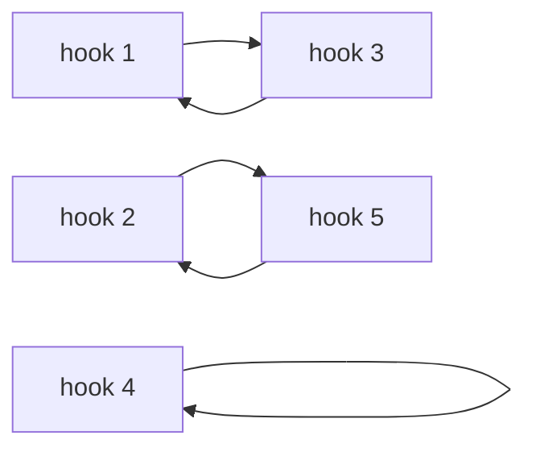

# Counting shuffles by their loops: Stirling numbers of the first kind, and derangements are the no-short-loop case

[Syllabus](../../../SYLLABUS.md) → [Combinatorics and graphs](../README.md) → [Partitions](../README.md#s08) → Counting shuffles by their loops

---

## General Overview

A caretaker keeps five keys, one per door, on five hooks labelled 1 to 5 to match. On Friday the keys go back in whatever order they come to hand. Each order the keys can come back in is called a rehang.

Take one rehang. Hook 1's key ends on hook 3, and hook 3's key on hook 1: those two have traded, and the trade closes. Hooks 2 and 5 have traded too, and hook 4 kept its own key — a trail that closes at once. Three closed trails, none sharing a hook. Call one a **loop**, the word used from here on.

Five keys go back 120 ways. Sorted by how many loops the trace finds: 24 with one loop through all five hooks, 50 with two, 35 with three, 10 with four, 1 with five, where nobody moved.

**Every rehang splits into loops that share no hook, and one short recurrence counts the rehangs making any given number of loops: the last key slips into a rehang of the others, or hangs on its own.**

**What kind of fact this is:** the loop count is a definition; the recurrence counting them is a theorem, proved below in Why it works.

### The picture: one rehang, traced



Each arrow runs from a hook to where its key went. Three loops, of lengths 2, 2 and 1.

---

## The formula

Notation first, in words. A rehang is a **destination list**: under each hook in order, the hook its key went to, so the rehang above is `3 5 1 4 2`. Its loops go in brackets, hooks in trace order: (1 3)(2 5)(4) — cycle notation, met on [Permutations](../../03-Algebra/08-Groups/03-permutations-and-the-symmetric-group.md), where a loop is a cycle.

Write $c(n,k)$, said "c of n, k", for the rehangs of $n$ keys whose trace makes exactly $k$ loops, so $c(5,3) = 35$. These are the **unsigned Stirling numbers of the first kind**.

$$c(n,k) = (n-1)\,c(n-1,k) + c(n-1,k-1), \qquad c(1,1) = 1$$

**Read it aloud:** the last key either slips into a rehang of the other n − 1, in any of n − 1 places, or hangs on its own beside a rehang making one loop fewer.

| Symbol | Plain meaning | In our example | Push it up and the answer… |
| --- | --- | --- | --- |
| $n$ | keys rehung, one per hook | 5 | rows grow far larger |
| $k$ | loops in the trace | 1 up to 5 | counts fall away past two |
| $c(n,k)$ | rehangs of n keys, k loops | 35 at k = 3 | — |
| $n!$ | all the rehangs, "n factorial" | 120 | — |
| $j$ | a loop's length | 2, 2 and 1 | fewer loops fit |
| $a_j$ | loops that long | two of 2, one of 1 | more repeats to divide out |

A rehang makes one number of loops, so a row holds all of them ([Factorials](../01-Counting%20Principles/03-factorial.md)):

$$c(n,1) + c(n,2) + \cdots + c(n,n) = n!$$

A rehang's **cycle type** is its loop lengths, largest first: `3 5 1 4 2` has type 2 + 2 + 1. Rehangs of one type are counted from $n!$: write $a_j$ for how many loops have length $j$, then divide by $j$ raised to $a_j$ and by $a_j$ factorial. For type 2 + 2 + 1:

$$\frac{5!}{2^2 \times 2! \times 1^1 \times 1!} = 15$$

### When it holds

- **Keys and hooks are told apart.** Five identical keys give one rehang, not 120, and nothing to trace.
- **Every hook ends holding one key.** Two on a hook leaves another empty, and the trace reaches one place twice.
- **A hook keeping its own key is a loop, of length 1.** Leave those out and counts scatter: the traced rehang files under two loops, the 20 of type 3 + 1 + 1 under one.
- **These counts carry no sign.** Many tables print a signed version instead, negative whenever n − k is odd; every count here is positive.

---

## Why it works

### Step 0: a rehang is its loops, and nothing else

Follow the keys from any hook. The trail cannot run for ever, nor rejoin itself part way along, since each hook receives one key: the first hook reached twice is the one it began at, so the trail closes. Start again at an untouched hook and that loop cannot meet the first, by the same rule.

The loops carve the hooks into groups with nothing in common, their lengths adding to 5 — which is why this sits on the Partitions shelf ([Integer partitions](01-integer-partitions.md)).

### Step 1: ask what the last key does

Two cases, and no rehang is in both.

**Hook 5 keeps its own key.** That loop of one is complete, and taking hook 5 off the board leaves a rehang of four keys with one loop fewer: $c(4,k-1)$ of them.

**Hook 5's key goes elsewhere.** Then hook 5 lies in a loop of two or more. Cut it out: the hook that fed hook 5 now sends its key straight to hook 5's target. The loop is a hook shorter, still a loop, so the count holds — a rehang of four keys with k loops. Backwards, hook 5 splices in after any of the four hooks: 4 × $c(4,k)$.

So c(5,k) = 4 c(4,k) + c(4,k−1), and at three loops 4 × 6 + 11 = 35. The multiplier is four, the hooks already there — not three, the loops.

<details>
<summary>Detailed proof: the splice is reversible</summary>

Inserting 5 after any of the four hooks lengthens that hook's loop and makes or loses none, so k holds, and the four results differ: a different hook sends its key to hook 5 in each. Deleting 5 undoes the insertion, so the two sides stand one to four: the term (n − 1) c(n − 1, k). Seeds: c(1,1) = 1, and c(n,k) = 0 for k above n or below 1.

</details>

### Step 2: each row adds to every rehang

Every rehang makes one number of loops, so a row counts each once: 24 + 50 + 35 + 10 + 1 = 120 = 5 × 4 × 3 × 2 × 1, peaking at two loops.

### Step 3: the corners, by hand

- **One loop, c(5,1) = 24.** Write the loop from hook 1 and the other four follow in any order: 4! = 24. Always starting at hook 1 stops one loop being counted five times over.
- **Five loops, c(5,5) = 1.** Every loop one hook long.
- **Four loops, c(5,4) = 10.** One loop of two, three of one: a single trade, and choosing its two hooks gives C(5,2) = 10 ([Combinations, n choose k](../01-Counting%20Principles/05-n-choose-k.md)).

### Step 4: a second road, counting each cycle type

Five breaks into parts seven ways, one cycle type each: 5; 4 + 1; 3 + 2; 3 + 1 + 1; 2 + 2 + 1; 2 + 1 + 1 + 1; 1 + 1 + 1 + 1 + 1.

Write the hooks in a row — 120 orders — chop it into runs of one type's lengths, and read each run as a loop. Every rehang of that type turns up repeatedly: a loop of $j$ hooks starts at any of its $j$, and $a_j$ loops of equal length can be listed $a_j!$ ways. Dividing the repeats out gives 24, 30, 20, 20, 15, 10, 1.

By number of parts: 24; 30 + 20 = 50; 20 + 15 = 35; 10; 1 — the recurrence's row, from unrelated arithmetic.

### Step 5: derangements are the types with no part equal to 1

A rehang leaving no key on its own hook is one with no loop of length 1. Of the seven types only 5 and 3 + 2 qualify, holding 24 + 20 = 44 rehangs — the 44 the sieve reaches on [Derangements](../04-Inclusion-Exclusion%20and%20Pigeonhole/02-derangements.md) by quite different arithmetic.

They fill no column of the row, though: 24 make a single loop, 20 make two. A loop of length one bars a rehang; it never sets the loop count.

---

## Worked numbers, by hand

Row four, 6, 11, 6, 1, comes from row three the same way; row five follows one entry at a time.

| Step | Arithmetic | Value |
| --- | --- | --- |
| one loop | 4 × 6 | **24** |
| two loops | 4 × 11 + 6 | **50** |
| three loops | 4 × 6 + 11 | **35** |
| four loops, then five | 4 × 1 + 6, then 1 | **10**, **1** |
| the row adds up | 24 + 50 + 35 + 10 + 1 | **120** |
| all rehangs, directly | 5 × 4 × 3 × 2 × 1 | **120** |
| no loop of length 1 | 24 of type 5, 20 of type 3 + 2 | **44** |

So of the 120 rehangs, 35 close into three loops and 44 leave no key on its own hook.

### What breaks if you drop a piece

| Mistake | Comes out at | What went wrong |
| --- | --- | --- |
| Multiplying by the loop count | 3 × 6 + 11 = 29 | the last key has n − 1 places to go |
| Single hooks not counted as loops | 2 loops, not 3 | the traced rehang files under two |
| Counting blocks, groups with no order, not loops | 25, not 35 | a loop of three runs two ways round |

The code prints all three.

---

## Code, from first principles, and it actually runs

Nothing is imported. Three roads sharing no arithmetic reach the row 24, 50, 35, 10, 1: listing all 120 rehangs and tracing each, the recurrence, and the cycle types. The no-loop-of-one count comes twice over, and a second triangle supplies the 25.

### Python

```python
# Counting shuffles by their loops -- the check behind the card.  Nothing is
# imported.  Five keys come off a keyring onto five labelled hooks, and a rehang
# is a destination list: entry i names the hook the key from hook i goes to.
# Three roads sharing no arithmetic count the rehangs with exactly k loops:
# listing all 120 and tracing each, the recurrence c(n,k) = (n-1) c(n-1,k) +
# c(n-1,k-1), and the cycle-type count n! / (product of j^a_j times a_j!).
N = 5

def rehangs(n):                          # every destination list, no hook used twice
    out = [()]
    for _ in range(n): out = [p + (d,) for p in out for d in range(1, n + 1) if d not in p]
    return out
def loops(p):                            # follow a hook until the key comes back
    seen, out = set(), []
    for start in range(1, len(p) + 1):
        cyc = []
        while start not in seen: cyc.append(start); seen.add(start); start = p[start - 1]
        if cyc: out.append(cyc)
    return out
def factorial(n): return 1 if n < 2 else n * factorial(n - 1)
def splits(n, most):                     # the ways n breaks into parts, largest first
    if n == 0: return [()]
    return [(j,) + r for j in range(min(n, most), 0, -1) for r in splits(n - j, j)]
def size(q):                             # n! / (product of j^a_j times a_j!)
    out = factorial(sum(q))
    for i, j in enumerate(q): out //= j * q[:i + 1].count(j)
    return out
def at(row, k): return row[k - 1] if 1 <= k <= len(row) else 0
def flat(row): return " ".join(str(v) for v in row)
def name(p): return "".join("(" + flat(c) + ")" for c in loops(p))
def lengths(p): return ", ".join(str(len(c)) for c in loops(p))

deck, parts, three, whole = rehangs(N), splits(N, N), (3, 5, 1, 4, 2), (2, 3, 4, 5, 1)
listed = [sum(1 for p in deck if len(loops(p)) == k) for k in range(1, N + 1)]
typed = [sum(size(q) for q in parts if len(q) == k) for k in range(1, N + 1)]
tri, sec = [[1]], [[1]]                  # first kind, and second kind for contrast
for n in range(2, N + 1):
    tri.append([(n - 1) * at(tri[-1], k) + at(tri[-1], k - 1) for k in range(1, n + 1)])
    sec.append([k * at(sec[-1], k) + at(sec[-1], k - 1) for k in range(1, n + 1)])
deranged = sum(1 for p in deck if all(p[i] != i + 1 for i in range(N)))
no_ones = sum(size(q) for q in parts if min(q) >= 2)
print(f"five keys on five hooks: {len(deck)} rehangs in all")
print(f"rehang {flat(three)} traced: {name(three)}, {len(loops(three))} loops of lengths {lengths(three)}")
print(f"rehang {flat(whole)} traced: {name(whole)}, {len(loops(whole))} loop of length {lengths(whole)}")
print("the triangle by the recurrence:   " + "   ".join(f"n={n + 1}: {flat(tri[n])}" for n in range(N)))
print(f"row 5 by listing all {len(deck)} rehangs: {flat(listed)}; from the cycle types: {flat(typed)}")
print(f"row sum {' + '.join(str(v) for v in listed)} = {sum(listed)}, and 5! = {factorial(N)}; "
      f"corners c(5,1) = 4! = {tri[4][0]}, c(5,5) = {tri[4][4]}, c(5,4) = C(5,2) = {tri[4][3]}")
print(f"the recurrence at c(5,3): 4 x c(4,3) + c(4,2) = 4 x {tri[3][2]} + {tri[3][1]} = {tri[4][2]}")
print("cycle types: " + ", ".join("+".join(str(j) for j in q) + f" -> {size(q)}" for q in parts))
print(f"no loop of length 1, by listing {deranged}; from the cycle types "
      + " + ".join(str(size(q)) for q in parts if min(q) >= 2) + f" = {no_ones}")
print(f"blocks are not loops: S(5,3) = {sec[4][2]} against c(5,3) = {tri[4][2]}")
print(f"mistakes: the multiplier read as k, 3 x {tri[3][2]} + {tri[3][1]} = {3 * tri[3][2] + tri[3][1]}; "
      f"the single hook left out, {sum(1 for c in loops(three) if len(c) > 1)} loops not {len(loops(three))}")
assert listed == tri[N - 1]                        # listing against the recurrence
assert listed == typed                             # listing against the cycle types
assert deranged == no_ones                         # two roads to the no-single-hook count
assert sum(listed) == factorial(N) == len(deck)    # the row sum, three ways
print("ALL CHECKS PASS")
```

**Ran 2026-09-19 on macOS, Python 3.14.6, standard library only. All checks passed. Output, pasted from the run:**

```
five keys on five hooks: 120 rehangs in all
rehang 3 5 1 4 2 traced: (1 3)(2 5)(4), 3 loops of lengths 2, 2, 1
rehang 2 3 4 5 1 traced: (1 2 3 4 5), 1 loop of length 5
the triangle by the recurrence:   n=1: 1   n=2: 1 1   n=3: 2 3 1   n=4: 6 11 6 1   n=5: 24 50 35 10 1
row 5 by listing all 120 rehangs: 24 50 35 10 1; from the cycle types: 24 50 35 10 1
row sum 24 + 50 + 35 + 10 + 1 = 120, and 5! = 120; corners c(5,1) = 4! = 24, c(5,5) = 1, c(5,4) = C(5,2) = 10
the recurrence at c(5,3): 4 x c(4,3) + c(4,2) = 4 x 6 + 11 = 35
cycle types: 5 -> 24, 4+1 -> 30, 3+2 -> 20, 3+1+1 -> 20, 2+2+1 -> 15, 2+1+1+1 -> 10, 1+1+1+1+1 -> 1
no loop of length 1, by listing 44; from the cycle types 24 + 20 = 44
blocks are not loops: S(5,3) = 25 against c(5,3) = 35
mistakes: the multiplier read as k, 3 x 6 + 11 = 29; the single hook left out, 2 loops not 3
ALL CHECKS PASS
```

### Rust

Same rows and labels, built with `rustc --edition 2021 -O`.

```rust
// Counting shuffles by their loops -- the same check as the Python, in Rust.  No
// crates.  Five keys come off a keyring onto five labelled hooks, and a rehang is
// a destination list: entry i names the hook the key from hook i goes to.  Three
// roads sharing no arithmetic count the rehangs with exactly k loops: listing all
// 120 and tracing each, the recurrence c(n,k) = (n-1) c(n-1,k) + c(n-1,k-1), and
// the cycle-type count n! / (product of j^a_j times a_j!).
const N: usize = 5;
fn rehangs(n: usize) -> Vec<Vec<usize>> {          // every destination list, no hook twice
    let mut out: Vec<Vec<usize>> = vec![vec![]];
    for _ in 0..n {
        let mut next: Vec<Vec<usize>> = Vec::new();
        for p in &out { for d in 1..=n { if !p.contains(&d) { let mut q = p.clone(); q.push(d); next.push(q) } } }
        out = next;
    }
    out
}
fn loops(p: &[usize]) -> Vec<Vec<usize>> {         // follow a hook until the key comes back
    let (mut seen, mut out) = (vec![false; p.len() + 1], Vec::new());
    for start in 1..=p.len() {
        let (mut cyc, mut j) = (Vec::new(), start);
        while !seen[j] { cyc.push(j); seen[j] = true; j = p[j - 1] }
        if !cyc.is_empty() { out.push(cyc) }
    }
    out
}
fn factorial(n: usize) -> i64 { if n < 2 { 1 } else { n as i64 * factorial(n - 1) } }
fn splits(n: usize, most: usize) -> Vec<Vec<usize>> {     // n into parts, largest first
    if n == 0 { return vec![vec![]] }
    let mut out: Vec<Vec<usize>> = Vec::new();
    for j in (1..=n.min(most)).rev() { for r in splits(n - j, j) { let mut q = vec![j]; q.extend(r); out.push(q) } }
    out
}
fn size(q: &[usize]) -> i64 {                      // n! / (product of j^a_j times a_j!)
    let mut out = factorial(q.iter().sum());
    for (i, &j) in q.iter().enumerate() { out /= j as i64 * q[..=i].iter().filter(|&&x| x == j).count() as i64 }
    out
}
fn at(row: &[i64], k: i64) -> i64 { if k >= 1 && k <= row.len() as i64 { row[k as usize - 1] } else { 0 } }
fn join(bits: Vec<String>, gap: &str) -> String { bits.join(gap) }
fn glue(row: &[i64], gap: &str) -> String { join(row.iter().map(|v| v.to_string()).collect(), gap) }
fn flat(row: &[usize]) -> String { join(row.iter().map(|v| v.to_string()).collect(), " ") }
fn name(p: &[usize]) -> String { join(loops(p).iter().map(|c| format!("({})", flat(c))).collect(), "") }
fn lengths(p: &[usize]) -> String { join(loops(p).iter().map(|c| c.len().to_string()).collect(), ", ") }
fn main() {
    let (deck, parts) = (rehangs(N), splits(N, N));
    let (three, whole) = (vec![3, 5, 1, 4, 2], vec![2, 3, 4, 5, 1]);
    let listed: Vec<i64> = (1..=N).map(|k| deck.iter().filter(|p| loops(p).len() == k).count() as i64).collect();
    let typed: Vec<i64> = (1..=N).map(|k| parts.iter().filter(|q| q.len() == k).map(|q| size(q)).sum()).collect();
    let (mut tri, mut sec) = (vec![vec![1i64]], vec![vec![1i64]]);    // first kind, then second
    for n in 2..=N as i64 {
        let (pt, ps) = (tri[tri.len() - 1].clone(), sec[sec.len() - 1].clone());
        tri.push((1..=n).map(|k| (n - 1) * at(&pt, k) + at(&pt, k - 1)).collect());
        sec.push((1..=n).map(|k| k * at(&ps, k) + at(&ps, k - 1)).collect());
    }
    let deranged = deck.iter().filter(|p| (0..N).all(|i| p[i] != i + 1)).count() as i64;
    let keep = |q: &&Vec<usize>| *q.iter().min().unwrap() >= 2;
    let no_ones: i64 = parts.iter().filter(keep).map(|q| size(q)).sum();
    println!("five keys on five hooks: {} rehangs in all", deck.len());
    println!("rehang {} traced: {}, {} loops of lengths {}", flat(&three), name(&three), loops(&three).len(), lengths(&three));
    println!("rehang {} traced: {}, {} loop of length {}", flat(&whole), name(&whole), loops(&whole).len(), lengths(&whole));
    println!("the triangle by the recurrence:   {}", join((0..N).map(|n| format!("n={}: {}", n + 1, glue(&tri[n], " "))).collect(), "   "));
    println!("row 5 by listing all {} rehangs: {}; from the cycle types: {}", deck.len(), glue(&listed, " "), glue(&typed, " "));
    println!("row sum {} = {}, and 5! = {}; corners c(5,1) = 4! = {}, c(5,5) = {}, c(5,4) = C(5,2) = {}",
             glue(&listed, " + "), listed.iter().sum::<i64>(), factorial(N), tri[4][0], tri[4][4], tri[4][3]);
    println!("the recurrence at c(5,3): 4 x c(4,3) + c(4,2) = 4 x {} + {} = {}", tri[3][2], tri[3][1], tri[4][2]);
    println!("cycle types: {}", join(parts.iter().map(|q| format!("{} -> {}",
             join(q.iter().map(|j| j.to_string()).collect(), "+"), size(q))).collect(), ", "));
    println!("no loop of length 1, by listing {}; from the cycle types {} = {}", deranged,
             join(parts.iter().filter(keep).map(|q| size(q).to_string()).collect(), " + "), no_ones);
    println!("blocks are not loops: S(5,3) = {} against c(5,3) = {}", sec[4][2], tri[4][2]);
    println!("mistakes: the multiplier read as k, 3 x {} + {} = {}; the single hook left out, {} loops not {}",
             tri[3][2], tri[3][1], 3 * tri[3][2] + tri[3][1],
             loops(&three).iter().filter(|c| c.len() > 1).count(), loops(&three).len());
    assert!(listed == tri[N - 1]);                     // listing against the recurrence
    assert!(listed == typed);                          // listing against the cycle types
    assert!(deranged == no_ones);                      // two roads to the no-single-hook count
    assert!(listed.iter().sum::<i64>() == factorial(N) && factorial(N) == deck.len() as i64);
    println!("ALL CHECKS PASS");
}
```

**Ran 2026-09-19 on macOS, rustc 1.98.1, no crates. All checks passed. Output, pasted from the run:**

```
five keys on five hooks: 120 rehangs in all
rehang 3 5 1 4 2 traced: (1 3)(2 5)(4), 3 loops of lengths 2, 2, 1
rehang 2 3 4 5 1 traced: (1 2 3 4 5), 1 loop of length 5
the triangle by the recurrence:   n=1: 1   n=2: 1 1   n=3: 2 3 1   n=4: 6 11 6 1   n=5: 24 50 35 10 1
row 5 by listing all 120 rehangs: 24 50 35 10 1; from the cycle types: 24 50 35 10 1
row sum 24 + 50 + 35 + 10 + 1 = 120, and 5! = 120; corners c(5,1) = 4! = 24, c(5,5) = 1, c(5,4) = C(5,2) = 10
the recurrence at c(5,3): 4 x c(4,3) + c(4,2) = 4 x 6 + 11 = 35
cycle types: 5 -> 24, 4+1 -> 30, 3+2 -> 20, 3+1+1 -> 20, 2+2+1 -> 15, 2+1+1+1 -> 10, 1+1+1+1+1 -> 1
no loop of length 1, by listing 44; from the cycle types 24 + 20 = 44
blocks are not loops: S(5,3) = 25 against c(5,3) = 35
mistakes: the multiplier read as k, 3 x 6 + 11 = 29; the single hook left out, 2 loops not 3
ALL CHECKS PASS
```

The two outputs match line for line.

### Lean

Lean proves the recurrence and the cycle-type count for any number of keys, then checks the five-key numbers one by one.

- The recurrence $c(n,k) = (n-1)\,c(n-1,k) + c(n-1,k-1)$ holds for every n and k from 1 up, with $c(1,1) = 1$.
- $c(n,k)$ is 0 when k is above n, or when k is below 1 and there is at least one key.
- The rehangs of one cycle type, times $j$ raised to $a_j$ and $a_j$ factorial for each length, make exactly $n!$.
- A rehang leaves no key on its own hook exactly when it has no loop of length 1.
- The traced rehang `3 5 1 4 2` has loops of lengths 2, 2 and 1, and `2 3 4 5 1` is one loop of length 5.
- Rows three, four and five, counted by listing, are 2, 3, 1; 6, 11, 6, 1; and 24, 50, 35, 10, 1.
- Type 2 + 2 + 1 holds 15 rehangs. The 44 rehangs with no loop of length 1 match the 44 derangements.
- The mistakes come out at 3 × 6 + 11 = 29, and three blocks number 25, not 35.

That every row adds to $n!$ is left to the Python and Rust checks, which confirm it for five keys.

```lean
-- Counting shuffles by their loops: the number of rearrangements of n labelled keys whose trace makes exactly k loops (a key left on its own hook counts as a loop of length 1) obeys c(n, k) = (n − 1) c(n − 1, k) + c(n − 1, k − 1) with c(1, 1) = 1, the rearrangements of one cycle type number n! divided by the product of j^(a_j) × a_j!, and the derangements are exactly those with no loop of length 1, with the card's five-key numbers checked.
import Mathlib.GroupTheory.Perm.Cycle.Type
import Mathlib.Combinatorics.Derangements.Finite
import Mathlib.Combinatorics.Enumerative.Stirling
import Mathlib.Logic.Equiv.Fin.Rotate
import Mathlib.GroupTheory.Perm.Fin
import Mathlib.GroupTheory.Perm.Centralizer

open Equiv Finset

theorem loops_card_eq {α : Type*} [Fintype α] [DecidableEq α] (σ : Perm α) :
    σ.partition.parts.card = σ.cycleType.card + (Fintype.card α - #σ.support) := by
  simp [Perm.parts_partition]

theorem loops_card_swap_mul {α : Type*} [Fintype α] [DecidableEq α] (μ : Perm α) (x : α)
    (hx : μ x ≠ x) :
    (swap x (μ x) * μ).partition.parts.card = μ.partition.parts.card + 1 := by
  have hcmem : μ.cycleOf x ∈ μ.cycleFactorsFinset :=
    Perm.cycleOf_mem_cycleFactorsFinset_iff.mpr (Perm.mem_support.mpr hx)
  have hcyc : (μ.cycleOf x).IsCycle := Perm.isCycle_cycleOf μ hx
  have hcx : μ.cycleOf x x = μ x := Perm.cycleOf_apply_self μ x
  generalize μ.cycleOf x = c at hcmem hcyc hcx
  have hdisj : Perm.Disjoint (μ * c⁻¹) c := Perm.disjoint_mul_inv_of_mem_cycleFactorsFinset hcmem
  generalize hr : μ * c⁻¹ = r at hdisj
  have hμ : μ = c * r := by
    rw [← hdisj.commute.eq, ← hr]; simp
  have hcx' : c x ≠ x := by rw [hcx]; exact hx
  have hdsub : (swap x (c x) * c).support ≤ c.support := fun y hy =>
    (Perm.mem_support_swap_mul_imp_mem_support_ne hy).1
  have hdd : Perm.Disjoint (swap x (c x) * c) r := hdisj.symm.mono hdsub le_rfl
  have hτ : swap x (μ x) * μ = (swap x (c x) * c) * r := by
    rw [← hcx]; conv_lhs => rw [hμ]
    rw [mul_assoc]
  rw [hτ, loops_card_eq, loops_card_eq, hdd.cycleType_mul, hdd.card_support_mul, hμ,
    hdisj.symm.cycleType_mul, hdisj.symm.card_support_mul, hcyc.cycleType]
  have hle : #(c * r).support ≤ Fintype.card α := (c * r).support.card_le_univ
  rw [hdisj.symm.card_support_mul] at hle
  have h2 := hcyc.two_le_card_support
  by_cases hccx : c (c x) = x
  · have hc2 : c ^ 2 = 1 := (hcyc.pow_eq_one_iff' hcx').mpr (by simp [pow_two, hccx])
    have hord : #c.support = 2 := by
      rw [← hcyc.orderOf]
      exact le_antisymm (Nat.le_of_dvd (by norm_num) (orderOf_dvd_of_pow_eq_one hc2))
        (hcyc.orderOf ▸ h2)
    obtain ⟨a, b, hab, rfl⟩ := Perm.card_support_eq_two.mp hord
    have hd : swap x (swap a b x) * swap a b = 1 := by
      have hxs : x = a ∨ x = b := by
        by_contra h
        push Not at h
        exact hcx' (swap_apply_of_ne_of_ne h.1 h.2)
      rcases hxs with rfl | rfl
      · simp
      · simp [swap_comm]
    rw [hd]
    simp
    omega
  · have hdc : (swap x (c x) * c).IsCycle := hcyc.swap_mul hcx' hccx
    rw [hdc.cycleType, Perm.support_swap_mul_eq c x hccx]
    have hxm : x ∈ c.support := Perm.mem_support.mpr hcx'
    rw [Finset.card_sdiff_of_subset (by simpa using hxm)]
    simp
    omega

theorem loops_card_lift {n : ℕ} (σ : Perm (Fin n)) :
    (Perm.decomposeFin.symm ((0 : Fin (n + 1)), σ)).partition.parts.card =
      σ.partition.parts.card + 1 := by
  let f : Fin n ≃ {i : Fin (n + 1) // i ≠ 0} :=
    { toFun := fun i => ⟨i.succ, Fin.succ_ne_zero i⟩
      invFun := fun j => j.1.pred j.2
      left_inv := fun i => by simp
      right_inv := fun j => by ext; simp }
  have hlift : Perm.decomposeFin.symm ((0 : Fin (n + 1)), σ) = σ.extendDomain f := by
    ext i
    refine Fin.cases ?_ (fun j => ?_) i
    · rw [Perm.decomposeFin_symm_apply_zero, Perm.extendDomain_apply_not_subtype _ _ (by simp)]
    · rw [Perm.decomposeFin_symm_apply_succ, Perm.extendDomain_apply_subtype (b := j.succ) σ f (Fin.succ_ne_zero j)]
      simp [f]
  rw [hlift, loops_card_eq, loops_card_eq, Perm.cycleType_extendDomain,
    Perm.card_support_extend_domain]
  have := σ.support.card_le_univ
  simp only [Fintype.card_fin] at this ⊢
  omega

theorem loops_card_decompose {n : ℕ} (p : Fin (n + 1)) (σ : Perm (Fin n)) :
    (Perm.decomposeFin.symm (p, σ)).partition.parts.card =
      if p = 0 then σ.partition.parts.card + 1 else σ.partition.parts.card := by
  split_ifs with hp
  · subst hp; exact loops_card_lift σ
  · have hsplit : Perm.decomposeFin.symm (p, σ) =
        swap 0 p * Perm.decomposeFin.symm ((0 : Fin (n + 1)), σ) := by
      ext i
      refine Fin.cases ?_ (fun j => ?_) i
      · simp [Perm.decomposeFin_symm_apply_zero]
      · simp [Perm.decomposeFin_symm_apply_succ]
    set μ := Perm.decomposeFin.symm (p, σ)
    have hμ0 : μ 0 = p := Perm.decomposeFin_symm_apply_zero p σ
    have h := loops_card_swap_mul μ 0 (by rw [hμ0]; exact hp)
    have hback : swap 0 p * μ = Perm.decomposeFin.symm ((0 : Fin (n + 1)), σ) := by
      rw [hsplit, ← mul_assoc, swap_mul_self, one_mul]
    rw [hμ0, hback, loops_card_lift] at h
    omega

/-- `loopCount n k` is the card's `c(n, k)`: the number of rehangs of `n` keys (permutations of
the hooks `Fin n`) whose trace makes exactly `k` loops. `σ.partition.parts` is the multiset of
the loop lengths of `σ`, loops of length 1 (keys left on their own hook) included, so its size
is the number of loops. -/
def loopCount (n k : ℕ) : ℕ :=
  #{σ : Perm (Fin n) | σ.partition.parts.card = k}

/-- The card's main claim. Counting the rehangs of `n` keys by how many loops they make, the
last key either slips into a rehang of the other keys after any one of their hooks (same number
of loops) or hangs on its own (one loop more), so
`c(n + 1, k + 1) = n × c(n, k + 1) + c(n, k)` for every `n` and `k`.
The seeds are `c(1, 1) = 1`, and `c(n, k) = 0` when `k` is above `n` or, for `n ≥ 1`, below 1.
These counts are the unsigned Stirling numbers of the first kind. -/
theorem loop_counts_obey_stirling_first_recurrence :
    loopCount 1 1 = 1 ∧
      (∀ n : ℕ, 1 ≤ n → loopCount n 0 = 0) ∧
      (∀ n k : ℕ, n < k → loopCount n k = 0) ∧
      ∀ n k : ℕ, loopCount (n + 1) (k + 1) = n * loopCount n (k + 1) + loopCount n k := by
  refine ⟨by decide, ?_, ?_, ?_⟩
  · intro n hn
    unfold loopCount
    rw [Finset.card_eq_zero, Finset.filter_eq_empty_iff]
    intro σ _ h
    have hs := σ.partition.parts_sum
    rw [Multiset.card_eq_zero.mp h] at hs
    simp at hs
    omega
  · intro n k hnk
    unfold loopCount
    rw [Finset.card_eq_zero, Finset.filter_eq_empty_iff]
    intro σ _ h
    have hle : Multiset.card σ.partition.parts • 1 ≤ σ.partition.parts.sum :=
      Multiset.card_nsmul_le_sum (fun x hx => σ.partition.parts_pos hx)
    rw [σ.partition.parts_sum, h, Fintype.card_fin] at hle
    simp at hle
    omega
  · intro n k
    unfold loopCount
    simp only [Finset.card_filter]
    rw [← (Perm.decomposeFin (n := n)).symm.sum_comp, Fintype.sum_prod_type, Fin.sum_univ_succ]
    simp only [loops_card_decompose, Fin.succ_ne_zero, ite_true, ite_false, Nat.add_right_cancel_iff]
    rw [Finset.sum_const, Finset.card_fin, smul_eq_mul]
    ring

/-- Counting one cycle type. For any finite set of hooks `α` with `n` members and any way `p`
of breaking `n` into loop lengths (parts equal to 1 included), the rehangs whose loop lengths
are exactly `p` number `n!` divided by the product, over each length `j` that occurs, of
`j ^ a_j × a_j!`, where `a_j` is how many loops have length `j`. Stated as a product so that the
division is shown to be exact. -/
theorem card_rehangs_of_cycle_type {α : Type*} [Fintype α] [DecidableEq α]
    (p : (Fintype.card α).Partition) :
    #{σ : Perm α | σ.partition = p} *
        ∏ j ∈ p.parts.toFinset, (j ^ p.parts.count j * (p.parts.count j).factorial) =
      (Fintype.card α).factorial := by
  set m := p.parts.filter (fun n => 2 ≤ n) with hm
  set r := p.parts.filter (fun n => ¬ 2 ≤ n) with hr
  have hr1 : r = Multiset.replicate (Multiset.card r) 1 := Multiset.eq_replicate_card.mpr (by
    intro b hb
    rw [hr, Multiset.mem_filter] at hb
    have := p.parts_pos hb.1
    omega)
  have hsum : m.sum + Multiset.card r = Fintype.card α := by
    rw [← p.parts_sum, ← Multiset.filter_add_not (fun n => 2 ≤ n) p.parts, Multiset.sum_add]
    congr 1
    rw [← hr, hr1]
    simp
  have hiff : ∀ σ : Perm α, σ.partition = p ↔ σ.cycleType = m := by
    intro σ
    constructor
    · rintro rfl
      exact Perm.filter_parts_partition_eq_cycleType.symm
    · intro h
      apply Nat.Partition.ext
      have hsupp : m.sum = #σ.support := by rw [← h, Perm.sum_cycleType]
      have : Fintype.card α - #σ.support = Multiset.card r := by omega
      rw [Perm.parts_partition, h, this, ← hr1, hm, hr, Multiset.filter_add_not]
  have hcard : #{σ : Perm α | σ.partition = p} = #{g : Perm α | g.cycleType = m} := by
    congr 1
    ext σ
    simp [hiff]
  have hcond : m.sum ≤ Fintype.card α ∧ ∀ a ∈ m, 2 ≤ a := by
    refine ⟨by omega, fun a ha => ?_⟩
    rw [hm, Multiset.mem_filter] at ha
    exact ha.2
  have key := Perm.card_of_cycleType_mul_eq (α := α) m
  rw [ite_eq_left_iff.mpr (fun h => absurd hcond h)] at key
  rw [hcard, ← key]
  congr 1
  have hsub : p.parts.toFinset ⊆ insert 1 m.toFinset := by
    intro x hx
    rw [Multiset.mem_toFinset] at hx
    rw [Finset.mem_insert, Multiset.mem_toFinset, hm, Multiset.mem_filter]
    have := p.parts_pos hx
    by_cases h2 : 2 ≤ x
    · exact Or.inr ⟨hx, h2⟩
    · left; omega
  rw [Finset.prod_subset hsub (fun x _ hx => by
    rw [Multiset.mem_toFinset, ← Multiset.count_eq_zero] at hx
    simp [hx])]
  have h1m : 1 ∉ m.toFinset := by
    rw [Multiset.mem_toFinset, hm, Multiset.mem_filter]
    omega
  rw [Finset.prod_insert h1m]
  have hc1 : p.parts.count 1 = Multiset.card r := by
    have : r.count 1 = p.parts.count 1 := by
      rw [hr, Multiset.count_filter_of_pos (by omega)]
    rw [← this, hr1]
    simp
  have hcm : ∀ j ∈ m.toFinset, p.parts.count j = m.count j := by
    intro j hj
    rw [Multiset.mem_toFinset, hm, Multiset.mem_filter] at hj
    rw [hm, Multiset.count_filter_of_pos hj.2]
  rw [Finset.prod_congr rfl (fun j hj => by rw [hcm j hj]), Finset.prod_mul_distrib,
    ← Finset.prod_multiset_count, hc1, show Fintype.card α - m.sum = Multiset.card r by omega]
  simp [mul_assoc]

/-- Derangements are the no-short-loop case: a rehang leaves no key on its own hook exactly
when its trace has no loop of length 1. -/
theorem derangement_iff_no_loop_of_length_one {α : Type*} [Fintype α] [DecidableEq α]
    (σ : Perm α) :
    σ ∈ derangements α ↔ 1 ∉ σ.partition.parts := by
  change (∀ x, σ x ≠ x) ↔ _
  rw [Perm.parts_partition, Multiset.mem_add, Multiset.mem_replicate]
  have h1 : 1 ∉ σ.cycleType := fun h => by
    have := Perm.two_le_of_mem_cycleType h
    omega
  have hiff : (∀ x, σ x ≠ x) ↔ #σ.support = Fintype.card α := by
    rw [Finset.card_eq_iff_eq_univ, Finset.eq_univ_iff_forall]
    simp
  have hle := σ.support.card_le_univ
  rw [hiff]
  constructor
  · intro h
    simp [h1, h]
  · intro h
    simp [h1] at h
    omega

-- Hooks 1 to 5 on the card are 0 to 4 here.
-- The traced rehang: destination list 3 5 1 4 2, the trades (1 3) and (2 5) with hook 4 kept.
example : List.ofFn (⇑(Equiv.swap (0 : Fin 5) 2 * Equiv.swap 1 4 : Perm (Fin 5))) =
    [2, 4, 0, 3, 1] := by
  decide
-- And the rehang 2 3 4 5 1.
example : List.ofFn (⇑(finRotate 5)) = [1, 2, 3, 4, 0] := by decide
-- Its loops have lengths 2, 2 and 1: three loops.
example : (Equiv.swap (0 : Fin 5) 2 * Equiv.swap 1 4).partition.parts = {2, 2, 1} := by decide
-- The rehang 2 3 4 5 1 is one loop of length 5.
example : (finRotate 5).partition.parts = {5} := by decide
-- Rows three and four of the triangle: 2, 3, 1 and 6, 11, 6, 1.
example : loopCount 3 1 = 2 ∧ loopCount 3 2 = 3 ∧ loopCount 3 3 = 1 := by decide
example : loopCount 4 1 = 6 ∧ loopCount 4 2 = 11 ∧ loopCount 4 3 = 6 ∧ loopCount 4 4 = 1 := by
  decide
-- Row five, by listing all 120 rehangs: 24, 50, 35, 10, 1.
example : loopCount 5 1 = 24 ∧ loopCount 5 2 = 50 ∧ loopCount 5 3 = 35 ∧ loopCount 5 4 = 10 ∧
    loopCount 5 5 = 1 := by
  decide
-- Row five from row four by the recurrence: 4 × 6, 4 × 11 + 6, 4 × 6 + 11, 4 × 1 + 6, then 1.
example : 4 * 6 = 24 ∧ 4 * 11 + 6 = 50 ∧ 4 * 6 + 11 = 35 ∧ 4 * 1 + 6 = 10 := by decide
-- The row adds to every rehang: 24 + 50 + 35 + 10 + 1 = 120 = 5!.
example : 24 + 50 + 35 + 10 + 1 = Nat.factorial 5 ∧ Nat.factorial 5 = 5 * 4 * 3 * 2 * 1 ∧
    Fintype.card (Perm (Fin 5)) = 120 := by
  decide
-- The corners: c(5, 1) = 4! = 24 and c(5, 4) = C(5, 2) = 10.
example : Nat.factorial 4 = 24 ∧ Nat.choose 5 2 = 10 := by decide
-- The seven cycle types of five: 5!/5 = 24, 5!/4 = 30, 5!/(3 × 2) = 20, 5!/(3 × 2!) = 20,
-- 5!/(2² × 2!) = 15, 5!/(2 × 3!) = 10, 5!/5! = 1.
example : Nat.factorial 5 / 5 = 24 ∧ Nat.factorial 5 / (4 * 1) = 30 ∧
    Nat.factorial 5 / (3 * 2) = 20 ∧ Nat.factorial 5 / (3 * Nat.factorial 2) = 20 ∧
    Nat.factorial 5 / (2 ^ 2 * Nat.factorial 2 * 1 ^ 1 * Nat.factorial 1) = 15 ∧
    Nat.factorial 5 / (2 * Nat.factorial 3) = 10 ∧ Nat.factorial 5 / Nat.factorial 5 = 1 := by
  decide
-- Type 2 + 2 + 1 holds 15 rehangs, counted directly.
example : #{σ : Perm (Fin 5) | σ.partition.parts = {2, 2, 1}} = 15 := by decide
-- By number of loops: 24; 30 + 20 = 50; 20 + 15 = 35; 10; 1.
example : 30 + 20 = 50 ∧ 20 + 15 = 35 := by decide
-- No loop of length 1: types 5 and 3 + 2, 24 + 20 = 44, the derangements of five keys.
example : 24 + 20 = 44 ∧ numDerangements 5 = 44 := by decide
example : Fintype.card (derangements (Fin 5)) = 44 := by decide
example : #{σ : Perm (Fin 5) | 1 ∉ σ.partition.parts} = 44 := by decide
-- The usual mistakes: the multiplier read as the loop count gives 3 × 6 + 11 = 29, not 35;
-- blocks instead of loops give S(5, 3) = 25.
example : 3 * 6 + 11 = 29 ∧ Nat.stirlingSecond 5 3 = 25 := by decide

#print axioms loops_card_eq
#print axioms loops_card_swap_mul
#print axioms loops_card_lift
#print axioms loops_card_decompose
#print axioms loop_counts_obey_stirling_first_recurrence
#print axioms card_rehangs_of_cycle_type
#print axioms derangement_iff_no_loop_of_length_one
```

**Checked 2026-11-11 on macOS, Lean 4.36.0-rc2, Mathlib v4.36.0-rc2. Every proof is complete and uses only Lean's standard axioms. Output, pasted from the run:**

```
'loops_card_eq' depends on axioms: [propext, Classical.choice, Quot.sound]
'loops_card_swap_mul' depends on axioms: [propext, Classical.choice, Quot.sound]
'loops_card_lift' depends on axioms: [propext, Classical.choice, Quot.sound]
'loops_card_decompose' depends on axioms: [propext, Classical.choice, Quot.sound]
'loop_counts_obey_stirling_first_recurrence' depends on axioms: [propext, Classical.choice, Quot.sound]
'card_rehangs_of_cycle_type' depends on axioms: [propext, Classical.choice, Quot.sound]
'derangement_iff_no_loop_of_length_one' depends on axioms: [propext, Classical.choice, Quot.sound]
```

> [!TIP]
> **Try changing**
> Guess first, then run it. The four asserts are pinned to the five keys.
> - **Swap the multiplier.** In the `tri` line use `k *` for `(n - 1) *`, the second-kind recurrence: row five reads 1, 15, 25, 10, 1 while listing still says 24, 50, 35, 10, 1, and the first assert stops it.
> - **Forget the repeats.** In `size`, divide by `j` alone: equal-length loops count as different, the cycle-type row runs high, second assert.
> - **Bar loops of two too.** Make `min(q) >= 2` read `min(q) >= 3`: type 3 + 2 drops out, the count falls to 24 against the listed 44, third assert.

---

## The usual mistake

> [!warning]
> **Multiplying by the number of loops.** The last key goes in after some hook already on the board, and there are n − 1 of those, not k: read as the loop count the recurrence gives 3 × 6 + 11 = 29 where the answer is 35.
>
> - **Dropping loops of length one.** They are loops. The traced rehang has three; calling it two moves it from the 35 into the 50.
> - **Reading this triangle as the second-kind one.** Three loops on five hooks number 35; three blocks number 25 ([Stirling numbers of the second kind](04-stirling-numbers-second-kind.md)). A loop of three runs two ways round; a block has no direction.

---

## Where you meet it in real life

- **Rotas and gift draws.** A rearrangement leaving nobody their own item is the no-loop-of-one case: 44 of the 120 ways five items come back ([Derangements](../04-Inclusion-Exclusion%20and%20Pigeonhole/02-derangements.md)).
- **Sorting work.** The fewest swaps a rearrangement needs is places minus loops ([Permutations](../../03-Algebra/08-Groups/03-permutations-and-the-symmetric-group.md)): 5 − 3 = 2 here, 5 − 1 = 4 for one long loop. A routine reordering a list in place walks one loop at a time.
- **Shuffles that come back.** How many rounds of a shuffle return a deck to its first order is set by its loop lengths ([Perfect shuffles](../../02-Number%20theory/05-Check%20Digits%2C%20Calendars%20and%20Cycles/05-perfect-shuffles.md)): there the lengths do the work, here only how many there are.

> **Say it back**
> Trace each key from its hook to where it went and a rehang closes into loops sharing no hook. The 120 rehangs of five keys hold 24 with one loop, 50 with two, 35 with three, 10 with four, 1 with five. The last key slips into a rehang of the others, in any of n − 1 places, or hangs on its own and adds a loop: that recurrence builds every row. Cycle types give the same row, making the derangements the types with no loop of length one, 44 of them.

---

## What this builds on

- [Derangements](../04-Inclusion-Exclusion%20and%20Pigeonhole/02-derangements.md): the 44, by the sieve rather than cycle types.
- [Factorials](../01-Counting%20Principles/03-factorial.md): the 120 a row adds to, and 4! = 24.
- [Permutations](../../03-Algebra/08-Groups/03-permutations-and-the-symmetric-group.md): rehangs as permutations, loops as cycles, swaps against loop count.
- [Perfect shuffles](../../02-Number%20theory/05-Check%20Digits%2C%20Calendars%20and%20Cycles/05-perfect-shuffles.md): loop lengths deciding when a repeated shuffle comes home.

## Where this goes next

- [The twelvefold way](06-twelvefold-way.md): the table sorting this family of questions — labelled or unlabelled things into labelled or unlabelled boxes — and placing loops and blocks in it.

Beside it, [Stirling numbers of the second kind](04-stirling-numbers-second-kind.md) counts the same keys into blocks, and [Set partitions and Bell numbers](03-set-partitions-and-bell-numbers.md) adds those counts along a row.

Loops and blocks are now counted apart; which standard question each answers, and what the other ten are, is the twelvefold way.

---

## Sources

Verified 19 Sep 2026: every link below resolves to the publisher's page.

- NIST *Digital Library of Mathematical Functions*, 26.8, "Set Partitions: Stirling Numbers". [dlmf.nist.gov/26.8](https://dlmf.nist.gov/26.8). Defines the first-kind numbers as permutations counted by cycles; 26.8.18 is this recurrence in its signed form, and Table 26.8.1 carries the signs.
- Sloane, N. J. A., ed. Sequence A132393, "Triangle of unsigned Stirling numbers of the first kind". *OEIS*. [oeis.org/A132393](https://oeis.org/A132393). Row five: 24, 50, 35, 10, 1.
- Stanley, Richard P. *Enumerative Combinatorics*, vol. 1, 2nd ed. Cambridge University Press, 2011. [Cambridge Core](https://www.cambridge.org/core/books/enumerative-combinatorics/3155CDE1D973D49F873BDE2EAF8D7651), [doi:10.1017/CBO9781139058520](https://doi.org/10.1017/CBO9781139058520). Chapter 1 proves the cycle-type count; paid.
