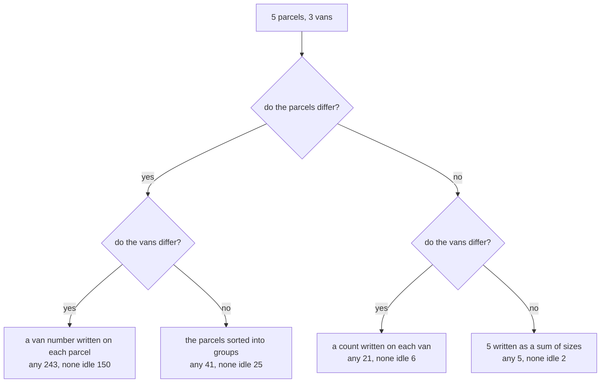

# The twelvefold way: every 'put n things into k boxes' question in one table

[Syllabus](../../../SYLLABUS.md) → [Combinatorics and graphs](../README.md) → [Partitions](../README.md#s08) → The twelvefold way

---

## General Overview

A courier depot has five parcels to send out on Monday and three vans in the yard. How many ways are there to load them?

The question has no answer yet: three things are unsettled.

**Do the parcels differ?** A wedding cake and a washing machine do; five identical sacks of gravel do not, since all that can be recorded is how many. **Do the vans differ?** Vans named on a manifest do; three unnumbered hired vans do not. **What must a van hold?** Anything, including nothing; or at most one parcel; or at least one.

Two by two by three: twelve questions inside one sentence. Eight of the counts here are 243, 150, 41, 25, 21, 6, 5 and 2; the other four are 0, since three vans cannot take five parcels one apiece. Gian-Carlo Rota set the twelve out in lectures and Joel Spencer supplied the name **twelvefold way**, the term used from here on.

**Every "put n things into k boxes" question is settled by three answers — do the things differ, do the boxes differ, what must a box hold — and the twelve combinations carry twelve counts.**

**What kind of fact this is:** a method, a way of naming which count a question asks for. The twelve formulas are theorems, proved on the cards this one draws together.

### The picture: the labels pick a row



The holding rule picks a column; the middle one is impossible here.

---

## The formula

Write $n$ for the things and $k$ for the boxes: here n = 5, k = 3. Three shorthands come from earlier cards:

- $C(m, r)$, "m choose r", the ways of picking r things out of m with order ignored ([Combinations, n choose k](../01-Counting%20Principles/05-n-choose-k.md)).
- $k!$, "k factorial", k × (k − 1) × … × 1 ([Factorials](../01-Counting%20Principles/03-factorial.md)).
- $S(n, k)$, the splits of n different things into k unnamed groups, none empty ([Stirling numbers of the second kind](04-stirling-numbers-second-kind.md)).

The fourth is new, in words first: $p_k(n)$ counts the ways of writing n as a sum of exactly k positive parts, order ignored. Its partner $p_{\le k}(n)$ allows fewer parts, and the partitions card writes it $R_k(n)$. For example, 5 = 3 + 1 + 1 is one of the two counted by $p_3(5)$ ([Integer partitions](01-integer-partitions.md)).

| Parcels, vans | Any number | At most one each | At least one each |
| --- | --- | --- | --- |
| differ, differ | $k^n$ → 243 | $k(k-1)\cdots(k-n+1)$ → 0 | $k!\,S(n, k)$ → 150 |
| differ, alike | $S(n, 1) + \cdots + S(n, k)$ → 41 | 1 when $n \le k$ → 0 | $S(n, k)$ → 25 |
| alike, differ | $C(n + k - 1,\; k - 1)$ → 21 | $C(k, n)$ → 0 | $C(n - 1,\; k - 1)$ → 6 |
| alike, alike | $p_{\le k}(n)$ → 5 | 1 when $n \le k$ → 0 | $p_k(n)$ → 2 |

**Read it aloud:** the labels pick a row, the holding rule picks a column, and their cell holds the formula.

| Symbol | Plain meaning | In our example | Push it up… |
| --- | --- | --- | --- |
| $n$ | things to be placed | 5 parcels | "any" and "at least one" never fall; "at most one" is 0 past k |
| $k$ | boxes for them | 3 vans | "at least one" rises, then falls, and is 0 past n |
| $C(m, r)$ | ways of picking r out of m, order ignored | C(7, 2) = 21 | — |
| $k!$ | the orders k things stand in | 3! = 6 | — |
| $k(k-1)\cdots(k-n+1)$ | k counted down for n factors, one per thing | 3 × 2 × 1 × 0 × (−1) = 0 | — |
| $S(n, k)$ | n things in exactly k groups, none empty, unnamed | S(5, 3) = 25 | — |
| $p_k(n)$ | n as a sum of exactly k parts; $p_{\le k}(n)$ allows fewer | 2 ways, and 5 ways | — |

The count-down in full:

$$k(k-1)(k-2)\cdots(k-n+1)$$

**In words:** the first thing has k boxes free, the next k − 1, and so on for n things; past k things a factor is 0.

### When it holds

- **The label questions are about the answer, not the metal.** The same vans differ when the manifest names them and are alike when it does not.
- **Three holding rules, no others.** A cap of two parcels a van is none of the twelve, and no cell counts it.
- **Nothing is ordered inside a box.** Stack each van in a fixed order and every count in the grid is too small.

---

## Why it works

### Step 0: a loading is a note written on every parcel

Number the parcels 1 to 5, the vans 1 to 3, and write each parcel's van number on it. A loading becomes a list of five numbers from 1 to 3, such as (2, 1, 1, 3, 2). Every loading writes one list and every list reads back as one, so counting loadings is counting lists: 3 × 3 × 3 × 3 × 3 = 243 ([Strings with repetition](../01-Counting%20Principles/02-strings-and-powers.md)).

The holding rule is a condition on the list: no number repeats, or all three show up. That is the top row — 243 in all, 0 with no repeat, 150 using all three ([Onto functions](../04-Inclusion-Exclusion%20and%20Pigeonhole/03-counting-surjections.md)).

### Step 1: taking the names off the vans, and when dividing is allowed

Rub the plates off and a loading is a sorting into groups: (1, 1, 2, 3, 3) and (2, 2, 3, 1, 1) are the same three groups.

With no van empty the names come off by dividing. Three vans can be named in 3! = 6 orders, each naming of a grouping giving a different list, so the 150 lists fall into blocks of six: 150 ÷ 6 = 25.

Allow empty vans and dividing breaks: 243 ÷ 6 = 40.5 counts nothing, and the answer is 41. All five parcels in van one keeps its list when the two empty vans swap, so its block is short. The repair is a sum, not a division: count the groupings by how many groups they use, 1 + 15 + 25 = 41.

<details>
<summary>Detailed proof: when the names come off by dividing</summary>

Take the loadings of $n$ things into $k$ boxes with no box empty. Two are the same grouping exactly when one of the $k!$ renamings of the boxes carries one to the other, so the loadings fall into blocks, one per grouping. Dividing needs every block to hold $k!$ of them.

A block is short only if some renaming leaves a loading unchanged, putting each box's contents where another box's were. With no box empty those contents differ, so only the renaming that moves nothing qualifies. Every block is full: 150 ÷ 6 = 25.

</details>

### Step 2: taking the labels off the parcels, then off both

Plates back on, and the parcels become identical sacks of gravel. A loading is three counts adding to five, such as (2, 0, 3). Five sacks and two dividers in a row of seven places give C(7, 2) = 21; with no van empty, dividers go in the four gaps between sacks, C(4, 2) = 6 ([Stars and bars](../02-Repeats%2C%20Groups%20and%20Double%20Counting/02-stars-and-bars.md)).

Strip the van names too and only the sizes survive, biggest first: 5, 4 + 1, 3 + 2, 3 + 1 + 1, 2 + 2 + 1 — five ways, two with exactly three parts. A list, a grouping, a list of sizes: each step drops what the question ignores.

### Step 3: the column of zeros, and where it comes alive

At most one parcel a van needs a van per parcel, so the column reads 0 here. Send two parcels and it wakes up: 6, 1, 3, 1.

With both labels on, the first parcel picks one of three vans and the second one of the two left, 3 × 2 = 6 ([Ordered picks](../01-Counting%20Principles/04-ordered-picks.md)). Sacks into named vans: which two are used, C(3, 2) = 3. Unnamed vans give 1 either way, nothing telling two such loadings apart.

Two more routes cross-check the grid. A loading that leaves vans empty fills fewer of them. So each "any" cell is its row's "at least one" cell added over how many vans are used, times the choice of which when they are named: 243 = 3 + 90 + 150, 41 = 1 + 15 + 25, 21 = 3 + 12 + 6, 5 = 1 + 2 + 2. And the alike-van rows grow one thing at a time, by $S(n, k) = k\,S(n-1, k) + S(n-1, k-1)$ and $p_k(n) = p_{k-1}(n-1) + p_k(n-k)$, both run by the code.

---

## Worked numbers, by hand

| Step | Arithmetic | Value |
| --- | --- | --- |
| each parcel picks a van | 3 × 3 × 3 × 3 × 3 | **243** |
| no van idle, vans named | 6 namings × 25 groupings | **150** |
| vans alike, no van idle | 150 ÷ 6 | **25** |
| vans alike, empties allowed | 1 + 15 + 25 | **41** |
| sacks of gravel, vans named, then no van idle | 2 dividers in 7 places, then in 4 gaps | **21**, then **6** |
| nothing named, then no van idle | 5, 4+1, 3+2, 3+1+1, 2+2+1 | **5**, then **2** |

So the depot's question has twelve answers: eight numbers and four zeros.

### What breaks if you drop a piece

| Mistake | Comes out at | What went wrong |
| --- | --- | --- |
| Unnaming the vans by dividing 243 by 3! | 40.5 | loadings leaving a van empty do not come six to a grouping |
| "At least one each" read as "at most one" | 0, not 150 | three vans cannot take five parcels one apiece |
| Sacks counted as different parcels | 243, not 21 | the count separates loads the question calls one |

Both checks print every number in that table.

---

## Code, from first principles, and it actually runs

Nothing is imported. All twelve counts are reached twice by roads sharing no arithmetic: one lists the 243 loadings and throws away what the question ignores, keeping one entry per answer. The other applies each cell's formula, with the choose count, factorial, groups rule and parts rule written out. The grid runs again on two parcels into three vans.

### Python

```python
# The twelvefold way -- the check behind the card.  Nothing is imported.  Five parcels into
# three vans, then two parcels into three vans.  Each of the twelve counts is reached twice:
# by listing every loading and stripping the labels the question ignores, and by its formula.
WAYS = (("differ", "differ"), ("differ", "alike"), ("alike", "differ"), ("alike", "alike"))
RULES = ("any", "at most one", "at least one")
def choose(m, r):                            # C(m, r), one factor at a time; 0 when r > m
    out = 0 if r < 0 or r > m else 1
    for i in range(r): out = out * (m - i) // (i + 1)
    return out
def falling(k, n):                           # count down from k for n steps: k x (k-1) x ...
    out = 1
    for i in range(n): out *= k - i
    return out
def blocks(n, k):                            # S(n, k) = k x S(n-1, k) + S(n-1, k-1)
    row = [1] + [0] * k
    for _ in range(n): row = [0] + [j * row[j] + row[j - 1] for j in range(1, k + 1)]
    return row[k]
def parts(n, k):                             # n as a sum of exactly k positive parts
    if n == k: return 1
    return 0 if k == 0 or n < k else parts(n - 1, k - 1) + parts(n - k, k)
def listing(n, k):                           # road one: every loading, the labels stripped
    loads = [()]
    for _ in range(n): loads = [f + (v,) for f in loads for v in range(k)]
    def keyset(things, vans, rule):
        keys = set()
        for f in loads:
            c = [f.count(v) for v in range(k)]
            if rule == "at most one" and max(c) > 1: continue
            if rule == "at least one" and min(c) < 1: continue
            if vans == "differ": keys.add(f if things == "differ" else tuple(c))
            elif things == "alike": keys.add(tuple(sorted([x for x in c if x], reverse=True)))
            else: keys.add(tuple(b for b in sorted(tuple(i for i in range(n) if f[i] == v) for v in range(k)) if b))
        return keys
    return [[keyset(t, v, r) for r in RULES] for t, v in WAYS]
def formulas(n, k):                          # road two: the twelve closed forms, same order
    b = [blocks(n, j) for j in range(1, k + 1)]
    p = [parts(n, j) for j in range(1, k + 1)]
    one = 1 if n <= k else 0
    return [[k ** n, falling(k, n), falling(k, k) * b[k - 1]], [sum(b), one, b[k - 1]],
            [choose(n + k - 1, k - 1), choose(k, n), choose(n - 1, k - 1)], [sum(p), one, p[k - 1]]]
L, F = listing(5, 3), formulas(5, 3)
M, G = listing(2, 3), formulas(2, 3)
for n, k, A, B in ((5, 3, L, F), (2, 3, M, G)):
    print(f"{n} parcels into {k} vans, each cell listed then by formula")
    for i, (things, vans) in enumerate(WAYS):
        print(f"  parcels {things:<6} vans {vans:<6}" + "".join(
              f"   {RULES[j]}: {len(A[i][j]):>3} {B[i][j]:>3}" for j in range(3)))
used = [[choose(3, j) * falling(j, j) * blocks(5, j) for j in (1, 2, 3)], [blocks(5, j) for j in (1, 2, 3)],
        [choose(3, j) * choose(4, j - 1) for j in (1, 2, 3)], [parts(5, j) for j in (1, 2, 3)]]
print("5 as a sum of at most 3 parts: " + ", ".join("+".join(str(x) for x in q) for q in sorted(L[3][0], reverse=True)))
print(f"no van left empty, two roads: listed {len(L[0][2])}, 3! x S(5,3) = {falling(3, 3)} x {blocks(5, 3)}")
print("each 'any' cell split by vans used: " + "; ".join(f"{' + '.join(str(x) for x in u)} = {sum(u)}" for u in used))
print(f"unlabelling the vans by dividing: 243 / 3! = 243 / {falling(3, 3)} = {243 / falling(3, 3):.1f}, not {F[1][0]}")
assert [[len(x) for x in r] for r in L] == F and [[len(x) for x in r] for r in M] == G
assert [F[i][0] for i in range(4)] == [243, 41, 21, 5] and [F[i][2] for i in range(4)] == [150, 25, 6, 2]
assert [sum(u) for u in used] == [len(L[i][0]) for i in range(4)] and len(L[0][2]) == falling(3, 3) * len(L[1][2])
assert [len(x) for x in M[0]] == [9, 6, 0] and [G[i][1] for i in range(4)] == [6, 1, 3, 1]
print("ALL CHECKS PASS")
```

**Ran 2026-09-19 on macOS, Python 3.14.6, standard library only. All checks passed. Output, pasted from the run:**

```
5 parcels into 3 vans, each cell listed then by formula
  parcels differ vans differ   any: 243 243   at most one:   0   0   at least one: 150 150
  parcels differ vans alike    any:  41  41   at most one:   0   0   at least one:  25  25
  parcels alike  vans differ   any:  21  21   at most one:   0   0   at least one:   6   6
  parcels alike  vans alike    any:   5   5   at most one:   0   0   at least one:   2   2
2 parcels into 3 vans, each cell listed then by formula
  parcels differ vans differ   any:   9   9   at most one:   6   6   at least one:   0   0
  parcels differ vans alike    any:   2   2   at most one:   1   1   at least one:   0   0
  parcels alike  vans differ   any:   6   6   at most one:   3   3   at least one:   0   0
  parcels alike  vans alike    any:   2   2   at most one:   1   1   at least one:   0   0
5 as a sum of at most 3 parts: 5, 4+1, 3+2, 3+1+1, 2+2+1
no van left empty, two roads: listed 150, 3! x S(5,3) = 6 x 25
each 'any' cell split by vans used: 3 + 90 + 150 = 243; 1 + 15 + 25 = 41; 3 + 12 + 6 = 21; 1 + 2 + 2 = 5
unlabelling the vans by dividing: 243 / 3! = 243 / 6 = 40.5, not 41
ALL CHECKS PASS
```

### Rust

Same numbers, same labels, built with `rustc --edition 2021 -O`.

```rust
// The twelvefold way -- the same check as the Python, in Rust.  No crates.  Five parcels into
// three vans, then two parcels into three vans.  Each of the twelve counts is reached twice:
// by listing every loading and stripping the labels the question ignores, and by its formula.
use std::collections::BTreeSet;
const WAYS: [(&str, &str); 4] = [("differ", "differ"), ("differ", "alike"), ("alike", "differ"), ("alike", "alike")];
const RULES: [&str; 3] = ["any", "at most one", "at least one"];
fn choose(m: i64, r: i64) -> i64 {               // C(m, r), one factor at a time; 0 when r > m
    let mut out = if r < 0 || r > m { 0 } else { 1 };
    for i in 0..r { out = out * (m - i) / (i + 1) } out
}
fn falling(k: i64, n: i64) -> i64 {              // count down from k for n steps: k x (k-1) x ...
    let mut out = 1;
    for i in 0..n { out *= k - i } out
}
fn blocks(n: i64, k: usize) -> i64 {             // S(n, k) = k x S(n-1, k) + S(n-1, k-1)
    let mut row = vec![0i64; k + 1]; row[0] = 1;
    for _ in 0..n { let p = row.clone(); row = (0..=k).map(|j| if j == 0 { 0 } else { j as i64 * p[j] + p[j - 1] }).collect() }
    row[k]
}
fn parts(n: i64, k: i64) -> i64 {                // n as a sum of exactly k positive parts
    if n == k { 1 } else if k == 0 || n < k { 0 } else { parts(n - 1, k - 1) + parts(n - k, k) }
}
fn joined(v: &[i64], sep: &str) -> String { v.iter().map(|x| x.to_string()).collect::<Vec<String>>().join(sep) }
fn listing(n: usize, k: usize) -> Vec<Vec<BTreeSet<Vec<i64>>>> {   // road one: every loading, labels stripped
    let mut loads: Vec<Vec<usize>> = vec![Vec::new()];
    for _ in 0..n { let mut next: Vec<Vec<usize>> = Vec::new();
        for f in &loads { for v in 0..k { let mut g = f.clone(); g.push(v); next.push(g) } } loads = next }
    let keyset = |things: &str, vans: &str, rule: &str| -> BTreeSet<Vec<i64>> {
        let mut keys: BTreeSet<Vec<i64>> = BTreeSet::new();
        for f in &loads {
            let c: Vec<i64> = (0..k).map(|v| f.iter().filter(|&&x| x == v).count() as i64).collect();
            if rule == "at most one" && *c.iter().max().unwrap() > 1 { continue }
            if rule == "at least one" && *c.iter().min().unwrap() < 1 { continue }
            let mut sizes: Vec<i64> = c.iter().copied().filter(|&x| x > 0).collect(); sizes.sort(); sizes.reverse();
            let mut bl: Vec<Vec<i64>> = (0..k).map(|v| (0..n).filter(|&i| f[i] == v).map(|i| i as i64).collect()).collect();
            bl.sort();                             // the blocks in a fixed order, empties dropped below
            let mut enc: Vec<i64> = Vec::new();
            for b in bl.iter().filter(|b| !b.is_empty()) { enc.push(-1); enc.extend(b) }
            keys.insert(match (things, vans) { ("differ", "differ") => f.iter().map(|&x| x as i64).collect(),
                ("alike", "differ") => c.clone(), ("differ", _) => enc, _ => sizes });
        }
        keys
    };
    WAYS.iter().map(|(t, v)| RULES.iter().map(|r| keyset(t, v, r)).collect()).collect()
}
fn formulas(n: i64, k: i64) -> Vec<Vec<i64>> {   // road two: the twelve closed forms, same order
    let b: Vec<i64> = (1..=k).map(|j| blocks(n, j as usize)).collect();
    let p: Vec<i64> = (1..=k).map(|j| parts(n, j)).collect();
    let (one, last) = (if n <= k { 1 } else { 0 }, (k - 1) as usize);
    vec![vec![k.pow(n as u32), falling(k, n), falling(k, k) * b[last]], vec![b.iter().sum(), one, b[last]],
         vec![choose(n + k - 1, k - 1), choose(k, n), choose(n - 1, k - 1)], vec![p.iter().sum(), one, p[last]]]
}
fn main() {
    let (l, f) = (listing(5, 3), formulas(5, 3));
    let (m, g) = (listing(2, 3), formulas(2, 3));
    for (n, k, a, b) in [(5, 3, &l, &f), (2, 3, &m, &g)] {
        println!("{} parcels into {} vans, each cell listed then by formula", n, k);
        for (i, (things, vans)) in WAYS.iter().enumerate() {
            println!("  parcels {:<6} vans {:<6}{}", things, vans, (0..3).map(|j|
                format!("   {}: {:>3} {:>3}", RULES[j], a[i][j].len(), b[i][j])).collect::<Vec<String>>().concat());
        }
    }
    let used: Vec<Vec<i64>> = vec![(1..=3).map(|j| choose(3, j) * falling(j, j) * blocks(5, j as usize)).collect(),
        (1..=3).map(|j| blocks(5, j as usize)).collect(), (1..=3).map(|j| choose(3, j) * choose(4, j - 1)).collect(),
        (1..=3).map(|j| parts(5, j)).collect()];
    let mut ps: Vec<Vec<i64>> = l[3][0].iter().cloned().collect(); ps.sort(); ps.reverse();
    println!("5 as a sum of at most 3 parts: {}", ps.iter().map(|q| joined(q, "+")).collect::<Vec<String>>().join(", "));
    println!("no van left empty, two roads: listed {}, 3! x S(5,3) = {} x {}", l[0][2].len(), falling(3, 3), blocks(5, 3));
    println!("each 'any' cell split by vans used: {}", used.iter().map(|u| format!("{} = {}", joined(u, " + "),
             u.iter().sum::<i64>())).collect::<Vec<String>>().join("; "));
    println!("unlabelling the vans by dividing: 243 / 3! = 243 / {} = {:.1}, not {}", falling(3, 3), 243.0 / falling(3, 3) as f64, f[1][0]);
    let counts = |t: &Vec<Vec<BTreeSet<Vec<i64>>>>| -> Vec<Vec<i64>> { t.iter().map(|r| r.iter().map(|s| s.len() as i64).collect()).collect() };
    let col = |t: &Vec<Vec<i64>>, j: usize| -> Vec<i64> { (0..4).map(|i| t[i][j]).collect() };
    assert!(counts(&l) == f && counts(&m) == g);
    assert!(col(&f, 0) == vec![243, 41, 21, 5] && col(&f, 2) == vec![150, 25, 6, 2]);
    assert!(used.iter().map(|u| u.iter().sum::<i64>()).collect::<Vec<i64>>() == col(&counts(&l), 0)
            && l[0][2].len() as i64 == falling(3, 3) * l[1][2].len() as i64);
    assert!(counts(&m)[0] == vec![9, 6, 0] && col(&g, 1) == vec![6, 1, 3, 1]);
    println!("ALL CHECKS PASS");
}
```

**Ran 2026-09-19 on macOS, rustc 1.98.1, no crates. All checks passed. Output, pasted from the run:**

```
5 parcels into 3 vans, each cell listed then by formula
  parcels differ vans differ   any: 243 243   at most one:   0   0   at least one: 150 150
  parcels differ vans alike    any:  41  41   at most one:   0   0   at least one:  25  25
  parcels alike  vans differ   any:  21  21   at most one:   0   0   at least one:   6   6
  parcels alike  vans alike    any:   5   5   at most one:   0   0   at least one:   2   2
2 parcels into 3 vans, each cell listed then by formula
  parcels differ vans differ   any:   9   9   at most one:   6   6   at least one:   0   0
  parcels differ vans alike    any:   2   2   at most one:   1   1   at least one:   0   0
  parcels alike  vans differ   any:   6   6   at most one:   3   3   at least one:   0   0
  parcels alike  vans alike    any:   2   2   at most one:   1   1   at least one:   0   0
5 as a sum of at most 3 parts: 5, 4+1, 3+2, 3+1+1, 2+2+1
no van left empty, two roads: listed 150, 3! x S(5,3) = 6 x 25
each 'any' cell split by vans used: 3 + 90 + 150 = 243; 1 + 15 + 25 = 41; 3 + 12 + 6 = 21; 1 + 2 + 2 = 5
unlabelling the vans by dividing: 243 / 3! = 243 / 6 = 40.5, not 41
ALL CHECKS PASS
```

The two outputs match line for line.

### Lean

Lean proves all twelve counts for any n ≥ 1 things and k ≥ 1 boxes, two steps of the proof, and the depot's numbers.

- Things differ, boxes differ: $k^n$ loadings, $k(k-1)\cdots(k-n+1)$ with at most one a box, and $k!\,S(n, k)$ with at least one.
- Things differ, boxes alike: $S(n, 1) + \cdots + S(n, k)$ groupings; with at most one, 1 if $n \le k$, else 0; with at least one, $S(n, k)$.
- Things alike, boxes differ: $C(n + k - 1,\; k - 1)$ loadings, $C(k, n)$ with at most one a box, and $C(n - 1,\; k - 1)$ with at least one.
- Things alike, boxes alike: $p_{\le k}(n)$ loadings, 1 when $n \le k$ and else 0 with at most one, and $p_k(n)$ with at least one.
- With no box empty, the only renaming of the boxes that leaves a loading unchanged is the one that moves nothing.
- For any n and k, $k^n$ is the sum over j of $C(k, j) \times j! \times S(n, j)$: the top row split by boxes used.
- The depot's cells are 243, 0, 150; 41, 25; 21, 0, 6; 5 and 2, with 150, 21, 6, 5 and 2 also counted by listing.
- Three vans cannot take five parcels one apiece, and two parcels give 6 and 3 in the middle column.
- 243 ÷ 6 is no whole number, while 150 ÷ 6 = 25.
- Each "any" cell splits by vans used: 243 = 3 + 90 + 150, 41 = 1 + 15 + 25, 21 = 3 + 12 + 6, 5 = 1 + 2 + 2.
- The groups rule by hand: S(5, 3) = 3 × S(4, 3) + S(4, 2) = 18 + 7 = 25.

The two growth rules in general, and the listing of all 243 loadings for every cell, are left to the Python and Rust checks.

```lean
-- The twelvefold way: for every n ≥ 1 things and k ≥ 1 boxes, each of the twelve ways of putting the things into the boxes (things named or not, boxes named or not, any number, at most one or at least one per box) is counted by its formula in the card's table.
import Mathlib.Combinatorics.Enumerative.Stirling
import Mathlib.Combinatorics.Enumerative.Partition.Basic
import Mathlib.Order.Partition.Finpartition
import Mathlib.Data.Fintype.Pi
import Mathlib.Data.Fintype.Vector
import Mathlib.Data.Nat.Choose.Basic
import Mathlib.Data.Nat.Factorial.Basic
import Mathlib.GroupTheory.Perm.Basic
import Mathlib.Tactic.NormNum
import Mathlib.Data.Sym.Card
import Mathlib.Data.Fintype.CardEmbedding
import Mathlib.Data.Fintype.Perm
import Mathlib.Data.Nat.Choose.Sum
import Mathlib.Data.Finset.Sort

open Finset

-- Helper lemmas for the proofs below.

theorem tw_pow_sum (n k : ℕ) :
    k ^ n = ∑ j ∈ range (k + 1), Nat.choose k j * j.factorial * Nat.stirlingSecond n j := by
  rw [Nat.pow_eq_sum_stirlingSecond_mul_descFactorial]
  have h1 : ∑ j ∈ range (n + 1), Nat.stirlingSecond n j * k.descFactorial j =
      ∑ j ∈ range (n + k + 1), Nat.stirlingSecond n j * k.descFactorial j := by
    apply Finset.sum_subset
    · intro j hj; simp only [mem_range] at hj ⊢; omega
    · intro j _ hj
      simp only [mem_range, not_lt] at hj
      rw [Nat.stirlingSecond_eq_zero_of_lt (by omega), zero_mul]
  have h2 : ∑ j ∈ range (k + 1), Nat.choose k j * j.factorial * Nat.stirlingSecond n j =
      ∑ j ∈ range (n + k + 1), Nat.choose k j * j.factorial * Nat.stirlingSecond n j := by
    apply Finset.sum_subset
    · intro j hj; simp only [mem_range] at hj ⊢; omega
    · intro j _ hj
      simp only [mem_range, not_lt] at hj
      rw [Nat.choose_eq_zero_of_lt (by omega)]; simp
  rw [h1, h2]
  refine Finset.sum_congr rfl fun j _ => ?_
  rw [Nat.descFactorial_eq_factorial_mul_choose]; ring

theorem tw_image_count (n : ℕ) {k : ℕ} (T : Finset (Fin k)) :
    #{f : Fin n → Fin k | univ.image f = T} = #{g : Fin n → Fin #T | Function.Surjective g} := by
  set e := T.orderEmbOfFin rfl with he
  have hr : ∀ y, y ∈ T ↔ ∃ t, e t = y := by
    intro y
    have := congrArg (y ∈ ·) (T.range_orderEmbOfFin rfl)
    simp only [Set.mem_range, mem_coe, eq_iff_iff] at this
    exact this.symm
  symm
  refine Finset.card_bij (fun g _ => fun x => e (g x)) ?_ ?_ ?_
  · intro g hg
    have hg' : Function.Surjective g := (mem_filter.1 hg).2
    simp only [mem_filter, mem_univ, true_and]
    ext y
    simp only [mem_image, mem_univ, true_and]
    constructor
    · rintro ⟨x, rfl⟩; exact (hr _).2 ⟨g x, rfl⟩
    · intro hy
      obtain ⟨t, rfl⟩ := (hr y).1 hy
      obtain ⟨x, rfl⟩ := hg' t
      exact ⟨x, rfl⟩
  · intro g _ g' _ h
    funext x
    exact e.injective (congrFun h x)
  · intro f hf
    have hf' : univ.image f = T := (mem_filter.1 hf).2
    have hx : ∀ x, ∃ t, e t = f x := fun x =>
      (hr _).1 (hf' ▸ mem_image_of_mem f (mem_univ x))
    refine ⟨fun x => (hx x).choose, ?_, ?_⟩
    · simp only [mem_filter, mem_univ, true_and]
      intro t
      have : e t ∈ univ.image f := hf' ▸ (hr _).2 ⟨t, rfl⟩
      obtain ⟨x, -, hxt⟩ := mem_image.1 this
      refine ⟨x, e.injective ?_⟩
      rw [(hx x).choose_spec, hxt]
    · funext x
      exact (hx x).choose_spec

theorem tw_pow_surj (n k : ℕ) :
    k ^ n = ∑ j ∈ range (k + 1),
      Nat.choose k j * #{g : Fin n → Fin j | Function.Surjective g} := by
  have h1 : k ^ n = #(univ : Finset (Fin n → Fin k)) := by simp
  rw [h1, card_eq_sum_card_fiberwise (f := fun f => univ.image f)
    (t := (univ : Finset (Fin k)).powerset) (by intro f _; simp)]
  have h2 := sum_powerset_apply_card (fun j => #{g : Fin n → Fin j | Function.Surjective g})
    (x := (univ : Finset (Fin k)))
  simp only [card_univ, Fintype.card_fin, smul_eq_mul] at h2
  rw [← h2]
  exact sum_congr rfl fun T _ => tw_image_count n T

theorem tw_surj (n k : ℕ) :
    #{f : Fin n → Fin k | Function.Surjective f} = k.factorial * Nat.stirlingSecond n k := by
  induction k using Nat.strong_induction_on with
  | _ k ih =>
    have h1 := tw_pow_surj n k
    have h2 := tw_pow_sum n k
    rw [sum_range_succ, Nat.choose_self, one_mul] at h1
    rw [sum_range_succ, Nat.choose_self, one_mul] at h2
    have h3 : ∑ j ∈ range k, Nat.choose k j * #{g : Fin n → Fin j | Function.Surjective g} =
        ∑ j ∈ range k, Nat.choose k j * j.factorial * Nat.stirlingSecond n j :=
      sum_congr rfl fun j hj => by rw [ih j (mem_range.1 hj), mul_assoc]
    omega

/-- The fibers of a map, as an equivalence relation. -/
def twSetoid {n k : ℕ} (f : Fin n → Fin k) : Setoid (Fin n) :=
  ⟨fun a b => f a = f b, ⟨fun _ => rfl, fun h => h.symm, fun h1 h2 => h1.trans h2⟩⟩

instance twSetoidDec {n k : ℕ} (f : Fin n → Fin k) : DecidableRel (twSetoid f).r :=
  fun a b => inferInstanceAs (Decidable (f a = f b))

/-- The grouping of the things made by a loading: things in the same box form a group. -/
def twPartOf {n k : ℕ} (f : Fin n → Fin k) : Finpartition (univ : Finset (Fin n)) :=
  Finpartition.ofSetoid (twSetoid f)

theorem tw_mem_part {n k : ℕ} (f : Fin n → Fin k) (a b : Fin n) :
    b ∈ (twPartOf f).part a ↔ f a = f b :=
  Finpartition.mem_part_ofSetoid_iff_rel

theorem tw_part_eq {n k : ℕ} (f : Fin n → Fin k) (a b : Fin n) :
    (twPartOf f).part a = (twPartOf f).part b ↔ f a = f b := by
  rw [← (twPartOf f).mem_part_iff_part_eq_part (mem_univ a) (mem_univ b), tw_mem_part]
  exact eq_comm

theorem tw_mem_parts_iff {α : Type*} [Fintype α] [DecidableEq α]
    (R : Finpartition (univ : Finset α)) (t : Finset α) :
    t ∈ R.parts ↔ ∃ a, R.part a = t := by
  constructor
  · intro ht
    obtain ⟨a, ha⟩ := R.nonempty_of_mem_parts ht
    exact ⟨a, R.part_eq_of_mem ht ha⟩
  · rintro ⟨a, rfl⟩
    exact R.part_mem.2 (mem_univ a)

theorem tw_fp_eq {α : Type*} [Fintype α] [DecidableEq α] (P Q : Finpartition (univ : Finset α))
    (h : ∀ a, P.part a = Q.part a) : P = Q := by
  ext t
  rw [tw_mem_parts_iff P, tw_mem_parts_iff Q]
  simp only [h]

theorem tw_card_parts {n k : ℕ} (f : Fin n → Fin k) (hf : Function.Surjective f) :
    #(twPartOf f).parts = k := by
  suffices h : #(univ : Finset (Fin k)) = #(twPartOf f).parts by simpa using h.symm
  refine Finset.card_bij (fun c _ => (twPartOf f).part (hf c).choose) ?_ ?_ ?_
  · intro c _
    exact (twPartOf f).part_mem.2 (mem_univ _)
  · intro c _ c' _ h
    rw [tw_part_eq, (hf c).choose_spec, (hf c').choose_spec] at h
    exact h
  · intro t ht
    obtain ⟨a, rfl⟩ := (tw_mem_parts_iff _ t).1 ht
    refine ⟨f a, mem_univ _, ?_⟩
    rw [tw_part_eq, (hf (f a)).choose_spec]

theorem tw_fiber {n k : ℕ} (P : Finpartition (univ : Finset (Fin n))) (hP : #P.parts = k) :
    #{f : Fin n → Fin k | Function.Surjective f ∧ twPartOf f = P} = k.factorial := by
  have hcard : Fintype.card P.parts = k := by simp [hP]
  have e0 : P.parts ≃ Fin k := Fintype.equivFinOfCardEq hcard
  rw [show k.factorial = Fintype.card (P.parts ≃ Fin k) by rw [Fintype.card_equiv e0, hcard],
    ← card_univ]
  have hpm : ∀ x, P.part x ∈ P.parts := fun x => P.part_mem.2 (mem_univ x)
  symm
  refine Finset.card_bij (fun e _ => fun x => e ⟨P.part x, hpm x⟩) ?_ ?_ ?_
  · intro e _
    simp only [mem_filter, mem_univ, true_and]
    constructor
    · intro c
      obtain ⟨a, ha⟩ := P.nonempty_of_mem_parts (e.symm c).2
      refine ⟨a, ?_⟩
      have : (⟨P.part a, hpm a⟩ : P.parts) = e.symm c :=
        Subtype.ext (P.part_eq_of_mem (e.symm c).2 ha)
      simp [this]
    · apply tw_fp_eq
      intro a
      ext b
      rw [tw_mem_part, P.mem_part_iff_part_eq_part (mem_univ b) (mem_univ a), e.apply_eq_iff_eq,
        Subtype.mk.injEq]
      exact eq_comm
  · intro e _ e' _ h
    apply Equiv.ext
    rintro ⟨t, ht⟩
    obtain ⟨a, ha⟩ := P.nonempty_of_mem_parts ht
    have h1 := congrFun h a
    have h2 : (⟨P.part a, hpm a⟩ : P.parts) = ⟨t, ht⟩ := Subtype.ext (P.part_eq_of_mem ht ha)
    simp only [h2] at h1
    exact h1
  · intro f hf
    simp only [mem_filter, mem_univ, true_and] at hf
    obtain ⟨hfs, hfP⟩ := hf
    have key : ∀ a b, f a = f b ↔ P.part a = P.part b := by
      intro a b; rw [← tw_part_eq, hfP]
    let g : P.parts → Fin k := fun t => f (P.nonempty_of_mem_parts t.2).choose
    have hg : ∀ t : P.parts, ∀ a ∈ (t : Finset (Fin n)), g t = f a := by
      intro t a ha
      have hy := (P.nonempty_of_mem_parts t.2).choose_spec
      rw [key, P.part_eq_of_mem t.2 hy, P.part_eq_of_mem t.2 ha]
    have hgb : Function.Bijective g := by
      constructor
      · rintro ⟨t, ht⟩ ⟨t', ht'⟩ h
        obtain ⟨a, ha⟩ := P.nonempty_of_mem_parts ht
        obtain ⟨a', ha'⟩ := P.nonempty_of_mem_parts ht'
        rw [hg _ a ha, hg _ a' ha', key, P.part_eq_of_mem ht ha, P.part_eq_of_mem ht' ha'] at h
        exact Subtype.ext h
      · intro c
        obtain ⟨a, rfl⟩ := hfs c
        exact ⟨⟨P.part a, hpm a⟩, hg _ a (P.mem_part (mem_univ a))⟩
    refine ⟨Equiv.ofBijective g hgb, mem_univ _, ?_⟩
    funext x
    exact hg _ x (P.mem_part (mem_univ x))

theorem tw_surj_eq (n k : ℕ) :
    #{f : Fin n → Fin k | Function.Surjective f} =
      #{P : Finpartition (univ : Finset (Fin n)) | #P.parts = k} * k.factorial := by
  rw [card_eq_sum_card_fiberwise (f := twPartOf)
    (t := {P : Finpartition (univ : Finset (Fin n)) | #P.parts = k})]
  · rw [sum_const_nat]
    intro P hP
    rw [filter_filter]
    exact tw_fiber P (mem_filter.1 hP).2
  · intro f hf
    simp only [coe_filter, mem_univ, true_and, Set.mem_ofPred_eq] at hf ⊢
    exact tw_card_parts f hf

theorem tw_fp_count (n k : ℕ) :
    #{P : Finpartition (univ : Finset (Fin n)) | #P.parts = k} = Nat.stirlingSecond n k := by
  have h := (tw_surj_eq n k).symm.trans (tw_surj n k)
  rw [mul_comm] at h
  exact Nat.eq_of_mul_eq_mul_left (Nat.factorial_pos k) h

theorem tw_fp_atmost (n k : ℕ) (hn : 0 < n) :
    #{P : Finpartition (univ : Finset (Fin n)) | #P.parts ≤ k} =
      ∑ j ∈ Icc 1 k, Nat.stirlingSecond n j := by
  rw [card_eq_sum_card_fiberwise (f := fun P : Finpartition (univ : Finset (Fin n)) => #P.parts)
    (t := Icc 1 k)]
  · refine sum_congr rfl fun j hj => ?_
    rw [filter_filter, ← tw_fp_count n j]
    congr 1
    refine filter_congr fun P _ => ?_
    have := (mem_Icc.1 hj).2
    constructor
    · exact fun h => h.2
    · intro h; exact ⟨by omega, h⟩
  · intro P hP
    simp only [coe_filter, mem_univ, true_and, Set.mem_ofPred_eq, coe_Icc, Set.mem_Icc] at hP ⊢
    refine ⟨?_, hP⟩
    have hne : (univ : Finset (Fin n)) ≠ ⊥ := by
      rw [bot_eq_empty, ← nonempty_iff_ne_empty, univ_nonempty_iff]
      exact ⟨⟨0, hn⟩⟩
    exact card_pos.2 (P.parts_nonempty hne)

theorem tw_fp_ones (n k : ℕ) :
    #{P : Finpartition (univ : Finset (Fin n)) | #P.parts ≤ k ∧ ∀ b ∈ P.parts, #b ≤ 1} =
      (if n ≤ k then 1 else 0) := by
  have hbot : ∀ P : Finpartition (univ : Finset (Fin n)), (∀ b ∈ P.parts, #b ≤ 1) → P = ⊥ := by
    intro P hP
    apply tw_fp_eq
    intro a
    have h1 : P.part a = {a} := by
      rw [eq_singleton_iff_unique_mem]
      refine ⟨P.mem_part (mem_univ a), fun b hb => ?_⟩
      exact card_le_one.1 (hP _ (P.part_mem.2 (mem_univ a))) b hb a (P.mem_part (mem_univ a))
    have h2 : (⊥ : Finpartition (univ : Finset (Fin n))).part a = {a} :=
      Finpartition.part_eq_of_mem _ (Finpartition.mem_bot_iff.2 ⟨a, mem_univ a, rfl⟩)
        (mem_singleton_self a)
    rw [h1, h2]
  have hbotc : #(⊥ : Finpartition (univ : Finset (Fin n))).parts = n := by
    rw [Finpartition.card_bot, card_univ, Fintype.card_fin]
  have hbot1 : ∀ b ∈ (⊥ : Finpartition (univ : Finset (Fin n))).parts, #b ≤ 1 := by
    intro b hb
    obtain ⟨a, -, rfl⟩ := Finpartition.mem_bot_iff.1 hb
    simp
  split_ifs with hnk
  · rw [card_eq_one]
    refine ⟨⊥, ?_⟩
    ext P
    simp only [mem_filter, mem_univ, true_and, mem_singleton]
    constructor
    · exact fun h => hbot P h.2
    · rintro rfl; exact ⟨by rw [hbotc]; exact hnk, hbot1⟩
  · rw [card_eq_zero, filter_eq_empty_iff]
    rintro P - ⟨h1, h2⟩
    rw [hbot P h2, hbotc] at h1
    exact hnk h1

theorem tw_sym_card (n k : ℕ) (hk : 0 < k) :
    Fintype.card (Sym (Fin k) n) = Nat.choose (n + k - 1) (k - 1) := by
  rw [Sym.card_sym_eq_choose, Fintype.card_fin]
  obtain ⟨k, rfl⟩ : ∃ k', k = k' + 1 := ⟨k - 1, by omega⟩
  rw [show k + 1 + n - 1 = n + k by omega, show n + (k + 1) - 1 = n + k by omega,
    Nat.add_sub_cancel, Nat.choose_symm_add]

theorem tw_sym_nodup (n k : ℕ) :
    #{s : Sym (Fin k) n | (s : Multiset (Fin k)).Nodup} = Nat.choose k n := by
  have : Nat.choose k n = #(powersetCard n (univ : Finset (Fin k))) := by
    rw [card_powersetCard, card_univ, Fintype.card_fin]
  rw [this]
  refine Finset.card_bij (fun s hs => ⟨(s : Multiset (Fin k)), (mem_filter.1 hs).2⟩) ?_ ?_ ?_
  · intro s hs
    simp only [mem_powersetCard, subset_univ, true_and]
    exact s.2
  · intro s _ t _ h
    have := congrArg Finset.val h
    exact Sym.coe_injective this
  · intro T hT
    exact ⟨⟨T.val, (mem_powersetCard.1 hT).2⟩, mem_filter.2 ⟨mem_univ _, T.nodup⟩, rfl⟩

theorem tw_sym_onto (n k : ℕ) (hn : 0 < n) (hk : 0 < k) :
    #{s : Sym (Fin k) n | ∀ i : Fin k, i ∈ s} = Nat.choose (n - 1) (k - 1) := by
  rcases lt_or_ge n k with hnk | hnk
  · rw [Nat.choose_eq_zero_of_lt (show n - 1 < k - 1 by omega), Finset.card_eq_zero, Finset.filter_eq_empty_iff]
    intro s _ h
    have hsub : (univ : Finset (Fin k)) ⊆ (s : Multiset (Fin k)).toFinset := by
      intro i _; simpa using h i
    have := Finset.card_le_card hsub
    rw [card_univ, Fintype.card_fin] at this
    have h2 := Multiset.toFinset_card_le (s : Multiset (Fin k))
    have h3 : Multiset.card (s : Multiset (Fin k)) = n := s.2
    omega
  · have hc : Nat.choose (n - 1) (k - 1) = Fintype.card (Sym (Fin k) (n - k)) := by
      rw [Sym.card_sym_eq_choose, Fintype.card_fin,
        show k + (n - k) - 1 = n - 1 by omega, ← Nat.choose_symm (by omega : k - 1 ≤ n - 1),
        show n - 1 - (k - 1) = n - k by omega]
    rw [hc, ← card_univ]
    symm
    refine Finset.card_bij (fun t _ => Sym.mk ((t : Multiset (Fin k)) + (univ : Finset (Fin k)).val)
      (by rw [Multiset.card_add, Sym.card_coe, Finset.card_val, card_univ, Fintype.card_fin]; omega)) ?_ ?_ ?_
    · intro t _
      simp only [mem_filter, mem_univ, true_and]
      intro i
      show i ∈ (t : Multiset (Fin k)) + (univ : Finset (Fin k)).val
      simp
    · intro s _ t _ h
      have := congrArg (fun x : Sym (Fin k) n => (x : Multiset (Fin k))) h
      exact Sym.coe_injective (add_right_cancel this)
    · intro s hs
      simp only [mem_filter, mem_univ, true_and] at hs
      have hle : (univ : Finset (Fin k)).val ≤ (s : Multiset (Fin k)) := by
        rw [Multiset.le_iff_subset (Finset.nodup _)]
        intro i _; exact hs i
      refine ⟨Sym.mk ((s : Multiset (Fin k)) - (univ : Finset (Fin k)).val) ?_, mem_univ _, ?_⟩
      · rw [Multiset.card_sub hle, Sym.card_coe, Finset.card_val, card_univ, Fintype.card_fin]
      · apply Sym.coe_injective
        show (s : Multiset (Fin k)) - (univ : Finset (Fin k)).val + (univ : Finset (Fin k)).val = s
        exact tsub_add_cancel_of_le hle

theorem tw_inj (n k : ℕ) :
    #{f : Fin n → Fin k | Function.Injective f} = k.descFactorial n := by
  have := Fintype.card_embedding_eq (α := Fin n) (β := Fin k)
  simp only [Fintype.card_fin] at this
  rw [← this, ← card_univ]
  symm
  refine Finset.card_bij (fun e _ => ⇑e) ?_ ?_ ?_
  · intro e _; simpa using e.injective
  · intro e _ e' _ h; exact DFunLike.coe_injective h
  · intro f hf
    exact ⟨⟨f, (mem_filter.1 hf).2⟩, mem_univ _, rfl⟩

theorem tw_lift (n : ℕ) (m : Multiset ℕ) (h : ∀ x ∈ m, x ≤ n) :
    ∃ t : Multiset (Fin (n + 1)), t.map Fin.val = m := by
  induction m using Multiset.induction_on with
  | empty => exact ⟨0, rfl⟩
  | cons a m ih =>
    obtain ⟨t, ht⟩ := ih (fun x hx => h x (Multiset.mem_cons_of_mem hx))
    have ha : a < n + 1 := by have := h a (Multiset.mem_cons_self a m); omega
    exact ⟨⟨a, ha⟩ ::ₘ t, by simp [ht]⟩

theorem tw_vm_inj {n k : ℕ} {s t : Sym (Fin (n + 1)) k}
    (h : (s : Multiset (Fin (n + 1))).map Fin.val = (t : Multiset (Fin (n + 1))).map Fin.val) :
    s = t :=
  Sym.coe_injective (Multiset.map_injective Fin.val_injective h)

theorem tw_split_zeros (m : Multiset ℕ) :
    m = m.filter (· ≠ 0) + Multiset.replicate
      (Multiset.card m - Multiset.card (m.filter (· ≠ 0))) 0 := by
  have h := Multiset.filter_add_not (· ≠ 0) m
  have hz : m.filter (fun a => ¬ a ≠ 0) =
      Multiset.replicate (Multiset.card (m.filter (fun a => ¬ a ≠ 0))) 0 := by
    rw [Multiset.eq_replicate_card]
    intro b hb
    simpa using (Multiset.mem_filter.1 hb).2
  have hc := congrArg Multiset.card h
  rw [Multiset.card_add] at hc
  rw [hz] at h
  conv_lhs => rw [← h]
  congr 2
  omega

theorem tw_sum_filter (m : Multiset ℕ) : (m.filter (· ≠ 0)).sum = m.sum := by
  conv_rhs => rw [tw_split_zeros m]
  simp

theorem tw_le_of_mem_parts {n : ℕ} (p : Nat.Partition n) {x : ℕ} (hx : x ∈ p.parts) : x ≤ n := by
  have := Multiset.le_sum_of_mem hx
  rwa [p.parts_sum] at this

theorem tw_part_exact (n k : ℕ) :
    #{s : Sym (Fin (n + 1)) k | ((s : Multiset (Fin (n + 1))).map Fin.val).sum = n ∧
      ∀ i ∈ s, 1 ≤ i.val} = #{p : Nat.Partition n | Multiset.card p.parts = k} := by
  refine Finset.card_bij (fun s hs => ⟨(s : Multiset (Fin (n + 1))).map Fin.val, fun {i} hi => by
      obtain ⟨j, hj, rfl⟩ := Multiset.mem_map.1 hi
      exact (mem_filter.1 hs).2.2 j (Sym.mem_coe.1 hj), (mem_filter.1 hs).2.1⟩) ?_ ?_ ?_
  · intro s _
    simp [Sym.card_coe]
  · intro s _ t _ h
    exact tw_vm_inj (congrArg Nat.Partition.parts h)
  · intro p hp
    obtain ⟨t, ht⟩ := tw_lift n p.parts (fun x hx => tw_le_of_mem_parts p hx)
    have hct : Multiset.card t = k := by
      rw [← Multiset.card_map Fin.val t, ht]; exact (mem_filter.1 hp).2
    refine ⟨Sym.mk t hct, ?_, ?_⟩
    · simp only [mem_filter, mem_univ, true_and, Sym.coe_mk]
      refine ⟨by rw [ht, p.parts_sum], fun i hi => ?_⟩
      have : i.val ∈ p.parts := by
        rw [← ht]; exact Multiset.mem_map_of_mem _ (Sym.mem_coe.2 hi)
      exact p.parts_pos this
    · ext1; simp [ht]

theorem tw_part_atmost (n k : ℕ) :
    #{s : Sym (Fin (n + 1)) k | ((s : Multiset (Fin (n + 1))).map Fin.val).sum = n} =
      #{p : Nat.Partition n | Multiset.card p.parts ≤ k} := by
  refine Finset.card_bij (fun s hs =>
    ⟨((s : Multiset (Fin (n + 1))).map Fin.val).filter (· ≠ 0), fun {i} hi => by
      have := (Multiset.mem_filter.1 hi).2; omega,
      by rw [tw_sum_filter]; exact (mem_filter.1 hs).2⟩) ?_ ?_ ?_
  · intro s _
    simp only [mem_filter, mem_univ, true_and]
    calc _ ≤ Multiset.card ((s : Multiset (Fin (n + 1))).map Fin.val) :=
          Multiset.card_le_card (Multiset.filter_le _ _)
      _ = k := by simp [Sym.card_coe]
  · intro s _ t _ h
    apply tw_vm_inj
    have h' := congrArg Nat.Partition.parts h
    simp only at h'
    rw [tw_split_zeros ((s : Multiset (Fin (n + 1))).map Fin.val),
      tw_split_zeros ((t : Multiset (Fin (n + 1))).map Fin.val), h']
    simp [Sym.card_coe]
  · intro p hp
    have hp' : Multiset.card p.parts ≤ k := (mem_filter.1 hp).2
    obtain ⟨t, ht⟩ := tw_lift n (p.parts + Multiset.replicate (k - Multiset.card p.parts) 0)
      (fun x hx => by
        rcases Multiset.mem_add.1 hx with hx | hx
        · exact tw_le_of_mem_parts p hx
        · rw [Multiset.eq_of_mem_replicate hx]; omega)
    have hct : Multiset.card t = k := by
      rw [← Multiset.card_map Fin.val t, ht]; simp; omega
    refine ⟨Sym.mk t hct, ?_, ?_⟩
    · simp only [mem_filter, mem_univ, true_and, Sym.coe_mk]
      rw [ht]; simp [p.parts_sum]
    · ext1
      simp only [Sym.coe_mk, ht]
      rw [Multiset.filter_add, Multiset.filter_eq_self.2, Multiset.filter_eq_nil.2]
      · simp
      · intro a ha; simp [Multiset.eq_of_mem_replicate ha]
      · intro a ha; have := p.parts_pos ha; omega

theorem tw_part_ones (n k : ℕ) :
    #{s : Sym (Fin (n + 1)) k | ((s : Multiset (Fin (n + 1))).map Fin.val).sum = n ∧
      ∀ i ∈ s, i.val ≤ 1} = (if n ≤ k then 1 else 0) := by
  -- every such loading reads n ones and k - n zeros
  have key : ∀ s : Sym (Fin (n + 1)) k,
      ((s : Multiset (Fin (n + 1))).map Fin.val).sum = n → (∀ i ∈ s, i.val ≤ 1) →
      n ≤ k ∧ (s : Multiset (Fin (n + 1))).map Fin.val =
        Multiset.replicate n 1 + Multiset.replicate (k - n) 0 := by
    intro s hsum hle
    set m := (s : Multiset (Fin (n + 1))).map Fin.val with hm
    have hcard : Multiset.card m = k := by simp [hm, Sym.card_coe]
    have hones : m.filter (· ≠ 0) =
        Multiset.replicate (Multiset.card (m.filter (· ≠ 0))) 1 := by
      rw [Multiset.eq_replicate_card]
      intro b hb
      obtain ⟨hb1, hb2⟩ := Multiset.mem_filter.1 hb
      obtain ⟨j, hj, rfl⟩ := Multiset.mem_map.1 hb1
      have := hle j (Sym.mem_coe.1 hj)
      omega
    have hsplit := tw_split_zeros m
    have hc : Multiset.card (m.filter (· ≠ 0)) = n := by
      have := tw_sum_filter m
      rw [hones, hsum] at this
      simpa using this
    have hc2 := Multiset.card_le_card (Multiset.filter_le (· ≠ 0) m)
    refine ⟨by omega, ?_⟩
    rw [hsplit, hones, hc, hcard, Multiset.card_replicate]
  split_ifs with hnk
  · obtain ⟨t, ht⟩ := tw_lift n (Multiset.replicate n 1 + Multiset.replicate (k - n) 0)
      (fun x hx => by
        rcases Multiset.mem_add.1 hx with hx | hx
        · have := Multiset.mem_replicate.1 hx; omega
        · have := Multiset.mem_replicate.1 hx; omega)
    have hct : Multiset.card t = k := by
      rw [← Multiset.card_map Fin.val t, ht]; simp; omega
    rw [Finset.card_eq_one]
    refine ⟨Sym.mk t hct, ?_⟩
    ext s
    simp only [mem_filter, mem_univ, true_and, mem_singleton]
    constructor
    · rintro ⟨h1, h2⟩
      apply tw_vm_inj
      rw [(key s h1 h2).2]
      simp [ht]
    · rintro rfl
      simp only [Sym.coe_mk, ht]
      refine ⟨by simp, fun i hi => ?_⟩
      have : i.val ∈ Multiset.replicate n 1 + Multiset.replicate (k - n) 0 := by
        rw [← ht]; exact Multiset.mem_map_of_mem _ (Sym.mem_coe.2 hi)
      rcases Multiset.mem_add.1 this with h | h
      · rw [Multiset.eq_of_mem_replicate h]
      · rw [Multiset.eq_of_mem_replicate h]; omega
  · rw [Finset.card_eq_zero, Finset.filter_eq_empty_iff]
    rintro s - ⟨h1, h2⟩
    exact hnk (key s h1 h2).1

/-- The twelvefold way. Put `n` things into `k` boxes (`n ≥ 1`, `k ≥ 1`: the card's formulas
`C(n − 1, k − 1)`, `C(n + k − 1, k − 1)` and `S(n, 1) + ⋯ + S(n, k)` misread an empty depot).
A loading is recorded as follows, one row per answer to "do the things differ, do the boxes
differ":
* things differ, boxes differ: a box number written on each thing, a map `Fin n → Fin k`;
* things differ, boxes alike: the things sorted into groups, a `Finpartition` of the `n` things
  with at most `k` groups (an empty box leaves no group);
* things alike, boxes differ: how many things each box holds, recorded as the multiset of the
  `n` box numbers, a `Sym (Fin k) n`;
* things alike, boxes alike: the `k` unnamed boxes' counts, a multiset of `k` counts from
  `0` to `n` adding to `n`, a `Sym (Fin (n + 1)) k`.
The three columns ask for any number per box, at most one per box, and at least one per box.
Then the twelve counts are:
`k ^ n`, `k(k − 1)⋯(k − n + 1)`, `k! · S(n, k)`;
`S(n, 1) + ⋯ + S(n, k)`, `1 if n ≤ k else 0`, `S(n, k)`;
`C(n + k − 1, k − 1)`, `C(k, n)`, `C(n − 1, k − 1)`;
`p_{≤k}(n)`, `1 if n ≤ k else 0`, `p_k(n)`,
where `S` is the Stirling number of the second kind and `p_{≤k}(n)`, `p_k(n)` count the ways
of writing `n` as a sum of at most `k`, exactly `k`, positive parts with order ignored. -/
theorem twelvefold_way (n k : ℕ) (hn : 0 < n) (hk : 0 < k) :
    -- things differ, boxes differ
    (Fintype.card (Fin n → Fin k) = k ^ n ∧
      #{f : Fin n → Fin k | Function.Injective f} = k.descFactorial n ∧
      #{f : Fin n → Fin k | Function.Surjective f} = k.factorial * Nat.stirlingSecond n k) ∧
    -- things differ, boxes alike
    (#{P : Finpartition (univ : Finset (Fin n)) | #P.parts ≤ k} =
        ∑ j ∈ Icc 1 k, Nat.stirlingSecond n j ∧
      #{P : Finpartition (univ : Finset (Fin n)) | #P.parts ≤ k ∧ ∀ b ∈ P.parts, #b ≤ 1} =
        (if n ≤ k then 1 else 0) ∧
      #{P : Finpartition (univ : Finset (Fin n)) | #P.parts = k} = Nat.stirlingSecond n k) ∧
    -- things alike, boxes differ
    (Fintype.card (Sym (Fin k) n) = Nat.choose (n + k - 1) (k - 1) ∧
      #{s : Sym (Fin k) n | (s : Multiset (Fin k)).Nodup} = Nat.choose k n ∧
      #{s : Sym (Fin k) n | ∀ i : Fin k, i ∈ s} = Nat.choose (n - 1) (k - 1)) ∧
    -- things alike, boxes alike
    (#{s : Sym (Fin (n + 1)) k | ((s : Multiset (Fin (n + 1))).map Fin.val).sum = n} =
        #{p : Nat.Partition n | Multiset.card p.parts ≤ k} ∧
      #{s : Sym (Fin (n + 1)) k | ((s : Multiset (Fin (n + 1))).map Fin.val).sum = n ∧
          ∀ i ∈ s, i.val ≤ 1} = (if n ≤ k then 1 else 0) ∧
      #{s : Sym (Fin (n + 1)) k | ((s : Multiset (Fin (n + 1))).map Fin.val).sum = n ∧
          ∀ i ∈ s, 1 ≤ i.val} = #{p : Nat.Partition n | Multiset.card p.parts = k}) := by
  exact ⟨⟨by simp, tw_inj n k, tw_surj n k⟩,
    ⟨tw_fp_atmost n k hn, tw_fp_ones n k, tw_fp_count n k⟩,
    ⟨tw_sym_card n k hk, tw_sym_nodup n k, tw_sym_onto n k hn hk⟩,
    ⟨tw_part_atmost n k, tw_part_ones n k, tw_part_exact n k⟩⟩

/-- When dividing takes the names off the boxes. With no box empty, the only renaming of the
`k` boxes that leaves a loading unchanged is the one that moves nothing, so the `k!` renamings
of a grouping give `k!` different loadings and the onto maps come `k!` to a grouping. -/
theorem renaming_fixes_onto_loading_only_if_trivial (n k : ℕ) (f : Fin n → Fin k)
    (hf : Function.Surjective f) (σ : Equiv.Perm (Fin k)) (hσ : ∀ i, σ (f i) = f i) :
    σ = 1 := by
  apply Equiv.ext
  intro c
  obtain ⟨i, rfl⟩ := hf c
  exact hσ i

/-- Each "any" cell is its row's "at least one" cell added over how many boxes are used, times
the choice of which boxes: with named things and named boxes,
`k ^ n = Σ_j C(k, j) · j! · S(n, j)`, for every `n` and `k`. -/
theorem pow_eq_sum_choose_mul_factorial_mul_stirlingSecond (n k : ℕ) :
    k ^ n = ∑ j ∈ range (k + 1), Nat.choose k j * j.factorial * Nat.stirlingSecond n j := by
  exact tw_pow_sum n k

-- The depot, five parcels into three vans: the top row 243, 0, 150.
example : 3 ^ 5 = 243 ∧ Nat.descFactorial 3 5 = 0 ∧
    Nat.factorial 3 * Nat.stirlingSecond 5 3 = 150 := by decide
example : #{f : Fin 5 → Fin 3 | Function.Surjective f} = 150 := by decide +kernel
-- Vans alike: 1 + 15 + 25 = 41 with empties allowed, 25 with none idle.
example : Nat.stirlingSecond 5 1 = 1 ∧ Nat.stirlingSecond 5 2 = 15 ∧
    Nat.stirlingSecond 5 3 = 25 ∧ (∑ j ∈ Icc 1 3, Nat.stirlingSecond 5 j) = 41 := by decide
-- Sacks of gravel into named vans: C(7, 2) = 21, C(3, 5) = 0, C(4, 2) = 6.
example : Nat.choose (5 + 3 - 1) (3 - 1) = 21 ∧ Nat.choose 3 5 = 0 ∧
    Nat.choose (5 - 1) (3 - 1) = 6 := by decide
-- The same two counts listed: a multiset of five van numbers from three vans, 21 in all,
-- 6 with every van used.
example : Fintype.card (Sym (Fin 3) 5) = 21 := by decide +kernel
example : #{s : Sym (Fin 3) 5 | ∀ i : Fin 3, i ∈ s} = 6 := by decide +kernel
-- Nothing named: three unnamed vans' counts adding to 5 are 5+0+0, 4+1+0, 3+2+0, 3+1+1, 2+2+1,
-- five ways, two with no van idle.
example : #{s : Sym (Fin 6) 3 | ((s : Multiset (Fin 6)).map Fin.val).sum = 5} = 5 := by
  decide +kernel
example : #{s : Sym (Fin 6) 3 | ((s : Multiset (Fin 6)).map Fin.val).sum = 5 ∧
    ∀ i ∈ s, 1 ≤ i.val} = 2 := by decide +kernel
-- The column of zeros: three vans cannot take five parcels one apiece.
example : ¬ (5 ≤ 3) := by decide
-- Two parcels into three vans, the middle column: 6, 1, 3, 1.
example : Nat.descFactorial 3 2 = 6 ∧ Nat.choose 3 2 = 3 := by decide
-- Dividing 243 by 3! = 6 fails: 6 does not divide 243, and 6 × 41 = 246, not 243.
example : ¬ (6 ∣ 243) ∧ 6 * 41 ≠ 243 ∧ 150 / Nat.factorial 3 = 25 := by decide
-- Each "any" cell split by vans used: 243 = 3 + 90 + 150, 41 = 1 + 15 + 25,
-- 21 = 3 + 12 + 6, 5 = 1 + 2 + 2.
example : Nat.choose 3 1 * Nat.factorial 1 * Nat.stirlingSecond 5 1 = 3 ∧
    Nat.choose 3 2 * Nat.factorial 2 * Nat.stirlingSecond 5 2 = 90 ∧
    3 + 90 + 150 = 243 := by decide
example : 1 + 15 + 25 = 41 ∧ 1 + 2 + 2 = 5 := by decide
example : Nat.choose 3 1 * Nat.choose 4 0 = 3 ∧ Nat.choose 3 2 * Nat.choose 4 1 = 12 ∧
    Nat.choose 3 3 * Nat.choose 4 2 = 6 ∧ 3 + 12 + 6 = 21 := by decide
-- The groups rule by hand: S(5, 3) = 3 · S(4, 3) + S(4, 2) = 18 + 7 = 25.
example : Nat.stirlingSecond 4 3 = 6 ∧ Nat.stirlingSecond 4 2 = 7 ∧ 3 * 6 + 7 = 25 := by decide

#print axioms twelvefold_way
#print axioms renaming_fixes_onto_loading_only_if_trivial
#print axioms pow_eq_sum_choose_mul_factorial_mul_stirlingSecond
#print axioms tw_pow_sum
#print axioms tw_image_count
#print axioms tw_pow_surj
#print axioms tw_surj
#print axioms tw_mem_part
#print axioms tw_part_eq
#print axioms tw_mem_parts_iff
#print axioms tw_fp_eq
#print axioms tw_card_parts
#print axioms tw_fiber
#print axioms tw_surj_eq
#print axioms tw_fp_count
#print axioms tw_fp_atmost
#print axioms tw_fp_ones
#print axioms tw_sym_card
#print axioms tw_sym_nodup
#print axioms tw_sym_onto
#print axioms tw_inj
#print axioms tw_lift
#print axioms tw_vm_inj
#print axioms tw_split_zeros
#print axioms tw_sum_filter
#print axioms tw_le_of_mem_parts
#print axioms tw_part_exact
#print axioms tw_part_atmost
#print axioms tw_part_ones
```

**Checked 2026-11-11 on macOS, Lean 4.36.0-rc2, Mathlib v4.36.0-rc2. Every proof is complete and uses only Lean's standard axioms. Output, pasted from the run:**

```
'twelvefold_way' depends on axioms: [propext, Classical.choice, Quot.sound]
'renaming_fixes_onto_loading_only_if_trivial' depends on axioms: [Quot.sound]
'pow_eq_sum_choose_mul_factorial_mul_stirlingSecond' depends on axioms: [propext, Classical.choice, Quot.sound]
'tw_pow_sum' depends on axioms: [propext, Classical.choice, Quot.sound]
'tw_image_count' depends on axioms: [propext, Classical.choice, Quot.sound]
'tw_pow_surj' depends on axioms: [propext, Classical.choice, Quot.sound]
'tw_surj' depends on axioms: [propext, Classical.choice, Quot.sound]
'tw_mem_part' depends on axioms: [propext, Classical.choice, Quot.sound]
'tw_part_eq' depends on axioms: [propext, Classical.choice, Quot.sound]
'tw_mem_parts_iff' depends on axioms: [propext, Classical.choice, Quot.sound]
'tw_fp_eq' depends on axioms: [propext, Classical.choice, Quot.sound]
'tw_card_parts' depends on axioms: [propext, Classical.choice, Quot.sound]
'tw_fiber' depends on axioms: [propext, Classical.choice, Quot.sound]
'tw_surj_eq' depends on axioms: [propext, Classical.choice, Quot.sound]
'tw_fp_count' depends on axioms: [propext, Classical.choice, Quot.sound]
'tw_fp_atmost' depends on axioms: [propext, Classical.choice, Quot.sound]
'tw_fp_ones' depends on axioms: [propext, Classical.choice, Quot.sound]
'tw_sym_card' depends on axioms: [propext, Classical.choice, Quot.sound]
'tw_sym_nodup' depends on axioms: [propext, Classical.choice, Quot.sound]
'tw_sym_onto' depends on axioms: [propext, Classical.choice, Quot.sound]
'tw_inj' depends on axioms: [propext, Classical.choice, Quot.sound]
'tw_lift' depends on axioms: [propext, Quot.sound]
'tw_vm_inj' depends on axioms: [propext, Classical.choice, Quot.sound]
'tw_split_zeros' depends on axioms: [propext, Classical.choice, Quot.sound]
'tw_sum_filter' depends on axioms: [propext, Classical.choice, Quot.sound]
'tw_le_of_mem_parts' depends on axioms: [propext, Quot.sound]
'tw_part_exact' depends on axioms: [propext, Classical.choice, Quot.sound]
'tw_part_atmost' depends on axioms: [propext, Classical.choice, Quot.sound]
'tw_part_ones' depends on axioms: [propext, Classical.choice, Quot.sound]
```

> [!TIP]
> **Try changing**
> Guess first, then run it. The asserts are pinned to the depot, so expect one to fire.
> - **A sixth parcel.** Change both `(5, 3)` calls to `(6, 3)`. Does the none-idle count into named vans double? It goes 150 to 540, the both-alike cell 2 to 3.
> - **A van for every parcel.** Use `(5, 5)`. The middle column stops being 0 and matches the right-hand one: with a van per parcel, the two "each" rules ask for the same loadings.
> - **Break the stripping.** In `listing`, change the identical-parcels key `tuple(c)` to `f`. That row stops ignoring which sack is which: the listing reports 243, the formula 21, and an assert fires.

---

## The usual mistake

> [!warning]
> **Counting before the question is settled.** "How many ways can five parcels go into three vans" is twelve questions in one sentence: both 243 and 5 answer it correctly.
>
> - **Dividing to unname the boxes.** It works only where no box is empty: 243 ÷ 3! = 40.5, against the true 41.
> - **Swapping the two "each" rules.** At least one a van is 150 here; at most one a van is 0.
> - **Reading the labels off the objects.** Vans are physically distinct and still count as alike when only the grouping is recorded.

---

## Where you meet it in real life

- **Loading and rostering.** Parcels into vans, jobs onto machines, students into teams: the three answers name the count the planner needs.
- **Hash tables.** Distinct keys into named buckets is the first cell; the middle cell counts the ways with no bucket used twice, and the middle over the first is the chance of no collision, favourable over possible.
- **Identical particles.** Filling energy levels: distinguishable particles use the top row, identical ones the third, and those that will not share a level the "at most one" column.

> **Say it back**
> "Put five parcels into three vans" is twelve questions: do the parcels differ, do the vans differ, and must a van hold anything, at most one, or at least one. The labels pick a row, the holding rule a column, and their cell holds the formula. Here the answers are 243, 150, 41, 25, 21, 6, 5, 2 and a column of zeros. Divide by 3! to unname the boxes only where no box is empty.

---

## What this builds on

- [Strings with repetition](../01-Counting%20Principles/02-strings-and-powers.md): the 243 lists.
- [Ordered picks](../01-Counting%20Principles/04-ordered-picks.md): counting down from k for n steps.
- [Stars and bars](../02-Repeats%2C%20Groups%20and%20Double%20Counting/02-stars-and-bars.md): the identical-parcels row, 21 and 6.
- [Stirling numbers of the second kind](04-stirling-numbers-second-kind.md): S(5, 3) = 25 and the groups rule.
- [Integer partitions](01-integer-partitions.md): 5 written as a sum of sizes.

## Where this goes next

This card closes the Partitions shelf, beside [Set partitions and Bell numbers](03-set-partitions-and-bell-numbers.md), [Euler's product](02-partitions-generating-function.md) and [Counting shuffles by their loops](05-permutations-by-cycles.md).

- [Colouring](../12-Planarity%20and%20Colouring/03-vertex-colouring-and-chromatic-number.md): colouring a graph sorts its points into colour groups, and the label questions decide when two colourings are one answer.

Only three holding rules: a van that may take at most two parcels is none of the twelve, which is the job of the product built in [Counting by multiplying series](../07-Generating%20Functions/02-counting-with-generating-functions.md).

---

## Sources

Verified 19 Sep 2026: every link below resolves to the publisher's page.

- Stanley, Richard P. *Enumerative Combinatorics, Volume 1*, 2nd ed. Cambridge, 2011. [Author's full text](https://math.mit.edu/~rstan/ec/ec1.pdf). Section 1.9 tabulates the twelve; its Notes credit Rota for the idea, Spencer for the name.
- Bogart, Kenneth P. *Combinatorics Through Guided Discovery*. Free: [book page](https://bogart.openmathbooks.org/). Its chapter "Distribution Problems" builds the grid.
- Graham, Ronald L., Donald E. Knuth, and Oren Patashnik. *Concrete Mathematics*, 2nd ed. Addison-Wesley, 1994. [Publisher page](https://www.informit.com/store/concrete-mathematics-a-foundation-for-computer-science-9780201558029). Chapter 6 sets out S(n, k) and its recurrence.
