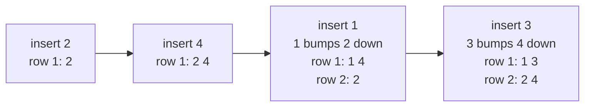

# The RSK correspondence: every shuffle becomes a pair of same-shaped tableaux, so the squared tableau counts add up to n!, and the first row is the longest rising run

[Syllabus](../../../SYLLABUS.md) → [Combinatorics and graphs](../README.md) → [Partitions](../README.md#s08) → The RSK correspondence

---

## General Overview

Four volumes of a reference set sit on a library shelf in the order 2, 4, 1, 3. Each move takes one volume out and slides it in elsewhere. How few moves put them in order 1, 2, 3, 4?

Volumes that never move keep their order, so they must already climb. Volumes 2 and 4 do, and so do 1 and 3; no three do. Keep two, move two: **2 moves**.

The **RSK correspondence** (named for Robinson, Schensted and Knuth) finds the length of the longest climbing set without trying every subset. It feeds 2, 4, 1, 3 one at a time into rows of numbers, by a fixed rule. The first row ends with length 2.

It also turns each of the 4! = 24 orders of four volumes into a pair of same-shaped grids, and back, with nothing lost. Counting both sides gives 1 + 9 + 4 + 9 + 1 = 24.

**Row insertion turns each shuffle of n into a pair of standard tableaux of one shape, one holding the numbers and one recording when each box appeared; reverse bumping undoes it, so the squared tableau counts add up to n!, and the first row's length is the longest rising run.**

**What kind of fact this is:** a theorem, proved on this card in Why it works; the facts that the number of rows equals the longest falling run, and that the shuffles that undo themselves have equal tableaux, are quoted from papers in Sources.

### The picture: inserting 2, 4, 1, 3



Each box is the grid after one insertion. A bumped number drops a row and is inserted there by the same rule.

---

## The formula

- A **shuffle** of $`n`$ is 1 to $`n`$ in some order, as on [Counting shuffles by their loops](05-permutations-by-cycles.md). Here $`w`$ is the shuffle 2, 4, 1, 3.
- **Shapes** $`\lambda`$ (lambda) and **standard tableaux**, fillings with 1 to $`n`$ rising along rows and down columns, are as on [Young tableaux and the hook length formula](07-young-tableaux-and-hook-lengths.md); $`f^\lambda`$ counts the tableaux of shape $`\lambda`$. The shape of 2, 2 is a 2 by 2 square.

RSK sends the shuffle $`w`$ to two standard tableaux of one shape: $`P`$, the **insertion tableau**, holding the numbers, and $`Q`$, the **recording tableau**, holding the step at which each box appeared.

```math
w \;\longleftrightarrow\; (P, Q), \qquad \text{shape}(P) = \text{shape}(Q) = \lambda
```

**Read it aloud:** each shuffle matches exactly one pair of same-shaped standard tableaux, and each such pair matches exactly one shuffle.

Counting both sides of that matching gives the identity:

```math
\sum_{\lambda} \left(f^\lambda\right)^2 = n!
```

**Read it aloud:** over every shape with $`n`$ boxes, square the number of standard tableaux and add; the total is the number of shuffles. The sign $`\sum`$ means "add over every".

Schensted's theorem reads the runs off the shape. A **rising run** is a set of terms taken from the shuffle in their original order, gaps allowed, that climb: 2, 4 and 1, 3 are rising runs of 2, 4, 1, 3. A **falling run** drops instead.

```math
\lambda_1 = \text{longest rising run of } w, \qquad \ell(\lambda) = \text{longest falling run of } w
```

**Read it aloud:** the first row's length is the longest rising run, and the number of rows is the longest falling run.

| Symbol | Plain meaning | In our example | Push it up and the answer… |
| --- | --- | --- | --- |
| $`n`$, $`n!`$ | how many numbers; how many shuffles of them | 4; 24 | the shuffles grow far faster than the shapes |
| $`w`$ | one shuffle of 1 to $`n`$ | 2, 4, 1, 3 | — |
| $`\lambda`$ | a shape: rows of boxes, longest on top | 2, 2 | — |
| $`f^\lambda`$ | standard tableaux of shape $`\lambda`$ | 2 for 2, 2 | its square counts more shuffles |
| $`P`$ | insertion tableau: where the numbers end up | `1 3 / 2 4` | — |
| $`Q`$ | recording tableau: the step each box appeared | `1 2 / 3 4` | — |
| $`\lambda_1`$; $`\ell(\lambda)`$ | length of the first row; number of rows | 2; 2 | fewer volumes move; a longer falling run |
| $`x`$ | the number being inserted into a row | 1, when it bumps 2 | it lands further right |

A slash separates rows: `1 3 / 2 4` is row 1 holding 1 and 3 over row 2 holding 2 and 4.

### When it holds

- **Distinct numbers.** With repeats, the tableaux stop being standard; Knuth's version of RSK handles that case.
- **Both tableaux kept.** $`P`$ alone forgets the order: 24 shuffles of four land on 10 insertion tableaux.
- **The exact bump rule.** Bump the last larger entry instead of the first and the rows stop rising: 2, 3, 1 gives `2 1 / 3`.
- **Lengths, not entries.** The first row of 3, 4, 2, 1 is 1, 4, yet 4 comes before 1.

---

## Why it works

### Step 0: insertion loses nothing if the new box is recorded

Each insertion adds one box at the end of some row. Write the step number in that box of $`Q`$, and the last step can later be found and run backwards.

### Step 1: row insertion, and why $`P`$ stays standard

To insert $`x`$ into a row: if $`x`$ is larger than everything there, put it at the end and stop. Otherwise $`x`$ takes the place of the first entry larger than it, and that entry is **bumped** into the next row, where the same rule applies. A bumped number that reaches an empty row starts it.

Rows stay rising: $`x`$ sits just after a smaller entry and before a larger one. Columns stay rising too, because a bumped number never lands to the right of where it left.

<details>
<summary>Detailed proof: columns stay rising</summary>

Say $`x`$ bumps $`y`$ from row $`r`$, column $`j`$. The entry below it, if any, was larger than $`y`$, so $`y`$ lands in row $`r+1`$ at some column $`k \le j`$.

Above $`y`$'s new spot sits an entry no larger than $`x`$, which is smaller than $`y`$. Anything below the spot is larger than its old occupant, so larger than $`y`$. The same facts, one row up, cover $`x`$.

</details>

### Step 2: $`Q`$ is standard and has the same shape

A bumped number never lands right of where it left, so the new box never makes a row longer than the one above. Step $`k`$ is the largest entry of $`Q`$ so far, so $`Q`$'s rows and columns rise. Both tableaux gain the same box each step, so they share a shape.

### Step 3: reverse bumping undoes one step

Take any pair $`(P, Q)`$ of one shape. The largest entry of $`Q`$ marks the box made last. Remove that box's number from $`P`$ and push it up: in each row above, it replaces the **largest** entry smaller than it. The number pushed out of row 1 is the shuffle's last number.

On the example, 4 sits at the end of row 2 of $`Q`$. Remove 4 from row 2 of $`P`$. In row 1, the largest entry below 4 is 3, so 4 takes its place and 3 leaves. The shuffle ended in 3.

<details>
<summary>Detailed proof: RSK is a bijection</summary>

Forward then back: the largest entry of $`Q`$ points at the last box made. If $`x`$ bumped $`y`$ out of a row, $`x`$ is that row's largest entry smaller than $`y`$, so reverse bumping swaps them back and retraces the path upward.

Back then forward: reverse bumping any same-shaped standard pair leaves a smaller such pair and one number. The entry just above the moving number's box is smaller, so a replacement exists; $`P`$ stays standard, mirroring Step 1. Inserting that number retraces the path downward. So every same-shaped pair comes from exactly one shuffle.

</details>

### Step 4: count both sides

The left side has $`n!`$ shuffles. The right side has, for each shape $`\lambda`$, $`f^\lambda`$ choices of $`P`$ times $`f^\lambda`$ choices of $`Q`$. A bijection makes the two counts equal. [Character tables](../../03-Algebra/12-Group%20Representations/03-character-tables.md) meets the same sum: there the squared sizes of a group's basic symmetry families add up to the group's size. For n = 4:

```text
squares of the tableau counts, n = 4

(4)           #                 1
(3, 1)        #########         9
(2, 2)        ####              4
(2, 1, 1)     #########         9
(1, 1, 1, 1)  #                 1
                              ---
                               24 = 4!
```

### Step 5: the first row is the longest rising run

Watch row 1 only. Its entry in column $`j`$ is always the smallest number read so far that ends a rising run of length $`j`$. A new number lands just after the entries smaller than it, so in column $`j+1`$ exactly when the longest rising run ending at it has length $`j+1`$. Row 1 grows only on a new record, so its length $`\lambda_1`$ is the longest rising run.

For 2, 4, 1, 3: 2 ends a run of 1; 4 ends a run of 2; 1 replaces 2 as the smallest end of a run of 1; 3 replaces 4 for runs of 2. Row 1 is 1, 3, of length 2.

Schensted's paper also proves that the number of rows $`\ell(\lambda)`$ is the longest falling run; the checks confirm it on every shuffle of up to seven numbers.

### Step 6: a bound on runs falls out

The shape's $`n`$ boxes fit inside a rectangle $`\lambda_1`$ wide and $`\ell(\lambda)`$ tall, so $`n \le \lambda_1 \times \ell(\lambda)`$. With Step 5 and Schensted's row count, the longest rising run times the longest falling run is at least $`n`$, for every shuffle. This is the Erdős–Szekeres inequality, read here off one shape.

---

## Worked numbers, by hand

| Step | Arithmetic | Value |
| --- | --- | --- |
| insert 2 | row 1 is empty | `2` |
| insert 4 | 4 is larger than 2: end of row 1 | `2 4` |
| insert 1 | 1 bumps 2, the first larger; 2 starts row 2 | `1 4 / 2` |
| insert 3 | 3 bumps 4; 4 goes to the end of row 2 | P = `1 3 / 2 4` |
| record the boxes | made at steps 1, 2 in row 1 and 3, 4 in row 2 | Q = `1 2 / 3 4` |
| reverse the last step | 4 leaves row 2, pushes out 3 from row 1 | last number 3 |
| first row and rows | longest rising run 2, longest falling run 2 | **2 and 2** |
| volumes to move | 4 − 2 | **2** |
| all 24 orders | 1 + 9 + 4 + 9 + 1 | **24 = 4!** |

Two volumes must move, and the 24 orders split by shape into 1, 9, 4, 9 and 1 pairs.

### What breaks if you drop a piece

| Mistake | Comes out at | What went wrong |
| --- | --- | --- |
| Adding the counts without squaring | 1 + 3 + 2 + 3 + 1 = 10 | That counts the 10 shuffles that are their own undo (doing them twice restores the order): those with P = Q |
| Keeping only P | 24 shuffles on 10 tableaux | 2, 4, 1, 3 and 2, 1, 4, 3 both give `1 3 / 2 4`; Q tells them apart |
| Reading row 1 as the run itself | 3, 4, 2, 1 gives row 1 = 1, 4 | 4 comes before 1; only the length is promised |
| Bumping the last larger entry | 2, 3, 1 gives `2 1 / 3` | row 1 falls, so P is not a standard tableau |

---

## Code, from first principles, and it actually runs

The code runs RSK and reverse bumping on every shuffle of up to seven numbers. Three independent roads meet: the distinct $`(P, Q)`$ pairs RSK makes, the tableau counts found by removing the corner box that holds $`n`$, with no insertion, and $`n!`$ itself. The runs are found separately, by a table of the best run ending at each position, and compared with the shape.

### Python

```python
# The RSK correspondence -- the check behind the card.  Nothing is imported.  Row insertion
# turns a shuffle into tableaux P (the numbers) and Q (when each box appeared); reverse bumping undoes it.
def rsk(w, pick=min):                      # road one: row insertion, with a recording
    P, Q = [], []
    for step, x in enumerate(w, 1):
        r = 0
        while r < len(P) and P[r][-1] > x:            # x bumps the first larger entry
            j = pick(i for i, y in enumerate(P[r]) if y > x); P[r][j], x, r = x, P[r][j], r + 1
        if r == len(P): P.append([]); Q.append([])
        P[r].append(x); Q[r].append(step)             # x lands at the end of row r
    return P, Q
def unrsk(P, Q):                          # reverse bumping: undo the last step first
    P, Q, w = [r[:] for r in P], [r[:] for r in Q], []
    for step in range(sum(map(len, Q)), 0, -1):
        r = [i for i, row in enumerate(Q) if row and row[-1] == step][0]
        Q[r].pop(); x = P[r].pop()
        for rr in range(r - 1, -1, -1):               # push x back up: it displaces the largest smaller entry
            j = max(i for i, y in enumerate(P[rr]) if y < x); P[rr][j], x = x, P[rr][j]
        w.append(x)
    return tuple(w[::-1])
def shapes(n, cap=99):                    # partitions of n, largest part first
    if n == 0: yield (); return
    for k in range(min(n, cap), 0, -1): yield from ((k,) + rest for rest in shapes(n - k, k))
def f(lam):                               # road two: the box holding n sits at a corner
    lam = tuple(p for p in lam if p)
    return 1 if not lam else sum(f(lam[:i] + (lam[i] - 1,) + lam[i + 1:])
        for i in range(len(lam)) if i == len(lam) - 1 or lam[i] > lam[i + 1])
def run(w, sign):                         # longest rising (+1) or falling (-1) run, by DP
    best = []
    for j in range(len(w)): best.append(1 + max([best[i] for i in range(j) if sign * (w[j] - w[i]) > 0] or [0]))
    return max(best)
def standard(P): return all(x < y for r in P for x, y in zip(r, r[1:])) and all(len(a) >= len(b) and all(x < y for x, y in zip(a, b)) for a, b in zip(P, P[1:]))
T = lambda P: " / ".join(" ".join(map(str, r)) for r in P if r); L = lambda xs: ", ".join(map(str, xs)); S = lambda lam: "(" + L(lam) + ")"; yn = lambda b: "yes" if b else "no"
w = (2, 4, 1, 3); P, Q = rsk(w); lams = list(shapes(4)); fs = [f(l) for l in lams]
print(f"insert {L(w)}: " + " | ".join(T(rsk(w[:k])[0]) for k in range(1, 5)))
print(f"P = {T(P)}; Q = {T(Q)}; shape {S([len(r) for r in P])}; reverse bumping gives {L(unrsk(P, Q))}")
print(f"first row {len(P[0])} = longest rising run {run(w, 1)}, so 4 - {run(w, 1)} = {4 - run(w, 1)} volumes move; rows {len(P)} = longest falling run {run(w, -1)}")
print("n = 4 tableau counts, by corners: " + ", ".join(f"{S(l)} {c}" for l, c in zip(lams, fs)))
print(f"squares {' + '.join(str(c * c) for c in fs)} = {sum(c * c for c in fs)} = 4!")
fact, total, schensted, es, ws = 1, 0, 0, 0, [()]
for n in range(1, 8):                     # every shuffle of 1..n: slot n into every shuffle of 1..n-1
    fact *= n; ws = [v[:i] + (n,) + v[i:] for v in ws for i in range(n)]; out = [rsk(v) for v in ws]
    pairs = {repr(o) for o in out}; back = all(unrsk(*o) == v for o, v in zip(out, ws))
    tot = sum(f(l) ** 2 for l in shapes(n)); byshape = {}; total += len(ws)
    for (p, q), v in zip(out, ws):
        byshape.setdefault(tuple(map(len, p)), set()).add(repr(p))
        schensted += len(p[0]) == run(v, 1) and len(p) == run(v, -1)
        es += run(v, 1) * run(v, -1) >= n
    if n >= 4: print(f"n = {n}: {len(ws)} shuffles, {len(pairs)} distinct (P, Q) pairs, sum of squares {tot}, all undone: {yn(back)}")
    assert len(pairs) == fact == tot and back and all(len(byshape[l]) == f(l) for l in shapes(n)) and all(standard(p) and standard(q) and list(map(len, p)) == list(map(len, q)) for p, q in out)
    if n == 4: out4, ws4 = out, ws
print(f"Schensted, first row = longest rising run and rows = longest falling run: {schensted} of {total} shuffles")
print(f"Erdos-Szekeres, rising x falling >= n: {es} of {total} shuffles, n = 1 to 7")
inv, same = sum(all(v[v[i] - 1] == i + 1 for i in range(4)) for v in ws4), sum(p == q for p, q in out4)
print(f"mistake 1, counts unsquared: {' + '.join(map(str, fs))} = {sum(fs)}, the {inv} shuffles that are their own undo ({same} with P = Q)")
print(f"mistake 2, P alone: 24 shuffles give {len({repr(p) for p, q in out4})} tableaux; 2, 1, 4, 3 also gives {T(rsk((2, 1, 4, 3))[0])}")
print(f"mistake 3, first row read as the run: 3, 4, 2, 1 gives first row {T(rsk((3, 4, 2, 1))[0][:1])}, but 4 comes before 1")
print(f"mistake 4, bump the last larger entry: 2, 3, 1 gives {T(rsk((2, 3, 1), max)[0])}, whose first row falls")
assert schensted == es == total == 5913 and sum(fs) == inv == same == 10        # Schensted, involutions
print("ALL CHECKS PASS")
```

**Ran 2026-11-23 on macOS, Python 3.14.10, standard library only. All checks passed. Output, pasted from the run:**

```
insert 2, 4, 1, 3: 2 | 2 4 | 1 4 / 2 | 1 3 / 2 4
P = 1 3 / 2 4; Q = 1 2 / 3 4; shape (2, 2); reverse bumping gives 2, 4, 1, 3
first row 2 = longest rising run 2, so 4 - 2 = 2 volumes move; rows 2 = longest falling run 2
n = 4 tableau counts, by corners: (4) 1, (3, 1) 3, (2, 2) 2, (2, 1, 1) 3, (1, 1, 1, 1) 1
squares 1 + 9 + 4 + 9 + 1 = 24 = 4!
n = 4: 24 shuffles, 24 distinct (P, Q) pairs, sum of squares 24, all undone: yes
n = 5: 120 shuffles, 120 distinct (P, Q) pairs, sum of squares 120, all undone: yes
n = 6: 720 shuffles, 720 distinct (P, Q) pairs, sum of squares 720, all undone: yes
n = 7: 5040 shuffles, 5040 distinct (P, Q) pairs, sum of squares 5040, all undone: yes
Schensted, first row = longest rising run and rows = longest falling run: 5913 of 5913 shuffles
Erdos-Szekeres, rising x falling >= n: 5913 of 5913 shuffles, n = 1 to 7
mistake 1, counts unsquared: 1 + 3 + 2 + 3 + 1 = 10, the 10 shuffles that are their own undo (10 with P = Q)
mistake 2, P alone: 24 shuffles give 10 tableaux; 2, 1, 4, 3 also gives 1 3 / 2 4
mistake 3, first row read as the run: 3, 4, 2, 1 gives first row 1 4, but 4 comes before 1
mistake 4, bump the last larger entry: 2, 3, 1 gives 2 1 / 3, whose first row falls
ALL CHECKS PASS
```

### Rust

Same numbers, same labels, built with `rustc --edition 2021 -O`.

```rust
// The RSK correspondence -- the same check as the Python, in Rust.  No crates.  Row insertion
// turns a shuffle into tableaux P (the numbers) and Q (when each box appeared); reverse bumping undoes it.
type Tab = Vec<Vec<usize>>;
fn rsk(w: &[usize]) -> (Tab, Tab) { rsk_by(w, false) }
fn rsk_by(w: &[usize], last: bool) -> (Tab, Tab) {  // road one: row insertion, with a recording
    let (mut p, mut q): (Tab, Tab) = (vec![], vec![]);
    for (step, &x0) in w.iter().enumerate() {
        let (mut x, mut r) = (x0, 0);
        while r < p.len() && *p[r].last().unwrap() > x {          // x bumps the first larger entry
            let j = if last { p[r].iter().rposition(|&y| y > x) } else { p[r].iter().position(|&y| y > x) }.unwrap(); std::mem::swap(&mut p[r][j], &mut x); r += 1;
        }
        if r == p.len() { p.push(vec![]); q.push(vec![]); }
        p[r].push(x); q[r].push(step + 1);                         // x lands at the end of row r
    }
    (p, q)
}
fn unrsk(p0: &Tab, q0: &Tab) -> Vec<usize> {  // reverse bumping: undo the last step first
    let (mut p, mut q, mut w) = (p0.clone(), q0.clone(), vec![]);
    for step in (1..=q.iter().map(|r| r.len()).sum::<usize>()).rev() {
        let r = q.iter().position(|row| row.last() == Some(&step)).unwrap();
        q[r].pop(); let mut x = p[r].pop().unwrap();
        for rr in (0..r).rev() {                                   // displace the largest smaller entry
            let j = p[rr].iter().rposition(|&y| y < x).unwrap(); std::mem::swap(&mut p[rr][j], &mut x); }
        w.push(x);
    }
    w.reverse(); w
}
fn shapes(n: usize, cap: usize) -> Vec<Vec<usize>> {        // partitions of n, largest part first
    if n == 0 { return vec![vec![]]; }
    (1..=n.min(cap)).rev().flat_map(|k| shapes(n - k, k).into_iter().map(move |r| [vec![k], r].concat())).collect()
}
fn f(lam: &[usize]) -> usize {             // road two: the box holding n sits at a corner
    let lam: Vec<usize> = lam.iter().copied().filter(|&p| p > 0).collect();
    if lam.is_empty() { return 1; }
    (0..lam.len()).filter(|&i| i == lam.len() - 1 || lam[i] > lam[i + 1])
        .map(|i| { let mut m = lam.clone(); m[i] -= 1; f(&m) }).sum()
}
fn run(w: &[usize], sign: i64) -> usize {   // longest rising (+1) or falling (-1) run, by DP
    let mut best: Vec<usize> = vec![];
    for j in 0..w.len() { best.push(1 + (0..j).filter(|&i| sign * (w[j] as i64 - w[i] as i64) > 0).map(|i| best[i]).max().unwrap_or(0)); }
    *best.iter().max().unwrap()
}
fn standard(p: &Tab) -> bool { p.iter().all(|r| r.windows(2).all(|x| x[0] < x[1])) && p.windows(2).all(|w| w[0].len() >= w[1].len() && w[1].iter().zip(&w[0]).all(|(b, a)| a < b)) }
fn l(xs: &[usize]) -> String { xs.iter().map(|x| x.to_string()).collect::<Vec<_>>().join(", ") }
fn t(p: &Tab) -> String { p.iter().filter(|r| !r.is_empty()).map(|r| r.iter().map(|x| x.to_string()).collect::<Vec<_>>().join(" ")).collect::<Vec<_>>().join(" / ") }
fn yn(b: bool) -> &'static str { if b { "yes" } else { "no" } }
fn main() {
    let w = [2, 4, 1, 3]; let (p, q) = rsk(&w); let lams = shapes(4, 99); let fs: Vec<usize> = lams.iter().map(|x| f(x)).collect();
    println!("insert {}: {}", l(&w), (1..5).map(|k| t(&rsk(&w[..k]).0)).collect::<Vec<_>>().join(" | "));
    println!("P = {}; Q = {}; shape ({}); reverse bumping gives {}", t(&p), t(&q), l(&p.iter().map(|r| r.len()).collect::<Vec<_>>()), l(&unrsk(&p, &q)));
    println!("first row {} = longest rising run {}, so 4 - {} = {} volumes move; rows {} = longest falling run {}", p[0].len(), run(&w, 1), run(&w, 1), 4 - run(&w, 1), p.len(), run(&w, -1));
    println!("n = 4 tableau counts, by corners: {}", lams.iter().zip(&fs).map(|(x, c)| format!("({}) {}", l(x), c)).collect::<Vec<_>>().join(", "));
    println!("squares {} = {} = 4!", fs.iter().map(|c| (c * c).to_string()).collect::<Vec<_>>().join(" + "), fs.iter().map(|c| c * c).sum::<usize>());
    let (mut fact, mut total, mut schensted, mut es) = (1, 0, 0, 0);
    let (mut ws, mut out4, mut ws4): (Vec<Vec<usize>>, Vec<(Tab, Tab)>, Vec<Vec<usize>>) = (vec![vec![]], vec![], vec![]);
    for n in 1..8usize {                   // every shuffle of 1..n: slot n into every shuffle of 1..n-1
        fact *= n;
        ws = ws.iter().flat_map(|v| (0..n).map(move |i| { let mut u = v.clone(); u.insert(i, n); u })).collect();
        let out: Vec<(Tab, Tab)> = ws.iter().map(|v| rsk(v)).collect();
        let mut pairs = out.clone(); pairs.sort(); pairs.dedup();
        let back = out.iter().zip(&ws).all(|((a, b), v)| unrsk(a, b) == *v);
        let tot: usize = shapes(n, 99).iter().map(|x| f(x) * f(x)).sum(); total += ws.len();
        let mut byshape: Vec<(Vec<usize>, Tab)> = out.iter().map(|(a, _)| (a.iter().map(|r| r.len()).collect(), a.clone())).collect();
        byshape.sort(); byshape.dedup();
        for ((a, _), v) in out.iter().zip(&ws) { schensted += (a[0].len() == run(v, 1) && a.len() == run(v, -1)) as usize; es += (run(v, 1) * run(v, -1) >= n) as usize; }
        if n >= 4 { println!("n = {}: {} shuffles, {} distinct (P, Q) pairs, sum of squares {}, all undone: {}", n, ws.len(), pairs.len(), tot, yn(back)); }
        assert!(pairs.len() == fact && fact == tot && back && shapes(n, 99).iter().all(|x| byshape.iter().filter(|(s, _)| s == x).count() == f(x)) && out.iter().all(|(a, b)| standard(a) && standard(b) && a.iter().map(|r| r.len()).eq(b.iter().map(|r| r.len()))));
        if n == 4 { out4 = out.clone(); ws4 = ws.clone(); }
    }
    println!("Schensted, first row = longest rising run and rows = longest falling run: {} of {} shuffles", schensted, total);
    println!("Erdos-Szekeres, rising x falling >= n: {} of {} shuffles, n = 1 to 7", es, total);
    let (inv, same) = (ws4.iter().filter(|v| (0..4).all(|i| v[v[i] - 1] == i + 1)).count(), out4.iter().filter(|(a, b)| a == b).count());
    let mut ps: Vec<Tab> = out4.iter().map(|(a, _)| a.clone()).collect(); ps.sort(); ps.dedup();
    println!("mistake 1, counts unsquared: {} = {}, the {} shuffles that are their own undo ({} with P = Q)", fs.iter().map(|c| c.to_string()).collect::<Vec<_>>().join(" + "), fs.iter().sum::<usize>(), inv, same);
    println!("mistake 2, P alone: 24 shuffles give {} tableaux; 2, 1, 4, 3 also gives {}", ps.len(), t(&rsk(&[2, 1, 4, 3]).0));
    println!("mistake 3, first row read as the run: 3, 4, 2, 1 gives first row {}, but 4 comes before 1", t(&rsk(&[3, 4, 2, 1]).0[..1].to_vec()));
    println!("mistake 4, bump the last larger entry: 2, 3, 1 gives {}, whose first row falls", t(&rsk_by(&[2, 3, 1], true).0));
    assert!(schensted == es && es == total && total == 5913 && fs.iter().sum::<usize>() == inv && inv == same && same == 10);
    println!("ALL CHECKS PASS");
}
```

**Ran 2026-11-23 on macOS, rustc 1.98.1, no crates. All checks passed. Output, pasted from the run:**

```
insert 2, 4, 1, 3: 2 | 2 4 | 1 4 / 2 | 1 3 / 2 4
P = 1 3 / 2 4; Q = 1 2 / 3 4; shape (2, 2); reverse bumping gives 2, 4, 1, 3
first row 2 = longest rising run 2, so 4 - 2 = 2 volumes move; rows 2 = longest falling run 2
n = 4 tableau counts, by corners: (4) 1, (3, 1) 3, (2, 2) 2, (2, 1, 1) 3, (1, 1, 1, 1) 1
squares 1 + 9 + 4 + 9 + 1 = 24 = 4!
n = 4: 24 shuffles, 24 distinct (P, Q) pairs, sum of squares 24, all undone: yes
n = 5: 120 shuffles, 120 distinct (P, Q) pairs, sum of squares 120, all undone: yes
n = 6: 720 shuffles, 720 distinct (P, Q) pairs, sum of squares 720, all undone: yes
n = 7: 5040 shuffles, 5040 distinct (P, Q) pairs, sum of squares 5040, all undone: yes
Schensted, first row = longest rising run and rows = longest falling run: 5913 of 5913 shuffles
Erdos-Szekeres, rising x falling >= n: 5913 of 5913 shuffles, n = 1 to 7
mistake 1, counts unsquared: 1 + 3 + 2 + 3 + 1 = 10, the 10 shuffles that are their own undo (10 with P = Q)
mistake 2, P alone: 24 shuffles give 10 tableaux; 2, 1, 4, 3 also gives 1 3 / 2 4
mistake 3, first row read as the run: 3, 4, 2, 1 gives first row 1 4, but 4 comes before 1
mistake 4, bump the last larger entry: 2, 3, 1 gives 2 1 / 3, whose first row falls
ALL CHECKS PASS
```

The two outputs match.

### Lean

Lean proves the three main facts for every $`n`$, and checks the worked numbers for 2, 4, 1, 3 and all 24 shuffles of four.

- Row insertion sends each shuffle of $`n`$ to a pair $`(P, Q)`$ of standard tableaux of one shape. Different shuffles give different pairs, and every such pair comes from a shuffle.
- Take every shape $`\lambda`$ with $`n`$ boxes. Then $`\sum_{\lambda} (f^\lambda)^2 = n!`$.
- Take any shuffle. Then the first row of its $`P`$ has the length of its longest rising run.
- Inserting 2, 4, 1, 3 gives P = `1 3 / 2 4` and Q = `1 2 / 3 4`, with first row length 2.
- All 24 shuffles of four give 24 different pairs, but only 10 insertion tableaux, split by shape as 1, 3, 2, 3, 1.
- 2, 1, 4, 3 also gives P = `1 3 / 2 4`, and 3, 4, 2, 1 gives P = `1 4 / 2 / 3`.

Schensted's row count, Step 6's bound and the wrong bump rule are left to the Python and Rust checks.

```lean
-- The RSK correspondence: row insertion with a recording tableau matches the shuffles of 1 to n one for one with the pairs of same-shaped standard tableaux, so the squared tableau counts add up to n!, and the first row's length is the longest rising run.
import Mathlib.Combinatorics.Young.SemistandardTableau
import Mathlib.Combinatorics.Enumerative.Partition.YoungDiagram
import Mathlib.GroupTheory.Perm.Fin
import Mathlib.Data.Nat.Factorial.Basic
import Mathlib.Data.List.Perm.Basic
import Mathlib.SetTheory.Cardinal.Finite
import Mathlib.Data.Set.Card

/-! Mathlib has Young diagrams and semistandard tableaux but no RSK, so row insertion is
defined here on lists. A tableau is a list of rows, top row first. -/

/-- Insert `x` into one row: `x` takes the place of the first entry larger than it, and that
entry is bumped out (returned); if nothing is larger, `x` goes at the end and nothing is bumped. -/
def rowInsert : List ℕ → ℕ → List ℕ × Option ℕ
  | [], x => ([x], none)
  | y :: ys, x =>
      if x < y then (x :: ys, some y)
      else let r := rowInsert ys x; (y :: r.1, r.2)

/-- Insert `x` into the tableau `P`: a bumped entry is inserted into the next row by the same
rule, and a bumped entry that reaches an empty row starts it. Also returns the index of the row
that gained a box. -/
def insertP : List (List ℕ) → ℕ → List (List ℕ) × ℕ
  | [], x => ([[x]], 0)
  | row :: rows, x =>
      match rowInsert row x with
      | (row', none) => (row' :: rows, 0)
      | (row', some y) => let r := insertP rows y; (row' :: r.1, r.2 + 1)

/-- Write `k` in a new box at the end of row `i` of the recording tableau
(a new bottom row when `i` is the number of rows). -/
def addAt : List (List ℕ) → ℕ → ℕ → List (List ℕ)
  | [], _, k => [[k]]
  | row :: rows, 0, k => (row ++ [k]) :: rows
  | row :: rows, i + 1, k => row :: addAt rows i k

/-- RSK: insert the terms of `w` one at a time into `P`, and record in `Q` the step at which each
box appeared. Returns `(P, Q)`. -/
def rsk (w : List ℕ) : List (List ℕ) × List (List ℕ) :=
  let s := w.foldl
    (fun (s : List (List ℕ) × List (List ℕ) × ℕ) x =>
      let r := insertP s.1 x
      (r.1, addAt s.2.1 r.2 (s.2.2 + 1), s.2.2 + 1))
    ([], [], 0)
  (s.1, s.2.1)

/-- The shuffle `σ` of `1, …, n` written out as the list `σ(1), …, σ(n)`
(Mathlib's `Fin n` counts from 0, so each value is shifted up by one). -/
def word {n : ℕ} (σ : Equiv.Perm (Fin n)) : List ℕ :=
  List.ofFn fun i => (σ i : ℕ) + 1

/-- The shape of a list tableau: its row lengths, top row first. -/
def shape (T : List (List ℕ)) : List ℕ :=
  T.map List.length

/-- A standard tableau with `n` boxes, as a list of rows: no empty rows, each row rising, each
row no longer than the one above it, each column rising, and the entries exactly `1, …, n`. -/
def IsStandard (n : ℕ) (T : List (List ℕ)) : Prop :=
  (∀ row ∈ T, row ≠ []) ∧
  (∀ row ∈ T, row.Pairwise (· < ·)) ∧
  (∀ i, (T.getD (i + 1) []).length ≤ (T.getD i []).length ∧
    ∀ j < (T.getD (i + 1) []).length, (T.getD i []).getD j 0 < (T.getD (i + 1) []).getD j 0) ∧
  T.flatten.Perm (List.range' 1 n)

/-- A standard Young tableau of shape `μ`, in Mathlib's terms: a semistandard tableau whose
entries on the cells of `μ` are exactly `1, …, |μ|`, each used once. -/
def StandardYoungTableau (μ : YoungDiagram) : Type :=
  {T : SemistandardYoungTableau μ //
    Set.BijOn (fun c : ℕ × ℕ => T c.1 c.2) (μ.cells : Set (ℕ × ℕ)) (Set.Icc 1 μ.card)}

/-! ## Helper definitions and lemmas for the proofs -/

/-- Column condition between two consecutive rows. -/
def RowsOK : List ℕ → List ℕ → Prop
  | _, [] => True
  | [], _ :: _ => False
  | a :: as, b :: bs => a < b ∧ RowsOK as bs

/-- Tableau shape conditions, row by row. -/
def Tab : List (List ℕ) → Prop
  | [] => True
  | r :: rs => r ≠ [] ∧ r.Pairwise (· < ·) ∧ RowsOK r (rs.headD []) ∧ Tab rs

def incAt : List ℕ → ℕ → List ℕ
  | [], _ => [1]
  | a :: as, 0 => (a + 1) :: as
  | a :: as, i + 1 => a :: incAt as i

def rowUnins : List ℕ → ℕ → List ℕ × ℕ
  | [], y => ([], y)
  | u :: us, y => if us.headD y < y then (u :: (rowUnins us y).1, (rowUnins us y).2) else (y :: us, u)

def dropBox : List (List ℕ) → ℕ → List (List ℕ)
  | [], _ => []
  | r :: rs, 0 => if r.length = 1 then rs else r.dropLast :: rs
  | r :: rs, i + 1 => r :: dropBox rs i

def deleteP : List (List ℕ) → ℕ → List (List ℕ) × ℕ
  | [], _ => ([], 0)
  | r :: rs, 0 => (if r.length = 1 then rs else r.dropLast :: rs, r.getLastD 0)
  | r :: rs, i + 1 =>
      ((rowUnins r (deleteP rs i).2).1 :: (deleteP rs i).1, (rowUnins r (deleteP rs i).2).2)

def findRow : List (List ℕ) → ℕ → ℕ
  | [], _ => 0
  | r :: rs, k => if k ∈ r then 0 else findRow rs k + 1

@[simp] theorem rowsOK_nil_right (a : List ℕ) : RowsOK a [] := by cases a <;> trivial
@[simp] theorem rowsOK_nil_cons (b : ℕ) (bs : List ℕ) : RowsOK [] (b :: bs) ↔ False := Iff.rfl
@[simp] theorem rowsOK_cons_cons (a b : ℕ) (as bs : List ℕ) :
    RowsOK (a :: as) (b :: bs) ↔ a < b ∧ RowsOK as bs := Iff.rfl
@[simp] theorem tab_nil : Tab [] ↔ True := Iff.rfl
theorem tab_cons (r : List ℕ) (rs : List (List ℕ)) :
    Tab (r :: rs) ↔ r ≠ [] ∧ r.Pairwise (· < ·) ∧ RowsOK r (rs.headD []) ∧ Tab rs := Iff.rfl

theorem getD_zero_eq_headD (l : List (List ℕ)) : l.getD 0 [] = l.headD [] := by
  cases l <;> rfl

theorem mem_flatten_of_mem_head {l : List (List ℕ)} {z : ℕ} (h : z ∈ l.headD []) : z ∈ l.flatten := by
  cases l with
  | nil => simp at h
  | cons b bs => simp only [List.headD_cons] at h; simp [h]

theorem tab_head_sorted {P : List (List ℕ)} (h : Tab P) : (P.headD []).Pairwise (· < ·) := by
  cases P with
  | nil => simp
  | cons r rs => exact ((tab_cons _ _).1 h).2.1

theorem rowsOK_length {a b : List ℕ} (h : RowsOK a b) : b.length ≤ a.length := by
  induction a generalizing b with
  | nil => cases b with
    | nil => simp
    | cons _ _ => simp at h
  | cons x xs ih => cases b with
    | nil => simp
    | cons y ys => simp only [rowsOK_cons_cons] at h; simpa using ih h.2

theorem rowsOK_append_right {a b : List ℕ} (l : List ℕ) (h : RowsOK a b) : RowsOK (a ++ l) b := by
  induction a generalizing b with
  | nil => cases b with
    | nil => simp
    | cons _ _ => simp at h
  | cons x xs ih => cases b with
    | nil => simp
    | cons y ys => simp only [rowsOK_cons_cons] at h; simp only [List.cons_append, rowsOK_cons_cons]; exact ⟨h.1, ih h.2⟩

theorem rowsOK_prefix {a c : List ℕ} {y : ℕ} (h : RowsOK a (c ++ [y])) : RowsOK a c := by
  induction c generalizing a with
  | nil => simp
  | cons v cs ih => cases a with
    | nil => simp at h
    | cons u us => simp only [List.cons_append, rowsOK_cons_cons] at h ⊢; exact ⟨h.1, ih h.2⟩

theorem rowsOK_shrink {c b : List ℕ} {y : ℕ} (h : RowsOK (c ++ [y]) b) (hl : b.length ≤ c.length) :
    RowsOK c b := by
  induction c generalizing b with
  | nil => cases b with
    | nil => simp
    | cons _ _ => simp at hl
  | cons v cs ih => cases b with
    | nil => simp
    | cons q qs =>
      simp only [List.cons_append, rowsOK_cons_cons] at h ⊢
      simp only [List.length_cons] at hl
      exact ⟨h.1, ih h.2 (by omega)⟩

theorem rowsOK_snoc {r b : List ℕ} {k : ℕ} (h : RowsOK r b) (hl : b.length < r.length)
    (hk : ∀ e ∈ r, e < k) : RowsOK r (b ++ [k]) := by
  induction b generalizing r with
  | nil => cases r with
    | nil => simp at hl
    | cons u us => simp only [List.nil_append, rowsOK_cons_cons, rowsOK_nil_right, and_true]; exact hk u (by simp)
  | cons q qs ih => cases r with
    | nil => simp at h
    | cons u us =>
      simp only [rowsOK_cons_cons] at h
      simp only [List.length_cons] at hl
      simp only [List.cons_append, rowsOK_cons_cons]
      exact ⟨h.1, ih h.2 (by omega) (fun e he => hk e (by simp [he]))⟩

theorem rowsOK_full {c b : List ℕ} {y : ℕ} (h : RowsOK (c ++ [y]) b) (hl : b.length = c.length + 1) :
    ∃ e ∈ b, y < e := by
  induction c generalizing b with
  | nil => cases b with
    | nil => simp at hl
    | cons q qs => simp only [List.nil_append, rowsOK_cons_cons] at h; exact ⟨q, by simp, h.1⟩
  | cons v cs ih => cases b with
    | nil => simp at hl
    | cons q qs =>
      simp only [List.cons_append, rowsOK_cons_cons] at h
      simp only [List.length_cons] at hl
      obtain ⟨e, he, hye⟩ := ih h.2 (by omega)
      exact ⟨e, by simp [he], hye⟩

theorem head_lt_of_mem {r b : List ℕ} {z : ℕ} (h : RowsOK r b) (hr : r ≠ []) (hb : b.Pairwise (· < ·))
    (hz : z ∈ b) : r.headD z < z := by
  cases b with
  | nil => simp at hz
  | cons q qs => cases r with
    | nil => exact absurd rfl hr
    | cons p ps =>
      simp only [rowsOK_cons_cons] at h
      simp only [List.headD_cons]
      rcases List.mem_cons.1 hz with h' | h'
      · omega
      · have := (List.pairwise_cons.1 hb).1 z h'; omega

/-! ### Row insertion -/

theorem rowInsert_nil (x : ℕ) : rowInsert [] x = ([x], none) := rfl

theorem rowInsert_cons_lt {y x : ℕ} (ys : List ℕ) (h : x < y) :
    rowInsert (y :: ys) x = (x :: ys, some y) := by
  simp [rowInsert, h]

theorem rowInsert_cons_not_lt {y x : ℕ} (ys : List ℕ) (h : ¬ x < y) :
    rowInsert (y :: ys) x = (y :: (rowInsert ys x).1, (rowInsert ys x).2) := by
  simp [rowInsert, h]

theorem rowInsert_fst_ne_nil (r : List ℕ) (x : ℕ) : (rowInsert r x).1 ≠ [] := by
  cases r with
  | nil => simp [rowInsert_nil]
  | cons y ys =>
    by_cases h : x < y
    · rw [rowInsert_cons_lt ys h]; simp
    · rw [rowInsert_cons_not_lt ys h]; simp

theorem rowInsert_of_forall {r : List ℕ} {x : ℕ} (h : ∀ e ∈ r, ¬ x < e) :
    rowInsert r x = (r ++ [x], none) := by
  induction r with
  | nil => rfl
  | cons y ys ih =>
    simp only [List.mem_cons, forall_eq_or_imp] at h
    rw [rowInsert_cons_not_lt ys h.1, ih h.2]; rfl

theorem rowInsert_snd_none {r : List ℕ} {x : ℕ} (h : (rowInsert r x).2 = none) :
    rowInsert r x = (r ++ [x], none) := by
  induction r with
  | nil => rfl
  | cons y ys ih =>
    by_cases hxy : x < y
    · rw [rowInsert_cons_lt ys hxy] at h; simp at h
    · rw [rowInsert_cons_not_lt ys hxy] at h ⊢
      simp only at h
      rw [ih h]; rfl

theorem rowInsert_snd_mem {r : List ℕ} {x y : ℕ} (h : (rowInsert r x).2 = some y) : y ∈ r := by
  induction r with
  | nil => simp [rowInsert_nil] at h
  | cons w ws ih =>
    by_cases hxw : x < w
    · rw [rowInsert_cons_lt ws hxw] at h; simp only [Option.some.injEq] at h; simp [h]
    · rw [rowInsert_cons_not_lt ws hxw] at h; simp only at h; exact List.mem_cons_of_mem _ (ih h)

theorem rowInsert_perm (r : List ℕ) (x : ℕ) :
    ((rowInsert r x).1 ++ (rowInsert r x).2.toList).Perm (x :: r) := by
  induction r with
  | nil => simp [rowInsert_nil]
  | cons y ys ih =>
    by_cases hxy : x < y
    · rw [rowInsert_cons_lt ys hxy]
      simp only [Option.toList_some, List.cons_append]
      exact (List.perm_append_singleton y ys).cons x
    · rw [rowInsert_cons_not_lt ys hxy]
      simp only [List.cons_append]
      exact (ih.cons y).trans (List.Perm.swap x y ys)

theorem rowInsert_mem_fst {r : List ℕ} {x e : ℕ} (he : e ∈ (rowInsert r x).1) : e = x ∨ e ∈ r :=
  List.mem_cons.1 ((rowInsert_perm r x).subset (List.mem_append_left _ he))

theorem rowInsert_length_some {r : List ℕ} {x y : ℕ} (h : (rowInsert r x).2 = some y) :
    (rowInsert r x).1.length = r.length := by
  have := (rowInsert_perm r x).length_eq
  rw [h] at this
  simpa using this

theorem rowInsert_sorted {r : List ℕ} {x : ℕ} (hr : r.Pairwise (· < ·)) (hx : x ∉ r) :
    (rowInsert r x).1.Pairwise (· < ·) := by
  induction r with
  | nil => simp [rowInsert_nil]
  | cons y ys ih =>
    rw [List.pairwise_cons] at hr
    simp only [List.mem_cons, not_or] at hx
    by_cases hxy : x < y
    · rw [rowInsert_cons_lt ys hxy]
      exact List.pairwise_cons.2 ⟨fun e he => lt_trans hxy (hr.1 e he), hr.2⟩
    · rw [rowInsert_cons_not_lt ys hxy]
      refine List.pairwise_cons.2 ⟨fun e he => ?_, ih hr.2 hx.2⟩
      rcases rowInsert_mem_fst he with h | h
      · rw [h]; omega
      · exact hr.1 e h

theorem rowsOK_rowInsert_left {r b : List ℕ} (x : ℕ) (h : RowsOK r b) : RowsOK (rowInsert r x).1 b := by
  induction r generalizing b with
  | nil => cases b with
    | nil => simp
    | cons _ _ => simp at h
  | cons y ys ih =>
    cases b with
    | nil => simp
    | cons v vs =>
      rw [rowsOK_cons_cons] at h
      by_cases hxy : x < y
      · rw [rowInsert_cons_lt ys hxy]; simp only [rowsOK_cons_cons]; exact ⟨by omega, h.2⟩
      · rw [rowInsert_cons_not_lt ys hxy]; simp only [rowsOK_cons_cons]; exact ⟨h.1, ih h.2⟩

theorem rowsOK_insert_step {a b : List ℕ} {x y : ℕ} (ha : a.Pairwise (· < ·))
    (hab : RowsOK a b) (hx : x ∉ a) (hy : (rowInsert a x).2 = some y) :
    RowsOK (rowInsert a x).1 (rowInsert b y).1 := by
  induction a generalizing b with
  | nil => simp [rowInsert_nil] at hy
  | cons u us ih =>
    rw [List.pairwise_cons] at ha
    simp only [List.mem_cons, not_or] at hx
    by_cases hxu : x < u
    · rw [rowInsert_cons_lt us hxu] at hy ⊢
      simp only [Option.some.injEq] at hy
      subst hy
      cases b with
      | nil => rw [rowInsert_nil]; simp [hxu]
      | cons v vs =>
        rw [rowsOK_cons_cons] at hab
        rw [rowInsert_cons_lt vs hab.1]
        simp [hxu, hab.2]
    · rw [rowInsert_cons_not_lt us hxu] at hy ⊢
      simp only at hy
      have hyu : u < y := ha.1 y (rowInsert_snd_mem hy)
      cases b with
      | nil => rw [rowInsert_nil]; simp [hyu]
      | cons v vs =>
        rw [rowsOK_cons_cons] at hab
        by_cases hyv : y < v
        · rw [rowInsert_cons_lt vs hyv]
          simp only [rowsOK_cons_cons]
          exact ⟨hyu, rowsOK_rowInsert_left x hab.2⟩
        · rw [rowInsert_cons_not_lt vs hyv]
          simp only [rowsOK_cons_cons]
          exact ⟨hab.1, ih ha.2 hab.2 hx.2 hy⟩

theorem rowInsert_head_lt {r : List ℕ} {x y : ℕ} (hr : r.Pairwise (· < ·))
    (hy : (rowInsert r x).2 = some y) : (rowInsert r x).1.headD y < y := by
  cases r with
  | nil => simp [rowInsert_nil] at hy
  | cons w ws =>
    rw [List.pairwise_cons] at hr
    by_cases hxw : x < w
    · rw [rowInsert_cons_lt ws hxw] at hy ⊢
      simp only [Option.some.injEq] at hy; subst hy; simpa using hxw
    · rw [rowInsert_cons_not_lt ws hxw] at hy ⊢
      simp only [List.headD_cons] at hy ⊢
      exact hr.1 y (rowInsert_snd_mem hy)

/-! ### Reverse bumping -/

theorem rowUnins_cons_lt {u y : ℕ} {us : List ℕ} (h : us.headD y < y) :
    rowUnins (u :: us) y = (u :: (rowUnins us y).1, (rowUnins us y).2) := by
  rw [rowUnins, if_pos h]

theorem rowUnins_cons_not_lt {u y : ℕ} {us : List ℕ} (h : ¬ us.headD y < y) :
    rowUnins (u :: us) y = (y :: us, u) := by
  rw [rowUnins, if_neg h]

theorem rowUnins_ne_nil {r : List ℕ} (y : ℕ) (hr : r ≠ []) : (rowUnins r y).1 ≠ [] := by
  cases r with
  | nil => exact absurd rfl hr
  | cons u us =>
    by_cases h : us.headD y < y
    · rw [rowUnins_cons_lt h]; simp
    · rw [rowUnins_cons_not_lt h]; simp

theorem rowUnins_mem {r : List ℕ} {z : ℕ} (h : r.headD z < z) : (rowUnins r z).2 ∈ r := by
  induction r with
  | nil => simp at h
  | cons u us ih =>
    by_cases hu : us.headD z < z
    · rw [rowUnins_cons_lt hu]; exact List.mem_cons_of_mem _ (ih hu)
    · rw [rowUnins_cons_not_lt hu]; simp

theorem rowUnins_rowInsert {r : List ℕ} {x y : ℕ} (hr : r.Pairwise (· < ·)) (hx : x ∉ r)
    (hy : (rowInsert r x).2 = some y) : rowUnins (rowInsert r x).1 y = (r, x) := by
  induction r with
  | nil => simp [rowInsert_nil] at hy
  | cons u us ih =>
    rw [List.pairwise_cons] at hr
    simp only [List.mem_cons, not_or] at hx
    by_cases hxu : x < u
    · rw [rowInsert_cons_lt us hxu] at hy ⊢
      simp only [Option.some.injEq] at hy; subst hy
      have h : ¬ us.headD u < u := by
        cases us with
        | nil => simp
        | cons v vs => simp only [List.headD_cons, not_lt]; exact (hr.1 v (by simp)).le
      rw [rowUnins_cons_not_lt h]
    · rw [rowInsert_cons_not_lt us hxu] at hy ⊢
      simp only at hy ⊢
      rw [rowUnins_cons_lt (rowInsert_head_lt hr.2 hy), ih hr.2 hx.2 hy]

theorem rowInsert_rowUnins {r : List ℕ} {y : ℕ} (hr : r.Pairwise (· < ·)) (hy : y ∉ r)
    (hh : r.headD y < y) :
    rowInsert (rowUnins r y).1 (rowUnins r y).2 = (r, some y) ∧ (rowUnins r y).1.Pairwise (· < ·) ∧
    (rowUnins r y).2 ∈ r ∧ (y :: r).Perm ((rowUnins r y).2 :: (rowUnins r y).1) := by
  induction r with
  | nil => simp at hh
  | cons u us ih =>
    rw [List.pairwise_cons] at hr
    simp only [List.mem_cons, not_or] at hy
    simp only [List.headD_cons] at hh
    by_cases h : us.headD y < y
    · rw [rowUnins_cons_lt h]
      obtain ⟨h1, h2, h3, h4⟩ := ih hr.2 hy.2 h
      simp only
      refine ⟨?_, ?_, ?_, ?_⟩
      · rw [rowInsert_cons_not_lt _ (by have := hr.1 _ h3; omega), h1]
      · refine List.pairwise_cons.2 ⟨fun e he => ?_, h2⟩
        have : e ∈ y :: us := h4.symm.subset (List.mem_cons_of_mem _ he)
        rcases List.mem_cons.1 this with h' | h'
        · rw [h']; exact hh
        · exact hr.1 e h'
      · exact List.mem_cons_of_mem _ h3
      · exact (List.Perm.swap u y us).trans ((h4.cons u).trans (List.Perm.swap _ _ _))
    · rw [rowUnins_cons_not_lt h]
      simp only
      refine ⟨?_, ?_, by simp, List.Perm.swap _ _ _⟩
      · rw [rowInsert_cons_lt _ hh]
      · refine List.pairwise_cons.2 ⟨fun e he => ?_, hr.2⟩
        cases us with
        | nil => simp at he
        | cons v vs =>
          simp only [List.headD_cons, not_lt] at h
          have hv : y ≠ v := fun h' => hy.2 (by simp [h'])
          rcases List.mem_cons.1 he with h' | h'
          · rw [h']; omega
          · have := (List.pairwise_cons.1 hr.2).1 e h'; omega

theorem rowsOK_unins_last {a c : List ℕ} {y : ℕ} (hc : (c ++ [y]).Pairwise (· < ·))
    (hab : RowsOK a (c ++ [y])) : RowsOK (rowUnins a y).1 c := by
  induction c generalizing a with
  | nil => simp
  | cons v cs ih =>
    cases a with
    | nil => simp at hab
    | cons u us =>
      simp only [List.cons_append, rowsOK_cons_cons] at hab
      rw [List.cons_append, List.pairwise_cons] at hc
      have hus : us.headD y < y := by
        cases us with
        | nil => cases cs <;> simp at hab
        | cons p ps =>
          simp only [List.headD_cons]
          cases cs with
          | nil => simpa using hab.2
          | cons q qs =>
            have h1 := hab.2
            simp only [List.cons_append, rowsOK_cons_cons] at h1
            have h2 := hc.2
            simp only [List.cons_append, List.pairwise_cons] at h2
            have := h2.1 y (by simp)
            omega
      rw [rowUnins_cons_lt hus]
      simp only [rowsOK_cons_cons]
      exact ⟨hab.1, ih hc.2 hab.2⟩

theorem rowsOK_unins_ins {us vs : List ℕ} {v : ℕ} (h : RowsOK us vs) (hv : ∀ e ∈ vs, v < e) :
    RowsOK (rowUnins us v).1 vs := by
  induction us generalizing vs with
  | nil => simpa [rowUnins] using h
  | cons p ps ih =>
    cases vs with
    | nil => simp
    | cons q qs =>
      simp only [rowsOK_cons_cons] at h
      simp only [List.mem_cons, forall_eq_or_imp] at hv
      by_cases hp : ps.headD v < v
      · rw [rowUnins_cons_lt hp]; simp only [rowsOK_cons_cons]; exact ⟨h.1, ih h.2 hv.2⟩
      · rw [rowUnins_cons_not_lt hp]; simp only [rowsOK_cons_cons]; exact ⟨hv.1, h.2⟩

theorem rowsOK_unins_step {a b : List ℕ} {z : ℕ} (hb : b.Pairwise (· < ·))
    (hab : RowsOK a b) (hz : b.headD z < z) :
    RowsOK (rowUnins a (rowUnins b z).2).1 (rowUnins b z).1 := by
  induction b generalizing a with
  | nil => simp at hz
  | cons v vs ih =>
    cases a with
    | nil => simp at hab
    | cons u us =>
      simp only [rowsOK_cons_cons] at hab
      rw [List.pairwise_cons] at hb
      simp only [List.headD_cons] at hz
      by_cases hv : vs.headD z < z
      · rw [rowUnins_cons_lt hv]
        simp only
        have hyv : (rowUnins vs z).2 ∈ vs := rowUnins_mem hv
        have hus : us.headD (rowUnins vs z).2 < (rowUnins vs z).2 := by
          cases vs with
          | nil => simp at hyv
          | cons q qs =>
            cases us with
            | nil => simp at hab
            | cons p ps =>
              have h1 := hab.2
              simp only [rowsOK_cons_cons] at h1
              simp only [List.headD_cons]
              have : q ≤ (rowUnins (q :: qs) z).2 := by
                rcases List.mem_cons.1 hyv with h | h
                · omega
                · exact ((List.pairwise_cons.1 hb.2).1 _ h).le
              omega
        rw [rowUnins_cons_lt hus]
        simp only [rowsOK_cons_cons]
        exact ⟨hab.1, ih hb.2 hab.2 hv⟩
      · rw [rowUnins_cons_not_lt hv]
        simp only
        by_cases hu : us.headD v < v
        · rw [rowUnins_cons_lt hu]; simp only [rowsOK_cons_cons]
          exact ⟨by omega, rowsOK_unins_ins hab.2 hb.1⟩
        · rw [rowUnins_cons_not_lt hu]; simp only [rowsOK_cons_cons]; exact ⟨hz, hab.2⟩

/-! ### Tableau insertion -/

theorem insertP_cons_none {row : List ℕ} {rows : List (List ℕ)} {x : ℕ}
    (h : (rowInsert row x).2 = none) : insertP (row :: rows) x = ((rowInsert row x).1 :: rows, 0) := by
  have e : rowInsert row x = ((rowInsert row x).1, none) := Prod.ext rfl h
  rw [insertP, e]

theorem insertP_cons_some {row : List ℕ} {rows : List (List ℕ)} {x y : ℕ}
    (h : (rowInsert row x).2 = some y) :
    insertP (row :: rows) x = ((rowInsert row x).1 :: (insertP rows y).1, (insertP rows y).2 + 1) := by
  have e : rowInsert row x = ((rowInsert row x).1, some y) := Prod.ext rfl h
  rw [insertP, e]

theorem insertP_head (P : List (List ℕ)) (x : ℕ) :
    (insertP P x).1.headD [] = (rowInsert (P.headD []) x).1 := by
  cases P with
  | nil => rfl
  | cons row rows =>
    rcases h : (rowInsert row x).2 with _ | y
    · rw [insertP_cons_none h]; rfl
    · rw [insertP_cons_some h]; rfl

theorem shape_cons (r : List ℕ) (rs : List (List ℕ)) : shape (r :: rs) = r.length :: shape rs := rfl

theorem tab_insertP (P : List (List ℕ)) (x : ℕ) (hP : Tab P) (hnd : P.flatten.Nodup)
    (hx : x ∉ P.flatten) :
    Tab (insertP P x).1 ∧ (insertP P x).1.flatten.Perm (x :: P.flatten) ∧
    shape (insertP P x).1 = incAt (shape P) (insertP P x).2 ∧ (insertP P x).2 ≤ P.length := by
  induction P generalizing x with
  | nil => simp [insertP, Tab, shape, incAt]
  | cons row rows ih =>
    rw [tab_cons] at hP
    obtain ⟨hne, hsort, hok, hrows⟩ := hP
    rw [List.flatten_cons] at hnd hx
    rw [List.mem_append, not_or] at hx
    rcases h : (rowInsert row x).2 with _ | y
    · rw [insertP_cons_none h]
      have e := rowInsert_snd_none h
      refine ⟨?_, ?_, ?_, by simp⟩
      · rw [tab_cons]
        exact ⟨rowInsert_fst_ne_nil _ _, rowInsert_sorted hsort hx.1, rowsOK_rowInsert_left x hok, hrows⟩
      · rw [e]; simp only [List.flatten_cons, List.append_assoc, List.singleton_append]
        exact List.perm_middle
      · rw [e]; simp [shape, incAt]
    · rw [insertP_cons_some h]
      have hy : y ∈ row := rowInsert_snd_mem h
      have hyr : y ∉ rows.flatten := fun h' => List.disjoint_of_nodup_append hnd hy h'
      obtain ⟨t1, t2, t3, t4⟩ := ih y hrows hnd.of_append_right hyr
      refine ⟨?_, ?_, ?_, by simp; omega⟩
      · rw [tab_cons]
        refine ⟨rowInsert_fst_ne_nil _ _, rowInsert_sorted hsort hx.1, ?_, t1⟩
        rw [insertP_head]
        exact rowsOK_insert_step hsort hok hx.1 h
      · have hp := rowInsert_perm row x
        rw [h] at hp
        simp only [Option.toList_some] at hp
        rw [List.flatten_cons]
        have h1 : List.Perm ((rowInsert row x).1 ++ (y :: rows.flatten)) (x :: (row ++ rows.flatten)) := by
          have := hp.append_right rows.flatten
          simpa using this
        exact (t2.append_left _).trans h1
      · rw [shape_cons, shape_cons, t3, rowInsert_length_some h]; rfl

/-! ### Tableau deletion -/

theorem tab_shrink {c : List ℕ} {y : ℕ} {rs : List (List ℕ)} (h : Tab ((c ++ [y]) :: rs))
    (hl : (rs.headD []).length ≤ c.length) (hc : c ≠ []) : Tab (c :: rs) := by
  rw [tab_cons] at h ⊢
  exact ⟨hc, h.2.1.sublist (List.sublist_append_left _ _), rowsOK_shrink h.2.2.1 hl, h.2.2.2⟩

theorem tab_rest_nil {r : List ℕ} {rs : List (List ℕ)} (h : Tab (r :: rs))
    (hl : (rs.headD []).length < 1) : rs = [] := by
  cases rs with
  | nil => rfl
  | cons b bs =>
    simp only [List.headD_cons, Nat.lt_one_iff, List.length_eq_zero_iff] at hl
    exact absurd hl ((tab_cons _ _).1 ((tab_cons _ _).1 h).2.2.2).1

theorem exists_concat {r : List ℕ} (hne : r ≠ []) : ∃ c y, r = c ++ [y] :=
  ⟨r.dropLast, r.getLast hne, (List.dropLast_append_getLast hne).symm⟩

theorem deleteP_spec (P : List (List ℕ)) (i : ℕ) (hP : Tab P) (hnd : P.flatten.Nodup)
    (hi : i < P.length) (hc : (P.getD (i + 1) []).length < (P.getD i []).length) :
    insertP (deleteP P i).1 (deleteP P i).2 = (P, i) ∧ Tab (deleteP P i).1 ∧
    P.flatten.Perm ((deleteP P i).2 :: (deleteP P i).1.flatten) ∧ (deleteP P i).2 ∈ P.headD [] ∧
    (∀ a : List ℕ, RowsOK a (P.headD []) →
      RowsOK (rowUnins a (deleteP P i).2).1 ((deleteP P i).1.headD [])) ∧
    shape (deleteP P i).1 = shape (dropBox P i) := by
  induction P generalizing i with
  | nil => simp at hi
  | cons r rs ih =>
    have hT := hP
    rw [tab_cons] at hP
    obtain ⟨hne, hsort, hok, hrs⟩ := hP
    cases i with
    | zero =>
      simp only [List.getD_cons_succ, List.getD_cons_zero, getD_zero_eq_headD] at hc
      obtain ⟨c, y, rfl⟩ := exists_concat hne
      by_cases hc0 : c = []
      · subst hc0
        have := tab_rest_nil hT (by simpa using hc)
        subst this
        simp [deleteP, dropBox, insertP, shape, rowInsert_nil]
      · have hd : deleteP ((c ++ [y]) :: rs) 0 = (c :: rs, y) := by simp [deleteP, hc0]
        have hdb : dropBox ((c ++ [y]) :: rs) 0 = c :: rs := by simp [dropBox, hc0]
        rw [hd, hdb]
        have hcy := List.pairwise_append.1 hsort
        refine ⟨?_, tab_shrink hT (by simp only [List.length_append, List.length_singleton] at hc; omega) hc0, ?_, by simp, ?_, rfl⟩
        · have hr : rowInsert c y = (c ++ [y], none) :=
            rowInsert_of_forall (fun e he => by have := hcy.2.2 e he y (by simp); omega)
          rw [insertP_cons_none (by rw [hr]), hr]
        · simp only [List.flatten_cons, List.append_assoc, List.singleton_append]
          exact List.perm_middle
        · intro a ha
          exact rowsOK_unins_last hsort ha
    | succ i' =>
      simp only [List.length_cons, Nat.add_lt_add_iff_right] at hi
      simp only [List.getD_cons_succ] at hc
      rw [List.flatten_cons] at hnd
      obtain ⟨s1, s2, s3, s4, s5, s6⟩ := ih i' hrs hnd.of_append_right hi hc
      have hzh : r.headD (deleteP rs i').2 < (deleteP rs i').2 :=
        head_lt_of_mem hok hne (tab_head_sorted hrs) s4
      have hzr : (deleteP rs i').2 ∉ r := fun h' =>
        List.disjoint_of_nodup_append hnd h' (mem_flatten_of_mem_head s4)
      obtain ⟨u1, u2, u3, u4⟩ := rowInsert_rowUnins hsort hzr hzh
      have hd : deleteP (r :: rs) (i' + 1) = ((rowUnins r (deleteP rs i').2).1 :: (deleteP rs i').1,
          (rowUnins r (deleteP rs i').2).2) := rfl
      rw [hd]
      refine ⟨?_, ?_, ?_, u3, ?_, ?_⟩
      · rw [insertP_cons_some (by rw [u1]), s1, u1]
      · rw [tab_cons]
        exact ⟨rowUnins_ne_nil _ hne, u2, s5 r hok, s2⟩
      · rw [List.flatten_cons, List.flatten_cons]
        exact (s3.append_left r).trans (List.perm_middle.trans (u4.append_right _))
      · intro a ha
        exact rowsOK_unins_step hsort ha hzh
      · have hl := u4.length_eq
        simp only [List.length_cons, Nat.add_right_cancel_iff] at hl
        simp only [dropBox, shape_cons, s6, hl]

/-! ### The recording tableau -/

theorem shape_addAt (Q : List (List ℕ)) (i k : ℕ) : shape (addAt Q i k) = incAt (shape Q) i := by
  induction Q generalizing i with
  | nil => simp [addAt, shape, incAt]
  | cons r rs ih => cases i with
    | zero => simp [addAt, shape_cons, incAt]
    | succ j => simp only [addAt, shape_cons, incAt, ih]

theorem flatten_addAt (Q : List (List ℕ)) (i k : ℕ) : (addAt Q i k).flatten.Perm (k :: Q.flatten) := by
  induction Q generalizing i with
  | nil => simp [addAt]
  | cons r rs ih => cases i with
    | zero =>
      simp only [addAt, List.flatten_cons, List.append_assoc, List.singleton_append]
      exact List.perm_middle
    | succ j =>
      simp only [addAt, List.flatten_cons]
      exact ((ih j).append_left r).trans List.perm_middle

theorem findRow_addAt {Q : List (List ℕ)} {i k : ℕ} (hk : k ∉ Q.flatten) (hi : i ≤ Q.length) :
    findRow (addAt Q i k) k = i := by
  induction Q generalizing i with
  | nil => simp at hi; subst hi; simp [addAt, findRow]
  | cons r rs ih =>
    simp only [List.flatten_cons, List.mem_append, not_or] at hk
    cases i with
    | zero => simp [addAt, findRow]
    | succ j =>
      simp only [List.length_cons, Nat.add_le_add_iff_right] at hi
      simp [addAt, findRow, hk.1, ih hk.2 hi]

theorem dropBox_addAt {Q : List (List ℕ)} {i : ℕ} (k : ℕ) (hQ : ∀ r ∈ Q, r ≠ [])
    (hi : i ≤ Q.length) : dropBox (addAt Q i k) i = Q := by
  induction Q generalizing i with
  | nil => simp at hi; subst hi; simp [addAt, dropBox]
  | cons r rs ih =>
    simp only [List.forall_mem_cons] at hQ
    cases i with
    | zero => simp [addAt, dropBox, hQ.1]
    | succ j =>
      simp only [List.length_cons, Nat.add_le_add_iff_right] at hi
      simp only [addAt, dropBox, ih hQ.2 hi]

theorem headD_length_of_shape {A B : List (List ℕ)} (h : shape A = shape B) :
    (A.headD []).length = (B.headD []).length := by
  cases A with
  | nil => cases B with
    | nil => rfl
    | cons _ _ => simp [shape] at h
  | cons a as => cases B with
    | nil => simp [shape] at h
    | cons b bs => simp only [shape_cons, List.cons.injEq] at h; simpa using h.1

theorem getD_length_of_shape {A B : List (List ℕ)} (h : shape A = shape B) (j : ℕ) :
    (A.getD j []).length = (B.getD j []).length := by
  induction A generalizing B j with
  | nil => cases B with
    | nil => rfl
    | cons _ _ => simp [shape] at h
  | cons a as ih => cases B with
    | nil => simp [shape] at h
    | cons b bs =>
      simp only [shape_cons, List.cons.injEq] at h
      cases j with
      | zero => simpa using h.1
      | succ j => simpa using ih h.2 j

theorem length_eq_of_shape {A B : List (List ℕ)} (h : shape A = shape B) : A.length = B.length := by
  simpa [shape] using congrArg List.length h

theorem shape_dropBox {P Q : List (List ℕ)} (h : shape P = shape Q) (i : ℕ) :
    shape (dropBox P i) = shape (dropBox Q i) := by
  induction P generalizing Q i with
  | nil => cases Q with
    | nil => rfl
    | cons _ _ => simp [shape] at h
  | cons r rs ih => cases Q with
    | nil => simp [shape] at h
    | cons q qs =>
      rw [shape_cons, shape_cons, List.cons.injEq] at h
      cases i with
      | zero => simp only [dropBox]; rw [h.1]; split_ifs <;> simp [shape_cons, h.1, h.2]
      | succ j => simp only [dropBox, shape_cons, h.1, ih h.2]

theorem tab_addAt (Q : List (List ℕ)) (i k : ℕ) (T : List (List ℕ)) (hQ : Tab Q)
    (hk : ∀ e ∈ Q.flatten, e < k) (hT : Tab T) (hs : shape T = shape (addAt Q i k)) :
    Tab (addAt Q i k) := by
  induction Q generalizing i T with
  | nil => simp [addAt, tab_cons]
  | cons r rs ih =>
    rw [tab_cons] at hQ
    obtain ⟨hne, hsort, hok, hrs⟩ := hQ
    simp only [List.flatten_cons, List.mem_append] at hk
    cases i with
    | zero =>
      simp only [addAt, tab_cons]
      refine ⟨by simp, ?_, rowsOK_append_right _ hok, hrs⟩
      exact List.pairwise_append.2 ⟨hsort, by simp, fun a ha b hb => by
        simp at hb; rw [hb]; exact hk a (Or.inl ha)⟩
    | succ j =>
      simp only [addAt] at hs ⊢
      cases T with
      | nil => simp [shape] at hs
      | cons t ts =>
        rw [shape_cons, shape_cons, List.cons.injEq] at hs
        rw [tab_cons] at hT
        have hA := ih j ts hrs (fun e he => hk e (Or.inr he)) hT.2.2.2 hs.2
        rw [tab_cons]
        refine ⟨hne, hsort, ?_, hA⟩
        have hlen : ((addAt rs j k).headD []).length ≤ r.length := by
          rw [← headD_length_of_shape hs.2, ← hs.1]; exact rowsOK_length hT.2.2.1
        cases rs with
        | nil =>
          obtain ⟨p, ps, rfl⟩ := List.exists_cons_of_ne_nil hne
          simp [addAt, hk p (Or.inl (by simp))]
        | cons b bs =>
          cases j with
          | zero =>
            simp only [addAt, List.headD_cons] at hlen ⊢
            simp only [List.headD_cons] at hok
            exact rowsOK_snoc hok (by simp at hlen; omega) (fun e he => hk e (Or.inl he))
          | succ j' => simpa [addAt] using hok

theorem rowsOK_dropBox_head {r : List ℕ} {rs : List (List ℕ)} {j : ℕ} (hrs : Tab rs)
    (hc : (rs.getD (j + 1) []).length < (rs.getD j []).length) (h : RowsOK r (rs.headD [])) :
    RowsOK r ((dropBox rs j).headD []) := by
  cases rs with
  | nil => simp [dropBox]
  | cons b bs =>
    cases j with
    | zero =>
      simp only [List.getD_cons_succ, List.getD_cons_zero, getD_zero_eq_headD] at hc
      simp only [dropBox]
      split_ifs with hb
      · rw [tab_rest_nil hrs (by omega)]; simp
      · have hne := ((tab_cons _ _).1 hrs).1
        obtain ⟨c, y, rfl⟩ := exists_concat hne
        simp only [List.headD_cons, List.dropLast_concat] at h ⊢
        exact rowsOK_prefix h
    | succ j' => simpa [dropBox] using h

theorem qmax_spec (Q : List (List ℕ)) (k : ℕ) (hQ : Tab Q) (hnd : Q.flatten.Nodup)
    (hk : k ∈ Q.flatten) (hle : ∀ e ∈ Q.flatten, e ≤ k) :
    findRow Q k < Q.length ∧
    (Q.getD (findRow Q k + 1) []).length < (Q.getD (findRow Q k) []).length ∧
    addAt (dropBox Q (findRow Q k)) (findRow Q k) k = Q ∧ Tab (dropBox Q (findRow Q k)) ∧
    Q.flatten.Perm (k :: (dropBox Q (findRow Q k)).flatten) := by
  induction Q with
  | nil => simp at hk
  | cons r rs ih =>
    have hT := hQ
    rw [tab_cons] at hQ
    obtain ⟨hne, hsort, hok, hrs⟩ := hQ
    rw [List.flatten_cons] at hnd
    simp only [List.flatten_cons, List.mem_append] at hk hle
    by_cases hkr : k ∈ r
    · have hf : findRow (r :: rs) k = 0 := by simp [findRow, hkr]
      rw [hf]
      obtain ⟨c, y, rfl⟩ := exists_concat hne
      have hyk : y = k := by
        rcases List.mem_append.1 hkr with h | h
        · have h1 := (List.pairwise_append.1 hsort).2.2 k h y (by simp)
          have h2 := hle y (Or.inl (by simp))
          omega
        · exact (List.mem_singleton.1 h).symm
      subst hyk
      have hcorner : (rs.headD []).length < c.length + 1 := by
        by_contra hcon
        have hl := rowsOK_length hok
        simp only [List.length_append, List.length_singleton] at hl
        obtain ⟨e, he, hye⟩ := rowsOK_full hok (by omega)
        have := hle e (Or.inr (mem_flatten_of_mem_head he))
        omega
      refine ⟨by simp, by simp only [List.getD_cons_succ, List.getD_cons_zero, getD_zero_eq_headD, List.length_append, List.length_singleton]; exact hcorner, ?_⟩
      by_cases hc0 : c = []
      · subst hc0
        have := tab_rest_nil hT (by simpa using hcorner)
        subst this
        simp [dropBox, addAt]
      · have hdb : dropBox ((c ++ [y]) :: rs) 0 = c :: rs := by simp [dropBox, hc0]
        rw [hdb]
        refine ⟨rfl, tab_shrink hT (by omega) hc0, ?_⟩
        simp only [List.flatten_cons, List.append_assoc, List.singleton_append]
        exact List.perm_middle
    · have hf : findRow (r :: rs) k = findRow rs k + 1 := by simp [findRow, hkr]
      have hk' : k ∈ rs.flatten := by simpa [hkr] using hk
      obtain ⟨a1, a2, a3, a4, a5⟩ :=
        ih hrs hnd.of_append_right hk' (fun e he => hle e (Or.inr he))
      rw [hf]
      refine ⟨by simp; omega, by simpa using a2, ?_, ?_, ?_⟩
      · simp only [dropBox, addAt, a3]
      · simp only [dropBox]
        rw [tab_cons]
        exact ⟨hne, hsort, rowsOK_dropBox_head hrs a2 hok, a4⟩
      · simp only [dropBox, List.flatten_cons]
        exact (a5.append_left r).trans List.perm_middle

/-! ### Standard tableaux as `Tab` -/

theorem rowsOK_iff (a b : List ℕ) :
    RowsOK a b ↔ b.length ≤ a.length ∧ ∀ j < b.length, a.getD j 0 < b.getD j 0 := by
  induction a generalizing b with
  | nil => cases b with
    | nil => simp
    | cons _ _ => simp
  | cons x xs ih => cases b with
    | nil => simp
    | cons y ys =>
      simp only [rowsOK_cons_cons, ih, List.length_cons]
      constructor
      · rintro ⟨h1, h2, h3⟩
        refine ⟨by omega, fun j hj => ?_⟩
        cases j with
        | zero => simpa using h1
        | succ j => simpa using h3 j (by omega)
      · rintro ⟨hl, hj⟩
        refine ⟨by simpa using hj 0 (by omega), by omega, fun j hj' => by simpa using hj (j + 1) (by omega)⟩

theorem tab_iff (T : List (List ℕ)) : Tab T ↔ (∀ row ∈ T, row ≠ []) ∧
    (∀ row ∈ T, row.Pairwise (· < ·)) ∧
    (∀ i, (T.getD (i + 1) []).length ≤ (T.getD i []).length ∧
      ∀ j < (T.getD (i + 1) []).length, (T.getD i []).getD j 0 < (T.getD (i + 1) []).getD j 0) := by
  induction T with
  | nil => simp
  | cons r rs ih =>
    rw [tab_cons, ih]
    simp only [List.forall_mem_cons]
    constructor
    · rintro ⟨hne, hs, hok, h1, h2, h3⟩
      refine ⟨⟨hne, h1⟩, ⟨hs, h2⟩, fun i => ?_⟩
      cases i with
      | zero =>
        simp only [List.getD_cons_succ, List.getD_cons_zero, getD_zero_eq_headD]
        exact (rowsOK_iff _ _).1 hok
      | succ i => simp only [List.getD_cons_succ]; exact h3 i
    · rintro ⟨⟨h1, h1'⟩, ⟨h2, h2'⟩, h3⟩
      refine ⟨h1, h2, ?_, h1', h2', fun i => by simpa only [List.getD_cons_succ] using h3 (i + 1)⟩
      have := h3 0
      simp only [List.getD_cons_succ, List.getD_cons_zero, getD_zero_eq_headD] at this
      exact (rowsOK_iff _ _).2 this

theorem isStandard_iff (n : ℕ) (T : List (List ℕ)) :
    IsStandard n T ↔ Tab T ∧ T.flatten.Perm (List.range' 1 n) := by
  simp only [IsStandard, tab_iff, and_assoc]

theorem tab_rows_ne {Q : List (List ℕ)} (h : Tab Q) : ∀ r ∈ Q, r ≠ [] := ((tab_iff Q).1 h).1

/-! ### RSK and its inverse -/

def rskStep (s : List (List ℕ) × List (List ℕ) × ℕ) (x : ℕ) : List (List ℕ) × List (List ℕ) × ℕ :=
  let r := insertP s.1 x
  (r.1, addAt s.2.1 r.2 (s.2.2 + 1), s.2.2 + 1)

theorem rsk_eq (w : List ℕ) :
    rsk w = ((w.foldl rskStep ([], [], 0)).1, (w.foldl rskStep ([], [], 0)).2.1) := rfl

theorem rsk_fold_count (w : List ℕ) (s : List (List ℕ) × List (List ℕ) × ℕ) :
    (w.foldl rskStep s).2.2 = s.2.2 + w.length := by
  induction w generalizing s with
  | nil => simp
  | cons x xs ih => simp only [List.foldl_cons, ih, rskStep, List.length_cons]; omega

theorem rsk_append (w : List ℕ) (x : ℕ) :
    rsk (w ++ [x]) = ((insertP (rsk w).1 x).1, addAt (rsk w).2 (insertP (rsk w).1 x).2 (w.length + 1)) := by
  rw [rsk_eq, rsk_eq, List.foldl_append, List.foldl_cons, List.foldl_nil]
  simp only [rskStep, rsk_fold_count]
  simp

theorem rsk_inv (w : List ℕ) (hw : w.Nodup) :
    Tab (rsk w).1 ∧ (rsk w).1.flatten.Perm w ∧ Tab (rsk w).2 ∧
    (rsk w).2.flatten.Perm (List.range' 1 w.length) ∧ shape (rsk w).1 = shape (rsk w).2 := by
  induction w using List.reverseRecOn with
  | nil => simp [rsk_eq, Tab, shape]
  | append_singleton w x ih =>
    have hw' : w.Nodup := hw.sublist (List.sublist_append_left _ _)
    have hxw : x ∉ w := fun h => List.disjoint_of_nodup_append hw h (List.mem_singleton_self x)
    obtain ⟨p1, p2, q1, q2, s⟩ := ih hw'
    have hnd : (rsk w).1.flatten.Nodup := p2.nodup_iff.2 hw'
    have hx : x ∉ (rsk w).1.flatten := fun h => hxw (p2.subset h)
    obtain ⟨i1, i2, i3, i4⟩ := tab_insertP _ x p1 hnd hx
    rw [rsk_append]
    refine ⟨i1, i2.trans ((p2.cons x).trans (List.perm_append_singleton x w).symm), ?_, ?_, ?_⟩
    · exact tab_addAt _ _ _ _ q1
        (fun e he => by have := List.mem_range'_1.1 (q2.subset he); omega) i1
        (by rw [i3, shape_addAt, s])
    · refine (flatten_addAt _ _ _).trans ?_
      rw [List.length_append, List.length_singleton, List.range'_1_concat]
      refine ((q2.cons _).trans ?_)
      rw [show 1 + w.length = w.length + 1 by omega]
      exact (List.perm_append_singleton _ _).symm
    · rw [i3, shape_addAt, s]

theorem deleteP_insertP (P : List (List ℕ)) (x : ℕ) (hP : Tab P) (hnd : P.flatten.Nodup)
    (hx : x ∉ P.flatten) : deleteP (insertP P x).1 (insertP P x).2 = (P, x) := by
  induction P generalizing x with
  | nil => simp [insertP, deleteP]
  | cons row rows ih =>
    rw [tab_cons] at hP
    obtain ⟨hne, hsort, hok, hrows⟩ := hP
    rw [List.flatten_cons] at hnd hx
    rw [List.mem_append, not_or] at hx
    rcases h : (rowInsert row x).2 with _ | y
    · rw [insertP_cons_none h, rowInsert_snd_none h]
      simp [deleteP, hne]
    · rw [insertP_cons_some h, deleteP]
      have hy : y ∈ row := rowInsert_snd_mem h
      have hyr : y ∉ rows.flatten := fun h' => List.disjoint_of_nodup_append hnd hy h'
      rw [ih y hrows hnd.of_append_right hyr]
      simp only
      rw [rowUnins_rowInsert hsort hx.1 h]

def rskInv : ℕ → List (List ℕ) → List (List ℕ) → List ℕ
  | 0, _, _ => []
  | m + 1, P, Q => rskInv m (deleteP P (findRow Q (m + 1))).1 (dropBox Q (findRow Q (m + 1))) ++
      [(deleteP P (findRow Q (m + 1))).2]

theorem rskInv_rsk (w : List ℕ) (hw : w.Nodup) : rskInv w.length (rsk w).1 (rsk w).2 = w := by
  induction w using List.reverseRecOn with
  | nil => rfl
  | append_singleton w x ih =>
    have hw' : w.Nodup := hw.sublist (List.sublist_append_left _ _)
    have hxw : x ∉ w := fun h => List.disjoint_of_nodup_append hw h (List.mem_singleton_self x)
    obtain ⟨p1, p2, q1, q2, s⟩ := rsk_inv w hw'
    have hnd : (rsk w).1.flatten.Nodup := p2.nodup_iff.2 hw'
    have hx : x ∉ (rsk w).1.flatten := fun h => hxw (p2.subset h)
    obtain ⟨i1, i2, i3, i4⟩ := tab_insertP _ x p1 hnd hx
    have hlen := length_eq_of_shape s
    have hf : findRow (addAt (rsk w).2 (insertP (rsk w).1 x).2 (w.length + 1)) (w.length + 1) =
        (insertP (rsk w).1 x).2 :=
      findRow_addAt (fun h => by have := List.mem_range'_1.1 (q2.subset h); omega) (by omega)
    rw [rsk_append, List.length_append, List.length_singleton]
    simp only [rskInv]
    rw [hf, dropBox_addAt _ (tab_rows_ne q1) (by omega), deleteP_insertP _ _ p1 hnd hx]
    simp only
    rw [ih hw']

theorem rsk_rskInv (m : ℕ) : ∀ P Q : List (List ℕ), Tab P → P.flatten.Nodup → Tab Q →
    Q.flatten.Perm (List.range' 1 m) → shape P = shape Q →
    rsk (rskInv m P Q) = (P, Q) ∧ (rskInv m P Q).length = m ∧ (rskInv m P Q).Perm P.flatten := by
  induction m with
  | zero =>
    intro P Q hP hnd hQ hQf hs
    have h1 : Q.flatten = [] := List.perm_nil.1 (by simpa using hQf)
    have hQ0 : Q = [] := by
      cases Q with
      | nil => rfl
      | cons q qs =>
        simp only [List.flatten_cons, List.append_eq_nil_iff] at h1
        exact absurd h1.1 ((tab_cons _ _).1 hQ).1
    subst hQ0
    have hP0 : P = [] := by simpa [shape] using hs
    subst hP0
    simp [rskInv, rsk_eq]
  | succ m ih =>
    intro P Q hP hnd hQ hQf hs
    have hQnd : Q.flatten.Nodup := hQf.nodup_iff.2 List.nodup_range'
    have hk : m + 1 ∈ Q.flatten := hQf.symm.subset (by simp)
    have hle : ∀ e ∈ Q.flatten, e ≤ m + 1 := fun e he => by
      have := List.mem_range'_1.1 (hQf.subset he); omega
    obtain ⟨a1, a2, a3, a4, a5⟩ := qmax_spec Q (m + 1) hQ hQnd hk hle
    have hPi : findRow Q (m + 1) < P.length := by rw [length_eq_of_shape hs]; exact a1
    have hPc : (P.getD (findRow Q (m + 1) + 1) []).length < (P.getD (findRow Q (m + 1)) []).length := by
      rw [getD_length_of_shape hs, getD_length_of_shape hs]; exact a2
    obtain ⟨d1, d2, d3, d4, d5, d6⟩ := deleteP_spec P _ hP hnd hPi hPc
    have hQ'f : (dropBox Q (findRow Q (m + 1))).flatten.Perm (List.range' 1 m) := by
      have := a5.symm.trans hQf
      rw [List.range'_1_concat, show 1 + m = m + 1 by omega] at this
      exact (this.trans (List.perm_append_singleton _ _)).cons_inv
    have hnd' := (d3.nodup_iff.1 hnd).of_cons
    obtain ⟨r1, r2, r3⟩ := ih _ _ d2 hnd' a4 hQ'f (by rw [d6]; exact shape_dropBox hs _)
    have e : rskInv (m + 1) P Q = rskInv m (deleteP P (findRow Q (m + 1))).1
        (dropBox Q (findRow Q (m + 1))) ++ [(deleteP P (findRow Q (m + 1))).2] := rfl
    rw [e]
    refine ⟨?_, by simp [r2], (r3.append_right _).trans ((List.perm_append_singleton _ _).trans d3.symm)⟩
    rw [rsk_append, r1, r2]
    simp only
    rw [d1]
    simp only
    rw [a3]

/-! ### Shuffles as words -/

theorem word_perm {n : ℕ} (σ : Equiv.Perm (Fin n)) : (word σ).Perm (List.range' 1 n) := by
  have hnd : (word σ).Nodup := by
    unfold word
    rw [List.nodup_ofFn]
    intro i j h
    exact σ.injective (Fin.ext (by simpa using h))
  refine (List.perm_ext_iff_of_nodup hnd List.nodup_range').2 (fun a => ?_)
  unfold word
  rw [List.mem_ofFn, List.mem_range'_1]
  constructor
  · rintro ⟨i, rfl⟩; have := (σ i).isLt; omega
  · rintro ⟨h1, h2⟩
    exact ⟨σ.symm ⟨a - 1, by omega⟩, by simp; omega⟩

theorem word_inj {n : ℕ} {σ τ : Equiv.Perm (Fin n)} (h : word σ = word τ) : σ = τ := by
  unfold word at h
  rw [List.ofFn_inj] at h
  ext i
  have := congrFun h i
  omega

theorem exists_word {n : ℕ} {w : List ℕ} (h : w.Perm (List.range' 1 n)) :
    ∃ σ : Equiv.Perm (Fin n), word σ = w := by
  have hlen : w.length = n := by simpa using h.length_eq
  have hmem : ∀ i (hi : i < w.length), 1 ≤ w[i] ∧ w[i] < 1 + n := fun i hi =>
    List.mem_range'_1.1 (h.subset (List.getElem_mem hi))
  have hnd : w.Nodup := h.nodup_iff.2 List.nodup_range'
  let f : Fin n → Fin n := fun i =>
    ⟨w[i.1]'(by omega) - 1, by have := hmem i.1 (by omega); omega⟩
  have hf : Function.Injective f := by
    intro i j hij
    simp only [f, Fin.mk.injEq] at hij
    have h1 := hmem i.1 (by omega)
    have h2 := hmem j.1 (by omega)
    have h3 : w[i.1]'(by omega) = w[j.1]'(by omega) := by omega
    exact Fin.ext ((List.Nodup.getElem_inj_iff hnd).1 h3)
  refine ⟨Equiv.ofBijective f (Finite.injective_iff_bijective.1 hf), ?_⟩
  unfold word
  apply List.ext_getElem (by simp [hlen])
  intro k h1 h2
  simp only [List.getElem_ofFn, Equiv.ofBijective_apply, f]
  have := hmem k h2
  omega

theorem rsk_bijOn_aux (n : ℕ) :
    Set.BijOn (fun σ : Equiv.Perm (Fin n) => rsk (word σ)) Set.univ
      {PQ : List (List ℕ) × List (List ℕ) |
        IsStandard n PQ.1 ∧ IsStandard n PQ.2 ∧ shape PQ.1 = shape PQ.2} := by
  refine ⟨?_, ?_, ?_⟩
  · intro σ _
    have hp := word_perm σ
    obtain ⟨p1, p2, q1, q2, s⟩ := rsk_inv (word σ) (hp.nodup_iff.2 List.nodup_range')
    have hl : (word σ).length = n := by simpa using hp.length_eq
    rw [hl] at q2
    exact ⟨(isStandard_iff _ _).2 ⟨p1, p2.trans hp⟩, (isStandard_iff _ _).2 ⟨q1, q2⟩, s⟩
  · intro σ _ τ _ h
    simp only at h
    apply word_inj
    have hσ := rskInv_rsk (word σ) ((word_perm σ).nodup_iff.2 List.nodup_range')
    have hτ := rskInv_rsk (word τ) ((word_perm τ).nodup_iff.2 List.nodup_range')
    have lσ : (word σ).length = n := by simpa using (word_perm σ).length_eq
    have lτ : (word τ).length = n := by simpa using (word_perm τ).length_eq
    rw [lσ] at hσ
    rw [lτ] at hτ
    rw [← hσ, ← hτ, h]
  · rintro ⟨P, Q⟩ ⟨hP, hQ, hs⟩
    rw [isStandard_iff] at hP hQ
    obtain ⟨r1, r2, r3⟩ := rsk_rskInv n P Q hP.1 (hP.2.nodup_iff.2 List.nodup_range') hQ.1 hQ.2 hs
    obtain ⟨σ, hσ⟩ := exists_word (r3.trans hP.2)
    exact ⟨σ, trivial, by simp only; rw [hσ, r1]⟩

/-! ### Schensted: the first row -/

theorem rowInsert_filter_le {R : List ℕ} {x : ℕ} (v : ℕ) :
    (R.filter (· ≤ v)).length ≤ ((rowInsert R x).1.filter (· ≤ v)).length := by
  induction R with
  | nil => simp
  | cons y ys ih =>
    by_cases hxy : x < y
    · rw [rowInsert_cons_lt ys hxy]
      simp only [List.filter_cons]
      by_cases h1 : x ≤ v <;> by_cases h2 : y ≤ v <;> simp [h1, h2] <;> omega
    · rw [rowInsert_cons_not_lt ys hxy]
      simp only [List.filter_cons]
      by_cases h2 : y ≤ v <;> simp [h2] <;> omega

theorem rowInsert_filter_self {R : List ℕ} {x : ℕ} (hR : R.Pairwise (· < ·)) (hx : x ∉ R) :
    ((rowInsert R x).1.filter (· ≤ x)).length = (R.filter (· < x)).length + 1 := by
  induction R with
  | nil => simp [rowInsert_nil]
  | cons y ys ih =>
    rw [List.pairwise_cons] at hR
    simp only [List.mem_cons, not_or] at hx
    by_cases hxy : x < y
    · rw [rowInsert_cons_lt ys hxy]
      have h1 : ys.filter (· ≤ x) = [] :=
        List.filter_eq_nil_iff.2 (fun e he => by have := hR.1 e he; simp; omega)
      have h2 : ys.filter (· < x) = [] :=
        List.filter_eq_nil_iff.2 (fun e he => by have := hR.1 e he; simp; omega)
      rw [List.filter_cons_of_pos (by simp), h1, List.filter_cons_of_neg (by simp; omega), h2]
      simp
    · have hyx : y < x := by omega
      rw [rowInsert_cons_not_lt ys hxy]
      rw [List.filter_cons_of_pos (by simp; omega), List.filter_cons_of_pos (by simp; omega)]
      simp [ih hR.2 hx.2]

theorem rowInsert_filter_other {R : List ℕ} {x r : ℕ} (hR : R.Pairwise (· < ·)) (hx : x ∉ R)
    (hr : r ∈ (rowInsert R x).1) (hrx : r ≠ x) :
    r ∈ R ∧ ((rowInsert R x).1.filter (· ≤ r)).length = (R.filter (· ≤ r)).length := by
  induction R with
  | nil => simp [rowInsert_nil] at hr; exact absurd hr hrx
  | cons y ys ih =>
    rw [List.pairwise_cons] at hR
    simp only [List.mem_cons, not_or] at hx
    by_cases hxy : x < y
    · rw [rowInsert_cons_lt ys hxy] at hr ⊢
      have hr' : r ∈ ys := by simpa [hrx] using hr
      have := hR.1 r hr'
      refine ⟨List.mem_cons_of_mem _ hr', ?_⟩
      rw [List.filter_cons_of_pos (by simp; omega), List.filter_cons_of_pos (by simp; omega)]
      simp
    · have hyx : y < x := by omega
      rw [rowInsert_cons_not_lt ys hxy] at hr ⊢
      rcases List.mem_cons.1 hr with h | h
      · rw [h]
        have e1 : (rowInsert ys x).1.filter (· ≤ y) = [] := List.filter_eq_nil_iff.2 (fun e he => by
          rcases rowInsert_mem_fst he with h' | h'
          · simp; omega
          · have := hR.1 e h'; simp; omega)
        have e2 : ys.filter (· ≤ y) = [] :=
          List.filter_eq_nil_iff.2 (fun e he => by have := hR.1 e he; simp; omega)
        refine ⟨by simp, ?_⟩
        rw [List.filter_cons_of_pos (by simp), List.filter_cons_of_pos (by simp), e1, e2]
      · obtain ⟨h1, h2⟩ := ih hR.2 hx.2 h
        have := hR.1 r h1
        refine ⟨List.mem_cons_of_mem _ h1, ?_⟩
        rw [List.filter_cons_of_pos (by simp; omega), List.filter_cons_of_pos (by simp; omega)]
        simp [h2]

theorem nil_or_snoc (l : List ℕ) : l = [] ∨ ∃ L b, l = L ++ [b] := by
  rcases List.eq_nil_or_concat l with h | ⟨L, b, h⟩
  · exact Or.inl h
  · exact Or.inr ⟨L, b, by simp [h]⟩

theorem schensted_inv (w : List ℕ) (hw : w.Nodup) :
    (∀ s y, (s ++ [y]).Sublist w → (s ++ [y]).Pairwise (· < ·) →
      s.length + 1 ≤ (((rsk w).1.headD []).filter (· ≤ y)).length) ∧
    (∀ r ∈ (rsk w).1.headD [], ∃ s, (s ++ [r]).Sublist w ∧ (s ++ [r]).Pairwise (· < ·) ∧
      s.length + 1 = (((rsk w).1.headD []).filter (· ≤ r)).length) := by
  induction w using List.reverseRecOn with
  | nil =>
    refine ⟨fun s y h _ => ?_, fun r hr => by simp [rsk_eq] at hr⟩
    have := h.length_le
    simp at this
  | append_singleton w x ih =>
    have hw' : w.Nodup := hw.sublist (List.sublist_append_left _ _)
    have hxw : x ∉ w := fun h => List.disjoint_of_nodup_append hw h (List.mem_singleton_self x)
    obtain ⟨p1, p2, -, -, -⟩ := rsk_inv w hw'
    obtain ⟨U, L⟩ := ih hw'
    have hR : ((rsk w).1.headD []).Pairwise (· < ·) := tab_head_sorted p1
    have hxR : x ∉ (rsk w).1.headD [] := fun h => hxw (p2.subset (mem_flatten_of_mem_head h))
    have hR' : (rsk (w ++ [x])).1.headD [] = (rowInsert ((rsk w).1.headD []) x).1 := by
      rw [rsk_append, insertP_head]
    rw [hR']
    generalize (rsk w).1.headD [] = R at U L hR hxR
    constructor
    · intro s y hsub hpw
      obtain ⟨l1, l2, heq, h1, h2⟩ := List.sublist_append_iff.1 hsub
      rcases List.sublist_singleton.1 h2 with rfl | rfl
      · simp only [List.append_nil] at heq
        rw [← heq] at h1
        exact (U s y h1 hpw).trans (rowInsert_filter_le y)
      · obtain ⟨rfl, hyx⟩ := List.append_inj' heq rfl
        simp only [List.cons.injEq, and_true] at hyx
        subst hyx
        rw [rowInsert_filter_self hR hxR]
        rcases nil_or_snoc s with rfl | ⟨s0, y0, rfl⟩
        · simp
        · have hu := U s0 y0 h1 (hpw.sublist (List.sublist_append_left _ _))
          have hyx : y0 < y := (List.pairwise_append.1 hpw).2.2 y0 (by simp) y (by simp)
          have hmono := (List.monotone_filter_right R (p := fun e => decide (e ≤ y0))
            (q := fun e => decide (e < y)) (fun a ha => by simp at ha ⊢; omega)).length_le
          simp only [List.length_append, List.length_singleton]
          omega
    · intro r hr
      by_cases hrx : r = x
      · rw [hrx, rowInsert_filter_self hR hxR]
        rcases nil_or_snoc (R.filter (· < x)) with hF | ⟨F0, r0, hF⟩
        · exact ⟨[], by simp, by simp, by simp [hF]⟩
        · have hr0 : r0 ∈ R.filter (· < x) := by rw [hF]; simp
          rw [List.mem_filter] at hr0
          have hr0x : r0 < x := by simpa using hr0.2
          obtain ⟨s0, hs1, hs2, hs3⟩ := L r0 hr0.1
          have hFs : (F0 ++ [r0]).Pairwise (· < ·) := hF ▸ hR.filter _
          have hcongr : R.filter (· ≤ r0) = R.filter (· < x) := by
            apply List.filter_congr
            intro e he
            simp only [decide_eq_decide]
            constructor
            · intro h; omega
            · intro h
              have hm : e ∈ F0 ++ [r0] := hF ▸ List.mem_filter.2 ⟨he, by simpa using h⟩
              rcases List.mem_append.1 hm with h' | h'
              · exact ((List.pairwise_append.1 hFs).2.2 e h' r0 (by simp)).le
              · simp at h'; omega
          refine ⟨s0 ++ [r0], hs1.append (List.Sublist.refl _), ?_, ?_⟩
          · refine List.pairwise_append.2 ⟨hs2, by simp, fun a ha b hb => ?_⟩
            simp only [List.mem_singleton] at hb
            rw [hb]
            rcases List.mem_append.1 ha with h' | h'
            · have := (List.pairwise_append.1 hs2).2.2 a h' r0 (by simp); omega
            · simp at h'; omega
          · rw [← hcongr, ← hs3]; simp
      · obtain ⟨hrR, hcnt⟩ := rowInsert_filter_other hR hxR hr hrx
        obtain ⟨s, hs1, hs2, hs3⟩ := L r hrR
        exact ⟨s, hs1.trans (List.sublist_append_left _ _), hs2, hs3.trans hcnt.symm⟩

theorem first_row_aux {n : ℕ} (σ : Equiv.Perm (Fin n)) :
    IsGreatest {k | ∃ s : List ℕ, s.Sublist (word σ) ∧ s.Pairwise (· < ·) ∧ s.length = k}
      ((rsk (word σ)).1.headD []).length := by
  have hw : (word σ).Nodup := (word_perm σ).nodup_iff.2 List.nodup_range'
  obtain ⟨U, L⟩ := schensted_inv _ hw
  have hR : ((rsk (word σ)).1.headD []).Pairwise (· < ·) := tab_head_sorted (rsk_inv _ hw).1
  generalize (rsk (word σ)).1.headD [] = R at U L hR
  constructor
  · rcases nil_or_snoc R with hR0 | ⟨R0, r, hR0⟩
    · exact ⟨[], List.nil_sublist _, List.Pairwise.nil, by simp [hR0]⟩
    · obtain ⟨s, h1, h2, h3⟩ := L r (by rw [hR0]; simp)
      refine ⟨s ++ [r], h1, h2, ?_⟩
      rw [List.length_append, List.length_singleton, h3]
      congr 1
      apply List.filter_eq_self.2
      intro e he
      rw [hR0] at hR he
      rcases List.mem_append.1 he with h' | h'
      · have := (List.pairwise_append.1 hR).2.2 e h' r (by simp); simp; omega
      · simp at h'; simp [h']
  · rintro k ⟨s, h1, h2, rfl⟩
    rcases nil_or_snoc s with rfl | ⟨s0, y, rfl⟩
    · simp
    · have := U s0 y h1 h2
      simp only [List.length_append, List.length_singleton]
      exact this.trans (List.length_filter_le _ _)

/-! ### Mathlib's standard tableaux as lists of rows -/

theorem getD_of_lt {α : Type} (l : List α) (d : α) {i : ℕ} (h : i < l.length) : l.getD i d = l[i] := by
  simp [List.getD_eq_getElem?_getD, h]

theorem getD_of_ge {α : Type} (l : List α) (d : α) {i : ℕ} (h : l.length ≤ i) : l.getD i d = d := by
  simp [List.getD_eq_getElem?_getD, h]

def ent (T : List (List ℕ)) (i j : ℕ) : ℕ := (T.getD i []).getD j 0

theorem shape_getD (T : List (List ℕ)) (i : ℕ) : (shape T).getD i 0 = (T.getD i []).length := by
  induction T generalizing i with
  | nil => simp [shape]
  | cons r rs ih => cases i with
    | zero => simp [shape_cons]
    | succ i => simp only [shape_cons, List.getD_cons_succ]; exact ih i

theorem rowLens_getD (μ : YoungDiagram) (i : ℕ) : μ.rowLens.getD i 0 = μ.rowLen i := by
  by_cases hi : i < μ.colLen 0
  · rw [getD_of_lt _ _ (by simpa using hi)]; simp
  · rw [getD_of_ge _ _ (by simpa using hi)]
    have : (i, 0) ∉ μ := by rw [YoungDiagram.mem_iff_lt_colLen]; exact hi
    rw [YoungDiagram.mem_iff_lt_rowLen] at this; omega

theorem len_getD_of_shape {μ : YoungDiagram} {T : List (List ℕ)} (hs : shape T = μ.rowLens) (i : ℕ) :
    (T.getD i []).length = μ.rowLen i := by
  rw [← shape_getD, hs, rowLens_getD]

theorem mem_iff_of_shape {μ : YoungDiagram} {T : List (List ℕ)} (hs : shape T = μ.rowLens) {i j : ℕ} :
    (i, j) ∈ μ ↔ j < (T.getD i []).length := by
  rw [YoungDiagram.mem_iff_lt_rowLen, len_getD_of_shape hs]

theorem getD_mem_of_lt {T : List (List ℕ)} {i j : ℕ} (h : j < (T.getD i []).length) :
    T.getD i [] ∈ T ∧ i < T.length := by
  by_cases hi : i < T.length
  · rw [getD_of_lt _ _ hi]; exact ⟨List.getElem_mem hi, hi⟩
  · rw [getD_of_ge _ _ (by omega)] at h; simp at h

theorem ent_mem {T : List (List ℕ)} {i j : ℕ} (h : j < (T.getD i []).length) : ent T i j ∈ T.flatten := by
  refine List.mem_flatten.2 ⟨_, (getD_mem_of_lt h).1, ?_⟩
  unfold ent; rw [getD_of_lt _ _ h]; exact List.getElem_mem h

theorem col_lt {T : List (List ℕ)} (hT3 : ∀ i, (T.getD (i + 1) []).length ≤ (T.getD i []).length ∧
      ∀ j < (T.getD (i + 1) []).length, (T.getD i []).getD j 0 < (T.getD (i + 1) []).getD j 0)
    {i j : ℕ} : ∀ i2, i + 1 ≤ i2 → j < (T.getD i2 []).length → ent T i j < ent T i2 j := by
  intro i2 h
  induction i2, h using Nat.le_induction with
  | base => intro hj; exact (hT3 i).2 j hj
  | succ m hm ih =>
    intro hj
    have hl := (hT3 m).1
    exact lt_trans (ih (by omega)) ((hT3 m).2 j hj)

def fromList {n : ℕ} (μ : YoungDiagram) (T : List (List ℕ)) (hT : IsStandard n T)
    (hs : shape T = μ.rowLens) : SemistandardYoungTableau μ where
  entry := ent T
  row_weak' := by
    intro i j1 j2 hj hc
    have h2 : j2 < (T.getD i []).length := (mem_iff_of_shape hs).1 hc
    have hrow := hT.2.1 _ (getD_mem_of_lt h2).1
    unfold ent
    rw [getD_of_lt _ _ (by omega), getD_of_lt _ _ h2]
    exact (List.pairwise_iff_getElem.1 hrow _ _ _ _ hj).le
  col_strict' := by
    intro i1 i2 j hi hc
    exact col_lt hT.2.2.1 i2 hi ((mem_iff_of_shape hs).1 hc)
  zeros' := by
    intro i j hc
    rw [mem_iff_of_shape hs] at hc
    unfold ent
    exact getD_of_ge _ _ (by omega)

theorem fromList_apply {n : ℕ} (μ : YoungDiagram) (T : List (List ℕ)) (hT : IsStandard n T)
    (hs : shape T = μ.rowLens) (i j : ℕ) : fromList μ T hT hs i j = ent T i j := rfl

theorem ent_inj {T : List (List ℕ)} (hnd : T.flatten.Nodup) {i1 j1 i2 j2 : ℕ}
    (h1 : j1 < (T.getD i1 []).length) (h2 : j2 < (T.getD i2 []).length)
    (heq : ent T i1 j1 = ent T i2 j2) : i1 = i2 ∧ j1 = j2 := by
  rw [List.nodup_flatten] at hnd
  have hi1 := (getD_mem_of_lt h1).2
  have hi2 := (getD_mem_of_lt h2).2
  unfold ent at heq
  rw [getD_of_lt _ _ hi1] at h1 heq
  rw [getD_of_lt _ _ hi2] at h2 heq
  rw [getD_of_lt _ _ h1, getD_of_lt _ _ h2] at heq
  by_cases hi : i1 = i2
  · subst hi
    exact ⟨rfl, (List.Nodup.getElem_inj_iff (hnd.1 _ (List.getElem_mem hi1))).1 heq⟩
  · exfalso
    rcases lt_or_gt_of_ne hi with h | h
    · exact (List.pairwise_iff_getElem.1 hnd.2 i1 i2 hi1 hi2 h) (List.getElem_mem h1)
        (heq ▸ List.getElem_mem h2)
    · exact (List.pairwise_iff_getElem.1 hnd.2 i2 i1 hi2 hi1 h) (List.getElem_mem h2)
        (heq.symm ▸ List.getElem_mem h1)

theorem fromList_bijOn {n : ℕ} (μ : YoungDiagram) (hμ : μ.card = n) (T : List (List ℕ))
    (hT : IsStandard n T) (hs : shape T = μ.rowLens) :
    Set.BijOn (fun c : ℕ × ℕ => fromList μ T hT hs c.1 c.2) (μ.cells : Set (ℕ × ℕ))
      (Set.Icc 1 μ.card) := by
  have hnd : T.flatten.Nodup := hT.2.2.2.nodup_iff.2 List.nodup_range'
  refine ⟨?_, ?_, ?_⟩
  · rintro ⟨i, j⟩ hc
    rw [Finset.mem_coe, YoungDiagram.mem_cells, mem_iff_of_shape hs] at hc
    have := List.mem_range'_1.1 (hT.2.2.2.subset (ent_mem hc))
    simp only [fromList_apply, Set.mem_Icc]
    omega
  · rintro ⟨i1, j1⟩ hc1 ⟨i2, j2⟩ hc2 heq
    rw [Finset.mem_coe, YoungDiagram.mem_cells, mem_iff_of_shape hs] at hc1 hc2
    simp only [fromList_apply] at heq
    obtain ⟨rfl, rfl⟩ := ent_inj hnd hc1 hc2 heq
    rfl
  · intro v hv
    rw [Set.mem_Icc] at hv
    have hvf : v ∈ T.flatten := hT.2.2.2.symm.subset (List.mem_range'_1.2 (by omega))
    obtain ⟨l, hl, hvl⟩ := List.mem_flatten.1 hvf
    obtain ⟨i, hi, rfl⟩ := List.mem_iff_getElem.1 hl
    obtain ⟨j, hj, rfl⟩ := List.mem_iff_getElem.1 hvl
    have hj' : j < (T.getD i []).length := by rw [getD_of_lt _ _ hi]; exact hj
    refine ⟨(i, j), ?_, ?_⟩
    · rw [Finset.mem_coe, YoungDiagram.mem_cells, mem_iff_of_shape hs]; exact hj'
    · simp only [fromList_apply, ent]
      rw [getD_of_lt _ _ hi, getD_of_lt _ _ hj]

def toList {μ : YoungDiagram} (T : SemistandardYoungTableau μ) : List (List ℕ) :=
  (List.range (μ.colLen 0)).map (fun i => (List.range (μ.rowLen i)).map (fun j => T i j))

theorem rowLen_eq_zero {μ : YoungDiagram} {i : ℕ} (hi : ¬ i < μ.colLen 0) : μ.rowLen i = 0 := by
  have : (i, 0) ∉ μ := by rw [YoungDiagram.mem_iff_lt_colLen]; exact hi
  rw [YoungDiagram.mem_iff_lt_rowLen] at this; omega

theorem toList_getD {μ : YoungDiagram} (T : SemistandardYoungTableau μ) (i : ℕ) :
    (toList T).getD i [] = (List.range (μ.rowLen i)).map (fun j => T i j) := by
  by_cases hi : i < μ.colLen 0
  · rw [getD_of_lt _ _ (by simpa [toList] using hi)]; simp [toList]
  · rw [getD_of_ge _ _ (by simp [toList]; omega), rowLen_eq_zero hi]; simp

theorem ent_toList {μ : YoungDiagram} (T : SemistandardYoungTableau μ) (i j : ℕ) :
    ent (toList T) i j = T i j := by
  unfold ent
  rw [toList_getD]
  by_cases hj : j < μ.rowLen i
  · rw [getD_of_lt _ _ (by simpa using hj)]; simp
  · rw [getD_of_ge _ _ (by simp; omega)]
    exact (T.zeros (by rw [YoungDiagram.mem_iff_lt_rowLen]; exact hj)).symm

theorem shape_toList {μ : YoungDiagram} (T : SemistandardYoungTableau μ) : shape (toList T) = μ.rowLens := by
  simp [shape, toList, YoungDiagram.rowLens, Function.comp_def]

theorem toList_standard {n : ℕ} {μ : YoungDiagram} (hμ : μ.card = n) (T : StandardYoungTableau μ) :
    IsStandard n (toList T.1) := by
  have hinj : ∀ {i1 j1 i2 j2 : ℕ}, (i1, j1) ∈ μ → (i2, j2) ∈ μ → T.1 i1 j1 = T.1 i2 j2 →
      i1 = i2 ∧ j1 = j2 := by
    intro i1 j1 i2 j2 h1 h2 h
    have := T.2.injOn (by simpa using h1) (by simpa using h2) h
    simpa using this
  have hrow : ∀ i, ((List.range (μ.rowLen i)).map (fun j => T.1 i j)).Pairwise (· < ·) := by
    intro i
    refine List.pairwise_map.2 (List.pairwise_lt_range.imp_of_mem (fun {a b} ha hb hab => ?_))
    rw [List.mem_range] at ha hb
    have hb' : (i, b) ∈ μ := YoungDiagram.mem_iff_lt_rowLen.2 hb
    have ha' : (i, a) ∈ μ := YoungDiagram.mem_iff_lt_rowLen.2 ha
    refine lt_of_le_of_ne (T.1.row_weak hab hb') (fun h => ?_)
    have := (hinj ha' hb' h).2; omega
  refine ⟨?_, ?_, ?_, ?_⟩
  · intro row hr
    simp only [toList, List.mem_map, List.mem_range] at hr
    obtain ⟨i, hi, rfl⟩ := hr
    have : (i, 0) ∈ μ := YoungDiagram.mem_iff_lt_colLen.2 hi
    rw [YoungDiagram.mem_iff_lt_rowLen] at this
    simp; omega
  · intro row hr
    simp only [toList, List.mem_map, List.mem_range] at hr
    obtain ⟨i, hi, rfl⟩ := hr
    exact hrow i
  · intro i
    refine ⟨by simp only [toList_getD, List.length_map, List.length_range]; exact μ.rowLen_anti _ _ (by omega),
      fun j hj => ?_⟩
    have hj' : j < μ.rowLen (i + 1) := by
      simp only [toList_getD, List.length_map, List.length_range] at hj; exact hj
    show ent (toList T.1) i j < ent (toList T.1) (i + 1) j
    rw [ent_toList, ent_toList]
    exact T.1.col_strict (by omega) (YoungDiagram.mem_iff_lt_rowLen.2 hj')
  · have hnd : (toList T.1).flatten.Nodup := by
      rw [List.nodup_flatten]
      refine ⟨?_, ?_⟩
      · intro row hr
        simp only [toList, List.mem_map, List.mem_range] at hr
        obtain ⟨i, hi, rfl⟩ := hr
        exact (hrow i).imp (fun h => Nat.ne_of_lt h)
      · refine List.pairwise_map.2 (List.pairwise_lt_range.imp_of_mem (fun {a b} ha hb hab => ?_))
        intro v hv1 hv2
        simp only [List.mem_map, List.mem_range] at hv1 hv2
        obtain ⟨j1, hj1, rfl⟩ := hv1
        obtain ⟨j2, hj2, h⟩ := hv2
        have := (hinj (YoungDiagram.mem_iff_lt_rowLen.2 hj2) (YoungDiagram.mem_iff_lt_rowLen.2 hj1) h).1
        omega
    refine (List.perm_ext_iff_of_nodup hnd List.nodup_range').2 (fun v => ?_)
    rw [List.mem_range'_1]
    simp only [toList, List.mem_flatten, List.mem_map, List.mem_range]
    constructor
    · rintro ⟨l, ⟨i, hi, rfl⟩, hv⟩
      simp only [List.mem_map, List.mem_range] at hv
      obtain ⟨j, hj, rfl⟩ := hv
      have := T.2.mapsTo (show ((i, j) : ℕ × ℕ) ∈ (μ.cells : Set (ℕ × ℕ)) by
        simpa using YoungDiagram.mem_iff_lt_rowLen.2 hj)
      simp only [Set.mem_Icc] at this
      omega
    · intro hv
      obtain ⟨⟨i, j⟩, hc, hcv⟩ := T.2.surjOn (show v ∈ Set.Icc 1 μ.card by simp; omega)
      have hc' : (i, j) ∈ μ := by simpa using hc
      refine ⟨_, ⟨i, ?_, rfl⟩, ?_⟩
      swap
      · simp only [List.mem_map, List.mem_range]; exact ⟨j, YoungDiagram.mem_iff_lt_rowLen.1 hc', hcv⟩
      have := YoungDiagram.mem_iff_lt_colLen.1 hc'
      have := μ.colLen_anti 0 j (Nat.zero_le _)
      omega

theorem toList_fromList {n : ℕ} (μ : YoungDiagram) (T : List (List ℕ)) (hT : IsStandard n T)
    (hs : shape T = μ.rowLens) : toList (fromList μ T hT hs) = T := by
  have hlen : T.length = μ.colLen 0 := by
    rw [← YoungDiagram.length_rowLens, ← hs]; simp [shape]
  apply List.ext_getElem (by simp [toList, hlen])
  intro i h1 h2
  simp only [toList, List.getElem_map, List.getElem_range]
  have hl := len_getD_of_shape hs i
  rw [getD_of_lt _ _ h2] at hl
  apply List.ext_getElem (by simp [hl])
  intro j h3 h4
  simp only [List.getElem_map, List.getElem_range, fromList_apply, ent]
  rw [getD_of_lt _ _ h2, getD_of_lt _ _ h4]

def sytEquiv (μ : YoungDiagram) (n : ℕ) (hμ : μ.card = n) :
    StandardYoungTableau μ ≃ {T : List (List ℕ) // IsStandard n T ∧ shape T = μ.rowLens} where
  toFun T := ⟨toList T.1, toList_standard hμ T, shape_toList T.1⟩
  invFun T := ⟨fromList μ T.1 T.2.1 T.2.2, fromList_bijOn μ hμ T.1 T.2.1 T.2.2⟩
  left_inv T := Subtype.ext (SemistandardYoungTableau.ext fun i j => ent_toList T.1 i j)
  right_inv T := Subtype.ext (toList_fromList μ T.1 T.2.1 T.2.2)

theorem syt_finite (μ : YoungDiagram) : Finite (StandardYoungTableau μ) := by
  let g : StandardYoungTableau μ → (μ.cells → Fin (μ.card + 1)) := fun T c =>
    ⟨T.1 c.1.1 c.1.2, by
      have := T.2.mapsTo (show (c.1 : ℕ × ℕ) ∈ (μ.cells : Set (ℕ × ℕ)) from Finset.mem_coe.2 c.2)
      simp only [Set.mem_Icc] at this
      omega⟩
  refine Finite.of_injective g ?_
  intro T T' h
  apply Subtype.ext
  apply SemistandardYoungTableau.ext
  intro i j
  by_cases hc : (i, j) ∈ μ
  · have := congrFun h ⟨(i, j), (YoungDiagram.mem_cells _).2 hc⟩
    simpa [g, Fin.ext_iff] using this
  · rw [T.1.zeros hc, T'.1.zeros hc]

/-! ### Counting -/

theorem shape_chain (P : List (List ℕ)) (h : Tab P) : List.IsChain (· ≥ ·) (shape P) := by
  induction P with
  | nil => simp [shape]
  | cons r rs ih =>
    rw [tab_cons] at h
    cases rs with
    | nil => simp [shape]
    | cons b bs =>
      rw [shape_cons, shape_cons, List.isChain_cons_cons]
      exact ⟨rowsOK_length h.2.2.1, by rw [← shape_cons]; exact ih h.2.2.2⟩

theorem std_shape_sorted {n : ℕ} {P : List (List ℕ)} (hP : IsStandard n P) : (shape P).SortedGE :=
  List.sortedGE_iff_isChain.2 (shape_chain P ((isStandard_iff _ _).1 hP).1)

theorem std_shape_pos {n : ℕ} {P : List (List ℕ)} (hP : IsStandard n P) : ∀ x ∈ shape P, 0 < x := by
  intro x hx
  simp only [shape, List.mem_map] at hx
  obtain ⟨r, hr, rfl⟩ := hx
  exact List.length_pos_iff.2 (hP.1 r hr)

theorem std_card {n : ℕ} {P : List (List ℕ)} (hP : IsStandard n P) :
    (YoungDiagram.ofRowLens (shape P) (std_shape_sorted hP)).card = n := by
  rw [← YoungDiagram.sum_rowLens_eq_card, YoungDiagram.rowLens_ofRowLens_eq_self (std_shape_pos hP)]
  have := hP.2.2.2.length_eq
  rw [List.length_flatten] at this
  simpa [shape] using this

abbrev SPairs (n : ℕ) := {PQ : List (List ℕ) × List (List ℕ) //
  IsStandard n PQ.1 ∧ IsStandard n PQ.2 ∧ shape PQ.1 = shape PQ.2}

noncomputable def shapeOf {n : ℕ} (x : SPairs n) : Nat.Partition n :=
  (YoungDiagram.ofRowLens (shape x.1.1) (std_shape_sorted x.2.1)).toPartition (std_card x.2.1)

theorem shapeOf_eq_iff {n : ℕ} (x : SPairs n) (p : Nat.Partition n) :
    shapeOf x = p ↔ shape x.1.1 = (YoungDiagram.ofPartition p).rowLens := by
  constructor
  · intro h
    subst h
    rw [shapeOf, YoungDiagram.ofPartition_toPartition,
      YoungDiagram.rowLens_ofRowLens_eq_self (std_shape_pos x.2.1)]
  · intro h
    have key : ∀ (w : List ℕ) (hw : w.SortedGE), w = (YoungDiagram.ofPartition p).rowLens →
        YoungDiagram.ofRowLens w hw = YoungDiagram.ofPartition p := by
      rintro w hw rfl; exact YoungDiagram.ofRowLens_to_rowLens_eq_self
    have key2 : ∀ (μ : YoungDiagram) (hμ : μ.card = n), μ = YoungDiagram.ofPartition p →
        μ.toPartition hμ = p := by
      rintro μ hμ rfl; exact YoungDiagram.toPartition_ofPartition
    exact key2 _ _ (key _ _ h)

def fiberEquiv {n : ℕ} (p : Nat.Partition n) :
    {x : SPairs n // shapeOf x = p} ≃
      {T : List (List ℕ) // IsStandard n T ∧ shape T = (YoungDiagram.ofPartition p).rowLens} ×
      {T : List (List ℕ) // IsStandard n T ∧ shape T = (YoungDiagram.ofPartition p).rowLens} where
  toFun y := (⟨y.1.1.1, y.1.2.1, (shapeOf_eq_iff _ _).1 y.2⟩,
    ⟨y.1.1.2, y.1.2.2.1, y.1.2.2.2.symm.trans ((shapeOf_eq_iff _ _).1 y.2)⟩)
  invFun z := ⟨⟨(z.1.1, z.2.1), z.1.2.1, z.2.2.1, z.1.2.2.trans z.2.2.2.symm⟩,
    (shapeOf_eq_iff _ _).2 z.1.2.2⟩
  left_inv y := rfl
  right_inv z := rfl

theorem sum_sq_aux (n : ℕ) :
    ∑ p : Nat.Partition n,
      Nat.card (StandardYoungTableau (YoungDiagram.ofPartition p)) ^ 2 = n.factorial := by
  have hL : ∀ p : Nat.Partition n,
      Nat.card (StandardYoungTableau (YoungDiagram.ofPartition p)) =
      Nat.card {T : List (List ℕ) // IsStandard n T ∧ shape T = (YoungDiagram.ofPartition p).rowLens} :=
    fun p => Nat.card_congr (sytEquiv _ n (YoungDiagram.card_ofPartition p))
  have hfin : ∀ p : Nat.Partition n, Finite {x : SPairs n // shapeOf x = p} := by
    intro p
    have := syt_finite (YoungDiagram.ofPartition p)
    have : Finite {T : List (List ℕ) // IsStandard n T ∧ shape T = (YoungDiagram.ofPartition p).rowLens} :=
      Finite.of_equiv _ (sytEquiv _ n (YoungDiagram.card_ofPartition p))
    exact Finite.of_equiv _ (fiberEquiv p).symm
  have h1 : Nat.card (SPairs n) = ∑ p : Nat.Partition n,
      Nat.card (StandardYoungTableau (YoungDiagram.ofPartition p)) ^ 2 := by
    rw [← Nat.card_congr (Equiv.sigmaFiberEquiv (shapeOf (n := n))), Nat.card_sigma]
    refine Finset.sum_congr rfl (fun p _ => ?_)
    rw [Nat.card_congr (fiberEquiv p), Nat.card_prod, hL p, sq]
  have h2 : Nat.card (SPairs n) = n.factorial := by
    have hb := rsk_bijOn_aux n
    have e : Nat.card (SPairs n) = Nat.card ↥{PQ : List (List ℕ) × List (List ℕ) |
        IsStandard n PQ.1 ∧ IsStandard n PQ.2 ∧ shape PQ.1 = shape PQ.2} := rfl
    rw [e, ← Nat.card_congr (hb.equiv _), Nat.card_univ, Nat.card_eq_fintype_card,
      Fintype.card_perm, Fintype.card_fin]
  rw [← h1, h2]

/-- RSK is a bijection: row insertion with a recording tableau sends each shuffle of `1, …, n`
to a pair `(P, Q)` of standard tableaux with `n` boxes and the same shape, different shuffles go
to different pairs, and every such pair comes from some shuffle. -/
theorem rsk_bijOn_same_shape_standard_pairs (n : ℕ) :
    Set.BijOn (fun σ : Equiv.Perm (Fin n) => rsk (word σ)) Set.univ
      {PQ : List (List ℕ) × List (List ℕ) |
        IsStandard n PQ.1 ∧ IsStandard n PQ.2 ∧ shape PQ.1 = shape PQ.2} := by
  exact rsk_bijOn_aux n

/-- Counting both sides of RSK: over every shape with `n` boxes, the squares of the numbers of
standard tableaux of that shape add up to `n!`. -/
theorem sum_sq_card_standard_tableaux_eq_factorial (n : ℕ) :
    ∑ p : Nat.Partition n,
      Nat.card (StandardYoungTableau (YoungDiagram.ofPartition p)) ^ 2 = n.factorial := by
  exact sum_sq_aux n

/-- Schensted's theorem, first row: the length of the first row of the insertion tableau `P` of a
shuffle is the length of its longest rising run (terms taken in their original order, gaps
allowed, that climb). -/
theorem first_row_length_eq_longest_rising_run {n : ℕ} (σ : Equiv.Perm (Fin n)) :
    IsGreatest {k | ∃ s : List ℕ, s.Sublist (word σ) ∧ s.Pairwise (· < ·) ∧ s.length = k}
      ((rsk (word σ)).1.headD []).length := by
  exact first_row_aux σ

-- Inserting 2, 4, 1, 3, one step at a time: 2 | 2 4 | 1 4 / 2 | 1 3 / 2 4.
example : (rsk [2]).1 = [[2]] := by decide
example : (rsk [2, 4]).1 = [[2, 4]] := by decide
example : (rsk [2, 4, 1]).1 = [[1, 4], [2]] := by decide
-- P = 1 3 / 2 4 and Q = 1 2 / 3 4, of shape (2, 2).
example : rsk [2, 4, 1, 3] = ([[1, 3], [2, 4]], [[1, 2], [3, 4]]) := by decide
example : shape (rsk [2, 4, 1, 3]).1 = [2, 2] := by decide
-- First row length 2, the longest rising run; 4 - 2 = 2 volumes move.
example : ((rsk [2, 4, 1, 3]).1.headD []).length = 2 := by decide
example : 4 - ((rsk [2, 4, 1, 3]).1.headD []).length = 2 := by decide
-- n = 4: the shapes (4), (3, 1), (2, 2), (2, 1, 1), (1, 1, 1, 1) have 1, 3, 2, 3, 1 tableaux.
example : 1 ^ 2 + 3 ^ 2 + 2 ^ 2 + 3 ^ 2 + 1 ^ 2 = Nat.factorial 4 := by decide
example : 1 + 3 + 2 + 3 + 1 = 10 := by decide
-- All 24 shuffles of four give 24 distinct pairs (P, Q) but only 10 insertion tableaux P,
-- split by shape as 1, 3, 2, 3, 1.
example : ((List.range' 1 4).permutations'.map rsk).dedup.length = 24 := by decide
example : ((List.range' 1 4).permutations'.map fun w => (rsk w).1).dedup.length = 10 := by decide
example :
    [[4], [3, 1], [2, 2], [2, 1, 1], [1, 1, 1, 1]].map
      (fun l => (((List.range' 1 4).permutations'.map fun w => (rsk w).1).dedup.map shape).count l)
      = [1, 3, 2, 3, 1] := by decide
-- Keeping only P: 2, 1, 4, 3 also gives 1 3 / 2 4.
example : (rsk [2, 1, 4, 3]).1 = [[1, 3], [2, 4]] := by decide
-- Lengths, not entries: 3, 4, 2, 1 gives P = 1 4 / 2 / 3.
example : (rsk [3, 4, 2, 1]).1 = [[1, 4], [2], [3]] := by decide

#print axioms rowsOK_nil_right
#print axioms rowsOK_nil_cons
#print axioms rowsOK_cons_cons
#print axioms tab_nil
#print axioms tab_cons
#print axioms getD_zero_eq_headD
#print axioms mem_flatten_of_mem_head
#print axioms tab_head_sorted
#print axioms rowsOK_length
#print axioms rowsOK_append_right
#print axioms rowsOK_prefix
#print axioms rowsOK_shrink
#print axioms rowsOK_snoc
#print axioms rowsOK_full
#print axioms head_lt_of_mem
#print axioms rowInsert_nil
#print axioms rowInsert_cons_lt
#print axioms rowInsert_cons_not_lt
#print axioms rowInsert_fst_ne_nil
#print axioms rowInsert_of_forall
#print axioms rowInsert_snd_none
#print axioms rowInsert_snd_mem
#print axioms rowInsert_perm
#print axioms rowInsert_mem_fst
#print axioms rowInsert_length_some
#print axioms rowInsert_sorted
#print axioms rowsOK_rowInsert_left
#print axioms rowsOK_insert_step
#print axioms rowInsert_head_lt
#print axioms rowUnins_cons_lt
#print axioms rowUnins_cons_not_lt
#print axioms rowUnins_ne_nil
#print axioms rowUnins_mem
#print axioms rowUnins_rowInsert
#print axioms rowInsert_rowUnins
#print axioms rowsOK_unins_last
#print axioms rowsOK_unins_ins
#print axioms rowsOK_unins_step
#print axioms insertP_cons_none
#print axioms insertP_cons_some
#print axioms insertP_head
#print axioms shape_cons
#print axioms tab_insertP
#print axioms tab_shrink
#print axioms tab_rest_nil
#print axioms exists_concat
#print axioms deleteP_spec
#print axioms shape_addAt
#print axioms flatten_addAt
#print axioms findRow_addAt
#print axioms dropBox_addAt
#print axioms headD_length_of_shape
#print axioms getD_length_of_shape
#print axioms length_eq_of_shape
#print axioms shape_dropBox
#print axioms tab_addAt
#print axioms rowsOK_dropBox_head
#print axioms qmax_spec
#print axioms rowsOK_iff
#print axioms tab_iff
#print axioms isStandard_iff
#print axioms tab_rows_ne
#print axioms rsk_eq
#print axioms rsk_fold_count
#print axioms rsk_append
#print axioms rsk_inv
#print axioms deleteP_insertP
#print axioms rskInv_rsk
#print axioms rsk_rskInv
#print axioms word_perm
#print axioms word_inj
#print axioms exists_word
#print axioms rsk_bijOn_aux
#print axioms rowInsert_filter_le
#print axioms rowInsert_filter_self
#print axioms rowInsert_filter_other
#print axioms nil_or_snoc
#print axioms schensted_inv
#print axioms first_row_aux
#print axioms getD_of_lt
#print axioms getD_of_ge
#print axioms shape_getD
#print axioms rowLens_getD
#print axioms len_getD_of_shape
#print axioms mem_iff_of_shape
#print axioms getD_mem_of_lt
#print axioms ent_mem
#print axioms col_lt
#print axioms fromList_apply
#print axioms ent_inj
#print axioms fromList_bijOn
#print axioms rowLen_eq_zero
#print axioms toList_getD
#print axioms ent_toList
#print axioms shape_toList
#print axioms toList_standard
#print axioms toList_fromList
#print axioms syt_finite
#print axioms shape_chain
#print axioms std_shape_sorted
#print axioms std_shape_pos
#print axioms std_card
#print axioms shapeOf_eq_iff
#print axioms sum_sq_aux
#print axioms rsk_bijOn_same_shape_standard_pairs
#print axioms sum_sq_card_standard_tableaux_eq_factorial
#print axioms first_row_length_eq_longest_rising_run
```

**Checked 2026-11-23 on macOS, Lean 4.36.0-rc2, Mathlib v4.36.0-rc2. Every proof is complete and uses only Lean's standard axioms. Output, pasted from the run:**

```
'rowsOK_nil_right' does not depend on any axioms
'rowsOK_nil_cons' does not depend on any axioms
'rowsOK_cons_cons' does not depend on any axioms
'tab_nil' does not depend on any axioms
'tab_cons' does not depend on any axioms
'getD_zero_eq_headD' depends on axioms: [propext]
'mem_flatten_of_mem_head' depends on axioms: [propext, Quot.sound]
'tab_head_sorted' depends on axioms: [propext]
'rowsOK_length' depends on axioms: [propext, Classical.choice, Quot.sound]
'rowsOK_append_right' depends on axioms: [propext]
'rowsOK_prefix' depends on axioms: [propext]
'rowsOK_shrink' depends on axioms: [propext, Quot.sound]
'rowsOK_snoc' depends on axioms: [propext, Quot.sound]
'rowsOK_full' depends on axioms: [propext, Classical.choice, Quot.sound]
'head_lt_of_mem' depends on axioms: [propext, Quot.sound]
'rowInsert_nil' does not depend on any axioms
'rowInsert_cons_lt' depends on axioms: [propext]
'rowInsert_cons_not_lt' depends on axioms: [propext]
'rowInsert_fst_ne_nil' depends on axioms: [propext]
'rowInsert_of_forall' depends on axioms: [propext, Quot.sound]
'rowInsert_snd_none' depends on axioms: [propext]
'rowInsert_snd_mem' depends on axioms: [propext]
'rowInsert_perm' depends on axioms: [propext]
'rowInsert_mem_fst' depends on axioms: [propext]
'rowInsert_length_some' depends on axioms: [propext]
'rowInsert_sorted' depends on axioms: [propext, Quot.sound]
'rowsOK_rowInsert_left' depends on axioms: [propext, Quot.sound]
'rowsOK_insert_step' depends on axioms: [propext, Quot.sound]
'rowInsert_head_lt' depends on axioms: [propext]
'rowUnins_cons_lt' does not depend on any axioms
'rowUnins_cons_not_lt' does not depend on any axioms
'rowUnins_ne_nil' depends on axioms: [propext]
'rowUnins_mem' depends on axioms: [propext]
'rowUnins_rowInsert' depends on axioms: [propext]
'rowInsert_rowUnins' depends on axioms: [propext, Quot.sound]
'rowsOK_unins_last' depends on axioms: [propext, Quot.sound]
'rowsOK_unins_ins' depends on axioms: [propext, Quot.sound]
'rowsOK_unins_step' depends on axioms: [propext, Quot.sound]
'insertP_cons_none' does not depend on any axioms
'insertP_cons_some' does not depend on any axioms
'insertP_head' does not depend on any axioms
'shape_cons' does not depend on any axioms
'tab_insertP' depends on axioms: [propext, Classical.choice, Quot.sound]
'tab_shrink' depends on axioms: [propext, Quot.sound]
'tab_rest_nil' depends on axioms: [propext]
'exists_concat' does not depend on any axioms
'deleteP_spec' depends on axioms: [propext, Classical.choice, Quot.sound]
'shape_addAt' depends on axioms: [propext]
'flatten_addAt' depends on axioms: [propext]
'findRow_addAt' depends on axioms: [propext, Classical.choice, Quot.sound]
'dropBox_addAt' depends on axioms: [propext, Classical.choice, Quot.sound]
'headD_length_of_shape' depends on axioms: [propext]
'getD_length_of_shape' depends on axioms: [propext, Classical.choice, Quot.sound]
'length_eq_of_shape' depends on axioms: [propext]
'shape_dropBox' depends on axioms: [propext]
'tab_addAt' depends on axioms: [propext, Classical.choice, Quot.sound]
'rowsOK_dropBox_head' depends on axioms: [propext, Quot.sound]
'qmax_spec' depends on axioms: [propext, Classical.choice, Quot.sound]
'rowsOK_iff' depends on axioms: [propext, Classical.choice, Quot.sound]
'tab_iff' depends on axioms: [propext, Classical.choice, Quot.sound]
'isStandard_iff' depends on axioms: [propext, Classical.choice, Quot.sound]
'tab_rows_ne' depends on axioms: [propext, Classical.choice, Quot.sound]
'rsk_eq' does not depend on any axioms
'rsk_fold_count' depends on axioms: [propext, Quot.sound]
'rsk_append' depends on axioms: [propext, Quot.sound]
'rsk_inv' depends on axioms: [propext, Classical.choice, Quot.sound]
'deleteP_insertP' depends on axioms: [propext, Classical.choice, Quot.sound]
'rskInv_rsk' depends on axioms: [propext, Classical.choice, Quot.sound]
'rsk_rskInv' depends on axioms: [propext, Classical.choice, Quot.sound]
'word_perm' depends on axioms: [propext, Classical.choice, Quot.sound]
'word_inj' depends on axioms: [propext, Quot.sound]
'exists_word' depends on axioms: [propext, Classical.choice, Quot.sound]
'rsk_bijOn_aux' depends on axioms: [propext, Classical.choice, Quot.sound]
'rowInsert_filter_le' depends on axioms: [propext, Classical.choice, Quot.sound]
'rowInsert_filter_self' depends on axioms: [propext, Classical.choice, Quot.sound]
'rowInsert_filter_other' depends on axioms: [propext, Classical.choice, Quot.sound]
'nil_or_snoc' depends on axioms: [propext]
'schensted_inv' depends on axioms: [propext, Classical.choice, Quot.sound]
'first_row_aux' depends on axioms: [propext, Classical.choice, Quot.sound]
'getD_of_lt' depends on axioms: [propext]
'getD_of_ge' depends on axioms: [propext]
'shape_getD' depends on axioms: [propext, Classical.choice, Quot.sound]
'rowLens_getD' depends on axioms: [propext, Classical.choice, Quot.sound]
'len_getD_of_shape' depends on axioms: [propext, Classical.choice, Quot.sound]
'mem_iff_of_shape' depends on axioms: [propext, Classical.choice, Quot.sound]
'getD_mem_of_lt' depends on axioms: [propext, Quot.sound]
'ent_mem' depends on axioms: [propext, Quot.sound]
'col_lt' depends on axioms: [propext, Quot.sound]
'fromList_apply' depends on axioms: [propext, Classical.choice, Quot.sound]
'ent_inj' depends on axioms: [propext, Quot.sound]
'fromList_bijOn' depends on axioms: [propext, Classical.choice, Quot.sound]
'rowLen_eq_zero' depends on axioms: [propext, Classical.choice, Quot.sound]
'toList_getD' depends on axioms: [propext, Classical.choice, Quot.sound]
'ent_toList' depends on axioms: [propext, Classical.choice, Quot.sound]
'shape_toList' depends on axioms: [propext, Classical.choice, Quot.sound]
'toList_standard' depends on axioms: [propext, Classical.choice, Quot.sound]
'toList_fromList' depends on axioms: [propext, Classical.choice, Quot.sound]
'syt_finite' depends on axioms: [propext, Classical.choice, Quot.sound]
'shape_chain' depends on axioms: [propext, Classical.choice, Quot.sound]
'std_shape_sorted' depends on axioms: [propext, Classical.choice, Quot.sound]
'std_shape_pos' depends on axioms: [propext, Quot.sound]
'std_card' depends on axioms: [propext, Classical.choice, Quot.sound]
'shapeOf_eq_iff' depends on axioms: [propext, Classical.choice, Quot.sound]
'sum_sq_aux' depends on axioms: [propext, Classical.choice, Quot.sound]
'rsk_bijOn_same_shape_standard_pairs' depends on axioms: [propext, Classical.choice, Quot.sound]
'sum_sq_card_standard_tableaux_eq_factorial' depends on axioms: [propext, Classical.choice, Quot.sound]
'first_row_length_eq_longest_rising_run' depends on axioms: [propext, Classical.choice, Quot.sound]
```

> [!TIP]
> **Try changing**
> Guess first, then run it.
> - **Another shelf.** Set `w` to `(3, 4, 2, 1)` and guess the shape. It is 2, 1, 1: P = `1 4 / 2 / 3`, three rows for the falling run 3, 2, 1.
> - **Eight numbers.** Change `range(1, 8)` to `range(1, 9)`. The n = 8 line shows 40320 pairs, then the last assert stops it: 5913 counts shuffles only up to seven.
> - **Bump the wrong entry.** Change `pick=min` to `pick=max` in `rsk`. The rows stop rising, and the loop's assert stops it at n = 3.

---

## The usual mistake

> [!warning]
> **Reading the first row as the rising run itself.** Schensted's theorem promises the length, not the entries. For 3, 4, 2, 1 the first row is 1, 4, but 4 comes before 1. A real longest rising run is 3, 4, also of length 2.
>
> - **Squaring forgotten.** 1 + 3 + 2 + 3 + 1 gives 10, not 24: each shuffle needs a pair of tableaux.
> - **Dropping Q.** 2, 4, 1, 3 and 2, 1, 4, 3 both give P = `1 3 / 2 4`; the 24 shuffles share 10 insertion tableaux.
> - **Bumping the last larger entry.** 2, 3, 1 then gives `2 1 / 3`, whose first row falls.

---

## Where you meet it in real life

- **Patience sorting.** Deal cards onto piles, each on the leftmost pile whose top card is larger, or on a new pile at the right if none is. The pile tops are row 1 of $`P`$; the number of piles is the longest rising run.
- **Comparing files.** Git's `diff --patience` mode matches lines that appear once in each file, then keeps the longest rising run of their positions.

> **Say it back**
> Row insertion feeds a shuffle into rows: each number bumps the first larger entry down a row. A second tableau records when each box appeared. Reverse bumping undoes the steps, so shuffles and same-shaped pairs of standard tableaux match one for one. So the squared tableau counts add up to n!, 24 for four. The first row's length is the longest rising run, 2 for 2, 4, 1, 3.

---

## What this builds on

- [Young tableaux and the hook length formula](07-young-tableaux-and-hook-lengths.md): standard tableaux and the counts 1, 3, 2, 3, 1 that this card squares.
- [Counting shuffles by their loops](05-permutations-by-cycles.md): shuffles of $`n`$ and their count $`n!`$.
- [Integer partitions](01-integer-partitions.md): the shapes, as partitions of $`n`$ drawn as rows of boxes.

## Where this goes next

- [Erdos-Szekeres](../14-Ramsey%20and%20Extremal%2C%20in%20Outline/04-erdos-szekeres.md): the bound of Step 6 proved again by labels and pigeonhole, and the lists that show it cannot be improved.

The open question: for a shuffle of $`n`$ chosen at random, how long is the longest rising run, and how much does it vary?

---

## Sources

Verified 2026-11-23: every link below resolves to the publisher's page.

- Schensted, C. "Longest Increasing and Decreasing Subsequences." *Canadian Journal of Mathematics* 13 (1961), 179–191. [doi:10.4153/CJM-1961-015-3](https://doi.org/10.4153/CJM-1961-015-3). Row insertion, and the first-row and row-count theorems.
- Knuth, Donald E. "Permutations, matrices, and generalized Young tableaux." *Pacific Journal of Mathematics* 34 (1970), 709–727. [doi:10.2140/pjm.1970.34.709](https://doi.org/10.2140/pjm.1970.34.709). Extends the bijection to repeated entries; its Theorem 3 gives P = Q for the shuffles that undo themselves.
- Fulton, William. *Young Tableaux*. Cambridge University Press, London Mathematical Society Student Texts 35, 1996. [doi:10.1017/CBO9780511626241](https://doi.org/10.1017/CBO9780511626241). Row insertion, reverse bumping and the correspondence in textbook form.
