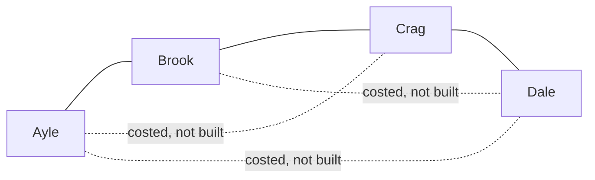

# Spanning trees: a loop-free skeleton reaching every vertex, and K(n) has n^(n-2) of them

[Syllabus](../../../SYLLABUS.md) → [Combinatorics and graphs](../README.md) → [Trees and Cheapest Routes](../README.md#s10) → Spanning trees

---

## General Overview

Four villages — Ayle, Brook, Crag and Dale — are to be joined by new roads, costed one per pair: six in all. The county will build only enough to reach every village with nothing wasted, one route between any two. Three roads, not six.

How many plans? Sixteen. Only two look different: a star, one village joined to the other three, and a line of four. But villages have names: a star centred on Ayle is a different budget from one centred on Dale. Four stars, one per centre, and twelve lines — two shapes, sixteen plans.

Roads that reach every village and never close a loop are a **spanning tree** of the map ([Trees](01-trees.md)): *spanning* because they touch every village, *tree* because they hold no loop. Add a fifth village, Ember, cost all ten roads, and the count jumps to 125.

**Strip a map until no loop is left and every place is still reachable: that is a spanning tree, and where all n named places can be joined there are n to the power n − 2.**

**What kind of fact this is:** a theorem, Cayley's formula, proved on this card in Why it works; the spanning tree is a definition.

### The picture: six roads costed, three built



One of the sixteen plans; each dotted road would close a loop.

---

## The formula

Notation first. A map is two lists: $V$ its places, $E$ its joined pairs, with $n$ and $m$ counting each ([Graphs](../09-Graphs%20-%20Dots%20and%20Lines/01-graphs-vertices-and-edges.md)). The map is $G$. Some places with some of the roads between them make a **subgraph**; one using every place **spans** the map. Write $T$ for a spanning subgraph with no loop: it always holds $n - 1$ roads.

The map with every pair joined is the **complete map** $K_n$, so the six costed roads are $K_4$. Write $\tau(G)$, "tau of G", for the spanning trees $G$ has. Arthur Cayley, 1889:

$$\tau(K_n) = n^{\,n-2}$$

**Read it aloud:** with n named places and every pair available to join, the loop-free layouts reaching all of them number n to the power n − 2: n − 2 copies of n multiplied together.

So 4 × 4 = 16 for four villages, 5 × 5 × 5 = 125 for five. The proof writes each layout as a word of $n - 2$ names: its **Prüfer code**.

| Symbol | Plain meaning | In our example | Push it up and the answer… |
| --- | --- | --- | --- |
| $G$, $V$, $E$ | map, places, joined pairs | villages, costed roads | — |
| $n$, $m$ | places and roads, counted | 4 and 6 | steeply more layouts |
| $T$, $n - 1$ | a spanning tree and its roads | Ayle-Brook, Brook-Crag, Crag-Dale; 3 | one road per place |
| $K_n$, $K_4$ | the complete map, all pairs joined | the six costed roads | — |
| $\tau(G)$ | spanning trees $G$ has | 16 on $K_4$, 8 when sparse | — |

### When it holds

- **In one piece.** Otherwise there is no spanning tree, only one tree per piece — a spanning forest — and $\tau(G)$ is 0.
- **Every pair joinable, for Cayley.** Where only six of the ten roads between five villages exist, the layouts number 8, not 125; sparser maps take Kirchhoff's determinant, in Why it works.
- **Named places.** Cayley counts labelled layouts: four villages, 2 shapes, 16 plans. Rub the names out and only the 2 shapes are left, which this formula does not count.

---

## Why it works

### Step 0: a loop always has a road to spare

Take a map in one piece. If some roads form a loop, remove any one of them: the places it joined are still joined the long way round, so the map stays whole. Repeat until no loop is left; what remains still reaches every place, so it is a spanning tree. The other way round is free: a map holding a spanning tree is in one piece.

### Step 1: one flood builds a spanning tree in a single pass

Hunting for loops is slow; flooding is fast. Mark the start, then every place one road from a marked place, keeping the road that marked it and ignoring roads landing on a mark. Stop when a round marks nothing: breadth-first search ([Connected or not](../09-Graphs%20-%20Dots%20and%20Lines/04-connectivity-and-breadth-first-search.md)).

On a sparser five-village map, only Ayle-Brook, Ayle-Crag, Brook-Crag, Brook-Dale, Crag-Dale and Dale-Ember can be built. Flooding from Ayle marks in rings — 0 Ayle, 1 Brook and Crag, 2 Dale, 3 Ember — and keeps Ayle-Brook, Ayle-Crag, Brook-Dale, Dale-Ember: four roads for five villages.

Every place but the start keeps one road, so the count is always $n - 1$, and no kept road closes a loop, since each lands on an unmarked place. Places left unmarked prove the map was in pieces.

### Step 2: counting by listing, and where listing gives out

Six roads, three to a plan: test all 20 choices of 3 from 6 ([Combinations, n choose k](../01-Counting%20Principles/05-n-choose-k.md)). Sixteen pass; the failures are triangles, with a village stranded. Five villages: 210 choices, 125 pass. But 16 is 4 × 4 and 125 is 5 × 5 × 5 — a pattern that wants a reason.

### Step 3: every layout is a short word

Heinz Prüfer's 1918 proof gives one. Repeatedly remove the **dead end** — a place with one road, also called a **leaf** — first in the alphabet, writing down its neighbour, until two places are left.

Take the line Ayle-Brook-Crag-Dale. Its dead ends are Ayle and Dale, so remove Ayle and write Brook. What remains is Brook-Crag-Dale: remove Brook, write Crag. Two places left, stop. The word is Brook Crag.

Each removal writes one letter and they stop two places short, so the word holds $n - 2$ letters from $n$ names. Write the neighbour, never the dead end: the star centred on Ayle codes as Ayle Ayle.

### Step 4: every word is a layout, so counting words counts layouts

Run it backwards. A place's road count is one more than the times its name appears, so a place never named is a dead end. Then, letter by letter: take the place first in the alphabet still owed just one road, join it to that letter's place, knock one off both. At the end, join the two places still owed a road. Brook Crag returns the line it came from.

Decoding undoes encoding step for step, so layouts and words pair off one for one: a bijection ([Bijections and double counting](../02-Repeats%2C%20Groups%20and%20Double%20Counting/05-bijection-and-double-counting.md)). Words are easy — $n - 2$ slots, any of $n$ names each — so $n^{\,n-2}$ words, and that many layouts.

<details>
<summary>Detailed proof: decoding never sticks, and the two directions undo each other</summary>

**Encoding always works.** Every tree on two or more places has at least two dead ends ([Trees](01-trees.md)), so there is always one to remove.

**The word has the right length.** A place's last road is never written, so a place met by k roads appears k − 1 times, a dead end never. Those counts add to 2(n − 1) − n = n − 2.

**Decoding never sticks.** After i letters, k = n − i places are still owed a road, their counts adding to 2(k − 1): if fewer than two of them were 1, the total would be at least 2k − 1, too big. So at least two are 1. Each step joins a leaving place to one still in play, closing no loop, and the dead ends come off in encoding's order.

</details>

<details>
<summary>The determinant method, which works on any map</summary>

Cayley's power needs every pair joinable. Kirchhoff's determinant does not, and is older: he counted these skeletons in 1847, solving currents in wire networks.

Build a square table, one row and column per place: on the diagonal how many roads meet that place, off it −1 where a road joins the pair, 0 otherwise. Delete any row with its column. Each village here has three roads, so cutting Ayle's leaves

```
 3  -1  -1
-1   3  -1
-1  -1   3
```

whose determinant ([Determinants](../../03-Algebra/05-Solving%20Systems/04-determinants.md)) is 3(9 − 1) + 1(−3 − 1) − 1(1 + 3) = 24 − 4 − 4 = 16, the layout count, whichever row is cut: the **matrix-tree theorem**, proved in Godsil and Royle under Sources, not here.

</details>

Both methods count layouts as though every road cost the same; pricing them asks which is cheapest: [The cheapest skeleton](04-minimum-spanning-trees.md).

---

## Worked numbers, by hand

| Step | Arithmetic | Value |
| --- | --- | --- |
| choices of 3 roads from 6 | the triples to test | 20 |
| triples reaching all four, no loop | tested one by one | **16** |
| the same by Cayley | 4 × 4 | **16** |
| the line as a word | write Brook, then Crag | Brook Crag |
| five villages, all pairs joinable | 5 × 5 × 5 | **125** |
| five villages, 6 roads of the 10 | tested one by one | **8** |

The last row is the warning: of the 125 layouts on five villages, only 8 are buildable.

### What breaks if you drop a piece

| Mistake | Comes out at | What went wrong |
| --- | --- | --- |
| Shapes counted, not plans | 2 | Ayle at the centre differs from Dale |
| Any three roads taken as a plan | 20 | Triangles strand a village |
| Cayley on a sparse map | 125 | Only 8 layouts are buildable |

The code prints the 20 and the 125, and splits the 16 plans into the 2 shapes: 4 stars and 12 lines.

---

## Code, from first principles, and it actually runs

Nothing is imported. The layouts are counted twice by methods sharing no arithmetic: every choice of $n - 1$ roads tested, and every Prüfer word decoded. A determinant is the third method; one flood both tests whether the roads reach everyone and builds Step 1's tree.

### Python

```python
# Spanning trees and Cayley's formula -- the check behind the card.  Nothing is imported.  Villages
# Ayle, Brook, Crag, Dale, then Ember.  A layout reaches every village and holds no loop.  Counted
# twice, by trying every choice of roads and by decoding every Prufer word, a determinant third.
NAMES = ["Ayle", "Brook", "Crag", "Dale", "Ember"]
SPARSE = [(0, 1), (0, 2), (1, 2), (1, 3), (2, 3), (3, 4)]
FULL = {n: [(i, j) for i in range(n) for j in range(i + 1, n)] for n in (4, 5)}

def flood(n, edges):                  # rings out from Ayle; each village keeps the road that reached it
    rings, kept = [[0]], []
    while rings[-1]:
        seen = {v for r in rings for v in r}
        nxt = sorted({w for v in rings[-1] for e in edges for w in e if v in e and w not in seen})
        kept += [min((min(v, w), max(v, w)) for v in rings[-1] if tuple(sorted((v, w))) in edges) for w in nxt]
        rings.append(nxt)
    return rings[:-1], tuple(sorted(kept))

def is_tree(n, edges):                # n-1 roads, and the flood reaches every village
    return len(edges) == n - 1 and sum(len(r) for r in flood(n, edges)[0]) == n

def by_listing(n, roads):             # road one: try every choice of n-1 of the roads
    tried = [tuple(r for i, r in enumerate(roads) if m >> i & 1) for m in range(1 << len(roads))]
    tried = [s for s in tried if len(s) == n - 1]
    return len(tried), sorted(s for s in tried if is_tree(n, s))

def decode(n, word):                  # road two: a word of n-2 names back into a layout
    deg, edges = [1 + list(word).count(v) for v in range(n)], []
    for letter in word:
        leaf = min(v for v in range(n) if deg[v] == 1)
        edges.append((min(leaf, letter), max(leaf, letter))); deg[leaf] -= 1; deg[letter] -= 1
    return tuple(sorted(edges + [tuple(v for v in range(n) if deg[v] == 1)]))

def det3(m):                          # road three: a 3-by-3 determinant, multiplied out here
    return (m[0][0] * (m[1][1] * m[2][2] - m[1][2] * m[2][1])
            - m[0][1] * (m[1][0] * m[2][2] - m[1][2] * m[2][0])
            + m[0][2] * (m[1][0] * m[2][1] - m[1][1] * m[2][0]))
def show(edges): return " ".join(f"{NAMES[u]}-{NAMES[v]}" for u, v in edges)
def say(vs): return " ".join(NAMES[v] for v in vs)

print(f"four villages {say(range(4))}; roads possible {len(FULL[4])}; each layout uses 3 roads")
counts, four = [], []
for label, n, roads in (("all 6 roads", 4, FULL[4]), ("all 10 roads", 5, FULL[5]), ("6 of the 10", 5, SPARSE)):
    tried, listed = by_listing(n, roads)
    words = sorted({decode(n, [m // n ** i % n for i in range(n - 2)]) for m in range(n ** (n - 2))})
    fit = [t for t in words if all(e in roads for e in t)]
    print(f"{n} villages, {label}: {tried} choices of {n - 1} roads tried, layouts by listing "
          f"{len(listed)}, from the {len(words)} words {len(fit)}")
    assert listed == fit and len(words) == n ** (n - 2)
    counts.append(len(listed)); four = listed if n == 4 else four
stars = sum(1 for t in four if max(sum(v in e for e in t) for v in range(4)) == 3)
rings, tree = flood(5, SPARSE)
print("the flood from Ayle over the sparse map, rings: " + " | ".join(f"{i} " + say(r) for i, r in enumerate(rings)))
print(f"  the layout it keeps: {show(tree)}; roads {len(tree)}; a tree: {'yes' if is_tree(5, tree) else 'no'}")
print(f"the word {say([1, 2])} decodes to {show(decode(4, [1, 2]))}, and {say([0, 0])} to {show(decode(4, [0, 0]))}")
k4tab = [[3, -1, -1], [-1, 3, -1], [-1, -1, 3]]
print(f"the four-village table, one row and column cut, has determinant {det3(k4tab)}")
print(f"Cayley 4^2 = {4 ** 2} and 5^3 = {5 ** 3}; the 16 plans are {stars} stars and "
      f"{counts[0] - stars} lines; 6 of the 10 roads allow {counts[2]}")
assert counts == [4 ** 2, 5 ** 3, 8] and det3(k4tab) == counts[0] and stars == 4
assert tree in listed and decode(4, [1, 2]) == ((0, 1), (1, 2), (2, 3)) and decode(4, [0, 0]) == ((0, 1), (0, 2), (0, 3))
print("ALL CHECKS PASS")
```

**Ran 2026-09-19 on macOS, Python 3.14.6, standard library only. All checks passed. Output, pasted from the run:**

```
four villages Ayle Brook Crag Dale; roads possible 6; each layout uses 3 roads
4 villages, all 6 roads: 20 choices of 3 roads tried, layouts by listing 16, from the 16 words 16
5 villages, all 10 roads: 210 choices of 4 roads tried, layouts by listing 125, from the 125 words 125
5 villages, 6 of the 10: 15 choices of 4 roads tried, layouts by listing 8, from the 125 words 8
the flood from Ayle over the sparse map, rings: 0 Ayle | 1 Brook Crag | 2 Dale | 3 Ember
  the layout it keeps: Ayle-Brook Ayle-Crag Brook-Dale Dale-Ember; roads 4; a tree: yes
the word Brook Crag decodes to Ayle-Brook Brook-Crag Crag-Dale, and Ayle Ayle to Ayle-Brook Ayle-Crag Ayle-Dale
the four-village table, one row and column cut, has determinant 16
Cayley 4^2 = 16 and 5^3 = 125; the 16 plans are 4 stars and 12 lines; 6 of the 10 roads allow 8
ALL CHECKS PASS
```

### Rust

Same numbers, same labels, built with `rustc --edition 2021 -O`. Its flood records each village's ring instead of a list of rings, so the two programs differ and print alike.

```rust
// Spanning trees and Cayley's formula -- the same check as the Python, in Rust.  No crates.  Villages
// Ayle, Brook, Crag, Dale, then Ember.  A layout reaches every village and holds no loop.  Counted twice,
// by every choice of roads and by decoding every Prufer word, a determinant third; flood gives each ring.
type Edge = (usize, usize);
const NAMES: [&str; 5] = ["Ayle", "Brook", "Crag", "Dale", "Ember"];
const SPARSE: [Edge; 6] = [(0, 1), (0, 2), (1, 2), (1, 3), (2, 3), (3, 4)];
const FULL4: [Edge; 6] = [(0, 1), (0, 2), (0, 3), (1, 2), (1, 3), (2, 3)];
const FULL5: [Edge; 10] = [(0, 1), (0, 2), (0, 3), (0, 4), (1, 2), (1, 3), (1, 4), (2, 3), (2, 4), (3, 4)];

fn flood(n: usize, edges: &[Edge]) -> (Vec<usize>, Vec<Edge>) {
    let (mut ring, mut kept) = ({ let mut r = vec![usize::MAX; n]; r[0] = 0; r }, Vec::new());
    for r in 0..n {                       // rings out from Ayle; each village keeps the road in
        for v in (0..n).filter(|&v| ring[v] == r).collect::<Vec<usize>>() {
            for (x, w) in edges.iter().flat_map(|&(a, b)| [(a, b), (b, a)]) {
                if x == v && ring[w] == usize::MAX { ring[w] = r + 1; kept.push((v.min(w), v.max(w))) }
            }
        }
    }
    kept.sort(); (ring, kept)
}
fn is_tree(n: usize, edges: &[Edge]) -> bool {    // n-1 roads, and the flood reaches every village
    edges.len() == n - 1 && flood(n, edges).0.iter().all(|&r| r != usize::MAX)
}
fn by_listing(n: usize, roads: &[Edge]) -> (usize, Vec<Vec<Edge>>) {   // road one: every choice of n-1
    let tried: Vec<Vec<Edge>> = (0..1u32 << roads.len()).map(|m| roads.iter().enumerate()
        .filter(|(i, _)| m >> i & 1 == 1).map(|(_, &r)| r).collect::<Vec<Edge>>())
        .filter(|s| s.len() == n - 1).collect();
    let mut out: Vec<Vec<Edge>> = tried.iter().filter(|s| is_tree(n, s)).cloned().collect();
    out.sort(); (tried.len(), out)
}
fn decode(n: usize, word: &[usize]) -> Vec<Edge> {   // road two: a word of n-2 names into a layout
    let mut deg: Vec<usize> = (0..n).map(|v| 1 + word.iter().filter(|&&a| a == v).count()).collect();
    let mut edges: Vec<Edge> = Vec::new();
    for &letter in word {
        let leaf = (0..n).find(|&v| deg[v] == 1).unwrap();
        edges.push((leaf.min(letter), leaf.max(letter))); deg[leaf] -= 1; deg[letter] -= 1;
    }
    let last: Vec<usize> = (0..n).filter(|&v| deg[v] == 1).collect();
    edges.push((last[0], last[1])); edges.sort(); edges
}
fn det3(m: &[[i64; 3]; 3]) -> i64 {       // road three: a 3-by-3 determinant, multiplied out here
    m[0][0] * (m[1][1] * m[2][2] - m[1][2] * m[2][1]) - m[0][1] * (m[1][0] * m[2][2] - m[1][2] * m[2][0])
        + m[0][2] * (m[1][0] * m[2][1] - m[1][1] * m[2][0])
}
fn show(e: &[Edge]) -> String { e.iter().map(|&(u, v)| format!("{}-{}", NAMES[u], NAMES[v])).collect::<Vec<_>>().join(" ") }
fn say(vs: &[usize]) -> String { vs.iter().map(|&v| NAMES[v]).collect::<Vec<_>>().join(" ") }

fn main() {
    println!("four villages {}; roads possible {}; each layout uses 3 roads", say(&[0, 1, 2, 3]), FULL4.len());
    let (mut counts, mut listed, mut four) = (Vec::new(), Vec::new(), Vec::new());
    for (label, n, roads) in [("all 6 roads", 4usize, FULL4.to_vec()), ("all 10 roads", 5, FULL5.to_vec()),
                              ("6 of the 10", 5, SPARSE.to_vec())] {
        let (tried, found) = by_listing(n, &roads);
        let total = n.pow((n - 2) as u32);
        let mut words: Vec<Vec<Edge>> = (0..total).map(|m| decode(n,
            &(0..n - 2).map(|i| m / n.pow(i as u32) % n).collect::<Vec<usize>>())).collect();
        words.sort(); words.dedup();
        let fit: Vec<Vec<Edge>> = words.iter().filter(|t| t.iter().all(|e| roads.contains(e))).cloned().collect();
        println!("{} villages, {}: {} choices of {} roads tried, layouts by listing {}, from the {} words {}",
                 n, label, tried, n - 1, found.len(), words.len(), fit.len());
        assert!(found == fit && words.len() == total);
        counts.push(found.len()); if n == 4 { four = found.clone() } listed = found;
    }
    let stars = four.iter().filter(|t| (0..4).any(|v| t.iter().filter(|e| e.0 == v || e.1 == v).count() == 3)).count();
    let (ring, tree) = flood(5, &SPARSE);
    println!("the flood from Ayle over the sparse map, rings: {}", (0..=*ring.iter().max().unwrap())
        .map(|r| format!("{} {}", r, say(&(0..5).filter(|&v| ring[v] == r).collect::<Vec<usize>>())))
        .collect::<Vec<String>>().join(" | "));
    println!("  the layout it keeps: {}; roads {}; a tree: {}", show(&tree), tree.len(),
             if is_tree(5, &tree) { "yes" } else { "no" });
    println!("the word {} decodes to {}, and {} to {}", say(&[1, 2]), show(&decode(4, &[1, 2])), say(&[0, 0]), show(&decode(4, &[0, 0])));
    let k4tab = [[3i64, -1, -1], [-1, 3, -1], [-1, -1, 3]];
    println!("the four-village table, one row and column cut, has determinant {}", det3(&k4tab));
    println!("Cayley 4^2 = {} and 5^3 = {}; the 16 plans are {} stars and {} lines; 6 of the 10 roads allow {}",
             4usize.pow(2), 5usize.pow(3), stars, counts[0] - stars, counts[2]);
    assert!(counts == vec![4usize.pow(2), 5usize.pow(3), 8] && det3(&k4tab) == counts[0] as i64 && stars == 4);
    assert!(listed.contains(&tree) && decode(4, &[1, 2]) == vec![(0, 1), (1, 2), (2, 3)]
        && decode(4, &[0, 0]) == vec![(0, 1), (0, 2), (0, 3)]);
    println!("ALL CHECKS PASS");
}
```

**Ran 2026-09-19 on macOS, rustc 1.98.1, no crates. All checks passed. Output, pasted from the run:**

```
four villages Ayle Brook Crag Dale; roads possible 6; each layout uses 3 roads
4 villages, all 6 roads: 20 choices of 3 roads tried, layouts by listing 16, from the 16 words 16
5 villages, all 10 roads: 210 choices of 4 roads tried, layouts by listing 125, from the 125 words 125
5 villages, 6 of the 10: 15 choices of 4 roads tried, layouts by listing 8, from the 125 words 8
the flood from Ayle over the sparse map, rings: 0 Ayle | 1 Brook Crag | 2 Dale | 3 Ember
  the layout it keeps: Ayle-Brook Ayle-Crag Brook-Dale Dale-Ember; roads 4; a tree: yes
the word Brook Crag decodes to Ayle-Brook Brook-Crag Crag-Dale, and Ayle Ayle to Ayle-Brook Ayle-Crag Ayle-Dale
the four-village table, one row and column cut, has determinant 16
Cayley 4^2 = 16 and 5^3 = 125; the 16 plans are 4 stars and 12 lines; 6 of the 10 roads allow 8
ALL CHECKS PASS
```

The two outputs match line for line.

### Lean

Lean proves Cayley's formula for every number of named places, along with the two facts behind it.

- Where every pair can be joined and the map is in one piece, there are n to the power n − 2 spanning trees.
- A map has a spanning tree exactly when it is in one piece.
- Every spanning tree on n places holds n − 1 roads.

It also checks the card's counts by listing: 20 triples and 16 plans on four villages, 4 of them stars, 125 on five, 8 on the sparse map. It checks the four-village determinant, 16, too. The flood's rings and the Prüfer words are left to the Python and Rust checks.

```lean
-- Spanning trees: a finite map has a spanning tree exactly when it is in one piece, every spanning tree on n places has n - 1 roads, and the complete map on n named places has n ^ (n - 2) spanning trees (Cayley's formula), with the card's village counts checked.
import Mathlib.Combinatorics.SimpleGraph.Acyclic
import Mathlib.Combinatorics.SimpleGraph.Connectivity.Finite
import Mathlib.LinearAlgebra.Matrix.Determinant.Basic
import Mathlib.LinearAlgebra.Matrix.Notation
import Mathlib.Combinatorics.SimpleGraph.Metric
import Mathlib.Tactic.Ring

namespace SpanningTreesAndCayleysFormula

noncomputable section

open SimpleGraph Function Classical

/-- One step along a parent map: `none` stays `none`, `some v` goes to `F v`. -/
def stp {V : Type*} (F : V → Option V) (o : Option V) : Option V := o.bind F

theorem stp_some {V : Type*} (F : V → Option V) (v : V) : stp F (some v) = F v := rfl

theorem iter_none {V : Type*} (F : V → Option V) (m : ℕ) : (stp F)^[m] none = none := by
  induction m with
  | zero => rfl
  | succ m ih => rw [iterate_succ_apply]; exact ih

/-- A parent map is acyclic when every vertex eventually steps off to `none`. -/
def Acyc {V : Type*} (F : V → Option V) : Prop := ∀ v, ∃ m, (stp F)^[m] (some v) = none

/-- `v` reaches `r` along the parent map. -/
def Reach {V : Type*} (F : V → Option V) (v r : V) : Prop := ∃ m, (stp F)^[m] (some v) = some r

theorem exists_min_nat {P : ℕ → Prop} (h : ∃ m, P m) : ∃ m, P m ∧ ∀ k < m, ¬ P k :=
  ⟨Nat.find h, Nat.find_spec h, fun _ hk => Nat.find_min h hk⟩

theorem iter_after_none {V : Type*} (F : V → Option V) {x : Option V} {a b : ℕ} (hab : a ≤ b)
    (h : (stp F)^[a] x = none) : (stp F)^[b] x = none := by
  obtain ⟨c, rfl⟩ := Nat.exists_eq_add_of_le hab
  rw [add_comm, iterate_add_apply, h, iter_none]

theorem exists_root {V : Type*} (F : V → Option V) (hF : Acyc F) (v : V) :
    ∃ r, F r = none ∧ Reach F v r := by
  obtain ⟨m, hm, hmin⟩ := exists_min_nat (hF v)
  cases m with
  | zero => simp at hm
  | succ k =>
    cases hx : (stp F)^[k] (some v) with
    | none => exact absurd hx (hmin k (by omega))
    | some u =>
      refine ⟨u, ?_, k, hx⟩
      rw [iterate_succ_apply', hx, stp_some] at hm
      exact hm

theorem root_unique_aux {V : Type*} (F : V → Option V) {v r1 r2 : V} (h1 : F r1 = none)
    {a b : ℕ} (hab : a ≤ b) (ha : (stp F)^[a] (some v) = some r1)
    (hb : (stp F)^[b] (some v) = some r2) : r1 = r2 := by
  obtain ⟨c, rfl⟩ := Nat.exists_eq_add_of_le hab
  cases c with
  | zero => rw [Nat.add_zero, ha] at hb; exact Option.some_injective _ hb
  | succ c =>
    rw [show a + (c + 1) = c + 1 + a by omega, iterate_add_apply, ha, iterate_succ_apply,
      stp_some, h1, iter_none] at hb
    cases hb

theorem root_unique {V : Type*} (F : V → Option V) {v r1 r2 : V} (h1 : F r1 = none)
    (h2 : F r2 = none) (ha : Reach F v r1) (hb : Reach F v r2) : r1 = r2 := by
  obtain ⟨a, ha⟩ := ha
  obtain ⟨b, hb⟩ := hb
  rcases le_total a b with hab | hab
  · exact root_unique_aux F h1 hab ha hb
  · exact (root_unique_aux F h2 hab hb ha).symm

theorem iter_update_eq {V : Type*} (F : V → Option V) (r : V) (val : Option V) (x : Option V)
    (m : ℕ) (h : ∀ j < m, (stp F)^[j] x ≠ some r) :
    (stp (update F r val))^[m] x = (stp F)^[m] x := by
  induction m with
  | zero => rfl
  | succ m ih =>
    rw [iterate_succ_apply', iterate_succ_apply', ih (fun j hj => h j (by omega))]
    have hm := h m (by omega)
    cases hy : (stp F)^[m] x with
    | none => rfl
    | some y =>
      rw [hy] at hm
      simp only [stp_some]
      exact update_of_ne (by rintro rfl; exact hm rfl) _ _

theorem no_return {V : Type*} (F : V → Option V) (hF : Acyc F) {w u : V} (hw : F w = some u) :
    ¬ Reach F u w := by
  rintro ⟨m, hm⟩
  have hper : (stp F)^[m + 1] (some w) = some w := by
    rw [iterate_succ_apply, stp_some, hw, hm]
  have hall : ∀ t, (stp F)^[t * (m + 1)] (some w) = some w := by
    intro t
    induction t with
    | zero => simp
    | succ t ih => rw [Nat.succ_mul, iterate_add_apply, hper, ih]
  obtain ⟨j, hj⟩ := hF w
  have := iter_after_none F (a := j) (b := j * (m + 1)) (Nat.le_mul_of_pos_right _ (by omega)) hj
  rw [hall] at this
  cases this

theorem no_loop {V : Type*} (F : V → Option V) (hF : Acyc F) (x : V) : F x ≠ some x :=
  fun h => no_return F hF h ⟨0, rfl⟩

theorem no_two_cycle {V : Type*} (F : V → Option V) (hF : Acyc F) {x y : V}
    (hx : F x = some y) (hy : F y = some x) : False :=
  no_return F hF hx ⟨1, by rw [iterate_one, stp_some, hy]⟩

theorem acyc_add {V : Type*} (F : V → Option V) (hF : Acyc F) {r v : V}
    (hv : ¬ Reach F v r) : Acyc (update F r (some v)) := by
  have hvorb : ∀ j, (stp (update F r (some v)))^[j] (some v) = (stp F)^[j] (some v) :=
    fun j => iter_update_eq F r _ _ j (fun i _ hi => hv ⟨i, hi⟩)
  obtain ⟨jv, hjv⟩ := hF v
  intro w
  by_cases hw : Reach F w r
  · obtain ⟨m, hm, hmin⟩ := exists_min_nat hw
    have h1 : (stp (update F r (some v)))^[m] (some w) = some r := by
      rw [iter_update_eq F r _ _ m (fun j hj => hmin j hj)]
      exact hm
    refine ⟨jv + (m + 1), ?_⟩
    rw [iterate_add_apply, iterate_succ_apply', h1, stp_some, update_self, hvorb, hjv]
  · obtain ⟨j, hj⟩ := hF w
    exact ⟨j, by rw [iter_update_eq F r _ _ j (fun i _ hi => hw ⟨i, hi⟩), hj]⟩

theorem acyc_remove {V : Type*} (F : V → Option V) (hF : Acyc F) (w : V) :
    Acyc (update F w none) := by
  intro x
  by_cases hx : Reach F x w
  · obtain ⟨m, hm, hmin⟩ := exists_min_nat hx
    refine ⟨m + 1, ?_⟩
    rw [iterate_succ_apply', iter_update_eq F w none _ m hmin, hm, stp_some, update_self]
  · obtain ⟨j, hj⟩ := hF x
    exact ⟨j, by rw [iter_update_eq F w none _ j (fun i _ hi => hx ⟨i, hi⟩), hj]⟩

theorem not_reach_remove {V : Type*} (F : V → Option V) (hF : Acyc F) {w u : V}
    (hw : F w = some u) : ¬ Reach (update F w none) u w := by
  intro h
  obtain ⟨m, hm, hmin⟩ := exists_min_nat h
  have hG : update (update F w none) w (some u) = F := by
    rw [update_idem, ← hw, update_eq_self]
  apply no_return F hF hw
  refine ⟨m, ?_⟩
  have := iter_update_eq (update F w none) w (some u) (some u) m hmin
  rw [hG] at this
  rw [this, hm]

/-- The roots of a parent map: the vertices with no parent. -/
def roots {V : Type*} [Fintype V] (F : V → Option V) : Finset V :=
  Finset.univ.filter (fun v => F v = none)

/-- Rooted forests on `V` with exactly `k` roots, as parent maps. -/
def forests (V : Type*) [Fintype V] (k : ℕ) : Finset (V → Option V) :=
  Finset.univ.filter (fun F => Acyc F ∧ (roots F).card = k)

theorem mem_roots {V : Type*} [Fintype V] (F : V → Option V) (v : V) :
    v ∈ roots F ↔ F v = none := by
  simp [roots]

theorem mem_forests {V : Type*} [Fintype V] (k : ℕ) (F : V → Option V) :
    F ∈ forests V k ↔ Acyc F ∧ (roots F).card = k := by
  simp [forests]

theorem card_not_reach {V : Type*} [Fintype V] (F : V → Option V) (hF : Acyc F) (k : ℕ)
    (hk : (roots F).card = k + 2) (v : V) :
    ((roots F).filter (fun r => ¬ Reach F v r)).card = k + 1 := by
  have h1 : ((roots F).filter (fun r => Reach F v r)).card = 1 := by
    obtain ⟨r, hr, hreach⟩ := exists_root F hF v
    rw [Finset.card_eq_one]
    refine ⟨r, ?_⟩
    ext x
    simp only [Finset.mem_filter, mem_roots, Finset.mem_singleton]
    constructor
    · rintro ⟨hx, hxr⟩
      exact root_unique F hx hr hxr hreach
    · rintro rfl
      exact ⟨hr, hreach⟩
  have h2 := Finset.card_filter_add_card_filter_not (s := roots F) (fun r => Reach F v r)
  omega

theorem card_nonroots {V : Type*} [Fintype V] (F : V → Option V) :
    (Finset.univ.filter (fun w => F w ≠ none)).card = Fintype.card V - (roots F).card := by
  have h2 := Finset.card_filter_add_card_filter_not (s := (Finset.univ : Finset V))
    (fun w => F w = none)
  rw [Finset.card_univ] at h2
  unfold roots
  simp only [ne_eq]
  omega

theorem forests_rec (V : Type*) [Fintype V] (k : ℕ) :
    (forests V (k + 2)).card * (Fintype.card V * (k + 1)) =
      (forests V (k + 1)).card * (Fintype.card V - (k + 1)) := by
  let A := (forests V (k + 2)).sigma
    (fun F => (Finset.univ : Finset V).sigma (fun v => (roots F).filter (fun r => ¬ Reach F v r)))
  let B := (forests V (k + 1)).sigma (fun F => Finset.univ.filter (fun w => F w ≠ none))
  have hA : A.card = (forests V (k + 2)).card * (Fintype.card V * (k + 1)) := by
    rw [Finset.card_sigma, Finset.sum_congr rfl (g := fun _ => Fintype.card V * (k + 1))]
    · simp
    · intro F hF
      rw [mem_forests] at hF
      rw [Finset.card_sigma, Finset.sum_congr rfl (fun v _ => card_not_reach F hF.1 k hF.2 v)]
      simp
  have hB : B.card = (forests V (k + 1)).card * (Fintype.card V - (k + 1)) := by
    rw [Finset.card_sigma, Finset.sum_congr rfl (g := fun _ => Fintype.card V - (k + 1))]
    · simp
    · intro F hF
      rw [mem_forests] at hF
      rw [card_nonroots, hF.2]
  rw [← hA, ← hB]
  apply Finset.card_nbij'
    (fun a => (⟨update a.1 a.2.2 (some a.2.1), a.2.2⟩ : Σ _ : V → Option V, V))
    (fun b => (⟨update b.1 b.2 none, ⟨(b.1 b.2).getD b.2, b.2⟩⟩ :
      Σ _ : V → Option V, Σ _ : V, V))
  · rintro ⟨F, v, r⟩ ha
    simp only [A, Finset.coe_sigma, Set.mem_sigma_iff, Finset.mem_coe, Finset.mem_univ,
      true_and, Finset.mem_filter, mem_roots, mem_forests] at ha
    obtain ⟨⟨hF, hk⟩, hr, hv⟩ := ha
    simp only [B, Finset.coe_sigma, Set.mem_sigma_iff, Finset.mem_coe, Finset.mem_filter,
      Finset.mem_univ, true_and, mem_forests, update_self]
    refine ⟨⟨acyc_add F hF hv, ?_⟩, by simp⟩
    have : roots (update F r (some v)) = (roots F).erase r := by
      ext x
      simp only [mem_roots, Finset.mem_erase]
      by_cases hx : x = r
      · subst hx; simp
      · simp [hx]
    rw [this, Finset.card_erase_of_mem ((mem_roots _ _).2 hr), hk]
    rfl
  · rintro ⟨F, w⟩ hb
    simp only [B, Finset.coe_sigma, Set.mem_sigma_iff, Finset.mem_coe, Finset.mem_filter,
      Finset.mem_univ, true_and, mem_forests] at hb
    obtain ⟨⟨hF, hk⟩, hw⟩ := hb
    obtain ⟨u, hu⟩ := Option.ne_none_iff_exists'.mp hw
    simp only [A, Finset.coe_sigma, Set.mem_sigma_iff, Finset.mem_coe, Finset.mem_univ,
      true_and, Finset.mem_filter, mem_roots, mem_forests, update_self, hu, Option.getD_some]
    refine ⟨⟨acyc_remove F hF w, ?_⟩, not_reach_remove F hF hu⟩
    have hnot : w ∉ roots F := by rw [mem_roots, hu]; simp
    have : roots (update F w none) = insert w (roots F) := by
      ext x
      simp only [mem_roots, Finset.mem_insert]
      by_cases hx : x = w
      · subst hx; simp
      · simp [hx]
    rw [this, Finset.card_insert_of_notMem hnot, hk]
  · rintro ⟨F, v, r⟩ ha
    simp only [A, Finset.coe_sigma, Set.mem_sigma_iff, Finset.mem_coe, Finset.mem_univ,
      true_and, Finset.mem_filter, mem_roots, mem_forests] at ha
    obtain ⟨_, hr, _⟩ := ha
    have e : update (update F r (some v)) r none = F := by
      rw [update_idem, ← hr, update_eq_self]
    simp only [update_self, Option.getD_some, e]
  · rintro ⟨F, w⟩ hb
    simp only [B, Finset.coe_sigma, Set.mem_sigma_iff, Finset.mem_coe, Finset.mem_filter,
      Finset.mem_univ, true_and, mem_forests] at hb
    obtain ⟨_, hw⟩ := hb
    obtain ⟨u, hu⟩ := Option.ne_none_iff_exists'.mp hw
    have e : update (update F w none) w (some u) = F := by
      rw [update_idem, ← hu, update_eq_self]
    simp only [hu, Option.getD_some, e]

theorem forests_top (V : Type*) [Fintype V] : (forests V (Fintype.card V)).card = 1 := by
  rw [Finset.card_eq_one]
  refine ⟨fun _ => none, ?_⟩
  ext F
  simp only [mem_forests, Finset.mem_singleton]
  constructor
  · rintro ⟨_, hc⟩
    have : roots F = Finset.univ := Finset.eq_univ_of_card _ hc
    funext v
    have hv : v ∈ roots F := by rw [this]; exact Finset.mem_univ v
    exact (mem_roots _ _).1 hv
  · rintro rfl
    refine ⟨fun v => ⟨1, rfl⟩, ?_⟩
    have : roots (fun _ : V => (none : Option V)) = Finset.univ := by
      ext v; simp [mem_roots]
    rw [this, Finset.card_univ]

theorem forests_card (V : Type*) [Fintype V] (j : ℕ) (hj : j + 1 ≤ Fintype.card V) :
    (forests V (Fintype.card V - j)).card =
      (Fintype.card V - 1).choose j * Fintype.card V ^ j := by
  induction j with
  | zero => simp [forests_top]
  | succ j ih =>
    set n := Fintype.card V with hn
    obtain ⟨k, hk⟩ : ∃ k, n = k + j + 2 := ⟨n - j - 2, by omega⟩
    have ih' := ih (by omega)
    have h1 : n - j = k + 2 := by omega
    have h2 : n - (j + 1) = k + 1 := by omega
    rw [h1] at ih'
    rw [h2]
    have hrec := forests_rec V k
    rw [← hn, ih', show n - (k + 1) = j + 1 by omega] at hrec
    have hch := Nat.choose_succ_right_eq (n - 1) j
    rw [show n - 1 - j = k + 1 by omega] at hch
    apply Nat.eq_of_mul_eq_mul_right (show 0 < j + 1 by omega)
    rw [← hrec]
    calc (n - 1).choose j * n ^ j * (n * (k + 1))
        = (n - 1).choose j * (k + 1) * n ^ (j + 1) := by ring
      _ = (n - 1).choose (j + 1) * (j + 1) * n ^ (j + 1) := by rw [hch]
      _ = (n - 1).choose (j + 1) * n ^ (j + 1) * (j + 1) := by ring

theorem forests_one (V : Type*) [Fintype V] [Nonempty V] :
    (forests V 1).card = Fintype.card V ^ (Fintype.card V - 1) := by
  have hpos := Fintype.card_pos (α := V)
  have := forests_card V (Fintype.card V - 1) (by omega)
  rw [show Fintype.card V - (Fintype.card V - 1) = 1 by omega, Nat.choose_self, one_mul] at this
  exact this

/-- The graph of a parent map: join each vertex to its parent. -/
def graphOf {V : Type*} (F : V → Option V) : SimpleGraph V :=
  SimpleGraph.fromRel (fun x y => F x = some y)

theorem graphOf_adj {V : Type*} (F : V → Option V) (x y : V) :
    (graphOf F).Adj x y ↔ x ≠ y ∧ (F x = some y ∨ F y = some x) :=
  fromRel_adj _ _ _

theorem graphOf_reach {V : Type*} (F : V → Option V) (hF : Acyc F) (v : V) :
    ∀ m u, (stp F)^[m] (some v) = some u → (graphOf F).Reachable v u := by
  intro m
  induction m with
  | zero =>
    intro u h
    obtain rfl : v = u := Option.some_injective _ h
    rfl
  | succ m ih =>
    intro u h
    rw [iterate_succ_apply'] at h
    cases hx : (stp F)^[m] (some v) with
    | none => rw [hx] at h; cases h
    | some x =>
      rw [hx, stp_some] at h
      have hadj : (graphOf F).Adj x u := by
        rw [graphOf_adj]
        exact ⟨by rintro rfl; exact no_loop F hF x h, Or.inl h⟩
      exact (ih x hx).trans hadj.reachable

theorem graphOf_connected {V : Type*} (F : V → Option V) (hF : Acyc F) {r : V}
    (hr : ∀ x, F x = none ↔ x = r) : (graphOf F).Connected := by
  have hall : ∀ v, (graphOf F).Reachable v r := by
    intro v
    obtain ⟨r', hr', m, hm⟩ := exists_root F hF v
    obtain rfl := (hr r').1 hr'
    exact graphOf_reach F hF v m _ hm
  have : Nonempty V := ⟨r⟩
  exact ⟨fun a b => (hall a).trans (hall b).symm⟩

theorem roots_iff {V : Type*} [Fintype V] (F : V → Option V) (hc : (roots F).card = 1) {r : V}
    (hr : F r = none) : ∀ x, F x = none ↔ x = r := by
  obtain ⟨a, ha⟩ := Finset.card_eq_one.mp hc
  have : r ∈ roots F := (mem_roots _ _).2 hr
  rw [ha, Finset.mem_singleton] at this
  subst this
  intro x
  rw [← mem_roots, ha, Finset.mem_singleton]

theorem roots_card_one {V : Type*} [Fintype V] (F : V → Option V) {r : V}
    (hr : ∀ x, F x = none ↔ x = r) : (roots F).card = 1 := by
  rw [Finset.card_eq_one]
  exact ⟨r, by ext x; rw [mem_roots, hr, Finset.mem_singleton]⟩

theorem graphOf_isTree {V : Type*} [Fintype V] (F : V → Option V) (hF : Acyc F) {r : V}
    (hr : ∀ x, F x = none ↔ x = r) : (graphOf F).IsTree := by
  have hc := graphOf_connected F hF hr
  rw [isTree_iff_connected_and_card]
  refine ⟨hc, le_antisymm ?_ hc.card_vert_le_card_edgeSet_add_one⟩
  rw [Nat.card_eq_fintype_card, Nat.card_eq_fintype_card, ← edgeFinset_card]
  have hsub : (graphOf F).edgeFinset ⊆ (Finset.univ.filter (fun v => F v ≠ none)).image
      (fun v => s(v, (F v).getD v)) := by
    intro e he
    induction e using Sym2.ind with
    | h x y =>
      rw [mem_edgeFinset, mem_edgeSet, graphOf_adj] at he
      rw [Finset.mem_image]
      rcases he.2 with h | h
      · exact ⟨x, by simp [h], by simp [h]⟩
      · exact ⟨y, by simp [h], by simp [h, Sym2.eq_swap]⟩
  have h1 := (Finset.card_le_card hsub).trans Finset.card_image_le
  rw [card_nonroots, roots_card_one F hr] at h1
  have hpos := Fintype.card_pos_iff.mpr ⟨r⟩
  omega

theorem no_invariant {V : Type*} (F : V → Option V) (hF : Acyc F) (D : V → Prop)
    (hD : ∀ x, D x → ∃ y, D y ∧ F x = some y) (x : V) (hx : D x) : False := by
  have : ∀ m, ∃ y, D y ∧ (stp F)^[m] (some x) = some y := by
    intro m
    induction m with
    | zero => exact ⟨x, hx, rfl⟩
    | succ m ih =>
      obtain ⟨y, hy, he⟩ := ih
      obtain ⟨z, hz, hyz⟩ := hD y hy
      exact ⟨z, hz, by rw [iterate_succ_apply', he, stp_some, hyz]⟩
  obtain ⟨m, hm⟩ := hF x
  obtain ⟨y, _, hy⟩ := this m
  rw [hm] at hy
  cases hy

theorem eq_of_graphOf_eq {V : Type*} (F G : V → Option V) (hF : Acyc F) {r : V}
    (hFr : ∀ x, F x = none ↔ x = r) (hGr : ∀ x, G x = none ↔ x = r)
    (h : graphOf F = graphOf G) : F = G := by
  funext x
  by_contra hne
  apply no_invariant F hF (fun x => F x ≠ G x) _ x hne
  intro x hx
  cases hFx : F x with
  | none => exact absurd (by rw [hFx, (hGr x).2 ((hFr x).1 hFx)]) hx
  | some y =>
    refine ⟨y, ?_, rfl⟩
    have hadj : (graphOf G).Adj x y := by
      rw [← h, graphOf_adj]
      exact ⟨by rintro rfl; exact no_loop F hF x hFx, Or.inl hFx⟩
    rw [graphOf_adj] at hadj
    rcases hadj.2 with h' | h'
    · exact absurd (hFx.trans h'.symm) hx
    · intro hFy
      exact no_two_cycle F hF hFx (hFy.trans h')

theorem exists_closer {V : Type*} (T : SimpleGraph V) (hT : T.Connected) {v r : V}
    (h : v ≠ r) : ∃ u, T.Adj v u ∧ T.dist u r < T.dist v r := by
  obtain ⟨p, hp⟩ := hT.exists_walk_length_eq_dist v r
  cases p with
  | nil => exact absurd rfl h
  | cons hadj q =>
    refine ⟨_, hadj, ?_⟩
    have := SimpleGraph.dist_le q
    rw [Walk.length_cons] at hp
    omega

theorem exists_parent {V : Type*} [Fintype V] (T : SimpleGraph V) (hT : T.IsTree) (r : V) :
    ∃ F : V → Option V, Acyc F ∧ (∀ x, F x = none ↔ x = r) ∧ graphOf F = T := by
  let F : V → Option V := fun v =>
    if h : v = r then none else some (Classical.choose (exists_closer T hT.connected h))
  have hFr : ∀ x, F x = none ↔ x = r := by
    intro x
    by_cases h : x = r <;> simp [F, h]
  have hFv : ∀ v (h : v ≠ r), ∃ u, F v = some u ∧ T.Adj v u ∧ T.dist u r < T.dist v r := by
    intro v h
    exact ⟨_, by simp [F, h], Classical.choose_spec (exists_closer T hT.connected h)⟩
  have hac : Acyc F := by
    have key : ∀ d v, T.dist v r = d → ∃ m, (stp F)^[m] (some v) = none := by
      intro d
      induction d using Nat.strong_induction_on with
      | _ d ih =>
        intro v hv
        by_cases h : v = r
        · exact ⟨1, by rw [iterate_one, stp_some]; exact (hFr v).2 h⟩
        · obtain ⟨u, hu, -, hd⟩ := hFv v h
          obtain ⟨m, hm⟩ := ih _ (hv ▸ hd) u rfl
          exact ⟨m + 1, by rw [iterate_succ_apply, stp_some, hu, hm]⟩
    exact fun v => key _ v rfl
  have hle : graphOf F ≤ T := by
    intro x y hxy
    rw [graphOf_adj] at hxy
    rcases hxy.2 with h | h
    · have hx : x ≠ r := fun hx => by rw [(hFr x).2 hx] at h; cases h
      obtain ⟨u, hu, hadj, -⟩ := hFv x hx
      obtain rfl : u = y := Option.some_injective _ (hu.symm.trans h)
      exact hadj
    · have hy : y ≠ r := fun hy => by rw [(hFr y).2 hy] at h; cases h
      obtain ⟨u, hu, hadj, -⟩ := hFv y hy
      obtain rfl : u = x := Option.some_injective _ (hu.symm.trans h)
      exact hadj.symm
  refine ⟨F, hac, hFr, le_antisymm hle ?_⟩
  exact (isTree_iff_minimal_connected.mp hT).2 (graphOf_connected F hac hFr) hle

theorem trees_mul_card {V : Type*} [Fintype V] [Nonempty V] :
    Nat.card {T : SimpleGraph V // T.IsTree} * Fintype.card V =
      Fintype.card V ^ (Fintype.card V - 1) := by
  have hP : ((forests V 1).sigma (fun F => roots F)).card = (forests V 1).card := by
    rw [Finset.card_sigma, Finset.sum_congr rfl (g := fun _ => 1)]
    · simp
    · intro F hF
      exact ((mem_forests _ _).1 hF).2
  have hQ : ((Finset.univ.filter (fun T : SimpleGraph V => T.IsTree)) ×ˢ
      (Finset.univ : Finset V)).card = Nat.card {T : SimpleGraph V // T.IsTree} *
        Fintype.card V := by
    rw [Finset.card_product, Finset.card_univ, Nat.card_eq_fintype_card, Fintype.card_subtype]
  rw [← hQ, ← forests_one V, ← hP]
  symm
  apply Finset.card_bij (fun a _ => (graphOf a.1, a.2))
  · rintro ⟨F, r⟩ ha
    simp only [Finset.mem_sigma, mem_forests, mem_roots] at ha
    obtain ⟨⟨hF, hc⟩, hr⟩ := ha
    simp only [Finset.mem_product, Finset.mem_filter, Finset.mem_univ, true_and, and_true]
    exact graphOf_isTree F hF (roots_iff F hc hr)
  · rintro ⟨F, r⟩ ha ⟨G, r'⟩ hb he
    simp only [Prod.mk.injEq] at he
    obtain ⟨he, rfl⟩ := he
    simp only [Finset.mem_sigma, mem_forests, mem_roots] at ha hb
    have := eq_of_graphOf_eq F G ha.1.1 (roots_iff F ha.1.2 ha.2) (roots_iff G hb.1.2 hb.2) he
    subst this
    rfl
  · rintro ⟨T, r⟩ hb
    simp only [Finset.mem_product, Finset.mem_filter, Finset.mem_univ, true_and,
      and_true] at hb
    obtain ⟨F, hF, hFr, hFT⟩ := exists_parent T hb r
    refine ⟨⟨F, r⟩, ?_, by simp [hFT]⟩
    simp only [Finset.mem_sigma, mem_forests, mem_roots]
    exact ⟨⟨hF, roots_card_one F hFr⟩, (hFr r).2 rfl⟩

end

#print axioms stp_some
#print axioms iter_none
#print axioms exists_min_nat
#print axioms iter_after_none
#print axioms exists_root
#print axioms root_unique_aux
#print axioms root_unique
#print axioms iter_update_eq
#print axioms no_return
#print axioms no_loop
#print axioms no_two_cycle
#print axioms acyc_add
#print axioms acyc_remove
#print axioms not_reach_remove
#print axioms mem_roots
#print axioms mem_forests
#print axioms card_not_reach
#print axioms card_nonroots
#print axioms forests_rec
#print axioms forests_top
#print axioms forests_card
#print axioms forests_one
#print axioms graphOf_adj
#print axioms graphOf_reach
#print axioms graphOf_connected
#print axioms roots_iff
#print axioms roots_card_one
#print axioms graphOf_isTree
#print axioms no_invariant
#print axioms eq_of_graphOf_eq
#print axioms exists_closer
#print axioms exists_parent
#print axioms trees_mul_card


open SimpleGraph

/-- Cayley's formula. Take `n` named places (a finite type `V` with `n` elements) where every pair
can be joined (the complete map `⊤`), and suppose that map is in one piece. A spanning tree of it is
a choice of roads (a simple graph `T` on all of `V`, every road one of the map's) that reaches every
place and holds no loop (`T.IsTree`). Counting labelled layouts, not shapes, there are exactly
`n ^ (n - 2)` of them. -/
theorem card_spanning_trees_complete_eq_pow {V : Type*} [Fintype V]
    (hconn : (⊤ : SimpleGraph V).Connected) :
    Nat.card {T : SimpleGraph V // T ≤ ⊤ ∧ T.IsTree} =
      Fintype.card V ^ (Fintype.card V - 2) := by
  have : Nonempty V := hconn.nonempty
  have h := trees_mul_card (V := V)
  have e : Nat.card {T : SimpleGraph V // T ≤ ⊤ ∧ T.IsTree} =
      Nat.card {T : SimpleGraph V // T.IsTree} :=
    Nat.card_congr (Equiv.subtypeEquivRight (fun T => by simp))
  rw [e]
  have hpos := Fintype.card_pos (α := V)
  rcases Nat.lt_or_ge (Fintype.card V) 2 with h2 | h2
  · have h1 : Fintype.card V = 1 := by omega
    rw [h1] at h ⊢
    simpa using h
  · apply Nat.eq_of_mul_eq_mul_right hpos
    rw [h, ← pow_succ]
    congr 1
    omega

/-- Step 0: a map has a spanning tree exactly when it is in one piece. Remove one road from each
loop until none is left; the other way round, a spanning tree already joins every place. So a map
in pieces has no spanning tree at all. -/
theorem connected_iff_exists_spanning_tree {V : Type*} [Fintype V] (G : SimpleGraph V) :
    G.Connected ↔ ∃ T : SimpleGraph V, T ≤ G ∧ T.IsTree := by
  exact ⟨fun h => h.exists_isTree_le, fun ⟨T, hle, hT⟩ => hT.connected.mono hle⟩

/-- A spanning tree always holds one road fewer than there are places: a loop-free layout reaching
all `n` places has exactly `n - 1` roads. -/
theorem spanning_tree_card_edges {V : Type*} [Fintype V] [DecidableEq V]
    (T : SimpleGraph V) [DecidableRel T.Adj] (hT : T.IsTree) :
    T.edgeFinset.card = Fintype.card V - 1 := by
  have := hT.card_edgeFinset
  omega

/-! The card's villages: Ayle, Brook, Crag, Dale, Ember are `0` to `4`. -/

/-- The map on `Fin n` whose roads are the pairs in the list `roads`. -/
def plan {n : ℕ} (roads : List (Fin n × Fin n)) : SimpleGraph (Fin n) where
  Adj x y := x ≠ y ∧ ((x, y) ∈ roads ∨ (y, x) ∈ roads)
  symm := ⟨fun _ _ h => ⟨h.1.symm, h.2.symm⟩⟩
  loopless := ⟨fun _ h => h.1 rfl⟩

instance {n : ℕ} (roads : List (Fin n × Fin n)) : DecidableRel (plan roads).Adj :=
  fun _ _ => inferInstanceAs (Decidable (_ ∧ _))

/-- The six costed roads between four villages: the complete map `K 4`. -/
def k4 : List (Fin 4 × Fin 4) := [(0, 1), (0, 2), (0, 3), (1, 2), (1, 3), (2, 3)]

/-- The ten costed roads between five villages: the complete map `K 5`. -/
def k5 : List (Fin 5 × Fin 5) :=
  [(0, 1), (0, 2), (0, 3), (0, 4), (1, 2), (1, 3), (1, 4), (2, 3), (2, 4), (3, 4)]

/-- The sparse five-village map: Ayle-Brook, Ayle-Crag, Brook-Crag, Brook-Dale, Crag-Dale,
Dale-Ember. -/
def sparse : List (Fin 5 × Fin 5) := [(0, 1), (0, 2), (1, 2), (1, 3), (2, 3), (3, 4)]

/-- The card's test for a layout: `n - 1` roads that reach every village. -/
def layouts {n : ℕ} (roads : List (Fin n × Fin n)) : List (List (Fin n × Fin n)) :=
  roads.sublists.filter (fun s => s.length = n - 1 ∧ (plan s).Connected)

-- Cayley: 4 × 4 = 16 for four villages and 5 × 5 × 5 = 125 for five.
example : 4 ^ (4 - 2) = 16 ∧ 5 ^ (5 - 2) = 125 := by norm_num
-- Four villages: 20 choices of 3 roads from 6, and 16 of them pass.
example : (k4.sublists.filter (fun s => s.length = 3)).length = 20 := by decide
example : (layouts k4).length = 16 := by decide
-- Of the 16 plans, 4 are stars (a village meeting all 3 roads) and 12 are lines.
example : ((layouts k4).filter (fun s => ∃ v : Fin 4, ((plan s).neighborFinset v).card = 3)).length
    = 4 := by decide
-- The line Ayle-Brook-Crag-Dale is one of the plans, and so is the star centred on Ayle.
example : (plan [(0, 1), (1, 2), (2, 3)] : SimpleGraph (Fin 4)).Connected := by decide
example : (plan [(0, 1), (0, 2), (0, 3)] : SimpleGraph (Fin 4)).Connected := by decide
-- A triangle strands a village.
example : ¬ (plan [(0, 1), (0, 2), (1, 2)] : SimpleGraph (Fin 4)).Connected := by decide
-- Five villages, 10 roads: 210 choices of 4, and 125 of them pass.
example : Nat.choose 10 4 = 210 := by decide
example : (layouts k5).length = 125 := by decide +kernel
-- The sparse map, 6 of the 10 roads, allows 8 layouts.
example : (layouts sparse).length = 8 := by decide
-- The flood's layout Ayle-Brook, Ayle-Crag, Brook-Dale, Dale-Ember reaches all five.
example : (plan [(0, 1), (0, 2), (1, 3), (3, 4)] : SimpleGraph (Fin 5)).Connected := by decide
-- Kirchhoff's table for four villages, one row and column cut, has determinant 16.
example : Matrix.det !![(3 : ℤ), -1, -1; -1, 3, -1; -1, -1, 3] = 16 := by
  norm_num [Matrix.det_fin_three]

#print axioms card_spanning_trees_complete_eq_pow
#print axioms connected_iff_exists_spanning_tree
#print axioms spanning_tree_card_edges

end SpanningTreesAndCayleysFormula
```

**Checked 2026-11-11 on macOS, Lean 4.36.0-rc2, Mathlib v4.36.0-rc2. Every proof is complete and uses only Lean's standard axioms. Output, pasted from the run:**

```
'SpanningTreesAndCayleysFormula.stp_some' does not depend on any axioms
'SpanningTreesAndCayleysFormula.iter_none' does not depend on any axioms
'SpanningTreesAndCayleysFormula.exists_min_nat' depends on axioms: [propext, Classical.choice, Quot.sound]
'SpanningTreesAndCayleysFormula.iter_after_none' depends on axioms: [propext]
'SpanningTreesAndCayleysFormula.exists_root' depends on axioms: [propext, Classical.choice, Quot.sound]
'SpanningTreesAndCayleysFormula.root_unique_aux' depends on axioms: [propext, Quot.sound]
'SpanningTreesAndCayleysFormula.root_unique' depends on axioms: [propext, Quot.sound]
'SpanningTreesAndCayleysFormula.iter_update_eq' depends on axioms: [propext, Classical.choice, Quot.sound]
'SpanningTreesAndCayleysFormula.no_return' depends on axioms: [propext, Quot.sound]
'SpanningTreesAndCayleysFormula.no_loop' depends on axioms: [propext, Quot.sound]
'SpanningTreesAndCayleysFormula.no_two_cycle' depends on axioms: [propext, Quot.sound]
'SpanningTreesAndCayleysFormula.acyc_add' depends on axioms: [propext, Classical.choice, Quot.sound]
'SpanningTreesAndCayleysFormula.acyc_remove' depends on axioms: [propext, Classical.choice, Quot.sound]
'SpanningTreesAndCayleysFormula.not_reach_remove' depends on axioms: [propext, Classical.choice, Quot.sound]
'SpanningTreesAndCayleysFormula.mem_roots' depends on axioms: [propext, Classical.choice, Quot.sound]
'SpanningTreesAndCayleysFormula.mem_forests' depends on axioms: [propext, Classical.choice, Quot.sound]
'SpanningTreesAndCayleysFormula.card_not_reach' depends on axioms: [propext, Classical.choice, Quot.sound]
'SpanningTreesAndCayleysFormula.card_nonroots' depends on axioms: [propext, Classical.choice, Quot.sound]
'SpanningTreesAndCayleysFormula.forests_rec' depends on axioms: [propext, Classical.choice, Quot.sound]
'SpanningTreesAndCayleysFormula.forests_top' depends on axioms: [propext, Classical.choice, Quot.sound]
'SpanningTreesAndCayleysFormula.forests_card' depends on axioms: [propext, Classical.choice, Quot.sound]
'SpanningTreesAndCayleysFormula.forests_one' depends on axioms: [propext, Classical.choice, Quot.sound]
'SpanningTreesAndCayleysFormula.graphOf_adj' depends on axioms: [propext, Quot.sound]
'SpanningTreesAndCayleysFormula.graphOf_reach' depends on axioms: [propext, Quot.sound]
'SpanningTreesAndCayleysFormula.graphOf_connected' depends on axioms: [propext, Classical.choice, Quot.sound]
'SpanningTreesAndCayleysFormula.roots_iff' depends on axioms: [propext, Classical.choice, Quot.sound]
'SpanningTreesAndCayleysFormula.roots_card_one' depends on axioms: [propext, Classical.choice, Quot.sound]
'SpanningTreesAndCayleysFormula.graphOf_isTree' depends on axioms: [propext, Classical.choice, Quot.sound]
'SpanningTreesAndCayleysFormula.no_invariant' depends on axioms: [propext, Quot.sound]
'SpanningTreesAndCayleysFormula.eq_of_graphOf_eq' depends on axioms: [propext, Classical.choice, Quot.sound]
'SpanningTreesAndCayleysFormula.exists_closer' depends on axioms: [propext, Classical.choice, Quot.sound]
'SpanningTreesAndCayleysFormula.exists_parent' depends on axioms: [propext, Classical.choice, Quot.sound]
'SpanningTreesAndCayleysFormula.trees_mul_card' depends on axioms: [propext, Classical.choice, Quot.sound]
'SpanningTreesAndCayleysFormula.card_spanning_trees_complete_eq_pow' depends on axioms: [propext, Classical.choice, Quot.sound]
'SpanningTreesAndCayleysFormula.connected_iff_exists_spanning_tree' depends on axioms: [propext, Classical.choice, Quot.sound]
'SpanningTreesAndCayleysFormula.spanning_tree_card_edges' depends on axioms: [propext, Classical.choice, Quot.sound]
```

> [!TIP]
> **Try changing**
> Guess first, then run it. The asserts are pinned to these maps, so expect one to stop the program.
> - **Shut the road to Ember.** Remove `(3, 4)` from `SPARSE`: nothing reaches all five, and the assert pinned to 8 stops the run.
> - **Make the sparse map complete.** Set `SPARSE` to every pair: the third row repeats the second, 210 choices and 125 layouts.
> - **Peel the wrong village.** In `decode`, change `min` to `max`: the same 16 layouts come back, each named by a different word, and the last assert stops it.

---

## The usual mistake

> [!warning]
> **Reading the power as a count of shapes.** Four villages give 2 shapes and 16 plans: the formula counts plans, and which village sits at the centre changes the budget.
>
> - **Taking any n − 1 roads.** Of the 20 triples, the triangles strand a village. A layout needs n − 1 roads *and* to reach everyone, or n − 1 roads *and* no loop.
> - **Using Cayley where the roads do not exist.** 125 counts layouts when every pair can be joined; this sparse map allows 8.
> - **Writing the dead end, not its neighbour.** The star centred on Ayle codes as Ayle Ayle; a list of its dead ends reads Brook Crag, which is the line.

---

## Where you meet it in real life

- **Anything cabled or piped once.** Reaching every building with no redundant run is this; priced runs make it [The cheapest skeleton](04-minimum-spanning-trees.md).
- **Ethernet.** Switches agree on a loop-free skeleton of the cabling and switch the rest off: one loop makes broadcast traffic circulate until the network drowns.
- **Electrical circuits.** The determinant in Why it works is Kirchhoff's, from solving currents in wire networks.
- **Other trees on this shelf.** Least distance from one place gives another tree, [Dijkstra's algorithm](05-dijkstra.md); hanging a skeleton from one place makes it rooted, [Rooted trees](02-rooted-and-binary-trees.md).

> **Say it back**
> A spanning tree reaches every place on a map and holds no loop, so it carries one road fewer than there are places. Every map in one piece has one: flood outward, keeping the road that first reaches each place. Where every pair can be joined, Cayley's formula counts them as n to the power n − 2: 16 plans on four villages, 125 on five. Tearing off dead ends alphabetically turns a layout into a word, and every word comes back as one layout.

---

## What this builds on

- [Trees](01-trees.md): what a tree is, that it holds n − 1 roads, and that it has dead ends.
- [Bijections and double counting](../02-Repeats%2C%20Groups%20and%20Double%20Counting/05-bijection-and-double-counting.md): why pairing two collections one for one proves the counts equal.
- [Determinants](../../03-Algebra/05-Solving%20Systems/04-determinants.md): working out the determinant in Why it works.

## Where this goes next

- [The cheapest skeleton](04-minimum-spanning-trees.md): the same skeletons priced, and a greedy rule that finds the cheapest.

The costs in the opening never entered the count: all 16 plans were counted alike. Which of them is cheapest, found without listing all 16, is the next card.

---

## Sources

Verified 19 Sep 2026: every link below resolves to the publisher's page.

- Cayley, Arthur. "A Theorem on Trees." *Quarterly Journal of Pure and Applied Mathematics* 23 (1889): 376–378; reprinted as paper 895 in his *Collected Mathematical Papers*, vol. 13, p. 26. [Full scan](https://archive.org/details/collectedmathema13cayluoft). Cayley's wording: trees on n + 1 knots number (n + 1)^(n − 1), worked there for 4 knots as 16.
- Aigner, Martin, and Günter M. Ziegler. *Proofs from THE BOOK*, 6th ed. Springer, 2018. [Publisher page](https://link.springer.com/book/10.1007/978-3-662-57265-8). Four proofs of Cayley's formula, Prüfer's included.
- Diestel, Reinhard. *Graph Theory*, 5th ed. Springer, 2017. [Publisher page](https://link.springer.com/book/10.1007/978-3-662-53622-3). Section 1.5, trees and forests, including spanning trees.
- Godsil, Chris, and Gordon Royle. *Algebraic Graph Theory*. Springer, 2001. [Publisher page](https://link.springer.com/book/10.1007/978-1-4613-0163-9). Chapter 13, the Laplacian of a graph, proves Kirchhoff's determinant.
