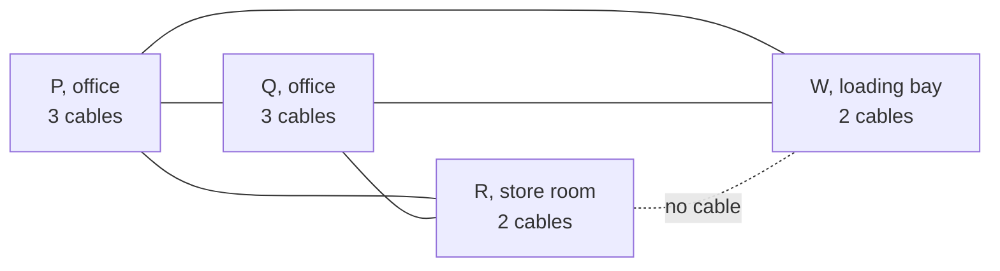

# The matrix-tree theorem: cut one row and column from the graph's Laplacian, and the determinant counts its spanning trees

[Syllabus](../../../SYLLABUS.md) → [Combinatorics and graphs](../README.md) → [Trees and Cheapest Routes](../README.md#s10) → The matrix-tree theorem

---

## General Overview

A small office joins four network switches with five cables: P and Q in the offices, R in the store room, W in the loading bay. Every pair is cabled except R and W. Data sent round a loop circles forever, so the switches turn cables off until no loop is left. Ethernet's Spanning Tree Protocol (STP) does this.

What is left is a **spanning tree**: cables that reach every switch and close no loop ([Spanning trees](03-spanning-trees-and-cayleys-formula.md)). How many layouts are possible? A tree on 4 switches has 3 cables; of the 10 ways to keep 3 of the 5, two are triangles, so 8.

Listing grows hopeless fast: seven fully cabled switches have 16807 layouts. Kirchhoff's 1847 shortcut writes the network as one square table, the **Laplacian**, crosses out one row and its column, and takes the determinant: here 8.

**Write each switch's cable count on the diagonal and −1 in the cell of each cabled pair; cut any one row with its column, and the determinant of what is left counts the spanning trees.**

**What kind of fact this is:** a theorem, Kirchhoff's matrix-tree theorem, proved on this card in Why it works; Cayley's count n to the power n − 2 follows.

### The picture: five cables, one pair left out



With the dotted cable added, 8 spanning trees become 16.

---

## The formula

Notation first. The network is $`G`$, with $`n`$ switches and $`m`$ cables. The **adjacency matrix** $`A`$ has a 1 where a cable joins two switches, 0 elsewhere ([The adjacency matrix](../09-Graphs%20-%20Dots%20and%20Lines/07-adjacency-matrix-and-walk-counting.md)). The **degree matrix** $`D`$ holds each switch's cable count, its degree, on the diagonal and 0 elsewhere. The **Laplacian** is

```math
L = D - A
```

**Read it aloud:** degrees down the diagonal, minus one in each cell where a cable joins the pair.

Write $`L_0`$ for $`L`$ with one switch's row and column crossed out, and $`\tau(G)`$, "tau of G", for the number of spanning trees. The theorem:

```math
\tau(G) = \det L_0
```

**Read it aloud:** the tree count equals the determinant of the Laplacian with one row and its own column removed.

In the office, cutting P leaves `[[3, -1, -1], [-1, 2, 0], [-1, 0, 2]]`, determinant 8 ([Determinants](../../03-Algebra/05-Solving%20Systems/04-determinants.md)).

A second form uses the **eigenvalues** of $`L`$: the numbers $`\lambda`$ for which some list $`v`$ of switch values gives $`Lv = \lambda v`$ ([Eigenvalues and eigenvectors](../../03-Algebra/07-Eigenvalues%20and%20Symmetric%20Matrices/02-eigenvalues-and-eigenvectors.md)). With at least one switch, sorted, the first one is always 0. Then

```math
\tau(G) = \frac{1}{n}\, \lambda_2 \lambda_3 \cdots \lambda_n
```

**Read it aloud:** multiply the Laplacian's eigenvalues other than the first zero, then divide by the number of switches.

The office's eigenvalues are 0, 2, 4, 4, so 2 × 4 × 4 / 4 = 8.

| Symbol | Plain meaning | In our example | Push it up and the answer… |
| --- | --- | --- | --- |
| $`G`$, $`n`$, $`m`$ | the network, its switches, its cables | the office; 4 and 5 | more cables, more trees |
| $`A`$, $`D`$ | adjacency matrix; degrees on a diagonal | degrees 3, 3, 2, 2 | — |
| $`L`$ | the Laplacian, $`D - A`$ | 4 by 4, every row adding to 0 | — |
| $`L_0`$ | $`L`$ with one row and its column cut | P cut: 3 by 3 | its determinant is the count |
| $`\tau(G)`$ | the number of spanning trees | 8 | — |
| $`M`$, $`M_S`$ | signed incidence matrix (Step 1), column P cut; $`M_S`$ keeps cable set $`S`$'s rows | 5 by 3; any 3 cables | — |
| $`\lambda_1, \dots, \lambda_n`$; $`x`$ | eigenvalues of $`L`$, smallest first; $`x`$ the polynomial's variable | 0, 2, 4, 4 | bigger ones, more trees |
| $`K_n`$; $`I`$, $`J`$ | the complete network: every pair cabled; identity, all-ones matrix | add R-W to get $`K_4`$, 16 trees | $`n^{\,n-2}`$ trees |

### When it holds

- **Finitely many switches, at least one.** Without a switch there is no row to cut and no $`n`$ to divide by.
- **Cut a row and its own column.** The whole of $`L`$ has determinant 0, since every row adds to 0. Row P with column Q gives the count only up to sign.
- **No cable from a switch to itself.** Such a cable is never in a tree but would raise the diagonal; delete it first.
- **Two cables between one pair are fine.** Write −2 in that cell; each cable gives its own trees.
- **A network in pieces gives 0.** It has no spanning tree, and the determinant agrees.

---

## Why it works

### Step 0: the Laplacian is a square of a simpler table

The proof writes $`L_0`$ as $`M^{\mathsf T} M`$, a matrix times itself tipped over. The Cauchy-Binet formula then splits $`\det L_0`$ into one term per set of $`n - 1`$ cables: 1 for a spanning tree, 0 otherwise. So the sum counts trees.

### Step 1: the signed incidence matrix squares to the Laplacian

Give each cable a direction, any direction. The **signed incidence matrix** $`M`$ has a row per cable and a column per switch: +1 at the cable's start, −1 at its end, 0 elsewhere. The unsigned version on [The adjacency matrix](../09-Graphs%20-%20Dots%20and%20Lines/07-adjacency-matrix-and-walk-counting.md) gives $`D + A`$; the signs turn $`+A`$ into $`-A`$.

Row u, column v of $`M^{\mathsf T} M`$ adds, over all cables, the entry at u times the entry at v. Each cable at u gives $`(\pm 1)^2 = 1`$ on the diagonal: the degree. A cable joining u to v gives $`(+1)(-1) = -1`$. That is $`L`$, and cutting P's column of $`M`$ cuts P's row and column of $`L`$.

### Step 2: Cauchy-Binet splits the determinant by cable sets

$`M`$ is now 5 by 3. The **Cauchy-Binet formula** splits the determinant of such a product over every way to keep 3 of its rows:

```math
\det\bigl(M^{\mathsf T} M\bigr) = \sum_{S} \det\bigl(M_S\bigr)^2
```

**Read it aloud:** for every set S of n − 1 cables, take the square block of M on those rows, square its determinant, and add.

Squared, in the code's order, the office's 10 determinants read 1, 0, 1, 1, 0, 1, 1, 1, 1, 1, total 8.

<details>
<summary>Detailed proof: the Cauchy-Binet formula</summary>

Here $`M`$ has column P cut, so $`k = n - 1`$ columns. Write $`p_e`$ for row $`e`$ of $`M`$ stood upright. Column $`j`$ of $`M^{\mathsf T} M`$ is a sum over cables:

$`\displaystyle \text{column } j = \sum_{e} M_{e j}\, p_e`$

A determinant splits over a sum in each column. Expanding all columns gives one term per choice of a cable $`e_j`$ for each column: $`M_{e_1 1} \cdots M_{e_k k}`$ times the determinant with columns $`p_{e_1}, \dots, p_{e_k}`$. A repeated cable makes two equal columns, so that term is 0.

Group the other terms by their set $`S`$ of cables. Reordering columns only multiplies by the order's sign, ±1. So each group is $`\det(M_S)`$ times the signed sum of products over all orders. Expanding $`\det(M_S)`$ column by column, by the same splitting rule, gives exactly that signed sum. Each set gives $`\det(M_S)^2`$.

</details>

### Step 3: a cable set gives 1 if it is a tree, 0 if not

$`n - 1`$ cables on $`n`$ switches either form a spanning tree or leave the network in pieces ([Trees](01-trees.md)).

- **Not a tree.** Some piece misses switch P. Add up that piece's columns of $`M_S`$: each cable inside gives +1 and −1, and none leaves, so the sum is 0 and the determinant is 0. The triangle P-Q, P-R, Q-R strands W.
- **A tree.** It has at least two leaves, switches with one cable, so one leaf is not P. Its column holds a single ±1. Expand down that column, removing the leaf and its cable, and repeat on the smaller tree. The determinant is a product of ±1s.

### Step 4: add up, and any cut gives the same count

Each tree adds 1 and every other set 0, so $`\det L_0 = \tau(G)`$. No step used which switch was cut: P, Q, R or W each gives 8.

### Step 5: the eigenvalues, and Cayley's formula

The first eigenvalue is 0, with every switch valued 1, since each row of $`L`$ adds to 0. None is negative: $`L`$ is symmetric, so its eigenvalues are real ([The spectral theorem](../../03-Algebra/07-Eigenvalues%20and%20Symmetric%20Matrices/04-spectral-theorem.md)). With $`L = M^{\mathsf T} M`$, an eigenvector $`v`$ gives $`\lambda\, v \cdot v = v \cdot Lv = Mv \cdot Mv \ge 0`$.

The **characteristic polynomial** $`\det(xI - L)`$ has the eigenvalues as roots. Its coefficient of $`x`$ is $`\pm\lambda_2 \cdots \lambda_n`$ from the roots, and $`\pm n\,\tau(G)`$ from the columns, the sum of $`n`$ cut determinants. In the office it is −32, and 32/4 = 8.

<details>
<summary>Detailed proof: the coefficient of x, two ways</summary>

From the roots, $`\lambda_1 = 0`$ makes the polynomial $`x(x - \lambda_2)\cdots(x - \lambda_n)`$, so the coefficient of $`x`$ is

$`\displaystyle (-1)^{n-1}\, \lambda_2 \lambda_3 \cdots \lambda_n`$

From the columns: column $`i`$ of $`xI - L`$ is $`x`$ times a 1 in place $`i`$, minus column $`i`$ of $`L`$. Split every column, as in the Cauchy-Binet fold. A term with exactly one $`x`$, from column $`i`$, expands down that column to $`-L`$ with row and column $`i`$ cut: $`(-1)^{n-1}\tau(G)`$ by Step 4. The $`n`$ columns give $`(-1)^{n-1} n\,\tau(G)`$.

</details>

For the complete network, $`L = nI - J`$, with $`I`$ the identity and $`J`$ all ones. $`J`$ wipes out any list of values adding to 0, so $`L`$ multiplies it by $`n`$. Such lists fill $`n - 1`$ directions, so $`\lambda_2 = \dots = \lambda_n = n`$:

```math
\tau(K_n) = \frac{1}{n}\, n^{\,n-1} = n^{\,n-2} \quad (n \ge 1)
```

**Read it aloud:** n multiplied n − 1 times, divided by n once: Cayley's formula. For $`K_4`$, 4 × 4 × 4 / 4 = 16.

---

## Worked numbers, by hand

| Step | Arithmetic | Value |
| --- | --- | --- |
| degrees of P, Q, R, W | count each switch's cables | 3, 3, 2, 2 |
| the Laplacian's rows | degree on the diagonal, −1 per cable | `[3, -1, -1, -1]`, `[-1, 3, -1, -1]`, `[-1, -1, 2, 0]`, `[-1, -1, 0, 2]` |
| cut P's row and column | rows Q, R, W, columns Q, R, W | `[[3, -1, -1], [-1, 2, 0], [-1, 0, 2]]` |
| expand along the top row | 3(2 × 2 − 0) + 1((−1)(2) − 0) − 1(0 − (2)(−1)) | 12 − 2 − 2 = **8** |
| list instead | 10 sets of 3 cables, minus triangles PQR and PQW | **8** |
| eigenvalues | 0, 2, 4, 4; 2 × 4 × 4 / 4 | **8** |
| add the R-W cable | coefficient of x in det(xI − L) is −64; 64 / 4 | **16** = 4 × 4 |

The cabling allows 8 loop-free layouts; STP picks one, and port costs decide which. A sixth cable makes 16.

### What breaks if you drop a piece

| Mistake | Comes out at | What went wrong |
| --- | --- | --- |
| Nothing cut | 0 | Every row of $`L`$ adds to 0 |
| Diagonal only, off-diagonal −1s ignored | 3 × 2 × 2 = 12 | The −1s carry which switches share a cable; dropping them loses the −2 − 2 |
| Eigenvalues multiplied, not divided by $`n`$ | 32 | Each tree is counted once per switch |
| Cayley's $`4^{2}`$ on the office | 16 | Cayley needs every pair cabled |

The code prints all four.

---

## Code, from first principles, and it actually runs

Nothing is imported. Four roads count the office's trees: listing with a flood test, the cut determinant, Cauchy-Binet, and the eigenvalues, checked by $`Lv = \lambda v`$. The characteristic polynomial comes from the Faddeev-LeVerrier recipe: traces (diagonal sums) of matrix products, no determinant. Cayley's count takes three roads for two to seven switches, the resistance two.

### Python

```python
# The matrix-tree theorem -- the check behind the card.  Nothing is imported.  Switches P, Q, R, W, cables every
# pair but R-W: trees by listing, cut determinant, Cauchy-Binet, eigenvalues; then the R-W resistance.
def det(M):                              # cofactor expansion along the top row
    return sum((-1) ** j * M[0][j] * det([r[:j] + r[j + 1:] for r in M[1:]]) for j in range(len(M))) if M else 1
def choose(items, k):                    # every k-element subset, in order
    return [[]] if k == 0 else [] if len(items) < k else [[items[0]] + c for c in choose(items[1:], k - 1)] + choose(items[1:], k)
def is_tree(n, cables):                  # n - 1 cables, and a flood from switch 0 reaches all
    seen, todo = {0}, [0]
    while todo:
        u = todo.pop()
        for y in [b for a, b in cables if a == u] + [a for a, b in cables if b == u]:
            if y not in seen: seen.add(y); todo.append(y)
    return len(cables) == n - 1 and len(seen) == n
def laplacian(n, cables):                # L = D - A
    L = [[0] * n for _ in range(n)]
    for a, b in cables: L[a][a] += 1; L[b][b] += 1; L[a][b] -= 1; L[b][a] -= 1
    return L
def charpoly(L):                         # Faddeev-LeVerrier: coefficients of det(xI - L)
    n, c, M = len(L), [1], [[0] * len(L) for _ in L]
    for k in range(1, n + 1):
        M = [[sum(L[i][t] * M[t][j] for t in range(n)) + (c[-1] if i == j else 0) for j in range(n)] for i in range(n)]
        c.append(-sum(L[i][t] * M[t][i] for i in range(n) for t in range(n)) // k)
    return c

cut = lambda L, i: [r[:i] + r[i + 1:] for k, r in enumerate(L) if k != i]
name = lambda s: " ".join("PQRW"[a] + "PQRW"[b] for a, b in s)
Kn = lambda k: laplacian(k, choose(list(range(k)), 2))               # every pair cabled
n, cables = 4, [(0, 1), (0, 2), (0, 3), (1, 2), (1, 3)]
L, sets = laplacian(n, cables), choose(cables, n - 1)
L0, trees = cut(L, 0), [s for s in sets if is_tree(n, s)]
M0 = [[(1 if j == a else -1 if j == b else 0) for j in range(1, n)] for a, b in cables]   # column P cut
squares = [det([M0[cables.index(e)] for e in s]) ** 2 for s in sets]
MtM = [[sum(r[i] * r[j] for r in M0) for j in range(n - 1)] for i in range(n - 1)]
eig = [(0, [1, 1, 1, 1]), (2, [0, 0, 1, -1]), (4, [1, -1, 0, 0]), (4, [1, 1, -1, -1])]
eig_ok = all([sum(p * x for p, x in zip(r, v)) for r in L] == [lam * x for x in v] for lam, v in eig)
prod, cp, K4, cp4 = eig[1][0] * eig[2][0] * eig[3][0], charpoly(L), Kn(4), charpoly(Kn(4))
terms = [(-1) ** j * L0[0][j] * det([r[:j] + r[j + 1:] for r in L0[1:]]) for j in range(3)]   # 12, -2, -2
merged, amps = det(cut(cut(L, 3), 2)), [sum(p * x for p, x in zip(r, [0, 0, 1, -1])) for r in L]   # R, W cut; 1 V, -1 V
print(f"switches P Q R W; cables {name(cables)}; degrees {[L[i][i] for i in range(n)]}")
print(f"Laplacian L = D - A, rows {L}; row sums {[sum(r) for r in L]}")
print(f"cut row and column P: {L0}; determinant {terms[0]} - {-terms[1]} - {-terms[2]} = {det(L0)}")
print(f"cut P, Q, R, W in turn: {[det(cut(L, i)) for i in range(n)]}; nothing cut: {det(L)}")
print(f"listing: {len(sets)} choices of 3 cables, {len(trees)} trees; loops: {', '.join(name(s) for s in sets if s not in trees)}")
print(f"signed incidence M, column P cut: M^T M equals the cut Laplacian: {'yes' if MtM == L0 else 'no'}")
print(f"Cauchy-Binet, det(M_S)^2 over the {len(sets)} sets: {squares}, total {sum(squares)}")
print(f"eigenvalues {[e[0] for e in eig]} checked by L v = lambda v: {'yes' if eig_ok else 'no'}; {prod}/{n} = {prod // n}")
print(f"det(xI - L) coefficients {cp}; x coefficient {cp[-2]}, so {-cp[-2]}/{n} = {-cp[-2] // n}")
print(f"add R-W, the full K4: cut determinant {det(cut(K4, 0))}; det(xI - L) coefficients {cp4}, so {-cp4[-2]}/4 = {-cp4[-2] // 4}")
rows = [(k, det(cut(Kn(k), 0)), sum(is_tree(k, s) for s in choose(choose(list(range(k)), 2), k - 1)), charpoly(Kn(k)), [len(choose(list(range(k - 1)), j)) * (-k) ** j for j in range(k)] + [0]) for k in range(2, 8)]   # x(x - k)^(k-1)
for k, d, t, c, e in rows: print(f"K{k}: cut determinant {d}, listed {t}, n^(n-2) {k ** (k - 2)}; det(xI - L) = x(x - {k})^{k - 1}: {'yes' if c == e else 'no'}")
print(f"1-ohm cables, R to W: trees with R and W merged {merged}, over {len(trees)} trees = {merged / len(trees):g} ohm; 1 V at R, -1 V at W: currents {amps}, 2 V / {amps[2]} A = {2 / amps[2]:g} ohm")
print(f"mistake 1, diagonal only {L0[0][0]}*{L0[1][1]}*{L0[2][2]} = {L0[0][0] * L0[1][1] * L0[2][2]}; mistake 2, eigenvalues not divided by n: {prod}")
print(f"mistake 3, Cayley's 4^2 here: {4 ** 2}, not {len(trees)}; mistake 4, signs dropped on K4: {det(cut([[abs(x) for x in r] for r in K4], 0))}, not {det(cut(K4, 0))}")
assert det(L0) == len(trees) == sum(squares) and MtM == L0       # three roads agree
assert all(det(cut(L, i)) == len(trees) for i in range(n))       # any row and column
assert eig_ok and prod == -cp[-2] == n * len(trees)              # the eigenvalue roads, exactly
assert all(d == t == k ** (k - 2) and c == e and (-1) ** (k - 1) * c[-2] == k * t for k, d, t, c, e in rows)   # Cayley, three roads
assert det(cut(K4, 0)) == rows[2][2] and -cp4[-2] == 4 * rows[2][2] and det(cut([[abs(x) for x in r] for r in K4], 0)) == 20
assert amps == [0, 0, amps[2], -amps[2]] and merged * amps[2] == 2 * len(trees)              # resistance, two roads
print("ALL CHECKS PASS")
```

**Ran 2026-11-23 on macOS, Python 3.14.10, standard library only. All checks passed. Output, pasted from the run:**

```
switches P Q R W; cables PQ PR PW QR QW; degrees [3, 3, 2, 2]
Laplacian L = D - A, rows [[3, -1, -1, -1], [-1, 3, -1, -1], [-1, -1, 2, 0], [-1, -1, 0, 2]]; row sums [0, 0, 0, 0]
cut row and column P: [[3, -1, -1], [-1, 2, 0], [-1, 0, 2]]; determinant 12 - 2 - 2 = 8
cut P, Q, R, W in turn: [8, 8, 8, 8]; nothing cut: 0
listing: 10 choices of 3 cables, 8 trees; loops: PQ PR QR, PQ PW QW
signed incidence M, column P cut: M^T M equals the cut Laplacian: yes
Cauchy-Binet, det(M_S)^2 over the 10 sets: [1, 0, 1, 1, 0, 1, 1, 1, 1, 1], total 8
eigenvalues [0, 2, 4, 4] checked by L v = lambda v: yes; 32/4 = 8
det(xI - L) coefficients [1, -10, 32, -32, 0]; x coefficient -32, so 32/4 = 8
add R-W, the full K4: cut determinant 16; det(xI - L) coefficients [1, -12, 48, -64, 0], so 64/4 = 16
K2: cut determinant 1, listed 1, n^(n-2) 1; det(xI - L) = x(x - 2)^1: yes
K3: cut determinant 3, listed 3, n^(n-2) 3; det(xI - L) = x(x - 3)^2: yes
K4: cut determinant 16, listed 16, n^(n-2) 16; det(xI - L) = x(x - 4)^3: yes
K5: cut determinant 125, listed 125, n^(n-2) 125; det(xI - L) = x(x - 5)^4: yes
K6: cut determinant 1296, listed 1296, n^(n-2) 1296; det(xI - L) = x(x - 6)^5: yes
K7: cut determinant 16807, listed 16807, n^(n-2) 16807; det(xI - L) = x(x - 7)^6: yes
1-ohm cables, R to W: trees with R and W merged 8, over 8 trees = 1 ohm; 1 V at R, -1 V at W: currents [0, 0, 2, -2], 2 V / 2 A = 1 ohm
mistake 1, diagonal only 3*2*2 = 12; mistake 2, eigenvalues not divided by n: 32
mistake 3, Cayley's 4^2 here: 16, not 8; mistake 4, signs dropped on K4: 20, not 16
ALL CHECKS PASS
```

### Rust

Same numbers, same labels, built with `rustc --edition 2021 -O`.

```rust
// The matrix-tree theorem -- the same check as the Python, in Rust.  No crates.  Switches P, Q, R, W, cables every
// pair but R-W: trees by listing, cut determinant, Cauchy-Binet, eigenvalues; then the R-W resistance.
type Mat = Vec<Vec<i64>>;
type Cable = (usize, usize);

fn minor(m: &Mat, i: usize, j: usize) -> Mat {     // drop row i and column j
    m.iter().enumerate().filter(|(k, _)| *k != i).map(|(_, r)| r.iter().enumerate().filter(|(c, _)| *c != j).map(|(_, x)| *x).collect()).collect()
}
fn det(m: &Mat) -> i64 {                           // cofactor expansion along the top row
    if m.is_empty() { 1 } else { (0..m.len()).map(|j| if j % 2 == 0 { 1 } else { -1 } * m[0][j] * det(&minor(m, 0, j))).sum() }
}
fn choose<T: Clone>(items: &[T], k: usize) -> Vec<Vec<T>> { // every k-element subset, in order
    if k == 0 || items.len() < k { return if k == 0 { vec![vec![]] } else { vec![] } }
    let mut out: Vec<Vec<T>> = choose(&items[1..], k - 1).into_iter().map(|mut c| { c.insert(0, items[0].clone()); c }).collect();
    out.extend(choose(&items[1..], k));
    out
}
fn is_tree(n: usize, cables: &[Cable]) -> bool {   // n - 1 cables, and a flood from switch 0 reaches all
    let (mut seen, mut todo) = ((0..n).map(|v| v == 0).collect::<Vec<bool>>(), vec![0]);
    while let Some(u) = todo.pop() {
        for (x, y) in cables.iter().flat_map(|&(a, b)| [(a, b), (b, a)]) { if x == u && !seen[y] { seen[y] = true; todo.push(y) } }
    }
    cables.len() == n - 1 && seen.iter().all(|&s| s)
}
fn laplacian(n: usize, cables: &[Cable]) -> Mat {  // L = D - A
    let mut l = vec![vec![0; n]; n];
    for &(a, b) in cables { l[a][a] += 1; l[b][b] += 1; l[a][b] -= 1; l[b][a] -= 1 }
    l
}
fn charpoly(l: &Mat) -> Vec<i64> {                 // Faddeev-LeVerrier: coefficients of det(xI - L)
    let (n, mut c, mut m) = (l.len(), vec![1i64], vec![vec![0i64; l.len()]; l.len()]);
    for k in 1..=n as i64 {
        let last = *c.last().unwrap();
        m = (0..n).map(|i| (0..n).map(|j| (0..n).map(|t| l[i][t] * m[t][j]).sum::<i64>() + if i == j { last } else { 0 }).collect()).collect();
        c.push(-(0..n).map(|i| (0..n).map(|t| l[i][t] * m[t][i]).sum::<i64>()).sum::<i64>() / k);
    }
    c
}
fn name(s: &[Cable]) -> String { s.iter().map(|&(a, b)| format!("{}{}", &"PQRW"[a..a + 1], &"PQRW"[b..b + 1])).collect::<Vec<_>>().join(" ") }
fn yn(b: bool) -> &'static str { if b { "yes" } else { "no" } }
fn complete(k: usize) -> Vec<Cable> { choose(&(0..k).collect::<Vec<_>>(), 2).iter().map(|p| (p[0], p[1])).collect() }
fn main() {
    let (n, cables): (usize, Vec<Cable>) = (4, vec![(0, 1), (0, 2), (0, 3), (1, 2), (1, 3)]);
    let (l, sets) = (laplacian(n, &cables), choose(&cables, n - 1));
    let (l0, trees): (Mat, Vec<&Vec<Cable>>) = (minor(&l, 0, 0), sets.iter().filter(|s| is_tree(n, s)).collect());
    let m0: Mat = cables.iter().map(|&(a, b)| (1..n).map(|j| if j == a { 1 } else if j == b { -1 } else { 0 }).collect()).collect(); // column P cut
    let squares: Vec<i64> = sets.iter().map(|s| det(&s.iter().map(|e| m0[cables.iter().position(|c| c == e).unwrap()].clone()).collect()).pow(2)).collect();
    let mtm: Mat = (0..n - 1).map(|i| (0..n - 1).map(|j| m0.iter().map(|r| r[i] * r[j]).sum()).collect()).collect();
    let eig: Vec<(i64, Vec<i64>)> = vec![(0, vec![1, 1, 1, 1]), (2, vec![0, 0, 1, -1]), (4, vec![1, -1, 0, 0]), (4, vec![1, 1, -1, -1])];
    let eig_ok = eig.iter().all(|(lam, v)| (0..n).all(|i| (0..n).map(|t| l[i][t] * v[t]).sum::<i64>() == lam * v[i]));
    let (prod, cp) = (eig[1].0 * eig[2].0 * eig[3].0, charpoly(&l));
    let k4 = laplacian(4, &complete(4)); let (cp4, unsigned) = (charpoly(&k4), det(&minor(&k4.iter().map(|r| r.iter().map(|x| x.abs()).collect()).collect(), 0, 0)));
    let (merged, amps): (i64, Vec<i64>) = (det(&minor(&minor(&l, 3, 3), 2, 2)), l.iter().map(|r| r[2] - r[3]).collect()); // R, W cut; 1 V, -1 V
    let terms: Vec<i64> = (0..3).map(|j| if j % 2 == 0 { 1 } else { -1 } * l0[0][j] * det(&minor(&l0, 0, j))).collect();
    let (cuts, nt): (Vec<i64>, i64) = ((0..n).map(|i| det(&minor(&l, i, i))).collect(), trees.len() as i64);
    let loops: Vec<String> = sets.iter().filter(|s| !is_tree(n, s)).map(|s| name(s)).collect();
    println!("switches P Q R W; cables {}; degrees {:?}", name(&cables), (0..n).map(|i| l[i][i]).collect::<Vec<_>>());
    println!("Laplacian L = D - A, rows {:?}; row sums {:?}", l, l.iter().map(|r| r.iter().sum::<i64>()).collect::<Vec<_>>());
    println!("cut row and column P: {:?}; determinant {} - {} - {} = {}", l0, terms[0], -terms[1], -terms[2], det(&l0));
    println!("cut P, Q, R, W in turn: {:?}; nothing cut: {}", cuts, det(&l));
    println!("listing: {} choices of 3 cables, {} trees; loops: {}", sets.len(), trees.len(), loops.join(", "));
    println!("signed incidence M, column P cut: M^T M equals the cut Laplacian: {}", yn(mtm == l0));
    println!("Cauchy-Binet, det(M_S)^2 over the {} sets: {:?}, total {}", sets.len(), squares, squares.iter().sum::<i64>());
    println!("eigenvalues {:?} checked by L v = lambda v: {}; {}/{} = {}", eig.iter().map(|e| e.0).collect::<Vec<_>>(), yn(eig_ok), prod, n, prod / n as i64);
    println!("det(xI - L) coefficients {:?}; x coefficient {}, so {}/{} = {}", cp, cp[3], -cp[3], n, -cp[3] / n as i64);
    println!("add R-W, the full K4: cut determinant {}; det(xI - L) coefficients {:?}, so {}/4 = {}", det(&minor(&k4, 0, 0)), cp4, -cp4[3], -cp4[3] / 4);
    let rows: Vec<(usize, i64, i64, Vec<i64>, Vec<i64>)> = (2..8).map(|k| (k, det(&minor(&laplacian(k, &complete(k)), 0, 0)), choose(&complete(k), k - 1).iter().filter(|s| is_tree(k, s)).count() as i64,
        charpoly(&laplacian(k, &complete(k))), (0..k).map(|j| choose(&(0..k - 1).collect::<Vec<_>>(), j).len() as i64 * (-(k as i64)).pow(j as u32)).chain([0]).collect())).collect(); // x(x - k)^(k-1)
    for (k, d, t, c, e) in &rows { println!("K{}: cut determinant {}, listed {}, n^(n-2) {}; det(xI - L) = x(x - {})^{}: {}", k, d, t, (*k as i64).pow(*k as u32 - 2), k, k - 1, yn(c == e)) }
    println!("1-ohm cables, R to W: trees with R and W merged {}, over {} trees = {} ohm; 1 V at R, -1 V at W: currents {:?}, 2 V / {} A = {} ohm", merged, nt, merged as f64 / nt as f64, amps, amps[2], 2.0 / amps[2] as f64);
    println!("mistake 1, diagonal only {}*{}*{} = {}; mistake 2, eigenvalues not divided by n: {}", l0[0][0], l0[1][1], l0[2][2], l0[0][0] * l0[1][1] * l0[2][2], prod);
    println!("mistake 3, Cayley's 4^2 here: {}, not {}; mistake 4, signs dropped on K4: {}, not {}", 4i64.pow(2), trees.len(), unsigned, det(&minor(&k4, 0, 0)));
    assert!(det(&l0) == nt && squares.iter().sum::<i64>() == nt && mtm == l0);   // three roads agree
    assert!(cuts.iter().all(|&c| c == nt));                                       // any row and column
    assert!(eig_ok && prod == -cp[3] && -cp[3] == n as i64 * nt);                 // the eigenvalue roads, exactly
    assert!(rows.iter().all(|(k, d, t, c, e)| d == t && *t == (*k as i64).pow(*k as u32 - 2) && c == e && (-1i64).pow(*k as u32 - 1) * c[k - 1] == *k as i64 * t)); // Cayley, three roads
    assert!(det(&minor(&k4, 0, 0)) == rows[2].2 && -cp4[3] == 4 * rows[2].2 && unsigned == 20);
    assert!(amps == vec![0, 0, amps[2], -amps[2]] && merged * amps[2] == 2 * nt);     // resistance, two roads
    println!("ALL CHECKS PASS");
}
```

**Ran 2026-11-23 on macOS, rustc 1.98.1, no crates. All checks passed. Output, pasted from the run:**

```
switches P Q R W; cables PQ PR PW QR QW; degrees [3, 3, 2, 2]
Laplacian L = D - A, rows [[3, -1, -1, -1], [-1, 3, -1, -1], [-1, -1, 2, 0], [-1, -1, 0, 2]]; row sums [0, 0, 0, 0]
cut row and column P: [[3, -1, -1], [-1, 2, 0], [-1, 0, 2]]; determinant 12 - 2 - 2 = 8
cut P, Q, R, W in turn: [8, 8, 8, 8]; nothing cut: 0
listing: 10 choices of 3 cables, 8 trees; loops: PQ PR QR, PQ PW QW
signed incidence M, column P cut: M^T M equals the cut Laplacian: yes
Cauchy-Binet, det(M_S)^2 over the 10 sets: [1, 0, 1, 1, 0, 1, 1, 1, 1, 1], total 8
eigenvalues [0, 2, 4, 4] checked by L v = lambda v: yes; 32/4 = 8
det(xI - L) coefficients [1, -10, 32, -32, 0]; x coefficient -32, so 32/4 = 8
add R-W, the full K4: cut determinant 16; det(xI - L) coefficients [1, -12, 48, -64, 0], so 64/4 = 16
K2: cut determinant 1, listed 1, n^(n-2) 1; det(xI - L) = x(x - 2)^1: yes
K3: cut determinant 3, listed 3, n^(n-2) 3; det(xI - L) = x(x - 3)^2: yes
K4: cut determinant 16, listed 16, n^(n-2) 16; det(xI - L) = x(x - 4)^3: yes
K5: cut determinant 125, listed 125, n^(n-2) 125; det(xI - L) = x(x - 5)^4: yes
K6: cut determinant 1296, listed 1296, n^(n-2) 1296; det(xI - L) = x(x - 6)^5: yes
K7: cut determinant 16807, listed 16807, n^(n-2) 16807; det(xI - L) = x(x - 7)^6: yes
1-ohm cables, R to W: trees with R and W merged 8, over 8 trees = 1 ohm; 1 V at R, -1 V at W: currents [0, 0, 2, -2], 2 V / 2 A = 1 ohm
mistake 1, diagonal only 3*2*2 = 12; mistake 2, eigenvalues not divided by n: 32
mistake 3, Cayley's 4^2 here: 16, not 8; mistake 4, signs dropped on K4: 20, not 16
ALL CHECKS PASS
```

### Lean

Lean proves the theorem for every finite network with at most one cable per pair, and checks the office's numbers.

- Take any finite network, and cut any one switch's row and its own column. Then the determinant of what is left is the number of spanning trees.
- A network in pieces has no spanning tree, so its cut determinant is 0.
- With at least one switch, one eigenvalue of $`L`$ is always 0. Leave out one such 0. Then the other eigenvalues multiply to $`n\,\tau(G)`$.
- Take the complete network $`K_n`$ with at least one switch. Then $`\tau(K_n) = n^{\,n-2}`$, Cayley's formula.
- Take the office with P cut. Then the determinant is 12 − 2 − 2 = 8, and the eigenvalue product 2 × 4 × 4 is 4 × 8.
- Take $`K_4`$ with its first row and column cut. Then the determinant is 16, which is $`4^{2}`$.

The listing, Cauchy-Binet, the office's eigenvectors and the resistance are left to the Python and Rust checks.

```lean
-- The matrix-tree theorem: cutting any one row and its own column from a finite graph's Laplacian leaves a determinant equal to the number of spanning trees, the nonzero eigenvalues multiply to n times that count, and the complete graph on n vertices has n ^ (n - 2) spanning trees.
import Mathlib.Combinatorics.SimpleGraph.LapMatrix
import Mathlib.Combinatorics.SimpleGraph.Acyclic
import Mathlib.Analysis.Matrix.Spectrum
import Mathlib.LinearAlgebra.Matrix.Determinant.Basic
import Mathlib.LinearAlgebra.Matrix.Notation
import Mathlib.Tactic

namespace MatrixTreeTheorem

open SimpleGraph Matrix

section parent
variable {V : Type*} (i : V) (F : V → V)

/-- `F` sends every vertex to `i` after finitely many steps. -/
def Reaches (v : V) : Prop := ∃ k, F^[k] v = i

/-- The number of steps from `v` to `i` under `F`. -/
noncomputable def depth (v : V) : ℕ := sInf {k | F^[k] v = i}

variable {i F}

lemma depth_spec {v : V} (h : Reaches i F v) : F^[depth i F v] v = i :=
  Nat.sInf_mem (s := {k | F^[k] v = i}) h

lemma depth_le {v : V} {k : ℕ} (h : F^[k] v = i) : depth i F v ≤ k := Nat.sInf_le h

lemma depth_self : depth i F i = 0 := Nat.le_zero.mp (depth_le (k := 0) rfl)

lemma depth_pos {v : V} (h : Reaches i F v) (hv : v ≠ i) : 0 < depth i F v := by
  rcases Nat.eq_zero_or_pos (depth i F v) with h0 | h0
  · have := depth_spec h; rw [h0] at this; exact absurd this hv
  · exact h0

lemma reaches_F {v : V} (h : Reaches i F v) (hv : v ≠ i) : Reaches i F (F v) := by
  have hd := depth_pos h hv
  refine ⟨depth i F v - 1, ?_⟩
  rw [← Function.iterate_succ_apply, Nat.succ_eq_add_one, Nat.sub_add_cancel hd]
  exact depth_spec h

lemma reaches_of_F {v : V} (h : Reaches i F (F v)) : Reaches i F v := by
  obtain ⟨k, hk⟩ := h
  exact ⟨k + 1, by rw [Function.iterate_succ_apply]; exact hk⟩

lemma depth_F {v : V} (h : Reaches i F v) (hv : v ≠ i) :
    depth i F (F v) + 1 = depth i F v := by
  have hd := depth_pos h hv
  apply le_antisymm
  · have : F^[depth i F v - 1] (F v) = i := by
      rw [← Function.iterate_succ_apply, Nat.succ_eq_add_one, Nat.sub_add_cancel hd]
      exact depth_spec h
    have := depth_le this
    omega
  · apply depth_le
    rw [Function.iterate_succ_apply]
    exact depth_spec (reaches_F h hv)

lemma depth_eq_zero {v : V} (h : Reaches i F v) (h0 : depth i F v = 0) : v = i := by
  have := depth_spec h; rwa [h0] at this

/-- The graph that joins each vertex to its parent `F v`. -/
def parentGraph (F : V → V) : SimpleGraph V := SimpleGraph.fromRel (fun v w => F v = w)

lemma parentGraph_adj {v w : V} : (parentGraph F).Adj v w ↔ v ≠ w ∧ (F v = w ∨ F w = v) :=
  SimpleGraph.fromRel_adj _ _ _

lemma parentGraph_adj_depth (hF : ∀ v, Reaches i F v) (hi : F i = i) {v w : V}
    (h : (parentGraph F).Adj v w) :
    depth i F v = depth i F w + 1 ∨ depth i F w = depth i F v + 1 := by
  rw [parentGraph_adj] at h
  obtain ⟨hne, h | h⟩ := h
  · have hv : v ≠ i := by rintro rfl; exact hne (hi ▸ h)
    subst h; exact Or.inl (depth_F (hF v) hv).symm
  · have hw : w ≠ i := by rintro rfl; exact hne (hi ▸ h).symm
    subst h; exact Or.inr (depth_F (hF w) hw).symm

lemma ne_F (hF : ∀ v, Reaches i F v) {v : V} (hv : v ≠ i) : v ≠ F v := by
  intro h
  have := depth_F (hF v) hv
  rw [← h] at this; omega

lemma parentGraph_connected [Nonempty V] (hF : ∀ v, Reaches i F v) :
    (parentGraph F).Connected := by
  have key : ∀ n, ∀ v, depth i F v = n → (parentGraph F).Reachable v i := by
    intro n
    induction n with
    | zero => intro v hv; rw [depth_eq_zero (hF v) hv]
    | succ n ih =>
      intro v hv
      have hvi : v ≠ i := by rintro rfl; rw [depth_self] at hv; omega
      have h1 := depth_F (hF v) hvi
      have hadj : (parentGraph F).Adj v (F v) := parentGraph_adj.2 ⟨ne_F hF hvi, Or.inl rfl⟩
      exact hadj.reachable.trans (ih _ (by omega))
  rw [connected_iff_exists_forall_reachable]
  exact ⟨i, fun v => (key _ v rfl).symm⟩

lemma card_edgeSet_parentGraph [Fintype V] [DecidableEq V] (hF : ∀ v, Reaches i F v)
    (hi : F i = i) : Nat.card (parentGraph F).edgeSet + 1 = Nat.card V := by
  let φ : {v // v ≠ i} → (parentGraph F).edgeSet := fun v =>
    ⟨s(v.1, F v.1), parentGraph_adj.2 ⟨ne_F hF v.2, Or.inl rfl⟩⟩
  have hφ : Function.Bijective φ := by
    constructor
    · rintro ⟨v, hv⟩ ⟨w, hw⟩ h
      have h := congrArg Subtype.val h
      simp only [φ, Sym2.eq_iff] at h
      rcases h with ⟨h1, -⟩ | ⟨h1, h2⟩
      · exact Subtype.ext h1
      · have a := depth_F (hF v) hv
        have b := depth_F (hF w) hw
        rw [h2] at a; rw [← h1] at b; omega
    · rintro ⟨e, he⟩
      induction e using Sym2.ind with
      | _ a b =>
        rw [mem_edgeSet, parentGraph_adj] at he
        obtain ⟨hne, h | h⟩ := he
        · have ha : a ≠ i := by rintro rfl; exact hne (hi ▸ h)
          exact ⟨⟨a, ha⟩, by simp [φ, h]⟩
        · have hb : b ≠ i := by rintro rfl; exact hne (hi ▸ h).symm
          exact ⟨⟨b, hb⟩, by simp [φ, h, Sym2.eq_swap]⟩
  rw [← Nat.card_congr (Equiv.ofBijective φ hφ)]
  simp [Nat.card_eq_fintype_card, Fintype.card_subtype_compl]
  have : 0 < Fintype.card V := Fintype.card_pos_iff.2 ⟨i⟩
  omega

lemma parentGraph_isTree [Fintype V] [DecidableEq V] (hF : ∀ v, Reaches i F v)
    (hi : F i = i) : (parentGraph F).IsTree := by
  have : Nonempty V := ⟨i⟩
  exact isTree_iff_connected_and_card.2 ⟨parentGraph_connected hF, card_edgeSet_parentGraph hF hi⟩

lemma depth_le_depth {F' : V → V} (hF : ∀ v, Reaches i F v) (hi : F i = i)
    (hF' : ∀ v, Reaches i F' v) (h : parentGraph F = parentGraph F') (v : V) :
    depth i F v ≤ depth i F' v := by
  suffices ∀ n, ∀ v, depth i F' v = n → depth i F v ≤ n from this _ v rfl
  intro n
  induction n with
  | zero => intro v hv; rw [depth_eq_zero (hF' v) hv, depth_self]
  | succ n ih =>
    intro v hv
    have hvi : v ≠ i := by rintro rfl; rw [depth_self] at hv; omega
    have h1 := depth_F (hF' v) hvi
    have hadj : (parentGraph F).Adj v (F' v) :=
      h ▸ parentGraph_adj.2 ⟨ne_F hF' hvi, Or.inl rfl⟩
    have h2 := ih (F' v) (by omega)
    rcases parentGraph_adj_depth hF hi hadj with h3 | h3 <;> omega

lemma parent_unique {F' : V → V} (hF : ∀ v, Reaches i F v) (hi : F i = i)
    (hF' : ∀ v, Reaches i F' v) (hi' : F' i = i) (h : parentGraph F = parentGraph F') :
    F = F' := by
  have hd : ∀ v, depth i F v = depth i F' v := fun v =>
    le_antisymm (depth_le_depth hF hi hF' h v) (depth_le_depth hF' hi' hF h.symm v)
  funext v
  by_cases hv : v = i
  · subst hv; rw [hi, hi']
  · have hadj : (parentGraph F).Adj v (F' v) :=
      h ▸ parentGraph_adj.2 ⟨ne_F hF' hv, Or.inl rfl⟩
    rw [parentGraph_adj] at hadj
    obtain ⟨hne, h1 | h1⟩ := hadj
    · exact h1
    · exfalso
      have hw : F' v ≠ i := by intro hw; rw [hw, hi] at h1; exact hv h1.symm
      have a := depth_F (hF (F' v)) hw
      rw [h1] at a
      have b := depth_F (hF' v) hv
      rw [← hd, ← hd] at b
      omega

lemma exists_parent {T : SimpleGraph V} (hT : T.Connected) {v : V} (hv : v ≠ i) :
    ∃ w, T.Adj v w ∧ T.dist w i < T.dist v i := by
  obtain ⟨p, hp⟩ := hT.exists_walk_length_eq_dist v i
  cases p with
  | nil => exact absurd rfl hv
  | cons h q =>
    refine ⟨_, h, ?_⟩
    have := dist_le q
    simp only [Walk.length_cons] at hp
    omega

open Classical in
/-- In a connected graph, a parent of each vertex one step nearer to `i`. -/
noncomputable def treeParent (i : V) {T : SimpleGraph V} (hT : T.Connected) (v : V) : V :=
  if h : v = i then i else Classical.choose (exists_parent hT h)

lemma treeParent_self {T : SimpleGraph V} (hT : T.Connected) : treeParent i hT i = i := by
  simp [treeParent]

lemma treeParent_spec {T : SimpleGraph V} (hT : T.Connected) {v : V} (hv : v ≠ i) :
    T.Adj v (treeParent i hT v) ∧ T.dist (treeParent i hT v) i < T.dist v i := by
  simp only [treeParent, hv, dite_false]
  exact Classical.choose_spec (exists_parent hT hv)

lemma treeParent_reaches {T : SimpleGraph V} (hT : T.Connected) (v : V) :
    Reaches i (treeParent i hT) v := by
  induction h : T.dist v i using Nat.strong_induction_on generalizing v with
  | _ n ih =>
    by_cases hv : v = i
    · exact ⟨0, hv⟩
    · exact reaches_of_F (ih _ (h ▸ (treeParent_spec hT hv).2) _ rfl)

lemma parentGraph_treeParent_le {T : SimpleGraph V} (hT : T.Connected) :
    parentGraph (treeParent i hT) ≤ T := by
  intro a b h
  rw [parentGraph_adj] at h
  obtain ⟨hne, h | h⟩ := h
  · have ha : a ≠ i := by rintro rfl; rw [treeParent_self] at h; exact hne h
    exact h ▸ (treeParent_spec hT ha).1
  · have hb : b ≠ i := by rintro rfl; rw [treeParent_self] at h; exact hne h.symm
    exact (h ▸ (treeParent_spec hT hb).1).symm

lemma eq_of_le_isTree [Finite V] {H T : SimpleGraph V} (hle : H ≤ T) (hH : H.IsTree)
    (hT : T.IsTree) : H = T := by
  have a := hH.ncard_edgeSet_add_one
  have b := hT.ncard_edgeSet_add_one
  rw [← edgeSet_inj]
  exact Set.eq_of_subset_of_ncard_le (edgeSet_subset_edgeSet.2 hle) (by omega) (Set.toFinite _)

end parent

section det
variable {V : Type*} [Fintype V] [DecidableEq V] (i : V)

/-- Extend a parent choice on the other vertices by sending `i` to itself. -/
def extend (f : {j // j ≠ i} → V) : V → V := fun v => if h : v = i then i else f ⟨v, h⟩

lemma extend_self (f : {j // j ≠ i} → V) : extend i f i = i := by simp [extend]

lemma extend_val (f : {j // j ≠ i} → V) (v : {j // j ≠ i}) : extend i f v = f v := by
  simp [extend, v.2]

/-- Row `v` is `e_v - e_(f v)`, with the column of `i` cut. -/
def choiceMatrix (f : {j // j ≠ i} → V) : Matrix {j // j ≠ i} {j // j ≠ i} ℤ :=
  fun v w => (if v = w then 1 else 0) - (if f v = w.val then 1 else 0)

variable {i}

lemma det_choiceMatrix_of_reaches {f : {j // j ≠ i} → V}
    (h : ∀ v, Reaches i (extend i f) v) : (choiceMatrix i f).det = 1 := by
  set F := extend i f with hFdef
  let b : {j // j ≠ i} → ℕᵒᵈ := fun v => OrderDual.toDual (depth i F v)
  have hb : (choiceMatrix i f).BlockTriangular b := by
    intro v w hlt
    change depth i F v < depth i F w at hlt
    have hd := depth_F (h v) v.2
    have h1 : v ≠ w := by rintro rfl; omega
    have h2 : f v ≠ w.val := by
      intro e; rw [show F v = f v from extend_val i f v, e] at hd; omega
    simp [choiceMatrix, h1, h2]
  rw [hb.det]
  apply Finset.prod_eq_one
  intro a _
  have : (choiceMatrix i f).toSquareBlock b a = 1 := by
    ext ⟨v, hv⟩ ⟨w, hw⟩
    have hvw : depth i F v = depth i F w := by
      have := hv.trans hw.symm
      exact OrderDual.toDual_inj.1 this
    have hd := depth_F (h v) v.2
    have h2 : f v ≠ w.val := by
      intro e; rw [show F v = f v from extend_val i f v, e] at hd; omega
    simp only [toSquareBlock, toSquareBlockProp, toBlock_apply, choiceMatrix, h2, ite_false, sub_zero]
    by_cases e : v = w
    · subst e; simp
    · rw [one_apply_ne (fun h => e (congrArg Subtype.val h))]; simp [e]
  rw [this, det_one]

lemma det_choiceMatrix_of_not {f : {j // j ≠ i} → V}
    (h : ¬ ∀ v, Reaches i (extend i f) v) : (choiceMatrix i f).det = 0 := by
  set F := extend i f with hFdef
  simp only [not_forall] at h
  obtain ⟨v0, hv0⟩ := h
  classical
  rw [← exists_mulVec_eq_zero_iff]
  let y : V → ℤ := fun u => if Reaches i F u then 0 else 1
  have hyi : y i = 0 := by simp [y, Reaches, show ∃ k, F^[k] i = i from ⟨0, rfl⟩]
  have hv0i : v0 ≠ i := by rintro rfl; exact hv0 ⟨0, rfl⟩
  refine ⟨fun w => y w.val, ?_, ?_⟩
  · intro hz
    have := congrFun hz ⟨v0, hv0i⟩
    simp [y, hv0] at this
  · funext v
    have key : ∑ w : {j // j ≠ i}, (if f v = ↑w then y ↑w else 0) = y (f v) := by
      by_cases hfv : f v = i
      · rw [hfv, hyi]
        apply Finset.sum_eq_zero
        intro w _
        have : i ≠ ↑w := fun e => w.2 e.symm
        simp [this]
      · rw [Finset.sum_eq_single ⟨f v, hfv⟩]
        · simp
        · intro w _ hw
          have : f v ≠ ↑w := fun e => hw (Subtype.ext e.symm)
          simp [this]
        · simp
    have hyv : y v = y (f v) := by
      rw [← extend_val i f v]
      simp only [y]
      have : Reaches i F v ↔ Reaches i F (F v) :=
        ⟨fun h => reaches_F h v.2, reaches_of_F⟩
      rw [this]
    simp only [mulVec, dotProduct, choiceMatrix, sub_mul, Finset.sum_sub_distrib, ite_mul,
      one_mul, zero_mul, Finset.sum_ite_eq, Finset.mem_univ, ite_true, key, hyv, sub_self,
      Pi.zero_apply]

variable (G : SimpleGraph V) [DecidableRel G.Adj]

lemma lap_submatrix_eq (i : V) :
    (G.lapMatrix ℤ).submatrix (Subtype.val : {j // j ≠ i} → V) Subtype.val =
      fun v => ∑ u ∈ G.neighborFinset v.val,
        (fun w : {j // j ≠ i} => (if v = w then 1 else 0) - (if u = w.val then (1 : ℤ) else 0)) := by
  ext v w
  simp [Finset.sum_apply, lapMatrix, degMatrix, adjMatrix_apply, Finset.sum_sub_distrib,
    diagonal_apply, Subtype.ext_iff]

lemma det_lap_sub_eq_sum (i : V) :
    ((G.lapMatrix ℤ).submatrix (Subtype.val : {j // j ≠ i} → V) Subtype.val).det =
      ∑ f ∈ Fintype.piFinset (fun v : {j // j ≠ i} => G.neighborFinset v.val),
        (choiceMatrix i f).det := by
  rw [lap_submatrix_eq]
  exact (detRowAlternating).toMultilinearMap.map_sum_finset _ _

omit [Fintype V] [DecidableEq V] in
lemma parentGraph_le {F : V → V} (hi : F i = i) (h : ∀ v, v ≠ i → G.Adj v (F v)) :
    parentGraph F ≤ G := by
  intro a b hab
  rw [parentGraph_adj] at hab
  obtain ⟨hne, e | e⟩ := hab
  · have ha : a ≠ i := by rintro rfl; exact hne (hi ▸ e)
    exact e ▸ h a ha
  · have hb : b ≠ i := by rintro rfl; exact hne (hi ▸ e).symm
    exact (e ▸ h b hb).symm

open Classical in
lemma card_good_eq (i : V) :
    ((Fintype.piFinset (fun v : {j // j ≠ i} => G.neighborFinset v.val)).filter
      (fun f => ∀ v, Reaches i (extend i f) v)).card =
      Nat.card {T : SimpleGraph V // T ≤ G ∧ T.IsTree} := by
  set S := (Fintype.piFinset (fun v : {j // j ≠ i} => G.neighborFinset v.val)).filter
      (fun f => ∀ v, Reaches i (extend i f) v)
  have mem : ∀ f, f ∈ S ↔ (∀ v : {j // j ≠ i}, G.Adj v.1 (f v)) ∧ ∀ v, Reaches i (extend i f) v := by
    intro f
    simp [S, Fintype.mem_piFinset]
  let φ : S → {T : SimpleGraph V // T ≤ G ∧ T.IsTree} := fun f =>
    ⟨parentGraph (extend i f.1),
      parentGraph_le G (extend_self i f.1) (fun v hv => by
        have := ((mem f.1).1 f.2).1 ⟨v, hv⟩
        rwa [← extend_val i f.1 ⟨v, hv⟩] at this),
      parentGraph_isTree ((mem f.1).1 f.2).2 (extend_self i f.1)⟩
  have hφ : Function.Bijective φ := by
    constructor
    · intro f g hfg
      have h1 := congrArg Subtype.val hfg
      have h2 := parent_unique ((mem f.1).1 f.2).2 (extend_self i f.1) ((mem g.1).1 g.2).2
        (extend_self i g.1) h1
      apply Subtype.ext
      funext v
      have := congrFun h2 v.1
      rwa [extend_val, extend_val] at this
    · rintro ⟨T, hle, hT⟩
      let F := treeParent i hT.connected
      let f : {j // j ≠ i} → V := fun v => F v.1
      have hext : extend i f = F := by
        funext v
        by_cases hv : v = i
        · rw [hv, extend_self]; exact (treeParent_self hT.connected).symm
        · exact extend_val i f ⟨v, hv⟩
      have hf : f ∈ S := by
        rw [mem, hext]
        exact ⟨fun v => hle (treeParent_spec hT.connected v.2).1, treeParent_reaches hT.connected⟩
      refine ⟨⟨f, hf⟩, Subtype.ext ?_⟩
      change parentGraph (extend i f) = T
      rw [hext]
      exact eq_of_le_isTree (parentGraph_treeParent_le hT.connected)
        (parentGraph_isTree (treeParent_reaches hT.connected) (treeParent_self hT.connected)) hT
  rw [← Nat.card_eq_finsetCard, Nat.card_congr (Equiv.ofBijective φ hφ)]

lemma det_cut_aux (i : V) :
    ((G.lapMatrix ℤ).submatrix (Subtype.val : {j // j ≠ i} → V) Subtype.val).det =
      (Nat.card {T : SimpleGraph V // T ≤ G ∧ T.IsTree} : ℤ) := by
  classical
  rw [det_lap_sub_eq_sum, ← card_good_eq, ← Finset.sum_boole]
  apply Finset.sum_congr rfl
  intro f _
  split_ifs with h
  · exact det_choiceMatrix_of_reaches h
  · exact det_choiceMatrix_of_not h

end det


section real
variable {V : Type*} [Fintype V] [DecidableEq V] (G : SimpleGraph V) [DecidableRel G.Adj]

lemma det_cut_real (k : V) :
    ((G.lapMatrix ℝ).submatrix (Subtype.val : {j // j ≠ k} → V) Subtype.val).det =
      (Nat.card {T : SimpleGraph V // T ≤ G ∧ T.IsTree} : ℝ) := by
  have h : (G.lapMatrix ℝ).submatrix (Subtype.val : {j // j ≠ k} → V) Subtype.val =
      (Int.castRingHom ℝ).mapMatrix
        ((G.lapMatrix ℤ).submatrix (Subtype.val : {j // j ≠ k} → V) Subtype.val) := by
    ext a b
    simp only [RingHom.mapMatrix_apply, Matrix.map_apply, submatrix_apply, lapMatrix, degMatrix,
      Matrix.sub_apply, Matrix.diagonal_apply, adjMatrix_apply]
    split_ifs <;> simp
  rw [h, ← RingHom.map_det, det_cut_aux]
  simp

end real

lemma cayley_det {n : ℕ} (hn : 0 < n) :
    (((⊤ : SimpleGraph (Fin n)).lapMatrix ℤ).submatrix
      (Subtype.val : {j // j ≠ (⟨0, hn⟩ : Fin n)} → Fin n) Subtype.val).det =
      (n : ℤ) ^ (n - 2) := by
  set i : Fin n := ⟨0, hn⟩
  set M := ((⊤ : SimpleGraph (Fin n)).lapMatrix ℤ).submatrix
    (Subtype.val : {j // j ≠ i} → Fin n) Subtype.val
  have hm : Fintype.card {j // j ≠ i} = n - 1 := by simp [Fintype.card_subtype_compl]
  have hnq : (n : ℚ) ≠ 0 := by exact_mod_cast hn.ne'
  have key : (Int.castRingHom ℚ).mapMatrix M = (n : ℚ) • (1 + replicateCol Unit
      (fun _ : {j // j ≠ i} => -(n : ℚ)⁻¹) * replicateRow Unit (fun _ => (1 : ℚ))) := by
    ext j k
    by_cases h : j = k
    · subst h
      simp [M, Matrix.natCast_apply, Matrix.mul_apply]
      field_simp
      ring
    · have h' : j.1 ≠ k.1 := fun e => h (Subtype.ext e)
      simp [M, Matrix.natCast_apply, h', one_apply_ne h, Matrix.mul_apply]
      field_simp
  have : ((M.det : ℤ) : ℚ) = (n : ℚ) ^ (n - 2) := by
    rw [show ((M.det : ℤ) : ℚ) = Int.castRingHom ℚ M.det from rfl, RingHom.map_det, key,
      det_smul, det_one_add_replicateCol_mul_replicateRow, hm]
    simp [dotProduct, hm]
    rcases n with _ | k
    · omega
    rcases k with _ | j
    · simp
    · push_cast
      field_simp
      ring
  exact_mod_cast this


lemma adjugate_apply_self {V R : Type*} [Fintype V] [DecidableEq V] [CommRing R]
    (A : Matrix V V R) (k : V) :
    adjugate A k k = (A.submatrix (Subtype.val : {j // j ≠ k} → V) Subtype.val).det := by
  rw [adjugate_apply, twoBlockTriangular_det _ (fun j => j ≠ k)]
  · have h1 : toSquareBlockProp (A.updateRow k (Pi.single k 1)) (fun j => j ≠ k) =
        A.submatrix (Subtype.val : {j // j ≠ k} → V) Subtype.val := by
      ext a b
      simp [toSquareBlockProp, toBlock_apply, updateRow_ne a.2]
    have h2 : toSquareBlockProp (A.updateRow k (Pi.single k 1)) (fun j => ¬ j ≠ k) = 1 := by
      ext ⟨a, ha⟩ ⟨b, hb⟩
      simp only [not_not] at ha hb
      subst ha; subst hb
      simp [toSquareBlockProp, toBlock_apply]
    rw [h1, h2, det_one, mul_one]
  · intro r hr c hc
    simp only [not_not] at hr
    subst hr
    simp [hc]

lemma trace_adjugate_eq {V : Type*} [Fintype V] [DecidableEq V] {A : Matrix V V ℝ}
    (hA : A.IsHermitian) :
    (adjugate A).trace = ∑ k, ∏ l ∈ Finset.univ.erase k, hA.eigenvalues l := by
  conv_lhs => rw [hA.spectral_theorem, Unitary.conjStarAlgAut_apply]
  rw [adjugate_mul_distrib, adjugate_mul_distrib, ← Matrix.mul_assoc, trace_mul_cycle,
    ← adjugate_mul_distrib, Unitary.coe_star_mul_self, adjugate_one, Matrix.one_mul,
    adjugate_diagonal, trace_diagonal]
  simp

lemma sum_prod_erase_of_zero {V : Type*} [Fintype V] [DecidableEq V] (μ : V → ℝ) {j : V}
    (hj : μ j = 0) :
    ∑ k, ∏ l ∈ Finset.univ.erase k, μ l = ∏ l ∈ Finset.univ.erase j, μ l := by
  rw [Finset.sum_eq_single j]
  · intro k _ hk
    exact Finset.prod_eq_zero (Finset.mem_erase.2 ⟨fun e => hk e.symm, Finset.mem_univ _⟩) hj
  · simp


#print axioms depth_spec
#print axioms depth_le
#print axioms depth_self
#print axioms depth_pos
#print axioms reaches_F
#print axioms reaches_of_F
#print axioms depth_F
#print axioms depth_eq_zero
#print axioms parentGraph_adj
#print axioms parentGraph_adj_depth
#print axioms ne_F
#print axioms parentGraph_connected
#print axioms card_edgeSet_parentGraph
#print axioms parentGraph_isTree
#print axioms depth_le_depth
#print axioms parent_unique
#print axioms exists_parent
#print axioms treeParent_self
#print axioms treeParent_spec
#print axioms treeParent_reaches
#print axioms parentGraph_treeParent_le
#print axioms eq_of_le_isTree
#print axioms extend_self
#print axioms extend_val
#print axioms det_choiceMatrix_of_reaches
#print axioms det_choiceMatrix_of_not
#print axioms lap_submatrix_eq
#print axioms det_lap_sub_eq_sum
#print axioms parentGraph_le
#print axioms card_good_eq
#print axioms det_cut_aux
#print axioms det_cut_real
#print axioms cayley_det
#print axioms adjugate_apply_self
#print axioms trace_adjugate_eq
#print axioms sum_prod_erase_of_zero


/-- Kirchhoff's matrix-tree theorem. Take the Laplacian `L = D - A` of a finite graph `G`
(degrees on the diagonal, `-1` in the cell of each joined pair), cut any one vertex's row and its
own column, and the determinant of what is left is the number of spanning trees of `G`: the
subgraphs on all the vertices that use only `G`'s edges, reach every vertex and close no loop.
A graph in pieces has none, and the determinant is then 0. -/
theorem det_cut_laplacian_eq_card_spanning_trees {V : Type*} [Fintype V] [DecidableEq V]
    (G : SimpleGraph V) [DecidableRel G.Adj] (i : V) :
    ((G.lapMatrix ℤ).submatrix (Subtype.val : {j // j ≠ i} → V) Subtype.val).det =
      (Nat.card {T : SimpleGraph V // T ≤ G ∧ T.IsTree} : ℤ) := by
  exact det_cut_aux G i

/-- The eigenvalue form. One eigenvalue of the Laplacian is always 0; leave out one such 0,
multiply the other eigenvalues, and the product is `n` times the number of spanning trees,
where `n` is the number of vertices. -/
theorem card_mul_spanning_trees_eq_prod_eigenvalues {V : Type*} [Fintype V] [DecidableEq V]
    [Nonempty V] (G : SimpleGraph V) [DecidableRel G.Adj] :
    (∃ j, (G.isHermitian_lapMatrix ℝ).eigenvalues j = 0) ∧
    ∀ j, (G.isHermitian_lapMatrix ℝ).eigenvalues j = 0 →
      (Fintype.card V : ℝ) * (Nat.card {T : SimpleGraph V // T ≤ G ∧ T.IsTree} : ℝ) =
        ∏ k ∈ Finset.univ.erase j, (G.isHermitian_lapMatrix ℝ).eigenvalues k := by
  constructor
  · have h0 := G.det_lapMatrix_eq_zero (R := ℝ)
    rw [(G.isHermitian_lapMatrix ℝ).det_eq_prod_eigenvalues] at h0
    obtain ⟨j, -, hj⟩ := Finset.prod_eq_zero_iff.1 h0
    exact ⟨j, by simpa using hj⟩
  · intro j hj
    rw [← sum_prod_erase_of_zero _ hj, ← trace_adjugate_eq (G.isHermitian_lapMatrix ℝ)]
    simp only [trace, diag_apply, adjugate_apply_self, det_cut_real, Finset.sum_const,
      Finset.card_univ, nsmul_eq_mul]

/-- Cayley's formula, recovered from the complete graph's Laplacian: with every pair of the
`n` vertices joined, there are `n ^ (n - 2)` spanning trees. -/
theorem cayley_spanning_trees_complete {n : ℕ} (hn : 0 < n) :
    Nat.card {T : SimpleGraph (Fin n) // T ≤ ⊤ ∧ T.IsTree} = n ^ (n - 2) := by
  have h := det_cut_aux (⊤ : SimpleGraph (Fin n)) ⟨0, hn⟩
  rw [cayley_det hn] at h
  exact_mod_cast h.symm

/-! The card's worked numbers. The office: switches P, Q, R, W, every pair cabled but R-W. -/

/-- Cutting P's row and column from the office's Laplacian leaves determinant 12 - 2 - 2 = 8. -/
example : (!![3, -1, -1; -1, 2, 0; -1, 0, 2] : Matrix (Fin 3) (Fin 3) ℤ).det = 8 := by
  norm_num [det_fin_three]

/-- The office's eigenvalues 0, 2, 4, 4: the nonzero ones multiply to 32, and 32 / 4 = 8. -/
example : 2 * 4 * 4 = 4 * 8 := by norm_num

/-- Add the R-W cable, the full K4: the cut determinant is 16 = 4 ^ 2. -/
example : (((⊤ : SimpleGraph (Fin 4)).lapMatrix ℤ).submatrix
    (Fin.succAbove 0) (Fin.succAbove 0)).det = 16 := by
  simp [det_fin_three, lapMatrix, degMatrix]

/-- Cayley's count for K4: 4 ^ (4 - 2) = 16. -/
example : 4 ^ (4 - 2) = 16 := by norm_num

#print axioms det_cut_laplacian_eq_card_spanning_trees
#print axioms card_mul_spanning_trees_eq_prod_eigenvalues
#print axioms cayley_spanning_trees_complete

end MatrixTreeTheorem
```

**Checked 2026-11-23 on macOS, Lean 4.36.0-rc2, Mathlib v4.36.0-rc2. Every proof is complete and uses only Lean's standard axioms. Output, pasted from the run:**

```
'MatrixTreeTheorem.depth_spec' depends on axioms: [propext, Classical.choice, Quot.sound]
'MatrixTreeTheorem.depth_le' depends on axioms: [propext, Classical.choice, Quot.sound]
'MatrixTreeTheorem.depth_self' depends on axioms: [propext, Classical.choice, Quot.sound]
'MatrixTreeTheorem.depth_pos' depends on axioms: [propext, Classical.choice, Quot.sound]
'MatrixTreeTheorem.reaches_F' depends on axioms: [propext, Classical.choice, Quot.sound]
'MatrixTreeTheorem.reaches_of_F' does not depend on any axioms
'MatrixTreeTheorem.depth_F' depends on axioms: [propext, Classical.choice, Quot.sound]
'MatrixTreeTheorem.depth_eq_zero' depends on axioms: [propext, Classical.choice, Quot.sound]
'MatrixTreeTheorem.parentGraph_adj' depends on axioms: [propext, Quot.sound]
'MatrixTreeTheorem.parentGraph_adj_depth' depends on axioms: [propext, Classical.choice, Quot.sound]
'MatrixTreeTheorem.ne_F' depends on axioms: [propext, Classical.choice, Quot.sound]
'MatrixTreeTheorem.parentGraph_connected' depends on axioms: [propext, Classical.choice, Quot.sound]
'MatrixTreeTheorem.card_edgeSet_parentGraph' depends on axioms: [propext, Classical.choice, Quot.sound]
'MatrixTreeTheorem.parentGraph_isTree' depends on axioms: [propext, Classical.choice, Quot.sound]
'MatrixTreeTheorem.depth_le_depth' depends on axioms: [propext, Classical.choice, Quot.sound]
'MatrixTreeTheorem.parent_unique' depends on axioms: [propext, Classical.choice, Quot.sound]
'MatrixTreeTheorem.exists_parent' depends on axioms: [propext, Classical.choice, Quot.sound]
'MatrixTreeTheorem.treeParent_self' depends on axioms: [propext, Classical.choice, Quot.sound]
'MatrixTreeTheorem.treeParent_spec' depends on axioms: [propext, Classical.choice, Quot.sound]
'MatrixTreeTheorem.treeParent_reaches' depends on axioms: [propext, Classical.choice, Quot.sound]
'MatrixTreeTheorem.parentGraph_treeParent_le' depends on axioms: [propext, Classical.choice, Quot.sound]
'MatrixTreeTheorem.eq_of_le_isTree' depends on axioms: [propext, Classical.choice, Quot.sound]
'MatrixTreeTheorem.extend_self' depends on axioms: [propext, Classical.choice, Quot.sound]
'MatrixTreeTheorem.extend_val' depends on axioms: [propext, Classical.choice, Quot.sound]
'MatrixTreeTheorem.det_choiceMatrix_of_reaches' depends on axioms: [propext, Classical.choice, Quot.sound]
'MatrixTreeTheorem.det_choiceMatrix_of_not' depends on axioms: [propext, Classical.choice, Quot.sound]
'MatrixTreeTheorem.lap_submatrix_eq' depends on axioms: [propext, Classical.choice, Quot.sound]
'MatrixTreeTheorem.det_lap_sub_eq_sum' depends on axioms: [propext, Classical.choice, Quot.sound]
'MatrixTreeTheorem.parentGraph_le' depends on axioms: [propext, Quot.sound]
'MatrixTreeTheorem.card_good_eq' depends on axioms: [propext, Classical.choice, Quot.sound]
'MatrixTreeTheorem.det_cut_aux' depends on axioms: [propext, Classical.choice, Quot.sound]
'MatrixTreeTheorem.det_cut_real' depends on axioms: [propext, Classical.choice, Quot.sound]
'MatrixTreeTheorem.cayley_det' depends on axioms: [propext, Classical.choice, Quot.sound]
'MatrixTreeTheorem.adjugate_apply_self' depends on axioms: [propext, Classical.choice, Quot.sound]
'MatrixTreeTheorem.trace_adjugate_eq' depends on axioms: [propext, Classical.choice, Quot.sound]
'MatrixTreeTheorem.sum_prod_erase_of_zero' depends on axioms: [propext, Classical.choice, Quot.sound]
'MatrixTreeTheorem.det_cut_laplacian_eq_card_spanning_trees' depends on axioms: [propext, Classical.choice, Quot.sound]
'MatrixTreeTheorem.card_mul_spanning_trees_eq_prod_eigenvalues' depends on axioms: [propext, Classical.choice, Quot.sound]
'MatrixTreeTheorem.cayley_spanning_trees_complete' depends on axioms: [propext, Classical.choice, Quot.sound]
```

> [!TIP]
> **Try changing**
> Guess first, then run it. The vectors in `eig` fit only the office, so a new network trips the third assert.
> - **Add the missing cable.** Append `(2, 3)` to `cables`. Listing, the cut determinant and Cauchy-Binet all read 16.
> - **Cut a cable.** Remove `(0, 1)`, the P-Q cable. The four cables left form a ring; listing, the cut determinant, Cauchy-Binet and the polynomial read 4.
> - **Drop the signs.** In `M0`, change `-1 if j == b` to `1 if j == b`. The squares still total 8, but $`M^{\mathsf T} M`$ no longer equals the cut Laplacian, and the first assert stops it.

---

## The usual mistake

> [!warning]
> **Taking the determinant of the whole Laplacian.** Every row of $`L`$ adds to 0, so the determinant is 0 for every network with at least one switch. Cut one row and the same column first.
>
> - **Keeping only the diagonal.** 3 × 2 × 2 = 12, not 8: the −1s off the diagonal subtract 2 and 2.
> - **Forgetting to divide by n.** The nonzero eigenvalues multiply to 32; the trees number 32 / 4 = 8.
> - **Using Cayley on a network with a missing cable.** $`4^{2}`$ = 16 counts the full network; the office has 8.
> - **Dropping the signs in the incidence matrix.** Unsigned, $`M^{\mathsf T} M`$ is $`D + A`$; cut, on the full $`K_4`$, it gives 20, not 16.

---

## Where you meet it in real life

- **Ethernet networks.** The Spanning Tree Protocol turns off spare cables, leaving one of the plan's spanning trees.
- **Electrical circuits.** Kirchhoff found the theorem solving for currents in wire networks. With 1-ohm cables, the resistance from R to W is the tree count with R and W merged into one switch, 8, over the office's 8: 1 ohm.

> **Say it back**
> The Laplacian holds cable counts on the diagonal and −1 for each cable. It is the signed incidence matrix times itself tipped over. Cauchy-Binet splits its cut determinant into one square per set of n − 1 cables: 1 for a spanning tree, 0 otherwise. So the cut determinant counts spanning trees: 8 in the office, 16 fully cabled. The eigenvalues of the complete network give Cayley's n to the power n − 2.

---

## What this builds on

- [Spanning trees](03-spanning-trees-and-cayleys-formula.md): what a spanning tree is, the count of 16 on four places, and Cayley's formula, which this card proves a second way.
- [The adjacency matrix](../09-Graphs%20-%20Dots%20and%20Lines/07-adjacency-matrix-and-walk-counting.md): the network as a table, and the unsigned incidence matrix whose square is $`D + A`$.
- [Determinants](../../03-Algebra/05-Solving%20Systems/04-determinants.md): cofactor expansion, and how swapping columns flips the sign.

## Where this goes next

- [Euler circuits](../11-Tours%20-%20Euler%20and%20Hamilton/01-euler-circuits.md): the next shelf, leaving trees behind to ask when one closed tour covers every edge once.
- [The graph Laplacian](../../14-Applied%20and%20computational/07-Network%20Science%20and%20Spectral%20Graphs/03-graph-laplacian-and-spectral-clustering.md): the same matrix, whose small eigenvalues count a network's pieces and cut it in two.
- [Kirchhoff's laws](../../13-Engineering%20mathematics/06-Circuits%20and%20Electromagnetism/01-kirchhoffs-laws-and-equivalent-circuits.md): currents in wire networks, where this theorem began.

This card counts every spanning tree alike; weighted trees, Kirchhoff's own form, are not covered here. The next shelf leaves trees behind and asks when one route can cover every edge once, starting with [Euler circuits](../11-Tours%20-%20Euler%20and%20Hamilton/01-euler-circuits.md).

---

## Sources

Verified 2026-11-23: every link below resolves to the publisher's page.

- Kirchhoff, G. "Ueber die Auflösung der Gleichungen, auf welche man bei der Untersuchung der linearen Vertheilung galvanischer Ströme geführt wird." *Annalen der Physik* 148 (1847): 497–508. [doi:10.1002/andp.18471481202](https://doi.org/10.1002/andp.18471481202). The original, from currents in wire networks.
- Stanley, Richard P. *Algebraic Combinatorics*, 2nd ed. Springer, 2018. Chapter 9, "The Matrix-Tree Theorem." [doi:10.1007/978-3-319-77173-1_9](https://doi.org/10.1007/978-3-319-77173-1_9). The Cauchy-Binet proof on the incidence matrix, and the eigenvalue form.
- Godsil, Chris, and Gordon Royle. *Algebraic Graph Theory*. Springer, 2001. Chapter 13, "The Laplacian of a Graph." [doi:10.1007/978-1-4613-0163-9_13](https://doi.org/10.1007/978-1-4613-0163-9_13). The Laplacian as incidence matrix times its transpose, and the tree count.
