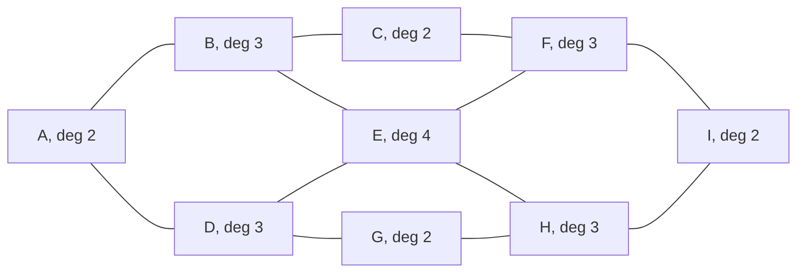
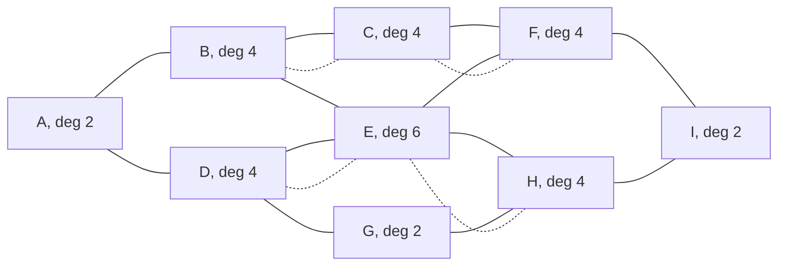

# The Chinese postman: when no Euler circuit exists, pair up the odd vertices as cheaply as possible and walk those streets twice

[Syllabus](../../../SYLLABUS.md) → [Combinatorics and graphs](../README.md) → [Tours - Euler and Hamilton](../README.md#s11) → The Chinese postman

---

## General Overview

A postman parks the van at junction A of a small estate: nine junctions in a 3 by 3 grid, lettered A to I across the rows, joined by twelve streets of 100 m. Every street needs a delivery, and the round must end back at the van. That is 1,200 m of street; the shortest round is 1,600 m.

The extra 400 m is forced. A round walking every street exactly once and ending where it began exists only when every junction meets an even number of streets ([Euler circuits](01-euler-circuits.md)). Four junctions here meet three: B, D, F and H, the middles of the sides. So some streets must be walked twice — which, and how few metres?

One move answers it. Take the junctions an odd number of streets meet — **odd junctions** from here on — and pair them up; for each pair, walk the shortest route between its two a second time. Doubling a street adds one at each end, and a junction passed through gains two, so only the pair's counts flip. Every junction is then even, and one round covers the lot.

Kwan Mei-ko set the problem out in 1960; Jack Edmonds named it the Chinese postman problem for Kwan and, with Ellis Johnson, proved the pairing is all there is to it.

**The shortest closed round covering every street is the total street length plus the cheapest pairing of the odd junctions, each pair charged the shortest walk between its two.**

**What kind of fact this is:** a method, resting on a theorem proved on this card in Why it works.

### The picture: the estate



deg counts the streets at a junction. The corners A, C, G and I are on two, the centre E on four, and B, D, F and H on three: the whole problem.

---

## The formula

Symbols first. $w(e)$ is the length of the street named in the brackets, 100 m across this estate. $d(u,v)$ is the length of the shortest walk between two junctions ([Dijkstra's algorithm](../10-Trees%20and%20Cheapest%20Routes/05-dijkstra.md)). The odd junctions are collected as $O$, and a **pairing** $M$ splits $O$ into pairs, every odd junction in one.

A capital sigma says "add one term per item listed underneath"; "min over $M$" says "work the sum out for every pairing, keep the smallest".

$$L = \sum_{e \in E} w(e) \;+\; \min_{M} \sum_{\{u,v\} \in M} d(u,v)$$

**Read it aloud:** the shortest round is every street's length added up, plus the cheapest total of shortest walks pairing the odd junctions off.

| Symbol | Plain meaning | In our example | Push it up and the answer… |
| --- | --- | --- | --- |
| $E$ | the streets, as pairs of junctions | twelve | a longer round |
| $w(e)$ | one street's length | 100 m | a longer round |
| $\deg(v)$ | streets at a junction | 3 at B, D, F, H | odd counts force repeats |
| $O$ | the odd junctions | B, D, F, H | more repeats |
| $d(u,v)$ | the shortest walk between two | 200 m, every pair in $O$ | dearer repeats |
| $M$ | one pairing of $O$ | B with F, D with H | — |
| $L$ | the shortest closed round | 1,600 m | — |

The pairings are easy to count. Write 2k for the number of odd junctions, a count the handshaking sum forces to be even ([Degrees and the handshaking lemma](../09-Graphs%20-%20Dots%20and%20Lines/02-degree-and-handshaking.md)): the first takes any of the other 2k − 1, the rest pair the same way, so there are

$$1 \times 3 \times 5 \times \cdots \times (2k-1)$$

of them: three for four odd junctions, 945 for ten.

### When it holds

- **Every street covered, the map in one piece.** Split the estate and no round reaches both halves ([Connected or not](../09-Graphs%20-%20Dots%20and%20Lines/04-connectivity-and-breadth-first-search.md)).
- **Lengths positive, a street the same price either way.** One-way streets need flows, not pairings: a flow is an amount pushed along each street ([Flows](../13-Matchings%20and%20Flows/05-flow-networks-and-ford-fulkerson.md)).
- **A second pass allowed anywhere, at full price.** A street barred from repeats, or free the second time, changes the sum.

---

## Why it works

### Step 0: repeating a street is the same as drawing it twice

A round that walks B-C twice walks every street once on a map where B-C appears twice. Add a copy per repeat and the round is an Euler circuit of that fuller map: every copy used once, ending where it started. The route question has become a map question — which copies to add ([Euler circuits](01-euler-circuits.md)).

### Step 1: the added copies must be odd exactly where the map is odd

A copy adds one to the count at each of its two ends, and Euler's test wants every count even. So an even junction takes an even number of copies, an odd junction an odd number. Read the copies as a map of their own: its odd junctions must be exactly B, D, F and H.

### Step 2: a pair's cheapest repeat is a shortest walk

Such a map breaks into walks joining those four two by two, plus closed loops. The loops can go: deleting one leaves every junction as odd or even as it was — its parity — and saves metres. A walk from B to F is at least $d(B,F)$ long, so nothing beats a shortest walk, and no street is walked three times: two copies of one street delete together.

### Step 3: add the two pieces

Every street is walked at least once, whatever the round: 1,200 m. The repeats are one pairing's shortest walks, the cheapest costing 400 m. So no round beats 1,600 m, and the pairing builds one that reaches it. "B with F, D with H" repeats B-C, C-F, D-E and E-H: 16 street-lengths.

<details>
<summary>Detailed proof: the two halves of the argument</summary>

Map in one piece, every length positive. Take any closed round covering every street and collect its extra passes as R. With R's copies added the round uses every copy once, so it is an Euler circuit: every junction even there. A count there is the map count plus the R count, so R is odd exactly at the map's odd junctions. Deleting two copies of one street, or one of R's closed loops, holds every parity and shortens R. What is left splits into walks pairing the odd junctions, each at least the shortest walk between its ends, so R costs at least the cheapest pairing.

The other half builds a round: add every street on a cheapest pairing's walks, deleting any street thereby doubled. Every junction is even and the map in one piece, so an Euler circuit exists, of length the street total plus at most the pairing's total. The bounds meet.

</details>

### Step 4: how far listing the pairings goes

A program listing them settles three pairings, or 945, in no time. But the count keeps multiplying, so listing stops being possible at a few dozen odd junctions — and a city map has hundreds.

Edmonds' 1965 matching algorithm, blossom, finds the cheapest pairing without listing any, in a time growing like a fixed power of the junction count. A matching is a set of pairs with no junction used twice, so a pairing is a matching that uses every odd junction ([Matchings](../13-Matchings%20and%20Flows/01-matchings-and-augmenting-paths.md)). This card leans on it, unbuilt.

A second road reaches the same 400 m with no pairings and no shortest walks: keep every set of streets whose own odd junctions are exactly B, D, F and H, then take the smallest, every street here being 100 m — Step 1 read forwards.

---

## Worked numbers, by hand

| Step | Arithmetic | Value |
| --- | --- | --- |
| every street once | 12 × 100 m | 1,200 m |
| the counts at the junctions | read off the map | 2, 3, 2, 3, 4, 3, 2, 3, 2 |
| the odd junctions | B, D, F, H | **4** |
| pairings to try | 1 × 3 | 3 |
| each pair's shortest walk | two streets, whichever pair | 200 m |
| the cheapest pairing | 200 + 200, and all three tie | **400 m** |
| the round | 1,200 + 400 | **1,600 m** |

The postman walks 1,600 m to deliver on 1,200 m of street. All three pairings tie at 400 m, so "cheapest" is idle on this estate; it earns its keep on the code's second map, two rows of four junctions. That map has P, Q, R and S in the top row and T, U, V and W under them, each junction joined to its neighbours across and down: ten streets of 100 m.

### The picture: the four repeats



Dotted: the second passes, B to F through C and D to H through E. Every junction is now on an even number of passes.

### What breaks if you drop a piece

| Mistake | Comes out at | What went wrong |
| --- | --- | --- |
| Walking every street twice to be safe | 2,400 m | Four streets of the twelve want a second pass, not all |
| Pairing by eye: on the second map, Q with V, R with U | 1,400 m, against 1,200 m | Two repeats of 200 m, where two of 100 m would do |
| Leaving the round's two ends free | 1,400 m on the estate | An open round doubles one pair only and must start and end at the other two odd junctions, neither of them the van |

The code prints all three of those.

---

## Code, from first principles, and it actually runs

Nothing is imported, and the round is reached three ways.

- Road one is this card's method: count the streets at each junction, get every shortest walk by Floyd's method — each junction tried in turn as a stepping stone ([Dijkstra's algorithm](../10-Trees%20and%20Cheapest%20Routes/05-dijkstra.md)) — then list the pairings and keep the cheapest.
- Road two mentions neither pairings nor shortest walks: all 4,096 sets of the twelve streets, keeping the smallest whose odd junctions match the map's.
- Road three walks the answer, taking any unused street at the junction under foot: Hierholzer's method.

### Python

```python
# The Chinese postman -- the check behind the card.  Nothing is imported.  The round is a 3 x 3 grid of junctions A to
# I joined by 12 streets of 100 m each; the two-row map P to W has 10.  The shortest closed round is reached three ways:
# the odd junctions paired by shortest walks, every set of streets that could be repeated searched, and the round walked.
W = 100
GRID = ("ABCDEFGHI", ["AB", "BC", "AD", "BE", "CF", "DE", "EF", "DG", "EH", "FI", "GH", "HI"])
ROWS = ("PQRSTUVW", ["PQ", "QR", "RS", "TU", "UV", "VW", "PT", "QU", "RV", "SW"])
def degs(names, edges): return [sum(v in e for e in edges) for v in names]   # streets met at a junction
def odd_of(names, edges): return "".join(v for v, k in zip(names, degs(names, edges)) if k % 2)
def apsp(names, edges):                      # shortest walk between every pair: Floyd-Warshall
    d = {a + b: (0 if a == b else 10 ** 6) for a in names for b in names}
    for e in edges: d[e] = d[e[1] + e[0]] = W
    for k in names:
        for ab in d: d[ab] = min(d[ab], d[ab[0] + k] + d[k + ab[1]])
    return d
def pairings(items):                         # every way to pair a list up, two by two
    if not items: return [[]]
    r = items[1:]
    return [[(items[0], r[i])] + p for i in range(len(r)) for p in pairings(r[:i] + r[i + 1:])]
def repeats(names, edges, odd):              # road two: every set of streets, no pairing and no shortest walk used
    every = [[e for i, e in enumerate(edges) if m >> i & 1] for m in range(1 << len(edges))]
    fits = [p for p in every if odd_of(names, p) == odd]
    return [p for p in fits if len(p) == min(len(q) for q in fits)]
def circuit(edges):                          # road three: walk the round, Hierholzer's method
    left, stack, route = list(edges), [edges[0][0]], []
    while stack:
        v, nxt = stack[-1], next((e for e in left if stack[-1] in e), None)
        if nxt is None: route.append(stack.pop())
        else: left.remove(nxt); stack.append(nxt[1] if nxt[0] == v else nxt[0])
    return route
def spaced(names, ds): return "  ".join(f"{v} {k}" for v, k in zip(names, ds))
def listed(pcs): return " | ".join(f"({', '.join(a + '-' + b for a, b in p)}) {c}" for p, c in pcs)
def dfact(k): return 1 if k == 0 else (2 * k - 1) * dfact(k - 1)             # 1 x 3 x 5 x ... x (2k-1)
def yn(claim): return "yes" if claim else "no"
def report(label, names, edges, want):
    d, odd, street = apsp(names, edges), odd_of(names, edges), len(edges) * W
    pcs = [(p, sum(d[a + b] for a, b in p)) for p in pairings(list(odd))]
    best, worst, sets_ = min(c for _, c in pcs), max(c for _, c in pcs), repeats(names, edges, odd)
    aug = edges + sets_[0]
    route, after = circuit(aug), degs(names, aug)
    walked = sorted("".join(sorted(p)) for p in zip(route, route[1:]))
    opened = min(d[a + b] for i, a in enumerate(odd) for b in odd[i + 1:])
    print(f"{label}: {len(names)} junctions, {len(edges)} streets of {W} m, {street} m of street in all\n"
          f"degrees: {spaced(names, degs(names, edges))}; odd junctions {' '.join(odd)}, {len(odd)} of them, so no Euler circuit as the map stands\n"
          f"shortest walks between the odd junctions, in m: "
          f"{'  '.join(f'{a}-{b} {d[a + b]}' for i, a in enumerate(odd) for b in odd[i + 1:])}\n"
          f"the pairings and the metres each adds: {listed(pcs)}\n"
          f"road 1, the cheapest pairing adds {best} m: {street} + {best} = {street + best} m; the dearest would add {worst} m, giving {street + worst} m\n"
          f"road 2, over all {1 << len(edges)} sets of streets to repeat: {len(sets_)} cheapest sets, each {len(sets_[0]) * W} m, first in order {' '.join(sets_[0])}; degrees then {spaced(names, after)}, all even: {yn(all(k % 2 == 0 for k in after))}\n"
          f"road 3, the round walked, {len(aug)} streets: {'-'.join(route)} = {len(aug) * W} m; it walks every street of the map and every repeat once each: {yn(walked == sorted(''.join(sorted(e)) for e in aug))}")
    assert best == len(sets_[0]) * W and street + best == want        # the pairing road and the search agree
    assert walked == sorted("".join(sorted(e)) for e in aug) and len(route) == len(aug) + 1 and route[0] == route[-1]
    assert all(k % 2 == 0 for k in after) and sum(after) == 2 * len(aug)
    return street, best, worst, opened, len(sets_)
grid, rows = report("the round, a 3 x 3 grid", *GRID, 1600), report("the two-row map", *ROWS, 1200)
print(f"an open round, not returning to the van: one pair doubled, {grid[3]} m, giving {grid[0] + grid[3]} m; every street walked twice instead: {2 * grid[0]} m")
counts = [len(pairings(list(range(2 * k)))) for k in (2, 3, 4, 5)]
print(f"pairings to test for 4, 6, 8, 10 odd junctions, counted by listing them: {counts}; by 1 x 3 x 5 x ...: {[dfact(k) for k in (2, 3, 4, 5)]}")
assert grid[1] == grid[2] and grid[4] == 7 and rows[2] == 400 and counts == [dfact(k) for k in (2, 3, 4, 5)]
print("ALL CHECKS PASS")
```

**Ran 2026-09-19 on macOS, Python 3.14.6, standard library only. All checks passed. Output, pasted from the run:**

```
the round, a 3 x 3 grid: 9 junctions, 12 streets of 100 m, 1200 m of street in all
degrees: A 2  B 3  C 2  D 3  E 4  F 3  G 2  H 3  I 2; odd junctions B D F H, 4 of them, so no Euler circuit as the map stands
shortest walks between the odd junctions, in m: B-D 200  B-F 200  B-H 200  D-F 200  D-H 200  F-H 200
the pairings and the metres each adds: (B-D, F-H) 400 | (B-F, D-H) 400 | (B-H, D-F) 400
road 1, the cheapest pairing adds 400 m: 1200 + 400 = 1600 m; the dearest would add 400 m, giving 1600 m
road 2, over all 4096 sets of streets to repeat: 7 cheapest sets, each 400 m, first in order BC CF DE EH; degrees then A 2  B 4  C 4  D 4  E 6  F 4  G 2  H 4  I 2, all even: yes
road 3, the round walked, 16 streets: A-D-E-H-G-D-E-H-I-F-C-B-E-F-C-B-A = 1600 m; it walks every street of the map and every repeat once each: yes
the two-row map: 8 junctions, 10 streets of 100 m, 1000 m of street in all
degrees: P 2  Q 3  R 3  S 2  T 2  U 3  V 3  W 2; odd junctions Q R U V, 4 of them, so no Euler circuit as the map stands
shortest walks between the odd junctions, in m: Q-R 100  Q-U 100  Q-V 200  R-U 200  R-V 100  U-V 100
the pairings and the metres each adds: (Q-R, U-V) 200 | (Q-U, R-V) 200 | (Q-V, R-U) 400
road 1, the cheapest pairing adds 200 m: 1000 + 200 = 1200 m; the dearest would add 400 m, giving 1400 m
road 2, over all 1024 sets of streets to repeat: 2 cheapest sets, each 200 m, first in order QR UV; degrees then P 2  Q 4  R 4  S 2  T 2  U 4  V 4  W 2, all even: yes
road 3, the round walked, 12 streets: P-T-U-V-R-Q-U-V-W-S-R-Q-P = 1200 m; it walks every street of the map and every repeat once each: yes
an open round, not returning to the van: one pair doubled, 200 m, giving 1400 m; every street walked twice instead: 2400 m
pairings to test for 4, 6, 8, 10 odd junctions, counted by listing them: [3, 15, 105, 945]; by 1 x 3 x 5 x ...: [3, 15, 105, 945]
ALL CHECKS PASS
```

### Rust

Same numbers, same labels, built with `rustc --edition 2021 -O`.

```rust
// The Chinese postman -- the same check as the Python, in Rust.  No crates.  The round is a 3 x 3 grid of junctions A to
// I joined by 12 streets of 100 m each; the two-row map P to W has 10.  The shortest closed round is reached three ways:
// the odd junctions paired by shortest walks, every set of streets that could be repeated searched, and the round walked.
const W: i64 = 100;
fn ix(names: &str, c: char) -> usize { names.chars().position(|x| x == c).unwrap() }
fn ends(e: &str) -> (char, char) { (e.chars().next().unwrap(), e.chars().nth(1).unwrap()) }
fn pair(a: char, b: char) -> String { if a <= b { format!("{}{}", a, b) } else { format!("{}{}", b, a) } }
fn degs(names: &str, edges: &[String]) -> Vec<i64> {       // streets met at a junction
    names.chars().map(|v| edges.iter().filter(|e| e.contains(v)).count() as i64).collect() }
fn odd_of(names: &str, edges: &[String]) -> String {
    names.chars().zip(degs(names, edges)).filter(|&(_, k)| k % 2 == 1).map(|(v, _)| v).collect() }
fn apsp(names: &str, edges: &[String]) -> Vec<Vec<i64>> {  // shortest walk between every pair: Floyd-Warshall
    let n = names.chars().count();
    let mut d: Vec<Vec<i64>> = (0..n).map(|a| (0..n).map(|b| if a == b { 0 } else { 1_000_000 }).collect()).collect();
    for e in edges { let (a, b) = ends(e); d[ix(names, a)][ix(names, b)] = W; d[ix(names, b)][ix(names, a)] = W }
    for k in 0..n { for a in 0..n { for b in 0..n { if d[a][k] + d[k][b] < d[a][b] { d[a][b] = d[a][k] + d[k][b] } } } }
    d }
fn pairings(items: &[char]) -> Vec<Vec<(char, char)>> {    // every way to pair a list up, two by two
    if items.is_empty() { return vec![vec![]] }
    (0..items.len() - 1).flat_map(|i| {
        let mut r: Vec<char> = items[1..].to_vec(); r.remove(i);
        pairings(&r).into_iter().map(move |mut p| { p.insert(0, (items[0], items[i + 1])); p }).collect::<Vec<_>>()
    }).collect() }
fn repeats(names: &str, edges: &[String], odd: &str) -> Vec<Vec<String>> {   // road two: every set of streets
    let every: Vec<Vec<String>> = (0..1u32 << edges.len()).map(|m| (0..edges.len())
        .filter(|i| m >> i & 1 == 1).map(|i| edges[i].clone()).collect()).collect();
    let fits: Vec<Vec<String>> = every.into_iter().filter(|p| odd_of(names, p) == odd).collect();
    let least = fits.iter().map(|p| p.len()).min().unwrap();
    fits.into_iter().filter(|p| p.len() == least).collect() }
fn circuit(edges: &[String]) -> Vec<char> {                // road three: walk the round, Hierholzer's method
    let (mut left, mut stack, mut route) = (edges.to_vec(), vec![ends(&edges[0]).0], Vec::new());
    while let Some(&v) = stack.last() {
        match left.iter().position(|e| e.contains(v)) {
            None => route.push(stack.pop().unwrap()),
            Some(i) => { let (a, b) = ends(&left.remove(i)); stack.push(if a == v { b } else { a }) } } }
    route }
fn spaced(names: &str, ds: &[i64]) -> String { names.chars().zip(ds).map(|(v, k)| format!("{} {}", v, k)).collect::<Vec<_>>().join("  ") }
fn listed(pcs: &[(Vec<(char, char)>, i64)]) -> String { pcs.iter().map(|(p, c)| format!("({}) {}", p.iter().map(|(a, b)| format!("{}-{}", a, b)).collect::<Vec<_>>().join(", "), c)).collect::<Vec<_>>().join(" | ") }
fn sorted_edges(edges: &[String]) -> Vec<String> { let mut o: Vec<String> = edges.iter().map(|e| { let (a, b) = ends(e); pair(a, b) }).collect(); o.sort(); o }
fn dfact(k: i64) -> i64 { if k == 0 { 1 } else { (2 * k - 1) * dfact(k - 1) } }   // 1 x 3 x 5 x ... x (2k-1)
fn yn(claim: bool) -> &'static str { if claim { "yes" } else { "no" } }
fn report(label: &str, names: &str, edges: &[String], want: i64) -> (i64, i64, i64, i64, usize) {
    let (d, odd, street) = (apsp(names, edges), odd_of(names, edges), edges.len() as i64 * W);
    let oc: Vec<char> = odd.chars().collect();
    let pcs: Vec<(Vec<(char, char)>, i64)> = pairings(&oc).into_iter()
        .map(|p| { let c = p.iter().map(|&(a, b)| d[ix(names, a)][ix(names, b)]).sum(); (p, c) }).collect();
    let (best, worst) = (pcs.iter().map(|&(_, c)| c).min().unwrap(), pcs.iter().map(|&(_, c)| c).max().unwrap());
    let sets = repeats(names, edges, &odd);
    let aug: Vec<String> = edges.iter().chain(sets[0].iter()).cloned().collect();
    let (route, after) = (circuit(&aug), degs(names, &aug));
    let mut walked: Vec<String> = route.windows(2).map(|w| pair(w[0], w[1])).collect(); walked.sort();
    let (mut ws, mut opened) = (Vec::new(), i64::MAX);
    for i in 0..oc.len() { for j in i + 1..oc.len() { let m = d[ix(names, oc[i])][ix(names, oc[j])];
        ws.push(format!("{}-{} {}", oc[i], oc[j], m)); opened = opened.min(m) } }
    println!("{}: {} junctions, {} streets of {} m, {} m of street in all", label, names.chars().count(), edges.len(), W, street);
    println!("degrees: {}; odd junctions {}, {} of them, so no Euler circuit as the map stands", spaced(names, &degs(names, edges)),
             odd.chars().map(|c| c.to_string()).collect::<Vec<_>>().join(" "), oc.len());
    println!("shortest walks between the odd junctions, in m: {}", ws.join("  "));
    println!("the pairings and the metres each adds: {}", listed(&pcs));
    println!("road 1, the cheapest pairing adds {} m: {} + {} = {} m; the dearest would add {} m, giving {} m", best, street, best, street + best, worst, street + worst);
    println!("road 2, over all {} sets of streets to repeat: {} cheapest sets, each {} m, first in order {}; degrees then {}, all even: {}",
             1 << edges.len(), sets.len(), sets[0].len() as i64 * W, sets[0].join(" "), spaced(names, &after), yn(after.iter().all(|k| k % 2 == 0)));
    println!("road 3, the round walked, {} streets: {} = {} m; it walks every street of the map and every repeat once each: {}",
             aug.len(), route.iter().map(|c| c.to_string()).collect::<Vec<_>>().join("-"), aug.len() as i64 * W, yn(walked == sorted_edges(&aug)));
    assert!(best == sets[0].len() as i64 * W && street + best == want);   // the pairing road and the search agree
    assert!(walked == sorted_edges(&aug) && route.len() == aug.len() + 1 && route[0] == route[route.len() - 1]);
    assert!(after.iter().all(|k| k % 2 == 0) && after.iter().sum::<i64>() == 2 * aug.len() as i64);
    (street, best, worst, opened, sets.len()) }
fn main() {
    let grid = report("the round, a 3 x 3 grid", "ABCDEFGHI",
        &["AB", "BC", "AD", "BE", "CF", "DE", "EF", "DG", "EH", "FI", "GH", "HI"].iter().map(|s| s.to_string()).collect::<Vec<String>>(), 1600);
    let rows = report("the two-row map", "PQRSTUVW",
        &["PQ", "QR", "RS", "TU", "UV", "VW", "PT", "QU", "RV", "SW"].iter().map(|s| s.to_string()).collect::<Vec<String>>(), 1200);
    println!("an open round, not returning to the van: one pair doubled, {} m, giving {} m; every street walked twice instead: {} m", grid.3, grid.0 + grid.3, 2 * grid.0);
    let counts: Vec<i64> = [2i64, 3, 4, 5].iter().map(|&k| pairings(&"abcdefghij".chars().take(2 * k as usize).collect::<Vec<char>>()).len() as i64).collect();
    let closed: Vec<i64> = [2i64, 3, 4, 5].iter().map(|&k| dfact(k)).collect();
    println!("pairings to test for 4, 6, 8, 10 odd junctions, counted by listing them: {:?}; by 1 x 3 x 5 x ...: {:?}", counts, closed);
    assert!(grid.1 == grid.2 && grid.4 == 7 && rows.2 == 400 && counts == closed);
    println!("ALL CHECKS PASS");
}
```

**Ran 2026-09-19 on macOS, rustc 1.98.1, no crates. All checks passed. Output, pasted from the run:**

```
the round, a 3 x 3 grid: 9 junctions, 12 streets of 100 m, 1200 m of street in all
degrees: A 2  B 3  C 2  D 3  E 4  F 3  G 2  H 3  I 2; odd junctions B D F H, 4 of them, so no Euler circuit as the map stands
shortest walks between the odd junctions, in m: B-D 200  B-F 200  B-H 200  D-F 200  D-H 200  F-H 200
the pairings and the metres each adds: (B-D, F-H) 400 | (B-F, D-H) 400 | (B-H, D-F) 400
road 1, the cheapest pairing adds 400 m: 1200 + 400 = 1600 m; the dearest would add 400 m, giving 1600 m
road 2, over all 4096 sets of streets to repeat: 7 cheapest sets, each 400 m, first in order BC CF DE EH; degrees then A 2  B 4  C 4  D 4  E 6  F 4  G 2  H 4  I 2, all even: yes
road 3, the round walked, 16 streets: A-D-E-H-G-D-E-H-I-F-C-B-E-F-C-B-A = 1600 m; it walks every street of the map and every repeat once each: yes
the two-row map: 8 junctions, 10 streets of 100 m, 1000 m of street in all
degrees: P 2  Q 3  R 3  S 2  T 2  U 3  V 3  W 2; odd junctions Q R U V, 4 of them, so no Euler circuit as the map stands
shortest walks between the odd junctions, in m: Q-R 100  Q-U 100  Q-V 200  R-U 200  R-V 100  U-V 100
the pairings and the metres each adds: (Q-R, U-V) 200 | (Q-U, R-V) 200 | (Q-V, R-U) 400
road 1, the cheapest pairing adds 200 m: 1000 + 200 = 1200 m; the dearest would add 400 m, giving 1400 m
road 2, over all 1024 sets of streets to repeat: 2 cheapest sets, each 200 m, first in order QR UV; degrees then P 2  Q 4  R 4  S 2  T 2  U 4  V 4  W 2, all even: yes
road 3, the round walked, 12 streets: P-T-U-V-R-Q-U-V-W-S-R-Q-P = 1200 m; it walks every street of the map and every repeat once each: yes
an open round, not returning to the van: one pair doubled, 200 m, giving 1400 m; every street walked twice instead: 2400 m
pairings to test for 4, 6, 8, 10 odd junctions, counted by listing them: [3, 15, 105, 945]; by 1 x 3 x 5 x ...: [3, 15, 105, 945]
ALL CHECKS PASS
```

The two outputs match line for line.

### Lean

Lean proves the method for every map in one piece with every street a positive length, not just the estate.

- Some pairing of the odd junctions is cheapest, each pair charged the shortest walk between its two.
- No closed round covering every street is shorter than the street total plus that cheapest pairing.
- Some closed round reaches that length exactly, starting and ending at whichever junction you choose.
- With 2k odd junctions there are $1 \times 3 \times 5 \times \cdots \times (2k-1)$ pairings.
- On both maps: the streets, the counts at each junction, the odd junctions, and both rounds walked covering every street.

The maps' shortest walks, the search over sets of streets and the open round stay with the Python and Rust checks.

```lean
-- The Chinese postman: on a connected map with positive street lengths, the shortest closed round from any junction that walks every street is the total street length plus the cheapest pairing of the odd junctions, each pair charged its shortest walk, and 2k odd junctions can be paired in 1 × 3 × 5 × ⋯ × (2k − 1) ways.
import Mathlib.Combinatorics.SimpleGraph.Connectivity.Connected
import Mathlib.Combinatorics.SimpleGraph.DegreeSum
import Mathlib.Combinatorics.SimpleGraph.Finite
import Mathlib.Data.Nat.Factorial.DoubleFactorial
import Mathlib.Algebra.Order.Archimedean.Real.Basic
import Mathlib.Tactic.NormNum
import Mathlib.Combinatorics.SimpleGraph.Trails
import Mathlib.Combinatorics.SimpleGraph.Walk.Counting
import Mathlib.Algebra.BigOperators.Ring.Nat

open SimpleGraph Finset
open scoped Nat

namespace ChinesePostman

variable {V : Type*}

/-! The map is a finite `SimpleGraph`: junctions are vertices, streets are edges. A street's
length is `w e` for the unordered pair `e : Sym2 V`, so it costs the same either way. A round
is a closed walk; walking a street twice counts it twice in `p.edges`, at full price. -/

/-- The length of a walk: each street it uses, added up once per pass. -/
noncomputable def walkLength (G : SimpleGraph V) (w : Sym2 V → ℝ) {u v : V}
    (p : G.Walk u v) : ℝ :=
  (p.edges.map w).sum

/-- `d(u, v)`: the length of the shortest walk from `u` to `v`. -/
noncomputable def shortestWalk (G : SimpleGraph V) (w : Sym2 V → ℝ) (u v : V) : ℝ :=
  ⨅ p : G.Walk u v, walkLength G w p

/-- The odd junctions: those an odd number of streets meet. -/
abbrev OddJunction (G : SimpleGraph V) [Fintype V] [DecidableRel G.Adj] :=
  {v : V // Odd (G.degree v)}

/-- A pairing of a finite set `O`: a rule `σ` sending each element to its partner, with the
partner's partner the element itself and nobody paired with themselves. -/
def IsPairing {O : Type*} (σ : O → O) : Prop :=
  Function.Involutive σ ∧ ∀ v, σ v ≠ v

/-- The cost of a pairing of the odd junctions: each pair charged the shortest walk between its
two. Summing over every odd junction counts each pair twice, hence the halving. -/
noncomputable def pairingCost (G : SimpleGraph V) [Fintype V] [DecidableRel G.Adj]
    (w : Sym2 V → ℝ) (σ : OddJunction G → OddJunction G) : ℝ :=
  (∑ v : OddJunction G, shortestWalk G w v.1 (σ v).1) / 2

/-! Helpers. -/

section Helpers

set_option linter.unusedSectionVars false

variable [Fintype V] [DecidableEq V] {G : SimpleGraph V}

/-- How many edges of a multiset of edges meet `v`. -/
def mdeg (M : Multiset (Sym2 V)) (v : V) : ℕ := M.countP (fun e => v ∈ e)

/-- The total weight of a multiset of edges. -/
noncomputable def mw (w : Sym2 V → ℝ) (M : Multiset (Sym2 V)) : ℝ := (M.map w).sum

lemma mdeg_add (M N : Multiset (Sym2 V)) (v : V) : mdeg (M + N) v = mdeg M v + mdeg N v := by
  simp [mdeg, Multiset.countP_add]

lemma mw_add (w : Sym2 V → ℝ) (M N : Multiset (Sym2 V)) : mw w (M + N) = mw w M + mw w N := by
  simp [mw, Multiset.map_add, Multiset.sum_add]

lemma walk_even_countP_edges_iff {u v : V} (p : G.Walk u v) (x : V) :
    Even (p.edges.countP fun e ↦ x ∈ e) ↔ u ≠ v → x ≠ u ∧ x ≠ v := by
  induction p with
  | nil => simp
  | cons huv p ih => grind [Walk.edges_cons, G.irrefl]

lemma mdeg_walk_closed {u : V} (p : G.Walk u u) (x : V) : Even (mdeg (p.edges : Multiset (Sym2 V)) x) := by
  have := (walk_even_countP_edges_iff p x).mpr (fun h => absurd rfl h)
  simpa [mdeg] using this

lemma mdeg_path_even_iff {u z : V} (p : G.Walk u z) (hp : p.IsTrail) (huz : u ≠ z) (x : V) :
    Even (mdeg (p.edges : Multiset (Sym2 V)) x) ↔ x ≠ u ∧ x ≠ z := by
  have := hp.even_countP_edges_iff x
  simp only [mdeg, Multiset.coe_countP]
  rw [this]
  exact ⟨fun h => h huz, fun h _ => h⟩

lemma walkLength_eq_mw (w : Sym2 V → ℝ) {u v : V} (p : G.Walk u v) :
    walkLength G w p = mw w (p.edges : Multiset (Sym2 V)) := by
  simp [walkLength, mw]

lemma mw_nonneg {w : Sym2 V → ℝ} (hpos : ∀ e ∈ G.edgeSet, 0 < w e) (M : Multiset (Sym2 V))
    (hM : ∀ e ∈ M, e ∈ G.edgeSet) : 0 ≤ mw w M :=
  Multiset.sum_nonneg (by
    intro x hx
    obtain ⟨e, he, rfl⟩ := Multiset.mem_map.mp hx
    exact (hpos e (hM e he)).le)

lemma mw_mono {w : Sym2 V → ℝ} (hpos : ∀ e ∈ G.edgeSet, 0 < w e) {A B : Multiset (Sym2 V)}
    (hAB : A ≤ B) (hB : ∀ e ∈ B, e ∈ G.edgeSet) : mw w A ≤ mw w B := by
  obtain ⟨C, rfl⟩ := Multiset.le_iff_exists_add.mp hAB
  rw [mw_add]
  have := mw_nonneg hpos C (fun e he => hB e (Multiset.mem_add.mpr (Or.inr he)))
  linarith

lemma walkLength_nonneg {w : Sym2 V → ℝ} (hpos : ∀ e ∈ G.edgeSet, 0 < w e) {u v : V}
    (p : G.Walk u v) : 0 ≤ walkLength G w p := by
  rw [walkLength_eq_mw]
  exact mw_nonneg hpos _ (fun e he => p.edges_subset_edgeSet (Multiset.mem_coe.mp he))

lemma walkLength_reverse (w : Sym2 V → ℝ) {u v : V} (p : G.Walk u v) :
    walkLength G w p.reverse = walkLength G w p := by
  simp [walkLength, Walk.edges_reverse, List.map_reverse, List.sum_reverse]

lemma shortestWalk_le {w : Sym2 V → ℝ} (hpos : ∀ e ∈ G.edgeSet, 0 < w e) {u v : V}
    (p : G.Walk u v) : shortestWalk G w u v ≤ walkLength G w p :=
  ciInf_le ⟨0, by rintro _ ⟨q, rfl⟩; exact walkLength_nonneg hpos q⟩ p

lemma exists_min_path [DecidableRel G.Adj] {w : Sym2 V → ℝ} (hpos : ∀ e ∈ G.edgeSet, 0 < w e)
    {u v : V} (h : G.Reachable u v) :
    ∃ Q : G.Walk u v, Q.IsPath ∧ shortestWalk G w u v = walkLength G w Q ∧
      ∀ p : G.Walk u v, walkLength G w Q ≤ walkLength G w p := by
  obtain ⟨p0⟩ := h
  have hne : (Finset.univ : Finset (G.Path u v)).Nonempty :=
    ⟨⟨p0.bypass, p0.bypass_isPath⟩, Finset.mem_univ _⟩
  obtain ⟨Q, -, hQ⟩ := Finset.exists_min_image Finset.univ
    (fun P : G.Path u v => walkLength G w P.1) hne
  have hmin : ∀ p : G.Walk u v, walkLength G w Q.1 ≤ walkLength G w p := by
    intro p
    calc walkLength G w Q.1 ≤ walkLength G w p.bypass :=
          hQ ⟨p.bypass, p.bypass_isPath⟩ (Finset.mem_univ _)
      _ ≤ walkLength G w p := by
          rw [walkLength_eq_mw, walkLength_eq_mw]
          apply mw_mono hpos
          · rw [Multiset.le_iff_subset (Multiset.coe_nodup.mpr p.bypass_isPath.isTrail.edges_nodup)]
            intro e he
            exact Multiset.mem_coe.mpr (p.edges_bypass_subset_edges (Multiset.mem_coe.mp he))
          · intro e he
            exact p.edges_subset_edgeSet (Multiset.mem_coe.mp he)
  have : Nonempty (G.Walk u v) := ⟨p0⟩
  exact ⟨Q.1, Q.2, le_antisymm (shortestWalk_le hpos _) (le_ciInf hmin), hmin⟩

/-- Every vertex of odd degree in a multiset of edges is joined, by a path using edges of the
multiset, to a different vertex of odd degree. -/
lemma exists_odd_partner (M : Multiset (Sym2 V)) (hM : ∀ e ∈ M, e ∈ G.edgeSet) {u : V}
    (hu : Odd (mdeg M u)) : ∃ z, z ≠ u ∧ Odd (mdeg M z) ∧
      ∃ P : G.Walk u z, P.IsPath ∧ (P.edges : Multiset (Sym2 V)) ≤ M := by
  classical
  let H : SimpleGraph V := SimpleGraph.fromEdgeSet {e | e ∈ M}
  have hHG : H ≤ G := by
    intro x y hxy
    rw [SimpleGraph.fromEdgeSet_adj] at hxy
    exact hM _ hxy.1
  let C : Finset V := Finset.univ.filter (fun x => H.Reachable u x)
  have hsplit : ∀ a b : V, s(a, b) ∈ M → (a ∈ C ↔ b ∈ C) := by
    intro a b he
    have hab : a ≠ b := G.ne_of_adj (hM _ he)
    have hadj : H.Adj a b := by rw [SimpleGraph.fromEdgeSet_adj]; exact ⟨he, hab⟩
    simp only [C, Finset.mem_filter, Finset.mem_univ, true_and]
    exact ⟨fun h => h.trans hadj.reachable, fun h => h.trans hadj.symm.reachable⟩
  have heven : ∀ N : Multiset (Sym2 V), N ≤ M → Even (∑ x ∈ C, mdeg N x) := by
    intro N
    induction N using Multiset.induction_on with
    | empty => intro _; simp [mdeg]
    | cons e N ih =>
      intro hle
      have he : e ∈ M := Multiset.mem_of_le hle (Multiset.mem_cons_self _ _)
      have ih' := ih (le_trans (Multiset.le_cons_self _ _) hle)
      have hsum : ∑ x ∈ C, mdeg (e ::ₘ N) x = ∑ x ∈ C, mdeg N x + ∑ x ∈ C, (if x ∈ e then 1 else 0) := by
        rw [← Finset.sum_add_distrib]
        refine Finset.sum_congr rfl (fun x _ => ?_)
        simp [mdeg, Multiset.countP_cons]
      rw [hsum]
      refine Even.add ih' ?_
      induction e using Sym2.ind with
      | _ a b =>
        have hab : a ≠ b := G.ne_of_adj (hM _ he)
        have h1 : ∀ x, (if x ∈ s(a, b) then 1 else 0 : ℕ) = (if a = x then 1 else 0) + (if b = x then 1 else 0) := by
          intro x
          by_cases hxa : x = a
          · subst hxa; simp [hab, Ne.symm hab]
          · by_cases hxb : x = b
            · subst hxb; simp [hab, Ne.symm hab]
            · simp [hxa, hxb, Ne.symm hxa, Ne.symm hxb]
        simp only [h1, Finset.sum_add_distrib, Finset.sum_ite_eq]
        have := hsplit a b he
        by_cases ha : a ∈ C
        · simp [ha, this.mp ha]
        · simp [ha, mt this.mpr ha]
  have hcard := (Finset.even_sum_iff_even_card_odd (s := C) (mdeg M)).mp (heven M le_rfl)
  have huC : u ∈ Finset.filter (fun x => Odd (mdeg M x)) C := by
    simp [C, hu]
  have h1 : 1 < (Finset.filter (fun x => Odd (mdeg M x)) C).card := by
    have hpos := Finset.card_pos.mpr ⟨u, huC⟩
    rcases hcard with ⟨k, hk⟩
    omega
  obtain ⟨z, hzC, hzu⟩ := Finset.exists_mem_ne h1 u
  simp only [C, Finset.mem_filter, Finset.mem_univ, true_and] at hzC
  obtain ⟨⟨W⟩, hz⟩ := hzC
  refine ⟨z, hzu, hz, W.bypass.mapLe hHG, W.bypass_isPath.mapLe hHG, ?_⟩
  rw [Walk.edges_mapLe_eq_edges,
    Multiset.le_iff_subset (Multiset.coe_nodup.mpr W.bypass_isPath.isTrail.edges_nodup)]
  intro e he
  have := W.bypass.edges_subset_edgeSet (Multiset.mem_coe.mp he)
  rw [SimpleGraph.edgeSet_fromEdgeSet] at this
  exact this.1


/-- `σ` pairs off the elements of `T` and fixes everything else. -/
def PairsOn (T : Finset V) (σ : V → V) : Prop :=
  (∀ v, σ (σ v) = v) ∧ (∀ v ∈ T, σ v ≠ v) ∧ (∀ v ∉ T, σ v = v)

/-- Add the pair `u, z` to a pairing. -/
def swapIn (σ : V → V) (u z : V) : V → V := fun v => if v = u then z else if v = z then u else σ v

lemma pairsOn_mem {T : Finset V} {σ : V → V} (h : PairsOn T σ) {v : V} (hv : v ∈ T) : σ v ∈ T := by
  by_contra hc
  have := h.2.2 _ hc
  rw [h.1 v] at this
  exact h.2.1 v hv this.symm

lemma pairsOn_insert {T : Finset V} {σ : V → V} (h : PairsOn T σ) {u z : V} (huz : u ≠ z)
    (hu : u ∉ T) (hz : z ∉ T) : PairsOn (insert u (insert z T)) (swapIn σ u z) := by
  obtain ⟨h1, h2, h3⟩ := h
  have hσu := h3 u hu
  have hσz := h3 z hz
  refine ⟨fun v => ?_, fun v hv => ?_, fun v hv => ?_⟩
  · by_cases hvu : v = u
    · subst hvu; simp [swapIn, huz.symm]
    · by_cases hvz : v = z
      · subst hvz; simp [swapIn, huz.symm]
      · have hne1 : σ v ≠ u := fun h => hvu (by rw [← h1 v, h, hσu])
        have hne2 : σ v ≠ z := fun h => hvz (by rw [← h1 v, h, hσz])
        simp [swapIn, hvu, hvz, hne1, hne2, h1]
  · simp only [Finset.mem_insert] at hv
    by_cases hvu : v = u
    · subst hvu; simp [swapIn, huz.symm]
    · by_cases hvz : v = z
      · subst hvz; simp [swapIn, hvu, huz]
      · have hvT : v ∈ T := by tauto
        simp [swapIn, hvu, hvz, h2 v hvT]
  · simp only [Finset.mem_insert, not_or] at hv
    simp [swapIn, hv.1, hv.2.1, h3 v hv.2.2]

lemma sum_swapIn {T : Finset V} {σ : V → V} {u z : V} (huz : u ≠ z) (hu : u ∉ T) (hz : z ∉ T)
    (f : V → V → ℝ) :
    ∑ v ∈ insert u (insert z T), f v (swapIn σ u z v) = f u z + f z u + ∑ v ∈ T, f v (σ v) := by
  rw [Finset.sum_insert (by simp [huz, hu]), Finset.sum_insert hz]
  have : ∑ v ∈ T, f v (swapIn σ u z v) = ∑ v ∈ T, f v (σ v) := by
    refine Finset.sum_congr rfl (fun v hv => ?_)
    have h1 : v ≠ u := fun h => hu (h ▸ hv)
    have h2 : v ≠ z := fun h => hz (h ▸ hv)
    simp [swapIn, h1, h2]
  rw [this]
  simp [swapIn, huz.symm]
  ring

/-- Lower bound: the extra edges of any multiset pay at least half the pairing cost of its odd
vertices. -/
lemma decompose {w : Sym2 V → ℝ} (hpos : ∀ e ∈ G.edgeSet, 0 < w e) :
    ∀ n, ∀ M : Multiset (Sym2 V), M.card = n → (∀ e ∈ M, e ∈ G.edgeSet) →
      ∃ σ, PairsOn (Finset.univ.filter fun v => Odd (mdeg M v)) σ ∧
        ∑ v ∈ Finset.univ.filter (fun v => Odd (mdeg M v)), shortestWalk G w v (σ v) ≤
          2 * mw w M := by
  intro n
  induction n using Nat.strong_induction_on with
  | _ n ih =>
  intro M hn hM
  by_cases hex : ∃ u, Odd (mdeg M u)
  · obtain ⟨u, hu⟩ := hex
    obtain ⟨z, hzu, hz, P, hP, hPM⟩ := exists_odd_partner M hM hu
    set M' := M - (P.edges : Multiset (Sym2 V)) with hM'def
    have hMM : M = M' + P.edges := (tsub_add_cancel_of_le hPM).symm
    have hlen : 0 < P.length := by
      rcases Nat.eq_zero_or_pos P.length with h | h
      · exact absurd (P.eq_of_length_eq_zero h).symm hzu
      · exact h
    have hcard : M'.card < n := by
      have := congrArg Multiset.card hMM
      simp only [Multiset.card_add, Multiset.coe_card, Walk.length_edges] at this
      omega
    have hM'G : ∀ e ∈ M', e ∈ G.edgeSet := fun e he => hM e (Multiset.mem_of_le tsub_le_self he)
    obtain ⟨σ', hσ', hsum'⟩ := ih _ hcard M' rfl hM'G
    have hpar := mdeg_path_even_iff P hP.isTrail hzu.symm
    have hdeg : ∀ v, mdeg M v = mdeg M' v + mdeg (P.edges : Multiset (Sym2 V)) v := by
      intro v; rw [hMM, mdeg_add]
    have hu' : ¬ Odd (mdeg M' u) := by
      have h1 := hdeg u
      have h2 : ¬ Even (mdeg (P.edges : Multiset (Sym2 V)) u) := by rw [hpar]; simp
      rw [Nat.not_even_iff_odd] at h2
      intro h3
      have : Even (mdeg M u) := by rw [h1]; exact h3.add_odd h2
      exact (Nat.not_even_iff_odd.mpr hu) this
    have hz' : ¬ Odd (mdeg M' z) := by
      have h1 := hdeg z
      have h2 : ¬ Even (mdeg (P.edges : Multiset (Sym2 V)) z) := by rw [hpar]; simp
      rw [Nat.not_even_iff_odd] at h2
      intro h3
      have : Even (mdeg M z) := by rw [h1]; exact h3.add_odd h2
      exact (Nat.not_even_iff_odd.mpr hz) this
    have hset : (Finset.univ.filter fun v => Odd (mdeg M v)) =
        insert u (insert z (Finset.univ.filter fun v => Odd (mdeg M' v))) := by
      ext v
      simp only [Finset.mem_filter, Finset.mem_univ, true_and, Finset.mem_insert]
      by_cases hvu : v = u
      · subst hvu; simp [hu]
      · by_cases hvz : v = z
        · subst hvz; simp [hz]
        · have h2 : Even (mdeg (P.edges : Multiset (Sym2 V)) v) := by rw [hpar]; exact ⟨hvu, hvz⟩
          simp only [hvu, hvz, false_or]
          rw [hdeg v]
          exact ⟨fun h => by
                  rcases Nat.even_or_odd (mdeg M' v) with h' | h'
                  · exact absurd (h'.add h2) (Nat.not_even_iff_odd.mpr h)
                  · exact h',
                 fun h => h.add_even h2⟩
    have hun : u ∉ Finset.univ.filter fun v => Odd (mdeg M' v) := by simp [hu']
    have hzn : z ∉ Finset.univ.filter fun v => Odd (mdeg M' v) := by simp [hz']
    refine ⟨swapIn σ' u z, ?_, ?_⟩
    · rw [hset]; exact pairsOn_insert hσ' hzu.symm hun hzn
    · rw [hset, sum_swapIn hzu.symm hun hzn]
      have h1 := shortestWalk_le hpos (w := w) P
      have h2 := shortestWalk_le hpos (w := w) P.reverse
      rw [walkLength_reverse] at h2
      have h3 : mw w M = mw w M' + walkLength G w P := by
        rw [walkLength_eq_mw, hMM, mw_add]
      rw [h3]
      linarith
  · push Not at hex
    have hempty : (Finset.univ.filter fun v => Odd (mdeg M v)) = ∅ := by
      ext v; simp [hex v]
    refine ⟨id, ?_, ?_⟩
    · rw [hempty]; exact ⟨fun v => rfl, by simp, fun v _ => rfl⟩
    · rw [hempty]
      have := mw_nonneg hpos M hM
      simp only [Finset.sum_empty]
      linarith

/-- Upper bound: a pairing gives a multiset of extra edges with the same odd vertices, weighing at
most half the pairing cost. -/
lemma build [DecidableRel G.Adj] {w : Sym2 V → ℝ} (hpos : ∀ e ∈ G.edgeSet, 0 < w e)
    (hconn : G.Connected) :
    ∀ n, ∀ T : Finset V, T.card = n → ∀ σ, PairsOn T σ →
      ∃ X : Multiset (Sym2 V), (∀ e ∈ X, e ∈ G.edgeSet) ∧ (∀ v, Odd (mdeg X v) ↔ v ∈ T) ∧
        2 * mw w X ≤ ∑ v ∈ T, shortestWalk G w v (σ v) := by
  intro n
  induction n using Nat.strong_induction_on with
  | _ n ih =>
  intro T hn σ hσ
  rcases T.eq_empty_or_nonempty with hT | ⟨u, hu⟩
  · exact ⟨0, by simp, fun v => by simp [mdeg, hT], by simp [hT, mw]⟩
  · obtain ⟨h1, h2, h3⟩ := hσ
    set z := σ u with hzdef
    have hzu : z ≠ u := h2 u hu
    have hzT : z ∈ T := pairsOn_mem ⟨h1, h2, h3⟩ hu
    have hσz : σ z = u := h1 u
    set T' := (T.erase u).erase z with hT'
    let σ' : V → V := fun v => if v = u ∨ v = z then v else σ v
    have hσ' : PairsOn T' σ' := by
      refine ⟨fun v => ?_, fun v hv => ?_, fun v hv => ?_⟩
      · by_cases hv : v = u ∨ v = z
        · simp [σ', hv]
        · have hne1 : σ v ≠ u := fun h => hv (Or.inr (by rw [← h1 v, h]))
          have hne2 : σ v ≠ z := fun h => hv (Or.inl (by rw [← h1 v, h, hσz]))
          have e1 : σ' v = σ v := if_neg hv
          have e2 : σ' (σ v) = σ (σ v) := if_neg (by rintro (h | h) <;> [exact hne1 h; exact hne2 h])
          rw [e1, e2, h1]
      · simp only [T', Finset.mem_erase] at hv
        simp [σ', hv.1, hv.2.1, h2 v hv.2.2]
      · by_cases hvu : v = u
        · simp [σ', hvu]
        · by_cases hvz : v = z
          · simp [σ', hvz]
          · have hvT : v ∉ T := fun hvT => hv (by simp [T', hvu, hvz, hvT])
            simp [σ', hvu, hvz, h3 v hvT]
    have hun : u ∉ T' := by simp [T']
    have hzn : z ∉ T' := by simp [T']
    have hTeq : insert u (insert z T') = T := by
      rw [hT', Finset.insert_erase (Finset.mem_erase.mpr ⟨hzu, hzT⟩), Finset.insert_erase hu]
    have hσeq : σ = swapIn σ' u z := by
      funext v
      by_cases hvu : v = u
      · simp [swapIn, hvu, hzdef]
      · by_cases hvz : v = z
        · simp [swapIn, hvz, hσz, hzu]
        · simp [swapIn, σ', hvu, hvz]
    have hcard : T'.card < n := by
      have := congrArg Finset.card hTeq
      rw [Finset.card_insert_of_notMem (by simp [hzu.symm, hun]), Finset.card_insert_of_notMem hzn]
        at this
      omega
    obtain ⟨X', hX'G, hX'odd, hX'sum⟩ := ih _ hcard T' rfl σ' hσ'
    obtain ⟨Q, hQ, hQd, hQmin⟩ := exists_min_path hpos (w := w) (hconn.preconnected u z)
    have hzu' : walkLength G w Q ≤ shortestWalk G w z u := by
      have : Nonempty (G.Walk z u) := hconn.preconnected z u
      exact le_ciInf fun r => by rw [← walkLength_reverse w r]; exact hQmin r.reverse
    have hpar := mdeg_path_even_iff Q hQ.isTrail hzu.symm
    refine ⟨X' + Q.edges, ?_, ?_, ?_⟩
    · intro e he
      rcases Multiset.mem_add.mp he with h | h
      · exact hX'G e h
      · exact Q.edges_subset_edgeSet (Multiset.mem_coe.mp h)
    · intro v
      rw [mdeg_add, ← hTeq]
      simp only [Finset.mem_insert]
      by_cases hvu : v = u
      · rw [hvu]
        have hq : ¬ Even (mdeg (Q.edges : Multiset (Sym2 V)) u) := by rw [hpar]; simp
        have hx : ¬ Odd (mdeg X' u) := by rw [hX'odd]; exact hun
        rw [Nat.not_even_iff_odd] at hq
        rw [Nat.not_odd_iff_even] at hx
        simp only [true_or, iff_true]
        exact hx.add_odd hq
      · by_cases hvz : v = z
        · rw [hvz]
          have hq : ¬ Even (mdeg (Q.edges : Multiset (Sym2 V)) z) := by rw [hpar]; simp [hzu]
          have hx : ¬ Odd (mdeg X' z) := by rw [hX'odd]; exact hzn
          rw [Nat.not_even_iff_odd] at hq
          rw [Nat.not_odd_iff_even] at hx
          simp only [true_or, or_true, iff_true]
          exact hx.add_odd hq
        · have hq : Even (mdeg (Q.edges : Multiset (Sym2 V)) v) := by rw [hpar]; exact ⟨hvu, hvz⟩
          simp only [hvu, hvz, false_or]
          rw [← hX'odd]
          exact ⟨fun h => by
                  rcases Nat.even_or_odd (mdeg X' v) with h' | h'
                  · exact absurd (h'.add hq) (Nat.not_even_iff_odd.mpr h)
                  · exact h',
                 fun h => h.add_even hq⟩
    · have hs : ∑ v ∈ T, shortestWalk G w v (σ v) =
          shortestWalk G w u z + shortestWalk G w z u + ∑ v ∈ T', shortestWalk G w v (σ' v) := by
        calc ∑ v ∈ T, shortestWalk G w v (σ v)
            = ∑ v ∈ insert u (insert z T'), shortestWalk G w v (swapIn σ' u z v) := by
              rw [hTeq]; exact Finset.sum_congr rfl (fun v _ => by rw [hσeq])
          _ = _ := sum_swapIn hzu.symm hun hzn _
      rw [hs, mw_add, ← walkLength_eq_mw, ← hQd]
      rw [← hQd] at hzu'
      linarith

/-- The simple graph of the edges in a multiset. -/
def supp (N : Multiset (Sym2 V)) : SimpleGraph V := SimpleGraph.fromEdgeSet {e | e ∈ N}

lemma touch {S : Set V} {M N : Multiset (Sym2 V)} (hN : ∀ e ∈ N, ∀ v ∈ e, v ∈ S) {y x : V}
    (W : (supp (M + N)).Walk y x) (hy : y ∈ S) : x ∈ S ∨ ∃ e ∈ M, ∃ v ∈ e, v ∈ S := by
  revert hy
  induction W with
  | nil => exact fun hy => Or.inl hy
  | cons h W ih =>
    intro hy
    have h' := h
    rw [supp, SimpleGraph.fromEdgeSet_adj] at h'
    rcases Multiset.mem_add.mp h'.1 with hm | hm
    · exact Or.inr ⟨_, hm, _, Sym2.mem_mk_left _ _, hy⟩
    · exact ih (hN _ hm _ (Sym2.mem_mk_right _ _))

/-- Euler: a multiset of edges with every degree even, hanging off a closed walk, can be spliced
into that walk. -/
lemma euler : ∀ n, ∀ M : Multiset (Sym2 V), M.card = n → (∀ e ∈ M, e ∈ G.edgeSet) →
    (∀ v, Even (mdeg M v)) → ∀ (a : V) (q : G.Walk a a),
    (∀ e ∈ M, ∀ x ∈ e, ∃ y ∈ q.support, (supp (M + (q.edges : Multiset (Sym2 V)))).Reachable y x) →
    ∃ p : G.Walk a a, (p.edges : Multiset (Sym2 V)) = q.edges + M := by
  intro n
  induction n using Nat.strong_induction_on with
  | _ n ih =>
  intro M hn hMG hMe a q hreach
  rcases Multiset.empty_or_exists_mem M with hM0 | ⟨e0, he0⟩
  · exact ⟨q, by simp [hM0]⟩
  have hqS : ∀ e ∈ (q.edges : Multiset (Sym2 V)), ∀ v ∈ e, v ∈ {x | x ∈ q.support} := by
    intro e he v hv
    induction e using Sym2.ind with
    | _ s t =>
      have he' := Multiset.mem_coe.mp he
      rcases Sym2.mem_iff.mp hv with rfl | rfl
      · exact q.fst_mem_support_of_mem_edges he'
      · exact q.snd_mem_support_of_mem_edges he'
  have htouch : ∃ e ∈ M, ∃ v ∈ e, v ∈ q.support := by
    obtain ⟨x, hx⟩ : ∃ x, x ∈ e0 := by
      induction e0 using Sym2.ind with
      | _ s t => exact ⟨s, Sym2.mem_mk_left _ _⟩
    obtain ⟨y, hy, ⟨W⟩⟩ := hreach e0 he0 x hx
    rcases touch hqS W hy with h | h
    · exact ⟨e0, he0, x, hx, h⟩
    · exact h
  obtain ⟨e, he, x0, hx0e, hx0⟩ := htouch
  obtain ⟨y0, rfl⟩ := Sym2.mem_iff_exists.mp hx0e
  have hadj : G.Adj x0 y0 := hMG _ he
  have hxy : x0 ≠ y0 := hadj.ne
  have hM1 : M = s(x0, y0) ::ₘ M.erase s(x0, y0) := (Multiset.cons_erase he).symm
  have hdeg1 : ∀ v, mdeg M v = mdeg (M.erase s(x0, y0)) v + (if v ∈ s(x0, y0) then 1 else 0) := by
    intro v
    conv_lhs => rw [hM1]
    simp [mdeg, Multiset.countP_cons]
  have hy0 : Odd (mdeg (M.erase s(x0, y0)) y0) := by
    have h1 := hdeg1 y0
    simp only [Sym2.mem_mk_right, if_true] at h1
    have h2 := hMe y0
    rw [h1, Nat.even_add_one, Nat.not_even_iff_odd] at h2
    exact h2
  obtain ⟨z, hzy, hz, P, hP, hPM⟩ := exists_odd_partner (M.erase s(x0, y0))
    (fun e he => hMG e (Multiset.mem_of_mem_erase he)) hy0
  have hzx : z = x0 := by
    by_contra hzx
    have h1 := hdeg1 z
    have hzn : z ∉ s(x0, y0) := by
      rw [Sym2.mem_iff]; rintro (h | h) <;> [exact hzx h; exact hzy h]
    simp only [hzn, if_false, add_zero] at h1
    have h2 := hMe z
    rw [h1] at h2
    exact (Nat.not_even_iff_odd.mpr hz) h2
  let C : G.Walk x0 x0 := Walk.cons hadj (P.copy rfl hzx)
  have hCe : ((C.edges : Multiset (Sym2 V)) : Multiset (Sym2 V)) = s(x0, y0) ::ₘ (P.edges : Multiset (Sym2 V)) := by
    simp [C]
  have hCM : ((C.edges : Multiset (Sym2 V)) : Multiset (Sym2 V)) ≤ M := by
    rw [hCe]; conv_rhs => rw [hM1]
    exact Multiset.cons_le_cons _ hPM
  let q' : G.Walk a a := (q.takeUntil x0 hx0).append (C.append (q.dropUntil x0 hx0))
  have hq'e : (q'.edges : Multiset (Sym2 V)) = (q.edges : Multiset (Sym2 V)) + (C.edges : Multiset (Sym2 V)) := by
    have hspec := congrArg Walk.edges (q.take_spec hx0)
    simp only [Walk.edges_append] at hspec
    simp only [q', Walk.edges_append]
    conv_rhs => rw [← hspec]
    simp only [← Multiset.coe_add]
    abel
  have hq'supp : ∀ y ∈ q.support, y ∈ q'.support := by
    intro y hy
    rw [← q.take_spec hx0, Walk.mem_support_append_iff] at hy
    simp only [q', Walk.mem_support_append_iff]
    tauto
  have hMM : M = (M - (C.edges : Multiset (Sym2 V))) + (C.edges : Multiset (Sym2 V)) := (tsub_add_cancel_of_le hCM).symm
  have hcard : (M - (C.edges : Multiset (Sym2 V))).card < n := by
    have := congrArg Multiset.card hMM
    simp only [Multiset.card_add, Multiset.coe_card, Walk.length_edges] at this
    have hC : 0 < C.length := by simp [C]
    omega
  have hM'G : ∀ e ∈ M - (C.edges : Multiset (Sym2 V)), e ∈ G.edgeSet := fun e he => hMG e (Multiset.mem_of_le tsub_le_self he)
  have hM'e : ∀ v, Even (mdeg (M - (C.edges : Multiset (Sym2 V))) v) := by
    intro v
    have h1 := hMe v
    rw [hMM, mdeg_add, Nat.even_add] at h1
    exact h1.mpr (mdeg_walk_closed C v)
  have hsame : (M - (C.edges : Multiset (Sym2 V))) + (q'.edges : Multiset (Sym2 V)) = M + (q.edges : Multiset (Sym2 V)) := by
    rw [hq'e]
    conv_rhs => rw [hMM]
    ac_rfl
  obtain ⟨p, hp⟩ := ih _ hcard (M - (C.edges : Multiset (Sym2 V))) rfl hM'G hM'e a q' (by
    intro e he x hx
    obtain ⟨y, hy, hr⟩ := hreach e (Multiset.mem_of_le tsub_le_self he) x hx
    exact ⟨y, hq'supp y hy, by rw [hsame]; exact hr⟩)
  refine ⟨p, ?_⟩
  rw [hp, hq'e]
  conv_rhs => rw [hMM]
  ac_rfl

lemma mdeg_edgeFinset [DecidableRel G.Adj] (v : V) : mdeg G.edgeFinset.val v = G.degree v := by
  rw [mdeg, Multiset.countP_eq_card_filter, ← G.card_incidenceFinset_eq_degree,
    G.incidenceFinset_eq_filter]
  rfl

end Helpers

#print axioms mdeg_add
#print axioms mw_add
#print axioms walk_even_countP_edges_iff
#print axioms mdeg_walk_closed
#print axioms mdeg_path_even_iff
#print axioms walkLength_eq_mw
#print axioms mw_nonneg
#print axioms mw_mono
#print axioms walkLength_nonneg
#print axioms walkLength_reverse
#print axioms shortestWalk_le
#print axioms exists_min_path
#print axioms exists_odd_partner
#print axioms pairsOn_mem
#print axioms pairsOn_insert
#print axioms sum_swapIn
#print axioms decompose
#print axioms build
#print axioms touch
#print axioms euler
#print axioms mdeg_edgeFinset

section Count

variable {α : Type*} [DecidableEq α]

/-- Put the pair `x0, y` back into a pairing of everything else. -/
def extendPairing (x0 y : α) (t : {z : α // z ≠ x0 ∧ z ≠ y} → {z : α // z ≠ x0 ∧ z ≠ y}) :
    α → α :=
  fun z => if hz : z = x0 then y else if hz' : z = y then x0 else (t ⟨z, hz, hz'⟩).1

lemma extendPairing_isPairing (x0 y : α) (hy : y ≠ x0)
    (t : {z : α // z ≠ x0 ∧ z ≠ y} → {z : α // z ≠ x0 ∧ z ≠ y}) (ht : IsPairing t) :
    IsPairing (extendPairing x0 y t) := by
  refine ⟨fun z => ?_, fun z => ?_⟩
  · by_cases hz : z = x0
    · subst hz; simp [extendPairing, hy]
    · by_cases hz' : z = y
      · subst hz'; simp [extendPairing, hy]
      · have h1 := (t ⟨z, hz, hz'⟩).2
        simp only [extendPairing, hz, hz', dite_false, h1.1, h1.2, Subtype.coe_eta, ht.1 ⟨z, hz, hz'⟩]
  · by_cases hz : z = x0
    · subst hz; simp [extendPairing, hy]
    · by_cases hz' : z = y
      · subst hz'; simp [extendPairing, hz, Ne.symm hz]
      · simp only [extendPairing, hz, hz', dite_false]
        exact fun h => ht.2 ⟨z, hz, hz'⟩ (Subtype.ext h)

/-- Pairings that pair `x0` with `y` are the pairings of everything else. -/
def pairingsFiberEquiv (x0 y : α) (hy : y ≠ x0) :
    {s : {σ : α → α // IsPairing σ} // s.1 x0 = y} ≃
      {t : {z : α // z ≠ x0 ∧ z ≠ y} → {z : α // z ≠ x0 ∧ z ≠ y} // IsPairing t} where
  toFun s := ⟨fun z => ⟨s.1.1 z.1,
      fun h => z.2.2 (by rw [← s.1.2.1 z.1, h, s.2]),
      fun h => z.2.1 (by
        have e1 := s.1.2.1 z.1
        have e2 := s.1.2.1 x0
        rw [h] at e1
        rw [s.2] at e2
        exact e1.symm.trans e2)⟩,
    ⟨fun z => Subtype.ext (s.1.2.1 z.1), fun z h => s.1.2.2 z.1 (congrArg Subtype.val h)⟩⟩
  invFun t := ⟨⟨extendPairing x0 y t.1, extendPairing_isPairing x0 y hy t.1 t.2⟩,
    by simp [extendPairing]⟩
  left_inv s := by
    apply Subtype.ext; apply Subtype.ext
    funext z
    simp only [extendPairing]
    by_cases hz : z = x0
    · subst hz; simp [s.2]
    · by_cases hz' : z = y
      · subst hz'; simp [hz, ← s.2, s.1.2.1 x0]
      · simp [hz, hz']
  right_inv t := by
    apply Subtype.ext
    funext z
    apply Subtype.ext
    simp [extendPairing, z.2.1, z.2.2]

lemma card_pairings_aux : ∀ k : ℕ, ∀ (β : Type) [Fintype β] [DecidableEq β],
    Fintype.card β = 2 * k → Nat.card {σ : β → β // IsPairing σ} = (2 * k - 1)‼ := by
  intro k
  induction k with
  | zero =>
    intro β _ _ hβ
    have : IsEmpty β := Fintype.card_eq_zero_iff.mp (by simpa using hβ)
    have hu : Nat.card {σ : β → β // IsPairing σ} = 1 := by
      rw [Nat.card_eq_one_iff_exists]
      exact ⟨⟨id, fun x => isEmptyElim x, fun x => isEmptyElim x⟩,
        fun s => Subtype.ext (funext fun x => isEmptyElim x)⟩
    rw [hu]; rfl
  | succ k ih =>
    intro β _ _ hβ
    classical
    obtain ⟨x0⟩ : Nonempty β := Fintype.card_pos_iff.mp (by omega)
    let f : {σ : β → β // IsPairing σ} → β := fun s => s.1 x0
    have hfib : ∀ y, Nat.card {s : {σ : β → β // IsPairing σ} // f s = y} =
        if y = x0 then 0 else (2 * k - 1)‼ := by
      intro y
      by_cases hy : y = x0
      · rw [if_pos hy]
        rw [Nat.card_eq_zero]
        left
        exact ⟨fun s => s.1.2.2 x0 (s.2.trans hy)⟩
      · rw [if_neg hy]
        have hcard : Fintype.card {z : β // z ≠ x0 ∧ z ≠ y} = 2 * k := by
          rw [Fintype.card_subtype]
          have : (Finset.univ.filter fun z : β => z ≠ x0 ∧ z ≠ y) =
              (Finset.univ.erase x0).erase y := by
            ext z; simp [and_comm]
          rw [this, Finset.card_erase_of_mem (by simp [hy]), Finset.card_erase_of_mem
            (Finset.mem_univ _), Finset.card_univ, hβ]
          omega
        rw [← ih _ hcard]
        exact Nat.card_congr (pairingsFiberEquiv x0 y hy)
    rw [← Nat.card_congr (Equiv.sigmaFiberEquiv f), Nat.card_sigma]
    simp only [hfib]
    rw [← Finset.add_sum_erase _ _ (Finset.mem_univ x0), if_pos rfl, zero_add]
    rw [Finset.sum_congr rfl (fun y hy => if_neg (Finset.ne_of_mem_erase hy)), Finset.sum_const,
      Finset.card_erase_of_mem (Finset.mem_univ _), Finset.card_univ, hβ, smul_eq_mul]
    rw [show 2 * (k + 1) - 1 = 2 * k + 1 by omega, Nat.doubleFactorial_add_one]

end Count

#print axioms extendPairing_isPairing
#print axioms card_pairings_aux

/-- The Chinese postman theorem. On a finite map in one piece, with every street a positive
length and the same price either way, there is a cheapest pairing of the odd junctions, costing
`c`, and the shortest closed round starting and ending at any junction `a` that walks every
street is exactly the total street length plus `c`: no round is shorter, and one reaches it. -/
theorem chinese_postman_shortest_round [Fintype V] [DecidableEq V]
    (G : SimpleGraph V) [DecidableRel G.Adj] (w : Sym2 V → ℝ)
    (hconn : G.Connected) (hpos : ∀ e ∈ G.edgeSet, 0 < w e) (a : V) :
    ∃ c : ℝ,
      IsLeast {x | ∃ σ : OddJunction G → OddJunction G, IsPairing σ ∧ x = pairingCost G w σ} c ∧
      IsLeast {ℓ | ∃ p : G.Walk a a, (∀ e ∈ G.edgeSet, e ∈ p.edges) ∧ ℓ = walkLength G w p}
        ((∑ e ∈ G.edgeFinset, w e) + c) := by
  set T0 : Finset V := Finset.univ.filter (fun v => Odd (G.degree v)) with hT0
  have hT0mem : ∀ v, v ∈ T0 ↔ Odd (G.degree v) := by simp [T0]
  have toSub : ∀ σ, PairsOn T0 σ → ∃ τ : OddJunction G → OddJunction G, IsPairing τ ∧
      pairingCost G w τ = (∑ v ∈ T0, shortestWalk G w v (σ v)) / 2 := by
    intro σ hσ
    refine ⟨fun v => ⟨σ v.1, (hT0mem _).mp (pairsOn_mem hσ ((hT0mem _).mpr v.2))⟩,
      ⟨fun v => Subtype.ext (hσ.1 v.1),
       fun v h => hσ.2.1 v.1 ((hT0mem _).mpr v.2) (congrArg Subtype.val h)⟩, ?_⟩
    rw [pairingCost, Finset.sum_subtype T0 hT0mem (fun v => shortestWalk G w v (σ v))]
  have fromSub : ∀ τ : OddJunction G → OddJunction G, IsPairing τ → ∃ σ, PairsOn T0 σ ∧
      ∑ v ∈ T0, shortestWalk G w v (σ v) = 2 * pairingCost G w τ := by
    intro τ hτ
    let σ : V → V := fun v => if h : Odd (G.degree v) then (τ ⟨v, h⟩).1 else v
    have hσodd : ∀ v (h : Odd (G.degree v)), σ v = (τ ⟨v, h⟩).1 := fun v h => dif_pos h
    refine ⟨σ, ⟨fun v => ?_, fun v hv => ?_, fun v hv => ?_⟩, ?_⟩
    · by_cases h : Odd (G.degree v)
      · rw [hσodd v h, hσodd _ (τ ⟨v, h⟩).2, Subtype.coe_eta, hτ.1]
      · simp [σ, h]
    · have h := (hT0mem v).mp hv
      rw [hσodd v h]
      exact fun e => hτ.2 ⟨v, h⟩ (Subtype.ext e)
    · have h : ¬ Odd (G.degree v) := fun h => hv ((hT0mem v).mpr h)
      exact dif_neg h
    · rw [Finset.sum_subtype T0 hT0mem (fun v => shortestWalk G w v (σ v)), pairingCost]
      have : ∑ a : {v // Odd (G.degree v)}, shortestWalk G w a.1 (σ a.1) =
          ∑ a : OddJunction G, shortestWalk G w a.1 (τ a).1 :=
        Finset.sum_congr rfl (fun a _ => by rw [hσodd a.1 a.2])
      rw [this]
      ring
  have hE0 : ∀ v, mdeg G.edgeFinset.val v = G.degree v := mdeg_edgeFinset
  have hE0G : ∀ e ∈ G.edgeFinset.val, e ∈ G.edgeSet := fun e he => G.mem_edgeFinset.mp he
  have htot : ∑ e ∈ G.edgeFinset, w e = mw w G.edgeFinset.val := by
    rw [mw, Finset.sum_eq_multiset_sum]
  -- a pairing exists
  obtain ⟨σ1, hσ1, -⟩ := decompose hpos _ G.edgeFinset.val rfl hE0G
  have hfilter : (Finset.univ.filter fun v => Odd (mdeg G.edgeFinset.val v)) = T0 := by
    ext v; simp [T0, hE0]
  rw [hfilter] at hσ1
  obtain ⟨τ1, hτ1, -⟩ := toSub σ1 hσ1
  -- the cheapest pairing
  classical
  let PS := Finset.univ.filter (fun τ : OddJunction G → OddJunction G => IsPairing τ)
  obtain ⟨τ0, hτ0mem, hτ0min⟩ := Finset.exists_min_image PS (pairingCost G w) ⟨τ1, by simp [PS, hτ1]⟩
  have hτ0 : IsPairing τ0 := (Finset.mem_filter.mp hτ0mem).2
  -- lower bound
  have lower : ∀ p : G.Walk a a, (∀ e ∈ G.edgeSet, e ∈ p.edges) →
      (∑ e ∈ G.edgeFinset, w e) + pairingCost G w τ0 ≤ walkLength G w p := by
    intro p hcov
    have hle : G.edgeFinset.val ≤ (p.edges : Multiset (Sym2 V)) := by
      rw [Multiset.le_iff_subset G.edgeFinset.nodup]
      intro e he
      exact Multiset.mem_coe.mpr (hcov e (G.mem_edgeFinset.mp he))
    set X := (p.edges : Multiset (Sym2 V)) - G.edgeFinset.val with hX
    have hXE : (p.edges : Multiset (Sym2 V)) = X + G.edgeFinset.val := (tsub_add_cancel_of_le hle).symm
    have hXG : ∀ e ∈ X, e ∈ G.edgeSet := fun e he =>
      p.edges_subset_edgeSet (Multiset.mem_coe.mp (Multiset.mem_of_le tsub_le_self he))
    obtain ⟨σ, hσ, hsum⟩ := decompose hpos _ X rfl hXG
    have hfX : (Finset.univ.filter fun v => Odd (mdeg X v)) = T0 := by
      ext v
      simp only [Finset.mem_filter, Finset.mem_univ, true_and, T0]
      have h1 := mdeg_walk_closed p v
      rw [hXE, mdeg_add, hE0, Nat.even_add] at h1
      simp only [← Nat.not_even_iff_odd]
      tauto
    rw [hfX] at hσ hsum
    obtain ⟨τ, hτ, hcost⟩ := toSub σ hσ
    have := hτ0min τ (by simp [PS, hτ])
    rw [walkLength_eq_mw, hXE, mw_add, htot]
    linarith
  -- upper bound
  obtain ⟨σ, hσ, hsum⟩ := fromSub τ0 hτ0
  obtain ⟨X, hXG, hXodd, hXsum⟩ := build hpos hconn _ T0 rfl σ hσ
  have hMe : ∀ v, Even (mdeg (G.edgeFinset.val + X) v) := by
    intro v
    rw [mdeg_add, hE0, Nat.even_add]
    have := hXodd v
    rw [hT0mem] at this
    simp only [← Nat.not_even_iff_odd] at this
    tauto
  have hMG : ∀ e ∈ G.edgeFinset.val + X, e ∈ G.edgeSet := by
    intro e he
    rcases Multiset.mem_add.mp he with h | h
    · exact hE0G e h
    · exact hXG e h
  have hGle : ∀ N : Multiset (Sym2 V), G ≤ supp (G.edgeFinset.val + X + N) := by
    intro N u v huv
    rw [supp, SimpleGraph.fromEdgeSet_adj]
    exact ⟨Multiset.mem_add.mpr (Or.inl (Multiset.mem_add.mpr (Or.inl
      (Finset.mem_val.mpr (G.mem_edgeFinset.mpr huv))))), huv.ne⟩
  obtain ⟨p, hp⟩ := euler _ (G.edgeFinset.val + X) rfl hMG hMe a Walk.nil
    (fun e he x hx => ⟨a, by simp, (hconn.preconnected a x).mono (hGle _)⟩)
  simp only [Walk.edges_nil, Multiset.coe_nil, zero_add] at hp
  have hcov : ∀ e ∈ G.edgeSet, e ∈ p.edges := by
    intro e he
    apply Multiset.mem_coe.mp
    rw [hp]
    exact Multiset.mem_add.mpr (Or.inl (Finset.mem_val.mpr (G.mem_edgeFinset.mpr he)))
  have hupper : walkLength G w p ≤ (∑ e ∈ G.edgeFinset, w e) + pairingCost G w τ0 := by
    rw [walkLength_eq_mw, hp, mw_add, htot]
    linarith
  refine ⟨pairingCost G w τ0, ⟨⟨τ0, hτ0, rfl⟩, ?_⟩, ⟨p, hcov, le_antisymm (lower p hcov) hupper⟩, ?_⟩
  · rintro x ⟨τ, hτ, rfl⟩
    exact hτ0min τ (by simp [PS, hτ])
  · rintro ℓ ⟨p', hcov', rfl⟩
    exact lower p' hcov'

/-- Counting the pairings: 2k items can be split into pairs in 1 × 3 × 5 × ⋯ × (2k − 1) ways,
the double factorial `(2k − 1)‼`. -/
theorem card_pairings_eq_double_factorial (k : ℕ) :
    Nat.card {σ : Fin (2 * k) → Fin (2 * k) // IsPairing σ} = (2 * k - 1)‼ := by
  exact card_pairings_aux k (Fin (2 * k)) (by simp)

/-! The card's worked numbers. -/

/-- The estate: junctions A to I are 0 to 8, three to a row; each is joined to the next one
across (not past the row's end) and to the one below. -/
def estate : SimpleGraph (Fin 9) :=
  SimpleGraph.fromRel fun i j => i.val + 3 = j.val ∨ (i.val + 1 = j.val ∧ i.val % 3 ≠ 2)

instance : DecidableRel estate.Adj := fun i j =>
  inferInstanceAs (Decidable (i ≠ j ∧ ((i.val + 3 = j.val ∨ (i.val + 1 = j.val ∧ i.val % 3 ≠ 2)) ∨
    (j.val + 3 = i.val ∨ (j.val + 1 = i.val ∧ j.val % 3 ≠ 2)))))

/-- The two-row map: P, Q, R, S are 0 to 3 and T, U, V, W are 4 to 7 beneath them. -/
def twoRows : SimpleGraph (Fin 8) :=
  SimpleGraph.fromRel fun i j => (i.val + 4 = j.val) ∨ (i.val + 1 = j.val ∧ i.val % 4 ≠ 3)

instance : DecidableRel twoRows.Adj := fun i j =>
  inferInstanceAs (Decidable (i ≠ j ∧ (((i.val + 4 = j.val) ∨ (i.val + 1 = j.val ∧ i.val % 4 ≠ 3)) ∨
    ((j.val + 4 = i.val) ∨ (j.val + 1 = i.val ∧ j.val % 4 ≠ 3)))))

-- The estate has twelve streets: 12 × 100 m = 1,200 m.
example : estate.edgeFinset.card = 12 ∧ 12 * 100 = 1200 := by decide
-- The counts at A to I: 2, 3, 2, 3, 4, 3, 2, 3, 2.
example : (List.finRange 9).map (fun v => estate.degree v) = [2, 3, 2, 3, 4, 3, 2, 3, 2] := by decide
-- The odd junctions are B, D, F and H: four of them.
example : (univ.filter fun v => Odd (estate.degree v)) = {1, 3, 5, 7} := by decide
-- Four odd junctions pair up in 1 × 3 = 3 ways.
example : Fintype.card {σ : Fin 4 → Fin 4 // ∀ v, σ (σ v) = v ∧ σ v ≠ v} = 3 := by
  decide
-- Each pair costs two streets, 200 m; the cheapest pairing adds 400 m; the round is 1,600 m.
example : 2 * 100 + 2 * 100 = 400 ∧ 1200 + 400 = 1600 := by norm_num
-- The round walked, A-D-E-H-G-D-E-H-I-F-C-B-E-F-C-B-A: every step is a street, it ends where it
-- began, it uses 16 streets (1,600 m), and it walks every street of the estate.
example :
    let r : List (Fin 9) := [0, 3, 4, 7, 6, 3, 4, 7, 8, 5, 2, 1, 4, 5, 2, 1, 0]
    (∀ q ∈ r.zip r.tail, estate.Adj q.1 q.2) ∧ r.head? = r.getLast? ∧ r.length - 1 = 16 ∧ 16 * 100 = 1600 ∧
      ∀ e ∈ estate.edgeFinset, e ∈ (r.zip r.tail).map (fun q => s(q.1, q.2)) := by
  decide
-- Walking every street twice instead: 2,400 m, 800 m more than needed.
example : 2 * 1200 = 2400 ∧ 2400 - 1600 = 800 := by norm_num
-- The two-row map: ten streets, 1,000 m; counts 2, 3, 3, 2, 2, 3, 3, 2; odd junctions Q, R, U, V.
example : twoRows.edgeFinset.card = 10 ∧
    (List.finRange 8).map (fun v => twoRows.degree v) = [2, 3, 3, 2, 2, 3, 3, 2] ∧
    (univ.filter fun v => Odd (twoRows.degree v)) = {1, 2, 5, 6} := by decide
-- Its pairings: (Q-R, U-V) 100 + 100, (Q-U, R-V) 100 + 100, (Q-V, R-U) 200 + 200; the cheapest
-- gives 1,000 + 200 = 1,200 m, the careless one 1,000 + 400 = 1,400 m.
example : 100 + 100 = 200 ∧ 200 + 200 = 400 ∧ 1000 + 200 = 1200 ∧ 1000 + 400 = 1400 := by norm_num
-- The round on the two-row map, P-T-U-V-R-Q-U-V-W-S-R-Q-P: 12 streets, 1,200 m, every street walked.
example :
    let r : List (Fin 8) := [0, 4, 5, 6, 2, 1, 5, 6, 7, 3, 2, 1, 0]
    (∀ q ∈ r.zip r.tail, twoRows.Adj q.1 q.2) ∧ r.head? = r.getLast? ∧ r.length - 1 = 12 ∧ 12 * 100 = 1200 ∧
      ∀ e ∈ twoRows.edgeFinset, e ∈ (r.zip r.tail).map (fun q => s(q.1, q.2)) := by
  decide
-- Pairings to test for 4, 6, 8 and 10 odd junctions: 3, 15, 105 and 945.
example : [3‼, 5‼, 7‼, 9‼] = [3, 15, 105, 945] := by decide

#print axioms chinese_postman_shortest_round
#print axioms card_pairings_eq_double_factorial

end ChinesePostman
```

**Checked 2026-11-11 on macOS, Lean 4.36.0-rc2, Mathlib v4.36.0-rc2. Every proof is complete and uses only Lean's standard axioms. Output, pasted from the run:**

```
'ChinesePostman.mdeg_add' depends on axioms: [propext, Classical.choice, Quot.sound]
'ChinesePostman.mw_add' depends on axioms: [propext, Classical.choice, Quot.sound]
'ChinesePostman.walk_even_countP_edges_iff' depends on axioms: [propext, Classical.choice, Quot.sound]
'ChinesePostman.mdeg_walk_closed' depends on axioms: [propext, Classical.choice, Quot.sound]
'ChinesePostman.mdeg_path_even_iff' depends on axioms: [propext, Classical.choice, Quot.sound]
'ChinesePostman.walkLength_eq_mw' depends on axioms: [propext, Classical.choice, Quot.sound]
'ChinesePostman.mw_nonneg' depends on axioms: [propext, Classical.choice, Quot.sound]
'ChinesePostman.mw_mono' depends on axioms: [propext, Classical.choice, Quot.sound]
'ChinesePostman.walkLength_nonneg' depends on axioms: [propext, Classical.choice, Quot.sound]
'ChinesePostman.walkLength_reverse' depends on axioms: [propext, Classical.choice, Quot.sound]
'ChinesePostman.shortestWalk_le' depends on axioms: [propext, Classical.choice, Quot.sound]
'ChinesePostman.exists_min_path' depends on axioms: [propext, Classical.choice, Quot.sound]
'ChinesePostman.exists_odd_partner' depends on axioms: [propext, Classical.choice, Quot.sound]
'ChinesePostman.pairsOn_mem' depends on axioms: [propext, Classical.choice, Quot.sound]
'ChinesePostman.pairsOn_insert' depends on axioms: [propext, Classical.choice, Quot.sound]
'ChinesePostman.sum_swapIn' depends on axioms: [propext, Classical.choice, Quot.sound]
'ChinesePostman.decompose' depends on axioms: [propext, Classical.choice, Quot.sound]
'ChinesePostman.build' depends on axioms: [propext, Classical.choice, Quot.sound]
'ChinesePostman.touch' depends on axioms: [propext, Classical.choice, Quot.sound]
'ChinesePostman.euler' depends on axioms: [propext, Classical.choice, Quot.sound]
'ChinesePostman.mdeg_edgeFinset' depends on axioms: [propext, Classical.choice, Quot.sound]
'ChinesePostman.extendPairing_isPairing' depends on axioms: [propext]
'ChinesePostman.card_pairings_aux' depends on axioms: [propext, Classical.choice, Quot.sound]
'ChinesePostman.chinese_postman_shortest_round' depends on axioms: [propext, Classical.choice, Quot.sound]
'ChinesePostman.card_pairings_eq_double_factorial' depends on axioms: [propext, Classical.choice, Quot.sound]
```

> [!TIP]
> **Try changing**
> Guess first, then run it. The asserts are pinned to both maps' answers, so expect one to stop the program.
> - **Ask for the dearest pairing.** Take `max` instead of `min` for `best`. The estate holds still, its pairings tied; the second map jumps to 1,400 m and the assert stops the run.
> - **Let road two keep the largest set.** Take `max` instead of `min` in `repeats`. Every parity is still fixed and the answer is every street repeated: 2,400 m. Parity is necessary, not enough.
> - **Start the walk elsewhere.** In `circuit`, start from `edges[0][1]`. Another round prints and every assert passes: the round is not unique, its length is.

---

## The usual mistake

> [!warning]
> **Pairing the odd junctions by eye.** Any pairing gives a legal round; only the cheapest gives the shortest. On the code's second map the careless choice costs 1,400 m against 1,200 m.
>
> - **Walking every street twice to be safe.** 2,400 m here, 800 m more than needed.
> - **Expecting a pair to be joined by one street.** No two of B, D, F and H are neighbours, and each pair still costs 200 m: a pair is charged a walk, and every street on it is doubled.
> - **Reading it as the travelling salesman.** Covering every street is this card, settled quickly; visiting every junction once is the other problem, with no quick method known ([The travelling salesman](04-travelling-salesman-in-outline.md)).

---

## Where you meet it in real life

- **Gritting, sweeping and bin rounds.** The lorry covers streets rather than visiting them, so the cost is street length plus repeats, with the depot for the van.
- **Meter reading and line inspection.** Anything passing along every cable, pipe or track pays for its map's odd junctions.
- **Testing a machine with states.** Exercising every transition once over is a postman round on the diagram of states, its repeats the resets.

> **Say it back**
> A round covering every street walks each street once or twice. Walking one twice is the same as drawing it twice, and Euler's test wants every junction even, so the repeats must be odd exactly where the map is odd. That makes them a pairing of the odd junctions, each pair charged the shortest walk between its two. The answer: street total plus cheapest pairing, here 1,200 m plus 400 m, so 1,600 m.

---

## What this builds on

- [Euler circuits](01-euler-circuits.md): why a round using every street once needs every junction even, and how to walk one.
- [Dijkstra's algorithm](../10-Trees%20and%20Cheapest%20Routes/05-dijkstra.md): the shortest walk between two junctions, the price of a pair.

## Where this goes next

- [Hamiltonian cycles](03-hamiltonian-cycles.md): a tour through every junction once, which no parity test decides.
- [The travelling salesman](04-travelling-salesman-in-outline.md): the cheapest such tour, and why it resists the methods that settle this card.
- [De Bruijn sequences](05-de-bruijn-sequences.md): an Euler circuit building the shortest string holding every block of symbols.

Parity settled the street-covering round cheaply. Ask for a round visiting every junction once and parity has nothing to say, which is where [Hamiltonian cycles](03-hamiltonian-cycles.md) begins.

---

## Sources

Verified 19 Sep 2026: every link below resolves to the publisher's page.

- Grötschel, Martin, and Ya-xiang Yuan. "Euler, Mei-ko Kwan, Königsberg, and a Chinese postman." *Documenta Mathematica*, Extra Volume ISMP (2012): 43–50. [doi:10.4171/dms/6/10](https://doi.org/10.4171/dms/6/10). Kwan's 1960 paper and the name.
- Edmonds, Jack, and Ellis L. Johnson. "Matching, Euler tours and the Chinese postman." *Mathematical Programming* 5 (1973): 88–124. [doi:10.1007/BF01580113](https://doi.org/10.1007/BF01580113). The reduction this card teaches, in general.
- Edmonds, Jack. "Paths, Trees, and Flowers." *Canadian Journal of Mathematics* 17 (1965): 449–467. [doi:10.4153/CJM-1965-045-4](https://doi.org/10.4153/CJM-1965-045-4). The blossom method that Step 4's cheapest-pairing algorithm is built on.
- Bondy, J. A., and U. S. R. Murty. *Graph Theory*. Springer, 2008. [Publisher page](https://link.springer.com/book/9781846289699). Euler tours and the postman problem in the standard notation.
