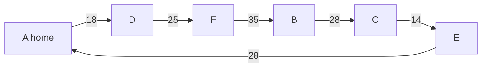

# The travelling salesman: the cheapest Hamiltonian cycle, brute force for a few cities, and why nobody has a fast method

[Syllabus](../../../SYLLABUS.md) → [Combinatorics and graphs](../README.md) → [Tours - Euler and Hamilton](../README.md#s11) → The travelling salesman

---

## General Overview

A sales rep covers six towns, written A to F, home at A. The Monday round leaves A, calls once at each of the other five, and ends back at A. The firm's chart gives the miles between every pair.

Sixty rounds are possible, few enough to list outright: the cheapest is A-D-F-B-C-E-A at 148 miles, the dearest A-E-F-C-D-B-A at 267.

Greed comes close and loses: always drive to the nearest town not yet called on and the round costs 160 miles, 8.11% above the cheapest.

**The cost of a round is the sum of its legs, so a few towns are settled by listing every round and reading off the cheapest; past a couple of dozen towns nobody knows a method that stays quick on every chart.**

**What kind of fact this is:** a method, carrying a theorem proved below ($n$ towns hold $(n-1)!/2$ rounds), an approximation with no fixed guarantee (the nearest-town rule), and an open question, unsettled as of 19 September 2026: whether a fast exact method can exist.

### The picture: the cheapest of the sixty rounds



The six legs add to 148 miles; driven the other way, the same round.

---

## The formula

Notation first, in words. The chart is $d$: $d(i, j)$ is the miles between towns i and j, so $d(A, D)$ is 18.

```
The rep's chart: miles between every pair, rows and columns A to F

     A   B   C   D   E   F
A    0  34  42  18  28  19
B   34   0  28  51  26  35
C   42  28   0  58  14  54
D   18  51  58   0  44  25
E   28  26  14  44   0  42
F   19  35  54  25  42   0
```

A round calling at every town once and returning home is a **tour**: a Hamiltonian cycle ([Hamiltonian cycles](03-hamiltonian-cycles.md)) priced leg by leg. Write it as the order it calls in, $t$, with $t_1$ home and $t_k$ the k-th town called at.

$$\text{cost}(t) = d(t_1, t_2) + d(t_2, t_3) + \cdots + d(t_5, t_6) + d(t_6, t_1)$$

**Read it aloud:** add the miles of each leg in turn, then the miles home from the last town.

The smallest cost any tour can have is written $L$: 148 miles here. With $n$ towns, how many tours must be searched:

$$\text{tours} = \frac{(n-1)!}{2}$$

Here $n!$ is the factorial: $n$ times every whole number below it ([Factorials](../01-Counting%20Principles/03-factorial.md)). **Read it aloud:** hold home still, order the other towns every way, then halve, since a round driven backwards is the same round.

One more quantity is needed below: the **cheapest connecting tree**, joining all six towns with five legs and no loop for the least miles ([The cheapest skeleton](../10-Trees%20and%20Cheapest%20Routes/04-minimum-spanning-trees.md)). Write $T$ for it, 105 here.

| Symbol | Plain meaning | In our example | Push it up and the answer… |
| --- | --- | --- | --- |
| $n$, $n!$ | towns on the round, home included; $n!$ is the factorial | 6; 5! = 120 | the search outgrows any computer |
| $d$ | the chart; $d(i, j)$ is the miles between two towns | $d(A, D)$ = 18 | every tour costs more |
| $t$, $t_1$, $t_k$ | a tour, as the order it calls in; $t_k$ is its k-th town | A, D, F, B, C, E | — |
| $L$ | the cheapest tour's miles | 148 | — |
| $T$ | the cheapest tree's miles | 105 | floor and ceiling rise |

### When it holds

- **The chart is symmetric:** B to C equals C to B. Where one-way systems break that, the halving fails and the count rises to $(n-1)!$, 120 rounds.
- **Every pair has a direct road:** no cell is blank. Where one is, orders needing that leg are not tours, and the count includes undrivable rounds.
- **No detour beats the direct road:** A to C is 42 miles, A to E to C also 42, never less. Charts breaking this keep the floor, lose the ceiling.

---

## Why it works

### Step 0: the tours are finitely many, so one of them is cheapest

Each tour has a cost, the tours can be listed, and a finite list of numbers has a smallest member. Brute force is honest for that reason: it reads the answer off a complete list. Everything hard here is that list's length.

### Step 1: sixty tours to check, and then a wall

Six towns line up in 6! = 720 orders, most naming the same round. Fixing home first strips a factor of six: 720 over 6 is 120, the orders of the other five towns. Each round still appears twice, clockwise and anticlockwise, so halving gives 60 — the bracelet count, with towns for beads ([Round tables and bracelets](../02-Repeats%2C%20Groups%20and%20Double%20Counting/04-circular-arrangements.md)).

Each town added multiplies the count by the number of towns already there: a seventh town takes 60 rounds to 360, ten towns to 181,440, fifteen to 43,589,145,600, twenty to 60,822,550,204,416,000. That is no large constant; it is a wall.

### Step 2: the nearest-town rule is fast, close, and wrong

From wherever the van stands, drive to the nearest town not yet called on, and home from the last one: the **nearest-neighbour rule**.

It gives A-D-F-B and then stumbles. At B the nearest uncalled town is E at 26 miles against C at 28, so greed takes E. The bill lands on the final leg, which greed never chooses: 42 miles home from C against 28 from E. The round costs 160 miles, 8.11% above 148; restarting at each of the six towns in turn does best from F, at 158. The rule never looks ahead, so nothing protects the drive home, and its excess can grow with the number of towns.

### Step 3: the cheapest connecting tree traps the answer from both sides

$$T \le L \le 2T$$

**Read it aloud:** the cheapest tour is never shorter than the cheapest tree, nor longer than twice it: 105 ≤ 148 ≤ 210.

The floor: delete one leg from any tour and five legs remain, still connected and with no room for a loop — a spanning tree, costing the tour less that leg. The cheapest tree is no dearer, so 105 sits below 148 before a single tour is costed.

The ceiling: walk the cheapest tree from A, each leg once out and once back. That is 210 miles and calls at every town, but towns repeat, so it is no tour. Repair it in one pass: wherever the walk would return to a town already called on, drive straight to the next town not yet called on. Each skip trades a chain of legs for one direct road, no dearer since no detour beats a direct road. The repaired round calls once at each town for at most 210 miles, so $L$ is at most 210 too.

Sharper floors than the tree exist, and inside a search that prunes they solve real instances ([Integer programs](../../14-Applied%20and%20computational/05-Operations%20Research/03-integer-programming-and-branch-and-bound.md)).

### Step 4: why nobody has a fast method

Held and Karp published a better exact method in 1962, the set-by-set method. For every set of towns already called on and every town in it, keep only the cheapest way to leave A, call at that set and stop there. Each record is built from the records one town shorter. Six towns need 80 records against 60 tours, no saving; twenty need 4,980,736. That count doubles with each town added, so it too runs out.

Karp's 1972 list of problems with no known fast method holds the bare question of whether a Hamiltonian cycle exists at all. Price a map's roads at one mile each and its missing roads at two: a round costing one mile per town exists exactly when a Hamiltonian cycle does.

So asking whether a round comes in under a given number of miles is at least as hard as anything on that list. That list is a family now thousands strong, each problem rewritable as any other in steps growing like a power of the input size (Karp's list). One method quick on every chart would make all of them quick. None is known, and whether one can exist is the open P versus NP question: P stands for the problems solved quickly, NP for the problems whose answers are checked quickly.

Charts of tens of thousands of towns are still solved exactly: the guarantee is what is missing, not the answers.

Degrees settle whether a route using every road once exists ([Euler circuits](01-euler-circuits.md)), and matching settles the cheapest road-covering route ([The Chinese postman](02-chinese-postman.md)); no such test is known once towns replace roads.

---

## Worked numbers, by hand

| Step | Arithmetic | Value |
| --- | --- | --- |
| tours to check | 5! = 120 orders, each loop twice | **60** |
| cheapest, A-D-F-B-C-E-A | 18 + 25 + 35 + 28 + 14 + 28 | **148 miles** |
| dearest, A-E-F-C-D-B-A | 28 + 42 + 54 + 58 + 51 + 34 | **267 miles** |
| nearest-town rule from A | 18 + 25 + 35 + 26 + 14 + 42 | **160 miles** |
| cheapest connecting tree | 18 + 19 + 28 + 14 + 26 | **105 miles** |
| the bracket, no tour costed | 105, and twice 105 | **105 ≤ 148 ≤ 210** |

Twelve miles a week separate the best round from the one greed suggests.

```
Miles on the rep's chart, one block per full 10 miles

cheapest connecting tree   ██████████                  105
cheapest tour              ██████████████              148
nearest-town rule from A   ████████████████            160
twice the tree             █████████████████████       210
dearest tour               ██████████████████████████  267
```

### What breaks if you drop a piece

| Mistake | Comes out at | What went wrong |
| --- | --- | --- |
| Every order counted as a tour | 720 instead of 60 | Home is fixed, and a loop reversed is the same loop |
| Stopping at the nearest-town round | 160 miles, 12 more | Greed never chooses the leg home |
| The cheapest tree read as a route | 105 miles, 43 short | A tree has no way home |

The code prints all three.

---

## Code, from first principles, and it actually runs

Nothing is imported. The cheapest tour comes twice over, by roads sharing no arithmetic: all 120 orders of the five towns after A, costed and sorted, and the set-by-set method, which forms no whole tour. The count comes twice too, formula against folding.

### Python

```python
# The travelling salesman -- the check behind the card.  Nothing is imported.  Six
# towns, A home, and the rep's mileage chart.  The cheapest tour is found twice over:
# by listing every order of the five towns after A, and by the set-by-set method,
# which keeps the cheapest way to reach each set of towns and end at each of them.
NAMES, N = "ABCDEF", 6
D = [[0, 34, 42, 18, 28, 19], [34, 0, 28, 51, 26, 35], [42, 28, 0, 58, 14, 54],
     [18, 51, 58, 0, 44, 25], [28, 26, 14, 44, 0, 42], [19, 35, 54, 25, 42, 0]]
def orders(rest):                        # every order of the towns after home
    return [()] if not rest else [(x,) + t for x in rest for t in orders([y for y in rest if y != x])]
def cost(t): return sum(D[t[k]][t[(k + 1) % N]] for k in range(N))   # legs, plus the drive home
def show(t): return "-".join(NAMES[c] for c in t) + "-" + NAMES[t[0]]
def fact(k): return 1 if k < 2 else k * fact(k - 1)
def fold(t):                             # one name per tour: rotations, both directions
    rots = [t[k:] + t[:k] for k in range(N)]
    return min(min(rots), min(tuple(reversed(r)) for r in rots))
def nearest(start):                      # greed: drive to the nearest town not yet seen
    seen = [start]
    while len(seen) < N:
        seen.append(min((D[seen[-1]][v], v) for v in range(N) if v not in seen)[1])
    return tuple(seen)
tours = [(0,) + p for p in orders(list(range(1, N)))]
ranked = sorted((cost(t), t) for t in tours)          # road one: every order, costed
best, worst, distinct = ranked[0], ranked[-1], len({fold(t) for t in tours})
sym = all(D[u][v] == D[v][u] for u in range(N) for v in range(N))
tri = all(D[u][v] <= D[u][w] + D[w][v] for u in range(N) for v in range(N) for w in range(N))
paths = {(1 << (v - 1), v): D[0][v] for v in range(1, N)}       # second road: set by set
for _ in range(N - 2):
    grown = dict(paths)
    for (s, v), c in paths.items():
        for w in range(1, N):
            if not s >> (w - 1) & 1 and c + D[v][w] < grown.get((s | 1 << (w - 1), w), 10 ** 9):
                grown[(s | 1 << (w - 1), w)] = c + D[v][w]
    paths = grown
setbest = min(paths[((1 << (N - 1)) - 1, v)] + D[v][0] for v in range(1, N))   # all five seen
inn, legs, tree = [0], [], 0
while len(inn) < N:                      # the cheapest connecting tree, grown from A
    w, u, v = min((D[u][v], u, v) for u in inn for v in range(N) if v not in inn)
    inn.append(v); legs.append(f"{NAMES[u]}-{NAMES[v]} {w}"); tree += w
nnt = nearest(0)
nnc, nns = cost(nnt), [cost(nearest(s)) for s in range(N)]
print("six towns, A home; the rep's mileage chart in miles, rows and columns A to F:")
for u in range(N):
    print(f"  {NAMES[u]} " + "".join(f"{D[u][v]:>4}" for v in range(N)))
print(f"chart symmetric: {'yes' if sym else 'no'}; no detour shorter than the direct road: {'yes' if tri else 'no'}")
print(f"orders of the five towns after A: 5! = {len(tours)}; tours (6-1)!/2 = {fact(N - 1) // 2}; by folding rotations and reversals: {distinct}")
print(f"cheapest tour, from all {len(tours)} orders: {show(best[1])} = {best[0]} miles")
print(f"the same cost from the set-by-set method: {setbest} miles, kept in {len(paths)} records")
print(f"dearest tour: {show(worst[1])} = {worst[0]} miles")
print(f"nearest neighbour from A: {show(nnt)} = {nnc} miles, {(nnc - best[0]) * 100 / best[0]:.2f}% above {best[0]}")
print(f"nearest neighbour restarted at each town A to F: {nns}; cheapest of the six {min(nns)}, still above {best[0]}")
print(f"cheapest connecting tree: {', '.join(legs)} = {tree} miles; the bracket {tree} <= {best[0]} <= {2 * tree}")
print(f"tours to check as towns are added: 6 -> {fact(5) // 2}, 7 -> {fact(6) // 2}, 10 -> {fact(9) // 2}, 15 -> {fact(14) // 2}, 20 -> {fact(19) // 2}")
print(f"records the set-by-set method keeps: 6 towns {len(paths)}, 20 towns {19 * 2 ** 18}")
print(f"mistake, every order of six towns counted as a tour: {fact(N)} instead of {distinct}")
print(f"mistake, stopping at the nearest-neighbour route: {nnc} miles, {nnc - best[0]} more than {best[0]}; the tree read as a route: {tree} miles, {best[0] - tree} short")
assert best[0] == setbest == 148 and worst[0] == 267
assert distinct == fact(N - 1) // 2 and len(tours) == fact(N - 1)
assert sym and tri and tree < best[0] <= 2 * tree
assert len(paths) == (N - 1) * 2 ** (N - 2) and nns == [160, 160, 171, 170, 161, 158] and best[0] < min(nns)
print("ALL CHECKS PASS")
```

**Ran 2026-09-19 on macOS, Python 3.14.6, standard library only. All checks passed. Output, pasted from the run:**

```
six towns, A home; the rep's mileage chart in miles, rows and columns A to F:
  A    0  34  42  18  28  19
  B   34   0  28  51  26  35
  C   42  28   0  58  14  54
  D   18  51  58   0  44  25
  E   28  26  14  44   0  42
  F   19  35  54  25  42   0
chart symmetric: yes; no detour shorter than the direct road: yes
orders of the five towns after A: 5! = 120; tours (6-1)!/2 = 60; by folding rotations and reversals: 60
cheapest tour, from all 120 orders: A-D-F-B-C-E-A = 148 miles
the same cost from the set-by-set method: 148 miles, kept in 80 records
dearest tour: A-E-F-C-D-B-A = 267 miles
nearest neighbour from A: A-D-F-B-E-C-A = 160 miles, 8.11% above 148
nearest neighbour restarted at each town A to F: [160, 160, 171, 170, 161, 158]; cheapest of the six 158, still above 148
cheapest connecting tree: A-D 18, A-F 19, A-E 28, E-C 14, E-B 26 = 105 miles; the bracket 105 <= 148 <= 210
tours to check as towns are added: 6 -> 60, 7 -> 360, 10 -> 181440, 15 -> 43589145600, 20 -> 60822550204416000
records the set-by-set method keeps: 6 towns 80, 20 towns 4980736
mistake, every order of six towns counted as a tour: 720 instead of 60
mistake, stopping at the nearest-neighbour route: 160 miles, 12 more than 148; the tree read as a route: 105 miles, 43 short
ALL CHECKS PASS
```

### Rust

Same numbers, same labels, built with `rustc --edition 2021 -O`.

```rust
// The travelling salesman -- the same check as the Python, in Rust.  No crates.  Six
// towns, A home, and the rep's mileage chart.  The cheapest tour is found twice over:
// by listing every order of the five towns after A, and by the set-by-set method,
// which keeps the cheapest way to reach each set of towns and end at each of them.
use std::collections::HashMap;
const NAMES: [char; 6] = ['A', 'B', 'C', 'D', 'E', 'F'];
const N: usize = 6;
const D: [[i64; 6]; 6] = [[0, 34, 42, 18, 28, 19], [34, 0, 28, 51, 26, 35], [42, 28, 0, 58, 14, 54],
                          [18, 51, 58, 0, 44, 25], [28, 26, 14, 44, 0, 42], [19, 35, 54, 25, 42, 0]];
fn orders(rest: &[usize]) -> Vec<Vec<usize>> {     // every order of the towns after home
    if rest.is_empty() { return vec![Vec::new()] }
    (0..rest.len()).flat_map(|i| { let mut left = rest.to_vec(); let x = left.remove(i);
        orders(&left).into_iter().map(move |t| { let mut r = vec![x]; r.extend(t); r }).collect::<Vec<Vec<usize>>>() }).collect()
}
fn cost(t: &[usize]) -> i64 { (0..N).map(|k| D[t[k]][t[(k + 1) % N]]).sum() }   // legs, plus the drive home
fn show(t: &[usize]) -> String { t.iter().map(|&c| NAMES[c].to_string()).collect::<Vec<String>>().join("-") + "-" + &NAMES[t[0]].to_string() }
fn fact(k: i64) -> i64 { if k < 2 { 1 } else { k * fact(k - 1) } }
fn fold(t: &[usize]) -> Vec<usize> {               // one name per tour: rotations, both directions
    (0..N).flat_map(|k| { let r: Vec<usize> = (0..N).map(|i| t[(k + i) % N]).collect();
        let mut b = r.clone(); b.reverse(); vec![r, b] }).min().unwrap()
}
fn nearest(start: usize) -> Vec<usize> {           // greed: drive to the nearest town not yet seen
    let mut seen = vec![start];
    while seen.len() < N {
        let last = *seen.last().unwrap();
        seen.push((0..N).filter(|v| !seen.contains(v)).map(|v| (D[last][v], v)).min().unwrap().1);
    }
    seen
}
fn main() {
    let tours: Vec<Vec<usize>> = orders(&(1..N).collect::<Vec<usize>>()).iter().map(|p| { let mut t = vec![0]; t.extend(p); t }).collect();
    let mut ranked: Vec<(i64, Vec<usize>)> = tours.iter().map(|t| (cost(t), t.clone())).collect();
    ranked.sort();                                 // road one: every order, costed
    let (best, worst) = (ranked[0].clone(), ranked[ranked.len() - 1].clone());
    let mut names: Vec<Vec<usize>> = tours.iter().map(|t| fold(t)).collect();
    names.sort(); names.dedup();
    let distinct = names.len() as i64;
    let sym = (0..N).all(|u| (0..N).all(|v| D[u][v] == D[v][u]));
    let tri = (0..N).all(|u| (0..N).all(|v| (0..N).all(|w| D[u][v] <= D[u][w] + D[w][v])));
    let mut paths: HashMap<(u32, usize), i64> = (1..N).map(|v| ((1u32 << (v - 1), v), D[0][v])).collect();   // second road: set by set
    for _ in 0..N - 2 {
        let mut grown = paths.clone();
        for (&(s, v), &c) in paths.iter() {
            for w in (1..N).filter(|w| s >> (w - 1) & 1 == 0) {
                let key = (s | 1 << (w - 1), w);
                if c + D[v][w] < *grown.get(&key).unwrap_or(&1_000_000_000) { grown.insert(key, c + D[v][w]); }
            }
        }
        paths = grown;
    }
    let setbest = (1..N).map(|v| paths[&((1u32 << (N - 1)) - 1, v)] + D[v][0]).min().unwrap();  // all five seen
    let (mut inn, mut legs, mut tree) = (vec![0usize], Vec::new(), 0);
    while inn.len() < N {                          // the cheapest connecting tree, grown from A
        let mut pick = (i64::MAX, 0usize, 0usize);
        for &u in inn.iter() { for v in 0..N { if !inn.contains(&v) && (D[u][v], u, v) < pick { pick = (D[u][v], u, v) } } }
        inn.push(pick.2); legs.push(format!("{}-{} {}", NAMES[pick.1], NAMES[pick.2], pick.0)); tree += pick.0;
    }
    let nnt = nearest(0);
    let (nnc, nns): (i64, Vec<i64>) = (cost(&nnt), (0..N).map(|s| cost(&nearest(s))).collect());
    let low = *nns.iter().min().unwrap();
    println!("six towns, A home; the rep's mileage chart in miles, rows and columns A to F:");
    for u in 0..N { println!("  {} {}", NAMES[u], (0..N).map(|v| format!("{:>4}", D[u][v])).collect::<Vec<String>>().join("")) }
    println!("chart symmetric: {}; no detour shorter than the direct road: {}", if sym { "yes" } else { "no" }, if tri { "yes" } else { "no" });
    println!("orders of the five towns after A: 5! = {}; tours (6-1)!/2 = {}; by folding rotations and reversals: {}", tours.len(), fact(N as i64 - 1) / 2, distinct);
    println!("cheapest tour, from all {} orders: {} = {} miles", tours.len(), show(&best.1), best.0);
    println!("the same cost from the set-by-set method: {} miles, kept in {} records", setbest, paths.len());
    println!("dearest tour: {} = {} miles", show(&worst.1), worst.0);
    println!("nearest neighbour from A: {} = {} miles, {:.2}% above {}", show(&nnt), nnc, (nnc - best.0) as f64 * 100.0 / best.0 as f64, best.0);
    println!("nearest neighbour restarted at each town A to F: {:?}; cheapest of the six {}, still above {}", nns, low, best.0);
    println!("cheapest connecting tree: {} = {} miles; the bracket {} <= {} <= {}", legs.join(", "), tree, tree, best.0, 2 * tree);
    println!("tours to check as towns are added: 6 -> {}, 7 -> {}, 10 -> {}, 15 -> {}, 20 -> {}", fact(5) / 2, fact(6) / 2, fact(9) / 2, fact(14) / 2, fact(19) / 2);
    println!("records the set-by-set method keeps: 6 towns {}, 20 towns {}", paths.len(), 19 * 2i64.pow(18));
    println!("mistake, every order of six towns counted as a tour: {} instead of {}", fact(N as i64), distinct);
    println!("mistake, stopping at the nearest-neighbour route: {} miles, {} more than {}; the tree read as a route: {} miles, {} short", nnc, nnc - best.0, best.0, tree, best.0 - tree);
    assert!(best.0 == setbest && setbest == 148 && worst.0 == 267);
    assert!(distinct == fact(N as i64 - 1) / 2 && tours.len() as i64 == fact(N as i64 - 1));
    assert!(sym && tri && tree < best.0 && best.0 <= 2 * tree);
    assert!(paths.len() as i64 == (N as i64 - 1) * 2i64.pow(N as u32 - 2) && nns == vec![160, 160, 171, 170, 161, 158] && best.0 < low);
    println!("ALL CHECKS PASS");
}
```

**Ran 2026-09-19 on macOS, rustc 1.98.1, no crates. All checks passed. Output, pasted from the run:**

```
six towns, A home; the rep's mileage chart in miles, rows and columns A to F:
  A    0  34  42  18  28  19
  B   34   0  28  51  26  35
  C   42  28   0  58  14  54
  D   18  51  58   0  44  25
  E   28  26  14  44   0  42
  F   19  35  54  25  42   0
chart symmetric: yes; no detour shorter than the direct road: yes
orders of the five towns after A: 5! = 120; tours (6-1)!/2 = 60; by folding rotations and reversals: 60
cheapest tour, from all 120 orders: A-D-F-B-C-E-A = 148 miles
the same cost from the set-by-set method: 148 miles, kept in 80 records
dearest tour: A-E-F-C-D-B-A = 267 miles
nearest neighbour from A: A-D-F-B-E-C-A = 160 miles, 8.11% above 148
nearest neighbour restarted at each town A to F: [160, 160, 171, 170, 161, 158]; cheapest of the six 158, still above 148
cheapest connecting tree: A-D 18, A-F 19, A-E 28, E-C 14, E-B 26 = 105 miles; the bracket 105 <= 148 <= 210
tours to check as towns are added: 6 -> 60, 7 -> 360, 10 -> 181440, 15 -> 43589145600, 20 -> 60822550204416000
records the set-by-set method keeps: 6 towns 80, 20 towns 4980736
mistake, every order of six towns counted as a tour: 720 instead of 60
mistake, stopping at the nearest-neighbour route: 160 miles, 12 more than 148; the tree read as a route: 105 miles, 43 short
ALL CHECKS PASS
```

The two outputs match line for line.

### Lean

Lean proves the tour count and both ends of the bracket for any number of towns, then checks the six-town chart.

- With $n$ towns and a two-way road between every pair, there are exactly $(n-1)!/2$ tours.
- For every tour, some connecting tree costs no more. So $T \le L$, with or without the detour rule.
- With three or more towns and no detour beating the direct road, some tour costs at most twice any connecting tree. So $L \le 2T$.
- The chart is symmetric, and no detour on it beats the direct road.
- All 120 orders of the five towns after A cost between 148 and 267 miles. Keeping those whose first town comes before the last leaves 60.
- The round A-D-F-B-E-C-A costs 160 miles, 12 more than the cheapest. The tree's five legs add to 105 miles.
- The tour counts for 7, 10, 15 and 20 towns match the card.

The Python and Rust checks are left to show greed's choices, the six restarts, the set-by-set records, and that this tree is the cheapest.

```lean
-- The travelling salesman: n towns with a direct two-way road between every pair hold exactly (n - 1)!/2 different rounds, the cheapest connecting tree costs no more than any round and, when no detour beats the direct road, some round costs at most twice the tree, and the card's six-town chart gives 60 rounds, the best at 148 miles, the worst at 267, greed at 160 and the tree at 105.
import Mathlib.Combinatorics.SimpleGraph.Hamiltonian
import Mathlib.Combinatorics.SimpleGraph.Acyclic
import Mathlib.Data.Set.Card
import Mathlib.Data.Nat.Factorial.Basic
import Mathlib.Data.Fin.VecNotation
import Mathlib.Tactic.NormNum

open SimpleGraph

namespace TSPHelp

variable {V : Type*}

/-- The roads of a route given as a list of towns. -/
def eo : List V → List (Sym2 V)
  | a :: b :: l => s(a, b) :: eo (b :: l)
  | _ => []

theorem walk_edges_eq {G : SimpleGraph V} : ∀ {u v : V} (p : G.Walk u v), p.edges = eo p.support
  | _, _, .nil => rfl
  | _, _, .cons _ .nil => rfl
  | _, _, .cons _ (.cons h p) => by
    have := walk_edges_eq (.cons h p)
    rw [Walk.edges_cons, this]
    simp [eo]

theorem support_cons_tail {G : SimpleGraph V} {u v : V} (p : G.Walk u v) :
    p.support = u :: p.support.tail := by
  cases p <;> simp

theorem mem_of_mem_eo : ∀ (L : List V) {e : Sym2 V} {x : V}, e ∈ eo L → x ∈ e → x ∈ L
  | a :: b :: l, e, x, he, hx => by
    simp only [eo, List.mem_cons] at he
    rcases he with rfl | he
    · rw [Sym2.mem_iff] at hx; rcases hx with rfl | rfl <;> simp
    · exact List.mem_cons_of_mem _ (mem_of_mem_eo _ he hx)
  | [], _, _, he, _ => by simp [eo] at he
  | [_], _, _, he, _ => by simp [eo] at he

theorem exists_walk (z : V) : ∀ (l : List V) (a : V), (a :: (l ++ [z])).Nodup →
    ∃ q : (⊤ : SimpleGraph V).Walk a z, q.support = a :: (l ++ [z])
  | [], a, h => by
    have : a ≠ z := by simpa using h
    exact ⟨Walk.cons (by simpa using this) Walk.nil, by simp⟩
  | b :: l, a, h => by
    have h1 : a ≠ b := by
      intro hab; subst hab; simp at h
    have h2 : (b :: (l ++ [z])).Nodup := (List.nodup_cons.mp h).2
    obtain ⟨q, hq⟩ := exists_walk z l b h2
    exact ⟨Walk.cons (by simpa using h1) q, by simp [hq]⟩

theorem exists_cycle [Fintype V] [DecidableEq V] (r : V) (l : List V) (hnd : l.Nodup)
    (hr : r ∉ l) (hall : ∀ v, v ≠ r → v ∈ l) (hlen : 2 ≤ l.length) :
    ∃ p : (⊤ : SimpleGraph V).Walk r r, p.IsHamiltonianCycle ∧ p.support = r :: (l ++ [r]) := by
  obtain ⟨a, b, m, rfl⟩ : ∃ a b m, l = a :: b :: m := by
    match l, hlen with
    | a :: b :: m, _ => exact ⟨a, b, m, rfl⟩
  have hnd2 : (a :: (b :: m ++ [r])).Nodup := by
    have : (a :: b :: m ++ [r]).Nodup := by
      rw [List.nodup_append]; refine ⟨hnd, by simp, ?_⟩
      intro x hx y hy; simp at hy; subst hy; rintro rfl; exact hr hx
    simpa using this
  obtain ⟨q, hq⟩ := exists_walk r (b :: m) a hnd2
  have hra : r ≠ a := by rintro rfl; simp at hr
  refine ⟨Walk.cons (by simpa using hra) q, ?_, by simp [hq]⟩
  rw [Walk.isHamiltonianCycle_iff_isCycle_and_support_count_tail_eq_one]
  refine ⟨?_, ?_⟩
  · rw [Walk.cons_isCycle_iff]
    refine ⟨(Walk.isPath_def _).2 (hq ▸ hnd2), ?_⟩
    rw [walk_edges_eq, hq]
    intro hmem
    simp only [List.cons_append, eo, List.mem_cons] at hmem
    rcases hmem with h | h
    · rw [Sym2.eq_iff] at h
      rcases h with ⟨h1, _⟩ | ⟨h1, _⟩
      · exact hra h1
      · exact hr (by simp [h1])
    · have := mem_of_mem_eo _ h (Sym2.mem_mk_right r a)
      have hnd3 := (List.nodup_cons.mp hnd2).1
      exact hnd3 (by simpa using this)
  · intro v
    simp only [Walk.support_cons, List.tail_cons, hq]
    apply List.count_eq_one_of_mem
    · simpa using hnd2
    · by_cases hv : v = r
      · simp [hv]
      · have := hall v hv; simp at this ⊢; tauto


theorem eo_append (x : V) (rest : List V) : ∀ pre : List V,
    eo (pre ++ x :: rest) = eo (pre ++ [x]) ++ eo (x :: rest)
  | [] => by simp [eo]
  | [p] => by simp [eo]
  | p :: q :: pre => by
    have := eo_append x rest (q :: pre)
    simp only [List.cons_append] at this ⊢
    simp only [eo, this, List.cons_append]

theorem insert_cost (w : Sym2 V → ℕ)
    (htri : ∀ i j k : V, i ≠ j → w s(i, j) ≤ w s(i, k) + w s(k, j))
    (pre post : List V) (x y c : V) (hyc : y ≠ c) :
    ((eo (pre ++ x :: y :: c :: post)).map w).sum ≤
      ((eo (pre ++ x :: c :: post)).map w).sum + 2 * w s(x, y) := by
  rw [eo_append, eo_append x (c :: post)]
  simp only [eo, List.map_append, List.map_cons, List.sum_append, List.sum_cons]
  have h1 := htri y c x hyc
  have h2 : w s(y, x) = w s(x, y) := by rw [Sym2.eq_swap]
  omega

theorem exists_cross [Fintype V] {G : SimpleGraph V} (hG : G.Connected) (M : List V)
    (hM : M.Nodup) (hlen : M.length < Fintype.card V) (x0 : V) (hx0 : x0 ∈ M) :
    ∃ x ∈ M, ∃ y, y ∉ M ∧ G.Adj x y := by
  classical
  obtain ⟨b, hb⟩ : ∃ b, b ∉ M := by
    by_contra h
    simp only [not_exists, not_not] at h
    have : (Finset.univ : Finset V) ⊆ M.toFinset := fun v _ => by simpa using h v
    have := Finset.card_le_card this
    rw [List.toFinset_card_of_nodup hM, Finset.card_univ] at this
    omega
  obtain ⟨d, -, hd1, hd2⟩ := (hG.preconnected x0 b).some.exists_boundary_dart {v | v ∈ M} hx0 hb
  exact ⟨d.fst, hd1, d.snd, hd2, d.adj⟩


theorem filter_eo_snoc [DecidableEq V] (z : V) : ∀ (m : List V) (a : V), z ∉ a :: m →
    (eo (a :: (m ++ [z]))).filter (fun e => z ∉ e) = eo (a :: m)
  | [], a, h => by
    simp [eo]
  | b :: m, a, h => by
    have hza : z ≠ a := fun h' => h (by simp [h'])
    have hzb : z ≠ b := fun h' => h (by simp [h'])
    have ih := filter_eo_snoc z m b (fun h' => h (List.mem_cons_of_mem _ h'))
    simp only [List.cons_append, eo] at ih ⊢
    rw [List.filter_cons_of_pos (by simp [Sym2.mem_iff, hza, hzb]), ih]

theorem last_edge (z : V) : ∀ (m : List V) (a : V), z ∉ a :: m →
    ∀ e ∈ eo (a :: (m ++ [z])), z ∈ e → e = s((a :: m).getLast (by simp), z)
  | [], a, h, e, he, _ => by simpa [eo] using he
  | b :: m, a, h, e, he, hz => by
    simp only [List.cons_append, eo, List.mem_cons] at he
    rcases he with rfl | he
    · exfalso; rw [Sym2.mem_iff] at hz
      rcases hz with rfl | rfl <;> simp at h
    · rw [List.getLast_cons (by simp)]
      exact last_edge z m b (fun h' => h (List.mem_cons_of_mem _ h')) e he hz

theorem path_unique [DecidableEq V] : ∀ (P Q : List V) (x : V), (x :: P).Nodup → (x :: Q).Nodup →
    (eo (x :: P)).toFinset = (eo (x :: Q)).toFinset → P = Q
  | [], [], _, _, _, _ => rfl
  | [], y :: Q, x, _, _, h => by
    have : s(x, y) ∈ (eo (x :: y :: Q)).toFinset := by simp [eo]
    rw [← h] at this; simp [eo] at this
  | y :: P, [], x, _, _, h => by
    have : s(x, y) ∈ (eo (x :: y :: P)).toFinset := by simp [eo]
    rw [h] at this; simp [eo] at this
  | y :: P, z :: Q, x, hP, hQ, h => by
    have hxP : x ∉ y :: P := (List.nodup_cons.mp hP).1
    have hxQ : x ∉ z :: Q := (List.nodup_cons.mp hQ).1
    have hyz : y = z := by
      have : s(x, y) ∈ (eo (x :: z :: Q)).toFinset := by rw [← h]; simp [eo]
      simp only [eo, List.toFinset_cons, Finset.mem_insert, List.mem_toFinset] at this
      rcases this with h1 | h1
      · rw [Sym2.eq_iff] at h1
        rcases h1 with ⟨_, h2⟩ | ⟨h2, _⟩
        · exact h2
        · exact absurd (h2 ▸ List.mem_cons_self) hxQ
      · exact absurd (mem_of_mem_eo _ h1 (Sym2.mem_mk_left x y)) hxQ
    subst hyz
    have hA : s(x, y) ∉ (eo (y :: P)).toFinset := fun h' => hxP
      (mem_of_mem_eo _ (List.mem_toFinset.mp h') (Sym2.mem_mk_left x y))
    have hB : s(x, y) ∉ (eo (y :: Q)).toFinset := fun h' => hxQ
      (mem_of_mem_eo _ (List.mem_toFinset.mp h') (Sym2.mem_mk_left x y))
    simp only [eo, List.toFinset_cons] at h
    have h' := congrArg (fun s => Finset.erase s s(x, y)) h
    simp only [Finset.erase_insert hA, Finset.erase_insert hB] at h'
    rw [path_unique P Q y (List.nodup_cons.mp hP).2 (List.nodup_cons.mp hQ).2 h']

/-- The roads of the round that leaves `r`, calls at the towns of `l` in order and comes home. -/
def cyc [DecidableEq V] (r : V) (l : List V) : Finset (Sym2 V) := (eo (r :: (l ++ [r]))).toFinset

#print axioms eo
#print axioms walk_edges_eq
#print axioms support_cons_tail
#print axioms mem_of_mem_eo
#print axioms exists_walk
#print axioms exists_cycle
#print axioms eo_append
#print axioms insert_cost
#print axioms exists_cross
#print axioms filter_eo_snoc
#print axioms last_edge
#print axioms path_unique
#print axioms cyc

end TSPHelp

/-- The number of tours. Take n towns with a direct road between every pair (the complete graph
on n towns), each road the same both ways. A tour is a round that calls at every town once and
comes back home, a Hamiltonian cycle; two rounds are the same tour when they drive the same roads,
whatever the starting town and whichever way round. Then there are exactly (n - 1)!/2 tours:
hold home still, order the other n - 1 towns every way, and halve, since a round driven backwards
is the same round. -/
theorem tours_of_n_towns_eq_factorial_div_two (n : ℕ) :
    {s : Finset (Sym2 (Fin n)) | ∃ (u : Fin n) (p : (⊤ : SimpleGraph (Fin n)).Walk u u),
        p.IsHamiltonianCycle ∧ p.edges.toFinset = s}.ncard = (n - 1).factorial / 2 := by
  open TSPHelp in
  rcases lt_or_ge n 3 with hn | hn
  · have hempty : {s : Finset (Sym2 (Fin n)) | ∃ (u : Fin n)
        (p : (⊤ : SimpleGraph (Fin n)).Walk u u), p.IsHamiltonianCycle ∧ p.edges.toFinset = s}
        = ∅ := by
      ext s
      simp only [Set.mem_ofPred_eq, Set.mem_empty_iff_false, iff_false, not_exists, not_and]
      intro u p hp _
      have h1 := hp.isCycle.three_le_length
      have h2 := hp.length_eq
      simp at h2
      omega
    rw [hempty, Set.ncard_empty]
    match n, hn with
    | 0, _ => rfl
    | 1, _ => rfl
    | 2, _ => rfl
  set r : Fin n := ⟨0, by omega⟩
  set b : List (Fin n) := (Finset.univ.erase r).toList
  have hb : b.Nodup := Finset.nodup_toList _
  have hblen : b.length = n - 1 := by simp [b, Finset.card_erase_of_mem]
  have hmemb : ∀ v, v ∈ b ↔ v ≠ r := by simp [b]
  set P := b.permutations.toFinset
  have hPcard : P.card = (n - 1).factorial := by
    rw [List.toFinset_card_of_nodup (List.nodup_permutations b hb), List.length_permutations,
      hblen]
  have hmemP : ∀ l, l ∈ P ↔ l.Perm b := by simp [P, List.mem_permutations]
  have good : ∀ l ∈ P, l.Nodup ∧ r ∉ l ∧ (∀ v, v ≠ r → v ∈ l) ∧ l.length = n - 1 := by
    intro l hl
    rw [hmemP] at hl
    refine ⟨hl.nodup_iff.2 hb, ?_, ?_, ?_⟩
    · rw [hl.mem_iff, hmemb]; exact fun h => h rfl
    · intro v hv; rw [hl.mem_iff, hmemb]; exact hv
    · rw [hl.length_eq, hblen]
  have hcyc : ∀ l ∈ P, ∃ p : (⊤ : SimpleGraph (Fin n)).Walk r r,
      p.IsHamiltonianCycle ∧ p.support = r :: (l ++ [r]) := by
    intro l hl
    obtain ⟨h1, h2, h3, h4⟩ := good l hl
    exact exists_cycle r l h1 h2 h3 (by omega)
  have hφrev : ∀ l ∈ P, cyc r l.reverse = cyc r l := by
    intro l hl
    obtain ⟨p, hp, hps⟩ := hcyc l hl
    have h1 : cyc r l = p.edges.toFinset := by rw [walk_edges_eq, hps]; rfl
    have h2 : cyc r l.reverse = p.reverse.edges.toFinset := by
      rw [walk_edges_eq, Walk.support_reverse, hps]; simp [cyc]
    rw [h1, h2, Walk.edges_reverse, List.toFinset_reverse]
  have hrevP : ∀ l ∈ P, l.reverse ∈ P := by
    intro l hl; rw [hmemP] at hl ⊢; exact (List.reverse_perm l).trans hl
  have hcons : ∀ l ∈ P, ∃ a m, l = a :: m ∧ m ≠ [] := by
    intro l hl
    obtain ⟨-, -, -, h4⟩ := good l hl
    match l, h4 with
    | a :: c :: m, _ => exact ⟨a, c :: m, rfl, by simp⟩
    | [], h4 => simp at h4; omega
    | [a], h4 => simp at h4; omega
  have hfilt : ∀ l ∈ P, (cyc r l).filter (fun e => r ∉ e) = (eo l).toFinset := by
    intro l hl
    obtain ⟨-, h2, -, -⟩ := good l hl
    obtain ⟨a, m, rfl, -⟩ := hcons l hl
    have key : (eo (r :: (a :: m ++ [r]))).filter (fun e => r ∉ e) = eo (a :: m) := by
      simp only [List.cons_append, eo]
      rw [List.filter_cons_of_neg (by simp)]
      have := filter_eo_snoc r m a h2
      simpa only [List.cons_append] using this
    ext e
    rw [cyc, Finset.mem_filter, List.mem_toFinset, List.mem_toFinset, ← key, List.mem_filter]
    simp
  have hsamehead : ∀ l ∈ P, ∀ l' ∈ P, l.head? = l'.head? → cyc r l = cyc r l' → l = l' := by
    intro l hl l' hl' hh hc
    have he : (eo l).toFinset = (eo l').toFinset := by rw [← hfilt l hl, ← hfilt l' hl', hc]
    obtain ⟨a, m, rfl, -⟩ := hcons l hl
    obtain ⟨a', m', rfl, -⟩ := hcons l' hl'
    simp only [List.head?_cons, Option.some.injEq] at hh
    subst hh
    rw [path_unique m m' a (good _ hl).1 (good _ hl').1 he]
  have hfiber : ∀ l ∈ P, ∀ l' ∈ P, cyc r l' = cyc r l → l' = l ∨ l' = l.reverse := by
    intro l hl l' hl' hc
    obtain ⟨a', m', rfl, -⟩ := hcons l' hl'
    obtain ⟨-, h2', -, -⟩ := good _ hl'
    obtain ⟨-, h2, -, -⟩ := good l hl
    obtain ⟨a, m, rfl, -⟩ := hcons l hl
    have hmem : s(r, a') ∈ cyc r (a :: m) := by rw [← hc]; simp [cyc, eo]
    simp only [cyc, List.cons_append, eo, List.toFinset_cons, Finset.mem_insert,
      List.mem_toFinset] at hmem
    rcases hmem with h | h
    · left
      rw [Sym2.eq_iff] at h
      rcases h with ⟨-, h⟩ | ⟨-, h⟩
      · subst h; exact hsamehead _ hl' _ hl rfl hc
      · exact absurd (by simp [h]) h2'
    · right
      have := last_edge r m a h2 _ h (Sym2.mem_mk_left r a')
      rw [Sym2.eq_iff] at this
      rcases this with ⟨-, h3⟩ | ⟨-, h3⟩
      · exact absurd (by simp [h3]) h2'
      · apply hsamehead _ hl' _ (hrevP _ hl)
        · rw [List.head?_reverse, List.getLast?_eq_getLast_of_ne_nil (by simp)]; simp [h3]
        · rw [hφrev _ hl, hc]
  have hne : ∀ l ∈ P, l ≠ l.reverse := by
    intro l hl heq
    obtain ⟨h1, -, -, -⟩ := good l hl
    obtain ⟨a, m, rfl, hm⟩ := hcons l hl
    have : (a :: m).head? = (a :: m).reverse.head? := by rw [← heq]
    rw [List.head?_reverse, List.getLast?_eq_getLast_of_ne_nil (by simp),
      List.getLast_cons hm] at this
    simp only [List.head?_cons, Option.some.injEq] at this
    have hmem : m.getLast hm ∈ m := List.getLast_mem hm
    rw [← this] at hmem
    exact (List.nodup_cons.mp h1).1 hmem
  have hset : {s : Finset (Sym2 (Fin n)) | ∃ (u : Fin n)
      (p : (⊤ : SimpleGraph (Fin n)).Walk u u), p.IsHamiltonianCycle ∧ p.edges.toFinset = s}
      = ↑(P.image (cyc r)) := by
    ext s
    simp only [Set.mem_ofPred_eq, Finset.coe_image, Set.mem_image, Finset.mem_coe]
    constructor
    · rintro ⟨u, p, hp, rfl⟩
      set p' := p.rotate r (hp.mem_support r)
      have hp' : p'.IsHamiltonianCycle := hp.rotate _
      have hE : p'.edges.toFinset = p.edges.toFinset :=
        List.toFinset_eq_of_perm _ _ (p.rotate_edges r _).perm
      have hLnd := hp'.isCycle.support_nodup
      have hLne : p'.support.tail ≠ [] := by
        have h1 := hp'.isCycle.three_le_length
        have h2 : p'.support.tail.length = p'.length := by
          simp [List.length_tail, Walk.length_support]
        intro h
        rw [h] at h2
        simp at h2
        omega
      have hLlast : p'.support.tail.getLast hLne = r := by
        rw [List.getLast_tail]; exact p'.getLast_support
      have hLeq : p'.support.tail = p'.support.tail.dropLast ++ [r] := by
        conv_lhs => rw [← List.dropLast_append_getLast hLne]
        rw [hLlast]
      set l := p'.support.tail.dropLast
      have hsupp : p'.support = r :: (l ++ [r]) := by rw [← hLeq]; exact support_cons_tail p'
      rw [hLeq, List.nodup_append] at hLnd
      have hrl : r ∉ l := fun h => hLnd.2.2 r h r (by simp) rfl
      have hlP : l ∈ P := by
        rw [hmemP, List.perm_ext_iff_of_nodup hLnd.1 hb]
        intro v
        rw [hmemb]
        constructor
        · rintro hv rfl; exact hrl hv
        · intro hv
          have := hp'.mem_support v
          rw [hsupp] at this
          simp [hv] at this
          exact this
      refine ⟨l, hlP, ?_⟩
      rw [← hE, walk_edges_eq, hsupp]; rfl
    · rintro ⟨l, hl, rfl⟩
      obtain ⟨p, hp, hps⟩ := hcyc l hl
      exact ⟨r, p, hp, by rw [walk_edges_eq, hps]; rfl⟩
  rw [hset, Set.ncard_coe_finset]
  have hcount := Finset.card_eq_sum_card_image (cyc r) P
  have hfib2 : ∀ s ∈ P.image (cyc r), (P.filter (fun a => cyc r a = s)).card = 2 := by
    intro s hs
    obtain ⟨l, hl, rfl⟩ := Finset.mem_image.mp hs
    have : P.filter (fun a => cyc r a = cyc r l) = {l, l.reverse} := by
      ext l'
      simp only [Finset.mem_filter, Finset.mem_insert, Finset.mem_singleton]
      constructor
      · rintro ⟨hl', he⟩; exact hfiber l hl l' hl' he
      · rintro (rfl | rfl)
        · exact ⟨hl, rfl⟩
        · exact ⟨hrevP _ hl, hφrev _ hl⟩
    rw [this, Finset.card_pair (hne l hl)]
  rw [Finset.sum_congr rfl hfib2, Finset.sum_const, smul_eq_mul, hPcard] at hcount
  omega

open Classical in
/-- The floor: the cheapest connecting tree costs no more than any tour. The chart `w` gives the
miles of each two-way road (a road is an unordered pair of towns, so the chart is symmetric), and
every pair of towns has a road. For every tour there is a tree joining all n towns whose roads add
to no more than the tour's legs: delete one leg of the tour and a spanning tree is left. So the
cheapest tree is at most the cheapest tour, T ≤ L. No triangle inequality is needed. -/
theorem cheapest_tree_at_most_any_tour (n : ℕ) (w : Sym2 (Fin n) → ℕ) (u : Fin n)
    (p : (⊤ : SimpleGraph (Fin n)).Walk u u) (hp : p.IsHamiltonianCycle) :
    ∃ t : SimpleGraph (Fin n), t.IsTree ∧ ∑ e ∈ t.edgeFinset, w e ≤ (p.edges.map w).sum := by
  set G := SimpleGraph.fromEdgeSet {e | e ∈ p.edges} with hG
  have hsub : ∀ e ∈ p.edges, e ∈ G.edgeSet := by
    intro e he
    rw [hG, edgeSet_fromEdgeSet]
    refine ⟨he, ?_⟩
    have := p.edges_subset_edgeSet he
    simpa [Sym2.mem_diagSet] using this
  have hconn : G.Connected := (Walk.isHamiltonianCycle_transfer hsub).2 hp |>.connected
  obtain ⟨t, hle, ht⟩ := hconn.exists_isTree_le
  refine ⟨t, ht, ?_⟩
  rw [← List.sum_toFinset _ hp.isCycle.edges_nodup]
  apply Finset.sum_le_sum_of_subset
  intro e he
  rw [mem_edgeFinset] at he
  have := edgeSet_mono hle he
  rw [hG, edgeSet_fromEdgeSet] at this
  simpa using this.1

open Classical in
/-- The ceiling: when no detour beats the direct road, some tour costs at most twice any
connecting tree. With at least three towns, a direct two-way road between every pair, and a chart
in which going from i to j by way of a third town k is never cheaper than the direct road, every
tree joining all n towns can be walked out and back and then short-cut into a tour costing at most
twice the tree's miles. So the cheapest tour is at most twice the cheapest tree, L ≤ 2T. -/
theorem some_tour_at_most_twice_any_tree (n : ℕ) (hn : 3 ≤ n) (w : Sym2 (Fin n) → ℕ)
    (htri : ∀ i j k : Fin n, i ≠ j → w s(i, j) ≤ w s(i, k) + w s(k, j))
    (t : SimpleGraph (Fin n)) (ht : t.IsTree) :
    ∃ (u : Fin n) (p : (⊤ : SimpleGraph (Fin n)).Walk u u),
      p.IsHamiltonianCycle ∧ (p.edges.map w).sum ≤ 2 * ∑ e ∈ t.edgeFinset, w e := by
  open TSPHelp in
  set r : Fin n := ⟨0, by omega⟩
  have key : ∀ k, 2 ≤ k → k ≤ n → ∃ M : List (Fin n), M.Nodup ∧ M.head? = some r ∧
      M.length = k ∧ ∃ F : Finset (Sym2 (Fin n)), F ⊆ t.edgeFinset ∧
      (∀ e ∈ F, ∀ v ∈ e, v ∈ M) ∧ ((eo (M ++ [r])).map w).sum ≤ 2 * ∑ e ∈ F, w e := by
    intro k hk
    induction k, hk using Nat.le_induction with
    | base =>
      intro h2
      obtain ⟨x, hx, y, hy, hxy⟩ := exists_cross ht.connected [r] (by simp)
        (by simp; omega) r (by simp)
      simp only [List.mem_singleton] at hx hy
      subst hx
      refine ⟨[r, y], by simpa using Ne.symm hy, rfl, rfl, {s(r, y)}, ?_, ?_, ?_⟩
      · simpa using hxy
      · intro e he v hv
        simp only [Finset.mem_singleton] at he; subst he
        rw [Sym2.mem_iff] at hv; rcases hv with rfl | rfl <;> simp
      · simp [eo, Sym2.eq_swap]; omega
    | succ k hk ih =>
      intro hkn
      obtain ⟨M, hMnd, hMh, hMl, F, hF, hFM, hcost⟩ := ih (by omega)
      have hrM : r ∈ M := by
        cases M with
        | nil => simp at hMh
        | cons a M => simp at hMh; simp [hMh]
      obtain ⟨x, hx, y, hy, hxy⟩ := exists_cross ht.connected M hMnd
        (by simp; omega) r hrM
      obtain ⟨A, B, rfl⟩ := List.append_of_mem hx
      obtain ⟨c, post, hc⟩ : ∃ c post, B ++ [r] = c :: post := by
        cases B with
        | nil => exact ⟨r, [], rfl⟩
        | cons b B => exact ⟨b, B ++ [r], rfl⟩
      have hcM : c ∈ A ++ x :: B := by
        have : c ∈ B ++ [r] := by rw [hc]; simp
        simp at this
        rcases this with h | rfl
        · simp [h]
        · exact hrM
      have hyc : y ≠ c := by rintro rfl; exact hy hcM
      have hperm : (A ++ x :: y :: B).Perm (y :: (A ++ x :: B)) := by
        have := @List.perm_middle _ y (A ++ [x]) B
        simpa using this
      refine ⟨A ++ x :: y :: B, ?_, ?_, ?_, insert s(x, y) F, ?_, ?_, ?_⟩
      · rw [hperm.nodup_iff, List.nodup_cons]; exact ⟨hy, hMnd⟩
      · cases A <;> simp_all
      · simp at hMl ⊢; omega
      · intro e he
        rw [Finset.mem_insert] at he
        rcases he with rfl | he
        · simpa using hxy
        · exact hF he
      · intro e he v hv
        rw [Finset.mem_insert] at he
        rcases he with rfl | he
        · rw [Sym2.mem_iff] at hv
          rcases hv with rfl | rfl
          · rw [hperm.mem_iff]; exact List.mem_cons_of_mem _ hx
          · rw [hperm.mem_iff]; simp
        · rw [hperm.mem_iff]; exact List.mem_cons_of_mem _ (hFM e he v hv)
      · have hnot : s(x, y) ∉ F := fun h => hy (hFM _ h y (Sym2.mem_mk_right x y))
        rw [Finset.sum_insert hnot]
        have e1 : A ++ x :: y :: B ++ [r] = A ++ x :: y :: c :: post := by
          simp [← hc]
        have e2 : A ++ x :: B ++ [r] = A ++ x :: c :: post := by
          simp [← hc]
        rw [e2] at hcost
        rw [e1]
        have := insert_cost w htri A post x y c hyc
        omega
  obtain ⟨M, hMnd, hMh, hMl, F, hF, -, hcost⟩ := key n (by omega) le_rfl
  obtain ⟨l, rfl⟩ : ∃ l, M = r :: l := by
    cases M with
    | nil => simp at hMh
    | cons a M => simp at hMh; exact ⟨M, by rw [hMh]⟩
  have hall : ∀ v, v ∈ r :: l := by
    have : (r :: l).toFinset = Finset.univ := by
      apply Finset.eq_univ_of_card
      rw [List.toFinset_card_of_nodup hMnd, hMl, Fintype.card_fin]
    intro v; simpa using (this ▸ Finset.mem_univ v : v ∈ (r :: l).toFinset)
  rw [List.nodup_cons] at hMnd
  obtain ⟨p, hp, hps⟩ := exists_cycle r l hMnd.2 hMnd.1
    (fun v hv => by have := hall v; simp [hv] at this; exact this)
    (by simp at hMl; omega)
  refine ⟨r, p, hp, ?_⟩
  rw [walk_edges_eq, hps]
  calc ((eo (r :: (l ++ [r]))).map w).sum ≤ 2 * ∑ e ∈ F, w e := by simpa using hcost
    _ ≤ 2 * ∑ e ∈ t.edgeFinset, w e := by
      have := Finset.sum_le_sum_of_subset (f := w) hF
      omega

/-! ### The card's worked numbers -/

/-- The rep's chart: miles between towns A to F, numbered 0 to 5. -/
def chart : Fin 6 → Fin 6 → ℕ :=
  ![![0, 34, 42, 18, 28, 19],
    ![34, 0, 28, 51, 26, 35],
    ![42, 28, 0, 58, 14, 54],
    ![18, 51, 58, 0, 44, 25],
    ![28, 26, 14, 44, 0, 42],
    ![19, 35, 54, 25, 42, 0]]

/-- The miles of a round that leaves A (town 0), calls at the five other towns in the order given,
and comes home to A. -/
def roundCost (l : List (Fin 6)) : ℕ :=
  ((0 :: l).zip (l ++ [0])).foldr (fun e acc => chart e.1 e.2 + acc) 0

-- The chart is symmetric, and no detour beats the direct road.
example : ∀ i j : Fin 6, chart i j = chart j i := by decide
example : ∀ i j k : Fin 6, chart i j ≤ chart i k + chart k j := by decide
-- Six towns: 6! = 720 orders, 720 / 6 = 120 with home held still, halved to 60 tours.
example : Nat.factorial 6 = 720 ∧ 720 / 6 = 120 ∧ Nat.factorial 5 = 120 ∧
    Nat.factorial (6 - 1) / 2 = 60 := by decide
/-- Every order of the towns in `rest`, built town by town as in the card's code (`k` counts the
towns still to place). -/
def orders : ℕ → List (Fin 6) → List (List (Fin 6))
  | 0, _ => [[]]
  | k + 1, rest => rest.flatMap fun x => (orders k (rest.erase x)).map (x :: ·)

/-- The 5! orders of the five towns B to F that a round from A can call in. -/
def fiveTownOrders : List (List (Fin 6)) := orders 5 [1, 2, 3, 4, 5]

-- 120 orders, all different, each calling at B, C, D, E and F once.
example : fiveTownOrders.length = 120 ∧ fiveTownOrders.Nodup := by decide +kernel
example : ∀ l ∈ fiveTownOrders, l.Perm [1, 2, 3, 4, 5] := by decide +kernel
-- Each tour appears twice, once each way round: keeping the orders whose first town is below
-- the last leaves 60.
example : (fiveTownOrders.filter (fun l => l.head! < l.getLast!)).length = 60 := by decide +kernel
-- Cheapest, A-D-F-B-C-E-A: 18 + 25 + 35 + 28 + 14 + 28 = 148 miles.
example : roundCost [3, 5, 1, 2, 4] = 148 ∧ 18 + 25 + 35 + 28 + 14 + 28 = 148 := by decide
-- Dearest, A-E-F-C-D-B-A: 28 + 42 + 54 + 58 + 51 + 34 = 267 miles.
example : roundCost [4, 5, 2, 3, 1] = 267 ∧ 28 + 42 + 54 + 58 + 51 + 34 = 267 := by decide
-- Every one of the 120 orders costs between 148 and 267 miles.
example : ∀ l ∈ fiveTownOrders, 148 ≤ roundCost l ∧ roundCost l ≤ 267 := by decide +kernel
-- The nearest-town rule from A, A-D-F-B-E-C-A: 18 + 25 + 35 + 26 + 14 + 42 = 160 miles, 12 more.
example : roundCost [3, 5, 1, 4, 2] = 160 ∧ 160 - 148 = 12 := by decide
-- The cheapest connecting tree, A-D 18, A-F 19, A-E 28, E-C 14, E-B 26: 105 miles.
example : chart 0 3 + chart 0 5 + chart 0 4 + chart 4 2 + chart 4 1 = 105 := by decide
-- The bracket: 105 ≤ 148 ≤ 210, and the tree read as a route is 43 miles short.
example : 105 ≤ 148 ∧ 148 ≤ 2 * 105 ∧ 148 - 105 = 43 := by decide
-- Tours to check as towns are added: 7 → 360, 10 → 181,440, 15 → 43,589,145,600,
-- 20 → 60,822,550,204,416,000.
example : Nat.factorial 6 / 2 = 360 ∧ Nat.factorial 9 / 2 = 181440 ∧
    Nat.factorial 14 / 2 = 43589145600 ∧ Nat.factorial 19 / 2 = 60822550204416000 := by
  norm_num [Nat.factorial]
-- One-way roads: the halving fails and six towns give (6 - 1)! = 120 rounds.
example : Nat.factorial (6 - 1) = 120 := by decide
-- The set-by-set method keeps 5 × 2⁴ = 80 records for six towns, 19 × 2¹⁸ = 4,980,736 for twenty.
example : 5 * 2 ^ 4 = 80 ∧ 19 * 2 ^ 18 = 4980736 := by norm_num

#print axioms tours_of_n_towns_eq_factorial_div_two
#print axioms cheapest_tree_at_most_any_tour
#print axioms some_tour_at_most_twice_any_tree
```

**Checked 2026-11-11 on macOS, Lean 4.36.0-rc2, Mathlib v4.36.0-rc2. Every proof is complete and uses only Lean's standard axioms. Output, pasted from the run:**

```
'TSPHelp.eo' depends on axioms: [propext]
'TSPHelp.walk_edges_eq' depends on axioms: [propext]
'TSPHelp.support_cons_tail' depends on axioms: [propext]
'TSPHelp.mem_of_mem_eo' depends on axioms: [propext, Quot.sound]
'TSPHelp.exists_walk' depends on axioms: [propext, Classical.choice, Quot.sound]
'TSPHelp.exists_cycle' depends on axioms: [propext, Classical.choice, Quot.sound]
'TSPHelp.eo_append' depends on axioms: [propext]
'TSPHelp.insert_cost' depends on axioms: [propext, Quot.sound]
'TSPHelp.exists_cross' depends on axioms: [propext, Classical.choice, Quot.sound]
'TSPHelp.filter_eo_snoc' depends on axioms: [propext, Quot.sound]
'TSPHelp.last_edge' depends on axioms: [propext, Quot.sound]
'TSPHelp.path_unique' depends on axioms: [propext, Classical.choice, Quot.sound]
'TSPHelp.cyc' depends on axioms: [propext, Classical.choice, Quot.sound]
'tours_of_n_towns_eq_factorial_div_two' depends on axioms: [propext, Classical.choice, Quot.sound]
'cheapest_tree_at_most_any_tour' depends on axioms: [propext, Classical.choice, Quot.sound]
'some_tour_at_most_twice_any_tree' depends on axioms: [propext, Classical.choice, Quot.sound]
```

> [!TIP]
> **Try changing**
> Guess first, then run it. The asserts are pinned to this chart, so expect one to stop the program.
> - **Make one road one-way.** In row C set the E entry to 40, leaving row E's C entry at 14: the symmetric line reads "no" and the third assert stops it.
> - **Start greed at F.** Change `nearest(0)` to `nearest(5)`: the round printed costs 158 miles, still above 148, and nothing stops it.
> - **Count rotations only.** In `fold`, return `min(rots)`: the count reads 120, not 60, and the second assert stops it.

---

## The usual mistake

> [!warning]
> **Taking the nearest-town round for the answer.** It is a genuine tour, 8.11% above the best here. But 160 miles against 148 is 12 miles a week the rule cannot know it has lost, since it never looks past its next call. A heuristic, a quick rule with no guarantee, hands over a tour; a bound hands over a fact.
>
> - **Counting every order as a tour.** Six towns give 720 orders but only 60 rounds.
> - **Restarting greed everywhere and calling it exhaustive.** The best of the six starts is 158 miles, still above 148.
> - **Reading the cheapest tree as a route.** It costs 105 miles, 43 short of any tour, and no van can drive it.

---

## Where you meet it in real life

- **Delivery rounds.** One van, a list of drops, back to the depot, with time windows on top.
- **Drilling circuit boards.** Thousands of holes, and the drill head's route is a tour: a percent off it is a percent off the day.
- **Genome assembly.** Overlapping DNA fragments stitched into the shortest string holding them all pose a shortest-tour question, next door to [De Bruijn sequences](05-de-bruijn-sequences.md).

> **Say it back**
> A tour calls at every town once and comes home, and its cost is the sum of its legs. Six towns hold 60 tours: half of the 5! = 120 orders of the towns after home, since a loop reversed is the same loop. All 60 can be costed — 148 miles at best, 267 at worst — while greed returns 160, never choosing the leg home. The cheapest tree floors the answer at 105 and, doubled, caps it at 210; each town added multiplies the tours, and no method stays quick on every chart.

---

## What this builds on

- [Hamiltonian cycles](03-hamiltonian-cycles.md): the object being priced, and why finding one is already hard.
- [The cheapest skeleton](../10-Trees%20and%20Cheapest%20Routes/04-minimum-spanning-trees.md): the cheapest connecting tree, which gives both ends of the bracket.

## Where this goes next

- [Polynomial or exponential](../../14-Applied%20and%20computational/01-Algorithms%20and%20Growth/03-polynomial-versus-exponential-time.md): what separates 4,980,736 records from 60,822,550,204,416,000 tours, and both from "fast".
- [Approximation](../../14-Applied%20and%20computational/02-Randomised%20and%20Approximate%20Algorithms/06-approximation-algorithms.md): heuristics with a guaranteed ratio.
- [Integer programs](../../14-Applied%20and%20computational/05-Operations%20Research/03-integer-programming-and-branch-and-bound.md): floors and pruning made into an exact method.
- [Four classic models](../../15-Optimization/05-Integer%20and%20Combinatorial%20Optimisation/06-classic-integer-models-knapsack-assignment-and-covering.md): the tour as whole-number variables and constraints.
- [Heuristics with a promise](../../15-Optimization/05-Integer%20and%20Combinatorial%20Optimisation/08-heuristics-and-approximation-guarantees.md): how close a quick method can be promised to get.
- Karp's list: the family this problem joins, and how membership is proved.

This card costs all 60 tours and shrugs at the twenty-town count; what "quick" means precisely is [Polynomial or exponential](../../14-Applied%20and%20computational/01-Algorithms%20and%20Growth/03-polynomial-versus-exponential-time.md).

---

## Sources

Verified 19 Sep 2026: every link below resolves to the publisher's page.

- Applegate, David L., Robert E. Bixby, Vašek Chvátal, and William J. Cook. *The Traveling Salesman Problem: A Computational Study*. Princeton University Press, 2006. [Publisher page](https://press.princeton.edu/books/hardcover/9780691129938/the-traveling-salesman-problem). Exact solving at the scale of tens of thousands.
- Held, Michael, and Richard M. Karp. "A Dynamic Programming Approach to Sequencing Problems." *Journal of the Society for Industrial and Applied Mathematics* 10, no. 1 (1962): 196–210. [doi:10.1137/0110015](https://doi.org/10.1137/0110015). The set-by-set method, the code's second road.
- Rosenkrantz, Daniel J., Richard E. Stearns, and Philip M. Lewis II. "An Analysis of Several Heuristics for the Traveling Salesman Problem." *SIAM Journal on Computing* 6, no. 3 (1977): 563–581. [doi:10.1137/0206041](https://doi.org/10.1137/0206041). The nearest-neighbour excess, bounded and unbounded.
- Karp, Richard M. "Reducibility among Combinatorial Problems." In *Complexity of Computer Computations*, 85–103. Springer, 1972. [doi:10.1007/978-1-4684-2001-2_9](https://doi.org/10.1007/978-1-4684-2001-2_9). The list that made the tour question a hardest case.
