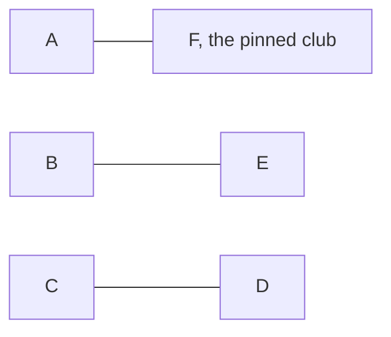

# Edge colouring: colour the edges so no two at a vertex match, and a league fixture list is exactly this

[Syllabus](../../../SYLLABUS.md) → [Combinatorics and graphs](../README.md) → [Planarity and Colouring](../README.md#s12) → Edge colouring

---

## General Overview

Six clubs in a league: A, B, C, D, E, F. Everyone plays everyone once — 15 matches — and no club plays twice on the same weekend. How few weekends does the season need?

Five. Each club has five opponents and plays one a weekend, and six clubs make at most three matches at a time: 15 matches need five weekends of three.

Strip the league to dots and lines: a dot per club, a line per match ([Graphs](../09-Graphs%20-%20Dots%20and%20Lines/01-graphs-vertices-and-edges.md)). Paint each match with its weekend's colour, and "no club plays twice a weekend" reads: no two lines of one colour meet at a dot. That is an **edge colouring**; the fewest colours that work is the **chromatic index**. ([Colouring](03-vertex-colouring-and-chromatic-number.md) does the same for dots.)

**The lines of a network need as many colours as the busiest dot has lines, or exactly one more; a league with an even number of clubs needs only that count, built by pinning one club and rotating the rest.**

**What kind of fact this is:** a theorem — Vizing's bound, stated here and proved in the sources; König's equality, proved below. The chromatic index is a definition, the rotation a method.

### The picture: one weekend, three matches



The season's first weekend, built below; four more of this shape finish it.

---

## The formula

Notation first.

- A capital Greek delta before a network's name, $\Delta(G)$, is its largest degree: the busiest dot's line count, read "delta of G" ([Degrees and the handshaking lemma](../09-Graphs%20-%20Dots%20and%20Lines/02-degree-and-handshaking.md)).
- The chromatic index is a primed chi, $\chi'(G)$, read "chi prime of G": the fewest colours in a **proper** edge colouring, where no two lines of a colour meet at a dot. Plain chi is the dot version.
- $K_n$ is the **complete network**: all $n$ dots pairwise joined.

Vizing's theorem, 1964:

$$\Delta(G) \;\le\; \chi'(G) \;\le\; \Delta(G) + 1$$

**Read it aloud:** the lines need as many colours as the busiest dot has lines, or one more, and nothing else.

Two exact answers sit inside it. A **bipartite** network splits its dots into two sides with every line crossing between them — teachers one side, classes the other ([Bipartite graphs](../09-Graphs%20-%20Dots%20and%20Lines/05-bipartite-graphs-and-odd-cycles.md)). There the lower end always holds: König, 1916.

$$\chi'(G) = \Delta(G) \quad \text{for bipartite } G, \qquad \chi'(K_n) = n - 1 \ \text{ for even } n, \qquad \chi'(K_n) = n \ \text{ for odd } n \ge 3$$

Six clubs: busiest count 5, chromatic index 5, five weekends. Five clubs: busiest count 4, chromatic index 5 — five weekends still, one resting.

| Symbol | Plain meaning | In our example | Push it up and the answer… |
| --- | --- | --- | --- |
| $n$ | how many dots in the network | 6 | more matches |
| $\Delta(G)$ | the busiest dot's line count | 5 | the floor rises |
| $\chi'(G)$ | fewest colours for the lines | 5 | — |
| $K_n$ | all $n$ dots pairwise joined | the league | — |
| $i$, $j$, $k$ | two rotating labels, and the weekend | A is 0, E is 4; weekends 0 to 4 | — |

### When it holds

- **No pair meets twice.** A triangle whose every pair plays twice has six matches all touching: six colours, where the bound promises five.
- **Bipartite, or no promise.** An odd cycle — a closed run of an odd number of lines — ends König's guarantee; the five-club league spends the spare colour.
- **Which of the two, Vizing does not say.** No quick test for choosing between three colours and four is known (Holyer, 1981), so the code below searches.

---

## Why it works

### Step 0: one colour is a set of matches with no club in common

Matches sharing a colour meet at no dot, so no two share a club. A set of lines, no two meeting, is a **matching**, so an edge colouring cuts the match list into matchings, one per colour.

### Step 1: the busiest dot sets the floor

Five lines meet the dot A and any two of them meet there, so all five differ in colour: the chromatic index is at least the busiest dot's line count, in every network.

### Step 2: an odd club count raises the floor again

A matching leaves no dot with two lines, so an odd dot count always leaves one dot out. Five clubs have 10 matches and no weekend holds more than 2, so 5 weekends are needed although the busiest club has 4 opponents: Vizing's upper end, exactly, 5 = 4 + 1.

Six clubs are even: 15 matches at 3 a weekend is 5, Step 1's floor again — the first sign 5 can be built.

### Step 3: the rotation builds the five weekends

Sit F out of the wheel: F is the **pin**, playing every weekend and never moving. Put A, B, C, D, E round a circle with labels 0 to 4, number the weekends $k = 0$ to 4, and wrap label arithmetic at 5.

$$\text{weekend } k: \quad \text{the pin meets label } k, \quad \text{and labels } i \text{ and } j \text{ meet when } i + j \equiv 2k \ (\mathrm{mod}\ 5)$$

Here $\equiv$ with $(\mathrm{mod}\ 5)$ means the two sides leave the same remainder after dividing by 5 ([Congruence](../../02-Number%20theory/03-Clock%20Arithmetic/01-congruence-mod-n.md)).

Weekend 0: the pin meets label 0, A; labels adding to 0 are 1 + 4 and 2 + 3, so B-E and C-D — the picture above.

**Nothing clashes.** Any label but $k$ has one partner, $2k$ minus itself, which is the label itself only when the label is $k$ — already booked against the pin. Every club plays once, three matches a weekend.

**Every match happens, once.** Two labels fix their weekend, since $2k$ must be their sum, and multiplying by 2 can be undone at 5, because 3 times 2 leaves 1: multiply the sum by 3 and $k$ comes back. A and B add to 1, so $k$ is 3, the fourth weekend. Five weekends of three is 15 — every pair once.

Doubling undoes only when the rotating count is odd, which is what the pin is for: rotate all six and only even label sums ever come up — 6 of the 15 matches, and A never meets B.

### Step 4: Vizing's bound, stated

The lower end is Step 1. The upper end — one spare colour, never two — is Vizing's theorem; its proof rebuilds a fan of lines round one end of a bare line, then swaps two colours along a path. Bondy and Murty give it in full (Sources). Both ends are reached: six clubs the lower, five the upper.

### Step 5: bipartite networks never need the spare colour

Teachers one side, classes the other, a line per lesson owed. The proof is by induction on the line count: assume every bipartite network with fewer lines can be coloured with its busiest count, then show this one can ([Induction](../../01-Foundations/06-Proof/04-proof-by-induction.md)).

Take a line off and colour the rest with the busiest count — taking one off cannot raise that count, so induction allows it — then put it back and call its ends u and v. Each end now carries fewer lines than there are colours, so some colour is absent at u — red — and some at v — blue. Absent at both: paint the bare line blue.

Otherwise u has a blue line. Walk out along it, then a red line, then alternate until the colours run out. That walk cannot reach v, so swap red and blue along it: the blue line at u turns red, blue is now absent at both ends, and the bare line takes it.

<details>
<summary>Detailed proof: why the walk misses v, and why the swap is safe</summary>

Keep only the red and blue lines: every dot carries at most one of each, so the pieces are paths and cycles, and the piece holding u is a path with u at one end, its lines reading blue, red, blue, red.

Had it reached v, the line there would be red, since v has no blue line, and red lines sit at even positions — so the path would be even in length, and an even walk in a bipartite network ends on the side it began, while u and v are joined. The swap is safe: interior dots trade one red line for one blue, and each end's line moves into a gap already there.

</details>

<details>
<summary>The fixture grid is a Latin square</summary>

In the grid the code prints, `A . 4 2 5 3 1` says A meets B in round 4, C in 2, D in 5, E in 3, F in 1. Every row holds rounds 1 to 5 once, and every column too, the grid reading the same across the diagonal; a sixth symbol in each diagonal blank then makes a **Latin square** of order 6 — every symbol once per row and column.

</details>

---

## Worked numbers, by hand

| Step | Arithmetic | Value |
| --- | --- | --- |
| the matches | 6 × 5, halved | **15** |
| the two floors | 6 − 1 lines at one dot; 15 at 3 a weekend | at least 5 |
| the rotation | labels summing to twice the weekend | **5 weekends of 3** |
| a search, no formula | fewest colours, 15 lines | **5** |
| five clubs instead | 10 matches, 2 a weekend | **5 weekends** |

Five weekends run the season for six clubs, and five for five, one club resting each weekend — Vizing's spare colour.

### What breaks if you drop a piece

| Mistake | Comes out at | What went wrong |
| --- | --- | --- |
| All six rotating, none pinned | 6 of the 15 matches | Doubling needs an odd count; A never meets B |
| The season squeezed into 4 weekends | 12 slots for 15 | 3 short: Step 2 forbids it |
| The busiest count read as five clubs' answer | 4 weekends, 8 slots for 10 matches | An odd count caps a weekend at 2 |

The code prints all three.

---

## Code, from first principles, and it actually runs

Nothing is imported. The code says teams and rounds for clubs and weekends, numbering them 1 to 5. Road one is the rotation's closed form; road two is a backtracking search that knows no formula, trying one colour, then two, until every line is coloured. The roads meet at 5. It also settles the five-club league, a doubled triangle, and two censuses — 1024 networks on five clubs against Vizing, 512 bipartite ones against König.

### Python

```python
# Edge colouring and the round-robin -- the check behind the card.  Nothing is imported.  Six teams
# A to F each meet the other five: F is pinned while A to E rotate, so the pin meets team i in round
# i and rotating teams i and j meet in round 3(i + j) mod 5.  Road two is a backtracking search that
# knows no formula and reports the fewest colours it can manage: it settles the six-team league, the
# five-team one, a doubled triangle, and two censuses of small networks against Vizing and Konig.
NAMES = "ABCDEF"
M = 5                                        # the rotating teams, labelled 0 to 4
def rotation():                              # road one: the closed form
    rounds = [[(i, M)] for i in range(M)]    # the pin, team 5, meets team i in round i
    for i in range(M):
        for j in range(i + 1, M): rounds[3 * (i + j) % M].append((i, j))
    return rounds
def maxdeg(n, edges): return max(sum((u == t) + (v == t) for u, v in edges) for t in range(n))
def fewest(n, edges):                        # road two: search, fewest colours first
    for k in range(len(edges) + 1):
        used = [[False] * k for _ in range(n)]
        def place(e):
            if e == len(edges): return True
            u, v = edges[e]
            for c in range(k):
                if not (used[u][c] or used[v][c]):
                    used[u][c] = used[v][c] = True
                    if place(e + 1): return True
                    used[u][c] = used[v][c] = False
            return False
        if place(0): return k
def clash(rs): return any(len({t for m in r for t in m}) != 2 * len(r) for r in rs)
def show(ms): return " ".join(NAMES[u] + "-" + NAMES[v] for u, v in ms)
def yn(c): return "yes" if c else "no"
def subsets(pool): return ([p for i, p in enumerate(pool) if m >> i & 1] for m in range(1 << len(pool)))
pairs6, pairs5 = [[(a, b) for a in range(n) for b in range(a + 1, n)] for n in (6, 5)]
bip = [(a, 3 + b) for a in range(3) for b in range(3)]        # 3 teachers against 3 classes
fat = [(0, 1), (0, 1), (1, 2), (1, 2), (0, 2), (0, 2)]        # a triangle, every match played twice
allsix = {(i, j) for k in range(6) for i in range(6) for j in range(i + 1, 6) if (i + j) % 6 == 2 * k % 6}
rounds = rotation()
grid = [[next((str(r + 1) for r, ms in enumerate(rounds) if (min(u, v), max(u, v)) in ms), ".") for v in range(6)] for u in range(6)]
five = [[m for m in r if M not in m] for r in rounds]         # the same rounds without the pin
d6, k6, d5, k5 = maxdeg(6, pairs6), fewest(6, pairs6), maxdeg(5, pairs5), fewest(5, pairs5)
tally = [0, 0, 0]                            # slot 2 catches any count Vizing forbids
for es in subsets(pairs5): tally[fewest(5, es) - maxdeg(5, es) if es else 0] += 1
konig = all(fewest(6, es) == maxdeg(6, es) for es in subsets(bip) if es)
latin = all(sorted(grid[u][v] for v in range(6) if v != u) == list("12345") for u in range(6))
print(f"six teams {NAMES}: {len(pairs6)} matches, every team meets {d6} others, so at least {d6} rounds")
for r, ms in enumerate(rounds): print(f"  round {r + 1}:  {show(ms)}")
print(f"all {len(pairs6)} pairs, each exactly once: {yn(sorted(m for r in rounds for m in r) == pairs6)}; nobody twice in one round: {yn(not clash(rounds))}\nroad two, a search knowing no formula: fewest rounds {k6}, the busiest team's count {d6}")
print(f"the fixture grid, entry = the round in which the row team meets the column team; every row holds rounds 1 to {M} once: {yn(latin)}\n  " + "    ".join(NAMES[u] + " " + " ".join(grid[u]) for u in range(6)))
print(f"five teams {NAMES[:M]}: {len(pairs5)} matches, every team meets {d5}, and a round holds only {len(five[0])} matches, so fewest rounds {k5} = {d5} + 1\n  " + " | ".join(f"round {r + 1}: {show(five[r])}, {NAMES[r]} rests" for r in range(M)))
print(f"all {1 << len(pairs5)} networks on five named teams: fewest = busiest degree in {tally[0]} of them, one more in {tally[1]}, never worse: {yn(tally[2] == 0)}\nall {1 << len(bip)} bipartite networks, 3 teachers against 3 classes: fewest = busiest degree every time: {yn(konig)}")
print(f"a triangle with every match played twice: busiest degree {maxdeg(3, fat)}, fewest rounds {fewest(3, fat)}, past Vizing's {maxdeg(3, fat) + 1}")
print(f"mistake, all six teams rotating: only {len(allsix)} of the {len(pairs6)} matches ever scheduled, and A-B is not among them: {yn((0, 1) not in allsix)}\nmistake, {len(pairs6)} matches in 4 rounds: 4 rounds x {len(rounds[0])} matches = {4 * len(rounds[0])}, short by {len(pairs6) - 4 * len(rounds[0])}\nmistake, five teams in the busiest count of {d5} rounds: {d5} rounds x {len(five[0])} matches = {d5 * len(five[0])}, short by {len(pairs5) - d5 * len(five[0])}")
assert sorted(m for r in rounds for m in r) == pairs6 and not clash(rounds)
assert k6 == 5 and d6 == 5 and latin
assert k5 == 5 and d5 == 4 and fewest(3, fat) == 6
assert tally == [951, 73, 0] and konig
print("ALL CHECKS PASS")
```

**Ran 2026-09-19 on macOS, Python 3.14.6, standard library only. All checks passed. Output, pasted from the run:**

```
six teams ABCDEF: 15 matches, every team meets 5 others, so at least 5 rounds
  round 1:  A-F B-E C-D
  round 2:  B-F A-C D-E
  round 3:  C-F A-E B-D
  round 4:  D-F A-B C-E
  round 5:  E-F A-D B-C
all 15 pairs, each exactly once: yes; nobody twice in one round: yes
road two, a search knowing no formula: fewest rounds 5, the busiest team's count 5
the fixture grid, entry = the round in which the row team meets the column team; every row holds rounds 1 to 5 once: yes
  A . 4 2 5 3 1    B 4 . 5 3 1 2    C 2 5 . 1 4 3    D 5 3 1 . 2 4    E 3 1 4 2 . 5    F 1 2 3 4 5 .
five teams ABCDE: 10 matches, every team meets 4, and a round holds only 2 matches, so fewest rounds 5 = 4 + 1
  round 1: B-E C-D, A rests | round 2: A-C D-E, B rests | round 3: A-E B-D, C rests | round 4: A-B C-E, D rests | round 5: A-D B-C, E rests
all 1024 networks on five named teams: fewest = busiest degree in 951 of them, one more in 73, never worse: yes
all 512 bipartite networks, 3 teachers against 3 classes: fewest = busiest degree every time: yes
a triangle with every match played twice: busiest degree 4, fewest rounds 6, past Vizing's 5
mistake, all six teams rotating: only 6 of the 15 matches ever scheduled, and A-B is not among them: yes
mistake, 15 matches in 4 rounds: 4 rounds x 3 matches = 12, short by 3
mistake, five teams in the busiest count of 4 rounds: 4 rounds x 2 matches = 8, short by 2
ALL CHECKS PASS
```

### Rust

Same numbers, same labels, built with `rustc --edition 2021 -O`.

```rust
// Edge colouring and the round-robin -- the same check as the Python, in Rust.  No crates.  Six teams
// A to F each meet the other five: F is pinned while A to E rotate, so the pin meets team i in round
// i and rotating teams i and j meet in round 3(i + j) mod 5.  Road two is a backtracking search that
// knows no formula and reports the fewest colours it can manage: it settles the six-team league, the
// five-team one, a doubled triangle, and two censuses of small networks against Vizing and Konig.
const NAMES: &str = "ABCDEF";
const M: usize = 5;                              // the rotating teams, labelled 0 to 4
type Edge = (usize, usize);
fn tag(i: usize) -> char { NAMES.as_bytes()[i] as char }
fn rotation() -> Vec<Vec<Edge>> {                // road one: the closed form
    let mut rounds: Vec<Vec<Edge>> = (0..M).map(|i| vec![(i, M)]).collect();  // pin meets i in round i
    for i in 0..M { for j in i + 1..M { rounds[3 * (i + j) % M].push((i, j)) } }
    rounds
}
fn maxdeg(n: usize, es: &[Edge]) -> usize {      // the busiest team's match count
    (0..n).map(|t| es.iter().map(|&(u, v)| (u == t) as usize + (v == t) as usize).sum()).max().unwrap()
}
fn place(es: &[Edge], e: usize, k: usize, used: &mut Vec<Vec<bool>>) -> bool {
    if e == es.len() { return true }
    let (u, v) = es[e];
    for c in 0..k {
        if used[u][c] || used[v][c] { continue }
        used[u][c] = true; used[v][c] = true;
        if place(es, e + 1, k, used) { return true }
        used[u][c] = false; used[v][c] = false;
    }
    false
}
fn fewest(n: usize, es: &[Edge]) -> usize {      // road two: search, fewest colours first
    (0..=es.len()).find(|&k| place(es, 0, k, &mut vec![vec![false; k]; n])).unwrap_or(es.len())
}
fn clash(rs: &[Vec<Edge>]) -> bool {
    rs.iter().any(|r| { let mut t: Vec<usize> = r.iter().flat_map(|&(u, v)| [u, v]).collect();
        t.sort(); t.dedup(); t.len() != 2 * r.len() })
}
fn show(ms: &[Edge]) -> String {
    ms.iter().map(|&(u, v)| format!("{}-{}", tag(u), tag(v))).collect::<Vec<_>>().join(" ")
}
fn yn(c: bool) -> &'static str { if c { "yes" } else { "no" } }
fn complete(n: usize) -> Vec<Edge> { (0..n).flat_map(|a| (a + 1..n).map(move |b| (a, b))).collect() }
fn subset(pool: &[Edge], mask: u32) -> Vec<Edge> { (0..pool.len()).filter(|i| mask >> i & 1 == 1).map(|i| pool[i]).collect() }
fn main() {
    let (pairs6, pairs5) = (complete(6), complete(5));
    let bip: Vec<Edge> = (0..3).flat_map(|a| (0..3).map(move |b| (a, 3 + b))).collect();   // 3 teachers, 3 classes
    let fat: Vec<Edge> = vec![(0, 1), (0, 1), (1, 2), (1, 2), (0, 2), (0, 2)];  // a triangle, matches twice
    let mut allsix: Vec<Edge> = Vec::new();
    for k in 0..6 { for i in 0..6 { for j in i + 1..6 {
        if (i + j) % 6 == 2 * k % 6 && !allsix.contains(&(i, j)) { allsix.push((i, j)) } } } }
    let rounds = rotation();
    let grid: Vec<Vec<String>> = (0..6).map(|u| (0..6).map(|v| rounds.iter()
        .position(|ms| ms.contains(&(u.min(v), u.max(v))))
        .map_or(".".to_string(), |r| (r + 1).to_string())).collect()).collect();
    let five: Vec<Vec<Edge>> = rounds.iter()     // the same rounds without the pin
        .map(|r| r.iter().copied().filter(|&(u, v)| u != M && v != M).collect()).collect();
    let (d6, k6, d5, k5) = (maxdeg(6, &pairs6), fewest(6, &pairs6), maxdeg(5, &pairs5), fewest(5, &pairs5));
    let mut tally = [0usize; 3];                 // slot 2 catches any count Vizing forbids
    for mask in 0..(1u32 << pairs5.len()) {
        let es = subset(&pairs5, mask);
        tally[fewest(5, &es) - maxdeg(5, &es)] += 1;
    }
    let konig = (0..(1u32 << bip.len())).all(|mask| { let es = subset(&bip, mask);
        es.is_empty() || fewest(6, &es) == maxdeg(6, &es) });
    let latin = (0..6).all(|u| { let mut row: Vec<&str> = (0..6).filter(|&v| v != u)
        .map(|v| grid[u][v].as_str()).collect(); row.sort(); row == ["1", "2", "3", "4", "5"] });
    let mut played: Vec<Edge> = rounds.iter().flatten().copied().collect();
    played.sort();
    println!("six teams {}: {} matches, every team meets {} others, so at least {} rounds", NAMES, pairs6.len(), d6, d6);
    for (r, ms) in rounds.iter().enumerate() { println!("  round {}:  {}", r + 1, show(ms)) }
    println!("all {} pairs, each exactly once: {}; nobody twice in one round: {}\nroad two, a search knowing no formula: fewest rounds {}, the busiest team's count {}", pairs6.len(), yn(played == pairs6), yn(!clash(&rounds)), k6, d6);
    println!("the fixture grid, entry = the round in which the row team meets the column team; every row holds rounds 1 to {} once: {}\n  {}", M, yn(latin), (0..6).map(|u| format!("{} {}", tag(u), grid[u].join(" "))).collect::<Vec<_>>().join("    "));
    println!("five teams {}: {} matches, every team meets {}, and a round holds only {} matches, so fewest rounds {} = {} + 1\n  {}", &NAMES[..M], pairs5.len(), d5, five[0].len(), k5, d5, (0..M).map(|r| format!("round {}: {}, {} rests", r + 1, show(&five[r]), tag(r))).collect::<Vec<_>>().join(" | "));
    println!("all {} networks on five named teams: fewest = busiest degree in {} of them, one more in {}, never worse: {}\nall {} bipartite networks, 3 teachers against 3 classes: fewest = busiest degree every time: {}", 1 << pairs5.len(), tally[0], tally[1], yn(tally[2] == 0), 1 << bip.len(), yn(konig));
    println!("a triangle with every match played twice: busiest degree {}, fewest rounds {}, past Vizing's {}", maxdeg(3, &fat), fewest(3, &fat), maxdeg(3, &fat) + 1);
    println!("mistake, all six teams rotating: only {} of the {} matches ever scheduled, and A-B is not among them: {}\nmistake, {} matches in 4 rounds: 4 rounds x {} matches = {}, short by {}\nmistake, five teams in the busiest count of {} rounds: {} rounds x {} matches = {}, short by {}", allsix.len(), pairs6.len(), yn(!allsix.contains(&(0, 1))), pairs6.len(), rounds[0].len(), 4 * rounds[0].len(), pairs6.len() - 4 * rounds[0].len(), d5, d5, five[0].len(), d5 * five[0].len(), pairs5.len() - d5 * five[0].len());
    assert!(played == pairs6 && !clash(&rounds));
    assert!(k6 == 5 && d6 == 5 && latin);
    assert!(k5 == 5 && d5 == 4 && fewest(3, &fat) == 6);
    assert!(tally == [951, 73, 0] && konig);
    println!("ALL CHECKS PASS");
}
```

**Ran 2026-09-19 on macOS, rustc 1.98.1, no crates. All checks passed. Output, pasted from the run:**

```
six teams ABCDEF: 15 matches, every team meets 5 others, so at least 5 rounds
  round 1:  A-F B-E C-D
  round 2:  B-F A-C D-E
  round 3:  C-F A-E B-D
  round 4:  D-F A-B C-E
  round 5:  E-F A-D B-C
all 15 pairs, each exactly once: yes; nobody twice in one round: yes
road two, a search knowing no formula: fewest rounds 5, the busiest team's count 5
the fixture grid, entry = the round in which the row team meets the column team; every row holds rounds 1 to 5 once: yes
  A . 4 2 5 3 1    B 4 . 5 3 1 2    C 2 5 . 1 4 3    D 5 3 1 . 2 4    E 3 1 4 2 . 5    F 1 2 3 4 5 .
five teams ABCDE: 10 matches, every team meets 4, and a round holds only 2 matches, so fewest rounds 5 = 4 + 1
  round 1: B-E C-D, A rests | round 2: A-C D-E, B rests | round 3: A-E B-D, C rests | round 4: A-B C-E, D rests | round 5: A-D B-C, E rests
all 1024 networks on five named teams: fewest = busiest degree in 951 of them, one more in 73, never worse: yes
all 512 bipartite networks, 3 teachers against 3 classes: fewest = busiest degree every time: yes
a triangle with every match played twice: busiest degree 4, fewest rounds 6, past Vizing's 5
mistake, all six teams rotating: only 6 of the 15 matches ever scheduled, and A-B is not among them: yes
mistake, 15 matches in 4 rounds: 4 rounds x 3 matches = 12, short by 3
mistake, five teams in the busiest count of 4 rounds: 4 rounds x 2 matches = 8, short by 2
ALL CHECKS PASS
```

The two outputs match line for line.

### Lean

Lean proves Vizing's bound, König's equality and the league answer for every finite network where no pair meets twice.

- The lines need at least as many colours as the busiest dot has lines, and at most one more.
- A bipartite network needs exactly the busiest dot's line count, never the spare colour.
- All n dots pairwise joined need n − 1 colours when n is even, and n when n is odd and at least 3.
- The six-club rotation: 15 matches, five weekends of three, no club twice in a weekend, and A meets B in weekend 3.
- Rotating all six clubs with no pin schedules only 6 of the 15 matches, and A-B is not among them.

The backtracking search, the printed rounds and grid, and the two censuses of small networks are left to the Python and Rust checks.

<details>
<summary>The Lean proof, 1134 lines</summary>

```lean
-- Edge colouring: a finite simple graph's edges need at least its largest degree in colours and at most one more, exactly that many when it is bipartite, and the complete graph on n dots needs n - 1 colours for even n and n for odd n.
import Mathlib.Combinatorics.SimpleGraph.LineGraph
import Mathlib.Combinatorics.SimpleGraph.Coloring.Vertex
import Mathlib.Combinatorics.SimpleGraph.Bipartite
import Mathlib.Combinatorics.SimpleGraph.Finite
import Mathlib.Tactic.NormNum
import Mathlib.Combinatorics.SimpleGraph.Acyclic
import Mathlib.Combinatorics.SimpleGraph.DegreeSum
import Mathlib.Combinatorics.SimpleGraph.Connectivity.Connected
import Mathlib.Data.Nat.Prime.Basic

open SimpleGraph

namespace ECHelp

section Helpers

open Finset Classical

variable {V : Type*}

def IsCol (H : SimpleGraph V) (K : Finset ℕ) (φ : V → V → ℕ) : Prop :=
  (∀ u v, H.Adj u v → φ u v ∈ K) ∧ (∀ u v, H.Adj u v → φ u v = φ v u) ∧
  (∀ u v w, H.Adj u v → H.Adj u w → v ≠ w → φ u v ≠ φ u w)

noncomputable def miss (H : SimpleGraph V) (φ : V → V → ℕ) (K : Finset ℕ) (y : V) :
    Finset ℕ :=
  K.filter (fun c => ∀ w, H.Adj y w → φ y w ≠ c)

theorem mem_miss {H : SimpleGraph V} {φ : V → V → ℕ} {K : Finset ℕ} {y : V} {c : ℕ} :
    c ∈ miss H φ K y ↔ c ∈ K ∧ ∀ w, H.Adj y w → φ y w ≠ c := by
  unfold miss; exact Finset.mem_filter

theorem miss_subset (H : SimpleGraph V) (φ : V → V → ℕ) (K : Finset ℕ) (y : V) :
    miss H φ K y ⊆ K := fun _ h => (mem_miss.1 h).1

theorem IsCol.mono {H H' : SimpleGraph V} {K : Finset ℕ} {φ : V → V → ℕ} (h : IsCol H K φ)
    (hle : ∀ u v, H'.Adj u v → H.Adj u v) : IsCol H' K φ :=
  ⟨fun u v huv => h.1 u v (hle u v huv), fun u v huv => h.2.1 u v (hle u v huv),
    fun u v w huv huw hvw => h.2.2 u v w (hle u v huv) (hle u w huw) hvw⟩

theorem card_le_miss_add [Fintype V] (H : SimpleGraph V) (φ : V → V → ℕ) (K : Finset ℕ)
    (y : V) : K.card ≤ (miss H φ K y).card + (univ.filter (fun w => H.Adj y w)).card := by
  have hsub : K ⊆ miss H φ K y ∪ (univ.filter (fun w => H.Adj y w)).image (φ y) := by
    intro c hc
    by_cases hm : c ∈ miss H φ K y
    · exact mem_union_left _ hm
    · apply mem_union_right
      simp only [mem_miss, not_and, not_forall, not_not] at hm
      obtain ⟨w, hw, hwc⟩ := hm hc
      exact mem_image.2 ⟨w, by simpa using hw, hwc⟩
  calc K.card ≤ (miss H φ K y ∪ (univ.filter (fun w => H.Adj y w)).image (φ y)).card :=
        card_le_card hsub
    _ ≤ (miss H φ K y).card + ((univ.filter (fun w => H.Adj y w)).image (φ y)).card :=
        card_union_le _ _
    _ ≤ _ := by gcongr; exact card_image_le

/-! Kempe swaps -/

def sw (a b c : ℕ) : ℕ := if c = a then b else if c = b then a else c

theorem sw_sw (a b c : ℕ) : sw a b (sw a b c) = c := by
  unfold sw; split_ifs <;> omega

theorem sw_inj (a b : ℕ) : Function.Injective (sw a b) := fun x y h => by
  simpa [sw_sw] using congrArg (sw a b) h

theorem sw_mem {K : Finset ℕ} {a b c : ℕ} (ha : a ∈ K) (hb : b ∈ K) : sw a b c ∈ K ↔ c ∈ K := by
  unfold sw; split_ifs <;> simp_all

theorem sw_eq_iff (a b c d : ℕ) : sw a b c = d ↔ c = sw a b d := by
  constructor
  · rintro rfl; rw [sw_sw]
  · rintro rfl; rw [sw_sw]

def kg (H : SimpleGraph V) (φ : V → V → ℕ) (a b : ℕ) : SimpleGraph V where
  Adj u v := H.Adj u v ∧ (φ u v = a ∨ φ u v = b) ∧ (φ v u = a ∨ φ v u = b)
  symm := ⟨fun _ _ h => ⟨h.1.symm, h.2.2, h.2.1⟩⟩
  loopless := ⟨fun _ h => H.irrefl h.1⟩

noncomputable def kswap (H : SimpleGraph V) (φ : V → V → ℕ) (a b : ℕ) (v0 : V) :
    V → V → ℕ :=
  fun u v => if (kg H φ a b).Reachable v0 u then sw a b (φ u v) else φ u v

theorem kswap_col {H : SimpleGraph V} {K : Finset ℕ} {φ : V → V → ℕ} {a b : ℕ} (v0 : V)
    (h : IsCol H K φ) (ha : a ∈ K) (hb : b ∈ K) : IsCol H K (kswap H φ a b v0) := by
  obtain ⟨h1, h2, h3⟩ := h
  refine ⟨fun u v huv => ?_, fun u v huv => ?_, fun u v w huv huw hvw => ?_⟩
  · unfold kswap; split_ifs
    · exact (sw_mem ha hb).2 (h1 u v huv)
    · exact h1 u v huv
  · have key : ∀ u v, H.Adj u v → (kg H φ a b).Reachable v0 u →
        ¬ (kg H φ a b).Reachable v0 v → sw a b (φ u v) = φ v u := by
      intro u v huv hu hv
      by_cases hc : φ u v = a ∨ φ u v = b
      · exfalso; apply hv
        have hk : (kg H φ a b).Adj u v := ⟨huv, hc, by rw [← h2 u v huv]; exact hc⟩
        exact hu.trans hk.reachable
      · push_neg at hc
        unfold sw; rw [if_neg hc.1, if_neg hc.2]; exact h2 u v huv
    unfold kswap
    by_cases hu : (kg H φ a b).Reachable v0 u <;> by_cases hv : (kg H φ a b).Reachable v0 v
    · rw [if_pos hu, if_pos hv, h2 u v huv]
    · rw [if_pos hu, if_neg hv]; exact key u v huv hu hv
    · rw [if_neg hu, if_pos hv]; exact (key v u huv.symm hv hu).symm
    · rw [if_neg hu, if_neg hv]; exact h2 u v huv
  · unfold kswap; split_ifs
    · exact fun e => h3 u v w huv huw hvw (sw_inj a b e)
    · exact h3 u v w huv huw hvw

theorem kswap_mem_miss {H : SimpleGraph V} {K : Finset ℕ} {φ : V → V → ℕ} {a b : ℕ} (v0 : V)
    (ha : a ∈ K) (hb : b ∈ K) (y : V) (c : ℕ) :
    c ∈ miss H (kswap H φ a b v0) K y ↔
      (if (kg H φ a b).Reachable v0 y then sw a b c else c) ∈ miss H φ K y := by
  simp only [mem_miss, kswap]
  split_ifs with hy
  · rw [sw_mem ha hb]
    refine and_congr_right fun _ => forall_congr' fun w => imp_congr_right fun _ => ?_
    rw [Ne, Ne, sw_eq_iff]
  · rfl

theorem kswap_card_miss {H : SimpleGraph V} {K : Finset ℕ} {φ : V → V → ℕ} {a b : ℕ} (v0 : V)
    (ha : a ∈ K) (hb : b ∈ K) (y : V) :
    (miss H (kswap H φ a b v0) K y).card = (miss H φ K y).card := by
  by_cases hy : (kg H φ a b).Reachable v0 y
  · have : miss H (kswap H φ a b v0) K y = (miss H φ K y).image (sw a b) := by
      ext c
      rw [kswap_mem_miss v0 ha hb, if_pos hy, mem_image]
      constructor
      · intro hc; exact ⟨sw a b c, hc, sw_sw a b c⟩
      · rintro ⟨d, hd, rfl⟩; rwa [sw_sw]
    rw [this, card_image_of_injective _ (sw_inj a b)]
  · congr 1
    ext c
    rw [kswap_mem_miss v0 ha hb, if_neg hy]


theorem comp_low [Fintype V] (F : SimpleGraph V) (h2 : ∀ v, F.degree v ≤ 2) (v0 : V) :
    (univ.filter (fun v => F.Reachable v0 v ∧ F.degree v ≤ 1)).card ≤ 2 := by
  set C := F.connectedComponentMk v0 with hC
  have hconn := C.connected_toSimpleGraph
  have h1 := hconn.card_vert_le_card_edgeSet_add_one
  have hsum := C.toSimpleGraph.sum_degrees_eq_twice_card_edges
  have hdeg : ∀ w : C, C.toSimpleGraph.degree w = F.degree w.1 := by
    intro w
    have := degree_induce_of_neighborSet_subset (G := F) (s := C.supp) (v := w)
      (fun z hz => C.mem_supp_of_adj_mem_supp w.2 hz)
    exact this
  set L : Finset C := univ.filter (fun w => F.degree w.1 ≤ 1) with hL
  have hLsum : ∑ w : C, F.degree w.1 + L.card ≤ 2 * Fintype.card C := by
    rw [hL, card_filter, ← sum_add_distrib, ← card_univ, mul_comm, ← smul_eq_mul,
      ← sum_const]
    apply sum_le_sum
    intro w _
    have := h2 w.1
    split_ifs <;> omega
  have hE : Nat.card C.toSimpleGraph.edgeSet = (C.toSimpleGraph.edgeFinset).card := by
    rw [Nat.card_eq_fintype_card, edgeFinset_card]
  rw [Nat.card_eq_fintype_card, hE] at h1
  simp_rw [hdeg] at hsum
  have hLle : L.card ≤ 2 := by omega
  have heq : univ.filter (fun v => F.Reachable v0 v ∧ F.degree v ≤ 1) =
      L.map (Function.Embedding.subtype _) := by
    ext v
    simp only [mem_filter, mem_univ, true_and, mem_map, hL, Function.Embedding.subtype_apply]
    constructor
    · rintro ⟨hr, hd⟩
      refine ⟨⟨v, ?_⟩, hd, rfl⟩
      rw [hC]
      exact (ConnectedComponent.eq.2 hr).symm
    · rintro ⟨w, hw, rfl⟩
      refine ⟨?_, hw⟩
      have hw2 : F.connectedComponentMk w.1 = C := w.2
      exact (ConnectedComponent.eq.1 hw2).symm
  rw [heq, card_map]
  exact hLle

theorem card_colour_le_one [Fintype V] {H : SimpleGraph V} {K : Finset ℕ} {φ : V → V → ℕ}
    (h : IsCol H K φ) (y : V) (c : ℕ) :
    (univ.filter (fun w => H.Adj y w ∧ φ y w = c)).card ≤ 1 := by
  rw [card_le_one]
  intro w1 hw1 w2 hw2
  simp only [mem_filter, mem_univ, true_and] at hw1 hw2
  by_contra hne
  exact h.2.2 y w1 w2 hw1.1 hw2.1 hne (hw1.2.trans hw2.2.symm)

theorem kg_degree_eq [Fintype V] (H : SimpleGraph V) (φ : V → V → ℕ) (a b : ℕ) (y : V) :
    (kg H φ a b).degree y = (univ.filter (fun w => (kg H φ a b).Adj y w)).card := by
  rw [← card_neighborFinset_eq_degree, neighborFinset_eq_filter]

theorem kg_deg_le [Fintype V] {H : SimpleGraph V} {K : Finset ℕ} {φ : V → V → ℕ}
    (h : IsCol H K φ) (a b : ℕ) (y : V) : (kg H φ a b).degree y ≤ 2 := by
  rw [kg_degree_eq]
  calc _ ≤ (univ.filter (fun w => H.Adj y w ∧ φ y w = a) ∪
        univ.filter (fun w => H.Adj y w ∧ φ y w = b)).card := by
        apply card_le_card
        intro w hw
        simp only [mem_filter, mem_univ, true_and, mem_union] at hw ⊢
        rcases hw.2.1 with h' | h'
        · exact Or.inl ⟨hw.1, h'⟩
        · exact Or.inr ⟨hw.1, h'⟩
    _ ≤ _ := card_union_le _ _
    _ ≤ 1 + 1 := add_le_add (card_colour_le_one h y a) (card_colour_le_one h y b)

theorem kg_deg_miss [Fintype V] {H : SimpleGraph V} {K : Finset ℕ} {φ : V → V → ℕ}
    (h : IsCol H K φ) (a b : ℕ) (y : V) (hy : a ∈ miss H φ K y) :
    (kg H φ a b).degree y ≤ 1 := by
  rw [kg_degree_eq]
  calc _ ≤ (univ.filter (fun w => H.Adj y w ∧ φ y w = b)).card := by
        apply card_le_card
        intro w hw
        simp only [mem_filter, mem_univ, true_and] at hw ⊢
        refine ⟨hw.1, ?_⟩
        rcases hw.2.1 with h' | h'
        · exact absurd h' ((mem_miss.1 hy).2 w hw.1)
        · exact h'
    _ ≤ 1 := card_colour_le_one h y b


theorem even_sum' {ι : Type*} (s : Finset ι) (f : ι → ℕ) (h : ∀ i ∈ s, Even (f i)) :
    Even (∑ i ∈ s, f i) := by
  induction s using Finset.induction_on with
  | empty => simp
  | insert a s ha ih =>
    rw [sum_insert ha]
    exact (h a (mem_insert_self a s)).add (ih fun i hi => h i (mem_insert_of_mem hi))

theorem sw_b (a b : ℕ) (hab : a ≠ b) : sw a b b = a := by
  unfold sw; rw [if_neg (Ne.symm hab), if_pos rfl]

theorem core [Fintype V] {H : SimpleGraph V} {K : Finset ℕ} {φ : V → V → ℕ} (N : Finset V)
    (hφ : IsCol H K φ) (hNK : N.card ≤ K.card) (hNne : N.Nonempty)
    (h1 : ∀ y ∈ N, 1 ≤ (miss H φ K y).card)
    (hs : (N.filter (fun y => (miss H φ K y).card ≤ 1)).card ≤ 1) :
    ∃ φ1, IsCol H K φ1 ∧ (∀ y, (miss H φ1 K y).card = (miss H φ K y).card) ∧
      ∃ a ∈ K, ∃ u ∈ N, a ∈ miss H φ1 K u ∧
        (N.filter (fun z => z ≠ u ∧ a ∈ miss H φ1 K z ∧ (miss H φ1 K z).card ≤ 2)).card +
          (N.filter (fun z => (miss H φ1 K z).card ≤ 1)).card ≤ 1 := by
  set Tt := N.filter (fun y => (miss H φ K y).card ≤ 2) with hTt
  set S := N.filter (fun y => (miss H φ K y).card ≤ 1) with hS
  have hSsub : S ⊆ Tt := by
    intro z hz
    rw [hS, mem_filter] at hz
    exact mem_filter.2 ⟨hz.1, by omega⟩
  -- Case 1: no tight neighbours
  by_cases hT : Tt = ∅
  · obtain ⟨y, hy⟩ := hNne
    obtain ⟨a, ha⟩ := card_pos.1 (h1 y hy)
    refine ⟨φ, hφ, fun _ => rfl, a, miss_subset _ _ _ _ ha, y, hy, ha, ?_⟩
    have e1 : N.filter (fun z => z ≠ y ∧ a ∈ miss H φ K z ∧ (miss H φ K z).card ≤ 2) = ∅ := by
      rw [filter_eq_empty_iff]
      rintro z hz ⟨_, _, h2⟩
      have : z ∈ Tt := mem_filter.2 ⟨hz, h2⟩
      rw [hT] at this
      simp at this
    have e2 : S = ∅ := subset_empty.1 (hT ▸ hSsub)
    rw [e1, ← hS, e2]
    simp
  set A : ℕ → ℕ := fun c => (Tt.filter (fun y => c ∈ miss H φ K y)).card with hA
  -- Case 2: a colour already works
  by_cases hc2 : ∃ c ∈ K, 1 ≤ A c ∧ A c + S.card ≤ 2
  · obtain ⟨c, hcK, hc1, hc2⟩ := hc2
    obtain ⟨u, hu⟩ := card_pos.1 hc1
    have hu' := mem_filter.1 hu
    have huN : u ∈ N := (mem_filter.1 hu'.1).1
    refine ⟨φ, hφ, fun _ => rfl, c, hcK, u, huN, hu'.2, ?_⟩
    have hsub : N.filter (fun z => z ≠ u ∧ c ∈ miss H φ K z ∧ (miss H φ K z).card ≤ 2) ⊆
        (Tt.filter (fun y => c ∈ miss H φ K y)).erase u := by
      intro z hz
      simp only [mem_filter] at hz
      exact mem_erase.2 ⟨hz.2.1, mem_filter.2 ⟨mem_filter.2 ⟨hz.1, hz.2.2.2⟩, hz.2.2.1⟩⟩
    have := card_le_card hsub
    rw [card_erase_of_mem hu] at this
    rw [← hS]
    have : A c = (Tt.filter (fun y => c ∈ miss H φ K y)).card := rfl
    omega
  -- Case 3: Kempe swap
  push_neg at hc2
  have hTne : Tt.Nonempty := nonempty_iff_ne_empty.2 hT
  have hSle : S.card ≤ 1 := hs
  have hTN : Tt.card ≤ N.card := card_filter_le _ _
  have hdc : ∑ c ∈ K, A c = ∑ y ∈ Tt, (miss H φ K y).card := by
    simp only [hA, card_filter]
    rw [sum_comm]
    apply sum_congr rfl
    intro y _
    rw [← card_filter, filter_mem_eq_inter, inter_eq_right.2 (miss_subset _ _ _ _)]
  have heq : ∑ y ∈ Tt, (miss H φ K y).card + S.card = 2 * Tt.card := by
    have hSc : S.card = ∑ y ∈ Tt, if (miss H φ K y).card ≤ 1 then 1 else 0 := by
      rw [← card_filter, hS, hTt, filter_filter]
      congr 1
      apply filter_congr
      intro y _
      constructor
      · intro h; exact ⟨by omega, h⟩
      · intro h; exact h.2
    rw [hSc, ← sum_add_distrib, card_eq_sum_ones, mul_sum]
    apply sum_congr rfl
    intro y hy
    have hy1 := h1 y (mem_filter.1 hy).1
    have hy2 := (mem_filter.1 hy).2
    split_ifs <;> omega
  have hK1 : 1 ≤ K.card := lt_of_lt_of_le (card_pos.2 hNne) hNK
  have hb : ∃ b ∈ K, A b = 0 := by
    by_contra hno
    push_neg at hno
    have hge : ∀ c ∈ K, 3 - S.card ≤ A c := fun c hc => by
      have := hc2 c hc (Nat.one_le_iff_ne_zero.2 (hno c hc))
      omega
    have := sum_le_sum hge
    rw [sum_const, smul_eq_mul, hdc] at this
    rcases Nat.le_one_iff_eq_zero_or_eq_one.1 hSle with h | h <;> rw [h] at this heq <;>
      omega
  obtain ⟨b, hbK, hb0⟩ := hb
  have ha : ∃ a ∈ K, 1 ≤ A a ∧ (S.card = 1 → Odd (A a)) := by
    by_cases hS1 : S.card = 1
    · by_contra hno
      push_neg at hno
      have hev : Even (∑ c ∈ K, A c) := by
        apply even_sum'
        intro c hc
        by_cases h : 1 ≤ A c
        · exact Nat.not_odd_iff_even.1 (hno c hc h).2
        · have : A c = 0 := by omega
          rw [this]; exact ⟨0, rfl⟩
      rw [hdc] at hev
      obtain ⟨r, hr⟩ := hev
      omega
    · obtain ⟨y, hy⟩ := hTne
      obtain ⟨a, ha⟩ := card_pos.1 (h1 y (mem_filter.1 hy).1)
      exact ⟨a, miss_subset _ _ _ _ ha, card_pos.2 ⟨y, mem_filter.2 ⟨hy, ha⟩⟩,
        fun h => absurd h hS1⟩
  obtain ⟨a, haK, ha1, haodd⟩ := ha
  have hab : a ≠ b := by
    rintro rfl
    omega
  set F := kg H φ a b with hF
  have hp2 : ∀ y, (Tt.filter (fun z => F.Reachable y z ∧ a ∈ miss H φ K z)).card ≤ 2 := by
    intro y
    refine le_trans (card_le_card ?_) (comp_low F (kg_deg_le hφ a b) y)
    intro z hz
    simp only [mem_filter, mem_univ, true_and] at hz ⊢
    exact ⟨hz.2.1, kg_deg_miss hφ a b z hz.2.2⟩
  have hy : ∃ y ∈ Tt, a ∈ miss H φ K y ∧
      (S.card = 1 → (Tt.filter (fun z => F.Reachable y z ∧ a ∈ miss H φ K z)).card ≠ 2) := by
    by_cases hS1 : S.card = 1
    · by_contra hno
      push_neg at hno
      set X := Tt.filter (fun y => a ∈ miss H φ K y) with hX
      have hXe : Even X.card := by
        rw [card_eq_sum_card_image (fun y => F.connectedComponentMk y) X]
        apply even_sum'
        intro c hc
        obtain ⟨y, hyX, rfl⟩ := mem_image.1 hc
        have hyX' := mem_filter.1 hyX
        have : X.filter (fun z => F.connectedComponentMk z = F.connectedComponentMk y) =
            Tt.filter (fun z => F.Reachable y z ∧ a ∈ miss H φ K z) := by
          ext z
          simp only [hX, mem_filter, ConnectedComponent.eq]
          constructor
          · rintro ⟨⟨h1, h2⟩, h3⟩; exact ⟨h1, h3.symm, h2⟩
          · rintro ⟨h1, h3, h2⟩; exact ⟨⟨h1, h2⟩, h3.symm⟩
        rw [this, (hno y hyX'.1 hyX'.2).2]
        exact even_two
      exact Nat.not_even_iff_odd.2 (haodd hS1) hXe
    · obtain ⟨y, hy⟩ := card_pos.1 ha1
      exact ⟨y, (mem_filter.1 hy).1, (mem_filter.1 hy).2, fun h => absurd h hS1⟩
  obtain ⟨y, hyT, hya, hyp⟩ := hy
  have hyin : y ∈ Tt.filter (fun z => F.Reachable y z ∧ a ∈ miss H φ K z) :=
    mem_filter.2 ⟨hyT, Reachable.refl _, hya⟩
  have hp1 := card_pos.2 ⟨y, hyin⟩
  have hp2y := hp2 y
  refine ⟨kswap H φ a b y, kswap_col y hφ haK hbK, kswap_card_miss y haK hbK, b, hbK, y,
    (mem_filter.1 hyT).1, ?_, ?_⟩
  · rw [kswap_mem_miss y haK hbK, if_pos (Reachable.refl _), sw_b a b hab]
    exact hya
  · simp_rw [kswap_card_miss y haK hbK]
    rw [← hS]
    have hsub : N.filter (fun z => z ≠ y ∧ b ∈ miss H (kswap H φ a b y) K z ∧
        (miss H φ K z).card ≤ 2) ⊆
        (Tt.filter (fun z => F.Reachable y z ∧ a ∈ miss H φ K z)).erase y := by
      intro z hz
      simp only [mem_filter] at hz
      obtain ⟨hzN, hzy, hzb, hz2⟩ := hz
      have hzT : z ∈ Tt := mem_filter.2 ⟨hzN, hz2⟩
      rw [kswap_mem_miss y haK hbK] at hzb
      split_ifs at hzb with hr
      · rw [sw_b a b hab] at hzb
        exact mem_erase.2 ⟨hzy, mem_filter.2 ⟨hzT, hr, hzb⟩⟩
      · exfalso
        have : 0 < A b := card_pos.2 ⟨z, mem_filter.2 ⟨hzT, hzb⟩⟩
        omega
    have := card_le_card hsub
    rw [card_erase_of_mem hyin] at this
    rcases Nat.le_one_iff_eq_zero_or_eq_one.1 hSle with h | h
    · omega
    · have := hyp h
      omega


def Del (G : SimpleGraph V) (x : V) : SimpleGraph V where
  Adj u v := G.Adj u v ∧ u ≠ x ∧ v ≠ x
  symm := ⟨fun _ _ h => ⟨h.1.symm, h.2.2, h.2.1⟩⟩
  loopless := ⟨fun _ h => G.irrefl h.1⟩

theorem isCol_of_noNbr {G : SimpleGraph V} {x : V} {K : Finset ℕ} {φ : V → V → ℕ}
    (hx : ∀ y, ¬ G.Adj x y) (h : IsCol (Del G x) K φ) : IsCol G K φ :=
  h.mono (fun u v huv => ⟨huv, fun e => hx v (e ▸ huv), fun e => hx u (e ▸ huv.symm)⟩)

def Gp (G : SimpleGraph V) (x u : V) (φ : V → V → ℕ) (a : ℕ) : SimpleGraph V where
  Adj v w := G.Adj v w ∧ ¬(v = x ∧ w = u) ∧ ¬(v = u ∧ w = x) ∧
    ¬(v ≠ x ∧ w ≠ x ∧ (φ v w = a ∨ φ w v = a))
  symm := ⟨fun _ _ h => ⟨h.1.symm, fun h' => h.2.2.1 ⟨h'.2, h'.1⟩,
    fun h' => h.2.1 ⟨h'.2, h'.1⟩, fun h' => h.2.2.2 ⟨h'.2.1, h'.1, h'.2.2.symm⟩⟩⟩
  loopless := ⟨fun _ h => G.irrefl h.1⟩

theorem Gp_cases {G : SimpleGraph V} {x u : V} {φ : V → V → ℕ} {a : ℕ} {K : Finset ℕ}
    (hφ : IsCol (Del G x) K φ) {v w : V} (hvw : G.Adj v w) (hn : ¬ (Gp G x u φ a).Adj v w) :
    (v = x ∧ w = u) ∨ (v = u ∧ w = x) ∨ (v ≠ x ∧ w ≠ x ∧ φ v w = a) := by
  by_cases h1 : v = x ∧ w = u
  · exact Or.inl h1
  by_cases h2 : v = u ∧ w = x
  · exact Or.inr (Or.inl h2)
  have h3 : v ≠ x ∧ w ≠ x ∧ (φ v w = a ∨ φ w v = a) := by
    by_contra h3
    exact hn ⟨hvw, h1, h2, h3⟩
  refine Or.inr (Or.inr ⟨h3.1, h3.2.1, ?_⟩)
  rcases h3.2.2 with h | h
  · exact h
  · rw [hφ.2.1 v w ⟨hvw, h3.1, h3.2.1⟩]; exact h

theorem VL [Fintype V] : ∀ (n : ℕ) (K : Finset ℕ), K.card = n →
    ∀ (G : SimpleGraph V) (x : V) (φ : V → V → ℕ),
    IsCol (Del G x) K φ → (univ.filter (fun y => G.Adj x y)).card ≤ K.card →
    (∀ y, G.Adj x y → 1 ≤ (miss (Del G x) φ K y).card) →
    (univ.filter (fun y => G.Adj x y ∧ (miss (Del G x) φ K y).card ≤ 1)).card ≤ 1 →
    ∃ ψ, IsCol G K ψ := by
  intro n
  induction n with
  | zero =>
    intro K hK G x φ hφ hd _ _
    refine ⟨φ, isCol_of_noNbr (fun y hy => ?_) hφ⟩
    have : 0 < (univ.filter (fun y => G.Adj x y)).card := card_pos.2 ⟨y, by simpa using hy⟩
    omega
  | succ m ih =>
    intro K hK G x φ hφ hd h1 hs
    by_cases hx : ∃ y, G.Adj x y
    swap
    · push_neg at hx
      exact ⟨φ, isCol_of_noNbr hx hφ⟩
    obtain ⟨y0, hy0⟩ := hx
    set N := univ.filter (fun y => G.Adj x y) with hN
    have hmemN : ∀ y, y ∈ N ↔ G.Adj x y := fun y => by simp [hN]
    have hfilt : N.filter (fun y => (miss (Del G x) φ K y).card ≤ 1) =
        univ.filter (fun y => G.Adj x y ∧ (miss (Del G x) φ K y).card ≤ 1) := by
      rw [hN, filter_filter]
    obtain ⟨φ1, hφ1, hc, a, haK, u, huN, hau, hgood⟩ := core N hφ hd ⟨y0, (hmemN y0).2 hy0⟩
      (fun y hy => h1 y ((hmemN y).1 hy)) (by rw [hfilt]; exact hs)
    have hxu : G.Adj x u := (hmemN u).1 huN
    set G' := Gp G x u φ1 a with hG'
    have hDel' : ∀ v w, (Del G' x).Adj v w ↔
        (Del G x).Adj v w ∧ ¬(φ1 v w = a ∨ φ1 w v = a) := by
      intro v w
      constructor
      · rintro ⟨⟨hg, -, -, h3⟩, hv, hw⟩
        exact ⟨⟨hg, hv, hw⟩, fun h => h3 ⟨hv, hw, h⟩⟩
      · rintro ⟨⟨hg, hv, hw⟩, h⟩
        exact ⟨⟨hg, fun h' => hv h'.1, fun h' => hw h'.2, fun h' => h h'.2.2⟩, hv, hw⟩
    have hcol' : IsCol (Del G' x) (K.erase a) φ1 := by
      refine ⟨fun v w h => ?_, fun v w h => hφ1.2.1 v w ((hDel' v w).1 h).1,
        fun v w1 w2 h1 h2 hne => hφ1.2.2 v w1 w2 ((hDel' v w1).1 h1).1 ((hDel' v w2).1 h2).1 hne⟩
      rw [hDel'] at h
      exact mem_erase.2 ⟨fun e => h.2 (Or.inl e), hφ1.1 v w h.1⟩
    have hmiss' : ∀ z, miss (Del G' x) φ1 (K.erase a) z = (miss (Del G x) φ1 K z).erase a := by
      intro z
      ext c
      simp only [mem_miss, mem_erase]
      constructor
      · rintro ⟨⟨hca, hcK⟩, hall⟩
        refine ⟨hca, hcK, fun w hw => ?_⟩
        by_cases e : φ1 z w = a
        · intro h; apply hca; rw [← h, e]
        · refine hall w ((hDel' z w).2 ⟨hw, fun h => h.elim e (fun e' => e ?_)⟩)
          rw [hφ1.2.1 z w hw]; exact e'
      · rintro ⟨hca, hcK, hall⟩
        exact ⟨⟨hca, hcK⟩, fun w hw => hall w ((hDel' z w).1 hw).1⟩
    have hnb' : ∀ y, G'.Adj x y ↔ G.Adj x y ∧ y ≠ u := by
      intro y
      constructor
      · intro h; exact ⟨h.1, fun e => h.2.1 ⟨rfl, e⟩⟩
      · intro h
        refine ⟨h.1, fun e => h.2 e.2, fun e => ?_, fun e => e.1 rfl⟩
        have := h.1
        rw [e.2] at this
        exact G.irrefl this
    have hd' : (univ.filter (fun y => G'.Adj x y)).card ≤ (K.erase a).card := by
      rw [card_erase_of_mem haK]
      have : univ.filter (fun y => G'.Adj x y) = N.erase u := by
        ext y
        simp only [mem_filter, mem_univ, true_and, hnb', mem_erase, hmemN]
        exact and_comm
      rw [this, card_erase_of_mem huN]
      omega
    have h1' : ∀ y, G'.Adj x y → 1 ≤ (miss (Del G' x) φ1 (K.erase a) y).card := by
      intro y hy
      rw [hnb'] at hy
      rw [hmiss']
      have hy1 : 1 ≤ (miss (Del G x) φ1 K y).card := by rw [hc]; exact h1 y hy.1
      by_cases hay : a ∈ miss (Del G x) φ1 K y
      · rw [card_erase_of_mem hay]
        by_contra hlt
        have hle : (miss (Del G x) φ1 K y).card ≤ 1 := by omega
        have e1 : 1 ≤ (N.filter (fun z => z ≠ u ∧ a ∈ miss (Del G x) φ1 K z ∧
            (miss (Del G x) φ1 K z).card ≤ 2)).card :=
          card_pos.2 ⟨y, mem_filter.2 ⟨(hmemN y).2 hy.1, hy.2, hay, by omega⟩⟩
        have e2 : 1 ≤ (N.filter (fun z => (miss (Del G x) φ1 K z).card ≤ 1)).card :=
          card_pos.2 ⟨y, mem_filter.2 ⟨(hmemN y).2 hy.1, hle⟩⟩
        omega
      · rw [erase_eq_of_notMem hay]; exact hy1
    have hs' : (univ.filter (fun y => G'.Adj x y ∧
        (miss (Del G' x) φ1 (K.erase a) y).card ≤ 1)).card ≤ 1 := by
      calc _ ≤ (N.filter (fun z => z ≠ u ∧ a ∈ miss (Del G x) φ1 K z ∧
              (miss (Del G x) φ1 K z).card ≤ 2) ∪
            N.filter (fun z => (miss (Del G x) φ1 K z).card ≤ 1)).card := by
            apply card_le_card
            intro y hy
            simp only [mem_filter, mem_univ, true_and, hnb', hmiss'] at hy
            simp only [mem_union, mem_filter, hmemN]
            by_cases hay : a ∈ miss (Del G x) φ1 K y
            · rw [card_erase_of_mem hay] at hy
              left
              exact ⟨hy.1.1, hy.1.2, hay, by omega⟩
            · rw [erase_eq_of_notMem hay] at hy
              right
              exact ⟨hy.1.1, hy.2⟩
        _ ≤ _ := card_union_le _ _
        _ ≤ 1 := hgood
    obtain ⟨ψ', hψ'⟩ := ih (K.erase a) (by rw [card_erase_of_mem haK, hK]; rfl) G' x φ1
      hcol' hd' h1' hs'
    refine ⟨fun v w => if G'.Adj v w then ψ' v w else a, ?_, ?_, ?_⟩
    · intro v w _
      dsimp only
      split_ifs with h
      · exact mem_of_mem_erase (hψ'.1 v w h)
      · exact haK
    · intro v w _
      dsimp only
      by_cases h : G'.Adj v w
      · rw [if_pos h, if_pos h.symm]; exact hψ'.2.1 v w h
      · rw [if_neg h, if_neg (fun h' => h h'.symm)]
    · intro v w1 w2 hv1 hv2 hne
      dsimp only
      by_cases g1 : G'.Adj v w1 <;> by_cases g2 : G'.Adj v w2
      · rw [if_pos g1, if_pos g2]; exact hψ'.2.2 v w1 w2 g1 g2 hne
      · rw [if_pos g1, if_neg g2]; exact (mem_erase.1 (hψ'.1 v w1 g1)).1
      · rw [if_neg g1, if_pos g2]; exact Ne.symm (mem_erase.1 (hψ'.1 v w2 g2)).1
      · exfalso
        have hux : u ≠ x := hxu.ne.symm
        have hau' := (mem_miss.1 hau).2
        rcases Gp_cases hφ1 hv1 g1 with ⟨hv, hw⟩ | ⟨hv, hw⟩ | ⟨hv, hw, hk1⟩ <;>
          rcases Gp_cases hφ1 hv2 g2 with ⟨hv', hw'⟩ | ⟨hv', hw'⟩ | ⟨hv', hw', hk2⟩
        · exact hne (hw.trans hw'.symm)
        · exact hux (hv'.symm.trans hv)
        · exact hv' hv
        · exact hux (hv.symm.trans hv')
        · exact hne (hw.trans hw'.symm)
        · subst hv
          exact hau' w2 ⟨hv2, hux, hw'⟩ hk2
        · exact hv hv'
        · subst hv'
          exact hau' w1 ⟨hv1, hux, hw⟩ hk1
        · exact hφ1.2.2 v w1 w2 ⟨hv1, hv, hw⟩ ⟨hv2, hv', hw'⟩ hne (hk1.trans hk2.symm)

def GS (G : SimpleGraph V) (S : Finset V) : SimpleGraph V where
  Adj u v := G.Adj u v ∧ u ∈ S ∧ v ∈ S
  symm := ⟨fun _ _ h => ⟨h.1.symm, h.2.2, h.2.1⟩⟩
  loopless := ⟨fun _ h => G.irrefl h.1⟩

theorem viz_col [Fintype V] (G : SimpleGraph V) (D : ℕ)
    (hD : ∀ v, (univ.filter (fun w => G.Adj v w)).card ≤ D) :
    ∃ φ, IsCol G (range (D + 1)) φ := by
  have key : ∀ S : Finset V, ∃ φ, IsCol (GS G S) (range (D + 1)) φ := by
    intro S
    induction S using Finset.induction_on with
    | empty =>
      exact ⟨fun _ _ => 0, fun u v h => absurd h.2.1 (notMem_empty _),
        fun u v h => absurd h.2.1 (notMem_empty _), fun u v w h => absurd h.2.1 (notMem_empty _)⟩
    | insert x S hx ih =>
      obtain ⟨φ, hφ⟩ := ih
      set G1 := GS G (insert x S) with hG1
      have hcol : IsCol (Del G1 x) (range (D + 1)) φ :=
        hφ.mono (fun u v h => ⟨h.1.1, (mem_insert.1 h.1.2.1).resolve_left h.2.1,
          (mem_insert.1 h.1.2.2).resolve_left h.2.2⟩)
      have h2 : ∀ y, G1.Adj x y → 2 ≤ (miss (Del G1 x) φ (range (D + 1)) y).card := by
        intro y hy
        have hlow := card_le_miss_add (Del G1 x) φ (range (D + 1)) y
        have hsub : univ.filter (fun w => (Del G1 x).Adj y w) ⊂
            univ.filter (fun w => G.Adj y w) := by
          rw [ssubset_iff_of_subset]
          · refine ⟨x, by simpa using hy.1.symm, ?_⟩
            simp only [mem_filter, mem_univ, true_and]
            exact fun h => h.2.2 rfl
          · intro w hw
            simp only [mem_filter, mem_univ, true_and] at hw ⊢
            exact hw.1.1
        have := card_lt_card hsub
        have := hD y
        rw [card_range] at hlow
        omega
      apply VL (range (D + 1)).card (range (D + 1)) rfl G1 x φ hcol
      · rw [card_range]
        refine le_trans (card_le_card (fun y hy => ?_)) ((hD x).trans (Nat.le_succ D))
        simp only [mem_filter, mem_univ, true_and] at hy ⊢
        exact hy.1
      · intro y hy
        have := h2 y hy
        omega
      · rw [card_le_one]
        intro a ha b hb
        simp only [mem_filter, mem_univ, true_and] at ha hb
        have := h2 a ha.1
        omega
  obtain ⟨φ, hφ⟩ := key univ
  exact ⟨φ, hφ.mono (fun u v h => ⟨h, mem_univ _, mem_univ _⟩)⟩


theorem walk_parity {F : SimpleGraph V} (col : V → Fin 2)
    (hF : ∀ u v, F.Adj u v → col u ≠ col v) :
    ∀ {u v : V} (p : F.Walk u v), (Even p.length ↔ col u = col v) := by
  intro u v p
  induction p with
  | nil => simp
  | cons h p ih =>
    rw [Walk.length_cons, Nat.even_add_one, ih]
    have key : ∀ a b c : Fin 2, a ≠ b → ((¬ b = c) ↔ a = c) := by decide
    exact key _ _ _ (hF _ _ h)

theorem alt {H : SimpleGraph V} {K : Finset ℕ} {φ : V → V → ℕ} (hφ : IsCol H K φ) {a b : ℕ}
    (hab : a ≠ b) :
    ∀ {v w : V} (p : (kg H φ a b).Walk v w), p.IsPath → ∀ γ, (γ = a ∨ γ = b) →
      (∀ z, (kg H φ a b).Adj v z → φ v z = γ → z ∉ p.support) → 0 < p.length →
      ∃ z, (kg H φ a b).Adj w z ∧
        φ w z = (if Even p.length then γ else (if γ = a then b else a)) := by
  intro v w p
  induction p with
  | nil => intro _ _ _ _ h; simp at h
  | @cons v v1 w h p ih =>
    intro hpath γ hγ hv _
    rw [Walk.cons_isPath_iff] at hpath
    have hc1 : φ v v1 ≠ γ := fun e => hv v1 h e (by simp)
    have hc1' : φ v v1 = (if γ = a then b else a) := by
      rcases h.2.1 with e | e <;> rcases hγ with g | g <;> subst g
      · exact absurd e hc1
      · rw [if_neg hab.symm]; exact e
      · rw [if_pos rfl]; exact e
      · exact absurd e hc1
    have hsym : φ v v1 = φ v1 v := hφ.2.1 v v1 h.1
    have hoo : (if (if γ = a then b else a) = a then b else a) = γ := by
      rcases hγ with g | g <;> subst g
      · rw [if_pos rfl, if_neg hab.symm]
      · rw [if_neg hab.symm, if_pos rfl]
    by_cases hp0 : p.length = 0
    · have hvw := Walk.eq_of_length_eq_zero hp0
      subst hvw
      refine ⟨v, h.symm, ?_⟩
      rw [Walk.length_cons, hp0, ← hsym, hc1']
      simp
    · have hside : ∀ z, (kg H φ a b).Adj v1 z → φ v1 z = (if γ = a then b else a) →
          z ∉ p.support := by
        intro z hz hzc hzs
        have hzv : z = v := by
          by_contra hne
          exact hφ.2.2 v1 z v hz.1 h.1.symm hne (hzc.trans (hc1'.symm.trans hsym))
        subst hzv
        exact hpath.2 hzs
      obtain ⟨z, hz, hzc⟩ := ih hpath.1 (if γ = a then b else a)
        (by split_ifs <;> simp) hside (Nat.pos_of_ne_zero hp0)
      refine ⟨z, hz, ?_⟩
      rw [hzc, hoo]
      simp only [Walk.length_cons, Nat.even_add_one]
      by_cases he : Even p.length <;> simp [he]

theorem ext_col {H H' : SimpleGraph V} {K : Finset ℕ} {φ : V → V → ℕ} {p q : V} (hpq : p ≠ q)
    (hcov : ∀ u v, H.Adj u v → H'.Adj u v ∨ (u = p ∧ v = q) ∨ (u = q ∧ v = p))
    (hφ : IsCol H' K φ) {c : ℕ} (hc : c ∈ K) (hcp : c ∈ miss H' φ K p)
    (hcq : c ∈ miss H' φ K q) :
    IsCol H K (fun u v => if (u = p ∧ v = q) ∨ (u = q ∧ v = p) then c else φ u v) := by
  have hH' : ∀ u v, H.Adj u v → ¬((u = p ∧ v = q) ∨ (u = q ∧ v = p)) → H'.Adj u v :=
    fun u v h hn => (hcov u v h).resolve_right hn
  refine ⟨fun u v huv => ?_, fun u v huv => ?_, fun u v w huv huw hvw => ?_⟩
  · dsimp only
    split_ifs with h
    · exact hc
    · exact hφ.1 u v (hH' u v huv h)
  · dsimp only
    by_cases h : (u = p ∧ v = q) ∨ (u = q ∧ v = p)
    · have h' : (v = p ∧ u = q) ∨ (v = q ∧ u = p) := by
        rcases h with ⟨h1, h2⟩ | ⟨h1, h2⟩
        · exact Or.inr ⟨h2, h1⟩
        · exact Or.inl ⟨h2, h1⟩
      rw [if_pos h, if_pos h']
    · have h' : ¬((v = p ∧ u = q) ∨ (v = q ∧ u = p)) := by
        rintro (⟨h1, h2⟩ | ⟨h1, h2⟩)
        · exact h (Or.inr ⟨h2, h1⟩)
        · exact h (Or.inl ⟨h2, h1⟩)
      rw [if_neg h, if_neg h']
      exact hφ.2.1 u v (hH' u v huv h)
  · dsimp only
    by_cases hv : (u = p ∧ v = q) ∨ (u = q ∧ v = p) <;>
      by_cases hw : (u = p ∧ w = q) ∨ (u = q ∧ w = p)
    · exfalso
      rcases hv with ⟨h1, h2⟩ | ⟨h1, h2⟩ <;> rcases hw with ⟨h3, h4⟩ | ⟨h3, h4⟩
      · exact hvw (h2.trans h4.symm)
      · exact hpq (h1.symm.trans h3)
      · exact hpq (h3.symm.trans h1)
      · exact hvw (h2.trans h4.symm)
    · rw [if_pos hv, if_neg hw]
      have hw' := hH' u w huw hw
      rcases hv with ⟨h1, _⟩ | ⟨h1, _⟩ <;> subst h1
      · exact fun e => (mem_miss.1 hcp).2 w hw' e.symm
      · exact fun e => (mem_miss.1 hcq).2 w hw' e.symm
    · rw [if_neg hv, if_pos hw]
      have hv' := hH' u v huv hv
      rcases hw with ⟨h1, _⟩ | ⟨h1, _⟩ <;> subst h1
      · exact fun e => (mem_miss.1 hcp).2 v hv' e
      · exact fun e => (mem_miss.1 hcq).2 v hv' e
    · rw [if_neg hv, if_neg hw]
      exact hφ.2.2 u v w (hH' u v huv hv) (hH' u w huw hw) hvw

theorem kon_step [Fintype V] {H H' : SimpleGraph V} {k : ℕ} {φ : V → V → ℕ} {p q : V}
    (col : V → Fin 2) (hcol : ∀ u v, H.Adj u v → col u ≠ col v)
    (hpq : H.Adj p q) (hsub : ∀ u v, H'.Adj u v → H.Adj u v)
    (hcov : ∀ u v, H.Adj u v → H'.Adj u v ∨ (u = p ∧ v = q) ∨ (u = q ∧ v = p))
    (hnot : ¬ H'.Adj p q)
    (hdeg : ∀ v, (univ.filter (fun w => H.Adj v w)).card ≤ k)
    (hφ : IsCol H' (range k) φ) : ∃ ψ, IsCol H (range k) ψ := by
  have hlow : ∀ v w, H.Adj v w → ¬ H'.Adj v w → 1 ≤ (miss H' φ (range k) v).card := by
    intro v w hvw hn
    have h1 := card_le_miss_add H' φ (range k) v
    have hss : univ.filter (fun z => H'.Adj v z) ⊂ univ.filter (fun z => H.Adj v z) := by
      rw [ssubset_iff_of_subset]
      · exact ⟨w, by simpa using hvw, by simpa using hn⟩
      · intro z hz
        simp only [mem_filter, mem_univ, true_and] at hz ⊢
        exact hsub v z hz
    have := card_lt_card hss
    have := hdeg v
    rw [card_range] at h1
    omega
  obtain ⟨α, hα⟩ := card_pos.1 (hlow p q hpq hnot)
  obtain ⟨β, hβ⟩ := card_pos.1 (hlow q p hpq.symm (fun h => hnot h.symm))
  have hαK := miss_subset _ _ _ _ hα
  have hβK := miss_subset _ _ _ _ hβ
  by_cases hαq : α ∈ miss H' φ (range k) q
  · exact ⟨_, ext_col hpq.ne hcov hφ hαK hα hαq⟩
  have hab : α ≠ β := fun e => hαq (e ▸ hβ)
  have hnr : ¬ (kg H' φ α β).Reachable p q := by
    rintro ⟨w⟩
    have hP := w.bypass_isPath
    have hlen : 0 < w.bypass.length := by
      rcases Nat.eq_zero_or_pos w.bypass.length with h0 | h0
      · exact absurd (Walk.eq_of_length_eq_zero h0) hpq.ne
      · exact h0
    obtain ⟨z, hz, hzc⟩ := alt hφ hab w.bypass hP α (Or.inl rfl)
      (fun z hz hzc _ => (mem_miss.1 hα).2 z hz.1 hzc) hlen
    have heven : Even w.bypass.length := by
      by_contra hodd
      rw [if_neg hodd, if_pos rfl] at hzc
      exact (mem_miss.1 hβ).2 z hz.1 hzc
    have := (walk_parity (F := kg H' φ α β) col (fun u v h => hcol u v (hsub u v h.1)) w.bypass).1 heven
    exact hcol p q hpq this
  refine ⟨_, ext_col hpq.ne hcov (kswap_col p hφ hαK hβK) hβK ?_ ?_⟩
  · rw [kswap_mem_miss p hαK hβK, if_pos (Reachable.refl _), sw_b α β hab]
    exact hα
  · rw [kswap_mem_miss p hαK hβK, if_neg hnr]
    exact hβ

def GE (G : SimpleGraph V) (E : Finset (V × V)) : SimpleGraph V where
  Adj u v := G.Adj u v ∧ ((u, v) ∈ E ∨ (v, u) ∈ E)
  symm := ⟨fun _ _ h => ⟨h.1.symm, h.2.symm⟩⟩
  loopless := ⟨fun _ h => G.irrefl h.1⟩

theorem kon_col [Fintype V] (G : SimpleGraph V) (col : V → Fin 2)
    (hcol : ∀ u v, G.Adj u v → col u ≠ col v) (D : ℕ)
    (hD : ∀ v, (univ.filter (fun w => G.Adj v w)).card ≤ D) :
    ∃ φ, IsCol G (range D) φ := by
  have key : ∀ E : Finset (V × V), ∃ φ, IsCol (GE G E) (range D) φ := by
    intro E
    induction E using Finset.induction_on with
    | empty =>
      refine ⟨fun _ _ => 0, fun u v h => ?_, fun u v h => ?_, fun u v w h => ?_⟩ <;>
        simp [GE] at h
    | insert e E he ih =>
      obtain ⟨φ, hφ⟩ := ih
      obtain ⟨p, q⟩ := e
      by_cases hnew : G.Adj p q ∧ ¬((p, q) ∈ E ∨ (q, p) ∈ E)
      · refine kon_step (H := GE G (insert (p, q) E)) (H' := GE G E) (p := p) (q := q) col
          (fun u v (h : (GE G (insert (p, q) E)).Adj u v) => hcol u v h.1)
          ⟨hnew.1, Or.inl (mem_insert_self _ _)⟩
          (fun u v (h : (GE G E).Adj u v) => ⟨h.1, h.2.imp (fun h' => mem_insert_of_mem h')
            (fun h' => mem_insert_of_mem h')⟩) ?_ (fun h => hnew.2 h.2) ?_ hφ
        · intro u v h
          by_cases h' : (GE G E).Adj u v
          · exact Or.inl h'
          · right
            rcases h.2 with h2 | h2 <;> rw [mem_insert] at h2
            · rcases h2 with h2 | h2
              · simp only [Prod.mk.injEq] at h2; exact Or.inl h2
              · exact absurd ⟨h.1, Or.inl h2⟩ h'
            · rcases h2 with h2 | h2
              · simp only [Prod.mk.injEq] at h2; exact Or.inr ⟨h2.2, h2.1⟩
              · exact absurd ⟨h.1, Or.inr h2⟩ h'
        · intro v
          refine le_trans (card_le_card (fun w hw => ?_)) (hD v)
          simp only [mem_filter, mem_univ, true_and] at hw ⊢
          exact hw.1
      · refine ⟨φ, hφ.mono (fun u v h => ⟨h.1, ?_⟩)⟩
        rcases h.2 with h2 | h2 <;> rw [mem_insert] at h2
        · rcases h2 with h2 | h2
          · simp only [Prod.mk.injEq] at h2
            obtain ⟨rfl, rfl⟩ := h2
            push_neg at hnew
            exact hnew h.1
          · exact Or.inl h2
        · rcases h2 with h2 | h2
          · simp only [Prod.mk.injEq] at h2
            obtain ⟨rfl, rfl⟩ := h2
            push_neg at hnew
            exact (hnew h.1.symm).symm
          · exact Or.inr h2
  obtain ⟨φ, hφ⟩ := key univ
  exact ⟨φ, hφ.mono (fun u v h => ⟨h, Or.inl (mem_univ _)⟩)⟩


theorem line_colorable {G : SimpleGraph V} {k : ℕ} {φ : V → V → ℕ} (h : IsCol G (range k) φ) :
    G.lineGraph.Colorable k := by
  let f : Sym2 V → ℕ := Sym2.lift ⟨fun u v => min (φ u v) (φ v u), fun u v => min_comm _ _⟩
  have hf : ∀ u v, G.Adj u v → f s(u, v) = φ u v := by
    intro u v huv
    simp only [f, Sym2.lift_mk, h.2.1 u v huv, min_self]
  have hlt : ∀ e : G.edgeSet, f e.1 < k := by
    rintro ⟨e, he⟩
    induction e using Sym2.ind with
    | h u v =>
      rw [mem_edgeSet] at he
      rw [hf u v he]
      exact mem_range.1 (h.1 u v he)
  refine ⟨Coloring.mk (fun e => ⟨f e.1, hlt e⟩) ?_⟩
  intro e1 e2 hadj
  rw [lineGraph_adj_iff_exists] at hadj
  obtain ⟨hne, v, hv1, hv2⟩ := hadj
  obtain ⟨w1, hw1⟩ := Sym2.mem_iff_exists.1 hv1
  obtain ⟨w2, hw2⟩ := Sym2.mem_iff_exists.1 hv2
  have ha1 : G.Adj v w1 := by
    have := e1.2
    rw [hw1] at this
    exact this
  have ha2 : G.Adj v w2 := by
    have := e2.2
    rw [hw2] at this
    exact this
  have hw : w1 ≠ w2 := by
    rintro rfl
    exact hne (Subtype.ext (hw1.trans hw2.symm))
  intro heq
  have := congrArg Fin.val heq
  simp only at this
  rw [hw1, hw2, hf v w1 ha1, hf v w2 ha2] at this
  exact h.2.2 v w1 w2 ha1 ha2 hw this

theorem maxDeg_le_line [Fintype V] (G : SimpleGraph V) [DecidableRel G.Adj] :
    (G.maxDegree : ℕ∞) ≤ G.lineGraph.chromaticNumber := by
  cases isEmpty_or_nonempty V
  · rw [maxDegree_of_subsingleton]
    simp
  obtain ⟨v, hv⟩ := G.exists_maximal_degree_vertex
  rw [hv]
  refine le_chromaticNumber_of_pairwise_adj (ι := G.neighborSet v) ?_
    (fun w => (⟨s(v, w.1), w.2⟩ : G.edgeSet)) ?_
  · rw [Nat.card_eq_fintype_card, card_neighborSet_eq_degree]
  · intro w1 w2 hne
    rw [lineGraph_adj_iff_exists]
    refine ⟨fun e => hne (Subtype.ext ?_), v, Sym2.mem_mk_left _ _, Sym2.mem_mk_left _ _⟩
    exact Sym2.congr_right.1 (congrArg Subtype.val e)

theorem filter_card_le_maxDegree [Fintype V] (G : SimpleGraph V) [DecidableRel G.Adj] (v : V) :
    (univ.filter (fun w => G.Adj v w)).card ≤ G.maxDegree := by
  have h := G.degree_le_maxDegree v
  rw [← card_neighborFinset_eq_degree, neighborFinset_eq_filter] at h
  convert h using 2

theorem mod_ne_add {N a b c : ℕ} (hb : b < N) (hc : c < N) (hbc : b ≠ c) :
    (a + b) % N ≠ (a + c) % N := by
  intro h
  have h' : b % N = c % N := Nat.ModEq.add_left_cancel' a h
  rw [Nat.mod_eq_of_lt hb, Nat.mod_eq_of_lt hc] at h'
  exact hbc h'

theorem mod_ne_two {N b c : ℕ} (hN : Odd N) (hb : b < N) (hc : c < N) (hbc : b ≠ c) :
    (2 * b) % N ≠ (2 * c) % N := by
  intro h
  have hg : Nat.gcd N 2 = 1 := Nat.coprime_two_right.2 hN
  have h' : b % N = c % N := Nat.ModEq.cancel_left_of_coprime hg h
  rw [Nat.mod_eq_of_lt hb, Nat.mod_eq_of_lt hc] at h'
  exact hbc h'

theorem rr_col (n : ℕ) (hn : Even n) :
    ∃ φ, IsCol (⊤ : SimpleGraph (Fin n)) (range (n - 1)) φ := by
  rcases Nat.eq_zero_or_pos n with rfl | hpos
  · exact ⟨fun _ _ => 0, fun u => u.elim0, fun u => u.elim0, fun u => u.elim0⟩
  obtain ⟨r, hr⟩ := hn
  set N := n - 1 with hN
  have hNodd : Odd N := ⟨r - 1, by omega⟩
  have hNpos : 0 < N := by omega
  refine ⟨fun i j => if i.val = N then (2 * j.val) % N else if j.val = N then (2 * i.val) % N
    else (i.val + j.val) % N, ?_, ?_, ?_⟩
  · intro i j _
    dsimp only
    split_ifs <;> exact mem_range.2 (Nat.mod_lt _ hNpos)
  · intro i j hij
    have hne : i.val ≠ j.val := fun e => hij.ne (Fin.ext e)
    dsimp only
    split_ifs <;> first | omega | rw [add_comm]
  · intro i j k hij hik hjk
    have hjk' : j.val ≠ k.val := fun e => hjk (Fin.ext e)
    have hij' : i.val ≠ j.val := fun e => hij.ne (Fin.ext e)
    have hik' : i.val ≠ k.val := fun e => hik.ne (Fin.ext e)
    have hi := i.isLt
    have hj := j.isLt
    have hk := k.isLt
    dsimp only
    split_ifs
    all_goals first
      | exact mod_ne_two hNodd (by omega) (by omega) hjk'
      | exact mod_ne_add (by omega) (by omega) hjk'
      | (rw [two_mul]; exact mod_ne_add (by omega) (by omega) (by omega))
      | omega

theorem no_col_odd (n : ℕ) (hodd : Odd n) (h3 : 3 ≤ n) :
    ¬ (⊤ : SimpleGraph (Fin n)).lineGraph.Colorable (n - 1) := by
  rintro ⟨C⟩
  have hmem : ∀ v w : Fin n, v ≠ w → s(v, w) ∈ (⊤ : SimpleGraph (Fin n)).edgeSet := by
    intro v w h
    simpa using h
  let ecol : Fin n → Fin n → ℕ := fun v w =>
    if h : v ≠ w then (C ⟨s(v, w), hmem v w h⟩ : Fin (n - 1)).val else n
  have hecol : ∀ v w (h : v ≠ w), ecol v w = (C ⟨s(v, w), hmem v w h⟩ : Fin (n - 1)).val :=
    fun v w h => dif_pos h
  have hsymm : ∀ v w, ecol v w = ecol w v := by
    intro v w
    by_cases h : v ≠ w
    · rw [hecol v w h, hecol w v (Ne.symm h)]
      exact congrArg (fun e => (C e).val) (Subtype.ext Sym2.eq_swap)
    · have : v = w := not_not.1 h
      subst this
      rfl
  have hlt : ∀ v w, v ≠ w → ecol v w < n - 1 := by
    intro v w h
    rw [hecol v w h]
    exact (C _).isLt
  have hinj : ∀ v w1 w2, v ≠ w1 → v ≠ w2 → w1 ≠ w2 → ecol v w1 ≠ ecol v w2 := by
    intro v w1 w2 h1 h2 h12
    rw [hecol v w1 h1, hecol v w2 h2]
    intro e
    apply C.valid _ (Fin.ext e)
    rw [lineGraph_adj_iff_exists]
    refine ⟨fun e' => h12 ?_, v, Sym2.mem_mk_left _ _, Sym2.mem_mk_left _ _⟩
    exact Sym2.congr_right.1 (congrArg Subtype.val e')
  let Gc : SimpleGraph (Fin n) :=
    { Adj := fun v w => v ≠ w ∧ ecol v w = 0
      symm := ⟨fun v w h => ⟨Ne.symm h.1, (hsymm w v).trans h.2⟩⟩
      loopless := ⟨fun v h => h.1 rfl⟩ }
  have hdeg : ∀ v, Gc.degree v = 1 := by
    intro v
    rw [← card_neighborFinset_eq_degree, neighborFinset_eq_filter, card_eq_one]
    have himg : ((univ.erase v).image (ecol v)) = range (n - 1) := by
      apply eq_of_subset_of_card_le
      · intro c hc
        obtain ⟨w, hw, rfl⟩ := mem_image.1 hc
        exact mem_range.2 (hlt v w (Ne.symm (ne_of_mem_erase hw)))
      · rw [card_range, card_image_of_injOn, card_erase_of_mem (mem_univ _), card_univ,
          Fintype.card_fin]
        intro w1 hw1 w2 hw2 e
        by_contra h12
        exact hinj v w1 w2 (Ne.symm (ne_of_mem_erase hw1)) (Ne.symm (ne_of_mem_erase hw2))
          h12 e
    have h0 : 0 ∈ (univ.erase v).image (ecol v) := by
      rw [himg]
      exact mem_range.2 (by omega)
    obtain ⟨w, hw, hw0⟩ := mem_image.1 h0
    have hvw : v ≠ w := Ne.symm (ne_of_mem_erase hw)
    refine ⟨w, ?_⟩
    ext z
    simp only [mem_filter, mem_univ, true_and, mem_singleton]
    constructor
    · rintro ⟨hvz, hz0⟩
      by_contra hzw
      exact hinj v z w hvz hvw hzw (hz0.trans hw0.symm)
    · rintro rfl
      exact ⟨hvw, hw0⟩
  have hsum := Gc.sum_degrees_eq_twice_card_edges
  simp only [hdeg, sum_const, card_univ, Fintype.card_fin, smul_eq_mul, mul_one] at hsum
  exact (Nat.not_even_iff_odd.2 hodd) ⟨_, hsum.trans (two_mul _)⟩

end Helpers

#print axioms mem_miss
#print axioms miss_subset
#print axioms IsCol.mono
#print axioms card_le_miss_add
#print axioms sw_sw
#print axioms sw_inj
#print axioms sw_mem
#print axioms sw_eq_iff
#print axioms kswap_col
#print axioms kswap_mem_miss
#print axioms kswap_card_miss
#print axioms comp_low
#print axioms card_colour_le_one
#print axioms kg_degree_eq
#print axioms kg_deg_le
#print axioms kg_deg_miss
#print axioms even_sum'
#print axioms sw_b
#print axioms core
#print axioms isCol_of_noNbr
#print axioms Gp_cases
#print axioms VL
#print axioms viz_col
#print axioms walk_parity
#print axioms alt
#print axioms ext_col
#print axioms kon_step
#print axioms kon_col
#print axioms line_colorable
#print axioms maxDeg_le_line
#print axioms filter_card_le_maxDegree
#print axioms mod_ne_add
#print axioms mod_ne_two
#print axioms rr_col
#print axioms no_col_odd

end ECHelp

/-! The chromatic index of `G` is the chromatic number of its line graph: a proper colouring of
the line graph is exactly an edge colouring in which no two edges of one colour meet at a dot.
A `SimpleGraph` has no loops and joins a pair at most once, which is the card's
"no pair meets twice". -/

/-- Vizing's theorem: in a finite network where no pair is joined twice, the lines need at least
as many colours as the busiest dot has lines, and at most one more. -/
theorem vizing_chromatic_index_le_max_degree_add_one {V : Type*} [Fintype V]
    (G : SimpleGraph V) [DecidableRel G.Adj] :
    (G.maxDegree : ℕ∞) ≤ G.lineGraph.chromaticNumber ∧
      G.lineGraph.chromaticNumber ≤ G.maxDegree + 1 := by
  refine ⟨ECHelp.maxDeg_le_line G, ?_⟩
  obtain ⟨φ, hφ⟩ := ECHelp.viz_col G G.maxDegree
    (fun v => by convert ECHelp.filter_card_le_maxDegree G v using 2; ext w; simp)
  have := (ECHelp.line_colorable hφ).chromaticNumber_le
  exact_mod_cast this

/-- König's theorem: a finite bipartite network never needs the spare colour; its lines need
exactly as many colours as the busiest dot has lines. -/
theorem konig_bipartite_chromatic_index_eq_max_degree {V : Type*} [Fintype V]
    (G : SimpleGraph V) [DecidableRel G.Adj] (hG : G.IsBipartite) :
    G.lineGraph.chromaticNumber = G.maxDegree := by
  obtain ⟨c⟩ := hG
  obtain ⟨φ, hφ⟩ := ECHelp.kon_col G c (fun u v h => c.valid h) G.maxDegree
    (fun v => by convert ECHelp.filter_card_le_maxDegree G v using 2; ext w; simp)
  exact le_antisymm (ECHelp.line_colorable hφ).chromaticNumber_le (ECHelp.maxDeg_le_line G)

/-- The complete network on `n` dots (everyone plays everyone once): its lines need `n - 1`
colours when `n` is even, and `n` colours when `n` is odd and at least 3. -/
theorem complete_graph_chromatic_index (n : ℕ) :
    (Even n → (⊤ : SimpleGraph (Fin n)).lineGraph.chromaticNumber = ((n - 1 : ℕ) : ℕ∞)) ∧
      (Odd n → 3 ≤ n → (⊤ : SimpleGraph (Fin n)).lineGraph.chromaticNumber = n) := by
  refine ⟨fun hn => ?_, fun hn h3 => ?_⟩
  · obtain ⟨φ, hφ⟩ := ECHelp.rr_col n hn
    refine le_antisymm (ECHelp.line_colorable hφ).chromaticNumber_le ?_
    have := ECHelp.maxDeg_le_line (⊤ : SimpleGraph (Fin n))
    rw [maxDegree_top, Fintype.card_fin] at this
    exact this
  · apply le_antisymm
    · have := (vizing_chromatic_index_le_max_degree_add_one (⊤ : SimpleGraph (Fin n))).2
      rw [maxDegree_top, Fintype.card_fin] at this
      have e : ((n - 1 : ℕ) : ℕ∞) + 1 = (n : ℕ∞) := by
        have h : n - 1 + 1 = n := by omega
        rw [← Nat.cast_succ]
        congr 1
      rw [e] at this
      exact this
    · rw [le_chromaticNumber_iff_colorable]
      intro m hm
      by_contra hlt
      push_neg at hlt
      exact ECHelp.no_col_odd n hn h3 (hm.mono (by omega))

/-! The card's worked numbers. -/

/-- The six-club league's rotation: the pin F (club 5) meets club `i` in weekend `i`, and rotating
clubs `i` and `j` meet in weekend `3(i + j) mod 5`. -/
def weekend (i j : Fin 6) : ℕ :=
  if i.val = 5 then j.val else if j.val = 5 then i.val else 3 * (i.val + j.val) % 5

-- Six clubs: 6 × 5 halved is 15 matches.
example : (⊤ : SimpleGraph (Fin 6)).edgeFinset.card = 15 := by decide
-- Every club has five opponents.
example : ∀ v : Fin 6, (⊤ : SimpleGraph (Fin 6)).degree v = 5 := by decide
-- 15 matches at 3 a weekend fill exactly 5 weekends.
example : 15 / 3 = 5 ∧ 3 * 5 = 15 := by norm_num
-- Five clubs: 10 matches, at most 2 a weekend, so 5 weekends; 4 weekends hold only 8.
example : 5 * 4 / 2 = 10 ∧ 10 / 2 = 5 ∧ 4 * 2 = 8 := by norm_num
-- Squeezing six clubs into 4 weekends gives 12 slots, 3 short of 15.
example : 4 * 3 = 12 ∧ 15 - 12 = 3 := by norm_num
-- Weekend 0 (the picture): A-F, B-E, C-D.
example : weekend 0 5 = 0 ∧ weekend 1 4 = 0 ∧ weekend 2 3 = 0 := by decide
-- A and B add to 1, so they meet in weekend 3, the fourth weekend.
example : weekend 0 1 = 3 := by decide
-- The rotation is symmetric and nothing clashes: two different matches sharing a club
-- never share a weekend.
example : ∀ i j : Fin 6, weekend i j = weekend j i := by decide
example : ∀ a b c : Fin 6, a ≠ b → a ≠ c → b ≠ c → weekend a b ≠ weekend a c := by decide
-- Five weekends, numbered 0 to 4, each holding exactly three of the 15 matches.
example : ∀ k : Fin 5, ((Finset.univ : Finset (Fin 6 × Fin 6)).filter
    (fun p => p.1 < p.2 ∧ weekend p.1 p.2 = k.val)).card = 3 := by decide
-- Rotating all six with no pin schedules only 6 of the 15 matches, and A-B is not among them.
example : ((Finset.univ : Finset (Fin 6 × Fin 6)).filter
    (fun p => p.1 < p.2 ∧ ∃ k : Fin 6, (p.1.val + p.2.val) % 6 = 2 * k.val % 6)).card = 6 := by
  decide
example : ¬ ∃ k : Fin 6, (0 + 1) % 6 = 2 * k.val % 6 := by decide

#print axioms vizing_chromatic_index_le_max_degree_add_one
#print axioms konig_bipartite_chromatic_index_eq_max_degree
#print axioms complete_graph_chromatic_index
```

</details>

**Checked 2026-11-11 on macOS, Lean 4.36.0-rc2, Mathlib v4.36.0-rc2. Every proof is complete and uses only Lean's standard axioms. Output, pasted from the run:**

```
'ECHelp.mem_miss' depends on axioms: [propext, Classical.choice, Quot.sound]
'ECHelp.miss_subset' depends on axioms: [propext, Classical.choice, Quot.sound]
'ECHelp.IsCol.mono' depends on axioms: [propext, Classical.choice, Quot.sound]
'ECHelp.card_le_miss_add' depends on axioms: [propext, Classical.choice, Quot.sound]
'ECHelp.sw_sw' depends on axioms: [propext, Quot.sound]
'ECHelp.sw_inj' depends on axioms: [propext, Quot.sound]
'ECHelp.sw_mem' depends on axioms: [propext, Classical.choice, Quot.sound]
'ECHelp.sw_eq_iff' depends on axioms: [propext, Quot.sound]
'ECHelp.kswap_col' depends on axioms: [propext, Classical.choice, Quot.sound]
'ECHelp.kswap_mem_miss' depends on axioms: [propext, Classical.choice, Quot.sound]
'ECHelp.kswap_card_miss' depends on axioms: [propext, Classical.choice, Quot.sound]
'ECHelp.comp_low' depends on axioms: [propext, Classical.choice, Quot.sound]
'ECHelp.card_colour_le_one' depends on axioms: [propext, Classical.choice, Quot.sound]
'ECHelp.kg_degree_eq' depends on axioms: [propext, Classical.choice, Quot.sound]
'ECHelp.kg_deg_le' depends on axioms: [propext, Classical.choice, Quot.sound]
'ECHelp.kg_deg_miss' depends on axioms: [propext, Classical.choice, Quot.sound]
'ECHelp.even_sum'' depends on axioms: [propext, Classical.choice, Quot.sound]
'ECHelp.sw_b' does not depend on any axioms
'ECHelp.core' depends on axioms: [propext, Classical.choice, Quot.sound]
'ECHelp.isCol_of_noNbr' depends on axioms: [propext, Classical.choice, Quot.sound]
'ECHelp.Gp_cases' depends on axioms: [propext, Classical.choice, Quot.sound]
'ECHelp.VL' depends on axioms: [propext, Classical.choice, Quot.sound]
'ECHelp.viz_col' depends on axioms: [propext, Classical.choice, Quot.sound]
'ECHelp.walk_parity' depends on axioms: [propext, Classical.choice, Quot.sound]
'ECHelp.alt' depends on axioms: [propext, Classical.choice, Quot.sound]
'ECHelp.ext_col' depends on axioms: [propext, Classical.choice, Quot.sound]
'ECHelp.kon_step' depends on axioms: [propext, Classical.choice, Quot.sound]
'ECHelp.kon_col' depends on axioms: [propext, Classical.choice, Quot.sound]
'ECHelp.line_colorable' depends on axioms: [propext, Classical.choice, Quot.sound]
'ECHelp.maxDeg_le_line' depends on axioms: [propext, Classical.choice, Quot.sound]
'ECHelp.filter_card_le_maxDegree' depends on axioms: [propext, Classical.choice, Quot.sound]
'ECHelp.mod_ne_add' depends on axioms: [propext]
'ECHelp.mod_ne_two' depends on axioms: [propext, Classical.choice, Quot.sound]
'ECHelp.rr_col' depends on axioms: [propext, Classical.choice, Quot.sound]
'ECHelp.no_col_odd' depends on axioms: [propext, Classical.choice, Quot.sound]
'vizing_chromatic_index_le_max_degree_add_one' depends on axioms: [propext, Classical.choice, Quot.sound]
'konig_bipartite_chromatic_index_eq_max_degree' depends on axioms: [propext, Classical.choice, Quot.sound]
'complete_graph_chromatic_index' depends on axioms: [propext, Classical.choice, Quot.sound]
```

> [!TIP]
> **Try changing**
> Guess first, then run it; the asserts are pinned to the league, so expect one to stop it.
> - **Wrong multiplier.** `2 * (i + j) % M`: round 2 reads B-F A-D B-C — one club booked twice, another idle; assert one stops it.
> - **Search forgets one end.** `if not used[u][c]`: it reports 4 rounds for five clubs; assert three stops it.
> - **Pin's match moved.** `[[((i + 1) % M, M)] for i in range(M)]`: the pin collides with a rotating pair; assert one stops it.

---

## The usual mistake

> [!warning]
> **Taking the busiest club's count as the matches per weekend.** A club has five opponents but plays one match a weekend, and a weekend holds three. Five is the colour count, three the size of one colour.
>
> - **Assuming the busiest count is enough.** Five clubs need 5 weekends on a busiest count of 4.
> - **Rotating every club.** All six on the wheel schedules only 6 of the 15 matches.
> - **Colouring the dots instead.** A different question with a different answer ([Colouring](03-vertex-colouring-and-chromatic-number.md)); in print the prime on the chi is all that separates them.

---

## Where you meet it in real life

- **Sports fixture lists.** This rotation is the circle method; real seasons add home-and-away balance, shared venues and television slots (Sources).
- **Timetables and switches.** A lesson list is bipartite, so Step 5 gives the exact number of periods. A data switch joining inputs to outputs in time slots is the same, a colour per slot.
- **Balanced experiment layouts.** The fixture grid is a Latin square, and Latin squares keep two nuisance differences — order and location, say — out of a comparison ([Blocking and factorial designs](../../09-Probability%20and%20statistics/13-Survival%2C%20Design%20and%20Causality/05-blocking-and-factorial-designs.md)).

> **Say it back**
> An edge colouring paints the lines so no two of one colour meet at a dot; the fewest colours is the chromatic index. The busiest dot's line count is a floor, since its lines all touch each other, and Vizing proved one spare colour is always enough — bipartite networks need none. Six clubs playing everyone once need five weekends of three: pin one club, label the other five round a circle, pair the labels summing to twice the weekend number.

---

## What this builds on

- [Colouring](03-vertex-colouring-and-chromatic-number.md): colours on the dots, and the word chromatic; this card moves it onto the lines.
- [Degrees and the handshaking lemma](../09-Graphs%20-%20Dots%20and%20Lines/02-degree-and-handshaking.md): the degree, and why the busiest one is what the answer hangs on.

## Where this goes next

- [Blocking and factorial designs](../../09-Probability%20and%20statistics/13-Survival%2C%20Design%20and%20Causality/05-blocking-and-factorial-designs.md): the same balanced grids laying out an experiment rather than a season.

The rotation hands over a balanced grid and says nothing about what the rounds are for; putting that balance to work in an experiment is [Blocking and factorial designs](../../09-Probability%20and%20statistics/13-Survival%2C%20Design%20and%20Causality/05-blocking-and-factorial-designs.md).

---

## Sources

Verified 19 Sep 2026: every link below resolves to the publisher's page.

- Bondy, J. A., and U. S. R. Murty. *Graph Theory*. Springer, 2008. [Publisher page](https://link.springer.com/book/9781846289699). Vizing's theorem in full.
- Diestel, Reinhard. *Graph Theory*, 6th ed. Springer GTM 173, 2025. [Book site, main text free online](https://diestel-graph-theory.com/). Both theorems, short proofs.
- Holyer, Ian. "The NP-Completeness of Edge-Coloring." *SIAM Journal on Computing* 10, no. 4 (1981): 718–720. [doi:10.1137/0210055](https://doi.org/10.1137/0210055). Choosing between the two is hard.
- Rasmussen, Rasmus V., and Michael A. Trick. "Round robin scheduling – a survey." *European Journal of Operational Research* 188, no. 3 (2008): 617–636. [doi:10.1016/j.ejor.2007.05.046](https://doi.org/10.1016/j.ejor.2007.05.046). The circle method in practice.
