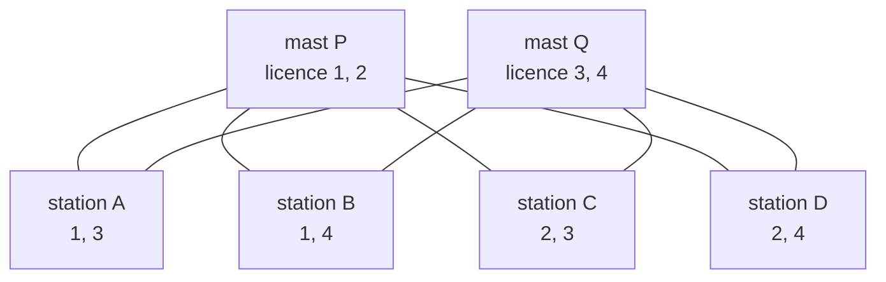

# List colouring: when every vertex brings its own short list of allowed colours, and Thomassen's proof that five per vertex always suffice on a flat map

[Syllabus](../../../SYLLABUS.md) → [Combinatorics and graphs](../README.md) → [Planarity and Colouring](../README.md#s12) → List colouring

---

## General Overview

A radio regulator licenses six transmitters. Two hilltop masts, P and Q, each reach four village stations, A, B, C and D. A mast and a station it reaches need different channels. Masts may share channels with each other, and so may stations.

As a graph (dots for transmitters, lines for interference), this is K(2,4): two dots on one side, four on the other, and every cross pair joined. If any transmitter could use any channel, two channels would do: both masts on channel 1, all four stations on channel 2.

But each licence names only two channels: P {1, 2}, Q {3, 4}, A {1, 3}, B {1, 4}, C {2, 3}, D {2, 4}. Now no plan works. Whatever channels P and Q take, one station is licensed for exactly those two. All 64 ways to pick from the lists fail.

**When each vertex must take its colour from its own list, a graph can need more colours than when all share one box; yet on any graph drawn flat, lists of five always work, which Thomassen proved by proving something stronger.**

**What kind of fact this is:** two definitions (list colouring, the choice number), a fact checked by exhaustive search (K(2,4) needs lists of three), and a theorem (Thomassen, 1994) proved in Why it works.

### The picture: two masts, four stations, six licences



The stations hold all four pairs of one channel from P with one from Q.

---

## The formula

Notation first, in words. A **list assignment** $`L`$ hands each vertex $`v`$ its own list $`L(v)`$ of allowed colours. An **$`L`$-colouring** is a proper colouring $`c`$ ([Colouring](03-vertex-colouring-and-chromatic-number.md)): joined vertices differ, and each $`c(v)`$ comes from $`L(v)`$.

A graph is **$`k`$-choosable** when it has an $`L`$-colouring for every list assignment whose lists all hold at least $`k`$ colours. The **choice number** $`\mathrm{ch}(G)`$ is the smallest such $`k`$.

```math
\chi(G) \le \mathrm{ch}(G) \le \Delta(G) + 1, \qquad \mathrm{ch}(G) \le 5 \text{ for every planar } G
```

**Read it aloud:** lists never need fewer colours than one shared box, never more than one past the busiest vertex's line count, and never more than five on a flat graph.

Here $`\chi(K(2,4)) = 2`$ but $`\mathrm{ch}(K(2,4)) = 3`$.

| Symbol | Plain meaning | In our example | Push it up and the answer… |
| --- | --- | --- | --- |
| $`G`$ | a graph: dots and lines | K(2,4): 6 transmitters, 8 interference lines | more lines, harder to colour |
| $`v`$ | one vertex (dot) | station A | — |
| $`L(v)`$, $`\lvert L(v)\rvert`$ | the list of $`v`$; its length | A {1, 3}; 2 | longer lists are easier to satisfy |
| $`c`$, $`k`$ | the colouring; the list length on offer | $`c`$(P) = 1; 2 | at $`k`$ = 3 every licence set works |
| $`\chi`$, $`\Delta`$ | fewest colours from one shared box; most lines at one vertex | 2; 4, at each mast | — |
| $`\mathrm{ch}`$ | choice number: shortest list length that always works | 3 | — |
| $`C`$, $`x`$, $`y`$ | outer cycle of a flat drawing; two neighbours on it, coloured first | P A Q D; P and A | — |
| $`w`$, $`u`$, $`u_1, \dots, u_m`$, $`a`$, $`b`$ | the other outer neighbour of $`x`$; the other outer neighbour of $`w`$; inner neighbours of $`w`$; two colours $`w`$ keeps | D; Q; C; 2 and 4 | — |

### When it holds

- **Lengths count, not the palette.** The bound is on each list's length; together the lists may name any number of colours.
- **Flat drawing.** Drop it and no fixed length works: two-sided graphs with equal sides need two colours from one box, but their choice number grows without limit as the sides grow.
- **Five is sharp.** Voigt (1993) built a flat graph that is not 4-choosable, though one box of 4 colours always suffices ([Colouring maps](05-five-and-four-colour-theorems.md)).
- **The stronger form needs outer lists of 3.** With 2, 60 of 2,000 tested cases get stuck.

---

## Why it works

### Step 0: one shared box is the easy special case

Give every vertex the same list $`\{1, \dots, k\}`$ and an $`L`$-colouring is an ordinary colouring. So $`\chi(G) \le \mathrm{ch}(G)`$.

The ceiling $`\Delta + 1`$: colour in any order. Each vertex has at most $`\Delta`$ coloured neighbours, so a list of $`\Delta + 1`$ keeps one free.

### Step 1: K(2,4) is not 2-choosable, but is 3-choosable

Each of the masts' 2 × 2 = 4 choices from {1, 2} and {3, 4} is exactly one station's licence, and that station has nothing left.

Lists of three always work. The masts are not joined, so each takes any colour on its list. A station sees at most two used colours, so its list of three keeps one.

From four channels there are 6 lists of two, so $`6^6`$ = 46,656 licence sets. A set is bad only if:

1. P and Q share no channel. If they share one, both masts take it, and each station loses just that one.
2. P and Q split the four channels. There are 6 ways to choose P's pair.
3. The four stations hold the four cross pairs, one each. There are 4 × 3 × 2 × 1 = 24 orders.

That gives 6 × 24 = 144, and the search finds the same 144. From three channels two disjoint pairs cannot exist, so none of the 729 sets is bad.

### Step 2: why the five-colour proof does not carry over

The proof on [Colouring maps](05-five-and-four-colour-theorems.md) swaps two colours along a **Kempe chain** (vertices wearing two colours, linked line to line). With lists, the swap can hand a vertex a colour not on its list. So Thomassen needed a new induction (settle the smallest cases, then each size from the one below).

### Step 3: prove something stronger, so the induction carries itself

A **near-triangulation** is a graph drawn flat whose outer boundary is a cycle $`C`$ and whose inner faces (regions) are all triangles. Thomassen proves:

> Let $`x`$ and $`y`$ be neighbours on $`C`$, already coloured differently. Give every other vertex of $`C`$ a list of at least 3, and every inner vertex a list of at least 5. Then the colouring extends to the whole graph.

The numbers 3 and 5 reproduce themselves: an inner vertex that moves onto the outer cycle loses 2 colours, and 5 − 2 = 3.

### Step 4: case one, a chord

A **chord** is a line joining two vertices of $`C`$ that are not neighbours on $`C`$. It cuts the graph into two smaller near-triangulations. Colour the side holding $`x`$ and $`y`$ first, by induction. The chord's two ends are now coloured neighbours on the other side's cycle, so that side follows by induction too.

### Step 5: case two, no chord

Let $`w`$ be the other outer neighbour of $`x`$, and $`u`$ the other outer neighbour of $`w`$. The inner neighbours of $`w`$ form a path from $`x`$ round to $`u`$, because the faces at $`w`$ are triangles.

1. From the list of $`w`$ (at least 3), set aside two colours $`a`$ and $`b`$ other than the colour of $`x`$.
2. Delete $`a`$ and $`b`$ from the lists of the inner neighbours of $`w`$. They keep at least 3.
3. Remove $`w`$. Its inner neighbours join the outer cycle, and the smaller near-triangulation is coloured by induction.
4. Put $`w`$ back. Its inner neighbours avoid $`a`$ and $`b`$, $`x`$ avoids both, and $`u`$ can block only one. So $`a`$ or $`b`$ is free.

### Step 6: from the stronger form to every flat graph

Add lines to a flat graph until it is a near-triangulation; extra lines only add constraints. Colour two outer neighbours differently from their lists of 5. Every other list holds 5, at least 3, so Step 3 applies.

<details>
<summary>Detailed proof: the smallest cases, and why the path and the split are sound</summary>

Induct on the number of vertices. The single line $`xy`$ is already coloured. A triangle $`xyw`$ is case two with $`u = y`$ and no inner neighbours.

Case two needs the inner neighbours of $`w`$ to form a path $`x, u_1, \dots, u_m, u`$. The faces round $`w`$ are triangles, so consecutive neighbours of $`w`$ are joined. With no chord, none of the $`u_i`$ is outer, so the new outer cycle $`x, y, \dots, u, u_m, \dots, u_1`$ repeats no vertex.

Case one needs the chord to split the graph in two. That rests on the Jordan curve theorem, the one fact taken on trust: a closed curve drawn flat splits the plane into an inside and an outside. Outer vertices of the second part were outer before, so their lists still hold 3.

</details>

---

## Worked numbers, by hand

| Step | Arithmetic | Value |
| --- | --- | --- |
| P takes 1, Q takes 3 | A's licence is {1, 3} | A blocked |
| P takes 1, Q takes 4 | B's licence is {1, 4} | B blocked |
| P takes 2, Q takes 3 | C's licence is {2, 3} | C blocked |
| P takes 2, Q takes 4 | D's licence is {2, 4} | D blocked |
| all 64 choices | every one contains a mast pair above | **0 work** |

Now Thomassen's proof as a procedure. Add the lines A–B, B–C and C–D: still flat, with outer cycle P A Q D, inner vertices B and C, and 6 triangles. Every licence gains channels 5, 6 and 7.

| Step | Arithmetic | Value |
| --- | --- | --- |
| colour $`x`$ = P, $`y`$ = A | P takes 1; A avoids 1 | P1, A3 |
| no chord; $`w`$ = D, $`u`$ = Q | D's list {2, 4, 5, 6, 7} without 1 | D keeps 2, 4 |
| C joins the outer cycle | {2, 3, 5, 6, 7} without 2 and 4 | C: {3, 5, 6, 7} |
| no chord; $`w`$ = C | C keeps two without 1 | C keeps 3, 5 |
| B joins the outer cycle | {1, 4, 5, 6, 7} without 3 and 5 | B: {1, 4, 6, 7} |
| chord A–B splits off triangle P A B | B keeps 4, 6; A wears 3 | B4 |
| triangle B A Q, $`x`$ = B, $`y`$ = A | Q keeps 3, 5 (not 4); A wears 3 | Q5 |
| put C back | keeps 3, 5; Q wears 5 | C3 |
| put D back | keeps 2, 4; Q wears 5 | D2 |
| result | proper, every channel on its licence | **P1 Q5 A3 B4 C3 D2** |

With five channels per licence, the proof finds a plan without searching, though Step 0 alone guarantees one here: no vertex has over 4 lines. Busier flat graphs need Thomassen; the real test is the stronger form, where Q has 4 lines but a list of 3.

### What breaks if you drop a piece

| Mistake | Comes out at | What went wrong |
| --- | --- | --- |
| Reading "2 colours suffice" as "any 2-channel licences suffice" | 0 of 64 channel choices work | Lists can block where one shared box cannot |
| Testing licences drawn from only 3 channels | 0 bad of 729, so it looks 2-choosable | The bad sets need 4 channels: 144 of 46,656 |
| Outer lists of 2 in the stronger form | 60 of 2,000 cases stuck | P1, A2, Q {2, 3}, D {1, 3}: Q and D both forced to 3 |

---

## Code, from first principles, and it actually runs

Nothing is imported. The bad licence sets are found two ways: exhaustive search, and the count 6 × 24 from Step 1. Thomassen's proof runs as a recursive program; its colouring is checked on each of 46,656 licence sets, and against brute-force search on 2,000 cases of the stronger form.

### Python

```python
# List colouring and choosability -- the check behind the card.  Nothing is imported.  Two hilltop
# masts P, Q each interfere with four village stations A B C D: the graph K(2,4).  Exhaustive search
# meets the card's count of bad licence sets; Thomassen's proof runs as a program on K(2,4) with A-B,
# B-C, C-D added (still flat), against a brute-force search.
G = {"P": "ABCD", "Q": "ABCD", "A": "PQ", "B": "PQ", "C": "PQ", "D": "PQ"}
T = {v: set(n + {"A": "B", "B": "AC", "C": "BD", "D": "C"}.get(v, "")) for v, n in G.items()}
BAD = {"P": (1, 2), "Q": (3, 4), "A": (1, 3), "B": (1, 4), "C": (2, 3), "D": (2, 4)}
def colourings(g, L, col):                  # every proper colouring with each vertex on its own list
    rest = [v for v in g if v not in col]
    if not rest: yield col; return
    for c in L[rest[0]]:
        if all(col.get(u) != c for u in g[rest[0]]): yield from colourings(g, L, {**col, rest[0]: c})
def ok(g, L): return next(colourings(g, L, {}), None) is not None
def subsets(n, k, lo=1): return [()] if k == 0 else [(i,) + s for i in range(lo, n + 1) for s in subsets(n, k - 1, i + 1)]
def assign(vs, opts): return [{}] if not vs else [{vs[0]: o, **a} for o in opts for a in assign(vs[1:], opts)]
def sub(g, keep): return {v: g[v] & keep for v in keep}
def thomassen(g, outer, L, col, log):       # outer: the outer cycle in order, its first two coloured
    n = len(outer)
    if n == 2: return col
    chords = [(i, j) for i in range(n) for j in range(i + 2, n) if (i, j) != (0, n - 1) and outer[j] in g[outer[i]]]
    if chords:                              # case 1: split along the chord, the side holding x, y first
        i, j = chords[0]; log.append(f"chord {outer[i]}-{outer[j]}")
        c1, c2 = (outer[:j + 1], [outer[0], outer[j]] + outer[j + 1:]) if i == 0 else (outer[:i + 1] + outer[j:], [outer[j], outer[i]] + outer[i + 1:j])
        side, stack = set(c2), c2[2:]
        while stack: stack += [w for w in g[stack.pop()] if w not in side and not side.add(w)]
        col = thomassen(sub(g, set(g) - side | set(c2[:2])), c1, L, col, log)
        return thomassen(sub(g, side), c2, L, col, log)
    x, u, w, path = outer[0], outer[-2], outer[-1], []     # case 2: w is x's other outer neighbour
    while nxt := sorted(v for v in g[w] & g[path[-1] if path else x] if v not in outer and v not in path): path.append(nxt[0])
    a, b = [c for c in L[w] if c != col[x]][:2]; log.append(f"{w} keeps {a},{b}")
    L2 = {**L, **{v: tuple(c for c in L[v] if c not in (a, b)) for v in path}}
    col = thomassen(sub(g, set(g) - {w}), outer[:-1] + path[::-1], L2, col, log)
    return {**col, w: a if col[u] != a else b}
def run(L, col):                            # Thomassen from P and A, then check the answer
    out = thomassen(T, ["P", "A", "Q", "D"], L, col, log := [])
    return out, log, all(out[v] in L[v] and all(out[v] != out[u] for u in T[v]) for v in T)
def show(c, f=str): return " ".join(f"{v}{f(c[v])}" for v in "PQABCD")
def braces(t): return "{" + ",".join(map(str, t)) + "}"
two = list(colourings(G, {v: (1, 2) for v in G}, {}))
blocked = [f"P{p} Q{q} blocks {next((v for v in 'ABCD' if set(BAD[v]) <= {p, q}), 'none')}" for p in BAD["P"] for q in BAD["Q"]]
bad4, bad3, ch3 = [[a for a in assign("PQABCD", subsets(p, k)) if not ok(G, a)] for p, k in ((4, 2), (3, 2), (4, 3))]
E, tri = sum(map(len, T.values())) // 2, sum(1 for u in T for v in T[u] for w in T[v] if u < v < w and w in T[u])
col, log, good = run({v: BAD[v] + (5, 6, 7) for v in G}, {"P": 1, "A": 3})
sweep = [run(L, {"P": L["P"][0], "A": [c for c in L["A"] if c != L["P"][0]][0]})[2] for L in assign("PQABCD", subsets(6, 5))]
def outer_k(k): return [{"P": (p,), "A": (q,), "B": (1, 2, 3, 4, 5), "C": (1, 2, 3, 4, 5), **a}
                        for p in range(1, 6) for q in range(1, 6) if p != q for a in assign("QD", subsets(5, k))]
strong, short = outer_k(3), outer_k(2)
st_th, st_bf, stuck = [run(L, {"P": L["P"][0], "A": L["A"][0]})[2] for L in strong], [ok(T, L) for L in strong], [L for L in short if not ok(T, L)]
print(f"K(2,4): {len(G)} vertices, {sum(map(len, G.values())) // 2} edges, most at one vertex {max(map(len, G.values()))}; proper colourings from channels 1 and 2 only: {len(two)}, so chromatic number 2")
print(f"the bad licences {show(BAD, braces)}: channel choices tried {sum(1 for _ in colourings({v: "" for v in G}, BAD, {}))}, proper {sum(1 for _ in colourings(G, BAD, {}))}\n  " + "; ".join(blocked))
print(f"2-channel licences from 4 channels: bad {len(bad4)} of {6 ** 6}; formula 6 x 24 = {6 * 24}\n2-channel licences from 3 channels: bad {len(bad3)} of {3 ** 6}\n3-channel licences from 4 channels: bad {len(ch3)} of {4 ** 6}, so choice number 3")
print(f"with A-B, B-C, C-D added: V = {len(T)}, E = {E}, most at one vertex {max(map(len, T.values()))}, triangles {tri} + the outer face P A Q D = {tri + 1} = E - V + 2")
print(f"Thomassen on licences of 5 (the bad ones plus 5, 6, 7): " + "; ".join(log) + f"\n  result {show(col)}, proper and on every list: {'yes' if good else 'no'}")
print(f"every 5-channel licence set from 6 channels: {len(sweep)} sets, Thomassen fails {sweep.count(False)}")
print(f"stronger form, P and A fixed, Q and D lists of 3, B and C lists of 5: {len(strong)} cases, Thomassen fails {st_th.count(False)}, search finds {st_bf.count(False)} stuck")
print(f"mistake, Q and D lists of 2: {len(stuck)} of {len(short)} cases stuck, first {show(stuck[0], braces)}")
assert len(two) == 2 and not ok(G, BAD) and len(bad4) == 6 * 24 and bad3 == [] and ch3 == []
assert good and all(sweep) and all(st_th) and all(st_bf) and len(stuck) > 0
assert tri + 1 == E - len(T) + 2 and all(set(a["P"]).isdisjoint(a["Q"]) for a in bad4)
print("ALL CHECKS PASS")
```

**Ran 2026-11-23 on macOS, Python 3.14.10, standard library only. All checks passed. Output, pasted from the run:**

```
K(2,4): 6 vertices, 8 edges, most at one vertex 4; proper colourings from channels 1 and 2 only: 2, so chromatic number 2
the bad licences P{1,2} Q{3,4} A{1,3} B{1,4} C{2,3} D{2,4}: channel choices tried 64, proper 0
  P1 Q3 blocks A; P1 Q4 blocks B; P2 Q3 blocks C; P2 Q4 blocks D
2-channel licences from 4 channels: bad 144 of 46656; formula 6 x 24 = 144
2-channel licences from 3 channels: bad 0 of 729
3-channel licences from 4 channels: bad 0 of 4096, so choice number 3
with A-B, B-C, C-D added: V = 6, E = 11, most at one vertex 4, triangles 6 + the outer face P A Q D = 7 = E - V + 2
Thomassen on licences of 5 (the bad ones plus 5, 6, 7): D keeps 2,4; C keeps 3,5; chord A-B; B keeps 4,6; Q keeps 3,5
  result P1 Q5 A3 B4 C3 D2, proper and on every list: yes
every 5-channel licence set from 6 channels: 46656 sets, Thomassen fails 0
stronger form, P and A fixed, Q and D lists of 3, B and C lists of 5: 2000 cases, Thomassen fails 0, search finds 0 stuck
mistake, Q and D lists of 2: 60 of 2000 cases stuck, first P{1} Q{2,3} A{2} B{1,2,3,4,5} C{1,2,3,4,5} D{1,3}
ALL CHECKS PASS
```

### Rust

Same numbers, same labels, built with `rustc --edition 2021 -O`.

```rust
// List colouring and choosability -- the same check as the Python, in Rust.  No crates.  Two hilltop masts
// P, Q each interfere with four village stations A B C D: the graph K(2,4).  Exhaustive search meets the
// card's count of bad licence sets; Thomassen's proof runs as a program on K(2,4) with A-B, B-C, C-D added.
use std::collections::{BTreeMap as M, BTreeSet as S};
type Gr = M<char, S<char>>; type Ls = M<char, Vec<i64>>; type Col = M<char, i64>;
const VS: [char; 6] = ['P', 'Q', 'A', 'B', 'C', 'D'];
fn graph(extra: &[(char, char)]) -> Gr { let mut g: Gr = VS.iter().map(|&v| (v, S::new())).collect();   // K(2,4), plus any extra edges
    for (a, b) in "PQ".chars().flat_map(|m| "ABCD".chars().map(move |s| (m, s))).chain(extra.iter().copied()) { g.get_mut(&a).unwrap().insert(b); g.get_mut(&b).unwrap().insert(a); } g }
fn count(g: &Gr, l: &Ls, col: &mut Col, stop: bool) -> usize {   // proper colourings with each vertex on its own list
    let v = match VS.iter().find(|v| g.contains_key(v) && !col.contains_key(v)) { None => return 1, Some(&v) => v };
    let mut n = 0; for &c in &l[&v] { if g[&v].iter().all(|u| col.get(u) != Some(&c)) { col.insert(v, c); n += count(g, l, col, stop); col.remove(&v); if stop && n > 0 { return n } } }
    n
}
fn ok(g: &Gr, l: &Ls) -> bool { count(g, l, &mut M::new(), true) > 0 }
fn subsets(n: i64, k: usize, lo: i64) -> Vec<Vec<i64>> { if k == 0 { vec![vec![]] } else { (lo..=n).flat_map(|i| subsets(n, k - 1, i + 1).into_iter().map(move |s| [vec![i], s].concat())).collect() } }
// every way to hand each vertex one list from opts
fn assign(vs: &[char], opts: &[Vec<i64>]) -> Vec<Ls> { if vs.is_empty() { vec![M::new()] } else { opts.iter().flat_map(|o| assign(&vs[1..], opts).into_iter().map(move |mut a| { a.insert(vs[0], o.clone()); a })).collect() } }
fn sub(g: &Gr, keep: &S<char>) -> Gr { keep.iter().map(|v| (*v, g[v].intersection(keep).copied().collect())).collect() }
fn thomassen(g: &Gr, outer: &[char], l: &Ls, col: Col, log: &mut Vec<String>) -> Col {   // first two of outer coloured
    let n = outer.len();
    if n == 2 { return col }
    let chord = (0..n).flat_map(|i| (i + 2..n).map(move |j| (i, j))).find(|&(i, j)| (i, j) != (0, n - 1) && g[&outer[i]].contains(&outer[j]));
    if let Some((i, j)) = chord {                                // case 1: split along the chord, the side holding x, y first
        log.push(format!("chord {}-{}", outer[i], outer[j]));
        let (c1, c2) = if i == 0 { (outer[..=j].to_vec(), [&[outer[0], outer[j]], &outer[j + 1..]].concat()) }
                       else { ([&outer[..=i], &outer[j..]].concat(), [&[outer[j], outer[i]], &outer[i + 1..j]].concat()) };
        let (mut side, mut stack): (S<char>, Vec<char>) = (c2.iter().copied().collect(), c2[2..].to_vec());
        while let Some(v) = stack.pop() { for &w in &g[&v] { if side.insert(w) { stack.push(w) } } }
        let one: S<char> = g.keys().filter(|v| !side.contains(v) || c2[..2].contains(v)).copied().collect();
        let col = thomassen(&sub(g, &one), &c1, l, col, log);
        return thomassen(&sub(g, &side), &c2, l, col, log);
    }
    let (x, u, w, mut path) = (outer[0], outer[n - 2], outer[n - 1], vec![]);   // case 2: w is x's other outer neighbour
    while let Some(&nx) = g[&w].intersection(&g[path.last().unwrap_or(&x)]).find(|v| !outer.contains(v) && !path.contains(v)) { path.push(nx) }
    let ab: Vec<i64> = l[&w].iter().copied().filter(|&c| c != col[&x]).take(2).collect(); log.push(format!("{} keeps {},{}", w, ab[0], ab[1]));
    let mut l2 = l.clone();
    for v in &path { l2.insert(*v, l[v].iter().copied().filter(|c| !ab.contains(c)).collect()); }
    let rest: S<char> = g.keys().filter(|&&v| v != w).copied().collect();
    let mut col = thomassen(&sub(g, &rest), &[&outer[..n - 1], &path.iter().rev().copied().collect::<Vec<char>>()[..]].concat(), &l2, col, log);
    col.insert(w, if col[&u] != ab[0] { ab[0] } else { ab[1] });
    col
}
fn run(t: &Gr, l: &Ls, col: Col) -> (Col, Vec<String>, bool) {  // Thomassen from P and A, then check the answer
    let (mut log, good) = (vec![], |out: &Col| t.iter().all(|(v, ns)| l[v].contains(&out[v]) && ns.iter().all(|u| out[u] != out[v])));
    let out = thomassen(t, &['P', 'A', 'Q', 'D'], l, col, &mut log);
    let g = good(&out); (out, log, g)
}
fn braces(t: &[i64]) -> String { format!("{{{}}}", t.iter().map(|c| c.to_string()).collect::<Vec<_>>().join(",")) }
fn show(f: impl Fn(char) -> String) -> String { VS.iter().map(|&v| format!("{}{}", v, f(v))).collect::<Vec<_>>().join(" ") }
fn main() {
    let (g, t) = (graph(&[]), graph(&[('A', 'B'), ('B', 'C'), ('C', 'D')]));
    let bad: Ls = VS.iter().zip([[1, 2], [3, 4], [1, 3], [1, 4], [2, 3], [2, 4]]).map(|(&v, c)| (v, c.to_vec())).collect();
    let two = count(&g, &VS.iter().map(|&v| (v, vec![1, 2])).collect(), &mut M::new(), false);
    let blocked: Vec<String> = bad[&'P'].iter().flat_map(|&p| bad[&'Q'].iter().map(move |&q| (p, q)))
        .map(|(p, q)| format!("P{} Q{} blocks {}", p, q, "ABCD".chars().find(|v| bad[v].iter().all(|c| *c == p || *c == q)).map_or("none".to_string(), |c| c.to_string()))).collect();
    let [bad4, bad3, ch3]: [Vec<Ls>; 3] = [(4, 2), (3, 2), (4, 3)].map(|(p, k)| assign(&VS, &subsets(p, k, 1)).into_iter().filter(|a| !ok(&g, a)).collect());
    let (e, mut tri) = (t.values().map(|s| s.len()).sum::<usize>() / 2, 0);
    for (u, ns) in &t { for v in ns { for w in &t[v] { if u < v && v < w && t[u].contains(w) { tri += 1 } } } }
    let five: Ls = bad.iter().map(|(v, c)| (*v, [&c[..], &[5, 6, 7]].concat())).collect();
    let (col, log, good) = run(&t, &five, M::from([('P', 1), ('A', 3)]));
    let sweep: Vec<bool> = assign(&VS, &subsets(6, 5, 1)).iter().map(|l| { let p = l[&'P'][0];
        run(&t, l, M::from([('P', p), ('A', *l[&'A'].iter().find(|&&c| c != p).unwrap())])).2 }).collect();
    let outer_k = |k: usize| -> Vec<Ls> { (1..6).flat_map(|p| (1..6).filter(move |&q| q != p).map(move |q| (p, q))).flat_map(|(p, q)| assign(&['Q', 'D'], &subsets(5, k, 1)).into_iter()
        .map(move |a| { let mut l: Ls = M::from([('P', vec![p]), ('A', vec![q]), ('B', vec![1, 2, 3, 4, 5]), ('C', vec![1, 2, 3, 4, 5])]); l.extend(a); l })).collect() };
    let (strong, short) = (outer_k(3), outer_k(2));
    let st_th: Vec<bool> = strong.iter().map(|l| run(&t, l, M::from([('P', l[&'P'][0]), ('A', l[&'A'][0])])).2).collect();
    let (st_bf, stuck): (Vec<bool>, Vec<&Ls>) = (strong.iter().map(|l| ok(&t, l)).collect(), short.iter().filter(|l| !ok(&t, l)).collect());
    let fails = |v: &Vec<bool>| v.iter().filter(|b| !**b).count();
    println!("K(2,4): {} vertices, {} edges, most at one vertex {}; proper colourings from channels 1 and 2 only: {}, so chromatic number 2", g.len(), g.values().map(|s| s.len()).sum::<usize>() / 2, g.values().map(|s| s.len()).max().unwrap(), two);
    println!("the bad licences {}: channel choices tried {}, proper {}\n  {}", show(|v| braces(&bad[&v])), count(&VS.iter().map(|&v| (v, S::new())).collect(), &bad, &mut M::new(), false), count(&g, &bad, &mut M::new(), false), blocked.join("; "));
    println!("2-channel licences from 4 channels: bad {} of {}; formula 6 x 24 = {}\n2-channel licences from 3 channels: bad {} of {}\n3-channel licences from 4 channels: bad {} of {}, so choice number 3",
             bad4.len(), 6i64.pow(6), 6 * 24, bad3.len(), 3i64.pow(6), ch3.len(), 4i64.pow(6));
    println!("with A-B, B-C, C-D added: V = {}, E = {}, most at one vertex {}, triangles {} + the outer face P A Q D = {} = E - V + 2\nThomassen on licences of 5 (the bad ones plus 5, 6, 7): {}\n  result {}, proper and on every list: {}", t.len(), e, t.values().map(|s| s.len()).max().unwrap(), tri, tri + 1, log.join("; "), show(|v| col[&v].to_string()), if good { "yes" } else { "no" });
    println!("every 5-channel licence set from 6 channels: {} sets, Thomassen fails {}\nstronger form, P and A fixed, Q and D lists of 3, B and C lists of 5: {} cases, Thomassen fails {}, search finds {} stuck", sweep.len(), fails(&sweep), strong.len(), fails(&st_th), fails(&st_bf));
    println!("mistake, Q and D lists of 2: {} of {} cases stuck, first {}", stuck.len(), short.len(), show(|v| braces(&stuck[0][&v])));
    assert!(two == 2 && !ok(&g, &bad) && bad4.len() == 6 * 24 && bad3.is_empty() && ch3.is_empty());
    assert!(good && fails(&sweep) == 0 && fails(&st_th) == 0 && fails(&st_bf) == 0 && !stuck.is_empty());
    assert!(tri + 1 == e + 2 - t.len() && bad4.iter().all(|a| a[&'P'].iter().all(|c| !a[&'Q'].contains(c))));
    println!("ALL CHECKS PASS");
}
```

**Ran 2026-11-23 on macOS, rustc 1.98.1, no crates. All checks passed. Output, pasted from the run:**

```
K(2,4): 6 vertices, 8 edges, most at one vertex 4; proper colourings from channels 1 and 2 only: 2, so chromatic number 2
the bad licences P{1,2} Q{3,4} A{1,3} B{1,4} C{2,3} D{2,4}: channel choices tried 64, proper 0
  P1 Q3 blocks A; P1 Q4 blocks B; P2 Q3 blocks C; P2 Q4 blocks D
2-channel licences from 4 channels: bad 144 of 46656; formula 6 x 24 = 144
2-channel licences from 3 channels: bad 0 of 729
3-channel licences from 4 channels: bad 0 of 4096, so choice number 3
with A-B, B-C, C-D added: V = 6, E = 11, most at one vertex 4, triangles 6 + the outer face P A Q D = 7 = E - V + 2
Thomassen on licences of 5 (the bad ones plus 5, 6, 7): D keeps 2,4; C keeps 3,5; chord A-B; B keeps 4,6; Q keeps 3,5
  result P1 Q5 A3 B4 C3 D2, proper and on every list: yes
every 5-channel licence set from 6 channels: 46656 sets, Thomassen fails 0
stronger form, P and A fixed, Q and D lists of 3, B and C lists of 5: 2000 cases, Thomassen fails 0, search finds 0 stuck
mistake, Q and D lists of 2: 60 of 2000 cases stuck, first P{1} Q{2,3} A{2} B{1,2,3,4,5} C{1,2,3,4,5} D{1,3}
ALL CHECKS PASS
```

### Lean

Lean proves the two outer bounds for every graph with finitely many vertices, then the K(2,4) facts with the card's six licences.

- Take any graph $`G`$ with finitely many vertices. Then $`\chi(G) \le \mathrm{ch}(G) \le \Delta(G) + 1`$.
- A graph that is $`k`$-choosable also colours from one shared box of $`k`$: give every vertex the same list.
- Lists of $`\Delta + 1`$ always work: colour in any order, and each vertex keeps one colour free.
- K(2,4) colours with two shared channels, and every licence holds two, yet the six licences admit no plan.
- Take K(2,4). Then $`\chi`$ = 2 and $`\mathrm{ch}`$ = 3, since any licences of three always leave a plan.
- K(2,4) has 6 transmitters, 8 lines and 4 lines at each mast.
- Each pair of mast channels is exactly one station's licence, so that station is blocked.
- The plan P1 Q5 A3 B4 C3 D2 keeps joined transmitters apart, with A-B, B-C and C-D added, and fits every licence of five.

Thomassen's theorem that lists of five suffice on flat graphs, and the searches over licence sets, are left to the Python and Rust checks.

```lean
-- List colouring: in every finite graph the choice number is at least the chromatic number and at most one past the largest degree, and K(2,4) colours with two shared colours yet needs lists of three, as the card's six licences show.
import Mathlib.Combinatorics.SimpleGraph.Coloring.Vertex
import Mathlib.Combinatorics.SimpleGraph.Finite
import Mathlib.Data.Fintype.Sum
import Mathlib.Tactic.NormNum

open SimpleGraph

namespace SimpleGraph

variable {V : Type*} (G : SimpleGraph V)

/-- A list assignment `L` hands each vertex `v` its own finite list `L v` of allowed colours
(whole numbers). An `L`-colouring is a proper colouring `c` (joined vertices differ) with each
`c v` taken from `L v`. -/
def ListColorable (L : V → Finset ℕ) : Prop :=
  ∃ C : G.Coloring ℕ, ∀ v, C v ∈ L v

/-- `G` is `k`-choosable when it has an `L`-colouring for every list assignment whose lists all
hold at least `k` colours. Only the lengths are bounded: together the lists may name any colours. -/
def Choosable (k : ℕ) : Prop :=
  ∀ L : V → Finset ℕ, (∀ v, k ≤ (L v).card) → G.ListColorable L

/-- The choice number ch(G): the smallest `k` for which `G` is `k`-choosable (`⊤` if none). -/
noncomputable def choiceNumber : ℕ∞ :=
  ⨅ k ∈ Set.ofPred G.Choosable, (k : ℕ∞)

end SimpleGraph

/-- Greedy step: every finite graph is `(Δ + 1)`-choosable. -/
theorem SimpleGraph.choosable_maxDegree_add_one {V : Type*} [Fintype V]
    (G : SimpleGraph V) [DecidableRel G.Adj] : G.Choosable (G.maxDegree + 1) := by
  classical
  intro L hL
  have key : ∀ S : Finset V, ∃ f : V → ℕ, (∀ v ∈ S, f v ∈ L v) ∧
      ∀ u ∈ S, ∀ v ∈ S, G.Adj u v → f u ≠ f v := by
    intro S
    induction S using Finset.induction_on with
    | empty => exact ⟨fun _ => 0, by simp, by simp⟩
    | @insert a S ha ih =>
      obtain ⟨f, hf1, hf2⟩ := ih
      have hcard : ((G.neighborFinset a).image f).card < (L a).card := by
        calc ((G.neighborFinset a).image f).card ≤ (G.neighborFinset a).card :=
              Finset.card_image_le
          _ = G.degree a := G.card_neighborFinset_eq_degree a
          _ ≤ G.maxDegree := G.degree_le_maxDegree a
          _ < G.maxDegree + 1 := Nat.lt_succ_self _
          _ ≤ (L a).card := hL a
      obtain ⟨x, hxL, hxn⟩ := Finset.exists_mem_notMem_of_card_lt_card hcard
      have hx : ∀ w, G.Adj a w → f w ≠ x := by
        intro w hw h
        apply hxn
        rw [Finset.mem_image]
        exact ⟨w, (G.mem_neighborFinset a w).2 hw, h⟩
      refine ⟨Function.update f a x, ?_, ?_⟩
      · intro v hv
        rcases Finset.mem_insert.1 hv with rfl | hv
        · simpa using hxL
        · have : v ≠ a := fun h => ha (h ▸ hv)
          simpa [Function.update_of_ne this] using hf1 v hv
      · intro u hu v hv huv
        have hu' := Finset.mem_insert.1 hu
        have hv' := Finset.mem_insert.1 hv
        by_cases hua : u = a <;> by_cases hva : v = a
        · subst hua; subst hva; exact absurd huv (G.irrefl)
        · subst hua
          have hvS : v ∈ S := hv'.resolve_left hva
          rw [Function.update_self, Function.update_of_ne hva]
          exact (hx v huv).symm
        · subst hva
          rw [Function.update_self, Function.update_of_ne hua]
          exact hx u huv.symm
        · rw [Function.update_of_ne hua, Function.update_of_ne hva]
          exact hf2 u (hu'.resolve_left hua) v (hv'.resolve_left hva) huv
  obtain ⟨f, hf1, hf2⟩ := key Finset.univ
  exact ⟨Coloring.mk f (fun {u v} h => hf2 u (Finset.mem_univ _) v (Finset.mem_univ _) h),
    fun v => hf1 v (Finset.mem_univ _)⟩

/-- A `k`-choosable graph is `k`-colourable: give every vertex the list `0, …, k - 1`. -/
theorem SimpleGraph.Choosable.colorable {V : Type*} {G : SimpleGraph V} {k : ℕ}
    (h : G.Choosable k) : G.Colorable k := by
  obtain ⟨C, hC⟩ := h (fun _ => Finset.range k) (fun _ => by simp)
  exact (G.colorable_iff_exists_bdd_nat_coloring k).2 ⟨C, fun v => Finset.mem_range.1 (hC v)⟩

#print axioms SimpleGraph.choosable_maxDegree_add_one
#print axioms SimpleGraph.Choosable.colorable

/-- The card's formula. In every finite graph, lists never need fewer colours than one shared box,
and never more than one past the busiest vertex's line count: χ(G) ≤ ch(G) ≤ Δ(G) + 1. -/
theorem chromaticNumber_le_choiceNumber_le_maxDegree_add_one {V : Type*} [Fintype V]
    (G : SimpleGraph V) [DecidableRel G.Adj] :
    G.chromaticNumber ≤ G.choiceNumber ∧ G.choiceNumber ≤ G.maxDegree + 1 := by
  refine ⟨?_, ?_⟩
  · unfold SimpleGraph.choiceNumber
    refine le_iInf₂ fun k hk => ?_
    exact (SimpleGraph.Choosable.colorable hk).chromaticNumber_le
  · unfold SimpleGraph.choiceNumber
    have := iInf₂_le (f := fun (k : ℕ) (_ : k ∈ Set.ofPred G.Choosable) => (k : ℕ∞))
      (G.maxDegree + 1) (G.choosable_maxDegree_add_one)
    simpa using this

/-! The card's example: two masts P, Q (`inl 0`, `inl 1`) and four stations A, B, C, D
(`inr 0` to `inr 3`), every mast joined to every station: the graph K(2,4). -/

/-- K(2,4): two masts, four stations, every cross pair joined. -/
abbrev K24 : SimpleGraph (Fin 2 ⊕ Fin 4) := completeBipartiteGraph (Fin 2) (Fin 4)

instance : DecidableRel K24.Adj := fun u v =>
  inferInstanceAs (Decidable (u.isLeft ∧ v.isRight ∨ u.isRight ∧ v.isLeft))

/-- The card's six licences: P {1, 2}, Q {3, 4}, A {1, 3}, B {1, 4}, C {2, 3}, D {2, 4}. -/
def badLicences : Fin 2 ⊕ Fin 4 → Finset ℕ
  | .inl 0 => {1, 2}
  | .inl 1 => {3, 4}
  | .inr 0 => {1, 3}
  | .inr 1 => {1, 4}
  | .inr 2 => {2, 3}
  | .inr 3 => {2, 4}

/-- Lists can block where one shared box cannot: K(2,4) colours with two shared colours, and every
list of two is long enough on each vertex, yet the card's six licences admit no plan. -/
theorem k24_not_listColorable_badLicences :
    K24.Colorable 2 ∧ (∀ v, 2 ≤ (badLicences v).card) ∧ ¬ K24.ListColorable badLicences := by
  refine ⟨by simpa using (CompleteBipartiteGraph.bicoloring (Fin 2) (Fin 4)).colorable,
    by decide, ?_⟩
  rintro ⟨C, hC⟩
  have h0 := hC (.inl 0)
  have h1 := hC (.inl 1)
  have h2 := hC (.inr 0)
  have h3 := hC (.inr 1)
  have h4 := hC (.inr 2)
  have h5 := hC (.inr 3)
  simp only [badLicences, Finset.mem_insert, Finset.mem_singleton] at h0 h1 h2 h3 h4 h5
  have a0 := C.valid (show K24.Adj (.inl 0) (.inr 0) by decide)
  have a1 := C.valid (show K24.Adj (.inl 0) (.inr 1) by decide)
  have a2 := C.valid (show K24.Adj (.inl 0) (.inr 2) by decide)
  have a3 := C.valid (show K24.Adj (.inl 0) (.inr 3) by decide)
  have b0 := C.valid (show K24.Adj (.inl 1) (.inr 0) by decide)
  have b1 := C.valid (show K24.Adj (.inl 1) (.inr 1) by decide)
  have b2 := C.valid (show K24.Adj (.inl 1) (.inr 2) by decide)
  have b3 := C.valid (show K24.Adj (.inl 1) (.inr 3) by decide)
  omega

/-- K(2,4) needs two shared colours but lists of three: χ(K(2,4)) = 2 and ch(K(2,4)) = 3. -/
theorem k24_chromaticNumber_eq_two_choiceNumber_eq_three :
    K24.chromaticNumber = 2 ∧ K24.choiceNumber = 3 := by
  refine ⟨CompleteBipartiteGraph.chromaticNumber, ?_⟩
  have h3 : K24.Choosable 3 := by
    intro L hL
    have hp : ∀ i : Fin 2, ∃ x, x ∈ L (.inl i) := fun i =>
      Finset.card_pos.1 (lt_of_lt_of_le (by norm_num) (hL (.inl i)))
    choose p hp using hp
    have hs : ∀ j : Fin 4, ∃ x, x ∈ L (.inr j) ∧ x ∉ ({p 0, p 1} : Finset ℕ) := fun j =>
      Finset.exists_mem_notMem_of_card_lt_card
        (lt_of_lt_of_le (lt_of_le_of_lt Finset.card_le_two (by norm_num)) (hL (.inr j)))
    choose s hs hs' using hs
    refine ⟨Coloring.mk (Sum.elim p s) ?_, ?_⟩
    · intro u v h
      rcases u with i | j <;> rcases v with i' | j' <;>
        simp only [completeBipartiteGraph_adj, Sum.isLeft_inl, Sum.isRight_inr, Sum.isLeft_inr,
          Sum.isRight_inl] at h <;> simp at h
      · have := hs' j'
        simp only [Finset.mem_insert, Finset.mem_singleton, not_or] at this
        fin_cases i <;> simp [Ne.symm this.1, Ne.symm this.2]
      · have := hs' j
        simp only [Finset.mem_insert, Finset.mem_singleton, not_or] at this
        fin_cases i' <;> simp [this.1, this.2]
    · rintro (i | j)
      · exact hp i
      · exact hs j
  have hn : ∀ k, k ≤ 2 → ¬ K24.Choosable k := fun k hk h =>
    k24_not_listColorable_badLicences.2.2
      (h badLicences fun v => le_trans hk (k24_not_listColorable_badLicences.2.1 v))
  unfold SimpleGraph.choiceNumber
  refine le_antisymm ?_ ?_
  · have := iInf₂_le (f := fun (k : ℕ) (_ : k ∈ Set.ofPred K24.Choosable) => (k : ℕ∞)) 3 h3
    simpa using this
  · refine le_iInf₂ fun k hk => ?_
    have : 3 ≤ k := by
      by_contra hlt
      exact hn k (by omega) hk
    exact_mod_cast this

-- K(2,4) has 6 vertices, 8 lines, and 4 lines at each mast.
example : Fintype.card (Fin 2 ⊕ Fin 4) = 6 ∧ K24.edgeFinset.card = 8 ∧
    K24.degree (.inl 0) = 4 := by decide
-- Each of the masts' 2 × 2 = 4 choices is exactly one station's licence, so that station is blocked.
example : ∀ p ∈ badLicences (.inl 0), ∀ q ∈ badLicences (.inl 1),
    ∃ s : Fin 4, badLicences (.inr s) = {p, q} := by decide
-- All 2 ^ 6 = 64 ways to pick from the six licences of two.
example : (Finset.univ : Finset (Fin 2 ⊕ Fin 4)).prod (fun v => (badLicences v).card) = 64 ∧
    2 ^ 6 = 64 := by decide
-- Licence sets: 6 ^ 6 = 46,656 from four channels, 6 × 24 = 144 bad; 3 ^ 6 = 729 from three
-- channels; 4 ^ 6 = 4,096 sets of three-channel licences from four channels.
example : 6 ^ 6 = 46656 ∧ 6 * 24 = 144 ∧ 4 * 3 * 2 * 1 = 24 ∧ 3 ^ 6 = 729 ∧ 4 ^ 6 = 4096 := by
  norm_num

/-- The plan Thomassen's proof finds on licences of five: P1 Q5 A3 B4 C3 D2. -/
def plan : Fin 2 ⊕ Fin 4 → ℕ
  | .inl 0 => 1
  | .inl 1 => 5
  | .inr 0 => 3
  | .inr 1 => 4
  | .inr 2 => 3
  | .inr 3 => 2

-- Thomassen's result on licences of five (the bad ones plus 5, 6, 7): P1 Q5 A3 B4 C3 D2 is proper
-- on K(2,4) and on the added lines A-B, B-C, C-D, and each channel is on its licence.
example : (∀ u v, K24.Adj u v → plan u ≠ plan v) ∧
    (plan (.inr 0) ≠ plan (.inr 1) ∧ plan (.inr 1) ≠ plan (.inr 2) ∧
      plan (.inr 2) ≠ plan (.inr 3)) ∧
    ∀ v, plan v ∈ badLicences v ∪ {5, 6, 7} := by decide

#print axioms chromaticNumber_le_choiceNumber_le_maxDegree_add_one
#print axioms k24_not_listColorable_badLicences
#print axioms k24_chromaticNumber_eq_two_choiceNumber_eq_three
```

**Checked 2026-11-23 on macOS, Lean 4.36.0-rc2, Mathlib v4.36.0-rc2. Every proof is complete and uses only Lean's standard axioms. Output, pasted from the run:**

```
'SimpleGraph.choosable_maxDegree_add_one' depends on axioms: [propext, Classical.choice, Quot.sound]
'SimpleGraph.Choosable.colorable' depends on axioms: [propext, Classical.choice, Quot.sound]
'chromaticNumber_le_choiceNumber_le_maxDegree_add_one' depends on axioms: [propext, Classical.choice, Quot.sound]
'k24_not_listColorable_badLicences' depends on axioms: [propext, Classical.choice, Quot.sound]
'k24_chromaticNumber_eq_two_choiceNumber_eq_three' depends on axioms: [propext, Classical.choice, Quot.sound]
```

> [!TIP]
> **Try changing**
> Guess first, then run it.
> - **Widen one licence.** Set A to `(1, 3, 5)`. Answer: 2 of 96 choices work, since P1 with Q3 blocks nobody; the first assert stops the run.
> - **Ask the 2-channel question twice.** Change `(4, 3)` to `(4, 2)` in the line that builds `ch3`. Answer: the third count reads 144 bad sets, like the first, and the first assert stops the run.
> - **Shorten every licence to 4.** Change `subsets(6, 5)` to `subsets(5, 4)`. Answer: Thomassen's step runs out of colours to set aside and stops with an error. The proof needs 5.

---

## The usual mistake

> [!warning]
> **Treating the choice number as the chromatic number.** K(2,4) colours with two shared colours, yet the bad licences leave 0 of 64 choices working.
>
> - **Counting the palette instead of the lists.** Lists of 5 work on a flat graph however many channels they name: all 46,656 licence sets from 6 channels work.
> - **Reusing the Kempe chain proof.** A swap can hand a vertex a colour outside its list.
> - **Weakening Thomassen's hypotheses.** Outer lists of 2 leave 60 of 2,000 cases stuck.

---

## Where you meet it in real life

- **Radio networks.** Each transmitter may use only the channels its licence or hardware allows.
- **Timetabling with availability.** Each exam may go only in sessions its people can attend ([Colouring](03-vertex-colouring-and-chromatic-number.md)).
- **Register allocation.** Some program values may sit only in certain processor registers, so each value carries a list.

> **Say it back**
> List colouring gives each vertex its own list of allowed colours. The choice number is the shortest list length that always works, never below the chromatic number. Two masts and four stations need two shared colours, but two-channel licences can block every plan, so the choice number is 3. On any flat graph, lists of five always work. Thomassen proved it by induction on a stronger claim: two outer vertices fixed, outer lists of 3, inner lists of 5.

---

## What this builds on

- [Colouring maps](05-five-and-four-colour-theorems.md): the five-colour proof and the Kempe chain that lists break, and the four colour theorem that lists cannot match.
- [Colouring](03-vertex-colouring-and-chromatic-number.md): proper colouring, the chromatic number, and the ceiling $`\Delta + 1`$.
- [Planar graphs](01-planar-graphs-and-eulers-formula.md): flat drawings, faces, and the outer face whose boundary the induction walks.

## Where this goes next

- [Perfect graphs](08-perfect-and-chordal-graphs.md): graphs where the largest all-joined group always sets the number of colours.

One question left open, the list colouring conjecture, looks back to [Edge colouring](06-edge-colouring-and-round-robin.md): does the choice number of line colouring always equal its chromatic index? Galvin proved it for two-sided graphs in 1995; in general it is unproved. Next on this shelf, [Perfect graphs](08-perfect-and-chordal-graphs.md) asks the opposite question for ordinary colouring: which graphs never need more colours than their largest all-joined group?

---

## Sources

Verified 2026-11-23: every link below resolves to the publisher's page.

- Thomassen, Carsten. "Every Planar Graph Is 5-Choosable." *Journal of Combinatorial Theory, Series B* 62, no. 1 (1994): 180–181. [doi:10.1006/jctb.1994.1062](https://doi.org/10.1006/jctb.1994.1062). The stronger statement and its proof, followed here.
- Voigt, Margit. "List colourings of planar graphs." *Discrete Mathematics* 120, no. 1–3 (1993): 215–219. [doi:10.1016/0012-365X(93)90579-I](https://doi.org/10.1016/0012-365X(93)90579-I). A flat graph that is not 4-choosable, so five is sharp.
- Diestel, Reinhard. *Graph Theory*, 5th ed. Graduate Texts in Mathematics 173. Springer, 2017. [Publisher page](https://link.springer.com/book/10.1007/978-3-662-53622-3). Chapter 5 defines choosability and proves Thomassen's theorem.
