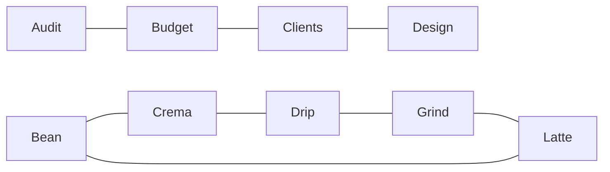

# Perfect graphs: graphs where the largest clique always gives the colour count, chordal graphs as the friendly family, and the strong perfect graph theorem

[Syllabus](../../../SYLLABUS.md) → [Combinatorics and graphs](../README.md) → [Planarity and Colouring](../README.md#s12) → Perfect graphs

---

## General Overview

An office books four meetings for Tuesday: Audit 9:00–11:00, Budget 10:00–12:00, Clients 11:30–13:00 and Design 12:30–14:00. Two meetings that overlap cannot share a room. How many rooms does the day need?

At 10:00 two meetings run at once, and never more, so two rooms is a floor. Two rooms also suffice: Audit and Clients share room 1, Budget and Design room 2.

Five cafes round a square differ: Bean, Crema, Drip, Grind and Latte each compete with the two next door, and rivals hold tasting nights on different evenings. No three are rivals in every pair, so the floor reads two nights, but the answer is three ([Bipartite graphs](../09-Graphs%20-%20Dots%20and%20Lines/05-bipartite-graphs-and-odd-cycles.md)).

A graph whose floor is the answer in every piece cut from it is **perfect**. The meetings are perfect; the cafe ring is the smallest imperfect graph.

**A perfect graph needs exactly as many colours as its largest all-joined group, in every part of it; chordal graphs (no ring of four or more without a short-cut) are perfect and greedy colouring finds their best colouring, and the only obstacles are odd rings of five or more and their complements.**

**What kind of fact this is:** "perfect" and "chordal" are definitions. That chordal graphs are perfect and the ring of five is not are proved in Why it works. The two perfect graph theorems are stated; proofs are in the sources.

### The picture: four meetings on the clock

Each `#` is a half hour from 9:00 to 14:00.

```
Audit   |####......| 9:00-11:00
Budget  |..####....| 10:00-12:00
Clients |.....###..| 11:30-13:00
Design  |.......###| 12:30-14:00
```

No vertical line crosses more than two bars. As graphs, a dot per meeting or cafe and a line per clash:



---

## The formula

A graph $`G`$ is a set of dots and lines, each line joining two dots. Three counts come from [Colouring](03-vertex-colouring-and-chromatic-number.md):

- $`\chi(G)`$, "chi": the **chromatic number**, the fewest colours that give joined dots different colours. Here a colour is a room or a night.
- $`\omega(G)`$, "omega": the **clique number**, the size of the largest set of dots joined in every pair. Such a set is a **clique**.
- $`\alpha(G)`$, "alpha": the **independence number**, the size of the largest set of dots with no line inside.

The colouring card proves $`\chi(G) \ge \omega(G)`$ always. An **induced subgraph** $`H`$ keeps some of the dots and every line among them. A graph is **perfect** when the floor is met everywhere:

```math
\chi(H) = \omega(H) \quad \text{for every induced subgraph } H \text{ of } G
```

**Read it aloud:** whatever dots are kept, the fewest colours equals the largest all-joined group among them.

A **ring** $`C_k`$ is $`k`$ dots in a closed loop. A **chord** of a ring is a line joining two of its dots that are not next to each other on it. A **hole** is a ring of four or more dots with no chord. A graph is **chordal** when it has no hole. The **complement** $`\overline{G}`$ swaps lines and non-lines, and an **antihole** is the complement of a hole.

An **elimination order** (a perfect elimination ordering) $`v_1, v_2, \ldots, v_n`$ lists all $`n`$ dots so that each dot's neighbours later in the list form a clique.

| Symbol | Plain meaning | In our example | Push it up and the answer… |
| --- | --- | --- | --- |
| $`G`$, $`H`$, $`n`$ | a graph; one of its induced subgraphs; its dot count | meetings, $`n`$ = 4 | more dots, more subgraphs to test |
| $`\chi`$ | fewest colours | 2 rooms; 3 nights | — |
| $`\omega`$ | largest all-joined group | 2 meetings at once; 2 rival cafes | the floor rises |
| $`\alpha`$ | largest group with no line inside | 2 cafes | fewer colours forced |
| $`C_k`$, $`k`$ | a ring; its dot count | $`C_5`$, the cafes | odd $`k`$ from 5 up: not perfect |
| $`\overline{G}`$ | the complement: lines swapped with non-lines | meetings that never overlap | perfect exactly when $`G`$ is |
| $`v_1, \ldots, v_n`$; $`v_i`$, $`i`$ | an elimination order; its dot in place $`i`$ | Audit, Budget, Clients, Design | — |
| $`a`$, $`b`$, $`S`$, $`A`$, $`B`$, $`x`$, $`y`$ | in the Step 3 proof: two unjoined dots; a smallest set separating them; the pieces holding $`a`$ and $`b`$; two dots of $`S`$ | — | — |

### When it holds

- **Every induced subgraph, not just the whole graph.** A ring of five beside a separate triangle has $`\chi = \omega = 3`$, yet is not perfect: delete the triangle and 2 against 3 returns.
- **No hole, for the greedy guarantee.** A hole has no elimination order. Yet the ring of four is perfect: chordal is narrower than perfect.
- **Each meeting one unbroken interval.** A meeting split in two breaks the clock argument, and the graph may hold a hole.

---

## Why it works

### Step 0: the floor is always there; perfect means it is reached everywhere

Every clique needs a colour per dot, so $`\chi \ge \omega`$ always. Perfection asks that nothing else forces an extra colour. One big clique can hide a bad part, so the demand covers every induced subgraph.

### Step 1: an odd ring is not perfect

In a ring of five, each dot's two neighbours are not joined, so there is no triangle: $`\omega(C_5) = 2`$.

Two colours fail on any odd ring ([Bipartite graphs](../09-Graphs%20-%20Dots%20and%20Lines/05-bipartite-graphs-and-odd-cycles.md)); a third colour for the last dot fixes it, so $`\chi(C_5) = 3`$. A count agrees: a colour is a set with no line inside, so it holds at most $`\alpha = 2`$ cafes, and $`\omega = 2`$ colours hold at most $`2 \times 2 = 4`$ of the 5. Whenever $`\alpha \times \omega`$ is below the dot count, the graph is not perfect.

The same holds for every odd ring of five or more dots, an **odd hole**. Its complement, an **odd antihole**, also fails: the antihole on seven dots has $`\omega = 3`$ and $`\chi = 4`$.

### Step 2: an elimination order makes greedy colouring exact

**Greedy colouring** walks the dots in a chosen order and gives each the lowest colour no coloured neighbour holds ([Colouring](03-vertex-colouring-and-chromatic-number.md)).

Walk an elimination order backwards, from $`v_n`$ to $`v_1`$. At $`v_i`$, its coloured neighbours are exactly its later neighbours. With $`v_i`$ they form a clique, so there are at most $`\omega - 1`$ of them. One of the first $`\omega`$ colours is free.

So greedy uses at most $`\omega`$ colours, and the floor says it cannot use fewer: $`\chi = \omega`$.

### Step 3: every chordal graph has an elimination order

Call a dot **simplicial** when its neighbours form a clique. Audit is simplicial: its only neighbour is Budget.

Dirac's lemma (1961): every nonempty finite chordal graph has a simplicial dot. Remove it; the rest is still chordal, since deleting dots cannot create a hole. Repeat, and the removed dots, in order, form an elimination order.

The converse holds too. Each hole dot has two unjoined neighbours on the hole, so the first hole dot removed is not simplicial at its turn. So a finite graph has an elimination order exactly when it is chordal.

Induced subgraphs of a chordal graph are chordal, so Step 2 applies to each. **Every chordal graph is perfect.**

<details>
<summary>Detailed proof: Dirac's lemma, that a chordal graph has a simplicial dot</summary>

Prove more, by induction on dot count: a chordal graph is complete (all pairs joined) or has two unjoined simplicial dots.

Take unjoined dots $`a`$ and $`b`$, and a smallest set $`S`$ of other dots whose removal separates them. Removing $`S`$ leaves $`a`$ in a piece $`A`$ and $`b`$ in a piece $`B`$.

**$`S`$ is a clique.** Take $`x`$ and $`y`$ in $`S`$. Because $`S`$ is smallest, each has neighbours in both $`A`$ and $`B`$. Shortest routes from $`x`$ to $`y`$ through $`A`$ and back through $`B`$ form a ring of at least four dots. No line joins $`A`$ to $`B`$ and shortest routes have no short-cuts, so the only possible chord, $`xy`$, must be a line.

**A simplicial dot lies in $`A`$.** The graph on $`A`$ and $`S`$ is smaller and chordal. If complete, any dot of $`A`$ is simplicial in it; if not, it has two unjoined simplicial dots, not both in the clique $`S`$. All neighbours of that dot of $`A`$ lie in $`A`$ or $`S`$, so it is simplicial in the whole graph.

Likewise one lies in $`B`$, and no line joins $`A`$ to $`B`$, so the two are unjoined.

</details>

### Step 4: meetings make a chordal graph, and the clock reads the clique

A graph whose dots are time intervals, joined when they overlap, is an **interval graph**.

Take the meeting that ends first. Every meeting overlapping it runs at its end moment, so they overlap each other: the first-ending meeting is simplicial. Sorting by end time is an elimination order, so interval graphs are chordal.

The clock also reads $`\omega`$. Meetings overlapping in every pair all run at the latest of their starts, so the largest clique is the most meetings running at once: 2. Greedy by start time also works: a meeting's roomed neighbours all run at its start, a clique.

### Step 5: the two perfect graph theorems

Bipartite graphs are perfect: any piece with a line needs 2 colours and has $`\omega = 2`$. So are their complements, by König's theorem (Diestel, Theorem 2.1.1), and their **line graphs** (a dot per line, joined when lines share an end): [Edge colouring](06-edge-colouring-and-round-robin.md) proves these need only as many colours as the most lines at one dot, their largest clique.

- **Weak perfect graph theorem** (László Lovász, 1972): $`G`$ is perfect exactly when $`\overline{G}`$ is. The meetings' complement, pairs that never overlap, is perfect with $`\omega = \chi = 2`$.
- **Strong perfect graph theorem** (Maria Chudnovsky, Neil Robertson, Paul Seymour and Robin Thomas, 2006): $`G`$ is perfect exactly when it has no odd hole and no odd antihole.

Berge conjectured both in 1961; the strong theorem's proof runs about 180 pages.

---

## Worked numbers, by hand

| Step | Arithmetic | Value |
| --- | --- | --- |
| overlapping pairs | Audit-Budget, Budget-Clients, Clients-Design | 3 |
| most meetings running at one start time | read off the clock chart | $`\omega`$ = 2 |
| elimination order | each first-ending meeting is simplicial | Audit, Budget, Clients, Design |
| greedy, order reversed | Design 1, Clients 2, Budget 1, Audit 2 | 2 rooms |
| greedy by start time | Audit 1, Budget 2, Clients 1, Design 2 | 2 rooms |
| every induced subgraph | 15 of them, $`\chi = \omega`$ in each | perfect |
| cafe ring | $`\omega`$ = 2, $`\alpha \times \omega`$ = 2 × 2 = 4 < 5 | 3 nights, not perfect |
| the answer | floor 2 met | **2 rooms** |

### What breaks if you drop a piece

| Mistake | Comes out at | What went wrong |
| --- | --- | --- |
| Greedy in arrival order Audit, Design, Budget, Clients | 3 rooms | Design took room 1, boxing in Clients; Step 2 guarantees only a backwards walk |
| "No three mutual rivals, so two nights" on the cafes | 2 nights, needs 3 | an odd hole: the floor is not the answer |
| $`\chi = \omega`$ checked on the whole ring-plus-triangle only | looks perfect at 3 = 3 | the ring inside still has 3 against 2 |
| "Not chordal, so not perfect" on the ring of four | called imperfect | it is perfect: 2 colours, no triangle |

---

## Code, from first principles, and it actually runs

Nothing is imported. The room count comes three ways: a backtracking search, greedy colouring backwards along an elimination order found by removing simplicial dots, and a clock sweep. Perfection is tested as $`\chi = \omega`$ on every induced subgraph.

### Python

```python
# Perfect and chordal graphs -- the check behind the card.  Nothing is imported.  Four meetings need two
# rooms and five rival cafes need three nights: counted by search, by elimination order, by a clock sweep.
MEET = [("Audit", 9.0, 11.0), ("Budget", 10.0, 12.0), ("Clients", 11.5, 13.0), ("Design", 12.5, 14.0)]
def graph(n, pairs):
    adj = [set() for _ in range(n)]
    for a, b in pairs: adj[a].add(b); adj[b].add(a)
    return adj
def ring(n): return graph(n, [(i, (i + 1) % n) for i in range(n)])
def flip(adj): return [{w for w in range(len(adj)) if w != v and w not in adj[v]} for v in range(len(adj))]
def sub(adj, keep): return [{keep.index(w) for w in adj[v] if w in keep} for v in keep]
def subsets(n): return ([i for i in range(n) if m >> i & 1] for m in range(1 << n))
def omega(adj): return max(len(s) for s in subsets(len(adj)) if all(b in adj[a] for a in s for b in s if a < b))
def chi(adj):                                  # fewest colours, by backtracking through every colouring
    def fits(c, k):
        v = len(c)
        return v == len(adj) or any(fits(c + [x], k) for x in range(k) if all(c[w] != x for w in adj[v] if w < v))
    return next(k for k in range(1, len(adj) + 1) if fits([], k))
def perfect(adj): return all(chi(h) == omega(h) for s in subsets(len(adj)) if s for h in [sub(adj, s)])
def eliminate(adj):                            # remove a dot whose remaining neighbours are all joined
    left, order = set(range(len(adj))), []
    while left:
        simp = [v for v in sorted(left) if all(b in adj[a] for a in adj[v] & left for b in adj[v] & left if a < b)]
        if not simp: return order                  # stuck: no perfect elimination order exists
        order.append(simp[0]); left.remove(simp[0])
    return order
def greedy(adj, order):                        # lowest colour no already-coloured neighbour holds
    col = {}
    for v in order: col[v] = min(c for c in range(1, len(adj) + 2) if c not in {col.get(w) for w in adj[v]})
    return [col[v] for v in range(len(adj))]
def is_peo(adj, o): return all(all(b in adj[a] for a in adj[v] & set(o[i + 1:]) for b in adj[v] & set(o[i + 1:]) if a < b) for i, v in enumerate(o))
clock = lambda t: f"{int(t)}:{round(t % 1 * 60):02d}"
n = len(MEET)
meet = graph(n, [(a, b) for a in range(n) for b in range(a + 1, n) if MEET[a][1] < MEET[b][2] and MEET[b][1] < MEET[a][2]])
for name, s, e in MEET:
    print(f"{name:8}|" + "".join("#" if s <= 9 + h / 2 < e else "." for h in range(10)) + f"| {clock(s)}-{clock(e)}")
print("overlapping pairs: " + ", ".join(f"{MEET[a][0]}-{MEET[b][0]}" for a in range(n) for b in sorted(meet[a]) if a < b))
sweep = max(sum(1 for _, s, e in MEET if s <= t < e) for _, t, _ in MEET)
peo = eliminate(meet)
by_peo, by_start, by_arrival = greedy(meet, peo[::-1]), greedy(meet, range(n)), greedy(meet, [0, 3, 1, 2])
print(f"most meetings running at one start time: {sweep}; largest clique {omega(meet)}; fewest rooms {chi(meet)}")
print("elimination order: " + ", ".join(MEET[v][0] for v in peo))
print(f"greedy along the reversed order: {by_peo}; greedy by start time: {by_start}")
print(f"chi = omega on all {2 ** n - 1} induced subgraphs: {'yes' if perfect(meet) else 'no'}")
c5, anti7, c4, mixed = ring(5), flip(ring(7)), ring(4), graph(8, [(i, (i + 1) % 5) for i in range(5)] + [(5, 6), (6, 7), (5, 7)])
print(f"cafe ring: omega {omega(c5)}, chi {chi(c5)}, eliminated {len(eliminate(c5))} of 5, perfect "
      f"{'yes' if perfect(c5) else 'no'}, alpha*omega = {omega(flip(c5))}*{omega(c5)} = {omega(flip(c5)) * omega(c5)} < 5")
print(f"seven-dot antihole: omega {omega(anti7)}, chi {chi(anti7)}")
print(f"ring of {len(c4)}: perfect {'yes' if perfect(c4) else 'no'}, eliminated {len(eliminate(c4))} of {len(c4)}")
flipped = flip(meet)                           # the pairs of meetings that do NOT overlap
print("never overlapping: " + ", ".join(f"{MEET[a][0]}-{MEET[b][0]}" for a in range(n) for b in sorted(flipped[a]) if a < b))
print(f"complement of the meetings: omega {omega(flipped)}, chi {chi(flipped)}, perfect {'yes' if perfect(flipped) else 'no'}")
print(f"mistake, bookings in arrival order Audit, Design, Budget, Clients: rooms {by_arrival} -> {max(by_arrival)}; an elimination order: {'yes' if is_peo(meet, [0, 3, 1, 2]) else 'no'}, reversed: {'yes' if is_peo(meet, [2, 1, 3, 0]) else 'no'}")
print(f"mistake, cafe ring beside a triangle: omega {omega(mixed)}, chi {chi(mixed)}, perfect {'yes' if perfect(mixed) else 'no'}")
assert sweep == omega(meet) == chi(meet) == max(by_peo) == max(by_start) == 2 and len(peo) == n
assert perfect(meet) and max(by_arrival) == 3 and is_peo(meet, peo) and is_peo(meet, [0, 3, 1, 2]) and not is_peo(meet, [2, 1, 3, 0])
assert omega(c5) == 2 and chi(c5) == 3 and eliminate(c5) == [] and not perfect(c5)
assert omega(anti7) == 3 and chi(anti7) == 4 and perfect(c4) and eliminate(c4) == []
assert omega(flipped) == chi(flipped) == 2 and perfect(flipped) and len(eliminate(flipped)) == n
assert omega(mixed) == chi(mixed) == 3 and not perfect(mixed)
print("ALL CHECKS PASS")
```

**Ran 2026-11-23 on macOS, Python 3.14.10, standard library only. All checks passed. Output, pasted from the run:**

```
Audit   |####......| 9:00-11:00
Budget  |..####....| 10:00-12:00
Clients |.....###..| 11:30-13:00
Design  |.......###| 12:30-14:00
overlapping pairs: Audit-Budget, Budget-Clients, Clients-Design
most meetings running at one start time: 2; largest clique 2; fewest rooms 2
elimination order: Audit, Budget, Clients, Design
greedy along the reversed order: [2, 1, 2, 1]; greedy by start time: [1, 2, 1, 2]
chi = omega on all 15 induced subgraphs: yes
cafe ring: omega 2, chi 3, eliminated 0 of 5, perfect no, alpha*omega = 2*2 = 4 < 5
seven-dot antihole: omega 3, chi 4
ring of 4: perfect yes, eliminated 0 of 4
never overlapping: Audit-Clients, Audit-Design, Budget-Design
complement of the meetings: omega 2, chi 2, perfect yes
mistake, bookings in arrival order Audit, Design, Budget, Clients: rooms [1, 2, 3, 1] -> 3; an elimination order: yes, reversed: no
mistake, cafe ring beside a triangle: omega 3, chi 3, perfect no
ALL CHECKS PASS
```

### Rust

Same numbers, same labels, built with `rustc --edition 2021 -O`.

```rust
// Perfect and chordal graphs -- the same check as the Python, in Rust.  No crates.  Four meetings need two
// rooms and five rival cafes need three nights: counted by search, by elimination order, by a clock sweep.
type G = Vec<Vec<bool>>;
fn graph(n: usize, pairs: &[(usize, usize)]) -> G {
    let mut adj = vec![vec![false; n]; n];
    for &(a, b) in pairs { adj[a][b] = true; adj[b][a] = true }
    adj
}
fn ring(n: usize) -> G { graph(n, &(0..n).map(|i| (i, (i + 1) % n)).collect::<Vec<_>>()) }
fn flip(adj: &G) -> G { (0..adj.len()).map(|v| (0..adj.len()).map(|w| w != v && !adj[v][w]).collect()).collect() }
fn sub(adj: &G, keep: &[usize]) -> G { keep.iter().map(|&v| keep.iter().map(|&w| adj[v][w]).collect()).collect() }
fn subsets(n: usize) -> Vec<Vec<usize>> { (0..1usize << n).map(|m| (0..n).filter(|i| m >> i & 1 == 1).collect()).collect() }
fn clique(adj: &G, s: &[usize]) -> bool { s.iter().all(|&a| s.iter().all(|&b| a == b || adj[a][b])) }
fn omega(adj: &G) -> usize { subsets(adj.len()).iter().filter(|s| clique(adj, s)).map(|s| s.len()).max().unwrap() }
fn fits(adj: &G, c: &mut Vec<usize>, k: usize) -> bool {   // backtracking through every colouring
    let v = c.len();
    if v == adj.len() { return true }
    for x in 0..k {
        if (0..v).all(|w| !adj[v][w] || c[w] != x) { c.push(x); if fits(adj, c, k) { return true } c.pop(); }
    }
    false
}
fn chi(adj: &G) -> usize { (1..=adj.len()).find(|&k| fits(adj, &mut Vec::new(), k)).unwrap() }
fn perfect(adj: &G) -> bool { subsets(adj.len()).iter().filter(|s| !s.is_empty()).all(|s| { let h = sub(adj, s); chi(&h) == omega(&h) }) }
fn eliminate(adj: &G) -> Vec<usize> {   // remove a dot whose remaining neighbours are all joined
    let (mut left, mut order): (Vec<usize>, Vec<usize>) = ((0..adj.len()).collect(), Vec::new());
    while !left.is_empty() {
        let simp = left.iter().position(|&v| clique(adj, &left.iter().copied().filter(|&w| adj[v][w]).collect::<Vec<_>>()));
        match simp { Some(i) => order.push(left.remove(i)), None => return order }   // stuck: no order exists
    }
    order
}
fn greedy(adj: &G, order: &[usize]) -> Vec<usize> {   // lowest colour no already-coloured neighbour holds
    let mut col = vec![0usize; adj.len()];
    for &v in order { col[v] = (1..).find(|&c| (0..adj.len()).all(|w| !adj[v][w] || col[w] != c)).unwrap() }
    col
}
fn clock(t: f64) -> String { format!("{}:{:02}", t as u32, ((t % 1.0) * 60.0).round() as u32) }
fn yn(b: bool) -> &'static str { if b { "yes" } else { "no" } }
fn is_peo(adj: &G, o: &[usize]) -> bool { (0..o.len()).all(|i| clique(adj, &o[i + 1..].iter().copied().filter(|&w| adj[o[i]][w]).collect::<Vec<_>>())) }
fn main() {
    let meets = [("Audit", 9.0, 11.0), ("Budget", 10.0, 12.0), ("Clients", 11.5, 13.0), ("Design", 12.5, 14.0)];
    let (n, mut pairs) = (meets.len(), Vec::new());
    for a in 0..n { for b in a + 1..n { if meets[a].1 < meets[b].2 && meets[b].1 < meets[a].2 { pairs.push((a, b)) } } }
    let meet = graph(n, &pairs);
    for &(name, s, e) in &meets {
        let bar: String = (0..10).map(|h| if s <= 9.0 + h as f64 / 2.0 && 9.0 + h as f64 / 2.0 < e { '#' } else { '.' }).collect();
        println!("{:8}|{}| {}-{}", name, bar, clock(s), clock(e));
    }
    println!("overlapping pairs: {}", pairs.iter().map(|&(a, b)| format!("{}-{}", meets[a].0, meets[b].0)).collect::<Vec<_>>().join(", "));
    let sweep = meets.iter().map(|&(_, t, _)| meets.iter().filter(|&&(_, s, e)| s <= t && t < e).count()).max().unwrap();
    let peo = eliminate(&meet); let rev: Vec<usize> = peo.iter().rev().copied().collect();
    let (by_peo, by_start, by_arrival) = (greedy(&meet, &rev), greedy(&meet, &[0, 1, 2, 3]), greedy(&meet, &[0, 3, 1, 2]));
    println!("most meetings running at one start time: {}; largest clique {}; fewest rooms {}", sweep, omega(&meet), chi(&meet));
    println!("elimination order: {}", peo.iter().map(|&v| meets[v].0).collect::<Vec<_>>().join(", "));
    println!("greedy along the reversed order: {:?}; greedy by start time: {:?}", by_peo, by_start);
    println!("chi = omega on all {} induced subgraphs: {}", (1 << n) - 1, yn(perfect(&meet)));
    let mp: Vec<(usize, usize)> = (0..5).map(|i| (i, (i + 1) % 5)).chain([(5, 6), (6, 7), (5, 7)]).collect();
    let (c5, anti7, c4, mixed) = (ring(5), flip(&ring(7)), ring(4), graph(8, &mp));
    let a5 = omega(&flip(&c5));
    println!("cafe ring: omega {}, chi {}, eliminated {} of 5, perfect {}, alpha*omega = {}*{} = {} < 5",
             omega(&c5), chi(&c5), eliminate(&c5).len(), yn(perfect(&c5)), a5, omega(&c5), a5 * omega(&c5));
    println!("seven-dot antihole: omega {}, chi {}", omega(&anti7), chi(&anti7));
    println!("ring of {}: perfect {}, eliminated {} of {}", c4.len(), yn(perfect(&c4)), eliminate(&c4).len(), c4.len());
    let flipped = flip(&meet);   // the pairs of meetings that do NOT overlap
    let apart: Vec<String> = (0..n).flat_map(|a| (a + 1..n).map(move |b| (a, b))).filter(|&(a, b)| flipped[a][b])
        .map(|(a, b)| format!("{}-{}", meets[a].0, meets[b].0)).collect();
    println!("never overlapping: {}", apart.join(", "));
    println!("complement of the meetings: omega {}, chi {}, perfect {}", omega(&flipped), chi(&flipped), yn(perfect(&flipped)));
    println!("mistake, bookings in arrival order Audit, Design, Budget, Clients: rooms {:?} -> {}; an elimination order: {}, reversed: {}", by_arrival, by_arrival.iter().max().unwrap(), yn(is_peo(&meet, &[0, 3, 1, 2])), yn(is_peo(&meet, &[2, 1, 3, 0])));
    println!("mistake, cafe ring beside a triangle: omega {}, chi {}, perfect {}", omega(&mixed), chi(&mixed), yn(perfect(&mixed)));
    assert!(sweep == omega(&meet) && omega(&meet) == chi(&meet) && chi(&meet) == *by_peo.iter().max().unwrap());
    assert!(*by_start.iter().max().unwrap() == 2 && sweep == 2 && peo.len() == n);
    assert!(perfect(&meet) && *by_arrival.iter().max().unwrap() == 3 && is_peo(&meet, &peo) && is_peo(&meet, &[0, 3, 1, 2]) && !is_peo(&meet, &[2, 1, 3, 0]));
    assert!(omega(&c5) == 2 && chi(&c5) == 3 && eliminate(&c5).is_empty() && !perfect(&c5));
    assert!(omega(&anti7) == 3 && chi(&anti7) == 4 && perfect(&c4) && eliminate(&c4).is_empty());
    assert!(omega(&flipped) == 2 && chi(&flipped) == 2 && perfect(&flipped) && eliminate(&flipped).len() == n);
    assert!(omega(&mixed) == 3 && chi(&mixed) == 3 && !perfect(&mixed));
    println!("ALL CHECKS PASS");
}
```

**Ran 2026-11-23 on macOS, rustc 1.98.1, no crates. All checks passed. Output, pasted from the run:**

```
Audit   |####......| 9:00-11:00
Budget  |..####....| 10:00-12:00
Clients |.....###..| 11:30-13:00
Design  |.......###| 12:30-14:00
overlapping pairs: Audit-Budget, Budget-Clients, Clients-Design
most meetings running at one start time: 2; largest clique 2; fewest rooms 2
elimination order: Audit, Budget, Clients, Design
greedy along the reversed order: [2, 1, 2, 1]; greedy by start time: [1, 2, 1, 2]
chi = omega on all 15 induced subgraphs: yes
cafe ring: omega 2, chi 3, eliminated 0 of 5, perfect no, alpha*omega = 2*2 = 4 < 5
seven-dot antihole: omega 3, chi 4
ring of 4: perfect yes, eliminated 0 of 4
never overlapping: Audit-Clients, Audit-Design, Budget-Design
complement of the meetings: omega 2, chi 2, perfect yes
mistake, bookings in arrival order Audit, Design, Budget, Clients: rooms [1, 2, 3, 1] -> 3; an elimination order: yes, reversed: no
mistake, cafe ring beside a triangle: omega 3, chi 3, perfect no
ALL CHECKS PASS
```

### Lean

Lean proves the main theorems of Steps 1 and 3 in general, and checks the meetings' worked numbers.

- Every chordal graph with finitely many dots is perfect.
- Suppose $`k`$ is odd and at least 5. Then the ring $`C_k`$ has $`\omega = 2`$ and $`\chi = 3`$, so it is not perfect.
- A graph with finitely many dots is chordal exactly when it has an elimination order.
- The meetings make three overlapping pairs, and at most two run at any start time.
- Audit, Budget, Clients, Design is an elimination order, and rooms 1, 2, 1, 2 give no clash.
- The sums $`2^4 - 1 = 15`$ and $`2 \times 2 = 4 < 5`$ come out as stated.

Greedy colouring, the antihole, the ring of four and the complement of the meetings are left to the Python and Rust checks.

```lean
-- Perfect graphs: every finite chordal graph is perfect, odd rings of five or more are not, and a graph is chordal exactly when it has an elimination order.
import Mathlib.Combinatorics.SimpleGraph.Coloring.Vertex
import Mathlib.Combinatorics.SimpleGraph.Coloring.Constructions
import Mathlib.Combinatorics.SimpleGraph.CycleGraph
import Mathlib.Combinatorics.SimpleGraph.Maps
import Mathlib.Data.Fin.VecNotation
import Mathlib.Data.Finset.Sort
import Mathlib.Tactic.NormNum

namespace PerfectChordal

open SimpleGraph

variable {V : Type*}

/-- A graph is perfect when every induced subgraph needs exactly as many colours
as its largest clique: `χ(H) = ω(H)` for every induced subgraph `H`. -/
def IsPerfectGraph (G : SimpleGraph V) : Prop :=
  ∀ s : Set V, (G.induce s).chromaticNumber = ((G.induce s).cliqueNum : ℕ∞)

/-- A hole is a ring of four or more dots with no chord, that is, an induced copy
of the cycle graph `C_k` with `k ≥ 4`. A `↪g` embedding keeps lines and non-lines. -/
def HasHole (G : SimpleGraph V) : Prop :=
  ∃ k : ℕ, 4 ≤ k ∧ Nonempty (cycleGraph k ↪g G)

/-- A graph is chordal when it has no hole. -/
def IsChordal (G : SimpleGraph V) : Prop := ¬ HasHole G

/-- An elimination order lists the dots `v_1, ..., v_n` so that each dot's
neighbours later in the list form a clique. -/
def IsEliminationOrder [Fintype V] (G : SimpleGraph V) (σ : V ≃ Fin (Fintype.card V)) :
    Prop :=
  ∀ v : V, G.IsClique {w | G.Adj v w ∧ σ v < σ w}

lemma cyc_adj_val {k : ℕ} (hk : 2 ≤ k) (a b : Fin k) :
    (cycleGraph k).Adj a b ↔ (a.val + 1 = b.val ∨ b.val + 1 = a.val ∨
      (a.val = 0 ∧ b.val + 1 = k) ∨ (b.val = 0 ∧ a.val + 1 = k)) := by
  rw [cycleGraph_adj']
  have ha := a.isLt
  have hb := b.isLt
  rcases lt_or_ge a b with h | h
  · rw [Fin.coe_sub_iff_lt.mpr h, Fin.coe_sub_iff_le.mpr h.le]
    rw [Fin.lt_def] at h
    omega
  · rw [Fin.coe_sub_iff_le.mpr h]
    rcases lt_or_eq_of_le h with h' | h'
    · rw [Fin.coe_sub_iff_lt.mpr h']
      rw [Fin.lt_def] at h'
      omega
    · subst h'
      rw [Fin.coe_sub_iff_le.mpr le_rfl]
      omega

#print axioms cyc_adj_val

lemma hasHole_of_cycle (G : SimpleGraph V) (n : ℕ) (hn : 2 ≤ n) (g : ℕ → V)
    (hinj : ∀ i j, i ≤ n + 1 → j ≤ n + 1 → g i = g j → i = j)
    (hadj : ∀ i j, i ≤ n + 1 → j ≤ n + 1 → (G.Adj (g i) (g j) ↔
      (i + 1 = j ∨ j + 1 = i ∨ (i = 0 ∧ j = n + 1) ∨ (j = 0 ∧ i = n + 1)))) :
    HasHole G := by
  refine ⟨n + 2, by omega, ⟨⟨⟨fun i => g i.val, ?_⟩, ?_⟩⟩⟩
  · intro a b h
    exact Fin.ext (hinj _ _ (by omega) (by omega) h)
  · intro a b
    show G.Adj (g a.val) (g b.val) ↔ _
    rw [hadj _ _ (by omega) (by omega), cyc_adj_val (by omega)]
    have := a.isLt
    have := b.isLt
    omega

#print axioms hasHole_of_cycle

lemma cyc_cliqueNum_le (k : ℕ) (hk : 4 ≤ k) : (cycleGraph k).cliqueNum ≤ 2 := by
  obtain ⟨s, hs⟩ := (cycleGraph k).exists_isNClique_cliqueNum
  by_contra hlt
  replace hlt := not_le.mp hlt
  have h3 : 2 < s.card := by rw [hs.card_eq]; exact hlt
  obtain ⟨a, ha, b, hb, c, hc, hab, hac, hbc⟩ := Finset.two_lt_card.mp h3
  have hab' := hs.isClique ha hb hab
  have hac' := hs.isClique ha hc hac
  have hbc' := hs.isClique hb hc hbc
  rw [cyc_adj_val (by omega)] at hab' hac' hbc'
  have h1 : a.val ≠ b.val := fun h => hab (Fin.ext h)
  have h2 : a.val ≠ c.val := fun h => hac (Fin.ext h)
  have h3 : b.val ≠ c.val := fun h => hbc (Fin.ext h)
  have := a.isLt
  have := b.isLt
  have := c.isLt
  omega

#print axioms cyc_cliqueNum_le

/-- `v` is simplicial in `s`: its neighbours inside `s` are pairwise adjacent. -/
def Simpl (G : SimpleGraph V) (s : Finset V) (v : V) : Prop :=
  ∀ a ∈ s, ∀ b ∈ s, G.Adj v a → G.Adj v b → a ≠ b → G.Adj a b

/-- A walk from `a` to `b` staying inside `D`, written as a function `ℕ → V`. -/
def RIn (G : SimpleGraph V) (D : Finset V) (a b : V) : Prop :=
  ∃ n : ℕ, ∃ p : ℕ → V, p 0 = a ∧ p n = b ∧ (∀ i ≤ n, p i ∈ D) ∧
    ∀ i < n, G.Adj (p i) (p (i + 1))

lemma RIn_refl {G : SimpleGraph V} {D : Finset V} {a : V} (ha : a ∈ D) : RIn G D a a :=
  ⟨0, fun _ => a, rfl, rfl, fun _ _ => ha, fun _ hi => absurd hi (Nat.not_lt_zero _)⟩

#print axioms RIn_refl

lemma RIn_symm {G : SimpleGraph V} {D : Finset V} {a b : V} : RIn G D a b → RIn G D b a := by
  rintro ⟨n, p, h0, hn, hD, hA⟩
  refine ⟨n, fun i => p (n - i), by simpa using hn, by simpa using h0,
    fun i _ => hD _ (by omega), ?_⟩
  intro i hi
  have h := hA (n - i - 1) (by omega)
  have e : n - i - 1 + 1 = n - i := by omega
  have e2 : n - (i + 1) = n - i - 1 := by omega
  rw [e] at h
  simp only [e2]
  exact h.symm

#print axioms RIn_symm

lemma RIn_trans {G : SimpleGraph V} {D : Finset V} {a b c : V} :
    RIn G D a b → RIn G D b c → RIn G D a c := by
  rintro ⟨n, p, h0, hn, hD, hA⟩ ⟨m, q, h0', hm, hD', hA'⟩
  refine ⟨n + m, fun i => if i ≤ n then p i else q (i - n), by simp [h0], ?_, ?_, ?_⟩
  · by_cases hm0 : m = 0
    · subst hm0
      simp only [Nat.add_zero, le_refl, ite_true]
      rw [hn, ← h0', hm]
    · simp only [show ¬ (n + m ≤ n) by omega, ite_false, Nat.add_sub_cancel_left]
      exact hm
  · intro i hi
    dsimp only
    split_ifs with h
    · exact hD i h
    · exact hD' _ (by omega)
  · intro i hi
    dsimp only
    by_cases h1 : i + 1 ≤ n
    · rw [ite_eq_left (by omega), ite_eq_left h1]; exact hA i (by omega)
    · by_cases h2 : i = n
      · subst h2
        rw [ite_eq_left le_rfl, ite_eq_right (by omega), hn, ← h0', show i + 1 - i = 0 + 1 by omega]
        exact hA' 0 (by omega)
      · rw [ite_eq_right (by omega), ite_eq_right h1, show i + 1 - n = (i - n) + 1 by omega]
        exact hA' _ (by omega)

#print axioms RIn_trans

lemma RIn_step {G : SimpleGraph V} {D : Finset V} {a b c : V} (h : RIn G D a b) (hc : c ∈ D)
    (hbc : G.Adj b c) : RIn G D a c := by
  have hb : b ∈ D := by
    obtain ⟨n, p, -, hn, hD, -⟩ := h
    exact hn ▸ hD n le_rfl
  refine RIn_trans h ⟨1, fun i => if i = 0 then b else c, by simp, by simp, ?_, ?_⟩
  · intro i _
    dsimp only
    split_ifs
    · exact hb
    · exact hc
  · intro i hi
    have : i = 0 := by omega
    subst this
    simpa using hbc

#print axioms RIn_step

/-- A path from `x` to `y` of length `n` whose inner dots lie in `C`. -/
def PathVia (G : SimpleGraph V) (C : Finset V) (x y : V) (n : ℕ) (p : ℕ → V) : Prop :=
  p 0 = x ∧ p n = y ∧ (∀ i < n, G.Adj (p i) (p (i + 1))) ∧ ∀ i, 0 < i → i < n → p i ∈ C

lemma chordless_of_min {G : SimpleGraph V} {C : Finset V} {x y : V} {n : ℕ} {p : ℕ → V}
    (hp : PathVia G C x y n p) (hmin : ∀ m q, PathVia G C x y m q → n ≤ m) :
    ∀ i j, i + 2 ≤ j → j ≤ n → ¬ G.Adj (p i) (p j) := by
  intro i j hij hjn hadj
  obtain ⟨h0, hn, hA, hC⟩ := hp
  have key := hmin (n - (j - i - 1)) (fun m => if m ≤ i then p m else p (m + (j - i - 1)))
    ⟨by simp [h0], ?_, ?_, ?_⟩
  · omega
  · dsimp only
    rw [ite_eq_right (by omega), show n - (j - i - 1) + (j - i - 1) = n by omega]
    exact hn
  · intro m hm
    dsimp only
    by_cases h1 : m + 1 ≤ i
    · rw [ite_eq_left (by omega), ite_eq_left h1]; exact hA m (by omega)
    · by_cases h2 : m = i
      · subst h2
        rw [ite_eq_left le_rfl, ite_eq_right (by omega), show m + 1 + (j - m - 1) = j by omega]
        exact hadj
      · rw [ite_eq_right (by omega), ite_eq_right h1, show m + 1 + (j - i - 1) = m + (j - i - 1) + 1 by omega]
        exact hA _ (by omega)
  · intro m hm0 hm
    dsimp only
    split_ifs with h
    · exact hC m hm0 (by omega)
    · exact hC _ (by omega) (by omega)

#print axioms chordless_of_min

lemma hole_from_path {G : SimpleGraph V} {C : Finset V} {u x y : V} (hux : G.Adj u x)
    (huy : G.Adj u y) (hxy : ¬ G.Adj x y) (hxy' : x ≠ y) (hxC : x ∉ C) (hyC : y ∉ C)
    (huC : ∀ c ∈ C, ¬ G.Adj u c ∧ c ≠ u) {n : ℕ} {p : ℕ → V}
    (hp : PathVia G C x y n p) (hmin : ∀ m q, PathVia G C x y m q → n ≤ m) : HasHole G := by
  have hcl := chordless_of_min hp hmin
  obtain ⟨h0, hn, hA, hC⟩ := hp
  have hn2 : 2 ≤ n := by
    rcases Nat.lt_or_ge n 2 with h | h
    · exfalso
      rcases (show n = 0 ∨ n = 1 by omega) with rfl | rfl
      · exact hxy' (h0 ▸ hn)
      · have := hA 0 (by omega)
        rw [h0, hn] at this
        exact hxy this
    · exact h
  have hnu : ∀ i ≤ n, p i ≠ u := by
    intro i hi he
    rcases Nat.eq_zero_or_pos i with h | h
    · subst h; rw [h0] at he; exact hux.ne he.symm
    · rcases Nat.lt_or_ge i n with h' | h'
      · exact (huC _ (hC i h h')).2 he
      · have : i = n := by omega
        subst this; rw [hn] at he; exact huy.ne he.symm
  have hlt : ∀ i j, i < j → j ≤ n → p i ≠ p j := by
    intro i j hij hjn he
    rcases Nat.eq_zero_or_pos i with h | h
    · subst h
      rw [h0] at he
      rcases Nat.lt_or_ge j n with h' | h'
      · exact hxC (he ▸ hC j hij h')
      · have : j = n := by omega
        subst this; rw [hn] at he; exact hxy' he
    · rcases Nat.lt_or_ge j n with h' | h'
      · have h2 := hA (i - 1) (by omega)
        rw [show i - 1 + 1 = i by omega, he] at h2
        exact hcl (i - 1) j (by omega) (by omega) h2
      · have : j = n := by omega
        subst this; rw [hn] at he; exact hyC (he ▸ hC i h (by omega))
  refine hasHole_of_cycle G n hn2 (fun i => if i ≤ n then p i else u) ?_ ?_
  · intro i j hi hj he
    by_contra hne
    rcases Nat.lt_or_gt_of_ne hne with h | h
    · by_cases hjn : j ≤ n
      · rw [ite_eq_left (by omega), ite_eq_left hjn] at he; exact hlt i j h hjn he
      · rw [ite_eq_left (by omega), ite_eq_right hjn] at he; exact hnu i (by omega) he
    · by_cases hin : i ≤ n
      · rw [ite_eq_left hin, ite_eq_left (by omega)] at he; exact hlt j i h hin he.symm
      · rw [ite_eq_right hin, ite_eq_left (by omega)] at he; exact hnu j (by omega) he.symm
  · intro i j hi hj
    have hsym : ∀ a b, a ≤ n → b ≤ n → a + 1 = b → G.Adj (p a) (p b) := by
      intro a b _ hb hab
      subst hab
      exact hA a (by omega)
    have hpu : ∀ a, a ≤ n → (G.Adj (p a) u ↔ (a = 0 ∨ a = n)) := by
      intro a ha
      constructor
      · intro h
        by_contra hne
        exact (huC _ (hC a (by omega) (by omega))).1 h.symm
      · rintro (h | h)
        · subst h; rw [h0]; exact hux.symm
        · subst h; rw [hn]; exact huy.symm
    by_cases hin : i ≤ n <;> by_cases hjn : j ≤ n
    · rw [ite_eq_left hin, ite_eq_left hjn]
      constructor
      · intro h
        by_contra hne
        rcases lt_trichotomy i j with h' | h' | h'
        · exact hcl i j (by omega) hjn h
        · subst h'; exact G.irrefl h
        · exact hcl j i (by omega) hin h.symm
      · rintro (h | h | h | h)
        · exact hsym i j hin hjn h
        · exact (hsym j i hjn hin h).symm
        · omega
        · omega
    · rw [ite_eq_left hin, ite_eq_right hjn, hpu i hin]
      omega
    · rw [ite_eq_right hin, ite_eq_left hjn, G.adj_comm, hpu j hjn]
      omega
    · rw [ite_eq_right hin, ite_eq_right hjn]
      simp only [SimpleGraph.irrefl, false_iff]
      omega

#print axioms hole_from_path

lemma comp_step {G : SimpleGraph V} [DecidableEq V] (hG : IsChordal G) (s : Finset V) (u w : V)
    (hu : u ∈ s) (hw : w ∈ s) (hwu : w ≠ u) (hnadj : ¬ G.Adj u w)
    (IH : ∀ t ⊂ s, ∀ K : Finset V, K ⊆ t → G.IsClique (K : Set V) → (∃ x ∈ t, x ∉ K) →
      ∃ v ∈ t, v ∉ K ∧ Simpl G t v) :
    ∃ v ∈ s, v ≠ u ∧ ¬ G.Adj u v ∧ Simpl G s v := by
  classical
  set D := s.filter (fun z => z ≠ u ∧ ¬ G.Adj u z) with hD
  set C := D.filter (fun z => RIn G D w z) with hC
  set S := s.filter (fun z => z ∉ C ∧ ∃ c ∈ C, G.Adj z c) with hS
  have hDp : ∀ z, z ∈ D ↔ z ∈ s ∧ z ≠ u ∧ ¬ G.Adj u z := fun z => by
    rw [hD, Finset.mem_filter]
  have hCp : ∀ z, z ∈ C ↔ z ∈ D ∧ RIn G D w z := fun z => by
    rw [hC, Finset.mem_filter]
  have hSp : ∀ z, z ∈ S ↔ z ∈ s ∧ z ∉ C ∧ ∃ c ∈ C, G.Adj z c := fun z => by
    rw [hS, Finset.mem_filter]
  have hwD : w ∈ D := (hDp w).2 ⟨hw, hwu, hnadj⟩
  have hwC : w ∈ C := (hCp w).2 ⟨hwD, RIn_refl hwD⟩
  have hCu : ∀ c ∈ C, ¬ G.Adj u c ∧ c ≠ u := by
    intro c hc
    obtain ⟨-, h1, h2⟩ := (hDp c).1 ((hCp c).1 hc).1
    exact ⟨h2, h1⟩
  have closure : ∀ c ∈ C, ∀ z ∈ s, G.Adj c z → z ∈ C ∨ G.Adj u z := by
    intro c hc z hz hcz
    by_cases huz : G.Adj u z
    · exact Or.inr huz
    · left
      have hzu : z ≠ u := by
        rintro rfl
        exact (hCu c hc).1 hcz.symm
      have hzD : z ∈ D := (hDp z).2 ⟨hz, hzu, huz⟩
      exact (hCp z).2 ⟨hzD, RIn_step ((hCp c).1 hc).2 hzD hcz⟩
  have hSu : ∀ x ∈ S, G.Adj u x := by
    intro x hx
    obtain ⟨hxs, hxC, c, hc, hxc⟩ := (hSp x).1 hx
    exact (closure c hc x hxs hxc.symm).resolve_left hxC
  have hRC : ∀ c1 ∈ C, ∀ c2 ∈ C, ∃ m : ℕ, ∃ q : ℕ → V, q 0 = c1 ∧ q m = c2 ∧
      (∀ i ≤ m, q i ∈ C) ∧ ∀ i < m, G.Adj (q i) (q (i + 1)) := by
    intro c1 h1 c2 h2
    have hr := RIn_trans (RIn_symm ((hCp c1).1 h1).2) ((hCp c2).1 h2).2
    obtain ⟨m, q, hq0, hqm, hqD, hqA⟩ := hr
    refine ⟨m, q, hq0, hqm, ?_, hqA⟩
    intro i hi
    refine (hCp _).2 ⟨hqD i hi, RIn_trans ((hCp c1).1 h1).2 ?_⟩
    exact ⟨i, q, hq0, rfl, fun j hj => hqD j (by omega), fun j hj => hqA j (by omega)⟩
  have hScl : G.IsClique (S : Set V) := by
    intro x hx y hy hxy
    by_contra hn
    rw [Finset.mem_coe] at hx hy
    obtain ⟨-, hxC, c1, hc1, hxc1⟩ := (hSp x).1 hx
    obtain ⟨-, hyC, c2, hc2, hyc2⟩ := (hSp y).1 hy
    obtain ⟨m, q, hq0, hqm, hqC, hqA⟩ := hRC c1 hc1 c2 hc2
    have hex : ∃ n, ∃ p, PathVia G C x y n p := by
      refine ⟨m + 2, fun i => if i = 0 then x else if i ≤ m + 1 then q (i - 1) else y,
        by simp, by simp, ?_, ?_⟩
      · intro i hi
        dsimp only
        rcases Nat.eq_zero_or_pos i with h | h
        · subst h
          simp only [ite_true, show ¬ (0 + 1 = 0) by omega, ite_false,
            show 0 + 1 ≤ m + 1 by omega, Nat.add_sub_cancel, hq0]
          exact hxc1
        · rw [ite_eq_right (show ¬ i = 0 by omega), ite_eq_right (show ¬ i + 1 = 0 by omega),
            ite_eq_left (show i ≤ m + 1 by omega)]
          by_cases him : i + 1 ≤ m + 1
          · rw [ite_eq_left him, show i + 1 - 1 = i - 1 + 1 by omega]
            exact hqA _ (by omega)
          · rw [ite_eq_right him, show i - 1 = m by omega, hqm]
            exact hyc2.symm
      · intro i h0 hi
        dsimp only
        rw [ite_eq_right (show ¬ i = 0 by omega), ite_eq_left (show i ≤ m + 1 by omega)]
        exact hqC _ (by omega)
    obtain ⟨p, hp⟩ := Nat.find_spec hex
    exact hG (hole_from_path (hSu x hx) (hSu y hy) hn hxy hxC hyC hCu hp
      (fun m q hq => Nat.find_min' hex ⟨q, hq⟩))
  set T := C ∪ S with hT
  have hTs : T ⊂ s := by
    rw [Finset.ssubset_iff_of_subset]
    · refine ⟨u, hu, ?_⟩
      rw [hT, Finset.mem_union]
      rintro (h | h)
      · exact (hCu u h).2 rfl
      · exact G.irrefl (hSu u h)
    · intro z hz
      rw [hT, Finset.mem_union] at hz
      rcases hz with h | h
      · exact ((hDp z).1 ((hCp z).1 h).1).1
      · exact ((hSp z).1 h).1
  have hwS : w ∉ S := fun h => ((hSp w).1 h).2.1 hwC
  obtain ⟨v, hvT, hvS, hv⟩ := IH T hTs S Finset.subset_union_right hScl
    ⟨w, Finset.mem_union_left _ hwC, hwS⟩
  have hvC : v ∈ C := (Finset.mem_union.mp hvT).resolve_right hvS
  have hmemT : ∀ z ∈ s, G.Adj v z → z ∈ T := by
    intro z hz hvz
    rw [hT, Finset.mem_union]
    by_cases hzC : z ∈ C
    · exact Or.inl hzC
    · exact Or.inr ((hSp z).2 ⟨hz, hzC, v, hvC, hvz.symm⟩)
  refine ⟨v, hTs.subset hvT, (hCu v hvC).2, (hCu v hvC).1, ?_⟩
  intro a ha b hb hva hvb hab
  exact hv a (hmemT a ha hva) b (hmemT b hb hvb) hva hvb hab

#print axioms comp_step

theorem exists_simpl {G : SimpleGraph V} [DecidableEq V] (hG : IsChordal G) (s : Finset V) :
    ∀ K : Finset V, K ⊆ s → G.IsClique (K : Set V) → (∃ x ∈ s, x ∉ K) →
      ∃ v ∈ s, v ∉ K ∧ Simpl G s v := by
  induction s using Finset.strongInduction with
  | H s IH =>
  rintro K hKs hK ⟨x, hxs, hxK⟩
  by_cases hA : ∃ u ∈ s, (∀ k ∈ K, k = u ∨ G.Adj u k) ∧ ∃ w ∈ s, w ≠ u ∧ ¬ G.Adj u w
  · obtain ⟨u, hu, hKu, w, hw, hwu, hnadj⟩ := hA
    obtain ⟨v, hv, hvu, hvadj, hsv⟩ := comp_step hG s u w hu hw hwu hnadj IH
    exact ⟨v, hv, fun hvK => (hKu v hvK).elim hvu hvadj, hsv⟩
  · have hA' : ∀ u ∈ s, (∀ k ∈ K, k = u ∨ G.Adj u k) → ∀ w ∈ s, w ≠ u → G.Adj u w := by
      intro u hu hKu w hw hwu
      by_contra h
      exact hA ⟨u, hu, hKu, w, hw, hwu, h⟩
    by_cases hKe : K = ∅
    · subst hKe
      refine ⟨x, hxs, hxK, ?_⟩
      intro a ha b hb _ _ hab
      exact hA' a ha (by simp) b hb hab.symm
    · have hKuniv : ∀ k ∈ K, ∀ z ∈ s, z ≠ k → G.Adj k z := by
        intro k hk z hz hzk
        refine hA' k (hKs hk) (fun k' hk' => ?_) z hz hzk
        by_cases e : k' = k
        · exact Or.inl e
        · exact Or.inr (hK hk hk' (Ne.symm e))
      have hsub : s \ K ⊂ s :=
        Finset.sdiff_ssubset hKs (Finset.nonempty_iff_ne_empty.mpr hKe)
      obtain ⟨v, hv, -, hsv⟩ := IH (s \ K) hsub ∅ (Finset.empty_subset _) (by simp)
        ⟨x, Finset.mem_sdiff.mpr ⟨hxs, hxK⟩, Finset.notMem_empty _⟩
      refine ⟨v, (Finset.mem_sdiff.mp hv).1, (Finset.mem_sdiff.mp hv).2, ?_⟩
      intro a ha b hb hva hvb hab
      by_cases haK : a ∈ K
      · exact hKuniv a haK b hb (Ne.symm hab)
      by_cases hbK : b ∈ K
      · exact (hKuniv b hbK a ha hab).symm
      exact hsv a (Finset.mem_sdiff.mpr ⟨ha, haK⟩) b (Finset.mem_sdiff.mpr ⟨hb, hbK⟩) hva hvb hab

#print axioms exists_simpl

theorem peo_chordal [Fintype V] (G : SimpleGraph V) (σ : V ≃ Fin (Fintype.card V))
    (hσ : IsEliminationOrder G σ) : IsChordal G := by
  rintro ⟨k, hk, ⟨f⟩⟩
  have hne : (Finset.univ : Finset (Fin k)).Nonempty := ⟨⟨0, by omega⟩, Finset.mem_univ _⟩
  obtain ⟨i, -, hi⟩ := Finset.exists_min_image Finset.univ (fun j => σ (f j)) hne
  have hi' := i.isLt
  obtain ⟨a, ha⟩ : ∃ a : Fin k, (i.val + 1 = k ∧ a.val = 0) ∨ (i.val + 1 < k ∧ a.val = i.val + 1) := by
    by_cases h : i.val + 1 = k
    · exact ⟨⟨0, by omega⟩, Or.inl ⟨h, rfl⟩⟩
    · exact ⟨⟨i.val + 1, by omega⟩, Or.inr ⟨by omega, rfl⟩⟩
  obtain ⟨b, hb⟩ : ∃ b : Fin k, (i.val = 0 ∧ b.val = k - 1) ∨ (0 < i.val ∧ b.val = i.val - 1) := by
    by_cases h : i.val = 0
    · exact ⟨⟨k - 1, by omega⟩, Or.inl ⟨h, rfl⟩⟩
    · exact ⟨⟨i.val - 1, by omega⟩, Or.inr ⟨by omega, rfl⟩⟩
  have hia : (cycleGraph k).Adj i a := by
    rw [cyc_adj_val (by omega)]; omega
  have hib : (cycleGraph k).Adj i b := by
    rw [cyc_adj_val (by omega)]; omega
  have hab : ¬ (cycleGraph k).Adj a b := by
    rw [cyc_adj_val (by omega)]; omega
  have hab' : a ≠ b := by
    intro h
    have h2 := congrArg Fin.val h
    omega
  have hlt : ∀ j, j ≠ i → σ (f i) < σ (f j) := by
    intro j hj
    refine lt_of_le_of_ne (hi j (Finset.mem_univ _)) ?_
    intro h
    exact hj (f.injective (σ.injective h)).symm
  have hcl := hσ (f i)
  have := hcl (show f a ∈ _ from ⟨f.map_rel_iff.mpr hia, hlt a (hia.ne.symm)⟩)
    (show f b ∈ _ from ⟨f.map_rel_iff.mpr hib, hlt b (hib.ne.symm)⟩)
    (fun h => hab' (f.injective h))
  exact hab (f.map_rel_iff.mp this)

#print axioms peo_chordal

lemma exists_rank {G : SimpleGraph V} [DecidableEq V] (hG : IsChordal G) (s : Finset V) :
    ∃ f : V → ℕ, Set.InjOn f s ∧ ∀ v ∈ s, ∀ a ∈ s, ∀ b ∈ s, G.Adj v a → G.Adj v b →
      f v < f a → f v < f b → a ≠ b → G.Adj a b := by
  induction s using Finset.strongInduction with
  | H s IH =>
  rcases s.eq_empty_or_nonempty with hs | ⟨x, hx⟩
  · subst hs
    exact ⟨fun _ => 0, by simp, by simp⟩
  obtain ⟨v, hv, -, hsv⟩ := exists_simpl hG s ∅ (Finset.empty_subset _) (by simp)
    ⟨x, hx, Finset.notMem_empty _⟩
  obtain ⟨f', hf'inj, hf'⟩ := IH (s.erase v) (Finset.erase_ssubset hv)
  refine ⟨fun z => if z = v then 0 else f' z + 1, ?_, ?_⟩
  · intro a ha b hb hab
    dsimp only at hab
    by_cases hav : a = v <;> by_cases hbv : b = v
    · rw [hav, hbv]
    · rw [ite_eq_left hav, ite_eq_right hbv] at hab; omega
    · rw [ite_eq_right hav, ite_eq_left hbv] at hab; omega
    · rw [ite_eq_right hav, ite_eq_right hbv] at hab
      exact hf'inj (Finset.mem_erase.mpr ⟨hav, ha⟩) (Finset.mem_erase.mpr ⟨hbv, hb⟩) (by omega)
  · intro z hz a ha b hb hza hzb hfa hfb hab
    dsimp only at hfa hfb
    by_cases hzv : z = v
    · subst hzv
      exact hsv a ha b hb hza hzb hab
    · rw [ite_eq_right hzv] at hfa hfb
      have hav : a ≠ v := by intro h; rw [ite_eq_left h] at hfa; omega
      have hbv : b ≠ v := by intro h; rw [ite_eq_left h] at hfb; omega
      rw [ite_eq_right hav] at hfa
      rw [ite_eq_right hbv] at hfb
      exact hf' z (Finset.mem_erase.mpr ⟨hzv, hz⟩) a (Finset.mem_erase.mpr ⟨hav, ha⟩) b
        (Finset.mem_erase.mpr ⟨hbv, hb⟩) hza hzb (by omega) (by omega) hab

#print axioms exists_rank

lemma chordal_peo [Fintype V] (G : SimpleGraph V) (hG : IsChordal G) :
    ∃ σ : V ≃ Fin (Fintype.card V), IsEliminationOrder G σ := by
  classical
  obtain ⟨f, hfinj, hf⟩ := exists_rank hG Finset.univ
  have hinj : Function.Injective f := fun a b h =>
    hfinj (Finset.mem_coe.mpr (Finset.mem_univ a)) (Finset.mem_coe.mpr (Finset.mem_univ b)) h
  let _ : LinearOrder V := LinearOrder.lift' f hinj
  refine ⟨(Fintype.orderIsoFinOfCardEq V rfl).symm.toEquiv, ?_⟩
  intro v a ha b hb hab
  obtain ⟨hva, hlta⟩ := ha
  obtain ⟨hvb, hltb⟩ := hb
  have h1 : f v < f a := (Fintype.orderIsoFinOfCardEq V rfl).symm.lt_iff_lt.mp hlta
  have h2 : f v < f b := (Fintype.orderIsoFinOfCardEq V rfl).symm.lt_iff_lt.mp hltb
  exact hf v (Finset.mem_univ _) a (Finset.mem_univ _) b (Finset.mem_univ _) hva hvb h1 h2 hab

#print axioms chordal_peo

lemma chordal_induce (G : SimpleGraph V) (hG : IsChordal G) (s : Set V) :
    IsChordal (G.induce s) := by
  rintro ⟨k, hk, ⟨f⟩⟩
  exact hG ⟨k, hk, ⟨f.trans (SimpleGraph.Embedding.induce s)⟩⟩

#print axioms chordal_induce

lemma chordal_chromatic_eq {W : Type*} [Fintype W] [DecidableEq W] (H : SimpleGraph W)
    (hH : IsChordal H) : H.chromaticNumber = (H.cliqueNum : ℕ∞) := by
  classical
  refine le_antisymm ?_ H.cliqueNum_le_chromaticNumber
  apply Colorable.chromaticNumber_le
  rcases isEmpty_or_nonempty W with hW | hW
  · exact ⟨Coloring.mk (fun v => isEmptyElim v) (fun {v} => isEmptyElim v)⟩
  have hpos : 0 < H.cliqueNum := Nat.pos_of_ne_zero H.cliqueNum_ne_zero_of_finite
  have key : ∀ s : Finset W, ∃ c : W → Fin H.cliqueNum,
      ∀ a ∈ s, ∀ b ∈ s, H.Adj a b → c a ≠ c b := by
    intro s
    induction s using Finset.strongInduction with
    | H s IH =>
    rcases s.eq_empty_or_nonempty with hs | ⟨x, hx⟩
    · subst hs
      exact ⟨fun _ => ⟨0, hpos⟩, by simp⟩
    obtain ⟨v, hv, -, hsv⟩ := exists_simpl hH s ∅ (Finset.empty_subset _) (by simp)
      ⟨x, hx, Finset.notMem_empty _⟩
    obtain ⟨c, hc⟩ := IH (s.erase v) (Finset.erase_ssubset hv)
    set N := s.filter (fun z => H.Adj v z) with hN
    have hNp : ∀ z, z ∈ N ↔ z ∈ s ∧ H.Adj v z := fun z => by rw [hN, Finset.mem_filter]
    have hvN : v ∉ N := fun h => H.irrefl ((hNp v).1 h).2
    have hcl : H.IsClique ((insert v N : Finset W) : Set W) := by
      intro a ha b hb hab
      rw [Finset.mem_coe, Finset.mem_insert] at ha hb
      rcases ha with rfl | ha <;> rcases hb with rfl | hb
      · exact absurd rfl hab
      · exact ((hNp b).1 hb).2
      · exact ((hNp a).1 ha).2.symm
      · exact hsv a ((hNp a).1 ha).1 b ((hNp b).1 hb).1 ((hNp a).1 ha).2 ((hNp b).1 hb).2 hab
    have hcard := hcl.card_le_cliqueNum
    rw [Finset.card_insert_of_notMem hvN] at hcard
    have himg : (N.image c).card < (Finset.univ : Finset (Fin H.cliqueNum)).card := by
      rw [Finset.card_univ, Fintype.card_fin]
      exact lt_of_le_of_lt Finset.card_image_le (by omega)
    obtain ⟨col, -, hcol⟩ := Finset.exists_mem_notMem_of_card_lt_card himg
    refine ⟨Function.update c v col, ?_⟩
    intro a ha b hb hab
    by_cases hav : a = v
    · subst hav
      have hbv : b ≠ a := fun h => H.irrefl (h ▸ hab)
      rw [Function.update_self, Function.update_of_ne hbv]
      intro h
      exact hcol (Finset.mem_image.mpr ⟨b, (hNp b).2 ⟨hb, hab⟩, h.symm⟩)
    by_cases hbv : b = v
    · subst hbv
      rw [Function.update_self, Function.update_of_ne hav]
      intro h
      exact hcol (Finset.mem_image.mpr ⟨a, (hNp a).2 ⟨ha, hab.symm⟩, h⟩)
    rw [Function.update_of_ne hav, Function.update_of_ne hbv]
    exact hc a (Finset.mem_erase.mpr ⟨hav, ha⟩) b (Finset.mem_erase.mpr ⟨hbv, hb⟩) hab
  obtain ⟨c, hc⟩ := key Finset.univ
  exact ⟨Coloring.mk c (fun {a b} hab => hc a (Finset.mem_univ a) b (Finset.mem_univ b) hab)⟩

#print axioms chordal_chromatic_eq

/-- Every (finite) chordal graph is perfect: in every induced subgraph the fewest
colours equals the size of the largest clique. -/
theorem chordal_graph_is_perfect [Finite V] (G : SimpleGraph V) (hG : IsChordal G) :
    IsPerfectGraph G := by
  intro s
  classical
  have : Fintype s := Fintype.ofFinite s
  exact chordal_chromatic_eq (G.induce s) (chordal_induce G hG s)

/-- An odd ring of five or more dots (an odd hole) has largest clique 2, needs 3
colours, and so is not perfect. -/
theorem odd_ring_not_perfect (k : ℕ) (hk : 5 ≤ k) (hodd : Odd k) :
    (cycleGraph k).cliqueNum = 2 ∧ (cycleGraph k).chromaticNumber = 3 ∧
      ¬ IsPerfectGraph (cycleGraph k) := by
  have hle := cyc_cliqueNum_le k (by omega)
  have hge : 2 ≤ (cycleGraph k).cliqueNum := by
    have hc : (cycleGraph k).IsClique ({⟨0, by omega⟩, ⟨1, by omega⟩} : Finset (Fin k)) := by
      rw [Finset.coe_pair]
      apply SimpleGraph.IsClique.insert (SimpleGraph.isClique_singleton _)
      intro b hb hne
      rw [Set.mem_singleton_iff] at hb
      subst hb
      rw [cyc_adj_val (by omega)]
      simp
    have := hc.card_le_cliqueNum
    rwa [Finset.card_pair (by simp [Fin.ext_iff])] at this
  have hchi := chromaticNumber_cycleGraph_of_odd k (by omega) hodd
  refine ⟨le_antisymm hle hge, hchi, ?_⟩
  intro hP
  have h1 := hP Set.univ
  have h2 : (cycleGraph k).chromaticNumber ≤ ((cycleGraph k).induce Set.univ).chromaticNumber :=
    chromaticNumber_mono_of_hom (induceUnivIso (cycleGraph k)).symm.toHom
  have h3 := cliqueNum_induce_le (G := cycleGraph k) Set.univ
  rw [h1, hchi] at h2
  have h4 : (((cycleGraph k).induce Set.univ).cliqueNum : ℕ∞) ≤ 2 := by
    exact_mod_cast h3.trans hle
  have := h2.trans h4
  norm_num at this

/-- A finite graph is chordal exactly when it has an elimination order. -/
theorem chordal_iff_exists_elimination_order [Fintype V] (G : SimpleGraph V) :
    IsChordal G ↔ ∃ σ : V ≃ Fin (Fintype.card V), IsEliminationOrder G σ := by
  constructor
  · exact chordal_peo G
  · rintro ⟨σ, hσ⟩
    exact peo_chordal G σ hσ

/-! ### The card's worked numbers

Times are in half hours after 9:00: Audit 0-4, Budget 2-6, Clients 5-8, Design 7-10.
Dots: 0 Audit, 1 Budget, 2 Clients, 3 Design. -/

/-- Start and end times of the four meetings, in half hours after 9:00. -/
def startT : Fin 4 → ℕ := ![0, 2, 5, 7]
def endT : Fin 4 → ℕ := ![4, 6, 8, 10]

/-- Two different meetings clash when their time intervals overlap. -/
def clash (a b : Fin 4) : Bool := a ≠ b && startT a < endT b && startT b < endT a

-- Three overlapping pairs: Audit-Budget, Budget-Clients, Clients-Design.
example : ((Finset.univ : Finset (Fin 4 × Fin 4)).filter
    (fun p => p.1 < p.2 ∧ clash p.1 p.2 = true)).card = 3 := by decide

-- At most two meetings run at any start time: ω = 2.
example : (Finset.univ.image (fun t : Fin 4 =>
    ((Finset.univ : Finset (Fin 4)).filter
      (fun m => startT m ≤ startT t ∧ startT t < endT m)).card)).max' (by decide) = 2 := by
  decide

-- Audit, Budget, Clients, Design is an elimination order: each meeting's later
-- clashing meetings all clash with each other.
example : ∀ v a b : Fin 4, v < a → v < b → a ≠ b → clash v a = true → clash v b = true →
    clash a b = true := by decide

-- Greedy by start time gives rooms 1, 2, 1, 2: a proper colouring with two rooms.
example : ∀ a b : Fin 4, clash a b = true → (![1, 2, 1, 2] : Fin 4 → ℕ) a ≠ ![1, 2, 1, 2] b := by
  decide

-- The 15 nonempty induced subgraphs of the four meetings.
example : 2 ^ 4 - 1 = 15 := by norm_num

-- The cafe ring: α × ω = 2 × 2 = 4 < 5 dots, so two nights cannot cover it.
example : 2 * 2 < 5 := by norm_num

#print axioms chordal_graph_is_perfect
#print axioms odd_ring_not_perfect
#print axioms chordal_iff_exists_elimination_order

end PerfectChordal
```

**Checked 2026-11-23 on macOS, Lean 4.36.0-rc2, Mathlib v4.36.0-rc2. Every proof is complete and uses only Lean's standard axioms. Output, pasted from the run:**

```
'PerfectChordal.cyc_adj_val' depends on axioms: [propext, Classical.choice, Quot.sound]
'PerfectChordal.hasHole_of_cycle' depends on axioms: [propext, Classical.choice, Quot.sound]
'PerfectChordal.cyc_cliqueNum_le' depends on axioms: [propext, Classical.choice, Quot.sound]
'PerfectChordal.RIn_refl' depends on axioms: [propext, Classical.choice, Quot.sound]
'PerfectChordal.RIn_symm' depends on axioms: [propext, Classical.choice, Quot.sound]
'PerfectChordal.RIn_trans' depends on axioms: [propext, Classical.choice, Quot.sound]
'PerfectChordal.RIn_step' depends on axioms: [propext, Classical.choice, Quot.sound]
'PerfectChordal.chordless_of_min' depends on axioms: [propext, Classical.choice, Quot.sound]
'PerfectChordal.hole_from_path' depends on axioms: [propext, Classical.choice, Quot.sound]
'PerfectChordal.comp_step' depends on axioms: [propext, Classical.choice, Quot.sound]
'PerfectChordal.exists_simpl' depends on axioms: [propext, Classical.choice, Quot.sound]
'PerfectChordal.peo_chordal' depends on axioms: [propext, Classical.choice, Quot.sound]
'PerfectChordal.exists_rank' depends on axioms: [propext, Classical.choice, Quot.sound]
'PerfectChordal.chordal_peo' depends on axioms: [propext, Classical.choice, Quot.sound]
'PerfectChordal.chordal_induce' depends on axioms: [propext, Classical.choice, Quot.sound]
'PerfectChordal.chordal_chromatic_eq' depends on axioms: [propext, Classical.choice, Quot.sound]
'PerfectChordal.chordal_graph_is_perfect' depends on axioms: [propext, Classical.choice, Quot.sound]
'PerfectChordal.odd_ring_not_perfect' depends on axioms: [propext, Classical.choice, Quot.sound]
'PerfectChordal.chordal_iff_exists_elimination_order' depends on axioms: [propext, Classical.choice, Quot.sound]
```

> [!TIP]
> **Try changing**
> Guess first, then run it.
> - **Move Clients to 10:30–13:00.** Set its start to `10.5`. Guess first: how many rooms? Three: Audit, Budget and Clients all run at 10:30. Sweep, clique and search print 3; the first assert, pinned at 2, stops the run.
> - **Build the antihole from `ring(5)` instead of `ring(7)`.** Guess first: what is its complement? Another ring of five: $`\omega`$ = 2, $`\chi`$ = 3. The assert pinned at 3 and 4 stops the run.
> - **Use `ring(6)` in place of `ring(4)`.** Guess first: perfect, chordal? Perfect yes, 2 colours; chordal no, 0 of 6 dots eliminated. Every assert passes.

---

## The usual mistake

> [!warning]
> **Reading "the largest clique is 2" as "2 colours will do".** The floor is only a floor: the cafe ring still needs 3 nights.
>
> - **Booking rooms in arrival order.** Audit, Design, Budget, Clients gives 3 rooms. Book by start time instead (Step 4).
> - **Testing the whole graph only.** A ring of five beside a triangle shows 3 = 3 yet is not perfect.
> - **Treating chordal as perfect.** The ring of four is perfect but not chordal.

---

## Where you meet it in real life

- **Room and gate booking.** Meetings, lectures, aircraft at gates and hire cars are time intervals. The fewest rooms or gates needed equals the busiest moment.
- **Large sparse equations.** Eliminating unknowns along an elimination order creates no new non-zero entries, so solvers seek orders close to one.
- **Compilers.** Values alive at the same time cannot share a register. When each value is written once, this clash graph is chordal, and greedy colouring in the right order gives the fewest registers.

> **Say it back**
> Every graph needs at least as many colours as its largest all-joined group. A perfect graph needs exactly that many, in every piece cut from it. Odd rings of five or more and their complements fail, and nothing else does. A chordal graph has an elimination order, and greedy colouring walking it backwards is exact. Meetings form such a graph, so the rooms needed equal the most meetings running at once: 2.

---

## What this builds on

- [Colouring](03-vertex-colouring-and-chromatic-number.md): the chromatic number, the clique floor and greedy colouring.
- [Bipartite graphs](../09-Graphs%20-%20Dots%20and%20Lines/05-bipartite-graphs-and-odd-cycles.md): why an odd ring refuses two colours, the core of Step 1.

## Where this goes next

- [Graph minors](09-graph-minors-and-wagner.md): another forbidden-structure theorem, using deletion and contraction rather than induced subgraphs.
- [Konig's theorem](../13-Matchings%20and%20Flows/03-konigs-theorem-and-vertex-cover.md): largest matching equals smallest cover in a bipartite graph, so their complements are perfect.
- [Treewidth](10-treewidth.md): how far a graph is from chordal, and so from easy.
- [Reductions](../../24-Computability%20and%20complexity/03-Time%20Complexity/03-polynomial-reductions-and-np-completeness.md): why colouring a general graph has no known fast method.

Perfect graphs can be coloured exactly in reasonable time, but only by a geometric method; no simple combinatorial one is known. Next on this shelf, [Graph minors](09-graph-minors-and-wagner.md) turns from induced-subgraph obstructions to minor obstructions, before [Treewidth](10-treewidth.md) returns to chordal graphs to measure how tree-like a graph is.

---

## Sources

Verified 2026-11-23: every link below resolves to the publisher's page.

- Diestel, Reinhard. *Graph Theory*. 5th ed. Graduate Texts in Mathematics 173. Springer, 2017. [Publisher page](https://link.springer.com/book/10.1007/978-3-662-53622-3). Theorem 2.1.1 is König's theorem; section 5.5 defines perfect graphs, proves chordal graphs perfect and states both perfect graph theorems.
- Dirac, G. A. "On rigid circuit graphs." *Abhandlungen aus dem Mathematischen Seminar der Universität Hamburg* 25 (1961): 71–76. [doi:10.1007/BF02992776](https://doi.org/10.1007/BF02992776). The simplicial-dot lemma of Step 3.
- Lovász, L. "Normal hypergraphs and the perfect graph conjecture." *Discrete Mathematics* 2, no. 3 (1972): 253–267. [doi:10.1016/0012-365X(72)90006-4](https://doi.org/10.1016/0012-365X%2872%2990006-4). The weak perfect graph theorem.
- Chudnovsky, Maria, Neil Robertson, Paul Seymour, and Robin Thomas. "The strong perfect graph theorem." *Annals of Mathematics* 164, no. 1 (2006): 51–229. [doi:10.4007/annals.2006.164.51](https://doi.org/10.4007/annals.2006.164.51). The strong perfect graph theorem.
