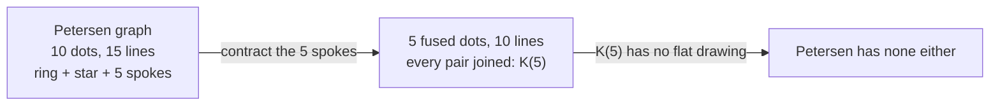

# Graph minors: delete and contract edges, Wagner's theorem that flat graphs are exactly those without K5 or K(3,3) as a minor, and Robertson-Seymour in outline

[Syllabus](../../../SYLLABUS.md) → [Combinatorics and graphs](../README.md) → [Planarity and Colouring](../README.md#s12) → Graph minors

---

## General Overview

Ten processors sit on one board, each with three links, 15 links in all. They are wired as the **Petersen graph**: an outer ring of five, an inner five-pointed star, and five spokes between them. The board has one copper layer, so no two links may cross. Can it be laid out?

The line count says nothing: a flat drawing of 10 dots holds up to 24 lines ([Why some graphs cannot be drawn flat](02-edge-bound-and-kuratowski.md)). Instead, **contract** each spoke: shrink it to nothing, fusing its two processors. The five fused dots are all joined to each other: K(5), which has no flat drawing.

Shrinking a line never creates a crossing, so the board has no flat layout either. A graph reached by deleting lines and dots and contracting lines is a **minor**. Klaus Wagner proved in 1937 that K(5) and K(3,3) (two groups of three, every cross pair joined) are the only two minors that block a flat drawing.

**A graph can be drawn flat exactly when no sequence of deleting and contracting its lines produces K(5) or K(3,3).**

**What kind of fact this is:** a theorem. Its easy half and the Petersen verdict are proved in Why it works; Wagner's hard half and Robertson–Seymour are quoted, their proofs named under Sources.

### The picture: from ten processors to K(5)



Each fused dot is one spoke.

---

## The formula

A **graph** $`G`$ is a set of dots (vertices) and lines (edges); $`V`$ counts its dots, $`E`$ its lines and, once drawn flat, $`F`$ its regions (faces). Three moves shrink a graph:

- **Delete a line** $`e`$: the graph $`G - e`$.
- **Delete a dot**, with every line at it.
- **Contract a line** $`e`$: fuse its two ends into one dot that keeps both ends' other lines, giving $`G/e`$ ([The chromatic polynomial](04-chromatic-polynomial.md) uses the same two moves). A repeated line or a loop that appears is dropped.

A graph $`H`$ is a **minor** of $`G`$, written $`H \preceq G`$, when some sequence of these moves turns $`G`$ into $`H`$.

```math
G \text{ can be drawn flat} \iff K(5) \not\preceq G \text{ and } K(3,3) \not\preceq G
```

**Read it aloud:** a graph has a flat drawing if and only if neither K(5) nor K(3,3) is among its minors.

The line ceiling sharpens when a graph has no short rings. The **girth** $`g`$ is the length of the shortest ring (cycle). A flat drawing with girth $`g`$ obeys

```math
E \le \frac{g\,(V - 2)}{g - 2}
```

**Read it aloud:** lines are at most girth times (dots minus two), over (girth minus two). Girth 3 gives $`3V - 6`$; girth 4 gives $`2V - 4`$.

| Symbol | Plain meaning | In our example | Push it up and the answer… |
| --- | --- | --- | --- |
| $`G`$ | the graph being tested | the Petersen board | more places for a minor to hide |
| $`H`$ | the graph looked for inside $`G`$ | K(5), then K(3,3) | harder to find |
| $`H \preceq G`$ | $`H`$ is a minor of $`G`$ | K(5) $`\preceq`$ Petersen | — |
| $`G - e`$, $`G/e`$ | $`G`$ with line $`e`$ deleted, or contracted | spokes contracted | each move loses a line |
| $`V`$, $`E`$ | dots and lines | 10 and 15 | each dot lifts the ceiling |
| $`F`$ | regions of a flat drawing, the outside counted | 7, if it could be drawn | more walls to pay for |
| $`g`$ | girth: the shortest ring's length | 5 | ceiling falls toward $`V - 2`$ |
| K(5), K(3,3) | five dots all joined; two groups of three, every cross pair joined | the two forbidden minors | — |

### When it holds

- **Finite graphs.** The ceilings need finite counts; Robertson–Seymour covers finite graphs only.
- **Only deletion and contraction.** Adding a line or splitting a dot can destroy flatness.
- **Repeats dropped after a contraction.** The girth ceiling assumes one line per pair.
- **The girth ceiling needs a ring and runs one way.** A forest has no girth. Over it means not flat; under it settles nothing.

---

## Why it works

### Step 0: no move can create a crossing

Erasing a line or a dot keeps a drawing flat. To contract a line, slide one end along it to the other; the lines at the moving end travel with it inside a thin strip, crossing nothing. So every minor of a flat graph is flat.

Turned round: if $`G`$ has a minor that cannot be drawn flat, neither can $`G`$.

### Step 1: the easy half of Wagner

K(5) and K(3,3) have no flat drawing: each has more lines than its ceiling allows ([Why some graphs cannot be drawn flat](02-edge-bound-and-kuratowski.md)). By Step 0, any graph with either one as a minor cannot be drawn flat.

### Step 2: deciding whether H is a minor

Whatever the order of moves, each dot of $`H`$ ends up as the fusion of a **branch set**: a group of dots of $`G`$ joined among themselves. So $`H \preceq G`$ exactly when $`G`$ has disjoint branch sets, one per dot of $`H`$, with a line of $`G`$ between two sets wherever $`H`$ has a line.

That makes a finite search: split the dots into branch sets every possible way, keep splits whose sets are joined inside, fuse each set, and look for $`H`$.

### Step 3: the Petersen board

Make the five spokes the branch sets: fused dot $`i`$ holds ring dot $`i`$ and star dot $`i`$. The ring joins it to its two ring neighbours, the star to the two dots two steps away. That is all four others: K(5).

The girth gives a second proof. Every Petersen ring has 5 lines or more, so in a flat drawing each region needs 5 sides. The 30 sides from 15 lines fill at most 6 regions, while Euler's formula demands $`F = 15 - 10 + 2 = 7`$. The ceiling reads $`5 \times (10 - 2) / 3 = 13.33`$, and 15 is over.

<details>
<summary>Detailed proof: the girth ceiling</summary>

Each line has two sides, so the sides of all regions add to $`2E`$. In a flat drawing of a simple graph with girth $`g`$, every region is walled by at least $`g`$ sides, so $`2E \ge gF`$. Euler's formula gives $`F = E - V + 2`$ for a connected drawing, and more regions for one in pieces ([Planar graphs](01-planar-graphs-and-eulers-formula.md)). Substitute:

$`\displaystyle 2E \ge g\,(E - V + 2), \qquad (g - 2)\,E \le g\,(V - 2).`$

Divide by $`g - 2`$, positive since $`g \ge 3`$.

</details>

### Step 4: Wagner and Kuratowski say the same thing

Kuratowski's 1930 theorem forbids **subdivisions**: K(5) or K(3,3) with extra dots along its lines. The two forms are equivalent.

- **A subdivision gives a minor.** Contract the inserted dots back into their lines.
- **A K(3,3) minor gives a K(3,3) subdivision.** Each branch set exits to only three others, and a tree inside it routes three paths from one meeting dot.
- **A K(5) minor gives a K(5) or a K(3,3) subdivision.** If a branch set cannot route its four exits through one dot, its routes fork two and two. Split it there, and the six sets form K(3,3).

The Petersen graph needs the last case. A K(5) subdivision needs five dots with four lines each, and every Petersen dot has three. So K(5) is a minor but not a subdivision; the code finds 350 ways to see K(3,3) instead.

<details>
<summary>Detailed proof: why the split gives K(3,3)</summary>

Call the five branch sets $`A, B, C, D, X`$. Suppose the exits of $`X`$ to $`A`$ and $`B`$ meet on one side of a line inside $`X`$, and its exits to $`C`$ and $`D`$ on the other. Cut that line: $`X`$ becomes $`X_1`$, joined to $`A`$ and $`B`$, and $`X_2`$, joined to $`C`$ and $`D`$, with the cut line joining $`X_1`$ to $`X_2`$.

Take the groups $`\{X_1, C, D\}`$ and $`\{X_2, A, B\}`$. Every cross pair is joined: $`X_1`$ to $`X_2, A, B`$, then $`C`$ and $`D`$ to $`X_2`$, and $`C, D`$ to $`A, B`$ as before. That is a K(3,3) minor, hence a subdivision by the bullet above. Diestel's Chapter 4 has the full argument.

</details>

### Step 5: Robertson–Seymour, in outline

A family of graphs is **minor-closed** when every minor of a member is a member. Flat graphs are one, by Step 0. Forests (graphs with no ring) are another.

Such a family is fixed by its **forbidden minors**: the smallest graphs outside it. Flat graphs forbid K(5) and K(3,3). Forests forbid the triangle alone, since every ring contracts to one.

Neil Robertson and Paul Seymour proved in 2004, in their Graph Minors series, that **every minor-closed family has finitely many forbidden minors**. The proof does not produce the list: for graphs drawable on a doughnut-shaped surface (a torus), it is still unknown.

---

## Worked numbers, by hand

| Step | Arithmetic | Value |
| --- | --- | --- |
| dots and lines | ring 5 + star 5; 5 + 5 + 5 spokes | 10 and 15 |
| edge ceiling | 3 × 10 − 6 | 24, silent |
| shortest ring | no ring shorter than the outer five | girth 5 |
| girth ceiling | 5 × (10 − 2) / 3 | 13.33 |
| contract the 5 spokes | 10 − 5 dots, 15 − 5 lines | 5 and 10 |
| pairs among 5 dots | 5 × 4 / 2 | **10**: every pair joined, K(5) |

Two independent arguments agree: 15 lines break the girth ceiling of 13.33, and K(5) is a minor. The board needs a second layer.

### What breaks if you drop a piece

| Mistake | Comes out at | What went wrong |
| --- | --- | --- |
| The edge ceiling read as permission | 15 ≤ 24, "it fits" | Counts only refuse; K(5) is a minor |
| The ring-of-four ceiling used | 15 ≤ 16, silent | The girth is 5, so the ceiling is 13.33 |
| Hunting only for a K(5) subdivision | 0 dots with 4 lines, "none" | 350 K(3,3) families are there |
| Minor-closed read backwards | K(5) minus one line, "not flat" | 0 K(5) and 0 K(3,3) minors: it is flat |

---

## Code, from first principles, and it actually runs

Nothing is imported. Three roads reach the Petersen verdict: the girth ceiling, contracting the spokes by hand, and a search of every split into connected branch sets. Its six K(5) splits match the perfect matchings (ways to pair every dot with a neighbour), counted separately; it also clears the flat cube of both forbidden minors.

### Python

```python
# Graph minors and Wagner's theorem -- the check behind the card.  Nothing is imported.  Road one counts:
# a flat drawing with no ring shorter than g has E <= g(V - 2)/(g - 2).  Road two contracts Petersen's five
# spokes by hand.  Road three knows no theory: it tries every split of the dots into connected branch sets.
def adj(n, es): return [{b if a == u else a for a, b in es if u in (a, b)} for u in range(n)]
def complete(n): return [(u, v) for u in range(n) for v in range(u + 1, n)]
def perms(xs): return [[x] + p for i, x in enumerate(xs) for p in perms(xs[:i] + xs[i + 1:])] or [[]]
RING = [(i, (i + 1) % 5) for i in range(5)]
PET = RING + [(5 + i, 5 + (i + 2) % 5) for i in range(5)] + [(i, 5 + i) for i in range(5)]
CUBE = [(i, (i + 1) % 4) for i in range(4)] + [(4 + i, 4 + (i + 1) % 4) for i in range(4)] + [(i, 4 + i) for i in range(4)]
K5, K33, K4 = complete(5), [(u, v) for u in range(3) for v in range(3, 6)], complete(4)
def girth(n, es):                                  # shortest ring: drop a line, walk round to its ends
    best = n + 1
    for u, v in es:
        a, dist, todo = adj(n, [e for e in es if e != (u, v)]), {u: 0}, [u]
        for x in todo:
            for y in a[x] - dist.keys(): dist[y] = dist[x] + 1; todo.append(y)
        best = min(best, dist.get(v, n) + 1)
    return best
def fuse(lab, es):                                 # each set becomes one dot; loops and repeats vanish
    return {(min(lab[u], lab[v]), max(lab[u], lab[v])) for u, v in es if lab[u] != lab[v] and min(lab[u], lab[v]) >= 0}
def connected(block, a):
    seen, todo = {block[0]}, [block[0]]
    for x in todo: todo += [y for y in a[x] & set(block) - seen]; seen |= a[x] & set(block)
    return len(seen) == len(block)
def models(n, es, k, h):                           # road three: label each dot unused (-1) or a set 0..k-1
    a, out, ps = adj(n, es), [], perms(list(range(k)))
    def go(v, lab, used):
        if n - v < k - used: return
        if v == n:
            blocks, q = [[x for x in range(n) if lab[x] == b] for b in range(k)], fuse(lab, es)
            if all(connected(b, a) for b in blocks) and any(all((min(p[x], p[y]), max(p[x], p[y])) in q for x, y in h) for p in ps):
                out.append(sorted(tuple(b) for b in blocks if len(b) > 1))
            return
        for c in range(-1, min(used, k - 1) + 1): go(v + 1, lab + [c], max(used, c + 1))
    go(0, [], 0)
    return out
def matchings(free, es):                           # perfect matchings, counted straight from the lines
    if not free: return [[]]
    u = min(free)
    return [[(u, v)] + m for v in sorted(adj(10, es)[u] & free) for m in matchings(free - {u, v}, es)]
V, E, g, spoked = 10, len(PET), girth(10, PET), fuse([0, 1, 2, 3, 4, 0, 1, 2, 3, 4], PET)
k5_pet, k33_pet, pm = models(10, PET, 5, K5), models(10, PET, 6, K33), matchings(set(range(10)), PET)
cube, big, nv = [len(models(8, CUBE, 5, K5)), len(models(8, CUBE, 6, K33)), len(models(8, CUBE, 4, K4))], sum(len(s) >= 4 for s in adj(V, PET)), len({x for e in spoked for x in e})
print(f"Petersen: V = {V}, E = {E}, degrees {sorted({len(s) for s in adj(V, PET)})}, girth {g}")
print(f"edge ceiling 3V - 6 = {3 * V - 6}: {E} lines fit, so the count is silent")
print(f"girth ceiling {g}(V - 2)/{g - 2} = {g * (V - 2) / (g - 2):.2f}: {E} lines is over; {2 * E} sides fill at most {2 * E // g} regions, Euler needs {E - V + 2}")
print(f"contract the {V - nv} spokes: V = {nv}, E = {len(spoked)}, pairs among {nv} dots = {nv * (nv - 1) // 2}, K(5): {'yes' if spoked == set(K5) else 'no'}")
print(f"search for K(5) in Petersen: {len(k5_pet)} families, set sizes {sorted({len(s) for m in k5_pet for s in m})}")
print(f"perfect matchings of Petersen, counted directly: {len(pm)}; the same line sets: {'yes' if sorted(pm) == sorted(k5_pet) else 'no'}")
print(f"search for K(3,3) in Petersen: {len(k33_pet)} families")
print(f"cube, 8 dots and {len(CUBE)} lines: K(5) {cube[0]} families, K(3,3) {cube[1]}, K(4) {cube[2]}")
print(f"mistake 1, the edge ceiling as permission: {E} <= {3 * V - 6}, yet K(5) is a minor")
print(f"mistake 2, the ring-of-four ceiling 2V - 4 = {2 * V - 4}: {E} fits; girth {g} gives {g * (V - 2) / (g - 2):.2f}")
print(f"mistake 3, hunting only for K(5) with dots along its lines: {big} dots of degree 4, yet {len(k33_pet)} K(3,3) families")
k5e = [e for e in K5 if e != (3, 4)]
print(f"mistake 4, closure read backwards: K(5) minus one line has {len(models(5, k5e, 5, K5))} K(5) and {len(models(5, k5e, 6, K33))} K(3,3) families, so it is flat")
assert g == 5 and E > g * (V - 2) / (g - 2) and E <= 3 * V - 6        # counting: silent, then decisive
assert spoked == set(K5) and len(k5_pet) == len(pm) == 6 and sorted(pm) == sorted(k5_pet)   # three roads, one K(5)
assert big == 0 and len(k33_pet) > 0 and cube[:2] == [0, 0] and cube[2] > 0   # Petersen fails Wagner, the cube passes
print("ALL CHECKS PASS")
```

**Ran 2026-11-23 on macOS, Python 3.14.10, standard library only. All checks passed. Output, pasted from the run:**

```
Petersen: V = 10, E = 15, degrees [3], girth 5
edge ceiling 3V - 6 = 24: 15 lines fit, so the count is silent
girth ceiling 5(V - 2)/3 = 13.33: 15 lines is over; 30 sides fill at most 6 regions, Euler needs 7
contract the 5 spokes: V = 5, E = 10, pairs among 5 dots = 10, K(5): yes
search for K(5) in Petersen: 6 families, set sizes [2]
perfect matchings of Petersen, counted directly: 6; the same line sets: yes
search for K(3,3) in Petersen: 350 families
cube, 8 dots and 12 lines: K(5) 0 families, K(3,3) 0, K(4) 166
mistake 1, the edge ceiling as permission: 15 <= 24, yet K(5) is a minor
mistake 2, the ring-of-four ceiling 2V - 4 = 16: 15 fits; girth 5 gives 13.33
mistake 3, hunting only for K(5) with dots along its lines: 0 dots of degree 4, yet 350 K(3,3) families
mistake 4, closure read backwards: K(5) minus one line has 0 K(5) and 0 K(3,3) families, so it is flat
ALL CHECKS PASS
```

### Rust

Same numbers, same labels, built with `rustc --edition 2021 -O`.

```rust
// Graph minors and Wagner's theorem -- the same check as the Python, in Rust.  No crates.  Road one counts:
// a flat drawing with no ring shorter than g has E <= g(V - 2)/(g - 2).  Road two contracts Petersen's five
// spokes by hand.  Road three knows no theory: it tries every split of the dots into connected branch sets.
use std::collections::BTreeSet;
type Edges = Vec<(usize, usize)>;
fn adj(n: usize, es: &[(usize, usize)]) -> Vec<BTreeSet<usize>> {
    (0..n).map(|u| es.iter().filter(|e| e.0 == u || e.1 == u).map(|e| if e.0 == u { e.1 } else { e.0 }).collect()).collect()
}
fn complete(n: usize) -> Edges { (0..n).flat_map(|u| (u + 1..n).map(move |v| (u, v))).collect() }
fn perms(xs: &[usize]) -> Vec<Vec<usize>> {
    if xs.is_empty() { return vec![vec![]] }
    (0..xs.len()).flat_map(|i| { let mut r = xs.to_vec(); let x = r.remove(i);
        perms(&r).into_iter().map(move |p| { let mut o = vec![x]; o.extend(p); o }).collect::<Vec<_>>() }).collect()
}
fn girth(n: usize, es: &Edges) -> usize {         // shortest ring: drop a line, walk round to its ends
    es.iter().map(|&(u, v)| { let rest: Edges = es.iter().copied().filter(|&e| e != (u, v)).collect();
        let a = adj(n, &rest); let (mut dist, mut todo, mut i) = (vec![usize::MAX; n], vec![u], 0); dist[u] = 0;
        while i < todo.len() { let x = todo[i]; i += 1;
            for &y in &a[x] { if dist[y] == usize::MAX { dist[y] = dist[x] + 1; todo.push(y) } } }
        if dist[v] == usize::MAX { n + 1 } else { dist[v] + 1 } }).min().unwrap_or(n + 1)
}
fn fuse(lab: &[i64], es: &Edges) -> BTreeSet<(i64, i64)> {   // each set becomes one dot; loops and repeats vanish
    es.iter().map(|&(u, v)| (lab[u].min(lab[v]), lab[u].max(lab[v]))).filter(|&(a, b)| a != b && a >= 0).collect()
}
fn connected(block: &[usize], a: &[BTreeSet<usize>]) -> bool {
    let (mut seen, mut todo, mut i) = (BTreeSet::from([block[0]]), vec![block[0]], 0);
    while i < todo.len() { let x = todo[i]; i += 1;
        for &y in &a[x] { if block.contains(&y) && seen.insert(y) { todo.push(y) } } }
    seen.len() == block.len()
}
fn go(v: usize, lab: &mut Vec<i64>, used: usize, n: usize, es: &Edges, k: usize, h: &Edges, a: &[BTreeSet<usize>], ps: &[Vec<usize>], out: &mut Vec<Vec<Vec<usize>>>) {
    if n - v < k - used { return }
    if v == n {
        let blocks: Vec<Vec<usize>> = (0..k).map(|b| (0..n).filter(|&x| lab[x] == b as i64).collect()).collect();
        let q = fuse(lab, es);
        if blocks.iter().all(|b| connected(b, a)) && ps.iter().any(|p| h.iter().all(|&(x, y)| q.contains(&(p[x].min(p[y]) as i64, p[x].max(p[y]) as i64)))) {
            let mut m: Vec<Vec<usize>> = blocks.into_iter().filter(|b| b.len() > 1).collect(); m.sort(); out.push(m);
        }
        return;
    }
    for c in -1..=(used.min(k - 1) as i64) { lab.push(c); go(v + 1, lab, used.max((c + 1) as usize), n, es, k, h, a, ps, out); lab.pop(); }
}
fn models(n: usize, es: &Edges, k: usize, h: &Edges) -> Vec<Vec<Vec<usize>>> {   // road three
    let (a, ps, mut out) = (adj(n, es), perms(&(0..k).collect::<Vec<usize>>()), Vec::new());
    go(0, &mut Vec::new(), 0, n, es, k, h, &a, &ps, &mut out); out
}
fn matchings(free: &BTreeSet<usize>, a: &[BTreeSet<usize>]) -> Vec<Vec<Vec<usize>>> {   // straight from the lines
    let Some(&u) = free.iter().next() else { return vec![vec![]] };
    a[u].iter().filter(|v| free.contains(v)).flat_map(|&v| { let mut rest = free.clone(); rest.remove(&u); rest.remove(&v);
        matchings(&rest, a).into_iter().map(move |m| { let mut o = vec![vec![u, v]]; o.extend(m); o }) }).collect()
}
fn main() {
    let ring: Edges = (0..5).map(|i| (i, (i + 1) % 5)).collect();
    let pet: Edges = ring.iter().copied().chain((0..5).map(|i| (5 + i, 5 + (i + 2) % 5))).chain((0..5).map(|i| (i, 5 + i))).collect();
    let cube: Edges = (0..4).map(|i| (i, (i + 1) % 4)).chain((0..4).map(|i| (4 + i, 4 + (i + 1) % 4))).chain((0..4).map(|i| (i, 4 + i))).collect();
    let (k5, k4): (Edges, Edges) = (complete(5), complete(4)); let k33: Edges = (0..3).flat_map(|u| (3..6).map(move |v| (u, v))).collect();
    let (v, e, g) = (10usize, pet.len(), girth(10, &pet)); let spoked = fuse(&[0, 1, 2, 3, 4, 0, 1, 2, 3, 4], &pet); let nv = spoked.iter().flat_map(|&(a, b)| [a, b]).collect::<BTreeSet<i64>>().len();
    let k5set: BTreeSet<(i64, i64)> = k5.iter().map(|&(a, b)| (a as i64, b as i64)).collect();
    let (k5_pet, k33_pet) = (models(10, &pet, 5, &k5), models(10, &pet, 6, &k33));
    let mut pm = matchings(&(0..10).collect(), &adj(10, &pet)); pm.sort(); let mut k5s = k5_pet.clone(); k5s.sort();
    let cubes = [models(8, &cube, 5, &k5).len(), models(8, &cube, 6, &k33).len(), models(8, &cube, 4, &k4).len()]; let k5e: Edges = k5.iter().copied().filter(|&x| x != (3, 4)).collect();
    let big = adj(v, &pet).iter().filter(|s| s.len() >= 4).count(); let degs: BTreeSet<usize> = adj(v, &pet).iter().map(|s| s.len()).collect();
    let sizes: BTreeSet<usize> = k5_pet.iter().flat_map(|m| m.iter().map(|s| s.len())).collect(); let gb = (g * (v - 2)) as f64 / (g - 2) as f64; let yn = |b: bool| if b { "yes" } else { "no" };
    println!("Petersen: V = {}, E = {}, degrees {:?}, girth {}", v, e, degs.iter().collect::<Vec<_>>(), g);
    println!("edge ceiling 3V - 6 = {}: {} lines fit, so the count is silent", 3 * v - 6, e);
    println!("girth ceiling {}(V - 2)/{} = {:.2}: {} lines is over; {} sides fill at most {} regions, Euler needs {}", g, g - 2, gb, e, 2 * e, 2 * e / g, e - v + 2);
    println!("contract the {} spokes: V = {}, E = {}, pairs among {} dots = {}, K(5): {}", v - nv, nv, spoked.len(), nv, nv * (nv - 1) / 2, yn(spoked == k5set));
    println!("search for K(5) in Petersen: {} families, set sizes {:?}", k5_pet.len(), sizes.iter().collect::<Vec<_>>());
    println!("perfect matchings of Petersen, counted directly: {}; the same line sets: {}", pm.len(), yn(pm == k5s));
    println!("search for K(3,3) in Petersen: {} families", k33_pet.len());
    println!("cube, 8 dots and {} lines: K(5) {} families, K(3,3) {}, K(4) {}", cube.len(), cubes[0], cubes[1], cubes[2]);
    println!("mistake 1, the edge ceiling as permission: {} <= {}, yet K(5) is a minor", e, 3 * v - 6);
    println!("mistake 2, the ring-of-four ceiling 2V - 4 = {}: {} fits; girth {} gives {:.2}", 2 * v - 4, e, g, gb);
    println!("mistake 3, hunting only for K(5) with dots along its lines: {} dots of degree 4, yet {} K(3,3) families", big, k33_pet.len());
    println!("mistake 4, closure read backwards: K(5) minus one line has {} K(5) and {} K(3,3) families, so it is flat", models(5, &k5e, 5, &k5).len(), models(5, &k5e, 6, &k33).len());
    assert!(g == 5 && e as f64 > gb && e <= 3 * v - 6);                    // counting: silent, then decisive
    assert!(spoked == k5set && k5_pet.len() == 6 && pm.len() == 6 && pm == k5s);   // three roads, one K(5)
    assert!(big == 0 && !k33_pet.is_empty() && cubes[0] == 0 && cubes[1] == 0 && cubes[2] > 0);   // Petersen fails, cube passes
    println!("ALL CHECKS PASS");
}
```

**Ran 2026-11-23 on macOS, rustc 1.98.1, no crates. All checks passed. Output, pasted from the run:**

```
Petersen: V = 10, E = 15, degrees [3], girth 5
edge ceiling 3V - 6 = 24: 15 lines fit, so the count is silent
girth ceiling 5(V - 2)/3 = 13.33: 15 lines is over; 30 sides fill at most 6 regions, Euler needs 7
contract the 5 spokes: V = 5, E = 10, pairs among 5 dots = 10, K(5): yes
search for K(5) in Petersen: 6 families, set sizes [2]
perfect matchings of Petersen, counted directly: 6; the same line sets: yes
search for K(3,3) in Petersen: 350 families
cube, 8 dots and 12 lines: K(5) 0 families, K(3,3) 0, K(4) 166
mistake 1, the edge ceiling as permission: 15 <= 24, yet K(5) is a minor
mistake 2, the ring-of-four ceiling 2V - 4 = 16: 15 fits; girth 5 gives 13.33
mistake 3, hunting only for K(5) with dots along its lines: 0 dots of degree 4, yet 350 K(3,3) families
mistake 4, closure read backwards: K(5) minus one line has 0 K(5) and 0 K(3,3) families, so it is flat
ALL CHECKS PASS
```

### Lean

Lean proves three claims from Why it works, and checks the Petersen numbers in the worked table.

- Lean has no flat drawings, so it takes the two region counts of the girth proof as given. Take a graph with a ring whose $`F`$ regions obey $`gF \le 2E`$ and $`F \ge E - V + 2`$. Then $`(g - 2)\,E \le g\,(V - 2)`$.
- Using the branch sets of Step 2, the five spokes show that K(5) is a minor of the Petersen graph.
- A finite graph has no ring exactly when the triangle is not one of its minors.
- The Petersen graph has 10 dots, 15 lines and three lines at every dot, and the table's arithmetic holds.

The girth of 5, the search counts 6 and 350, and the cube are left to the Python and Rust checks.

```lean
-- Graph minors: a flat drawing whose shortest ring has g lines obeys (g - 2) E <= g (V - 2), the Petersen graph has K(5) as a minor by contracting its five spokes, and a graph has no ring exactly when the triangle is not among its minors.
import Mathlib.Combinatorics.SimpleGraph.Girth
import Mathlib.Combinatorics.SimpleGraph.Acyclic
import Mathlib.Combinatorics.SimpleGraph.Maps
import Mathlib.Combinatorics.SimpleGraph.Finite
import Mathlib.Tactic.NormNum
import Mathlib.Tactic.Linarith
import Mathlib.Combinatorics.SimpleGraph.Connectivity.Subgraph
import Mathlib.Combinatorics.SimpleGraph.Connectivity.Connected
import Mathlib.Combinatorics.SimpleGraph.Paths
import Mathlib.Tactic.FinCases
import Mathlib.Data.Fin.VecNotation

namespace GraphMinors

open SimpleGraph

/-- `H` is a minor of `G` (the card's Step 2): `G` has pairwise disjoint branch sets, one per dot
of `H`, each joined among itself (its induced graph is connected, so in particular not empty),
with a line of `G` between two branch sets wherever `H` has a line. Fusing each branch set into
one dot and deleting what is left over turns `G` into `H`. Mathlib has no graph minors, so the
card's own definition is written out here. -/
def IsMinor {W V : Type*} (H : SimpleGraph W) (G : SimpleGraph V) : Prop :=
  ∃ B : W → Set V,
    (∀ w, (G.induce (B w)).Connected) ∧
    Pairwise (fun a b => Disjoint (B a) (B b)) ∧
    ∀ a b, H.Adj a b → ∃ x ∈ B a, ∃ y ∈ B b, G.Adj x y

/-- The links of the Petersen board: an outer ring of five, five spokes, and an inner
five-pointed star. -/
def petersenLinks : List (Fin 10 × Fin 10) :=
  [(0, 1), (1, 2), (2, 3), (3, 4), (4, 0),
   (0, 5), (1, 6), (2, 7), (3, 8), (4, 9),
   (5, 7), (6, 8), (7, 9), (8, 5), (9, 6)]

/-- The Petersen graph: ten processors, fifteen links. -/
def petersen : SimpleGraph (Fin 10) where
  Adj x y := (x, y) ∈ petersenLinks ∨ (y, x) ∈ petersenLinks
  symm := ⟨fun _ _ h => h.symm⟩
  loopless := ⟨by decide⟩

instance : DecidableRel petersen.Adj := fun _ _ =>
  inferInstanceAs (Decidable (_ ∨ _))

theorem walk_in_set {V : Type*} (G : SimpleGraph V) {s : Set V} (hc : (G.induce s).Connected)
    {a b : V} (ha : a ∈ s) (hb : b ∈ s) :
    ∃ p : G.Walk a b, ∀ e ∈ p.edges, ∀ v ∈ e, v ∈ s := by
  obtain ⟨q⟩ := hc.preconnected ⟨a, ha⟩ ⟨b, hb⟩
  have key : ∀ e ∈ (q.map (Embedding.induce s).toHom).edges, ∀ v ∈ e, v ∈ s := by
    intro e he v hv
    rw [Walk.edges_map, List.mem_map] at he
    obtain ⟨e', _, rfl⟩ := he
    rw [Sym2.mem_map] at hv
    obtain ⟨w, _, rfl⟩ := hv
    exact w.2
  exact ⟨_, key⟩

#print axioms walk_in_set

theorem induce_singleton_connected' {V : Type*} (G : SimpleGraph V) (v : V) :
    (G.induce {v}).Connected := by
  simp

#print axioms induce_singleton_connected'

/-- The girth ceiling. Take a finite graph with at least one ring, so its girth `g` (the length
of its shortest ring) is at least 3. Suppose it has a flat drawing with `F` regions. Mathlib has
no flat drawings, so the drawing enters through the two facts the card's proof uses: every region
is walled by at least `g` sides, so `g F ≤ 2 E`, and Euler's formula gives at least
`E - V + 2` regions. Then the lines obey `(g - 2) E ≤ g (V - 2)`. -/
theorem edges_le_girth_ceiling {V : Type*} [Fintype V] (G : SimpleGraph V) [DecidableRel G.Adj]
    (hring : ¬ G.IsAcyclic) (F : ℕ)
    (hsides : G.girth * F ≤ 2 * G.edgeFinset.card)
    (heuler : G.edgeFinset.card + 2 ≤ F + Fintype.card V) :
    ((G.girth : ℤ) - 2) * G.edgeFinset.card ≤ (G.girth : ℤ) * ((Fintype.card V : ℤ) - 2) := by
  have h := Nat.mul_le_mul_left G.girth heuler
  have h1 : ((G.girth * F : ℕ) : ℤ) ≤ ((2 * G.edgeFinset.card : ℕ) : ℤ) := by exact_mod_cast hsides
  have h2 : ((G.girth * (G.edgeFinset.card + 2) : ℕ) : ℤ) ≤ ((G.girth * (F + Fintype.card V) : ℕ) : ℤ) := by
    exact_mod_cast h
  push_cast at h1 h2
  nlinarith

/-- Contracting the Petersen graph's five spokes leaves K(5): it has the complete graph on five
dots as a minor. -/
theorem petersen_has_K5_minor : IsMinor (⊤ : SimpleGraph (Fin 5)) petersen := by
  refine ⟨fun w => {x : Fin 10 | x.val % 5 = w.val}, ?_, ?_, ?_⟩
  · intro w
    have hs : {x : Fin 10 | x.val % 5 = w.val} =
        {(⟨w.val, by omega⟩ : Fin 10), (⟨w.val + 5, by omega⟩ : Fin 10)} := by
      ext x
      simp only [Set.mem_ofPred_eq, Set.mem_insert_iff, Set.mem_singleton_iff, Fin.ext_iff]
      omega
    show (induce {x : Fin 10 | x.val % 5 = w.val} petersen).Connected
    rw [hs]
    apply induce_pair_connected_of_adj
    fin_cases w <;> decide
  · intro a b hab
    rw [Set.disjoint_left]
    intro x ha hb
    simp only [Set.mem_ofPred_eq] at ha hb
    exact hab (Fin.ext (by omega))
  · simp only [top_adj, Set.mem_ofPred_eq]
    decide

/-- Forests are the minor-closed family whose one forbidden minor is the triangle: a finite graph
has no ring exactly when the triangle K(3) is not a minor of it. -/
theorem isAcyclic_iff_not_triangle_minor {V : Type*} [Fintype V] (G : SimpleGraph V) :
    G.IsAcyclic ↔ ¬ IsMinor (⊤ : SimpleGraph (Fin 3)) G := by
  constructor
  · rintro hG ⟨B, hconn, hdisj, hadj⟩
    have d : ∀ a b : Fin 3, a ≠ b → ∀ x, x ∈ B a → x ∈ B b → False := fun a b hab x ha hb =>
      Set.disjoint_left.mp (hdisj hab) ha hb
    obtain ⟨x01, hx01, y01, hy01, h01⟩ := hadj 0 1 (by decide)
    obtain ⟨x12, hx12, y12, hy12, h12⟩ := hadj 1 2 (by decide)
    obtain ⟨x20, hx20, y20, hy20, h20⟩ := hadj 2 0 (by decide)
    obtain ⟨p1, hp1⟩ := walk_in_set G (hconn 1) hy01 hx12
    obtain ⟨p2, hp2⟩ := walk_in_set G (hconn 2) hy12 hx20
    obtain ⟨p0, hp0⟩ := walk_in_set G (hconn 0) hy20 hx01
    have hb := isAcyclic_iff_forall_adj_isBridge.mp hG h01
    rw [isBridge_iff_forall_walk_mem_edges] at hb
    have := hb (p1.append (Walk.cons h12 (p2.append (Walk.cons h20 p0)))).reverse
    simp only [Walk.edges_reverse, List.mem_reverse, Walk.edges_append, Walk.edges_cons,
      List.mem_append, List.mem_cons, Sym2.eq_iff] at this
    rcases this with h | (⟨rfl, rfl⟩ | ⟨rfl, rfl⟩) | h | (⟨rfl, rfl⟩ | ⟨rfl, rfl⟩) | h
    · exact d 0 1 (by decide) x01 hx01 (hp1 _ h x01 (Sym2.mem_mk_left _ _))
    · exact d 0 1 (by decide) _ hx01 hx12
    · exact d 0 2 (by decide) _ hx01 hy12
    · exact d 0 2 (by decide) x01 hx01 (hp2 _ h x01 (Sym2.mem_mk_left _ _))
    · exact d 0 2 (by decide) _ hx01 hx20
    · exact d 1 2 (by decide) _ hy01 hx20
    · exact d 0 1 (by decide) y01 (hp0 _ h y01 (Sym2.mem_mk_right _ _)) hy01
  · intro hm
    by_contra hG
    apply hm
    obtain ⟨v, c, hc⟩ := not_isAcyclic_iff_exists_isCycle.mp hG
    cases c with
    | nil => exact (Walk.not_isCycle_nil hc).elim
    | @cons _ u _ h p =>
      rw [Walk.cons_isCycle_iff] at hc
      obtain ⟨hp, hnot⟩ := hc
      cases p with
      | nil => exact absurd h (G.loopless.irrefl _)
      | @cons _ w _ h' p'' =>
        rw [Walk.cons_isPath_iff] at hp
        obtain ⟨hp'', hu⟩ := hp
        have hrp := hp''.reverse
        have hsupp : p''.reverse.support = p''.support.reverse := Walk.support_reverse _
        generalize hr : p''.reverse = r at hrp hsupp
        cases r with
        | nil =>
          exfalso
          have he := congrArg Walk.edges hr
          simp only [Walk.edges_reverse, Walk.edges_nil, List.reverse_eq_nil_iff] at he
          apply hnot
          simp [he, Sym2.eq_swap]
        | @cons _ z _ hvz q =>
          rw [Walk.cons_isPath_iff] at hrp
          have hvq : v ∉ q.support := hrp.2
          have huq : u ∉ q.support := by
            intro huq'
            apply hu
            have : u ∈ (Walk.cons hvz q).support := List.mem_cons_of_mem _ huq'
            rw [hsupp] at this
            exact List.mem_reverse.mp this
          have hvu : v ≠ u := G.ne_of_adj h
          refine ⟨![{v}, {u}, {x | x ∈ q.support}], ?_, ?_, ?_⟩
          · intro i
            fin_cases i
            · exact induce_singleton_connected' G v
            · exact induce_singleton_connected' G u
            · exact q.connected_induce_support
          · intro a b hab
            fin_cases a <;> fin_cases b <;>
              simp [hvu, hvu.symm, hvq, huq, Set.disjoint_singleton_left,
                Set.disjoint_singleton_right] at hab ⊢
          · intro a b hab
            fin_cases a <;> fin_cases b <;> simp at hab ⊢ <;>
              first
              | exact h | exact h.symm
              | exact ⟨_, q.start_mem_support, hvz⟩ | exact ⟨_, q.start_mem_support, hvz.symm⟩
              | exact ⟨_, q.end_mem_support, h'⟩ | exact ⟨_, q.end_mem_support, h'.symm⟩

-- The Petersen board: 10 dots, 15 lines, three at every dot (so no dot has the four lines a
-- K(5) subdivision needs).
example : Fintype.card (Fin 10) = 10 ∧ petersen.edgeFinset.card = 15 := by decide
example : ∀ v, petersen.degree v = 3 := by decide

-- The edge ceiling 3V - 6 = 24 is silent: 15 lines fit.
example : 3 * 10 - 6 = 24 ∧ 15 ≤ 3 * 10 - 6 := by norm_num

-- The ring-of-four ceiling 2V - 4 = 16 is silent too.
example : 2 * 10 - 4 = 16 ∧ 15 ≤ 2 * 10 - 4 := by norm_num

-- The girth-5 ceiling refuses: (5 - 2) * 15 = 45 is over 5 * (10 - 2) = 40.
example : (5 - 2) * 15 = 45 ∧ 5 * (10 - 2) = 40 ∧ 5 * (10 - 2) < (5 - 2) * 15 := by norm_num

-- 30 sides fill at most 6 regions of 5 sides, but Euler needs 15 - 10 + 2 = 7.
example : 2 * 15 / 5 = 6 ∧ 15 - 10 + 2 = 7 ∧ 2 * 15 / 5 < 15 - 10 + 2 := by norm_num

-- Contracting the 5 spokes: 10 - 5 = 5 dots and 15 - 5 = 10 lines, every one of the
-- 5 * 4 / 2 = 10 pairs joined.
example : 10 - 5 = 5 ∧ 15 - 5 = 10 ∧ 5 * 4 / 2 = 10 := by norm_num

#print axioms edges_le_girth_ceiling
#print axioms petersen_has_K5_minor
#print axioms isAcyclic_iff_not_triangle_minor

end GraphMinors
```

**Checked 2026-11-23 on macOS, Lean 4.36.0-rc2, Mathlib v4.36.0-rc2. Every proof is complete and uses only Lean's standard axioms. Output, pasted from the run:**

```
'GraphMinors.walk_in_set' depends on axioms: [propext, Quot.sound]
'GraphMinors.induce_singleton_connected'' depends on axioms: [propext, Classical.choice, Quot.sound]
'GraphMinors.edges_le_girth_ceiling' depends on axioms: [propext, Classical.choice, Quot.sound]
'GraphMinors.petersen_has_K5_minor' depends on axioms: [propext, Classical.choice, Quot.sound]
'GraphMinors.isAcyclic_iff_not_triangle_minor' depends on axioms: [propext, Classical.choice, Quot.sound]
```

> [!TIP]
> **Try changing**
> - **Contract only four spokes.** Change the last label in `[0, 1, 2, 3, 4, 0, 1, 2, 3, 4]` to `5`. Guess first: still K(5)? No: V reads 6, E reads 11, the K(5) line reads `no`, and an assert stops the run.
> - **Add a line across a cube face.** Append `(0, 2)` to `CUBE`. Guess first: still flat? Yes: 0 K(5) and 0 K(3,3) families, and the run passes.
> - **Join opposite cube corners.** Append `(0, 6)` instead. Guess first: does one line break it? Yes: 2 K(5) and 12 K(3,3) families appear, and an assert stops the run.
> - **Ask the Petersen graph for K(6).** Replace `K33` with `complete(6)` in its search. Guess first: can six fused dots each reach five others? No: 0 families, and an assert stops the run.

---

## The usual mistake

> [!warning]
> **Confusing a minor with a subgraph or a subdivision.** K(5) does not sit inside the Petersen graph: no dot has the four lines it needs. It appears only after contraction, so a search for K(5) as a part, or with dots along its lines, finds nothing and wrongly suggests a flat layout.
>
> - **The edge ceiling as permission.** 15 lines under 24 settles nothing; the girth ceiling of 13.33 refuses.
> - **Keeping repeats after a contraction.** Contracting one line of a triangle leaves two lines between one pair; drop one.
> - **Closure read backwards.** A graph that is not flat can have flat minors: K(5) minus one line is flat.
> - **Expecting Robertson–Seymour to hand over the list.** It proves the list finite, nothing more.

---

## Where you meet it in real life

- **Single-layer circuit boards.** A wiring plan with a K(5) or K(3,3) minor needs a second layer or a jumper, whatever the line count says.
- **Fast algorithms.** For each fixed $`H`$, the Graph Minors series tests $`H \preceq G`$ in time growing as a fixed power of the graph's size, so a minor-closed family with a known list is fast to test. Hard problems such as the largest independent set have no known fast method even on flat graphs; they turn fast on families that leave out some flat graph, which have bounded treewidth ([Treewidth](10-treewidth.md)).
- **Hard search.** When $`H`$ is part of the input, the test is hard: a graph on $`n`$ dots has the ring of $`n`$ dots as a minor exactly when it has a tour through every dot ([Hamiltonian cycles](../11-Tours%20-%20Euler%20and%20Hamilton/03-hamiltonian-cycles.md)).

> **Say it back**
> A minor is what remains after deleting lines and dots and contracting lines, and no such move creates a crossing. So a graph with K(5) or K(3,3) as a minor cannot be drawn flat, and Wagner proved the converse. The Petersen graph passes the 24-line ceiling, yet contracting its five spokes leaves K(5), and its girth ceiling of 13.33 agrees. Kuratowski's subdivisions and Wagner's minors forbid the same graphs. Robertson and Seymour proved every minor-closed family has a finite list of forbidden minors.

---

## What this builds on

- [Why some graphs cannot be drawn flat](02-edge-bound-and-kuratowski.md): the line ceilings, why K(5) and K(3,3) are not flat, and Kuratowski's subdivision form.
- [Planar graphs](01-planar-graphs-and-eulers-formula.md): Euler's formula $`F = E - V + 2`$, behind the girth ceiling.
- [The chromatic polynomial](04-chromatic-polynomial.md): deletion and contraction first met as moves on a graph.

## Where this goes next

- [Treewidth](10-treewidth.md): how close a graph is to a tree, the main tool of the Graph Minors proof.

The question left open looks back to [Colouring maps](05-five-and-four-colour-theorems.md): Hadwiger's conjecture, grown from Wagner's paper, says a graph with no K(t) minor needs at most t − 1 colours; it is proved for small t, open in general.

---

## Sources

Verified 2026-11-23: every link below resolves to the publisher's page.

- Wagner, Klaus. "Über eine Eigenschaft der ebenen Komplexe." *Mathematische Annalen* 114 (1937): 570–590. [doi:10.1007/BF01594196](https://doi.org/10.1007/BF01594196). Wagner's theorem.
- Robertson, Neil, and Paul Seymour. "Graph Minors. XX. Wagner's conjecture." *Journal of Combinatorial Theory, Series B* 92 (2004): 325–357. [doi:10.1016/j.jctb.2004.08.001](https://doi.org/10.1016/j.jctb.2004.08.001). The finite forbidden-minor theorem.
- Diestel, Reinhard. *Graph Theory*, 5th ed. Graduate Texts in Mathematics 173. Springer, 2017. [Publisher page](https://link.springer.com/book/10.1007/978-3-662-53622-3). Chapter 4 proves Kuratowski's and Wagner's theorems; Chapter 12 covers graph minors.
