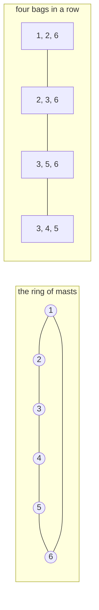

# Treewidth: how close a graph is to a tree, measured by the thinnest tree of overlapping bags, and why hard problems turn easy on tree-like graphs

[Syllabus](../../../SYLLABUS.md) → [Combinatorics and graphs](../README.md) → [Planarity and Colouring](../README.md#s12) → Treewidth

---

## General Overview

Six radio masts stand in a ring round a city, numbered 1 to 6. Each mast interferes with its two neighbours in the ring. How many masts can broadcast on one frequency at once?

As a graph, the masts are vertices and each interfering pair is an edge: the 6-cycle 1-2-3-4-5-6-1. A set of vertices with no edge inside it is an **independent set**; the question asks for the largest. The answer is 3, for example masts 1, 3 and 5.

Six masts allow 2^6 = 64 on-off choices; sixty allow 2^60, over a billion billion. Yet a ring is nearly a tree ([Trees](../10-Trees%20and%20Cheapest%20Routes/01-trees.md)), and treewidth measures that "nearly".

Cover the graph with small overlapping groups of vertices, called **bags**, arranged as a tree. For the ring, four bags in a row do it: {1, 2, 6}, {2, 3, 6}, {3, 5, 6}, {3, 4, 5}. The search then runs bag by bag, with at most 2^3 = 8 on-off choices per bag.

**Treewidth is the size of the largest bag, less one, in the thinnest tree of overlapping bags that covers a graph; trees score 1, cycles 2, the k by k grid k, and many problems that are hopeless on graphs in general become a short pass through the bags when that number is small.**

**What kind of fact this is:** tree decomposition and treewidth are definitions. The widths of trees and cycles and the bag-by-bag method are theorems, proved on this card in Why it works. The grid's lower bound is a theorem stated here and proved in the sources.

### The picture: six masts, four bags



Each mast's bags run unbroken: mast 6 in the first three, mast 3 in the last three.

---

## The formula

A graph $`G`$ has vertices $`V`$ and edges $`E`$ ([Graphs](../09-Graphs%20-%20Dots%20and%20Lines/01-graphs-vertices-and-edges.md)).

A **tree decomposition** of $`G`$ is a tree $`T`$ whose nodes $`t`$ each carry a bag $`B_t`$, a set of vertices of $`G`$. Three rules must hold:

1. **Cover the vertices.** Every vertex sits in at least one bag.
2. **Cover the edges.** Both ends of every edge sit together in at least one bag.
3. **Keep each vertex's bags joined.** The bags that hold any one vertex form a connected piece of $`T`$: no gap.

```math
\mathrm{width}(T) = \max_{t} \lvert B_t\rvert - 1, \qquad \mathrm{tw}(G) = \min_{T} \mathrm{width}(T)
```

**Read it aloud:** the width of a decomposition is its largest bag's size minus one; the treewidth of a graph is the smallest width any decomposition reaches.

The "minus one" makes trees score 1. The card proves or states four values:

```math
\mathrm{tw}(\text{tree}) = 1, \qquad \mathrm{tw}(\text{cycle}) = 2, \qquad \mathrm{tw}(k \times k \text{ grid}) = k, \qquad \mathrm{tw}(G) \ge \delta(G)
```

**Read it aloud:** trees score 1, cycles 2, a square grid of side k scores k, and no graph scores below its fewest neighbours $`\delta(G)`$.

The payoff: the bag-by-bag method keeps one table entry per on-off choice inside a bag.

```math
\text{entries per table} \le 2^{\mathrm{tw}(G) + 1}
```

For the masts that is $`2^{2+1} = 8`$, however long the ring.

| Symbol | Plain meaning | In our example | Push it up and the answer… |
| --- | --- | --- | --- |
| $`G`$, $`V`$, $`E`$, $`n`$ | the graph, its vertices, its edges, the vertex count | the ring; masts 1 to 6; 6 pairs; 6 | every subset: $`2^n`$ |
| $`v`$ | one vertex | mast 1 | — |
| $`T`$, $`t`$, $`B_t`$ | the decomposition's tree, one node, that node's bag | four nodes in a row; {1, 2, 6} | — |
| $`\mathrm{width}(T)`$, $`w`$ | largest bag size minus one | 3 − 1 = 2 | tables up to $`2^{w+1}`$ entries |
| $`\mathrm{tw}(G)`$ | the smallest width over all decompositions | 2 | each extra unit doubles the table size |
| $`\delta(G)`$ | the fewest neighbours any vertex has | 2 | a higher floor under the treewidth |
| $`k`$ | side of a square grid | 3, so width 3 | width grows with the side |

### When it holds

- **Rule 3 matters most.** Without it, one bag per edge gives every graph width 1, and the method reports 4 masts on the ring.
- **Small treewidth, not a small graph.** A k by k grid has treewidth k, so its tables reach $`2^{k+1}`$ entries: a large grid is out of reach.
- **A decomposition must be in hand.** Finding the thinnest one is hard in general; for a fixed small width, a known method takes time proportional to the vertex count (Cygan and others, chapter 7).

---

## Why it works

### Step 0: the shared vertices are all that two sides know of each other

Neighbouring bags {2, 3, 6} and {3, 5, 6} share 3 and 6. Every path from mast 2 to mast 4 passes through 3 or 6.

In general, the vertices two neighbouring bags share **separate** the graph: removing them cuts one side of the tree's bags from the other. Choices on the two sides meet only there, so a problem splits into pieces.

<details>
<summary>Detailed proof: shared vertices separate</summary>

Cut the tree between two neighbouring bags, splitting the bags into side A and side B. A vertex with bags on both sides sits in both neighbouring bags (rule 3), so it is shared. Every other vertex is A-only or B-only. An edge from an A-only vertex to a B-only vertex would need a bag holding both ends (rule 2), and no bag on either side can. So every path from an A-only vertex to a B-only vertex passes through a shared vertex.

</details>

### Step 1: a tree has width 1

Hang the tree from a leaf ([Rooted trees](../10-Trees%20and%20Cheapest%20Routes/02-rooted-and-binary-trees.md)). Give each edge its own bag of 2, and join each edge's bag to the bag of the edge just above it. Every vertex but the root leaf has one edge above it, and the bags holding the vertex all join through that edge's bag. The Trees card's seven-house village gets width 1. No graph with an edge goes lower: the edge needs a bag of 2.

### Step 2: the floor, from the fewest neighbours

Take a leaf of the decomposition tree. If its bag sits inside its neighbour's bag, delete it: nothing is lost. Repeat. If one bag is left, it holds every vertex. Otherwise the leaf bag holds a vertex $`v`$ found nowhere else (rule 3). Every edge at $`v`$ must then lie in this one bag (rule 2), so the bag holds $`v`$ and all its neighbours.

That bag has at least $`\delta(G) + 1`$ vertices. So the width is at least $`\delta(G)`$, the fewest neighbours. Every vertex of a cycle has 2 neighbours: no cycle has width below 2.

### Step 3: a cycle has width 2

Check the mast bags. All six masts appear. Edges 1-2 and 6-1 sit in {1, 2, 6}, 2-3 in {2, 3, 6}, 5-6 in {3, 5, 6}, 3-4 and 4-5 in {3, 4, 5}. Each mast's bags run unbroken.

The largest bag holds 3, so the width is 2, and Step 2's floor makes it exact. A longer cycle uses **fan bags**: mast 1 in every bag, walking round, {1, 2, 3}, {1, 3, 4}, and so on.

### Step 4: the k by k grid has width k

Number a grid's vertices row by row. Each window of $`k + 1`$ consecutive numbers is a bag. A vertex's right neighbour is the next number and its lower neighbour $`k`$ further on, so each edge fits in the window starting at its first end (a bottom-row edge fits in the last window). Width: $`k`$.

The matching lower bound is stated here without proof; Diestel's chapter 12 has the tools that prove it. Step 2's floor gives only 2, from the corners. Exhaustive search confirms 2, 3 and 4 for k = 2, 3 and 4.

Deleting and contracting edges never raises the treewidth, and large treewidth forces a large grid minor (Cygan and others, chapter 7).

### Step 5: solve the problem bag by bag

For each bag, list the independent choices inside it, and record for each the largest independent set so far that agrees with it. At the next bag:

1. Take each independent choice in the new bag.
2. Look only at earlier entries that **agree on the shared vertices**.
3. Take the best of those, and add the vertices new in this bag.

Step 0 makes this safe. Rule 3 counts each vertex once: once a vertex leaves the bags, it never returns. When the tree branches, hang it from one bag ([Rooted trees](../10-Trees%20and%20Cheapest%20Routes/02-rooted-and-binary-trees.md)): a bag with several children adds each child's best matching total, less the chosen vertices shared with this bag, then its own chosen vertices. A bag of $`w + 1`$ vertices, $`w`$ the width, has at most $`2^{w+1}`$ choices, so the work grows with the number of bags, not as $`2^n`$ for $`n`$ vertices.

---

## Worked numbers, by hand

Each entry reads "choice inside the bag = best total so far". Choices holding an edge, such as {1, 2}, are skipped.

| Step | Arithmetic | Value |
| --- | --- | --- |
| bag {1, 2, 6} | 5 clash-free choices | {}=0 {1}=1 {2}=1 {6}=1 {2,6}=2 |
| bag {2, 3, 6}, shares 2 and 6 | {3}: best of {}, {1} is 1, plus mast 3 | {}=1 {2}=1 {3}=2 {6}=1 {2,6}=2 {3,6}=2 |
| bag {3, 5, 6}, shares 3 and 6 | {3, 5}: from {3}=2, plus mast 5 | {}=1 {3}=2 {5}=2 {3,5}=3 {6}=2 {3,6}=2 |
| bag {3, 4, 5}, shares 3 and 5 | {3, 5} carries 3; {4}: best of {}, {6} is 2, plus mast 4 | {}=2 {3}=2 {4}=3 {5}=2 {3,5}=3 |
| table entries | 5 + 6 + 6 + 5, each at most 2^3 = 8 | 22 |
| best in the last table | a tie, 3 and 3 | **3**, masts {1, 3, 5} |
| check: every subset | 64 subsets, 18 independent | largest 3, by {1, 3, 5} and {2, 4, 6} |

At most three masts can share the frequency. The method used 22 entries against 64 subsets; on 60 masts, 346 against 2^60 = 1152921504606846976. A ring alone has a shortcut, alternate masts; the method matters on small-treewidth layouts with no such rule.

### What breaks if you drop a piece

| Mistake | Comes out at | What went wrong |
| --- | --- | --- |
| Width read as bag size | 6-cycle 3, tree 2 | The "minus one" sets trees at 1 |
| The six edges as bags in a row, breaking rule 3 | the method says 4 | Mast 1 sits in the first and last bags only, so counts twice |
| Tables joined without matching shared vertices | the method says 5, masts {2, 3, 4, 5, 6} | Clashing choices are glued together |

---

## Code, from first principles, and it actually runs

Two roads to each answer. The code tests each decomposition against the three rules; independently, it searches every order of removing vertices, joining each removed vertex's neighbours, for the order whose largest neighbour count is smallest. That count is the treewidth (Bodlaender and others, 2012). The largest independent set comes from the bag tables and, separately, from every subset.

### Python

```python
# Treewidth -- the check behind the card.  Nothing imported.  Vertices are 1, 2, 3 ... on the card, 0, 1, 2 ... here, and a
# set of vertices is a bit mask.  Widths two ways (rules tested, every elimination order); independent sets two ways (DP, every subset).
def ring(n): return n, [(i, (i + 1) % n) for i in range(n)]
def grid(k): return k * k, [(r * k + c, r * k + c + 1) for r in range(k) for c in range(k - 1)] + [(i, i + k) for i in range(k * k - k)]
def bits(vs): return sum(1 << v for v in vs)
def show(m): return "{" + ",".join(str(v + 1) for v in range(m.bit_length()) if m >> v & 1) + "}"
size, path = (lambda m: bin(m).count("1")), (lambda k: [(i, i + 1) for i in range(k - 1)])
def width(n, es, bags, links):          # road one: test the three rules, return the width or None
    if any(not any(b >> v & 1 for b in bags) for v in range(n)) or any(not any(b >> x & 1 and b >> y & 1 for b in bags) for x, y in es): return None
    for v in range(n):                                                                   # rule 3
        hold = {i for i, b in enumerate(bags) if b >> v & 1}; reach = {min(hold)}
        while new := {j for i, j in links + [(j, i) for i, j in links] if i in reach and j in hold} - reach: reach |= new
        if reach != hold: return None
    return max(size(b) for b in bags) - 1
def exact_tw(n, es):                    # road two: the best elimination order, built up over subsets
    nb = [bits([y for x, y in es if x == v] + [x for x, y in es if y == v]) for v in range(n)]
    def q(s, v):                        # vertices outside s that v reaches by walking through s
        seen, todo = 1 << v, [v]
        while todo: u = todo.pop(); fresh = nb[u] & ~seen; seen |= fresh; todo += [w for w in range(n) if (fresh & s) >> w & 1]
        return size(seen & ~s) - 1
    tw = [-1] + [n] * ((1 << n) - 1)
    for s in range(1, 1 << n): tw[s] = min(max(tw[s & ~(1 << v)], q(s & ~(1 << v), v)) for v in range(n) if s >> v & 1)
    return tw[-1]
def indep(m, es): return not any(m >> x & 1 and m >> y & 1 for x, y in es)
def subsets(b): vs = [v for v in range(b.bit_length()) if b >> v & 1]; return [bits(v for j, v in enumerate(vs) if k >> j & 1) for k in range(1 << len(vs))]
def dp(bags, es, agree=True):           # one table per bag: chosen part of the bag -> (best size, its set)
    prev, pb, tabs = {0: (0, 0)}, 0, []
    for b in bags:
        table = {}
        for s in (s for s in subsets(b) if indep(s, es)):
            opts = [(z + size(s & ~pb), -(m | s)) for p, (z, m) in prev.items() if not agree or p & b == s & pb]
            if opts: z, m = max(opts); table[s] = (z, -m)
        prev, pb = table, b; tabs.append(table)
    z, m = max((z, -m) for z, m in prev.values()); return z, -m, tabs
TREE, C6, C60 = (7, [(0, 1), (1, 2), (1, 3), (3, 4), (3, 5), (5, 6)]), ring(6), ring(60)   # the village of the Trees card
BAGS, FAN, LANE_BAGS = [bits(b) for b in ([0, 1, 5], [1, 2, 5], [2, 4, 5], [2, 3, 4])], [bits([0, i, i + 1]) for i in range(1, 59)], [bits(e) for e in C6[1]]
w6, w_tree = width(*C6, BAGS, path(4)), width(*TREE, [bits(e) for e in TREE[1]], [(1, 0), (2, 0), (3, 2), (4, 2), (5, 4)])
exact = [exact_tw(*g) for g in (TREE, C6, grid(2), grid(3), grid(4))]
sweep = [width(*grid(k), [bits(range(j, j + k + 1)) for j in range(k * k - k)], path(k * k - k)) for k in (3, 4)]
floor = [min(sum(v in e for e in g[1]) for v in range(g[0])) for g in (TREE, C6, grid(3))]
(best, best_set, tabs), (big, _, big_tabs), bad, loose = dp(BAGS, C6[1]), dp(FAN, C60[1]), dp(LANE_BAGS, C6[1])[0], dp(BAGS, C6[1], False)
brute = [m for m in range(1 << 6) if indep(m, C6[1])]; top = max(map(size, brute)); rows = [len(t) for t in tabs]
print(f"6-cycle, bags {' '.join(show(b) for b in BAGS)}: width {w6}")
print(f"village tree, one bag per lane: width {w_tree}")
print(f"exact treewidth by search: tree {exact[0]}, 6-cycle {exact[1]}, grids 2x2 {exact[2]}, 3x3 {exact[3]}, 4x4 {exact[4]}")
print(f"grid sweep, k+1 vertices in reading order: 3x3 width {sweep[0]}, 4x4 width {sweep[1]}")
print(f"floor from the fewest neighbours: tree {floor[0]}, 6-cycle {floor[1]}, 3x3 grid {floor[2]}")
print(f"DP table sizes, bag by bag: {rows}, {sum(rows)} entries, at most 2^3 = 8 each")
for b, t in zip(BAGS, tabs): print(f"bag {show(b)}: " + " ".join(f"{show(s)}={z}" for s, (z, m) in sorted(t.items())))
print(f"DP answer: largest independent set {best}, {show(best_set)}")
print(f"all {1 << 6} subsets: {len(brute)} independent, largest {top}, by {' and '.join(show(m) for m in brute if size(m) == top)}")
print(f"{C60[0]}-cycle, {len(FAN)} fan bags, width {width(*C60, FAN, path(len(FAN)))}: DP finds {big} from {sum(len(t) for t in big_tabs)} entries; every subset: 2^{C60[0]} = {2 ** C60[0]}")
print(f"mistake 1, width read as bag size: 6-cycle {w6 + 1}, tree {w_tree + 1}")
print(f"mistake 2, the six edges as bags in a row: rules met {'no' if width(*C6, LANE_BAGS, path(6)) is None else 'yes'}, DP says {bad}")
print(f"mistake 3, tables joined without matching shared vertices: DP says {loose[0]}, {show(loose[1])}")
assert w6 == exact[1] == floor[1] == 2 and w_tree == exact[0] == 1          # decomposition = search
assert exact[2:] == [2, 3, 4] and sweep == exact[3:]                         # grids: the sweep is optimal
assert best == top == 3 and best_set == bits([0, 2, 4]) and big == 30        # DP = brute force
assert bad == 4 and width(*C6, LANE_BAGS, path(6)) is None and loose[0] > top and max(rows) <= 8
print("ALL CHECKS PASS")
```

**Ran 2026-11-23 on macOS, Python 3.14.10, standard library only. All checks passed. Output, pasted from the run:**

```
6-cycle, bags {1,2,6} {2,3,6} {3,5,6} {3,4,5}: width 2
village tree, one bag per lane: width 1
exact treewidth by search: tree 1, 6-cycle 2, grids 2x2 2, 3x3 3, 4x4 4
grid sweep, k+1 vertices in reading order: 3x3 width 3, 4x4 width 4
floor from the fewest neighbours: tree 1, 6-cycle 2, 3x3 grid 2
DP table sizes, bag by bag: [5, 6, 6, 5], 22 entries, at most 2^3 = 8 each
bag {1,2,6}: {}=0 {1}=1 {2}=1 {6}=1 {2,6}=2
bag {2,3,6}: {}=1 {2}=1 {3}=2 {6}=1 {2,6}=2 {3,6}=2
bag {3,5,6}: {}=1 {3}=2 {5}=2 {3,5}=3 {6}=2 {3,6}=2
bag {3,4,5}: {}=2 {3}=2 {4}=3 {5}=2 {3,5}=3
DP answer: largest independent set 3, {1,3,5}
all 64 subsets: 18 independent, largest 3, by {1,3,5} and {2,4,6}
60-cycle, 58 fan bags, width 2: DP finds 30 from 346 entries; every subset: 2^60 = 1152921504606846976
mistake 1, width read as bag size: 6-cycle 3, tree 2
mistake 2, the six edges as bags in a row: rules met no, DP says 4
mistake 3, tables joined without matching shared vertices: DP says 5, {2,3,4,5,6}
ALL CHECKS PASS
```

### Rust

Same numbers, same labels, built with `rustc --edition 2021 -O`.

```rust
// Treewidth -- the same check as the Python, in Rust.  No crates.  Vertices are 1, 2, 3 ... on the card, 0, 1, 2 ... here,
// and a set of vertices is a bit mask.  Widths two ways (rules tested, every elimination order); independent sets two ways (DP, every subset).
type G = (usize, Vec<(usize, usize)>);
fn ring(n: usize) -> G { (n, (0..n).map(|i| (i, (i + 1) % n)).collect()) }
fn grid(k: usize) -> G {
    let mut es: Vec<(usize, usize)> = (0..k).flat_map(|r| (0..k - 1).map(move |c| (r * k + c, r * k + c + 1))).collect();
    es.extend((0..k * k - k).map(|i| (i, i + k))); (k * k, es)
}
fn bits(vs: &[usize]) -> u64 { vs.iter().map(|&v| 1u64 << v).sum() }
fn show(m: u64) -> String { format!("{{{}}}", (0..64).filter(|v| m >> v & 1 == 1).map(|v| (v + 1).to_string()).collect::<Vec<_>>().join(",")) }
fn size(m: u64) -> i64 { m.count_ones() as i64 } fn path(k: usize) -> Vec<(usize, usize)> { (0..k - 1).map(|i| (i, i + 1)).collect() }
fn width(g: &G, bags: &[u64], links: &[(usize, usize)]) -> Option<i64> {   // road one: test the three rules
    if (0..g.0).any(|v| !bags.iter().any(|b| b >> v & 1 == 1)) || g.1.iter().any(|&(x, y)| !bags.iter().any(|b| b >> x & 1 == 1 && b >> y & 1 == 1)) { return None }
    for v in 0..g.0 {
        let hold: Vec<usize> = (0..bags.len()).filter(|&i| bags[i] >> v & 1 == 1).collect();
        let mut reach = vec![hold[0]];
        loop {
            let new: Vec<usize> = links.iter().flat_map(|&(i, j)| [(i, j), (j, i)]).filter(|&(i, j)| reach.contains(&i) && hold.contains(&j) && !reach.contains(&j)).map(|p| p.1).collect();
            if new.is_empty() { break } for j in new { if !reach.contains(&j) { reach.push(j) } }
        }
        if reach.len() != hold.len() { return None }
    }
    bags.iter().map(|&b| size(b) - 1).max()
}
fn exact_tw(g: &G) -> i64 {                 // road two: the best elimination order, built up over subsets
    let n = g.0;
    let nb: Vec<u64> = (0..n).map(|v| g.1.iter().map(|&(x, y)| if x == v { 1u64 << y } else if y == v { 1u64 << x } else { 0 }).sum()).collect();
    let q = |s: u64, v: usize| -> i64 {      // vertices outside s that v reaches by walking through s
        let (mut seen, mut todo) = (1u64 << v, vec![v]);
        while let Some(u) = todo.pop() { let fresh = nb[u] & !seen; seen |= fresh; todo.extend((0..n).filter(|&w| (fresh & s) >> w & 1 == 1)) }
        size(seen & !s) - 1
    };
    let mut tw = vec![n as i64; 1 << n]; tw[0] = -1;
    for s in 1u64..1 << n { tw[s as usize] = (0..n).filter(|&v| s >> v & 1 == 1).map(|v| { let r = s & !(1u64 << v); tw[r as usize].max(q(r, v)) }).min().unwrap() }
    tw[(1 << n) - 1]
}
fn indep(m: u64, es: &[(usize, usize)]) -> bool { !es.iter().any(|&(x, y)| m >> x & 1 == 1 && m >> y & 1 == 1) }
fn subsets(b: u64) -> Vec<u64> { let vs: Vec<usize> = (0..64).filter(|v| b >> v & 1 == 1).collect(); (0u64..1 << vs.len()).map(|k| (0..vs.len()).filter(|j| k >> j & 1 == 1).map(|j| 1u64 << vs[j]).sum()).collect() }
fn dp(bags: &[u64], es: &[(usize, usize)], agree: bool) -> (i64, u64, Vec<Vec<(u64, i64, u64)>>) {   // chosen part of bag -> (best size, its set)
    let (mut prev, mut pb, mut rows): (Vec<(u64, i64, u64)>, u64, Vec<Vec<(u64, i64, u64)>>) = (vec![(0, 0, 0)], 0, vec![]);
    for &b in bags {
        let mut table = vec![];
        for s in subsets(b).into_iter().filter(|&s| indep(s, es)) {
            let best = prev.iter().filter(|&&(p, _, _)| !agree || p & b == s & pb).map(|&(_, z, m)| (z + size(s & !pb), m | s)).max_by(|a, c| a.0.cmp(&c.0).then(c.1.cmp(&a.1)));
            if let Some((z, m)) = best { table.push((s, z, m)) }
        }
        rows.push(table.clone()); prev = table; pb = b;
    }
    let (_, z, m) = *prev.iter().max_by(|a, c| a.1.cmp(&c.1).then(c.2.cmp(&a.2))).unwrap(); (z, m, rows)
}
fn main() {
    let (tree, c6, c60): (G, G, G) = ((7, vec![(0, 1), (1, 2), (1, 3), (3, 4), (3, 5), (5, 6)]), ring(6), ring(60));   // the village of the Trees card
    let bags: Vec<u64> = [[0, 1, 5], [1, 2, 5], [2, 4, 5], [2, 3, 4]].iter().map(|b| bits(b)).collect();
    let (fan, lane_bags): (Vec<u64>, Vec<u64>) = ((1..59).map(|i| bits(&[0, i, i + 1])).collect(), c6.1.iter().map(|&(x, y)| bits(&[x, y])).collect());
    let w6 = width(&c6, &bags, &path(4)).unwrap();
    let w_tree = width(&tree, &tree.1.iter().map(|&(x, y)| bits(&[x, y])).collect::<Vec<_>>(), &[(1, 0), (2, 0), (3, 2), (4, 2), (5, 4)]).unwrap();
    let exact: Vec<i64> = [&tree, &c6, &grid(2), &grid(3), &grid(4)].iter().map(|g| exact_tw(g)).collect();
    let sweep: Vec<i64> = [3usize, 4].iter().map(|&k| width(&grid(k), &(0..k * k - k).map(|j| bits(&(j..j + k + 1).collect::<Vec<_>>())).collect::<Vec<_>>(), &path(k * k - k)).unwrap()).collect();
    let floor: Vec<usize> = [&tree, &c6, &grid(3)].iter().map(|g| (0..g.0).map(|v| g.1.iter().filter(|&&(x, y)| x == v || y == v).count()).min().unwrap()).collect();
    let ((best, best_set, tabs), (big, _, big_tabs), bad, loose) = (dp(&bags, &c6.1, true), dp(&fan, &c60.1, true), dp(&lane_bags, &c6.1, true).0, dp(&bags, &c6.1, false));
    let brute: Vec<u64> = (0u64..1 << 6).filter(|&m| indep(m, &c6.1)).collect(); let top = brute.iter().map(|&m| size(m)).max().unwrap(); let rows: Vec<usize> = tabs.iter().map(|t| t.len()).collect();
    println!("6-cycle, bags {}: width {}", bags.iter().map(|&b| show(b)).collect::<Vec<_>>().join(" "), w6);
    println!("village tree, one bag per lane: width {}", w_tree);
    println!("exact treewidth by search: tree {}, 6-cycle {}, grids 2x2 {}, 3x3 {}, 4x4 {}", exact[0], exact[1], exact[2], exact[3], exact[4]);
    println!("grid sweep, k+1 vertices in reading order: 3x3 width {}, 4x4 width {}", sweep[0], sweep[1]);
    println!("floor from the fewest neighbours: tree {}, 6-cycle {}, 3x3 grid {}", floor[0], floor[1], floor[2]);
    println!("DP table sizes, bag by bag: {:?}, {} entries, at most 2^3 = 8 each", rows, rows.iter().sum::<usize>());
    for (b, t) in bags.iter().zip(&tabs) { let mut t = t.clone(); t.sort(); println!("bag {}: {}", show(*b), t.iter().map(|&(s, z, _)| format!("{}={}", show(s), z)).collect::<Vec<_>>().join(" ")) }
    println!("DP answer: largest independent set {}, {}", best, show(best_set));
    println!("all {} subsets: {} independent, largest {}, by {}", 1 << 6, brute.len(), top, brute.iter().filter(|&&m| size(m) == top).map(|&m| show(m)).collect::<Vec<_>>().join(" and "));
    println!("{}-cycle, {} fan bags, width {}: DP finds {} from {} entries; every subset: 2^{} = {}", c60.0, fan.len(), width(&c60, &fan, &path(fan.len())).unwrap(), big, big_tabs.iter().map(|t| t.len()).sum::<usize>(), c60.0, 1u64 << c60.0);
    println!("mistake 1, width read as bag size: 6-cycle {}, tree {}", w6 + 1, w_tree + 1);
    println!("mistake 2, the six edges as bags in a row: rules met {}, DP says {}", if width(&c6, &lane_bags, &path(6)).is_none() { "no" } else { "yes" }, bad);
    println!("mistake 3, tables joined without matching shared vertices: DP says {}, {}", loose.0, show(loose.1));
    assert!(w6 == exact[1] && exact[1] == floor[1] as i64 && w6 == 2 && w_tree == exact[0] && w_tree == 1);   // decomposition = search
    assert!(exact[2..] == [2, 3, 4] && sweep[..] == exact[3..]);                                               // grids: the sweep is optimal
    assert!(best == top && top == 3 && best_set == bits(&[0, 2, 4]) && big == 30);                              // DP = brute force
    assert!(bad == 4 && width(&c6, &lane_bags, &path(6)).is_none() && loose.0 > top && *rows.iter().max().unwrap() <= 8);
    println!("ALL CHECKS PASS");
}
```

**Ran 2026-11-23 on macOS, rustc 1.98.1, no crates. All checks passed. Output, pasted from the run:**

```
6-cycle, bags {1,2,6} {2,3,6} {3,5,6} {3,4,5}: width 2
village tree, one bag per lane: width 1
exact treewidth by search: tree 1, 6-cycle 2, grids 2x2 2, 3x3 3, 4x4 4
grid sweep, k+1 vertices in reading order: 3x3 width 3, 4x4 width 4
floor from the fewest neighbours: tree 1, 6-cycle 2, 3x3 grid 2
DP table sizes, bag by bag: [5, 6, 6, 5], 22 entries, at most 2^3 = 8 each
bag {1,2,6}: {}=0 {1}=1 {2}=1 {6}=1 {2,6}=2
bag {2,3,6}: {}=1 {2}=1 {3}=2 {6}=1 {2,6}=2 {3,6}=2
bag {3,5,6}: {}=1 {3}=2 {5}=2 {3,5}=3 {6}=2 {3,6}=2
bag {3,4,5}: {}=2 {3}=2 {4}=3 {5}=2 {3,5}=3
DP answer: largest independent set 3, {1,3,5}
all 64 subsets: 18 independent, largest 3, by {1,3,5} and {2,4,6}
60-cycle, 58 fan bags, width 2: DP finds 30 from 346 entries; every subset: 2^60 = 1152921504606846976
mistake 1, width read as bag size: 6-cycle 3, tree 2
mistake 2, the six edges as bags in a row: rules met no, DP says 4
mistake 3, tables joined without matching shared vertices: DP says 5, {2,3,4,5,6}
ALL CHECKS PASS
```

### Lean

Lean proves the widths of trees and cycles and the floor for every finite graph, and checks the mast numbers.

- Every tree with at least one edge has treewidth 1.
- Take a cycle of 3 or more vertices. Then its treewidth is exactly 2.
- Take any finite graph $`G`$. Then its treewidth is at least $`\delta(G)`$, its fewest neighbours.
- The four mast bags in a row obey all three rules, and their width is 2.
- Take the four mast bags. Then their tables hold 5, 6, 6 and 5 clash-free choices, each at most $`2^3 = 8`$.
- Masts 1, 3 and 5 can share a frequency, and no four masts can.
- Of the 64 subsets of masts, 18 are independent.
- Take sixty masts. Then there are $`2^{60} = 1152921504606846976`$ on-off choices.

The grid widths, the table totals bag by bag, and the 60-mast run are left to the Python and Rust checks.

```lean
-- Treewidth: every cycle of 3 or more vertices has treewidth exactly 2, every tree with an edge has treewidth 1, and no graph has treewidth below its fewest neighbours.
import Mathlib.Combinatorics.SimpleGraph.Acyclic
import Mathlib.Combinatorics.SimpleGraph.CycleGraph
import Mathlib.Combinatorics.SimpleGraph.Clique
import Mathlib.Combinatorics.SimpleGraph.Finite
import Mathlib.Order.ConditionallyCompleteLattice.Basic
import Mathlib.Order.Lattice.Nat
import Mathlib.Data.Fin.VecNotation
import Mathlib.Tactic.NormNum

/-! Mathlib has no tree decompositions, so this file defines them as the card does.
The decomposition's tree has nodes `0, …, m - 1`; node `t` carries the bag `bag t`.
The three rules are the card's: cover the vertices, cover the edges, keep each vertex's bags
joined (the nodes whose bags hold `v` span a connected piece of the tree).
The width is the largest bag's size minus one; the treewidth is the smallest width. -/

namespace Treewidth

open SimpleGraph

/-- A tree decomposition of `G`: a tree `T` on the nodes `Fin m`, a bag of vertices at each
node, and the card's three rules. -/
structure TreeDecomposition {V : Type*} (G : SimpleGraph V) where
  /-- The number of nodes of the decomposition's tree. -/
  m : ℕ
  /-- The decomposition's tree. -/
  T : SimpleGraph (Fin m)
  isTree : T.IsTree
  /-- The bag at each node. -/
  bag : Fin m → Finset V
  /-- Rule 1: every vertex sits in at least one bag. -/
  cover_vertices : ∀ v, ∃ t, v ∈ bag t
  /-- Rule 2: both ends of every edge sit together in at least one bag. -/
  cover_edges : ∀ u v, G.Adj u v → ∃ t, u ∈ bag t ∧ v ∈ bag t
  /-- Rule 3: the nodes whose bags hold `v` form a connected piece of the tree. -/
  joined : ∀ v, (T.induce {t | v ∈ bag t}).Connected

/-- The width of a decomposition: its largest bag's size, minus one. -/
def TreeDecomposition.width {V : Type*} {G : SimpleGraph V} (D : TreeDecomposition G) : ℕ :=
  (Finset.univ.sup fun t => (D.bag t).card) - 1

/-- The treewidth of `G`: the smallest width any tree decomposition of `G` reaches. -/
noncomputable def treewidth {V : Type*} (G : SimpleGraph V) : ℕ :=
  sInf (Set.range (TreeDecomposition.width (G := G)))

/-! ### Helper lemmas -/

/-- In an acyclic graph two paths with the same ends are equal. -/
theorem tw_path_eq {α : Type*} {T : SimpleGraph α} (hT : T.IsAcyclic) {a b : α}
    (p q : T.Walk a b) (hp : p.IsPath) (hq : q.IsPath) : p = q :=
  congrArg Subtype.val ((hT.subsingleton_path a b).elim ⟨p, hp⟩ ⟨q, hq⟩)

/-- In a tree every path has length equal to the distance. -/
theorem tw_path_length_eq_dist {α : Type*} {T : SimpleGraph α} (hT : T.IsTree) {a b : α}
    (p : T.Walk a b) (hp : p.IsPath) : p.length = T.dist a b := by
  obtain ⟨w, hw⟩ := hT.connected.exists_walk_length_eq_dist a b
  classical
  have h2 : p = w.bypass := tw_path_eq hT.isAcyclic _ _ hp w.bypass_isPath
  have h3 := w.length_bypass_le_length
  have h4 := T.dist_le p
  rw [h2] at h4 ⊢
  omega

/-- A connected induced piece of a tree holds the whole path between any two of its nodes. -/
theorem tw_support_subset {α : Type*} {T : SimpleGraph α} (hT : T.IsAcyclic) {S : Set α}
    (hS : (T.induce S).Connected) {a b : α} (ha : a ∈ S) (hb : b ∈ S)
    (p : T.Walk a b) (hp : p.IsPath) : ∀ x ∈ p.support, x ∈ S := by
  classical
  obtain ⟨w⟩ := hS.preconnected ⟨a, ha⟩ ⟨b, hb⟩
  let w' : T.Walk a b := w.map (Embedding.induce S).toHom
  have hw' : ∀ x ∈ w'.support, x ∈ S := by
    intro x hx
    have hx' : x ∈ (w.map (Embedding.induce S).toHom).support := hx
    rw [Walk.support_map, List.mem_map] at hx'
    obtain ⟨y, -, rfl⟩ := hx'
    exact y.2
  have hp' : p = w'.bypass := tw_path_eq hT _ _ hp w'.bypass_isPath
  intro x hx
  rw [hp'] at hx
  exact hw' x (w'.support_bypass_subset_support hx)

/-- Nodes on a path from the root are no farther from the root than its end, and only the end
is exactly as far. -/
theorem tw_dist_le_of_mem {α : Type*} {T : SimpleGraph α} (hT : T.IsTree) {r a x : α}
    (Q : T.Walk r a) (hQ : Q.IsPath) (hx : x ∈ Q.support) :
    T.dist r x ≤ T.dist r a ∧ (T.dist r x = T.dist r a → x = a) := by
  classical
  have h1 := tw_path_length_eq_dist hT (Q.takeUntil x hx) (hQ.takeUntil hx)
  have h2 := tw_path_length_eq_dist hT Q hQ
  have h3 := congrArg Walk.length (Q.take_spec hx)
  rw [Walk.length_append] at h3
  refine ⟨by omega, fun h => ?_⟩
  have h4 : (Q.dropUntil x hx).length = 0 := by omega
  exact Walk.eq_of_length_eq_zero h4

/-- If `a` is the node of a connected piece `S` closest to the root `r`, then the path from `r`
to any node `t` of `S` runs through `a`, and its part after `a` stays in `S`. -/
theorem tw_path_through_top {α : Type*} {T : SimpleGraph α} (hT : T.IsTree) {S : Set α}
    (hS : (T.induce S).Connected) {r a t : α} (ha : a ∈ S) (ht : t ∈ S)
    (hmin : ∀ s ∈ S, T.dist r a ≤ T.dist r s) (R : T.Walk r t) (hR : R.IsPath) :
    ∃ (Q : T.Walk r a) (P : T.Walk a t), Q.IsPath ∧ R = Q.append P ∧ ∀ x ∈ P.support, x ∈ S := by
  classical
  obtain ⟨w1⟩ := hT.connected.preconnected r a
  obtain ⟨w2⟩ := hT.connected.preconnected a t
  set Q := w1.bypass
  set P := w2.bypass
  have hQ : Q.IsPath := w1.bypass_isPath
  have hP : P.IsPath := w2.bypass_isPath
  have hPS := tw_support_subset hT.isAcyclic hS ha ht P hP
  have hQP : (Q.append P).IsPath := by
    rw [Walk.isPath_def, Walk.support_append, List.nodup_append]
    refine ⟨(Walk.isPath_def _).1 hQ, ((Walk.isPath_def _).1 hP).sublist (List.tail_sublist _), ?_⟩
    intro x hxQ y hyP hxy
    subst hxy
    have hxS : x ∈ S := hPS x (List.mem_of_mem_tail hyP)
    have h1 := hmin x hxS
    have h2 := tw_dist_le_of_mem hT Q hQ hxQ
    have hxa : x = a := h2.2 (le_antisymm h2.1 h1)
    subst hxa
    have hnd := (Walk.isPath_def _).1 hP
    rw [← Walk.cons_tail_support, List.nodup_cons] at hnd
    exact hnd.1 hyP
  refine ⟨Q, P, hQ, ?_, hPS⟩
  exact tw_path_eq hT.isAcyclic _ _ hR hQP

/-- In any tree decomposition some vertex sits in a bag together with all its neighbours. -/
theorem tw_exists_closed_bag {V : Type*} [Fintype V] [Nonempty V] {G : SimpleGraph V}
    (D : TreeDecomposition G) : ∃ v t, v ∈ D.bag t ∧ ∀ u, G.Adj v u → u ∈ D.bag t := by
  classical
  have hT := D.isTree
  obtain ⟨r⟩ := hT.connected.nonempty
  have hne : ∀ v, (Finset.univ.filter fun t => v ∈ D.bag t).Nonempty := fun v => by
    obtain ⟨t, ht⟩ := D.cover_vertices v
    exact ⟨t, by simp [ht]⟩
  choose top htop using fun v => Finset.exists_min_image _ (fun t => D.T.dist r t) (hne v)
  obtain ⟨v, -, hv⟩ := Finset.exists_max_image Finset.univ (fun v => D.T.dist r (top v))
    Finset.univ_nonempty
  have hmem : ∀ w, w ∈ D.bag (top w) := fun w => by simpa using (htop w).1
  have hmin : ∀ w, ∀ s ∈ {t | w ∈ D.bag t}, D.T.dist r (top w) ≤ D.T.dist r s :=
    fun w s hs => (htop w).2 s (by simpa using hs)
  refine ⟨v, top v, hmem v, fun u huv => ?_⟩
  obtain ⟨t, hvt, hut⟩ := D.cover_edges v u huv
  obtain ⟨w⟩ := hT.connected.preconnected r t
  have hR := w.bypass_isPath
  obtain ⟨Qa, Pa, -, hRa, -⟩ :=
    tw_path_through_top hT (D.joined v) (hmem v) hvt (hmin v) w.bypass hR
  obtain ⟨Qb, Pb, hQb, hRb, hPb⟩ :=
    tw_path_through_top hT (D.joined u) (hmem u) hut (hmin u) w.bypass hR
  have ha : top v ∈ w.bypass.support := by
    rw [hRa, Walk.mem_support_append_iff]
    exact Or.inr Pa.start_mem_support
  rw [hRb, Walk.mem_support_append_iff] at ha
  rcases ha with ha | ha
  · have h1 := tw_dist_le_of_mem hT Qb hQb ha
    have h2 := hv u (Finset.mem_univ u)
    have : top v = top u := h1.2 (le_antisymm h1.1 h2)
    rw [this]
    exact hmem u
  · exact hPb _ ha

/-- No decomposition has width below the fewest neighbours. -/
theorem tw_minDegree_le_width {V : Type*} [Fintype V] (G : SimpleGraph V) [DecidableRel G.Adj]
    (D : TreeDecomposition G) : G.minDegree ≤ D.width := by
  classical
  cases isEmpty_or_nonempty V
  · simp [minDegree_of_subsingleton]
  obtain ⟨v, t, hv, hN⟩ := tw_exists_closed_bag D
  have hsub : insert v (G.neighborFinset v) ⊆ D.bag t := by
    intro x hx
    rw [Finset.mem_insert] at hx
    rcases hx with rfl | hx
    · exact hv
    · exact hN x ((G.mem_neighborFinset v x).1 hx)
  have hcard : (insert v (G.neighborFinset v)).card = G.degree v + 1 :=
    Finset.card_insert_of_notMem (by simp)
  have h1 := Finset.card_le_card hsub
  have h2 : (D.bag t).card ≤ Finset.univ.sup fun t => (D.bag t).card :=
    Finset.le_sup (f := fun t => (D.bag t).card) (Finset.mem_univ t)
  have h3 := G.minDegree_le_degree v
  unfold TreeDecomposition.width
  omega

/-- Every finite graph has a decomposition: one bag holding everything. -/
def tw_trivialDecomp {V : Type*} [Fintype V] (G : SimpleGraph V) : TreeDecomposition G where
  m := 1
  T := ⊥
  isTree := IsTree.of_subsingleton
  bag := fun _ => Finset.univ
  cover_vertices := fun _ => ⟨0, Finset.mem_univ _⟩
  cover_edges := fun _ _ _ => ⟨0, Finset.mem_univ _, Finset.mem_univ _⟩
  joined := fun v => by
    have : Nonempty {t : Fin 1 // t ∈ {t : Fin 1 | v ∈ (Finset.univ : Finset V)}} :=
      ⟨⟨0, by simp⟩⟩
    exact IsTree.of_subsingleton.connected

/-- The floor, as a helper: no finite graph has treewidth below its fewest neighbours. -/
theorem tw_minDegree_le_treewidth {V : Type*} [Fintype V] (G : SimpleGraph V)
    [DecidableRel G.Adj] : G.minDegree ≤ treewidth G := by
  have : Nonempty (TreeDecomposition G) := ⟨tw_trivialDecomp G⟩
  apply le_csInf (Set.range_nonempty _)
  rintro _ ⟨D, rfl⟩
  exact tw_minDegree_le_width G D

/-- An upper bound from a decomposition on any finite tree of nodes. -/
theorem tw_treewidth_le_of {V α : Type*} [Fintype α] {G : SimpleGraph V} (T : SimpleGraph α)
    (hT : T.IsTree) (bag : α → Finset V) (h1 : ∀ v, ∃ t, v ∈ bag t)
    (h2 : ∀ u v, G.Adj u v → ∃ t, u ∈ bag t ∧ v ∈ bag t)
    (h3 : ∀ v, (T.induce {t | v ∈ bag t}).Connected) (k : ℕ) (hk : ∀ t, (bag t).card ≤ k + 1) :
    treewidth G ≤ k := by
  let e := Fintype.equivFin α
  let ι : T.comap e.symm ≃g T := { toEquiv := e.symm, map_rel_iff' := Iff.rfl }
  let D : TreeDecomposition G :=
    { m := Fintype.card α
      T := T.comap e.symm
      isTree := ι.isTree_iff.mpr hT
      bag := fun i => bag (e.symm i)
      cover_vertices := fun v => by
        obtain ⟨t, ht⟩ := h1 v
        exact ⟨e t, by simpa using ht⟩
      cover_edges := fun u v huv => by
        obtain ⟨t, hu, hv⟩ := h2 u v huv
        exact ⟨e t, by simpa using hu, by simpa using hv⟩
      joined := fun v => by
        let φ : (T.comap e.symm).induce {i | v ∈ bag (e.symm i)} ≃g T.induce {t | v ∈ bag t} :=
          { toEquiv := e.symm.subtypeEquiv fun _ => Iff.rfl, map_rel_iff' := Iff.rfl }
        exact φ.connected_iff.mpr (h3 v) }
  have hw : D.width ≤ k := by
    have : (Finset.univ.sup fun i => (D.bag i).card) ≤ k + 1 :=
      Finset.sup_le fun i _ => hk _
    unfold TreeDecomposition.width
    omega
  exact (Nat.sInf_le (Set.mem_range_self D)).trans hw

/-- Every tree has bags `{v, parent v}`: width at most 1, with the tree itself as the tree. -/
theorem tw_tree_bags {V : Type*} {G : SimpleGraph V} (hG : G.IsTree) :
    ∃ bag : V → Finset V, (∀ v, v ∈ bag v) ∧ (∀ u v, G.Adj u v → ∃ t, u ∈ bag t ∧ v ∈ bag t) ∧
      (∀ v, (G.induce {t | v ∈ bag t}).Connected) ∧ ∀ t, (bag t).card ≤ 2 := by
  classical
  obtain ⟨r⟩ := hG.connected.nonempty
  let pth : ∀ v, G.Walk v r := fun v => (hG.existsUnique_path v r).exists.choose
  have hpth : ∀ v, (pth v).IsPath := fun v => (hG.existsUnique_path v r).exists.choose_spec
  have huniq : ∀ v (q : G.Walk v r), q.IsPath → q = pth v :=
    fun v q hq => (hG.existsUnique_path v r).unique hq (hpth v)
  let par : V → V := fun v => (pth v).snd
  have hpar_r : par r = r := by
    have : pth r = Walk.nil := Walk.eq_nil_iff_nil.mpr (Walk.isPath_iff_nil.mp (hpth r))
    simp [par, this]
  have hpar_adj : ∀ v, v ≠ r → G.Adj v (par v) := fun v hv =>
    (pth v).adj_snd (Walk.not_nil_of_ne hv)
  have hedge : ∀ u v, G.Adj u v → par u = v ∨ par v = u := by
    intro u v h
    by_cases hv : v ∈ (pth u).support
    · exact Or.inl (hG.isAcyclic.eq_snd_of_adj_start (hpth u) h hv).symm
    · right
      have hq : (Walk.cons h.symm (pth u)).IsPath := (hpth u).cons hv
      have := huniq v _ hq
      show (pth v).snd = u
      rw [← this]
      simp
  refine ⟨fun v => {v, par v}, fun v => by simp, ?_, ?_, fun t => Finset.card_le_two⟩
  · intro u v h
    rcases hedge u v h with h1 | h1
    · exact ⟨u, by simp, by simp [h1]⟩
    · exact ⟨v, by simp [h1], by simp⟩
  · intro x
    have hx : x ∈ {t | x ∈ ({t, par t} : Finset V)} := by simp
    have : Nonempty {t // t ∈ {t | x ∈ ({t, par t} : Finset V)}} := ⟨⟨x, hx⟩⟩
    have key : ∀ a, (G.induce {t | x ∈ ({t, par t} : Finset V)}).Reachable ⟨x, hx⟩ a := by
      rintro ⟨a, ha⟩
      have ha' : x = a ∨ x = par a := by simpa using ha
      by_cases hxa : x = a
      · subst hxa; rfl
      · have hpa : par a = x := (ha'.resolve_left hxa).symm
        have har : a ≠ r := by
          rintro rfl
          exact hxa (hpa ▸ hpar_r)
        apply SimpleGraph.Adj.reachable
        show G.Adj x a
        rw [← hpa]
        exact (hpar_adj a har).symm
    exact ⟨fun a b => (key a).symm.trans (key b)⟩

/-- Cycles score 2: the cycle on `n ≥ 3` vertices has treewidth exactly 2
(fan bags reach width 2, and every vertex has 2 neighbours, so nothing goes lower). -/
theorem treewidth_cycleGraph (n : ℕ) (hn : 3 ≤ n) : treewidth (cycleGraph n) = 2 := by
  classical
  obtain ⟨k, rfl⟩ : ∃ k, n = k + 3 := ⟨n - 3, by omega⟩
  have hP : (pathGraph (k + 3)).IsTree := isTree_pathGraph.mpr (by omega)
  obtain ⟨bag, h1, h2, h3, h4⟩ := tw_tree_bags hP
  have hadj : ∀ u v : Fin (k + 3), (cycleGraph (k + 3)).Adj u v →
      (pathGraph (k + 3)).Adj u v ∨ u = 0 ∨ v = 0 := by
    intro u v h
    grind [pathGraph_adj, cycleGraph_adj', Fin.coe_sub_iff_le, Fin.coe_sub_iff_lt]
  have hle : treewidth (cycleGraph (k + 3)) ≤ 2 := by
    refine tw_treewidth_le_of (pathGraph (k + 3)) hP (fun t => insert 0 (bag t))
      (fun v => ⟨v, Finset.mem_insert_of_mem (h1 v)⟩) ?_ ?_ 2
      (fun t => (Finset.card_insert_le _ _).trans (by have := h4 t; omega))
    · intro u v huv
      rcases hadj u v huv with h | rfl | rfl
      · obtain ⟨t, hu, hv⟩ := h2 u v h
        exact ⟨t, Finset.mem_insert_of_mem hu, Finset.mem_insert_of_mem hv⟩
      · exact ⟨v, Finset.mem_insert_self _ _, Finset.mem_insert_of_mem (h1 v)⟩
      · exact ⟨u, Finset.mem_insert_of_mem (h1 u), Finset.mem_insert_self _ _⟩
    · intro x
      by_cases hx : x = 0
      · subst hx
        have : {t : Fin (k + 3) | (0 : Fin (k + 3)) ∈ insert 0 (bag t)} = Set.univ := by
          ext; simp
        rw [this]
        exact (induceUnivIso _).connected_iff.mpr hP.connected
      · have : {t : Fin (k + 3) | x ∈ insert 0 (bag t)} = {t | x ∈ bag t} := by
          ext; simp [hx]
        rw [this]
        exact h3 x
  have hge : 2 ≤ (cycleGraph (k + 3)).minDegree :=
    le_minDegree_of_forall_le_degree _ _ fun v => cycleGraph_degree_three_le.ge
  exact le_antisymm hle (hge.trans (tw_minDegree_le_treewidth _))

/-- Trees score 1: a finite tree with at least two vertices has treewidth exactly 1
(one bag per edge reaches width 1, and an edge needs a bag of 2). -/
theorem treewidth_of_isTree {V : Type*} [Fintype V] [Nontrivial V] {G : SimpleGraph V}
    (hG : G.IsTree) : treewidth G = 1 := by
  classical
  obtain ⟨bag, h1, h2, h3, h4⟩ := tw_tree_bags hG
  have hle : treewidth G ≤ 1 := tw_treewidth_le_of G hG bag (fun v => ⟨v, h1 v⟩) h2 h3 1 h4
  have hge : 1 ≤ G.minDegree := by
    apply le_minDegree_of_forall_le_degree
    intro v
    obtain ⟨w, hw⟩ := exists_ne v
    obtain ⟨p⟩ := hG.connected.preconnected v w
    cases p with
    | nil => exact absurd rfl hw
    | cons h _ => exact (G.degree_pos_iff_exists_adj v).2 ⟨_, h⟩
  exact le_antisymm hle (hge.trans (tw_minDegree_le_treewidth G))

/-- The floor: no finite graph has treewidth below its fewest neighbours `δ(G)`. -/
theorem minDegree_le_treewidth {V : Type*} [Fintype V] (G : SimpleGraph V) [DecidableRel G.Adj] :
    G.minDegree ≤ treewidth G := by
  exact tw_minDegree_le_treewidth G

/-! ### The six masts: the 6-cycle 1-2-3-4-5-6, here vertices 0 to 5 -/

/-- The card's four bags {1, 2, 6}, {2, 3, 6}, {3, 5, 6}, {3, 4, 5}, in a row, shifted down by one. -/
def mastBags : Fin 4 → Finset (Fin 6) :=
  ![{0, 1, 5}, {1, 2, 5}, {2, 4, 5}, {2, 3, 4}]

-- Rule 1: all six masts appear.
example : ∀ v : Fin 6, ∃ t, v ∈ mastBags t := by decide

-- Rule 2: both ends of every edge of the ring sit together in some bag.
example : ∀ u v : Fin 6, (cycleGraph 6).Adj u v → ∃ t, u ∈ mastBags t ∧ v ∈ mastBags t := by
  decide

-- Rule 3 on a row of bags: each mast's bags run unbroken.
example : ∀ (v : Fin 6) (i j k : Fin 4), i ≤ j → j ≤ k →
    v ∈ mastBags i → v ∈ mastBags k → v ∈ mastBags j := by decide

-- The largest bag holds 3, so the width is 2.
example : (Finset.univ.sup fun t => (mastBags t).card) - 1 = 2 := by decide

-- The tables: 5, 6, 6 and 5 clash-free choices per bag, 22 entries, each at most 2^3 = 8.
example : (List.ofFn fun t => ((mastBags t).powerset.filter
    fun s : Finset (Fin 6) => (cycleGraph 6).IsIndepSet (s : Set (Fin 6))).card) =
    [5, 6, 6, 5] := by decide

-- Masts 1, 3, 5 share a frequency; no four masts can.
example : (cycleGraph 6).IsIndepSet ({0, 2, 4} : Finset (Fin 6)) := by decide
example : ∀ s : Finset (Fin 6), ¬ (cycleGraph 6).IsNIndepSet 4 s := by decide

-- All 64 subsets: 18 are independent.
example : (Finset.univ.filter fun s : Finset (Fin 6) =>
    (cycleGraph 6).IsIndepSet (s : Set (Fin 6))).card = 18 := by decide

-- Every subset of 60 masts: 2^60.
example : 2 ^ 60 = 1152921504606846976 := by norm_num

#print axioms tw_path_eq
#print axioms tw_path_length_eq_dist
#print axioms tw_support_subset
#print axioms tw_dist_le_of_mem
#print axioms tw_path_through_top
#print axioms tw_exists_closed_bag
#print axioms tw_minDegree_le_width
#print axioms tw_minDegree_le_treewidth
#print axioms tw_treewidth_le_of
#print axioms tw_tree_bags
#print axioms treewidth_cycleGraph
#print axioms treewidth_of_isTree
#print axioms minDegree_le_treewidth

end Treewidth
```

**Checked 2026-11-23 on macOS, Lean 4.36.0-rc2, Mathlib v4.36.0-rc2. Every proof is complete and uses only Lean's standard axioms. Output, pasted from the run:**

```
'Treewidth.tw_path_eq' depends on axioms: [propext, Classical.choice, Quot.sound]
'Treewidth.tw_path_length_eq_dist' depends on axioms: [propext, Classical.choice, Quot.sound]
'Treewidth.tw_support_subset' depends on axioms: [propext, Classical.choice, Quot.sound]
'Treewidth.tw_dist_le_of_mem' depends on axioms: [propext, Classical.choice, Quot.sound]
'Treewidth.tw_path_through_top' depends on axioms: [propext, Classical.choice, Quot.sound]
'Treewidth.tw_exists_closed_bag' depends on axioms: [propext, Classical.choice, Quot.sound]
'Treewidth.tw_minDegree_le_width' depends on axioms: [propext, Classical.choice, Quot.sound]
'Treewidth.tw_minDegree_le_treewidth' depends on axioms: [propext, Classical.choice, Quot.sound]
'Treewidth.tw_treewidth_le_of' depends on axioms: [propext, Classical.choice, Quot.sound]
'Treewidth.tw_tree_bags' depends on axioms: [propext, Classical.choice, Quot.sound]
'Treewidth.treewidth_cycleGraph' depends on axioms: [propext, Classical.choice, Quot.sound]
'Treewidth.treewidth_of_isTree' depends on axioms: [propext, Classical.choice, Quot.sound]
'Treewidth.minDegree_le_treewidth' depends on axioms: [propext, Classical.choice, Quot.sound]
```

> [!TIP]
> **Try changing**
> - **Guess first: a fatter first bag.** Change `[0, 1, 5]` to `[0, 1, 2, 5]` (mast 3 joins the first bag). The width reads 3 and the first assert stops the program: valid, but not the thinnest.
> - **Guess first: a wider window on the grid.** Change `range(j, j + k + 1)` to `range(j, j + k + 2)`. The widths read 4 and 5, and the second assert stops it.
> - **Guess first: a 61-mast ring.** Change `ring(60)` to `ring(61)` and `range(1, 59)` to `range(1, 60)`. Still 30: an odd ring cannot alternate all the way round.

---

## The usual mistake

> [!warning]
> **Forgetting that treewidth is a minimum.** One bag holding all six masts obeys every rule, and its width is 5. That is a valid decomposition, not the treewidth: the four mast bags reach 2, and Step 2 shows nothing goes lower.
>
> - **Dropping rule 3.** Single-edge bags give any graph width 1, and the ring then reports 4 masts.
> - **Reading the floor as the answer.** The fewest-neighbours floor on the 3 by 3 grid reads 2; the treewidth is 3.
> - **Counting the bag size as the width.** It gives 3 for the ring, 2 for a tree.

---

## Where you meet it in real life

- **Frequency planning.** On mast layouts of small treewidth, the bag-by-bag method picks the largest clash-free set exactly where trying every subset could not finish.
- **Compilers.** Programs written without jumps ("goto") have control-flow graphs of treewidth at most 6, a 1998 result, so register-allocation methods built on the bags become practical.
- **Probabilistic reasoning.** The junction tree method for Bayesian networks (graphs of cause and effect with probabilities) runs on a tree decomposition; its cost grows exponentially with the width.
- **Hardness theory.** No fast method is known for the largest independent set on all graphs. On graphs of bounded treewidth it is fast, and so is [Colouring](03-vertex-colouring-and-chromatic-number.md).

> **Say it back**
> A tree decomposition covers a graph with bags arranged as a tree: every edge in some bag, each vertex's bags joined. Treewidth is the smallest possible largest bag, less one. Trees score 1, cycles 2, the k by k grid k. Neighbouring bags hold the only contact between their sides, so the largest independent set is found bag by bag: 3 masts of 6, from 22 entries.

---

## What this builds on

- [Graph minors](09-graph-minors-and-wagner.md): deleting and contracting edges, which Step 4 ties to grids.
- [Trees](../10-Trees%20and%20Cheapest%20Routes/01-trees.md): the shape the bags are arranged in, and the graphs of width 1.
- [Rooted trees](../10-Trees%20and%20Cheapest%20Routes/02-rooted-and-binary-trees.md): hanging the decomposition from one bag, so tables pass from children to parents.
- [Perfect graphs](08-perfect-and-chordal-graphs.md): chordal graphs, where every long cycle has a shortcut; the code's best removal order fills a graph out to a chordal one.

## Where this goes next

- [Karp's list](../../24-Computability%20and%20complexity/03-Time%20Complexity/05-karps-problems-and-hardness-recipes.md): why independent set is hard in general, the hardness the bag-by-bag method escapes.

The question left open: how to find the thinnest decomposition of a large graph, when the exact search grows as $`2^n`$.

---

## Sources

Verified 2026-11-23: every link below resolves to the publisher's page.

- Robertson, Neil, and P. D. Seymour. "Graph minors. II. Algorithmic aspects of tree-width." *Journal of Algorithms* 7 (1986): 309–322. [doi:10.1016/0196-6774(86)90023-4](https://doi.org/10.1016/0196-6774(86)90023-4). Defines tree-width and its use for algorithms.
- Diestel, Reinhard. *Graph Theory*, 5th ed. Springer, 2017. [Chapter 12, Graph Minors](https://doi.org/10.1007/978-3-662-53622-3_12). Tree-decompositions, Step 0's separation, and the tools behind the grid's lower bound.
- Cygan, Marek, and others. *Parameterized Algorithms*. Springer, 2015. [Chapter 7, Treewidth](https://doi.org/10.1007/978-3-319-21275-3_7). The bag-by-bag method for independent set, finding decompositions of fixed width, and Step 4's grid facts.
- Bodlaender, Hans L., Fedor V. Fomin, Arie M. C. A. Koster, Dieter Kratsch, and Dimitrios M. Thilikos. "On exact algorithms for treewidth." *ACM Transactions on Algorithms* 9 (2012): 1–23. [doi:10.1145/2390176.2390188](https://doi.org/10.1145/2390176.2390188). The elimination-order search, the code's second road.
