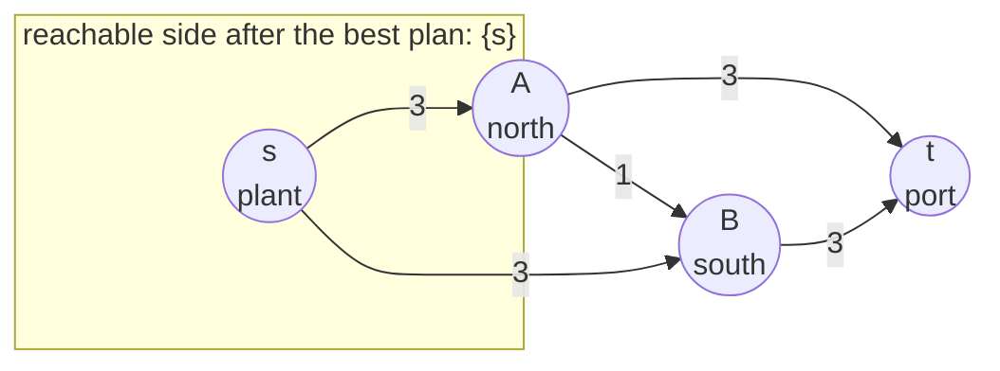
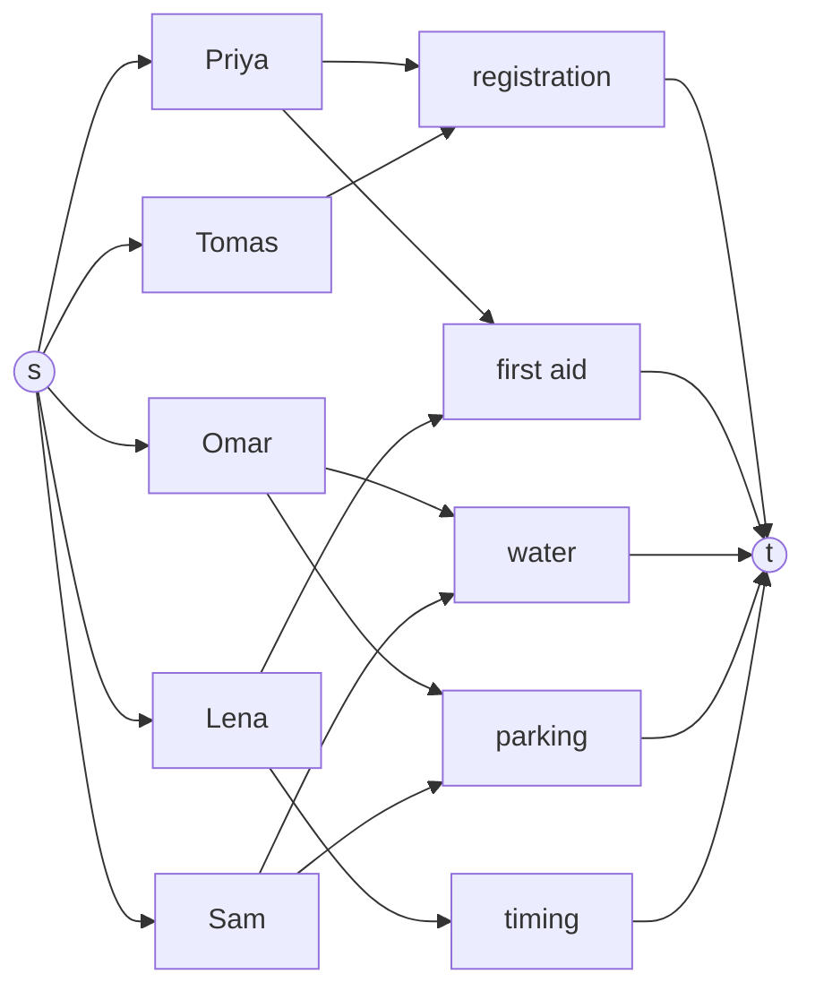

# Max-flow min-cut: the most you can push equals the cheapest way to sever the network, and matching is a flow

[Syllabus](../../../SYLLABUS.md) → [Combinatorics and graphs](../README.md) → [Matchings and Flows](../README.md#s13) → Max-flow min-cut

---

## General Overview

A bottling plant ships lorry-loads nightly to a port through a north and a south depot. The plant can send 3 loads to each depot, each depot can forward 3 to the port, and a link road from north to south takes 1. At most 6 loads a night reach the port. The cheapest way to cut the plant off from the port closes roads worth 6 loads: both roads out of the plant.

Ford and Fulkerson proved in 1956 that these two numbers always meet: no shipment plan beats any severing, and the best plan equals the cheapest one. Their method pushes loads along augmenting routes, paths from plant to port with room on every road, until none is left.

The same fact settles pairing. The fun run of [Matchings](01-matchings-and-augmenting-paths.md) has five volunteers, Priya, Omar, Lena, Sam and Tomas, for five tasks, one each. As a network with every road of capacity 1, the largest flow is the largest set of pairs, here 5. When a full pairing is impossible, the cheapest cut names a group that can do too few tasks between them: Hall's theorem again.

**The largest flow equals the cheapest cut, and when no augmenting route is left, the junctions still reachable from the source are one side of such a cut.**

**What kind of fact this is:** a theorem, proved on this card in Why it works.

### The picture: the diamond and its cheapest cuts



Labels are capacities in loads a night. The box marks the cut the method hands back.

---

## The formula

Notation from [Flows](05-flow-networks-and-ford-fulkerson.md): a flow puts $f(u,v)$ loads on the road from junction $u$ to junction $v$, at most its capacity $c(u,v)$, stranding nothing between source $s$ and sink $t$. Its value $\lvert f\rvert$ is the net count leaving $s$. A cut splits the junctions into a side $S$ holding $s$ and a side $T$ holding $t$; its price adds the capacities of roads leaving $S$.

$$\max_{f}\ \lvert f\rvert \;=\; \min_{(S,T)}\ c(S,T), \qquad c(S,T) = \sum_{u \in S,\ v \in T} c(u,v)$$

**Read it aloud:** the value of the best flow equals the price of the cheapest cut.

The method works on leftover: a road's spare capacity, plus any load on the reverse road, which a push may cancel. A step that only cancels such a load is a backward stub. An augmenting route has leftover above 0 on every step.

For pairing, roads of capacity 1 run from $s$ to each volunteer, from each volunteer to each task that volunteer can do, and from each task to $t$. Write $P$ for the volunteers, $X$ for any group of them and $N(X)$ for the tasks the group can do ([Hall's theorem](02-halls-marriage-theorem.md)). A cut whose source side holds exactly the volunteers in $X$ pays at least

$$c(S,T) \;\ge\; \lvert P\rvert - \lvert X\rvert + \lvert N(X)\rvert .$$

**Read it aloud:** a cut pays at least once per volunteer left outside, and once per task the inside group reaches.

| Symbol | Plain meaning | In our example | Push it up and the answer… |
| --- | --- | --- | --- |
| $s$, $t$ | source and sink | plant and port | — |
| $A$, $B$, $u$, $v$ | junctions: the depots, and any two | A → B is a road | — |
| $c(u,v)$ | a road's capacity | 3 outer, 1 cross | may raise the best flow |
| $f$, $\lvert f\rvert$ | a flow, and its value | best 6; 5 at the fun run | stops at the cheapest cut |
| $S$, $T$ | a cut's two sides; $c(S,T)$ its price | {s} and {A,B,t}, price 6 | — |
| $R$ | junctions reachable from $s$ on leftover once no augmenting route remains | {s} | — |
| $P$, $X$, $N(X)$, $j$ | volunteers, a group, the tasks it can do, one task | 5; Priya and Tomas; registration | more reach, fuller pairing |

### When it holds

- **Capacities at least 0.** Fractions and real numbers are fine; a negative capacity makes "flow" meaningless.
- **Pushing needs a rule on real capacities.** With whole numbers the method stops. With arbitrary reals a careless route choice can push forever; the fewest-roads rule (Edmonds-Karp) stops.
- **Whole-number flows need whole-number capacities.** Without them the pairing step fails.
- **Pairing as a flow needs two sides.** Every can-do line runs from a volunteer to a task; pairing within one group is a different problem.

---

## Why it works

### Step 0: two numbers that face each other

Each flow sits at or below each cut. So one flow and one cut with the same number settle both questions at once. The pushing method builds that pair.

### Step 1: no flow beats any cut

Junctions on the source side, except $s$, pass on what they receive, so the side's net output is $\lvert f\rvert$, and it leaves only by crossing to $T$:

$$\lvert f\rvert = \sum_{u \in S,\ v \in T} f(u,v) \;-\; \sum_{u \in T,\ v \in S} f(u,v) \;\le\; c(S,T).$$

The first sum is at most the price, road by road. The second counts loads coming back, never negative. On the diamond every plan is at most 6.

### Step 2: when the method stops, the reachable side is a cut priced at the flow

Push until no augmenting route is left. Let $R$ be the junctions still reachable from $s$ on leftover. The sink is outside $R$, or a route would exist, so $R$ and the rest form a cut.

Leftover on $u \to v$ is spare capacity plus any load on $v \to u$ that could be cancelled. A road leaving $R$ with room would make its far end reachable, so every road leaving $R$ is full. A road entering $R$ with a load would offer a stub back out, so every such road is empty. Step 1's sums become the full price and 0:

$$\lvert f\rvert = c(R,\ \text{rest}).$$

### Step 3: the two numbers are equal

With whole-number capacities the method stops, so Step 2's pair exists, and by Step 1 neither can be improved. On the diamond the pushes end at 6 with $R$ = {s}. Two other splits, {s,B} and {s,A,B}, also price 6: the value is one number, the cheapest cut need not be one set.

<details>
<summary>Detailed proof</summary>

**Tightness.** For $u$ in $R$ and $v$ outside it, leftover $(c(u,v) - f(u,v)) + f(v,u)$ is 0 with both brackets at least 0, so $f(u,v) = c(u,v)$ and $f(v,u) = 0$.

**Existence.** Whole-number capacities: each push adds at least 1 and the price of {s} caps the value, so pushing stops. Fractions: scale to whole numbers. Real capacities: the Edmonds-Karp rule stops ([Graph algorithms as code](../../14-Applied%20and%20computational/01-Algorithms%20and%20Growth/09-graph-algorithms-in-practice.md)).

**Hall's bound.** Let $X$ be the volunteers in $S$. Each volunteer outside $X$ gives a priced road from $s$. Each task $j$ reached by $X$ gives one more: its road to $t$ if $j$ is in $S$, a road from $X$ if not. The roads are distinct, which gives the bound in The formula.

</details>

### Step 4: whole numbers in, whole numbers out

Every push moves the smallest leftover on its route. With whole-number capacities every leftover is whole, so the method ends on a best flow with a whole number on every road.

### Step 5: a pairing is a flow of 0s and 1s

Every fun-run road has capacity 1, so a whole-number flow puts 0 or 1 on each. A volunteer receives at most 1, so takes at most one task; a task passes at most 1 to $t$, so has at most one volunteer. The roads carrying 1 between them form a matching (pairs sharing nobody) as large as the value, and any matching is such a flow. So the largest matching equals the best flow and the cheapest cut.

An augmenting route here is the alternating path of [Matchings](01-matchings-and-augmenting-paths.md). Greedy leaves Priya on registration, Lena on first aid and Tomas idle. The route s → Tomas → registration, back along the stub to Priya, on to first aid, back to Lena, then timing → t moves Priya and Lena along and gives Tomas registration.

### Step 6: when the pairing falls short, the cut names the crowded group

Suppose Priya cannot do first aid: she and Tomas both have only registration. The best flow is 4, and the reachable side is {s, Priya, Tomas, registration}. It pays for the roads from $s$ to Omar, Lena and Sam, and for registration → t: 4. Inside, $X$ = {Priya, Tomas} reaches $N(X)$ = {registration}, and the bound reads 5 − 2 + 1 = 4, met exactly.

If every group reaches at least as many tasks as it has members, every cut costs at least $\lvert P\rvert$ and everyone is placed: Hall's theorem.

---

## Worked numbers, by hand

| Step | Arithmetic | Value |
| --- | --- | --- |
| price of {s} | s→A 3 + s→B 3 | 6 |
| price of {s,A} | s→B 3 + A→B 1 + A→t 3 | 7 |
| price of {s,B} | s→A 3 + B→t 3 (A→B enters) | 6 |
| price of {s,A,B} | A→t 3 + B→t 3 | 6 |
| cheapest cut | smallest of 6, 7, 6, 6 | **6** |
| reachable side after pushing | roads out of s full | {s}, price 6 |
| fun run, greedy in list order | Tomas finds registration taken | 4 |
| one augmenting route | Priya and Lena move along | 5 |
| cheapest fun-run cut | five roads out of s, 1 each | **5** |
| Priya off first aid | 5 − 2 + 1 | **4** |

Six loads a night is the plant's ceiling, certified by two full roads. The fun run covers every task.

### The picture: the fun run as a flow



Every road has capacity 1: 19 in all. Remove Priya → first aid and the best flow drops to 4.

### What breaks if you drop a piece

| Mistake | Comes out at | What went wrong |
| --- | --- | --- |
| The cross road read as the cut | 1 | Closing A → B severs nothing |
| {s,B} priced with the road entering it | 7 | Only roads leaving the source side count |
| Greedy pairing read as the most | 4 | A first choice never revisited |

---

## Code, from first principles, and it actually runs

Nothing that solves the problem is imported. Road one pushes along fewest-road leftover routes and prices the reachable side. Road two prices every cut. Road three ignores the network: every set of pairs, every group.

### Python

```python
# Max-flow min-cut -- the check behind the card.  The diamond (plant s, depots A and B, port
# t; 3 loads on each outer road, 1 on the cross A->B), then five volunteers on five tasks as
# a flow with every road 1.  Road one: push along shortest leftover routes, read off the
# reachable side.  Road two: price every cut.  Road three: every pairing, every group.
def maxflow(cap, nodes):                     # road one; nodes run from s first to t last
    s, t, f = nodes[0], nodes[-1], {}
    left = lambda u, v: cap.get((u, v), 0) - f.get((u, v), 0) + f.get((v, u), 0)
    while True:
        prev, queue = {s: None}, [s]         # breadth-first: fewest roads first
        for u in queue:
            for v in nodes:
                if v not in prev and left(u, v) > 0: prev[v] = u; queue.append(v)
        if t not in prev: return sum(f.get((s, v), 0) for v in nodes), f, [v for v in nodes if v in prev]
        path, v = [], t
        while prev[v] is not None: path.append((prev[v], v)); v = prev[v]
        b = min(left(u, v) for u, v in path)
        for u, v in path:                    # cancel loads going the other way first
            undo = min(b, f.get((v, u), 0))
            f[(v, u)] = f.get((v, u), 0) - undo; f[(u, v)] = f.get((u, v), 0) + b - undo
def price(cap, S): return sum(c for (u, v), c in cap.items() if u in S and v not in S)
def cuts(cap, nodes):                        # road two: every split, s inside, t outside
    mid = nodes[1:-1]
    return [(S, price(cap, S)) for m in range(2 ** len(mid)) for S in [[nodes[0]] + [x for i, x in enumerate(mid) if m >> i & 1]]]
def side(S): return "{" + ",".join(S) + "}"
DIAMOND = {("s", "A"): 3, ("s", "B"): 3, ("A", "t"): 3, ("B", "t"): 3, ("A", "B"): 1}
dval, _, dR = maxflow(DIAMOND, ["s", "A", "B", "t"])
dcuts = cuts(DIAMOND, ["s", "A", "B", "t"]); dmin = min(c for _, c in dcuts)
print("diamond: " + ", ".join(f"{u}->{v} {c}" for (u, v), c in DIAMOND.items()))
print(f"diamond, road one: max flow {dval}; reachable side {side(dR)}, priced {price(DIAMOND, dR)}")
print("diamond, road two: " + ", ".join(f"{side(S)} {c}" for S, c in dcuts) + f"; cheapest {dmin}, priced by {sum(c == dmin for _, c in dcuts)} cuts")
TASKS = ["registration", "first aid", "water", "parking", "timing"]
CAN = {"Priya": ["registration", "first aid"], "Omar": ["water", "parking"], "Lena": ["first aid", "timing"], "Sam": ["water", "parking"], "Tomas": ["registration"]}
def volunteers(can, name):
    P, E = list(can), [(p, j) for p in can for j in can[p]]
    cap, N = {("s", p): 1 for p in P} | {e: 1 for e in E} | {(j, "t"): 1 for j in TASKS}, ["s"] + P + TASKS + ["t"]
    (val, f, R), cs = maxflow(cap, N), cuts(cap, N); low = min(c for _, c in cs)
    sizes = [bin(m).count("1") for m in range(2 ** len(E)) if len({x for i in range(len(E)) if m >> i & 1 for x in E[i]}) == 2 * bin(m).count("1")]
    groups = [[p for i, p in enumerate(P) if m >> i & 1] for m in range(2 ** len(P))]
    short = max(len(X) - len({j for p in X for j in can[p]}) for X in groups)   # worst crowding
    pairs = [(p, j) for p, j in E if f.get((p, j), 0) == 1]     # the roads the flow uses
    print(f"{name}: {len(cap)} roads of capacity 1; road one: max flow {val}, pairs " + ", ".join(f"{p}-{j}" for p, j in pairs))
    print(f"  reachable side {side(R)}, priced {price(cap, R)}")
    print(f"  road two: {len(cs)} cuts, cheapest {low}, priced by {sum(c == low for _, c in cs)} cuts")
    print(f"  road three: {len(sizes)} sets of pairings, largest {max(sizes)}; worst group short by {short}, so {len(P)} - {short} = {len(P) - short}")
    return val, low, max(sizes), len(P) - short, R, pairs
val, low, big, hall, R, pairs = volunteers(CAN, "volunteers")
BROKEN = dict(CAN, Priya=["registration"])
val2, low2, big2, hall2, R2, _ = volunteers(BROKEN, "Priya off first aid")
X = [p for p in CAN if p in R2]; NX = sorted({j for p in X for j in BROKEN[p]})
print(f"  volunteers on the reachable side {side(X)} reach {side(NX)}: {len(X)} people, {len(NX)} task")
used = set()                                 # greedy: each takes the first free task listed
for p in CAN: used |= set([j for j in CAN[p] if j not in used][:1])
print(f"mistake 1, the cross road read as the cut: {DIAMOND[('A', 'B')]}, not {dmin}")
print(f"mistake 2, {{s,B}} priced with the road entering it too: {price(DIAMOND, ['s', 'B']) + DIAMOND[('A', 'B')]}, not {dmin}")
print(f"mistake 3, greedy pairing in list order read as the most: {len(used)}, not {big}")
assert dval == dmin == price(DIAMOND, dR) == 6 and sum(c == dmin for _, c in dcuts) == 3   # flow meets cut
assert val == low == big == hall == 5 == len(pairs) and len({x for e in pairs for x in e}) == 2 * big > 2 * len(used)
assert val2 == low2 == big2 == hall2 == 4 and len(NX) < len(X)      # the cut names the crowded group
print("ALL CHECKS PASS")
```

**Ran 2026-09-24 on macOS, Python 3.14.6, standard library only. All checks passed. Output, pasted from the run:**

```
diamond: s->A 3, s->B 3, A->t 3, B->t 3, A->B 1
diamond, road one: max flow 6; reachable side {s}, priced 6
diamond, road two: {s} 6, {s,A} 7, {s,B} 6, {s,A,B} 6; cheapest 6, priced by 3 cuts
volunteers: 19 roads of capacity 1; road one: max flow 5, pairs Priya-first aid, Omar-water, Lena-timing, Sam-parking, Tomas-registration
  reachable side {s}, priced 5
  road two: 1024 cuts, cheapest 5, priced by 14 cuts
  road three: 91 sets of pairings, largest 5; worst group short by 0, so 5 - 0 = 5
Priya off first aid: 18 roads of capacity 1; road one: max flow 4, pairs Priya-registration, Omar-water, Lena-first aid, Sam-parking
  reachable side {s,Priya,Tomas,registration}, priced 4
  road two: 1024 cuts, cheapest 4, priced by 2 cuts
  road three: 63 sets of pairings, largest 4; worst group short by 1, so 5 - 1 = 4
  volunteers on the reachable side {Priya,Tomas} reach {registration}: 2 people, 1 task
mistake 1, the cross road read as the cut: 1, not 6
mistake 2, {s,B} priced with the road entering it too: 7, not 6
mistake 3, greedy pairing in list order read as the most: 4, not 5
ALL CHECKS PASS
```

### Rust

Same numbers, same labels, built with `rustc --edition 2021 -O`.

```rust
// Max-flow min-cut -- the same check as the Python, in Rust.  No crates.  The diamond (plant
// s, depots A and B, port t; 3 loads on each outer road, 1 on the cross A->B), then five
// volunteers on five tasks as a flow with every road 1.  Road one: shortest leftover routes
// and the reachable side.  Road two: price every cut.  Road three: every pairing, every group.
type Net = (Vec<&'static str>, Vec<(usize, usize, i64)>);   // junctions (s first, t last), roads
fn maxflow(n: &Net) -> (i64, Vec<Vec<i64>>, Vec<usize>) {    // road one: push until stuck
    let k = n.0.len(); let (mut cap, mut f) = (vec![vec![0i64; k]; k], vec![vec![0i64; k]; k]);
    for &(u, v, c) in &n.1 { cap[u][v] = c }
    let left = |f: &Vec<Vec<i64>>, u: usize, v: usize| cap[u][v] - f[u][v] + f[v][u];
    loop {
        let (mut prev, mut queue, mut i) = (vec![usize::MAX; k], vec![0usize], 0); prev[0] = 0;   // breadth-first
        while i < queue.len() {
            let u = queue[i]; i += 1;
            for v in 0..k { if prev[v] == usize::MAX && left(&f, u, v) > 0 { prev[v] = u; queue.push(v) } }
        }
        if prev[k - 1] == usize::MAX { return (f[0].iter().sum(), f, (0..k).filter(|&v| prev[v] != usize::MAX).collect()) }
        let (mut path, mut v) = (vec![], k - 1);
        while v != 0 { path.push((prev[v], v)); v = prev[v] }
        let b = path.iter().map(|&(u, v)| left(&f, u, v)).min().unwrap();
        for &(u, v) in &path { let undo = b.min(f[v][u]); f[v][u] -= undo; f[u][v] += b - undo }   // cancel first
    }
}
fn price(n: &Net, s: &[usize]) -> i64 { n.1.iter().filter(|r| s.contains(&r.0) && !s.contains(&r.1)).map(|r| r.2).sum() }
fn cuts(n: &Net) -> Vec<(Vec<usize>, i64)> {             // road two: every split, s in, t out
    let k = n.0.len();
    (0..1usize << (k - 2)).map(|m| { let s: Vec<usize> = std::iter::once(0).chain((1..k - 1).filter(|i| m >> (i - 1) & 1 == 1)).collect(); let p = price(n, &s); (s, p) }).collect()
}
fn side(names: &[&str]) -> String { format!("{{{}}}", names.join(",")) }
const TASKS: [&str; 5] = ["registration", "first aid", "water", "parking", "timing"];
fn volunteers(can: &[(&'static str, Vec<&'static str>)], name: &str) -> (i64, i64, i64, i64, Vec<&'static str>, Vec<(usize, usize)>) {
    let np = can.len();
    let mut names = vec!["s"]; names.extend(can.iter().map(|c| c.0)); names.extend(TASKS); names.push("t");
    let task = |j: &str| 1 + np + TASKS.iter().position(|&x| x == j).unwrap();
    let e: Vec<(usize, usize)> = can.iter().enumerate().flat_map(|(i, c)| c.1.iter().map(move |&j| (1 + i, j))).map(|(p, j)| (p, task(j))).collect();
    let mut roads: Vec<(usize, usize, i64)> = (1..=np).map(|p| (0, p, 1)).collect();
    roads.extend(e.iter().map(|&(p, j)| (p, j, 1))); roads.extend((0..5).map(|j| (1 + np + j, names.len() - 1, 1)));
    let net: Net = (names.clone(), roads);
    let (val, f, r) = maxflow(&net);
    let cs = cuts(&net); let low = cs.iter().map(|c| c.1).min().unwrap();
    let mut sizes = vec![]; for m in 0..1usize << e.len() {   // road three: every set of pairings
        let mut ends: Vec<usize> = (0..e.len()).filter(|i| m >> i & 1 == 1).flat_map(|i| [e[i].0, e[i].1]).collect();
        let size = m.count_ones() as usize; ends.sort(); ends.dedup();
        if ends.len() == 2 * size { sizes.push(size as i64) }
    }
    let big = *sizes.iter().max().unwrap();
    let short = (0..1usize << np).map(|m| {                  // worst crowding over every group
        let mut reach: Vec<&str> = (0..np).filter(|i| m >> i & 1 == 1).flat_map(|i| can[i].1.clone()).collect();
        reach.sort(); reach.dedup(); m.count_ones() as i64 - reach.len() as i64 }).max().unwrap();
    let pv: Vec<(usize, usize)> = e.iter().filter(|&&(p, j)| f[p][j] == 1).cloned().collect();   // roads the flow uses
    println!("{}: {} roads of capacity 1; road one: max flow {}, pairs {}", name, net.1.len(), val, pv.iter().map(|&(p, j)| format!("{}-{}", names[p], names[j])).collect::<Vec<String>>().join(", "));
    let rn: Vec<&'static str> = r.iter().map(|&i| names[i]).collect();
    println!("  reachable side {}, priced {}", side(&rn), price(&net, &r));
    println!("  road two: {} cuts, cheapest {}, priced by {} cuts", cs.len(), low, cs.iter().filter(|c| c.1 == low).count());
    println!("  road three: {} sets of pairings, largest {}; worst group short by {}, so {} - {} = {}", sizes.len(), big, short, np, short, np as i64 - short);
    (val, low, big, np as i64 - short, rn, pv)
}
fn main() {
    let d: Net = (vec!["s", "A", "B", "t"], vec![(0, 1, 3), (0, 2, 3), (1, 3, 3), (2, 3, 3), (1, 2, 1)]);
    let (dval, _, dr) = maxflow(&d);
    let dcuts = cuts(&d); let dmin = dcuts.iter().map(|c| c.1).min().unwrap(); let nm = |s: &[usize]| side(&s.iter().map(|&i| d.0[i]).collect::<Vec<&str>>());
    println!("diamond: {}", d.1.iter().map(|&(u, v, c)| format!("{}->{} {}", d.0[u], d.0[v], c)).collect::<Vec<String>>().join(", "));
    println!("diamond, road one: max flow {}; reachable side {}, priced {}", dval, nm(&dr), price(&d, &dr));
    println!("diamond, road two: {}; cheapest {}, priced by {} cuts", dcuts.iter().map(|(s, c)| format!("{} {}", nm(s), c)).collect::<Vec<String>>().join(", "), dmin, dcuts.iter().filter(|c| c.1 == dmin).count());
    let can = vec![("Priya", vec!["registration", "first aid"]), ("Omar", vec!["water", "parking"]), ("Lena", vec!["first aid", "timing"]), ("Sam", vec!["water", "parking"]), ("Tomas", vec!["registration"])];
    let (val, low, big, hall, _, pv) = volunteers(&can, "volunteers"); let mut broken = can.clone(); broken[0].1 = vec!["registration"];
    let (val2, low2, big2, hall2, r2, _) = volunteers(&broken, "Priya off first aid");
    let x: Vec<&str> = broken.iter().filter(|c| r2.contains(&c.0)).map(|c| c.0).collect();
    let mut nx: Vec<&str> = broken.iter().filter(|c| r2.contains(&c.0)).flat_map(|c| c.1.clone()).collect(); nx.sort(); nx.dedup();
    println!("  volunteers on the reachable side {} reach {}: {} people, {} task", side(&x), side(&nx), x.len(), nx.len());
    let mut used: Vec<&str> = vec![];                      // greedy: first free task listed
    for c in &can { if let Some(&j) = c.1.iter().find(|j| !used.contains(j)) { used.push(j) } }
    println!("mistake 1, the cross road read as the cut: {}, not {}", d.1[4].2, dmin);
    println!("mistake 2, {{s,B}} priced with the road entering it too: {}, not {}", price(&d, &[0, 2]) + d.1[4].2, dmin);
    println!("mistake 3, greedy pairing in list order read as the most: {}, not {}", used.len(), big);
    let mut ends: Vec<usize> = pv.iter().flat_map(|&(p, j)| [p, j]).collect(); ends.sort(); ends.dedup();
    assert!(dval == dmin && dmin == price(&d, &dr) && dval == 6 && dcuts.iter().filter(|c| c.1 == dmin).count() == 3);
    assert!(val == low && low == big && big == hall && hall == 5 && pv.len() as i64 == val && ends.len() as i64 == 2 * big && big > used.len() as i64);
    assert!(val2 == low2 && low2 == big2 && big2 == hall2 && hall2 == 4 && nx.len() < x.len());   // crowded group
    println!("ALL CHECKS PASS");
}
```

**Ran 2026-09-24 on macOS, rustc 1.98.1, no crates. All checks passed. Output, pasted from the run:**

```
diamond: s->A 3, s->B 3, A->t 3, B->t 3, A->B 1
diamond, road one: max flow 6; reachable side {s}, priced 6
diamond, road two: {s} 6, {s,A} 7, {s,B} 6, {s,A,B} 6; cheapest 6, priced by 3 cuts
volunteers: 19 roads of capacity 1; road one: max flow 5, pairs Priya-first aid, Omar-water, Lena-timing, Sam-parking, Tomas-registration
  reachable side {s}, priced 5
  road two: 1024 cuts, cheapest 5, priced by 14 cuts
  road three: 91 sets of pairings, largest 5; worst group short by 0, so 5 - 0 = 5
Priya off first aid: 18 roads of capacity 1; road one: max flow 4, pairs Priya-registration, Omar-water, Lena-first aid, Sam-parking
  reachable side {s,Priya,Tomas,registration}, priced 4
  road two: 1024 cuts, cheapest 4, priced by 2 cuts
  road three: 63 sets of pairings, largest 4; worst group short by 1, so 5 - 1 = 4
  volunteers on the reachable side {Priya,Tomas} reach {registration}: 2 people, 1 task
mistake 1, the cross road read as the cut: 1, not 6
mistake 2, {s,B} priced with the road entering it too: 7, not 6
mistake 3, greedy pairing in list order read as the most: 4, not 5
ALL CHECKS PASS
```

The two outputs match line for line.

### Lean

Lean proves the theorem for every network with finitely many junctions and capacities at least 0, real numbers included.

- A largest flow and a cheapest cut always exist, and they are the same number.
- When no augmenting route is left, the junctions still reachable from the source form a cheapest cut, priced at the flow's value.
- For any volunteers and tasks, with every road of capacity 1, the largest flow is a whole number equal to the largest pairing.
- The worked numbers: the diamond's cut prices 6, 7, 6 and 6, its best plan of 6, and the Priya-off-first-aid cut priced 4.

The pushing runs, the fun run's 1024 cuts and 91 sets of pairs, and greedy pairing are left to the Python and Rust checks.

<details>
<summary>The Lean proof, 723 lines</summary>

```lean
-- Max-flow min-cut: in every finite network with capacities at least 0, the largest flow equals the cheapest cut, the side still reachable on leftover when no augmenting route remains is such a cut, and in a two-sided network of capacity 1 the largest flow is the largest pairing.
import Mathlib.Topology.MetricSpace.Pseudo.Lemmas
import Mathlib.Topology.Order.Compact
import Mathlib.Topology.Algebra.Order.Group
import Mathlib.Tactic.Linarith
import Mathlib.Algebra.Group.Subgroup.Defs
import Mathlib.Algebra.BigOperators.Group.Finset.Piecewise
import Mathlib.Algebra.BigOperators.Ring.Finset
import Mathlib.Data.Fintype.BigOperators
import Mathlib.Algebra.BigOperators.Group.Finset.Basic
import Mathlib.Algebra.Order.BigOperators.Group.Finset
import Mathlib.Basic.Real.Basic
import Mathlib.Data.Fintype.Prod
import Mathlib.Data.Fintype.Sum
import Mathlib.Data.Fintype.Powerset
import Mathlib.Data.Fin.VecNotation
import Mathlib.Logic.Relation
import Mathlib.Order.Bounds.Basic
import Mathlib.Tactic.DeriveFintype

open Finset

/-! A network has finitely many junctions, a type `V`, and a capacity `c u v` on the road from
`u` to `v` (0 where there is no road). A flow `f` puts `f u v` loads on that road, between 0 and
the capacity, and every junction other than the source `s` and the sink `t` passes on exactly
what it receives. Its value `|f|` is the net count leaving `s`. A cut is a side `S` holding `s`
and not `t`; its price adds the capacities of the roads leaving `S`. The definitions take any
number system `β`, so the worked examples can run on whole numbers; the theorems use `ℝ`. -/

section Defs
variable {V β : Type*} [Fintype V]

/-- `f` is a flow from `s` to `t` within the capacities `c`. -/
def IsFlow [AddCommMonoid β] [LE β] (c : V → V → β) (s t : V) (f : V → V → β) : Prop :=
  (∀ u v, 0 ≤ f u v ∧ f u v ≤ c u v) ∧ ∀ v, v ≠ s → v ≠ t → ∑ u, f u v = ∑ w, f v w

/-- The value of a flow: loads leaving the source minus loads coming back into it. -/
def flowValue [AddCommGroup β] (s : V) (f : V → V → β) : β :=
  ∑ v, f s v - ∑ v, f v s

/-- A cut: a side `S` holding the source and not the sink. -/
def IsCut (s t : V) (S : Finset V) : Prop := s ∈ S ∧ t ∉ S

/-- The price of a cut: the capacities of the roads leaving `S`, `c(S,T)` on the card. -/
def cutCap [AddCommMonoid β] [DecidableEq V] (c : V → V → β) (S : Finset V) : β :=
  ∑ u ∈ S, ∑ v ∈ Sᶜ, c u v

/-- Leftover on the step `u → v`: spare capacity plus any load on `v → u` a push could cancel. -/
def residual [AddCommGroup β] (c f : V → V → β) (u v : V) : β := c u v - f u v + f v u

/-- `v` can be reached from `s` by steps that each have leftover above 0. An augmenting route
exists exactly when the sink can be reached this way. -/
def ResidualReach [AddCommGroup β] [LT β] (c f : V → V → β) (s v : V) : Prop :=
  Relation.ReflTransGen (fun a b => 0 < residual c f a b) s v

open Classical in
/-- The junctions still reachable from the source on leftover: `R` on the card. -/
noncomputable def reachableSide [AddCommGroup β] [LT β] (c f : V → V → β) (s : V) : Finset V :=
  univ.filter fun v => ResidualReach c f s v

instance [AddCommMonoid β] [LE β] [DecidableEq V] [DecidableEq β] [DecidableLE β]
    (c : V → V → β) (s t : V) (f : V → V → β) : Decidable (IsFlow c s t f) := by
  unfold IsFlow; infer_instance

instance [DecidableEq V] (s t : V) (S : Finset V) : Decidable (IsCut s t S) := by
  unfold IsCut; infer_instance

end Defs

/-! Helper lemmas for the proofs below. -/

section Helpers
variable {V : Type*} [Fintype V] [DecidableEq V]

/-- Net inflow at a junction: loads in minus loads out. -/
def netIn (g : V → V → ℝ) (x : V) : ℝ := ∑ u, g u x - ∑ w, g x w

/-- Reachable from `s` on leftover in at most `n` steps. -/
def resReachN (c f : V → V → ℝ) (s : V) : ℕ → V → Prop
  | 0, v => v = s
  | n + 1, v => resReachN c f s n v ∨ ∃ u, resReachN c f s n u ∧ 0 < residual c f u v

lemma flow_across_cut (c : V → V → ℝ) (s t : V) (g : V → V → ℝ) (hg : IsFlow c s t g)
    (S : Finset V) (hS : IsCut s t S) :
    flowValue s g = ∑ u ∈ S, ∑ v ∈ Sᶜ, (g u v - g v u) := by
  have h1 : ∑ u ∈ S, (∑ v, g u v - ∑ v, g v u) = flowValue s g := by
    rw [Finset.sum_eq_single_of_mem s hS.1]
    · rfl
    · intro u hu hus
      rw [hg.2 u hus (fun h => hS.2 (h ▸ hu))]
      ring
  have h2 : ∑ u ∈ S, ∑ v ∈ S, (g u v - g v u) = 0 := by
    have : ∑ u ∈ S, ∑ v ∈ S, g v u = ∑ u ∈ S, ∑ v ∈ S, g u v := Finset.sum_comm
    simp [Finset.sum_sub_distrib, this]
  rw [← h1]
  have h3 : ∀ u, ∑ v, g u v - ∑ v, g v u = ∑ v ∈ S, (g u v - g v u) + ∑ v ∈ Sᶜ, (g u v - g v u) := by
    intro u
    rw [Finset.sum_add_sum_compl S (fun v => g u v - g v u), Finset.sum_sub_distrib]
  simp only [h3, Finset.sum_add_distrib, h2, zero_add]

lemma flow_le_cut (c : V → V → ℝ) (s t : V) (g : V → V → ℝ) (hg : IsFlow c s t g)
    (S : Finset V) (hS : IsCut s t S) : flowValue s g ≤ cutCap c S := by
  rw [flow_across_cut c s t g hg S hS, cutCap]
  refine Finset.sum_le_sum fun u _ => Finset.sum_le_sum fun v _ => ?_
  linarith [(hg.1 u v).2, (hg.1 v u).1]

lemma certificate (c : V → V → ℝ) (s t : V) (f : V → V → ℝ) (hf : IsFlow c s t f)
    (hno : ¬ ResidualReach c f s t) :
    IsCut s t (reachableSide c f s) ∧ flowValue s f = cutCap c (reachableSide c f s) ∧
      (∀ g, IsFlow c s t g → flowValue s g ≤ flowValue s f) ∧
      ∀ S : Finset V, IsCut s t S → cutCap c (reachableSide c f s) ≤ cutCap c S := by
  classical
  have hcut : IsCut s t (reachableSide c f s) := by
    refine ⟨?_, ?_⟩
    · show s ∈ reachableSide c f s
      unfold reachableSide
      exact Finset.mem_filter.2 ⟨Finset.mem_univ _, Relation.ReflTransGen.refl⟩
    · simpa [reachableSide] using hno
  have heq : flowValue s f = cutCap c (reachableSide c f s) := by
    rw [flow_across_cut c s t f hf _ hcut, cutCap]
    refine Finset.sum_congr rfl fun u hu => Finset.sum_congr rfl fun v hv => ?_
    have hu' : ResidualReach c f s u := by simpa [reachableSide] using hu
    have hv' : ¬ ResidualReach c f s v := by simpa [reachableSide] using hv
    have hr : ¬ 0 < residual c f u v := fun h => hv' (Relation.ReflTransGen.tail hu' h)
    have h1 := hf.1 u v
    have h2 := hf.1 v u
    simp only [residual, not_lt] at hr
    have : f v u = 0 := by linarith
    have : f u v = c u v := by linarith
    simp [*]
  refine ⟨hcut, heq, fun g hg => heq ▸ flow_le_cut c s t g hg _ hcut, fun S hS => ?_⟩
  rw [← heq]
  exact flow_le_cut c s t f hf S hS

omit [Fintype V] [DecidableEq V] in
lemma reach_exists_n (c f : V → V → ℝ) (s v : V) (h : ResidualReach c f s v) :
    ∃ n, resReachN c f s n v := by
  induction h with
  | refl => exact ⟨0, rfl⟩
  | tail _ hbc ih =>
    obtain ⟨n, hn⟩ := ih
    exact ⟨n + 1, Or.inr ⟨_, hn, hbc⟩⟩

lemma augment_aux (c f : V → V → ℝ) (s : V) (hf : ∀ a b, 0 ≤ f a b ∧ f a b ≤ c a b)
    (δ : ℝ) (hδ : 0 ≤ δ) (hres : ∀ a b, 0 < residual c f a b → δ ≤ residual c f a b)
    (A : AddSubgroup ℝ) (hfA : ∀ a b, f a b ∈ A) (hδA : δ ∈ A) :
    ∀ n v, resReachN c f s n v → ∃ g : V → V → ℝ, (∀ a b, 0 ≤ g a b ∧ g a b ≤ c a b) ∧
      (∀ x, netIn g x = netIn f x +
        δ * ((if x = v then 1 else 0) - (if x = s then 1 else 0))) ∧
      (∀ a b, g a b ≠ f a b → resReachN c f s n a ∧ resReachN c f s n b) ∧
      ∀ a b, g a b ∈ A := by
  intro n
  induction n with
  | zero =>
    intro v hv
    have hv' : v = s := hv
    subst hv'
    exact ⟨f, hf, fun x => by simp, fun a b h => absurd rfl h, hfA⟩
  | succ n ih =>
    intro v hv
    by_cases hvn : resReachN c f s n v
    · obtain ⟨g, hcap, hnet, hsupp, hA⟩ := ih v hvn
      exact ⟨g, hcap, hnet, fun a b h => ⟨Or.inl (hsupp a b h).1, Or.inl (hsupp a b h).2⟩, hA⟩
    rcases hv with hv | ⟨u, hu, hr⟩
    · exact absurd hv hvn
    obtain ⟨g, hcap, hnet, hsupp, hA⟩ := ih u hu
    have huv : u ≠ v := fun h => hvn (h ▸ hu)
    have hguv : g u v = f u v := by
      by_contra h
      exact hvn (hsupp u v h).2
    have hgvu : g v u = f v u := by
      by_contra h
      exact hvn (hsupp v u h).1
    have hδr : δ ≤ c u v - g u v + g v u := by
      have := hres u v hr
      simp only [residual] at this
      rw [hguv, hgvu]
      exact this
    set y := min δ (g v u) with hy
    have hy0 : 0 ≤ y := le_min hδ (hcap v u).1
    have hyδ : y ≤ δ := min_le_left _ _
    have hyg : y ≤ g v u := min_le_right _ _
    have hx : δ - y ≤ c u v - g u v := by
      rcases min_choice δ (g v u) with h | h
      · rw [← hy] at h
        rw [h]
        linarith [(hcap u v).2]
      · rw [← hy] at h
        rw [h]
        linarith
    refine ⟨fun a b => g a b + (if a = u ∧ b = v then δ - y else 0) -
      (if a = v ∧ b = u then y else 0), ?_, ?_, ?_, ?_⟩
    · intro a b
      by_cases h1 : a = u ∧ b = v
      · obtain ⟨rfl, rfl⟩ := h1
        have h2 : ¬ (a = b ∧ b = a) := fun h => huv h.1
        simp only [and_self, ite_true, h2, ite_false]
        constructor <;> linarith [(hcap a b).1]
      · by_cases h2 : a = v ∧ b = u
        · obtain ⟨rfl, rfl⟩ := h2
          simp only [h1, ite_false, and_self, ite_true]
          constructor <;> linarith [(hcap a b).2]
        · simp only [h1, h2, ite_false]
          simpa using hcap a b
    · intro x
      have key : netIn (fun a b => g a b + (if a = u ∧ b = v then δ - y else 0) -
          (if a = v ∧ b = u then y else 0)) x =
          netIn g x + δ * ((if x = v then 1 else 0) - (if x = u then 1 else 0)) := by
        simp only [netIn, Finset.sum_add_distrib, Finset.sum_sub_distrib, ite_and,
          Finset.sum_ite_eq', Finset.mem_univ, ite_true]
        by_cases hxu : x = u
        · subst hxu
          simp [huv]
          ring
        · by_cases hxv : x = v
          · subst hxv
            simp [hxu]
            ring
          · simp [hxu, hxv]
      rw [key, hnet x]
      ring
    · intro a b h
      by_cases h1 : a = u ∧ b = v
      · obtain ⟨rfl, rfl⟩ := h1
        exact ⟨Or.inl hu, Or.inr ⟨a, hu, hr⟩⟩
      · by_cases h2 : a = v ∧ b = u
        · obtain ⟨rfl, rfl⟩ := h2
          exact ⟨Or.inr ⟨b, hu, hr⟩, Or.inl hu⟩
        · simp only [h1, h2, ite_false, add_zero, sub_zero] at h
          exact ⟨Or.inl (hsupp a b h).1, Or.inl (hsupp a b h).2⟩
    · intro a b
      have hyA : y ∈ A := by
        rcases min_choice δ (g v u) with h | h
        · rw [← hy] at h; rw [h]; exact hδA
        · rw [← hy] at h; rw [h]; exact hA v u
      refine A.sub_mem (A.add_mem (hA a b) ?_) ?_
      · split_ifs
        · exact A.sub_mem hδA hyA
        · exact A.zero_mem
      · split_ifs
        · exact hyA
        · exact A.zero_mem

lemma augment (c f : V → V → ℝ) (s t : V) (hst : s ≠ t) (hf : IsFlow c s t f)
    (δ : ℝ) (hδ : 0 ≤ δ) (hres : ∀ a b, 0 < residual c f a b → δ ≤ residual c f a b)
    (A : AddSubgroup ℝ) (hfA : ∀ a b, f a b ∈ A) (hδA : δ ∈ A)
    (hreach : ResidualReach c f s t) :
    ∃ g, IsFlow c s t g ∧ flowValue s g = flowValue s f + δ ∧ ∀ a b, g a b ∈ A := by
  obtain ⟨n, hn⟩ := reach_exists_n c f s t hreach
  obtain ⟨g, hcap, hnet, -, hA⟩ := augment_aux c f s hf.1 δ hδ hres A hfA hδA n t hn
  refine ⟨g, ⟨hcap, fun v hvs hvt => ?_⟩, ?_, hA⟩
  · have h1 := hnet v
    have h2 := hf.2 v hvs hvt
    simp only [netIn, hvs, hvt, ite_false, mul_zero, add_zero, h2, sub_self] at h1
    linarith
  · have h1 := hnet s
    simp only [netIn, hst, ite_false, ite_true, zero_sub] at h1
    simp only [flowValue]
    linarith

omit [DecidableEq V] in
lemma exists_delta (c f : V → V → ℝ) :
    ∃ δ : ℝ, 0 < δ ∧ ∀ a b, 0 < residual c f a b → δ ≤ residual c f a b := by
  classical
  let S := (Finset.univ : Finset (V × V)).filter fun p => 0 < residual c f p.1 p.2
  by_cases hS : S.Nonempty
  · obtain ⟨p, hp, hmin⟩ := S.exists_min_image (fun p => residual c f p.1 p.2) hS
    exact ⟨_, (Finset.mem_filter.1 hp).2, fun a b hab => hmin (a, b) (by simp [S, hab])⟩
  · exact ⟨1, one_pos, fun a b hab => absurd ⟨(a, b), by simp [S, hab]⟩ hS⟩

omit [Fintype V] [DecidableEq V] in
lemma continuous_finset_sum_aux (T : Finset V) (φ : V → (V → V → ℝ) → ℝ)
    (hφ : ∀ v, Continuous (φ v)) : Continuous fun g => ∑ v ∈ T, φ v g := by
  classical
  induction T using Finset.induction_on with
  | empty => simpa using continuous_const
  | insert a T ha ih =>
    simp only [Finset.sum_insert ha]
    exact (hφ a).add ih

end Helpers

#print axioms flow_across_cut
#print axioms flow_le_cut
#print axioms certificate
#print axioms reach_exists_n
#print axioms augment_aux
#print axioms augment
#print axioms exists_delta
#print axioms continuous_finset_sum_aux

/-- Max-flow min-cut (Ford and Fulkerson, 1956). In a network with finitely many junctions, a
source different from the sink and every capacity at least 0 (real numbers allowed), a largest
flow and a cheapest cut both exist and they are the same number: the most that can be pushed
from source to sink equals the cheapest price of a cut. -/
theorem max_flow_eq_min_cut {V : Type*} [Fintype V] [DecidableEq V] (c : V → V → ℝ)
    (hc : ∀ u v, 0 ≤ c u v) (s t : V) (hst : s ≠ t) :
    ∃ m : ℝ, IsGreatest {x | ∃ f, IsFlow c s t f ∧ x = flowValue s f} m ∧
      IsLeast {x | ∃ S : Finset V, IsCut s t S ∧ x = cutCap c S} m := by
  let F : Set (V → V → ℝ) := {f | IsFlow c s t f}
  have hsub : F ⊆ Set.univ.pi fun u => Set.univ.pi fun v => Set.Icc 0 (c u v) := by
    intro f hf
    simp only [Set.mem_pi, Set.mem_univ, forall_const, Set.mem_Icc]
    exact hf.1
  have hcont : ∀ x y : V, Continuous fun g : V → V → ℝ => g x y := fun x y =>
    (continuous_apply y).comp (continuous_apply x)
  have hclosed : IsClosed F := by
    show IsClosed {f : V → V → ℝ | (∀ u v, 0 ≤ f u v ∧ f u v ≤ c u v) ∧
      ∀ v, v ≠ s → v ≠ t → ∑ u, f u v = ∑ w, f v w}
    simp only [Set.ofPred_and, Set.ofPred_forall]
    refine IsClosed.inter (isClosed_iInter fun u => isClosed_iInter fun v =>
      (isClosed_le continuous_const (hcont u v)).inter
        (isClosed_le (hcont u v) continuous_const)) ?_
    exact isClosed_iInter fun v => isClosed_iInter fun _ => isClosed_iInter fun _ =>
      isClosed_eq (continuous_finset_sum_aux _ _ fun u => hcont u v)
        (continuous_finset_sum_aux _ _ fun w => hcont v w)
  have hcomp : IsCompact F :=
    (isCompact_univ_pi fun u => isCompact_univ_pi fun v => isCompact_Icc).of_isClosed_subset
      hclosed hsub
  have hzero : IsFlow c s t 0 :=
    ⟨fun u v => ⟨le_refl _, hc u v⟩, fun v _ _ => by simp⟩
  have hvc : Continuous fun g : V → V → ℝ => flowValue s g :=
    (continuous_finset_sum_aux _ _ fun v => hcont s v).sub
      (continuous_finset_sum_aux _ _ fun v => hcont v s)
  obtain ⟨f, hfF, hmax⟩ := hcomp.exists_isMaxOn ⟨0, hzero⟩ hvc.continuousOn
  have hf : IsFlow c s t f := hfF
  have hno : ¬ ResidualReach c f s t := by
    intro hr
    obtain ⟨δ, hδ, hres⟩ := exists_delta c f
    obtain ⟨g, hg, hval, -⟩ :=
      augment c f s t hst hf δ hδ.le hres
        { carrier := Set.univ, add_mem' := fun _ _ => trivial, zero_mem' := trivial,
          neg_mem' := fun _ => trivial } (fun _ _ => trivial) trivial hr
    have : flowValue s g ≤ flowValue s f := hmax (show g ∈ F from hg)
    linarith
  obtain ⟨hcut, heq, hfmax, hcmin⟩ := certificate c s t f hf hno
  refine ⟨flowValue s f, ⟨⟨f, hf, rfl⟩, ?_⟩, ⟨⟨_, hcut, heq⟩, ?_⟩⟩
  · rintro x ⟨g, hg, rfl⟩
    exact hfmax g hg
  · rintro x ⟨S, hS, rfl⟩
    rw [heq]
    exact hcmin S hS

/-- The certificate. If a flow leaves no augmenting route (the sink cannot be reached from the
source on leftover), then the junctions still reachable from the source form a cut, its price
equals the flow's value, no flow is larger and no cut is cheaper. -/
theorem no_augmenting_route_reachable_side_is_min_cut {V : Type*} [Fintype V] [DecidableEq V]
    (c : V → V → ℝ) (hc : ∀ u v, 0 ≤ c u v) (s t : V) (f : V → V → ℝ) (hf : IsFlow c s t f)
    (hno : ¬ ResidualReach c f s t) :
    IsCut s t (reachableSide c f s) ∧ flowValue s f = cutCap c (reachableSide c f s) ∧
      (∀ g, IsFlow c s t g → flowValue s g ≤ flowValue s f) ∧
      ∀ S : Finset V, IsCut s t S → cutCap c (reachableSide c f s) ≤ cutCap c S := by
  exact certificate c s t f hf hno

/-! Pairing as a flow. Volunteers form a finite type `P`, tasks a finite type `J`, and `r p j`
says volunteer `p` can do task `j`. The network has a source, one junction per volunteer, one per
task, and a sink; roads of capacity 1 run from the source to every volunteer, from each volunteer
to each task that volunteer can do, and from every task to the sink. -/

/-- The junctions of the pairing network. -/
inductive Node (P J : Type*)
  | src
  | vol (p : P)
  | task (j : J)
  | sink
  deriving DecidableEq, Fintype

/-- Capacity 1 on the roads source → volunteer, volunteer → task they can do, task → sink;
0 everywhere else. -/
def unitCap {P J β : Type*} [Zero β] [One β] (r : P → J → Prop) [DecidableRel r] :
    Node P J → Node P J → β
  | .src, .vol _ => 1
  | .vol p, .task j => if r p j then 1 else 0
  | .task _, .sink => 1
  | _, _ => 0

/-- A pairing: a set of (volunteer, task) pairs, each one a can-do line, with no volunteer and
no task used twice. -/
def IsPairing {P J : Type*} (r : P → J → Prop) (M : Finset (P × J)) : Prop :=
  (∀ e ∈ M, r e.1 e.2) ∧ (∀ a ∈ M, ∀ b ∈ M, a.1 = b.1 → a = b) ∧
    (∀ a ∈ M, ∀ b ∈ M, a.2 = b.2 → a = b)

instance {P J : Type*} [DecidableEq P] [DecidableEq J] (r : P → J → Prop) [DecidableRel r]
    (M : Finset (P × J)) : Decidable (IsPairing r M) := by
  unfold IsPairing; infer_instance

/-! Helper lemmas for the pairing theorem below. -/

section PairingHelpers
variable {P J : Type*}

/-- The junctions of the pairing network, listed as a sum type. -/
def nodeEquiv : (Unit ⊕ P) ⊕ (J ⊕ Unit) ≃ Node P J where
  toFun
    | .inl (.inl _) => .src
    | .inl (.inr p) => .vol p
    | .inr (.inl j) => .task j
    | .inr (.inr _) => .sink
  invFun
    | .src => .inl (.inl ())
    | .vol p => .inl (.inr p)
    | .task j => .inr (.inl j)
    | .sink => .inr (.inr ())
  left_inv := by rintro ((_ | _) | (_ | _)) <;> rfl
  right_inv := by rintro (_ | _ | _ | _) <;> rfl

lemma node_sum [Fintype P] [Fintype J] (F : Node P J → ℝ) :
    ∑ v, F v = F .src + ∑ p, F (.vol p) + ∑ j, F (.task j) + F .sink := by
  rw [← (nodeEquiv (P := P) (J := J)).sum_comp F]
  simp [Fintype.sum_sum_type, nodeEquiv]
  ring

/-- The whole numbers inside the reals, as an additive subgroup. -/
def intSub : AddSubgroup ℝ where
  carrier := {x | ∃ z : ℤ, (z : ℝ) = x}
  add_mem' := by
    rintro _ _ ⟨a, rfl⟩ ⟨b, rfl⟩
    exact ⟨a + b, by push_cast; ring⟩
  zero_mem' := ⟨0, by simp⟩
  neg_mem' := by
    rintro _ ⟨a, rfl⟩
    exact ⟨-a, by push_cast; ring⟩

lemma mem_intSub (x : ℝ) : x ∈ intSub ↔ ∃ z : ℤ, (z : ℝ) = x := Iff.rfl

lemma unitCap_cases (r : P → J → Prop) [DecidableRel r] (a b : Node P J) :
    (unitCap r a b : ℝ) = 0 ∨ (unitCap r a b : ℝ) = 1 := by
  rcases a with _ | p | j | _ <;> rcases b with _ | q | k | _ <;> simp [unitCap]
  all_goals tauto

lemma unitCap_nonneg (r : P → J → Prop) [DecidableRel r] (a b : Node P J) :
    0 ≤ (unitCap r a b : ℝ) := by
  rcases unitCap_cases r a b with h | h <;> simp [h]

lemma unitCap_le_one (r : P → J → Prop) [DecidableRel r] (a b : Node P J) :
    (unitCap r a b : ℝ) ≤ 1 := by
  rcases unitCap_cases r a b with h | h <;> simp [h]

lemma unitCap_mem (r : P → J → Prop) [DecidableRel r] (a b : Node P J) :
    (unitCap r a b : ℝ) ∈ intSub := by
  rcases unitCap_cases r a b with h | h
  · exact ⟨0, by simp [h]⟩
  · exact ⟨1, by simp [h]⟩

/-- The flow carried by a pairing: one load along each chosen pair. -/
def matchFlow [Fintype P] [Fintype J] [DecidableEq P] [DecidableEq J] (M : Finset (P × J)) :
    Node P J → Node P J → ℝ
  | .src, .vol p => ∑ j, if (p, j) ∈ M then 1 else 0
  | .vol p, .task j => if (p, j) ∈ M then 1 else 0
  | .task j, .sink => ∑ p, if (p, j) ∈ M then 1 else 0
  | _, _ => 0

variable [Fintype P] [Fintype J] [DecidableEq P] [DecidableEq J]

omit [Fintype P] in
lemma row_le_one (r : P → J → Prop) (M : Finset (P × J)) (hM : IsPairing r M) (p : P) :
    ∑ j, (if (p, j) ∈ M then (1 : ℝ) else 0) ≤ 1 := by
  rw [Finset.sum_boole]
  have : (Finset.univ.filter fun j => (p, j) ∈ M).card ≤ 1 := by
    refine Finset.card_le_one.2 fun a ha b hb => ?_
    simp only [Finset.mem_filter, Finset.mem_univ, true_and] at ha hb
    simpa using congrArg Prod.snd (hM.2.1 _ ha _ hb rfl)
  exact_mod_cast this

omit [Fintype J] in
lemma col_le_one (r : P → J → Prop) (M : Finset (P × J)) (hM : IsPairing r M) (j : J) :
    ∑ p, (if (p, j) ∈ M then (1 : ℝ) else 0) ≤ 1 := by
  rw [Finset.sum_boole]
  have : (Finset.univ.filter fun p => (p, j) ∈ M).card ≤ 1 := by
    refine Finset.card_le_one.2 fun a ha b hb => ?_
    simp only [Finset.mem_filter, Finset.mem_univ, true_and] at ha hb
    simpa using congrArg Prod.fst (hM.2.2 _ ha _ hb rfl)
  exact_mod_cast this

lemma matchFlow_isFlow (r : P → J → Prop) [DecidableRel r] (M : Finset (P × J))
    (hM : IsPairing r M) : IsFlow (unitCap r) .src .sink (matchFlow M) := by
  constructor
  · intro a b
    rcases a with _ | p | j | _ <;> rcases b with _ | q | k | _ <;>
      simp only [matchFlow, unitCap, le_refl, and_self]
    · exact ⟨Finset.sum_nonneg fun _ _ => by split_ifs <;> norm_num, row_le_one r M hM q⟩
    · by_cases h : (p, k) ∈ M
      · simp [h, hM.1 _ h]
      · simp only [h, ite_false, le_refl, true_and]
        split_ifs <;> norm_num
    · exact ⟨Finset.sum_nonneg fun _ _ => by split_ifs <;> norm_num, col_le_one r M hM j⟩
  · intro v hs ht
    rcases v with _ | p | j | _
    · exact absurd rfl hs
    · rw [node_sum, node_sum]
      simp [matchFlow]
    · rw [node_sum, node_sum]
      simp [matchFlow]
    · exact absurd rfl ht

lemma matchFlow_value (M : Finset (P × J)) :
    flowValue (.src : Node P J) (matchFlow M) = M.card := by
  unfold flowValue
  rw [node_sum, node_sum]
  simp only [matchFlow, Finset.sum_const_zero, add_zero, zero_add, sub_zero]
  rw [← Fintype.sum_prod_type' (fun p j => if (p, j) ∈ M then (1 : ℝ) else 0)]
  simp

omit [Fintype P] [Fintype J] [DecidableEq P] [DecidableEq J] in
lemma ite_mem_intSub (q : Prop) [Decidable q] : (if q then (1 : ℝ) else 0) ∈ intSub := by
  split_ifs
  · exact ⟨1, by simp⟩
  · exact ⟨0, by simp⟩

omit [Fintype P] [Fintype J] [DecidableEq P] [DecidableEq J] in
lemma sum_mem_intSub {ι : Type*} (s : Finset ι) (φ : ι → ℝ) (h : ∀ i, φ i ∈ intSub) :
    ∑ i ∈ s, φ i ∈ intSub := by
  classical
  induction s using Finset.induction_on with
  | empty => simp
  | insert a s ha ih =>
    rw [Finset.sum_insert ha]
    exact intSub.add_mem (h a) ih

lemma matchFlow_mem (M : Finset (P × J)) (a b : Node P J) : matchFlow M a b ∈ intSub := by
  rcases a with _ | p | j | _ <;> rcases b with _ | q | k | _ <;> simp only [matchFlow] <;>
    first
    | exact intSub.zero_mem
    | exact sum_mem_intSub _ _ fun _ => ite_mem_intSub _
    | exact ite_mem_intSub _


lemma pairing_of_int_flow (r : P → J → Prop) [DecidableRel r] (g : Node P J → Node P J → ℝ)
    (hg : IsFlow (unitCap r) .src .sink g) (hint : ∀ a b, g a b ∈ intSub) :
    ∃ M : Finset (P × J), IsPairing r M ∧ (M.card : ℝ) = flowValue .src g := by
  classical
  have h01 : ∀ a b, g a b = 0 ∨ g a b = 1 := by
    intro a b
    obtain ⟨z, hz⟩ := hint a b
    have h1 := (hg.1 a b).1
    have h2 := (hg.1 a b).2.trans (unitCap_le_one r a b)
    rw [← hz] at h1 h2 ⊢
    have hz0 : (0 : ℤ) ≤ z := by exact_mod_cast h1
    have hz1 : z ≤ 1 := by exact_mod_cast h2
    rcases (by omega : z = 0 ∨ z = 1) with rfl | rfl <;> simp
  have hzero : ∀ a b, (unitCap r a b : ℝ) = 0 → g a b = 0 := fun a b h =>
    le_antisymm (h ▸ (hg.1 a b).2) (hg.1 a b).1
  have zA : ∀ x, g x .src = 0 := fun x => hzero _ _ (by rcases x with _ | _ | _ | _ <;> rfl)
  have zB : ∀ x, g .sink x = 0 := fun x => hzero _ _ (by rcases x with _ | _ | _ | _ <;> rfl)
  have zC : ∀ p q, g (.vol p) (.vol q) = 0 := fun _ _ => hzero _ _ rfl
  have zD : ∀ p, g (.vol p) .sink = 0 := fun _ => hzero _ _ rfl
  have zE : ∀ j k, g (.task j) (.task k) = 0 := fun _ _ => hzero _ _ rfl
  have zF : ∀ j p, g (.task j) (.vol p) = 0 := fun _ _ => hzero _ _ rfl
  have zG : ∀ j, g .src (.task j) = 0 := fun _ => hzero _ _ rfl
  have zH : g .src .sink = 0 := hzero _ _ rfl
  have hvol : ∀ p, ∑ j, g (.vol p) (.task j) = g .src (.vol p) := by
    intro p
    have := hg.2 (.vol p) (by simp) (by simp)
    rw [node_sum, node_sum] at this
    simp only [zA, zB, zC, zD, zF, Finset.sum_const_zero, add_zero, zero_add] at this
    exact this.symm
  have htask : ∀ j, ∑ p, g (.vol p) (.task j) = g (.task j) .sink := by
    intro j
    have := hg.2 (.task j) (by simp) (by simp)
    rw [node_sum, node_sum] at this
    simp only [zA, zB, zE, zF, zG, Finset.sum_const_zero, add_zero, zero_add] at this
    exact this
  let M : Finset (P × J) := Finset.univ.filter fun e => g (.vol e.1) (.task e.2) = 1
  have hmem : ∀ e, e ∈ M ↔ g (.vol e.1) (.task e.2) = 1 := fun e => by simp [M]
  have hnn : ∀ a b, 0 ≤ g a b := fun a b => (hg.1 a b).1
  refine ⟨M, ⟨?_, ?_, ?_⟩, ?_⟩
  · intro e he
    by_contra hr
    have h0 : g (.vol e.1) (.task e.2) = 0 := hzero _ _ (by simp [unitCap, hr])
    rw [(hmem e).1 he] at h0
    norm_num at h0
  · intro a ha b hb hab
    by_contra hne
    have hne2 : a.2 ≠ b.2 := fun h => hne (Prod.ext hab h)
    have hle : ∑ j ∈ {a.2, b.2}, g (.vol a.1) (.task j) ≤ ∑ j, g (.vol a.1) (.task j) :=
      Finset.sum_le_sum_of_subset_of_nonneg (Finset.subset_univ _) fun _ _ _ => hnn _ _
    rw [Finset.sum_pair hne2, hvol, (hmem a).1 ha, hab, (hmem b).1 hb] at hle
    have hcap := (hg.1 .src (.vol b.1)).2
    have h1 : (unitCap r .src (.vol b.1) : ℝ) = 1 := rfl
    linarith
  · intro a ha b hb hab
    by_contra hne
    have hne1 : a.1 ≠ b.1 := fun h => hne (Prod.ext h hab)
    have hle : ∑ p ∈ {a.1, b.1}, g (.vol p) (.task a.2) ≤ ∑ p, g (.vol p) (.task a.2) :=
      Finset.sum_le_sum_of_subset_of_nonneg (Finset.subset_univ _) fun _ _ _ => hnn _ _
    rw [Finset.sum_pair hne1, htask, (hmem a).1 ha, hab, (hmem b).1 hb] at hle
    have hcap := (hg.1 (.task b.2) .sink).2
    have h1 : (unitCap r (.task b.2) .sink : ℝ) = 1 := rfl
    linarith
  · unfold flowValue
    rw [node_sum, node_sum]
    simp only [zA, zG, zH, Finset.sum_const_zero, add_zero, zero_add, sub_zero]
    simp only [← hvol]
    rw [← Fintype.sum_prod_type' (fun p j => g (.vol p) (.task j))]
    have : ∀ e : P × J, g (.vol e.1) (.task e.2) = if e ∈ M then 1 else 0 := by
      intro e
      rcases h01 (.vol e.1) (.task e.2) with h | h
      · have : e ∉ M := by rw [hmem]; rw [h]; norm_num
        simp [h, this]
      · simp [h, (hmem e).2 h]
    simp only [this, Finset.sum_boole]
    simp

end PairingHelpers

#print axioms node_sum
#print axioms mem_intSub
#print axioms unitCap_cases
#print axioms unitCap_nonneg
#print axioms unitCap_le_one
#print axioms unitCap_mem
#print axioms row_le_one
#print axioms col_le_one
#print axioms matchFlow_isFlow
#print axioms matchFlow_value
#print axioms ite_mem_intSub
#print axioms sum_mem_intSub
#print axioms matchFlow_mem
#print axioms pairing_of_int_flow

/-- Matching is a flow. With finitely many volunteers and tasks, and every can-do line running
from a volunteer to a task, the largest flow through the capacity-1 network is a whole number,
and it equals the size of the largest pairing. -/
theorem max_flow_eq_max_pairing {P J : Type*} [Fintype P] [Fintype J] [DecidableEq P]
    [DecidableEq J] (r : P → J → Prop) [DecidableRel r] :
    ∃ k : ℕ, IsGreatest {x : ℝ | ∃ f, IsFlow (unitCap r) .src .sink f ∧ x = flowValue .src f}
        (k : ℝ) ∧
      IsGreatest {n : ℕ | ∃ M : Finset (P × J), IsPairing r M ∧ M.card = n} k := by
  obtain ⟨M0, hM0, hmax⟩ :=
    (Finset.univ.filter fun M : Finset (P × J) => IsPairing r M).exists_max_image Finset.card
      ⟨∅, Finset.mem_filter.2 ⟨Finset.mem_univ _, by simp [IsPairing]⟩⟩
  have hM0' : IsPairing r M0 := (Finset.mem_filter.1 hM0).2
  have hmax' : ∀ M, IsPairing r M → M.card ≤ M0.card := fun M hM =>
    hmax M (Finset.mem_filter.2 ⟨Finset.mem_univ _, hM⟩)
  have hf0 := matchFlow_isFlow r M0 hM0'
  have hv0 := matchFlow_value (P := P) (J := J) M0
  have hno : ¬ ResidualReach (unitCap r) (matchFlow M0) .src .sink := by
    intro hreach
    have hres : ∀ a b, 0 < residual (unitCap r) (matchFlow M0) a b →
        1 ≤ residual (unitCap r) (matchFlow M0) a b := by
      intro a b h
      obtain ⟨z, hz⟩ : residual (unitCap r) (matchFlow M0) a b ∈ intSub :=
        intSub.add_mem (intSub.sub_mem (unitCap_mem r a b) (matchFlow_mem M0 a b))
          (matchFlow_mem M0 b a)
      rw [← hz] at h ⊢
      have : (0 : ℤ) < z := by exact_mod_cast h
      exact_mod_cast (show (1 : ℤ) ≤ z by omega)
    obtain ⟨g, hg, hval, hgA⟩ := augment (unitCap r) (matchFlow M0) .src .sink (by simp) hf0 1
      zero_le_one hres intSub (matchFlow_mem M0) ⟨1, by simp⟩ hreach
    obtain ⟨M, hM, hcard⟩ := pairing_of_int_flow r g hg hgA
    have h1 := hmax' M hM
    rw [hval, hv0] at hcard
    have h2 : (M.card : ℝ) ≤ M0.card := by exact_mod_cast h1
    linarith
  obtain ⟨-, -, hfmax, -⟩ := certificate (unitCap r) .src .sink (matchFlow M0) hf0 hno
  refine ⟨M0.card, ⟨⟨matchFlow M0, hf0, hv0.symm⟩, ?_⟩, ⟨⟨M0, hM0', rfl⟩, ?_⟩⟩
  · rintro x ⟨g, hg, rfl⟩
    rw [← hv0]
    exact hfmax g hg
  · rintro n ⟨M, hM, rfl⟩
    exact hmax' M hM

/-! The diamond. Junctions 0, 1, 2, 3 are the plant `s`, the north depot A, the south depot B
and the port `t`. Outer roads carry 3 loads, the cross road A → B carries 1. -/

/-- The diamond's capacities, row `u`, column `v`. -/
def diamond : Fin 4 → Fin 4 → ℤ := ![![0, 3, 3, 0], ![0, 0, 1, 3], ![0, 0, 0, 3], ![0, 0, 0, 0]]

/-- The best plan: 3 on each outer road, nothing on the cross road. -/
def diamondFlow : Fin 4 → Fin 4 → ℤ := ![![0, 3, 3, 0], ![0, 0, 0, 3], ![0, 0, 0, 3], ![0, 0, 0, 0]]

-- The four cuts and their prices: {s} 6, {s,A} 7, {s,B} 6, {s,A,B} 6.
example : cutCap diamond {0} = 6 ∧ cutCap diamond {0, 1} = 7 ∧ cutCap diamond {0, 2} = 6 ∧
    cutCap diamond {0, 1, 2} = 6 := by decide
-- Every cut costs at least 6, and exactly 3 of the 4 cuts cost 6.
example : (univ.filter fun S : Finset (Fin 4) => IsCut 0 3 S).card = 4 ∧
    (∀ S : Finset (Fin 4), IsCut 0 3 S → 6 ≤ cutCap diamond S) ∧
    (univ.filter fun S : Finset (Fin 4) => IsCut 0 3 S ∧ cutCap diamond S = 6).card = 3 := by
  decide
-- The best plan is a flow of value 6, the price of {s}.
example : IsFlow diamond 0 3 diamondFlow ∧ flowValue 0 diamondFlow = 6 ∧
    flowValue 0 diamondFlow = cutCap diamond {0} := by decide
-- After the best plan, no road out of s has leftover, so the reachable side is {s}.
example : ∀ v, v ≠ 0 → residual diamond diamondFlow 0 v ≤ 0 := by decide
-- Mistake 1: the cross road alone is 1, not 6.  Mistake 2: {s,B} priced with A → B is 7, not 6.
example : diamond 1 2 = 1 ∧ cutCap diamond {0, 2} + diamond 1 2 = 7 := by decide

/-! The fun run. Volunteers 0 to 4 are Priya, Omar, Lena, Sam, Tomas; tasks 0 to 4 are
registration, first aid, water, parking, timing. -/

/-- The can-do lists. -/
def canDo : Fin 5 → Finset (Fin 5) := ![{0, 1}, {2, 3}, {1, 4}, {2, 3}, {0}]

/-- The same lists with Priya off first aid. -/
def canDoBroken : Fin 5 → Finset (Fin 5) := ![{0}, {2, 3}, {1, 4}, {2, 3}, {0}]

/-- The pairing the pushing method finds: Priya-first aid, Omar-water, Lena-timing,
Sam-parking, Tomas-registration. -/
def fullPairing : Finset (Fin 5 × Fin 5) := {(0, 1), (1, 2), (2, 4), (3, 3), (4, 0)}

/-- The reachable side once Priya is off first aid: s, Priya, Tomas, registration. -/
def brokenSide : Finset (Node (Fin 5) (Fin 5)) := {.src, .vol 0, .vol 4, .task 0}

-- 19 roads of capacity 1 in the fun-run network, 18 once Priya is off first aid.
example : (univ.filter fun e : Node (Fin 5) (Fin 5) × Node (Fin 5) (Fin 5) =>
    unitCap (fun p j => j ∈ canDo p) e.1 e.2 = (1 : ℤ)).card = 19 := by decide
example : (univ.filter fun e : Node (Fin 5) (Fin 5) × Node (Fin 5) (Fin 5) =>
    unitCap (fun p j => j ∈ canDoBroken p) e.1 e.2 = (1 : ℤ)).card = 18 := by decide
-- The full pairing has 5 pairs, everyone placed.
example : IsPairing (fun p j => j ∈ canDo p) fullPairing ∧ fullPairing.card = 5 := by decide
-- Priya off first aid: the reachable side is a cut priced 4.
example : IsCut .src .sink brokenSide ∧
    cutCap (unitCap (fun p j => j ∈ canDoBroken p) : _ → _ → ℤ) brokenSide = 4 := by decide
-- Inside it, Priya and Tomas reach only registration: 2 people, 1 task, and 5 - 2 + 1 = 4.
example : ({0, 4} : Finset (Fin 5)).biUnion canDoBroken = {0} := by decide
example : 5 - 2 + 1 = 4 := by norm_num
-- Priya off first aid: no group of volunteers is short by more than 1, and some group is.
example : (∀ X : Finset (Fin 5), X.card ≤ (X.biUnion canDoBroken).card + 1) ∧
    ∃ X : Finset (Fin 5), X.card = (X.biUnion canDoBroken).card + 1 := by decide

#print axioms max_flow_eq_min_cut
#print axioms no_augmenting_route_reachable_side_is_min_cut
#print axioms max_flow_eq_max_pairing
```

</details>

**Checked 2026-11-11 on macOS, Lean 4.36.0-rc2, Mathlib v4.36.0-rc2. Every proof is complete and uses only Lean's standard axioms. Output, pasted from the run:**

```
'flow_across_cut' depends on axioms: [propext, Classical.choice, Quot.sound]
'flow_le_cut' depends on axioms: [propext, Classical.choice, Quot.sound]
'certificate' depends on axioms: [propext, Classical.choice, Quot.sound]
'reach_exists_n' depends on axioms: [propext, Classical.choice, Quot.sound]
'augment_aux' depends on axioms: [propext, Classical.choice, Quot.sound]
'augment' depends on axioms: [propext, Classical.choice, Quot.sound]
'exists_delta' depends on axioms: [propext, Classical.choice, Quot.sound]
'continuous_finset_sum_aux' depends on axioms: [propext, Classical.choice, Quot.sound]
'node_sum' depends on axioms: [propext, Classical.choice, Quot.sound]
'mem_intSub' depends on axioms: [propext, Classical.choice, Quot.sound]
'unitCap_cases' depends on axioms: [propext, Classical.choice, Quot.sound]
'unitCap_nonneg' depends on axioms: [propext, Classical.choice, Quot.sound]
'unitCap_le_one' depends on axioms: [propext, Classical.choice, Quot.sound]
'unitCap_mem' depends on axioms: [propext, Classical.choice, Quot.sound]
'row_le_one' depends on axioms: [propext, Classical.choice, Quot.sound]
'col_le_one' depends on axioms: [propext, Classical.choice, Quot.sound]
'matchFlow_isFlow' depends on axioms: [propext, Classical.choice, Quot.sound]
'matchFlow_value' depends on axioms: [propext, Classical.choice, Quot.sound]
'ite_mem_intSub' depends on axioms: [propext, Classical.choice, Quot.sound]
'sum_mem_intSub' depends on axioms: [propext, Classical.choice, Quot.sound]
'matchFlow_mem' depends on axioms: [propext, Classical.choice, Quot.sound]
'pairing_of_int_flow' depends on axioms: [propext, Classical.choice, Quot.sound]
'max_flow_eq_min_cut' depends on axioms: [propext, Classical.choice, Quot.sound]
'no_augmenting_route_reachable_side_is_min_cut' depends on axioms: [propext, Classical.choice, Quot.sound]
'max_flow_eq_max_pairing' depends on axioms: [propext, Classical.choice, Quot.sound]
```

> [!TIP]
> **Try changing**
> Guess first; an assert stops the run when a number comes out wrong.
> - **Give Tomas timing too.** Tomas's list becomes `["registration", "timing"]`. Greedy now reaches 5, and the second assert stops the run.
> - **Widen the cross road.** Set `("A", "B")` to 3. The best flow stays 6 and every assert passes; only {s,A} moves, to 9.
> - **Narrow one outer road.** Set `("s", "A")` to 2. Flow and cheapest cut both fall to 5, priced by 2 cuts; the first assert stops it.

---

## The usual mistake

> [!warning]
> **Treating the cheapest cut as one narrow road.** A cut splits all the junctions and pays for every road leaving the source side. Closing the diamond's cross road, capacity 1, severs nothing; the ceiling is 6.
>
> - **Pricing roads that enter the source side.** Counting A → B against {s,B} gives 7, not 6.
> - **"The" cheapest cut.** The value is unique; the cut is not. The diamond has 3, the fun-run network 14.
> - **Stopping at a greedy dead end.** Four pairs with Tomas left over looks finished; the route through Priya and Lena gives 5.

---

## Where you meet it in real life

- **Rail and pipelines.** The 1956 question was a rail network's largest steady shipment; the cheapest cut names the links worth widening.
- **Staffing.** Nurses to shifts, drivers to routes: a shortfall arrives with the crowded group causing it.
- **Image editing.** Separating a subject from its background is often a cheapest cut, one junction per pixel.
- **Guards on a town plan.** The cut of a pairing network gives the fewest guards of [Konig's theorem](03-konigs-theorem-and-vertex-cover.md).

> **Say it back**
> No flow beats any cut. When no augmenting route is left, the side still reachable from the source has every road out full and every road in empty, so its price equals the flow. The best flow therefore equals the cheapest cut: 6 on the diamond. With capacity 1 everywhere, a whole-number flow is a matching. When a full one is impossible, the cheapest cut holds a group reaching too few tasks: Hall's theorem.

---

## What this builds on

- [Flows](05-flow-networks-and-ford-fulkerson.md): flows, cuts, leftover and the pushing method.
- [Hall's theorem](02-halls-marriage-theorem.md): the condition on groups, proved there by induction.

## Where this goes next

- [How many cuts break a network](07-connectivity-and-mengers-theorem.md): unit capacities, so flows count separate routes and cuts count breaking links.
- [Network flows](../../15-Optimization/04-Linear%20Programming/06-network-flows-as-linear-programs.md): the largest flow as a linear program, and whole flows from whole capacities seen from that side.

Every cut on this card closes roads. Whether closing junctions instead gives the same equality is [How many cuts break a network](07-connectivity-and-mengers-theorem.md).

---

## Sources

Verified 24 Sep 2026: every link below resolves to the publisher's page.

- Ford, L. R., Jr., and D. R. Fulkerson. "Maximal Flow Through a Network." *Canadian Journal of Mathematics* 8 (1956): 399–404. [doi:10.4153/CJM-1956-045-5](https://doi.org/10.4153/CJM-1956-045-5). The theorem and its labelling proof.
- Elias, P., A. Feinstein, and C. E. Shannon. "A Note on the Maximum Flow Through a Network." *IRE Transactions on Information Theory* 2, no. 4 (1956): 117–119. [doi:10.1109/TIT.1956.1056816](https://doi.org/10.1109/TIT.1956.1056816). The same theorem, found independently.
- Cormen, Thomas H., Charles E. Leiserson, Ronald L. Rivest, and Clifford Stein. *Introduction to Algorithms*, 4th ed. MIT Press, 2022. [Publisher page](https://mitpress.mit.edu/9780262046305/introduction-to-algorithms/). The proof, and matching as a unit-capacity flow.
- Schrijver, Alexander. "On the History of the Transportation and Maximum Flow Problems." *Mathematical Programming* 91 (2002): 437–445. [doi:10.1007/s101070100259](https://doi.org/10.1007/s101070100259). The rail question behind the 1956 papers.
