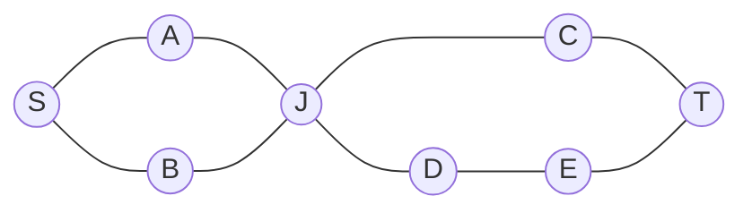
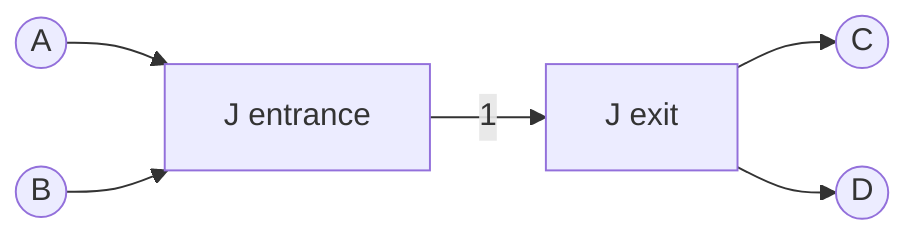

# How many cuts break a network: bridges, cut vertices, and Menger's theorem that separate routes equal the blocks needed

[Syllabus](../../../SYLLABUS.md) → [Combinatorics and graphs](../README.md) → [Matchings and Flows](../README.md#s13) → How many cuts break a network

---

## General Overview

A small railway runs between two termini, S in the west and T in the east: 8 stations, 9 lines. West of the junction J the track is a loop, S to J via A or via B. East of J it is a second loop, J to T via C, or via D and E.

How many trains can run from S to T at once, no two sharing a line? Two: S–A–J–C–T and S–B–J–D–E–T. How many lines must close before S and T are cut apart? Closing S–A and S–B does it, so two. The answers agree, and not by accident.

Stations tell a different story. Every route passes J, so closing J alone splits the network. A station whose loss splits a network is a **cut vertex**; a line whose loss splits it is a **bridge**. This railway has one cut vertex and no bridge. Close line C–T for a week and J–C, J–D, D–E and E–T become bridges, D and E cut vertices.

**The most routes from one station to another that share no line equals the fewest lines whose closure separates them; the same holds for stations, counting routes that share no station along the way.**

**What kind of fact this is:** a theorem, Menger's theorem, proved in Why it works from [Max-flow min-cut](06-max-flow-min-cut.md); bridge, cut vertex and the two connectivities are definitions.

### The picture: two loops meeting at one junction



Each line runs both ways. S and T are the termini; J is the junction every route must pass.

---

## The formula

Notation first, in words. A network is a graph $G$: stations are its vertex set $V$, lines its edge set $E$ ([Graphs](../09-Graphs%20-%20Dots%20and%20Lines/01-graphs-vertices-and-edges.md)). A **route** repeats no station. Routes are **line-disjoint** when they share no line, **station-disjoint** when they share no station but their ends. $c(G)$ counts the separate pieces of $G$ ([Connected or not](../09-Graphs%20-%20Dots%20and%20Lines/04-connectivity-and-breadth-first-search.md)); $G - e$ is $G$ with line $e$ removed.

The **line connectivity** $\lambda(S,T)$, read "lambda of S T", is the fewest lines whose closure leaves no route from $S$ to $T$. The **station connectivity** $\kappa(S,T)$, read "kappa", is the fewest stations, other than $S$ and $T$, whose closure does the same.

Menger's theorem, line form:

$$\text{most line-disjoint routes from } S \text{ to } T \;=\; \lambda(S,T)$$

**Read it aloud:** trains running at once on separate lines number as many as the lines that must close to stop them all.

Station form, for $S$ and $T$ not joined by a line:

$$\text{most station-disjoint routes from } S \text{ to } T \;=\; \kappa(S,T)$$

**Read it aloud:** routes sharing no station on the way number as many as the stations that must close.

A line $e$ is a **bridge** when $c(G - e) > c(G)$. That happens exactly when $e$ lies on no loop: a loop through $e$ is a detour round it. A station is a **cut vertex** when removing it, with its lines, adds a piece. For a whole network, the connectivities are the fewest lines, or stations, whose removal splits it: a bridge makes the first 1, a cut vertex the second.

| Symbol | Plain meaning | In our example | Push it up and the answer… |
| --- | --- | --- | --- |
| $G$, $V$, $E$ | network, stations, lines | 8 stations, 9 lines | more lines, more routes |
| $S$, $T$ | the stations kept apart | the termini | — |
| $e$, $G - e$ | one line; the network without it | C–T; C–T closed | — |
| $c(G)$ | number of separate pieces | 1 | — |
| $\lambda(S,T)$ | fewest lines parting $S$ from $T$ | 2 | more trains on separate lines |
| $\kappa(S,T)$ | fewest stations parting them | 1, station J | more station-disjoint routes |
| $k$ | a number of routes or closures | 2 | — |

### When it holds

- **Finite networks.** The proof peels routes one at a time; infinite networks need more care.
- **Station form needs the ends apart.** If a line joins $S$ to $T$, no set of stations separates them and $\kappa(S,T)$ is undefined.
- **Disjoint means disjoint.** Count all routes instead and get 4, though 2 closures stop them all.
- **One-way lines are fine.** The theorem then counts one-way routes and closures; the proof is unchanged.

---

## Why it works

### Step 0: routes are a flow, closures are a cut

Give every line a capacity of 1 in each direction: it carries at most one unit each way. Then send a flow, units that leave $S$, pass through stations without piling up, and arrive at $T$ ([Flows](05-flow-networks-and-ford-fulkerson.md)). A train is one unit of flow, one per line.

### Step 1: closures can never be fewer than routes

Suppose $k$ routes share no line. A closed line lies on at most one of them, so fewer than $k$ closures leave a route open. On the railway, two separate routes force two closures.

### Step 2: routes and whole-number flows are the same thing

One unit along each of $k$ line-disjoint routes is a legal flow of value $k$.

The other way round, use Ford-Fulkerson, the method of [Flows](05-flow-networks-and-ford-fulkerson.md): push units along any route with room left. With whole-number capacities it ends at a whole-number flow, so each line carries 0 or 1. From $S$, follow lines carrying a unit; every unit entering a station leaves it, so the walk reaches $T$. Remove that route's units and repeat. A flow of value $k$ peels into $k$ routes, no line used twice.

### Step 3: a cheapest cut is a smallest set of closures

A cut splits the stations into an $S$ side and a $T$ side; its price is the number of lines crossing. Closing them separates, so every price is at least $\lambda(S,T)$. Conversely, after any separating closures, put on the $S$ side every station $S$ still reaches. Every line leaving that side is closed, so that cut costs no more than the closures. The cheapest cut costs exactly $\lambda(S,T)$.

### Step 4: glue with max-flow min-cut

Most line-disjoint routes equal the largest flow (Step 2), which equals the cheapest cut ([Max-flow min-cut](06-max-flow-min-cut.md)), which equals $\lambda(S,T)$ (Step 3). That is the line form.

### Step 5: split each station to get the station form

Replace every station $x$ other than $S$ and $T$ by an entrance and an exit, joined by one one-way road of capacity 1. Lines arrive at the entrance and leave from the exit. Give each line capacity 8, the number of stations. Closing all six middle stations costs only 6, so no cheapest cut uses a line.



Every unit through $x$ uses its inside road, so routes share no station, and a cheapest cut is a set of inside roads: a set of stations. Steps 1 to 4 on this split network give the station form. J's inside road carries one unit, so the answer drops from 2 to 1.

<details>
<summary>Detailed proof: peeling a whole-number flow into routes</summary>

Take a flow of value $k$, each line carrying 0 or 1. If a line carries a unit both ways, zero both: each end's in-count and out-count drop together, and the value holds.

From $S$, follow a line carrying a unit out. At any station but $T$ a unit came in, so one goes out; lines are finite, so the walk reaches $T$.

If it revisits a station, cut out the loop and zero its units. What remains is a route; zero its units, and $S$ now sends $k - 1$ with every other station balanced.

Repeat $k$ times. The routes share no line, since each line held at most one unit.

</details>

A second road needs no flows: try every set of lines, smallest first, until one separates. The code does exactly that.

---

## Worked numbers, by hand

| Step | Arithmetic | Value |
| --- | --- | --- |
| routes from S to T | west: via A or via B; east: via C, or via D and E | 4 routes |
| routes sharing no line | S–A–J–C–T and S–B–J–D–E–T | 2 |
| lines that separate | close S–A and S–B | **2**, so $\lambda(S,T)$ = 2 |
| pairs of lines that separate | one line off each west route, or one off each east route | 10 |
| routes sharing no station | every route passes J | 1 |
| stations that separate | close J | **1**, so $\kappa(S,T)$ = 1 |
| bridges | every line lies on a loop | none |
| cut vertices | removing J leaves a west piece and an east piece | J |
| C–T closed: line connectivity | 2 routes left, both via D and E | **1** |
| C–T closed: bridges | the east loop is a path, C hangs off J | J–C, J–D, D–E, E–T |
| C–T closed: cut vertices | each splits the path | D, E, J |

Two trains can run at once on separate lines, and two closures stop them; one station, J, carries every train.

### What breaks if you drop a piece

| Mistake | Comes out at | What went wrong |
| --- | --- | --- |
| Counting every route | 4 | The routes share lines, and all pass J |
| Station form without splitting | 2, not 1 | Two units pass through J: the line answer |
| "No bridge, so no weak station" | no bridge, yet J cuts | Station connectivity sits below line connectivity |

The code prints all three.

---

## Code, from first principles, and it actually runs

Nothing is imported. Road one is brute force over every set of closed lines, of closed stations, and every family of routes. Road two is max flow with capacity 1, stations split for the station form. Bridges and cut vertices come from counting pieces, and from whether any flow survives. A second case closes C–T.

### Python

```python
# Menger's theorem on an 8-station rail network -- the check behind the card.  Nothing imported.
# Road one: brute force over closed lines, closed stations and route families.  Road two: max flow.
NET = [("S", "A"), ("S", "B"), ("A", "J"), ("B", "J"), ("J", "C"), ("C", "T"), ("J", "D"), ("D", "E"), ("E", "T")]
def pieces(stations, lines):             # give both ends of each open line one label
    label = {x: x for x in stations}
    for u, v in (l for l in lines if l[0] in label and l[1] in label):
        old, new = label[u], label[v]
        label = {x: new if y == old else y for x, y in label.items()}
    return label
def flow(arcs, s, t):                    # push one unit at a time along a searched route
    cap, total = dict(arcs), 0
    while True:
        prev, todo = {s: None}, [s]
        for u in todo:
            for (a, b), c in cap.items():
                if a == u and c > 0 and b not in prev: prev[b] = a; todo.append(b)
        if t not in prev: return total
        b, total = t, total + 1
        while prev[b] is not None:
            a = prev[b]; cap[(a, b)] -= 1; cap[(b, a)] = cap.get((b, a), 0) + 1; b = a
def roads(lines, big=1, split=(), off=""):  # each open line becomes two one-way roads
    i, o = (lambda x: x + "i" if x in split else x), (lambda x: x + "o" if x in split else x)
    arcs = {(x + "i", x + "o"): 1 for x in split}  # a split station passes one unit
    for u, v in (l for l in lines if off not in l):
        arcs[(o(u), i(v))] = arcs[(o(v), i(u))] = big
    return arcs
def routes(lines, here, seen):           # every S-T route that repeats no station
    if here == "T": return [["T"]]
    nxt = sorted({b for a, b in lines if a == here} | {a for a, b in lines if b == here})
    return [[here] + r for x in nxt if x not in seen for r in routes(lines, x, seen | {x})]
def most_apart(rs, key):                 # the largest family of routes sharing no key
    fams = [[key(r) for i, r in enumerate(rs) if m >> i & 1] for m in range(1 << len(rs))]
    return max(len(f) for f in fams if len([k for r in f for k in r]) == len({k for r in f for k in r}))
on_lines, on_stations = (lambda r: [tuple(sorted(p)) for p in zip(r, r[1:])]), (lambda r: r[1:-1])
for name, lines in (("full network", NET), ("line C-T closed", [l for l in NET if l != ("C", "T")])):
    st = sorted({x for l in lines for x in l}); mid = [x for x in st if x not in "ST"]
    count = lambda xs, ls: len(set(pieces(xs, ls).values()))
    apart = lambda xs, ls: (lambda r: r["S"] != r["T"])(pieces(xs, ls))
    shut = ([l for i, l in enumerate(lines) if m >> i & 1] for m in range(1 << len(lines)))
    cuts = [len(c) for c in shut if apart(st, [l for l in lines if l not in c])]
    vk = min(len(c) for c in ([x for i, x in enumerate(mid) if m >> i & 1] for m in range(1 << len(mid)))
             if apart([x for x in st if x not in c], lines))
    lam, kap = flow(roads(lines), "S", "T"), flow(roads(lines, len(st), mid), "S", "T")
    br1 = ["-".join(l) for l in lines if count(st, [m for m in lines if m != l]) > count(st, lines)]
    br2 = [u + "-" + v for u, v in lines if flow(roads([l for l in lines if l != (u, v)]), u, v) == 0]
    cv1 = [x for x in st if count([y for y in st if y != x], lines) > count(st, lines)]
    nb = lambda x: [b for a, b in lines if a == x] + [a for a, b in lines if b == x]
    cv2 = [x for x in st if any(flow(roads(lines, off=x), a, b) == 0 for a in nb(x) for b in nb(x) if a < b)]
    rs = routes(lines, "S", {"S"}); ld, sd = most_apart(rs, on_lines), most_apart(rs, on_stations)
    print(f"{name}: {len(st)} stations, {len(lines)} lines, {len(rs)} S-T routes in all")
    print(f"  fewest lines to separate S from T: {min(cuts)} (brute force), {lam} (flow); {cuts.count(min(cuts))} such sets")
    print(f"  most line-disjoint routes: {ld} (brute force), {lam} (flow)")
    print(f"  fewest stations to separate: {vk} (brute force), {kap} (split flow); station-disjoint routes {sd}")
    print(f"  bridges: {', '.join(br1) or 'none'} (pieces); {', '.join(br2) or 'none'} (flow)")
    print(f"  cut vertices: {', '.join(cv1) or 'none'} (pieces); {', '.join(cv2) or 'none'} (flow)")
    assert min(cuts) == lam == ld          # Menger, line form: brute cut, flow, brute routes
    assert vk == kap == sd                 # Menger, station form: brute cut, split flow, brute routes
    assert br1 == br2 and cv1 == cv2       # weak spots: counting pieces against flow
print("ALL CHECKS PASS")
```

**Ran 2026-09-24 on macOS, Python 3.14.6, standard library only. All checks passed. Output, pasted from the run:**

```
full network: 8 stations, 9 lines, 4 S-T routes in all
  fewest lines to separate S from T: 2 (brute force), 2 (flow); 10 such sets
  most line-disjoint routes: 2 (brute force), 2 (flow)
  fewest stations to separate: 1 (brute force), 1 (split flow); station-disjoint routes 1
  bridges: none (pieces); none (flow)
  cut vertices: J (pieces); J (flow)
line C-T closed: 8 stations, 8 lines, 2 S-T routes in all
  fewest lines to separate S from T: 1 (brute force), 1 (flow); 3 such sets
  most line-disjoint routes: 1 (brute force), 1 (flow)
  fewest stations to separate: 1 (brute force), 1 (split flow); station-disjoint routes 1
  bridges: J-C, J-D, D-E, E-T (pieces); J-C, J-D, D-E, E-T (flow)
  cut vertices: D, E, J (pieces); D, E, J (flow)
ALL CHECKS PASS
```

### Rust

Same numbers, same labels, built with `rustc --edition 2021 -O`. It finds pieces by depth-first search rather than merging labels.

```rust
// Menger's theorem on an 8-station rail network -- the same check as the Python, in Rust.  No crates.
// Road one: brute force as in the Python.  Road two: max flow, each station an in-node and an out-node.
type L = (&'static str, &'static str);
const NET: [L; 9] = [("S", "A"), ("S", "B"), ("A", "J"), ("B", "J"), ("J", "C"), ("C", "T"), ("J", "D"), ("D", "E"), ("E", "T")];
fn at(st: &[&str], x: &str) -> Option<usize> { st.iter().position(|&y| y == x) }
fn label(st: &[&str], lines: &[L]) -> Vec<usize> {   // depth-first search: a piece number per station
    let mut lab = vec![usize::MAX; st.len()];
    for s in 0..st.len() {
        if lab[s] != usize::MAX { continue }
        let mut stack = vec![s]; lab[s] = s;
        while let Some(u) = stack.pop() {
            for (i, j) in lines.iter().filter_map(|&(a, b)| Some((at(st, a)?, at(st, b)?))) {
                for (p, q) in [(i, j), (j, i)] { if p == u && lab[q] == usize::MAX { lab[q] = s; stack.push(q) } }
            }
        }
    }
    lab
}
fn count(st: &[&str], lines: &[L]) -> usize { let mut l = label(st, lines); l.sort(); l.dedup(); l.len() }
fn apart(st: &[&str], lines: &[L]) -> bool { let l = label(st, lines); l[at(st, "S").unwrap()] != l[at(st, "T").unwrap()] }
fn flow(st: &[&str], lines: &[L], big: i32, split: &[&str], off: &str, s: &str, t: &str) -> i32 {
    let (n, p) = (2 * st.len(), |x: &str| at(st, x).unwrap());
    let mut cap = vec![vec![0i32; n]; n];
    for k in 0..st.len() { cap[2 * k][2 * k + 1] = if split.contains(&st[k]) { 1 } else { 1000 } }
    for &(a, b) in lines.iter().filter(|l| l.0 != off && l.1 != off) { cap[2 * p(a) + 1][2 * p(b)] = big; cap[2 * p(b) + 1][2 * p(a)] = big }
    let (src, snk, mut total) = (2 * p(s) + 1, 2 * p(t), 0);
    loop {
        let (mut prev, mut todo, mut h) = (vec![usize::MAX; n], vec![src], 0); prev[src] = src;
        while h < todo.len() {
            let u = todo[h]; h += 1;
            for v in 0..n { if cap[u][v] > 0 && prev[v] == usize::MAX { prev[v] = u; todo.push(v) } }
        }
        if prev[snk] == usize::MAX { return total }
        let mut v = snk; while v != src { let u = prev[v]; cap[u][v] -= 1; cap[v][u] += 1; v = u }
        total += 1;
    }
}
fn routes(lines: &[L], path: Vec<&'static str>, out: &mut Vec<Vec<&'static str>>) {   // every S-T route, no repeats
    let here = *path.last().unwrap();
    if here == "T" { out.push(path); return }
    for &(a, b) in lines { for (u, v) in [(a, b), (b, a)] { if u == here && !path.contains(&v) { let mut q = path.clone(); q.push(v); routes(lines, q, out) } } }
}
fn most_apart(keys: &[Vec<String>]) -> usize {         // the largest family of routes sharing no key
    (0..1usize << keys.len()).filter(|m| {
        let f: Vec<&String> = (0..keys.len()).filter(|i| m >> i & 1 == 1).flat_map(|i| keys[i].iter()).collect();
        f.iter().enumerate().all(|(i, k)| !f[..i].contains(k))
    }).map(|m| m.count_ones() as usize).max().unwrap()
}
fn main() {
    let closed: Vec<L> = NET.iter().copied().filter(|&l| l != ("C", "T")).collect();
    for (name, lines) in [("full network", NET.to_vec()), ("line C-T closed", closed)] {
        let mut st: Vec<&str> = lines.iter().flat_map(|&(a, b)| [a, b]).collect(); st.sort(); st.dedup();
        let mid: Vec<&str> = st.iter().copied().filter(|&x| x != "S" && x != "T").collect();
        let cuts: Vec<u32> = (0..1u32 << lines.len()).filter(|m| apart(&st, &(0..lines.len()).filter(|i| m >> i & 1 == 0).map(|i| lines[i]).collect::<Vec<L>>())).map(|m| m.count_ones()).collect();
        let k = *cuts.iter().min().unwrap();
        let vk = (0..1u32 << mid.len()).filter(|m| apart(&st.iter().copied().filter(|x| !(0..mid.len()).any(|i| m >> i & 1 == 1 && mid[i] == *x)).collect::<Vec<&str>>(), &lines)).map(|m| m.count_ones()).min().unwrap();
        let (lam, kap) = (flow(&st, &lines, 1, &[], "", "S", "T"), flow(&st, &lines, st.len() as i32, &mid, "", "S", "T"));
        let whole = count(&st, &lines);
        let br1: Vec<String> = lines.iter().filter(|&&l| count(&st, &lines.iter().copied().filter(|&m| m != l).collect::<Vec<L>>()) > whole).map(|l| format!("{}-{}", l.0, l.1)).collect();
        let br2: Vec<String> = lines.iter().filter(|&&l| flow(&st, &lines.iter().copied().filter(|&m| m != l).collect::<Vec<L>>(), 1, &[], "", l.0, l.1) == 0).map(|l| format!("{}-{}", l.0, l.1)).collect();
        let cv1: Vec<String> = st.iter().map(|x| x.to_string()).filter(|x| count(&st.iter().copied().filter(|&y| y != x.as_str()).collect::<Vec<&str>>(), &lines) > whole).collect();
        let nb = |x: &str| -> Vec<&str> { lines.iter().filter_map(|&(a, b)| if a == x { Some(b) } else if b == x { Some(a) } else { None }).collect() };
        let cv2: Vec<String> = st.iter().map(|x| x.to_string()).filter(|x| nb(x).iter().any(|&a| nb(x).iter().any(|&b| a < b && flow(&st, &lines, 1, &[], x.as_str(), a, b) == 0))).collect();
        let mut rs = Vec::new(); routes(&lines, vec!["S"], &mut rs);
        let on_lines: Vec<Vec<String>> = rs.iter().map(|r| r.windows(2).map(|w| if w[0] < w[1] { format!("{}{}", w[0], w[1]) } else { format!("{}{}", w[1], w[0]) }).collect()).collect();
        let on_stations: Vec<Vec<String>> = rs.iter().map(|r| r[1..r.len() - 1].iter().map(|s| s.to_string()).collect()).collect();
        let (ld, sd) = (most_apart(&on_lines), most_apart(&on_stations));
        let show = |v: &[String]| if v.is_empty() { "none".to_string() } else { v.join(", ") };
        println!("{}: {} stations, {} lines, {} S-T routes in all", name, st.len(), lines.len(), rs.len());
        println!("  fewest lines to separate S from T: {} (brute force), {} (flow); {} such sets", k, lam, cuts.iter().filter(|&&c| c == k).count());
        println!("  most line-disjoint routes: {} (brute force), {} (flow)", ld, lam);
        println!("  fewest stations to separate: {} (brute force), {} (split flow); station-disjoint routes {}", vk, kap, sd);
        println!("  bridges: {} (pieces); {} (flow)", show(&br1), show(&br2));
        println!("  cut vertices: {} (pieces); {} (flow)", show(&cv1), show(&cv2));
        assert!(k as i32 == lam && lam as usize == ld);     // Menger, line form: brute cut, flow, brute routes
        assert!(vk as i32 == kap && kap as usize == sd);    // Menger, station form: brute cut, split flow, brute routes
        assert!(br1 == br2 && cv1 == cv2);                  // weak spots: counting pieces against flow
    }
    println!("ALL CHECKS PASS");
}
```

**Ran 2026-09-24 on macOS, rustc 1.98.1, no crates. All checks passed. Output, pasted from the run:**

```
full network: 8 stations, 9 lines, 4 S-T routes in all
  fewest lines to separate S from T: 2 (brute force), 2 (flow); 10 such sets
  most line-disjoint routes: 2 (brute force), 2 (flow)
  fewest stations to separate: 1 (brute force), 1 (split flow); station-disjoint routes 1
  bridges: none (pieces); none (flow)
  cut vertices: J (pieces); J (flow)
line C-T closed: 8 stations, 8 lines, 2 S-T routes in all
  fewest lines to separate S from T: 1 (brute force), 1 (flow); 3 such sets
  most line-disjoint routes: 1 (brute force), 1 (flow)
  fewest stations to separate: 1 (brute force), 1 (split flow); station-disjoint routes 1
  bridges: J-C, J-D, D-E, E-T (pieces); J-C, J-D, D-E, E-T (flow)
  cut vertices: D, E, J (pieces); D, E, J (flow)
ALL CHECKS PASS
```

The two outputs match line for line.

### Lean

Lean proves Menger's theorem in both forms, and the bridge rule, for every finite network with two-way lines.

- Line form: for any two different stations $S$ and $T$, the most line-disjoint routes equal $\lambda(S,T)$.
- Station form: for $S$ and $T$ not joined by a line, the most station-disjoint routes equal $\kappa(S,T)$.
- A line is a bridge exactly when it lies on no loop.
- The railway has 9 lines, is one piece, and has no bridge.
- Closing S–A and S–B parts S from T; closing S–A alone does not.
- Closing J parts S from T, so $\kappa(S,T)$ is at most 1.
- With C–T closed, J–C is a bridge.

The counts of 4 routes and 10 separating pairs, the full bridge and cut-vertex lists, and the flows are left to the Python and Rust checks.

<details>
<summary>The Lean proof, 743 lines</summary>

```lean
-- How many cuts break a network: in every finite network the most routes between two stations that share no line equals the fewest lines whose closure separates them, the same holds for stations when the two are not joined by a line, a line is a bridge exactly when it lies on no loop, and the card's eight-station railway numbers check out.
import Mathlib.Combinatorics.SimpleGraph.Connectivity.Finite
import Mathlib.Combinatorics.SimpleGraph.Connectivity.Connected
import Mathlib.Combinatorics.SimpleGraph.DeleteEdges
import Mathlib.Combinatorics.SimpleGraph.Paths
import Mathlib

namespace ConnectivityAndMengersTheorem

open SimpleGraph

/-! ### Helper lemmas for the proofs below -/

section Helpers

variable {V : Type*}

def R (H : SimpleGraph V) (S : Set V) : V → V → Prop :=
  Relation.ReflTransGen (fun u v => H.Adj u v ∧ u ∈ S ∧ v ∈ S)

def Link (H : SimpleGraph V) (A B S : Set V) : Prop :=
  ∃ a ∈ A, ∃ b ∈ B, a ∈ S ∧ b ∈ S ∧ R H S a b

theorem R_symm {H : SimpleGraph V} {S : Set V} {a b : V} (h : R H S a b) : R H S b a := by
  induction h with
  | refl => exact Relation.ReflTransGen.refl
  | tail _ hst ih => exact Relation.ReflTransGen.head ⟨hst.1.symm, hst.2.2, hst.2.1⟩ ih

theorem R_mono {H K : SimpleGraph V} {S T : Set V}
    (hHK : ∀ u v, u ∈ S → v ∈ S → H.Adj u v → K.Adj u v) (hST : S ⊆ T) {a b : V}
    (h : R H S a b) : R K T a b := by
  induction h with
  | refl => exact Relation.ReflTransGen.refl
  | tail _ hst ih => exact ih.tail ⟨hHK _ _ hst.2.1 hst.2.2 hst.1, hST hst.2.1, hST hst.2.2⟩

theorem R_mem {H : SimpleGraph V} {S : Set V} {a b : V} (h : R H S a b) (ha : a ∈ S) : b ∈ S := by
  induction h with
  | refl => exact ha
  | tail _ hs _ => exact hs.2.2

theorem Link_symm {H : SimpleGraph V} {A B S : Set V} (h : Link H A B S) : Link H B A S := by
  obtain ⟨a, ha, b, hb, haS, hbS, h⟩ := h
  exact ⟨b, hb, a, ha, hbS, haS, R_symm h⟩

theorem Link_mono_graph {H K : SimpleGraph V} (hHK : H ≤ K) {A B S : Set V} (h : Link H A B S) :
    Link K A B S := by
  obtain ⟨a, ha, b, hb, haS, hbS, h⟩ := h
  exact ⟨a, ha, b, hb, haS, hbS, R_mono (fun _ _ _ _ h => hHK h) subset_rfl h⟩

theorem first_hit {H : SimpleGraph V} {S X : Set V} {a b : V} (h : R H S a b) (haX : a ∉ X) :
    (b ∉ X ∧ R H (S ∩ Xᶜ) a b) ∨
      ∃ u z, u ∈ S ∧ u ∉ X ∧ z ∈ S ∧ z ∈ X ∧ H.Adj u z ∧ R H (S ∩ Xᶜ) a u := by
  induction h with
  | refl => exact Or.inl ⟨haX, Relation.ReflTransGen.refl⟩
  | @tail c d _ hcd ih =>
    rcases ih with ⟨hcX, hR⟩ | hex
    · by_cases hdX : d ∈ X
      · exact Or.inr ⟨c, d, hcd.2.1, hcX, hcd.2.2, hdX, hcd.1, hR⟩
      · exact Or.inl ⟨hdX, hR.tail ⟨hcd.1, ⟨hcd.2.1, hcX⟩, ⟨hcd.2.2, hdX⟩⟩⟩
    · exact Or.inr hex

theorem R_reached {H : SimpleGraph V} {T : Set V} {a v : V} (h : R H T a v) :
    R H {w | w ∈ T ∧ R H T a w} a v := by
  induction h with
  | refl => exact Relation.ReflTransGen.refl
  | @tail c d hac hcd ih => exact ih.tail ⟨hcd.1, ⟨hcd.2.1, hac⟩, ⟨hcd.2.2, hac.tail hcd⟩⟩

theorem trim {H : SimpleGraph V} {A X S : Set V} (hS : Link H A X S) :
    ∃ S' ⊆ S, ∃ x ∈ X, x ∈ S' ∧ (∀ v ∈ S', v ∈ X → v = x) ∧ (∃ a ∈ A, a ∈ S' ∧ R H S' a x) ∧
      (∀ v ∈ S', v ∉ X → ∃ a ∈ A, a ∉ X ∧ R H Xᶜ a v) := by
  obtain ⟨a, ha, b, hb, haS, hbS, hR⟩ := hS
  by_cases haX : a ∈ X
  · refine ⟨{a}, by simpa using haS, a, haX, rfl, fun v hv _ => hv,
      ⟨a, ha, rfl, Relation.ReflTransGen.refl⟩, ?_⟩
    intro v hv hvX
    rw [Set.mem_singleton_iff] at hv
    subst hv
    exact absurd haX hvX
  rcases first_hit hR haX with ⟨hbX, _⟩ | ⟨u, z, huS, huX, hzS, hzX, huz, hau⟩
  · exact absurd hb hbX
  let C : Set V := {w | w ∈ S ∩ Xᶜ ∧ R H (S ∩ Xᶜ) a w}
  have hCsub : C ⊆ S := fun w hw => hw.1.1
  refine ⟨insert z C, Set.insert_subset hzS hCsub, z, hzX, Set.mem_insert _ _, ?_,
    ⟨a, ha, Or.inr ⟨⟨haS, haX⟩, Relation.ReflTransGen.refl⟩, ?_⟩, ?_⟩
  · rintro v (rfl | hv) hvX
    · rfl
    · exact absurd hvX hv.1.2
  · have h1 : R H C a u := R_reached hau
    have h2 : R H (insert z C) a u := R_mono (fun _ _ _ _ h => h) (Set.subset_insert _ _) h1
    exact h2.tail ⟨huz, Or.inr ⟨⟨huS, huX⟩, hau⟩, Set.mem_insert _ _⟩
  · rintro v (rfl | hv) hvX
    · exact absurd hzX hvX
    · exact ⟨a, ha, haX, R_mono (fun _ _ _ _ h => h) Set.inter_subset_right hv.2⟩

theorem combine {H : SimpleGraph V} {A B : Set V} {X : Finset V} {k : ℕ} (hk : X.card = k)
    (hsep : ¬ Link H A B (↑X)ᶜ)
    (S : Fin k → Set V) (hS : ∀ i, Link H A ↑X (S i))
    (hSd : Pairwise fun i j => Disjoint (S i) (S j))
    (T : Fin k → Set V) (hT : ∀ i, Link H ↑X B (T i))
    (hTd : Pairwise fun i j => Disjoint (T i) (T j)) :
    ∃ U : Fin k → Set V, (∀ i, Link H A B (U i)) ∧ Pairwise fun i j => Disjoint (U i) (U j) := by
  choose S' hS'sub x hxX hxS' hxu hSa hSr using fun i => trim (hS i)
  choose T' hT'sub y hyX hyT' hyu hTb hTr using fun i => trim (Link_symm (hT i))
  have hxinj : Function.Injective x := by
    intro i j hij
    by_contra hne
    exact Set.disjoint_left.mp (hSd hne) (hS'sub i (hxS' i)) (hij ▸ hS'sub j (hxS' j))
  have hyinj : Function.Injective y := by
    intro i j hij
    by_contra hne
    exact Set.disjoint_left.mp (hTd hne) (hT'sub i (hyT' i)) (hij ▸ hT'sub j (hyT' j))
  classical
  have hysurj : ∀ z ∈ X, ∃ j, y j = z := by
    have hsub : Finset.univ.image y ⊆ X := by
      intro z hz
      simp only [Finset.mem_image, Finset.mem_univ, true_and] at hz
      obtain ⟨j, rfl⟩ := hz
      exact hyX j
    have heq : Finset.univ.image y = X := Finset.eq_of_subset_of_card_le hsub
      (by rw [Finset.card_image_of_injective _ hyinj, hk]; simp)
    intro z hz
    rw [← heq] at hz
    simpa using hz
  choose σ hσ using fun i => hysurj (x i) (hxX i)
  have cross : ∀ i j v, v ∈ S' i → v ∈ T' (σ j) → i = j := by
    intro i j v hvS hvT
    by_cases hvX : v ∈ (X : Set V)
    · have h1 := hxu i v hvS hvX
      have h2 := hyu (σ j) v hvT hvX
      apply hxinj
      rw [← h1, ← hσ j, h2]
    · exfalso
      obtain ⟨a, ha, haX, hav⟩ := hSr i v hvS hvX
      obtain ⟨b, hb, hbX, hbv⟩ := hTr (σ j) v hvT hvX
      exact hsep ⟨a, ha, b, hb, haX, hbX, Relation.ReflTransGen.trans hav (R_symm hbv)⟩
  refine ⟨fun i => S' i ∪ T' (σ i), ?_, ?_⟩
  · intro i
    obtain ⟨a, ha, haS, har⟩ := hSa i
    obtain ⟨b, hb, hbT, hbr⟩ := hTb (σ i)
    refine ⟨a, ha, b, hb, Or.inl haS, Or.inr hbT, ?_⟩
    have h1 : R H (S' i ∪ T' (σ i)) a (x i) :=
      R_mono (fun _ _ _ _ h => h) Set.subset_union_left har
    have h2 : R H (S' i ∪ T' (σ i)) b (y (σ i)) :=
      R_mono (fun _ _ _ _ h => h) Set.subset_union_right hbr
    rw [hσ i] at h2
    exact Relation.ReflTransGen.trans h1 (R_symm h2)
  · intro i j hij
    show Disjoint _ _
    rw [Set.disjoint_left]
    rintro v (hv | hv) (hw | hw)
    · exact Set.disjoint_left.mp (hSd hij) (hS'sub i hv) (hS'sub j hw)
    · exact hij (cross i j v hv hw)
    · exact hij (cross j i v hw hv).symm
    · have : σ i ≠ σ j := fun h => hij (hxinj (by rw [← hσ i, ← hσ j, h]))
      exact Set.disjoint_left.mp (hTd this) (hT'sub _ hv) (hT'sub _ hw)

theorem base_case [Fintype V] {G : SimpleGraph V} (hG : ∀ u v, ¬ G.Adj u v) (A B : Set V) (k : ℕ)
    (hk : ∀ X : Finset V, ¬ Link G A B (↑X)ᶜ → k ≤ X.card) :
    ∃ S : Fin k → Set V, (∀ i, Link G A B (S i)) ∧ Pairwise fun i j => Disjoint (S i) (S j) := by
  classical
  have hR : ∀ S a b, R G S a b → a = b := by
    intro S a b h
    induction h with
    | refl => rfl
    | tail _ h _ => exact absurd h.1 (hG _ _)
  let X : Finset V := Finset.univ.filter (fun v => v ∈ A ∧ v ∈ B)
  have hsep : ¬ Link G A B (↑X)ᶜ := by
    rintro ⟨a, ha, b, hb, haX, _, h⟩
    obtain rfl := hR _ _ _ h
    exact haX (by simp [X, ha, hb])
  have hkX := hk X hsep
  let g : Fin k → V := fun i => (X.equivFin.symm (Fin.castLE hkX i)).1
  have hg : Function.Injective g := by
    intro i j hij
    exact Fin.castLE_injective hkX (X.equivFin.symm.injective (Subtype.val_injective hij))
  have hgX : ∀ i, g i ∈ X := fun i => (X.equivFin.symm (Fin.castLE hkX i)).2
  refine ⟨fun i => {g i}, fun i => ?_, fun i j hij => ?_⟩
  · have := hgX i
    simp only [X, Finset.mem_filter] at this
    exact ⟨g i, this.2.1, g i, this.2.2, rfl, rfl, Relation.ReflTransGen.refl⟩
  · simpa using hg.ne hij

def cf [DecidableEq V] (x y : V) (w : V) : V := if w = x then y else w

def contr [DecidableEq V] (G : SimpleGraph V) (x y : V) : SimpleGraph V :=
  SimpleGraph.fromRel fun u v => ∃ u' v', G.Adj u' v' ∧ cf x y u' = u ∧ cf x y v' = v

theorem contr_adj [DecidableEq V] {G : SimpleGraph V} {x y u v : V} (h : (contr G x y).Adj u v) :
    ∃ u' v', G.Adj u' v' ∧ cf x y u' = u ∧ cf x y v' = v := by
  obtain ⟨_, ⟨u', v', h1, h2, h3⟩ | ⟨u', v', h1, h2, h3⟩⟩ := h
  · exact ⟨u', v', h1, h2, h3⟩
  · exact ⟨v', u', h1.symm, h3, h2⟩

theorem ncard_deleteEdge_lt [Finite V] (G : SimpleGraph V) {x y : V} (h : G.Adj x y) :
    (G.deleteEdges {s(x, y)}).edgeSet.ncard < G.edgeSet.ncard := by
  rw [edgeSet_deleteEdges]
  exact Set.ncard_sdiff_singleton_lt_of_mem h

theorem ncard_contr_lt [Finite V] [DecidableEq V] (G : SimpleGraph V) {x y : V} (h : G.Adj x y) :
    (contr G x y).edgeSet.ncard < G.edgeSet.ncard := by
  have hyx : y ≠ x := (G.ne_of_adj h).symm
  have hsub : (contr G x y).edgeSet ⊆ Sym2.map (cf x y) '' (G.edgeSet \ {s(x, y)}) := by
    intro e he
    induction e using Sym2.ind with
    | _ u v =>
    rw [mem_edgeSet] at he
    have huv : u ≠ v := (contr G x y).ne_of_adj he
    obtain ⟨u', v', h', rfl, rfl⟩ := contr_adj he
    refine ⟨s(u', v'), ⟨h', ?_⟩, by simp⟩
    intro heq
    rw [Set.mem_singleton_iff, Sym2.eq_iff] at heq
    apply huv
    rcases heq with ⟨rfl, rfl⟩ | ⟨rfl, rfl⟩ <;> simp [cf, hyx]
  calc (contr G x y).edgeSet.ncard
      ≤ (Sym2.map (cf x y) '' (G.edgeSet \ {s(x, y)})).ncard := Set.ncard_le_ncard hsub
    _ ≤ (G.edgeSet \ {s(x, y)}).ncard := Set.ncard_image_le
    _ < G.edgeSet.ncard := Set.ncard_sdiff_singleton_lt_of_mem h

theorem fiber_R [DecidableEq V] {G : SimpleGraph V} {x y : V} (h : G.Adj x y) (S' : Set V)
    {u w : V} (huw : cf x y u = cf x y w) (hu : cf x y u ∈ S') : R G (cf x y ⁻¹' S') u w := by
  have hyx : y ≠ x := (G.ne_of_adj h).symm
  have hx : x ∈ cf x y ⁻¹' S' ↔ y ∈ S' := by simp [cf]
  have hy : y ∈ cf x y ⁻¹' S' ↔ y ∈ S' := by simp [cf, hyx]
  by_cases hux : u = x <;> by_cases hwx : w = x
  · subst hux hwx; exact Relation.ReflTransGen.refl
  · simp only [cf, hux, hwx, ↓reduceIte] at huw hu
    subst hux huw
    exact Relation.ReflTransGen.single ⟨h, hx.2 hu, hy.2 hu⟩
  · simp only [cf, hux, hwx, ↓reduceIte] at huw hu
    subst hwx huw
    exact Relation.ReflTransGen.single ⟨h.symm, hy.2 hu, hx.2 hu⟩
  · simp only [cf, hux, hwx, ↓reduceIte] at huw
    subst huw
    exact Relation.ReflTransGen.refl

theorem lift_R [DecidableEq V] {G : SimpleGraph V} {x y : V} (h : G.Adj x y) (S' : Set V) {u z : V}
    (hR : R (contr G x y) S' (cf x y u) z) (hu : cf x y u ∈ S') :
    ∀ w, cf x y w = z → R G (cf x y ⁻¹' S') u w := by
  induction hR with
  | refl => intro w hw; exact fiber_R h S' hw.symm hu
  | @tail z1 z2 _ hst ih =>
    intro w hw
    obtain ⟨hadj, hz1, hz2⟩ := hst
    obtain ⟨u', v', h', rfl, rfl⟩ := contr_adj hadj
    have h1 := ih u' rfl
    have h2 : R G (cf x y ⁻¹' S') u v' := h1.tail ⟨h', hz1, hz2⟩
    exact Relation.ReflTransGen.trans h2 (fiber_R h S' hw.symm hz2)

theorem lift_link [DecidableEq V] {G : SimpleGraph V} {x y : V} (h : G.Adj x y) {A B S' : Set V}
    (hL : Link (contr G x y) (cf x y '' A) (cf x y '' B) S') : Link G A B (cf x y ⁻¹' S') := by
  obtain ⟨_, ⟨a, ha, rfl⟩, _, ⟨b, hb, rfl⟩, haS, hbS, hR⟩ := hL
  exact ⟨a, ha, b, hb, haS, hbS, lift_R h S' hR haS b rfl⟩

theorem push_link [DecidableEq V] {G : SimpleGraph V} {x y : V} {A B : Set V} (Y : Set V)
    (hL : Link G A B (cf x y ⁻¹' Yᶜ)) : Link (contr G x y) (cf x y '' A) (cf x y '' B) Yᶜ := by
  obtain ⟨a, ha, b, hb, haS, hbS, hR⟩ := hL
  refine ⟨_, ⟨a, ha, rfl⟩, _, ⟨b, hb, rfl⟩, haS, hbS, ?_⟩
  clear hb hbS
  induction hR with
  | refl => exact Relation.ReflTransGen.refl
  | @tail c d _ hcd ih =>
    obtain ⟨hadj, hc, hd⟩ := hcd
    by_cases he : cf x y c = cf x y d
    · rw [← he]; exact ih
    · exact ih.tail ⟨⟨he, Or.inl ⟨c, d, hadj, rfl, rfl⟩⟩, hc, hd⟩

theorem cut_link {G : SimpleGraph V} {A B X S : Set V} {x y : V} (hx : x ∈ X) (hy : y ∈ X)
    (hsep : ¬ Link G A B Xᶜ) (hL : Link G A B S) : Link (G.deleteEdges {s(x, y)}) A X S := by
  obtain ⟨a, ha, b, hb, haS, hbS, hR⟩ := hL
  by_cases haX : a ∈ X
  · exact ⟨a, ha, a, haX, haS, haS, Relation.ReflTransGen.refl⟩
  rcases first_hit hR haX with ⟨hbX, hR'⟩ | ⟨u, z, huS, huX, hzS, hzX, huz, hau⟩
  · exact absurd ⟨a, ha, b, hb, haX, hbX, R_mono (fun _ _ _ _ h => h) Set.inter_subset_right hR'⟩
      hsep
  · have hne : ∀ p q, p ∉ X → s(p, q) ∉ ({s(x, y)} : Set (Sym2 V)) := by
      intro p q hp heq
      rw [Set.mem_singleton_iff, Sym2.eq_iff] at heq
      rcases heq with ⟨rfl, _⟩ | ⟨rfl, _⟩ <;> contradiction
    have hau' : R (G.deleteEdges {s(x, y)}) S a u :=
      R_mono (S := S ∩ Xᶜ) (fun p q hp _ hpq => deleteEdges_adj.mpr ⟨hpq, hne p q hp.2⟩) Set.inter_subset_left hau
    exact ⟨a, ha, z, hzX, haS, hzS, hau'.tail ⟨deleteEdges_adj.mpr ⟨huz, hne u z huX⟩, huS, hzS⟩⟩

theorem core_aux [Fintype V] [DecidableEq V] (n : ℕ) : ∀ (G : SimpleGraph V),
    G.edgeSet.ncard = n → ∀ (A B : Set V) (k : ℕ),
    (∀ X : Finset V, ¬ Link G A B (↑X)ᶜ → k ≤ X.card) →
    ∃ S : Fin k → Set V, (∀ i, Link G A B (S i)) ∧ Pairwise fun i j => Disjoint (S i) (S j) := by
  induction n using Nat.strong_induction_on with
  | _ n ih =>
  intro G hn A B k hk
  by_cases hedge : ∃ x y, G.Adj x y
  swap
  · push Not at hedge
    exact base_case hedge A B k hk
  obtain ⟨x, y, hxy⟩ := hedge
  have hne : x ≠ y := G.ne_of_adj hxy
  by_contra hno
  have hno' : ¬ ∃ S : Fin k → Set V,
      (∀ i, Link (contr G x y) (cf x y '' A) (cf x y '' B) (S i)) ∧
        Pairwise fun i j => Disjoint (S i) (S j) := by
    rintro ⟨S, hS, hd⟩
    exact hno ⟨fun i => cf x y ⁻¹' S i, fun i => lift_link hxy (hS i),
      fun i j hij => (hd hij).preimage _⟩
  obtain ⟨Y, hY, hYk⟩ : ∃ Y : Finset V,
      ¬ Link (contr G x y) (cf x y '' A) (cf x y '' B) (↑Y)ᶜ ∧ Y.card < k := by
    by_contra hcon
    push Not at hcon
    exact hno' (ih _ (hn ▸ ncard_contr_lt G hxy) _ rfl _ _ k hcon)
  let X : Finset V := Finset.univ.filter (fun v => cf x y v ∈ Y)
  have hXc : ((↑X : Set V))ᶜ = cf x y ⁻¹' (↑Y : Set V)ᶜ := by ext v; simp [X]
  have hsepX : ¬ Link G A B (↑X)ᶜ := by
    rw [hXc]; intro hL; exact hY (push_link _ hL)
  have hkX := hk X hsepX
  have hcfx : cf x y x = y := by simp [cf]
  have hcfy : cf x y y = y := by simp [cf, hne.symm]
  have hcfv : ∀ v, v ≠ x → cf x y v = v := by intro v hv; simp [cf, hv]
  have hyY : y ∈ Y := by
    by_contra hyY
    have : X ⊆ Y := by
      intro v hv
      simp only [X, Finset.mem_filter, Finset.mem_univ, true_and] at hv
      by_cases hvx : v = x
      · subst hvx; rw [hcfx] at hv; exact absurd hv hyY
      · rwa [hcfv v hvx] at hv
    have := Finset.card_le_card this
    omega
  have hxX : x ∈ X := by simp [X, hcfx, hyY]
  have hyX : y ∈ X := by simp [X, hcfy, hyY]
  have hXle : X.card ≤ k := by
    have : X ⊆ insert x Y := by
      intro v hv
      simp only [X, Finset.mem_filter, Finset.mem_univ, true_and] at hv
      by_cases hvx : v = x
      · simp [hvx]
      · rw [hcfv v hvx] at hv; exact Finset.mem_insert_of_mem hv
    have := Finset.card_le_card this
    have := Finset.card_insert_le x Y
    omega
  have hXk : X.card = k := le_antisymm hXle hkX
  have hlt' : (G.deleteEdges {s(x, y)}).edgeSet.ncard < n := hn ▸ ncard_deleteEdge_lt G hxy
  have hG'le : G.deleteEdges {s(x, y)} ≤ G := deleteEdges_le _
  have hxX' : x ∈ (↑X : Set V) := hxX
  have hyX' : y ∈ (↑X : Set V) := hyX
  obtain ⟨S, hS, hSd⟩ := ih _ hlt' (G.deleteEdges {s(x, y)}) rfl A ↑X k (by
    intro Z hZ
    apply hk Z
    intro hL
    exact hZ (cut_link hxX' hyX' hsepX hL))
  obtain ⟨T, hT, hTd⟩ := ih _ hlt' (G.deleteEdges {s(x, y)}) rfl ↑X B k (by
    intro Z hZ
    apply hk Z
    intro hL
    exact hZ (Link_symm (cut_link hxX' hyX' (fun h => hsepX (Link_symm h)) (Link_symm hL))))
  have hsep' : ¬ Link (G.deleteEdges {s(x, y)}) A B (↑X)ᶜ :=
    fun h => hsepX (Link_mono_graph hG'le h)
  obtain ⟨U, hU, hUd⟩ := combine hXk hsep' S hS hSd T hT hTd
  exact hno ⟨U, fun i => Link_mono_graph hG'le (hU i), hUd⟩

theorem core [Fintype V] [DecidableEq V] (G : SimpleGraph V) (A B : Set V) :
    ∃ X : Finset V, ¬ Link G A B (↑X)ᶜ ∧ ∃ S : Fin X.card → Set V,
      (∀ i, Link G A B (S i)) ∧ Pairwise fun i j => Disjoint (S i) (S j) := by
  classical
  have hex : ∃ n, ∃ X : Finset V, ¬ Link G A B (↑X)ᶜ ∧ X.card = n :=
    ⟨_, Finset.univ, by rintro ⟨a, -, -, -, ha, -⟩; simp at ha, rfl⟩
  obtain ⟨X, hX, hcard⟩ := Nat.find_spec hex
  refine ⟨X, hX, ?_⟩
  rw [hcard]
  exact core_aux _ G rfl A B _ (fun Z hZ => Nat.find_min' hex ⟨Z, hZ, rfl⟩)

theorem R_to_walk {K : SimpleGraph V} {S : Set V} {a b : V} (h : R K S a b) (ha : a ∈ S) :
    ∃ p : K.Walk a b, ∀ v ∈ p.support, v ∈ S := by
  induction h using Relation.ReflTransGen.head_induction_on with
  | refl => exact ⟨Walk.nil, by simpa using ha⟩
  | head hst _ ih =>
    obtain ⟨p, hp⟩ := ih hst.2.2
    refine ⟨Walk.cons hst.1 p, ?_⟩
    intro v hv
    rw [Walk.support_cons, List.mem_cons] at hv
    rcases hv with rfl | hv
    · exact hst.2.1
    · exact hp v hv

theorem walk_to_link {G H : SimpleGraph V} {s t : V} {X : Set V}
    (hH : ∀ u v, u ≠ s → u ≠ t → v ≠ s → v ≠ t → G.Adj u v → H.Adj u v) :
    ∀ {c d : V} (q : G.Walk c d), d = t → c ≠ t → s ∉ q.support →
      (∀ v ∈ q.support, v ≠ t → v ∉ X) → ∃ b, G.Adj t b ∧ b ∉ X ∧ R H Xᶜ c b := by
  intro c d q
  induction q with
  | nil => intro hd hct; exact absurd hd hct
  | @cons c d' d h q ih =>
    intro hd hct hs hX
    have hcs : c ≠ s := fun h' => hs (by simp [h'])
    have hcX : c ∉ X := hX c (by simp) hct
    by_cases hdt : d' = t
    · subst hdt
      exact ⟨c, h.symm, hcX, Relation.ReflTransGen.refl⟩
    · have hs' : s ∉ q.support := fun h' => hs (by simp [h'])
      have hds : d' ≠ s := fun h' => hs' (h' ▸ q.start_mem_support)
      obtain ⟨b, hb, hbX, hR⟩ := ih hd hdt hs' (fun v hv hvt => hX v (by simp [hv]) hvt)
      have hdX : d' ∉ X := hX d' (by simp) hdt
      exact ⟨b, hb, hbX, Relation.ReflTransGen.head ⟨hH c d' hcs hct hds hdt h, hcX, hdX⟩ hR⟩

theorem path_to_link {G H : SimpleGraph V} {s t : V} {X : Set V}
    (hH : ∀ u v, u ≠ s → u ≠ t → v ≠ s → v ≠ t → G.Adj u v → H.Adj u v)
    (hst : s ≠ t) (hadj : ¬ G.Adj s t) (p : G.Walk s t) (hp : p.IsPath)
    (hX : ∀ v ∈ p.support, v ≠ s → v ≠ t → v ∉ X) :
    ∃ a b, G.Adj s a ∧ G.Adj t b ∧ a ∉ X ∧ b ∉ X ∧ R H Xᶜ a b := by
  cases p with
  | nil => exact absurd rfl hst
  | @cons _ a _ h q =>
    rw [Walk.cons_isPath_iff] at hp
    have hat : a ≠ t := fun h' => hadj (h' ▸ h)
    have has : a ≠ s := (G.ne_of_adj h).symm
    obtain ⟨b, hb, hbX, hR⟩ := walk_to_link hH q rfl hat hp.2
      (fun v hv hvt => hX v (by simp [hv]) (fun h' => hp.2 (h' ▸ hv)) hvt)
    exact ⟨a, b, h, hb, hX a (by simp) has hat, hbX, hR⟩

theorem line_walk {G D : SimpleGraph V} {L : SimpleGraph (Sym2 V)} {X : Set (Sym2 V)} {t : V}
    (hD : ∀ u v, D.Adj u v → s(u, v) ∈ G.edgeSet ∧ s(u, v) ∉ X)
    (hL : ∀ e f, e ≠ f → e ∈ G.edgeSet → f ∈ G.edgeSet → (∃ v, v ∈ e ∧ v ∈ f) → L.Adj e f) :
    ∀ {c d : V}, D.Walk c d → d = t → ∀ u, D.Adj u c →
      ∃ b, b ∈ G.edgeSet ∧ t ∈ b ∧ b ∉ X ∧ R L Xᶜ s(u, c) b := by
  intro c d q
  induction q with
  | nil =>
    intro hd u hu
    subst hd
    obtain ⟨h1, h2⟩ := hD _ _ hu
    exact ⟨_, h1, Sym2.mem_mk_right _ _, h2, Relation.ReflTransGen.refl⟩
  | @cons c d _ h q ih =>
    intro hd u hu
    obtain ⟨b, hb1, hb2, hbX, hR⟩ := ih hd c h
    obtain ⟨h1, h2⟩ := hD _ _ hu
    obtain ⟨h3, h4⟩ := hD _ _ h
    refine ⟨b, hb1, hb2, hbX, ?_⟩
    by_cases heq : s(u, c) = s(c, d)
    · rw [heq]; exact hR
    · exact Relation.ReflTransGen.head
        ⟨hL _ _ heq h1 h3 ⟨c, Sym2.mem_mk_right _ _, Sym2.mem_mk_left _ _⟩, h2, h4⟩ hR

end Helpers

#print axioms R_symm
#print axioms R_mono
#print axioms R_mem
#print axioms Link_symm
#print axioms Link_mono_graph
#print axioms first_hit
#print axioms R_reached
#print axioms trim
#print axioms combine
#print axioms base_case
#print axioms contr_adj
#print axioms ncard_deleteEdge_lt
#print axioms ncard_contr_lt
#print axioms fiber_R
#print axioms lift_R
#print axioms lift_link
#print axioms push_link
#print axioms cut_link
#print axioms core_aux
#print axioms core
#print axioms R_to_walk
#print axioms walk_to_link
#print axioms path_to_link
#print axioms line_walk

/-- The card's main result, Menger's theorem, line form. Take any finite network (a simple graph
`G` on a finite set of stations `V`) and two different stations `s` and `t`. Let `k` be the most
routes from `s` to `t` (paths: no station repeated) that pairwise share no line. Then `k` is also
the fewest lines whose closure leaves no route from `s` to `t`: there is a largest family of
line-disjoint routes and a smallest separating set of lines, and they have the same size. -/
theorem most_line_disjoint_routes_eq_fewest_separating_lines {V : Type*} [Fintype V]
    (G : SimpleGraph V) (s t : V) (hst : s ≠ t) :
    ∃ k : ℕ,
      IsGreatest {n : ℕ | ∃ P : Fin n → G.Path s t,
          Pairwise fun i j => List.Disjoint (P i : G.Walk s t).edges (P j : G.Walk s t).edges} k ∧
      IsLeast {n : ℕ | ∃ F : Finset (Sym2 V), (↑F : Set (Sym2 V)) ⊆ G.edgeSet ∧
          ¬ (G.deleteEdges ↑F).Reachable s t ∧ F.card = n} k := by
  classical
  let L : SimpleGraph (Sym2 V) :=
    SimpleGraph.fromRel fun e f => e ∈ G.edgeSet ∧ f ∈ G.edgeSet ∧ ∃ v, v ∈ e ∧ v ∈ f
  let A : Set (Sym2 V) := {e | e ∈ G.edgeSet ∧ s ∈ e}
  let B : Set (Sym2 V) := {e | e ∈ G.edgeSet ∧ t ∈ e}
  obtain ⟨X, hX, S, hS, hSd⟩ := core L A B
  -- weak duality
  have weak : ∀ n (P : Fin n → G.Path s t),
      (Pairwise fun i j => List.Disjoint (P i : G.Walk s t).edges (P j : G.Walk s t).edges) →
      ∀ F : Finset (Sym2 V), ¬ (G.deleteEdges ↑F).Reachable s t → n ≤ F.card := by
    intro n P hP F hF
    have hex : ∀ i, ∃ e ∈ (P i : G.Walk s t).edges, e ∈ F := by
      intro i
      by_contra hne
      push Not at hne
      exact hF ⟨(P i : G.Walk s t).toDeleteEdges ↑F (fun e he => by simpa using hne e he)⟩
    choose g hg1 hg2 using hex
    have hinj : Function.Injective g := by
      intro i j hij
      by_contra hne
      exact hP hne (hg1 i) (hij ▸ hg1 j)
    have := Finset.card_le_card_of_injOn g (s := Finset.univ) (t := F)
      (fun i _ => hg2 i) hinj.injOn
    simpa using this
  -- the separating set of lines
  let F : Finset (Sym2 V) := X.filter (· ∈ G.edgeSet)
  have hFsub : (↑F : Set (Sym2 V)) ⊆ G.edgeSet := by
    intro e he
    simp only [F, Finset.coe_filter, Set.mem_ofPred_eq] at he
    exact he.2
  have hadjF : ∀ u v, (G.deleteEdges ↑F).Adj u v → s(u, v) ∈ G.edgeSet ∧ s(u, v) ∉ X := by
    intro u v huv
    rw [deleteEdges_adj] at huv
    refine ⟨huv.1, fun hX' => huv.2 ?_⟩
    simp only [F, Finset.coe_filter, Set.mem_ofPred_eq]
    exact ⟨hX', huv.1⟩
  have hFsep : ¬ (G.deleteEdges ↑F).Reachable s t := by
    rintro ⟨p⟩
    cases p with
    | nil => exact hst rfl
    | @cons _ c _ h q =>
      obtain ⟨b, hb1, hb2, hbX, hR⟩ := line_walk (L := L) hadjF
        (fun e f hef he hf hv => ⟨hef, Or.inl ⟨he, hf, hv⟩⟩) q rfl s h
      obtain ⟨h1, h2⟩ := hadjF _ _ h
      exact hX ⟨_, ⟨h1, Sym2.mem_mk_left _ _⟩, b, ⟨hb1, hb2⟩, h2, hbX, hR⟩
  -- the routes
  have hroute : ∀ i, ∃ P : G.Path s t, ∀ e ∈ (P : G.Walk s t).edges, e ∈ S i := by
    intro i
    obtain ⟨a, ha, b, hb, haS, hbS, hR⟩ := hS i
    have hedge : ∀ e ∈ G.edgeSet, e ∈ S i → ∀ v w, v ∈ e → w ∈ e →
        (G.deleteEdges (S i)ᶜ).Reachable v w := by
      intro e he heS v w hv hw
      induction e using Sym2.ind with | h x y =>
      have hxy : (G.deleteEdges (S i)ᶜ).Adj x y :=
        deleteEdges_adj.mpr ⟨G.mem_edgeSet.mp he, fun h => h heS⟩
      rw [Sym2.mem_iff] at hv hw
      rcases hv with rfl | rfl <;> rcases hw with rfl | rfl
      · rfl
      · exact hxy.reachable
      · exact hxy.symm.reachable
      · rfl
    have hinv : ∀ e, R L (S i) a e → ∀ v ∈ e, (G.deleteEdges (S i)ᶜ).Reachable s v := by
      intro e he
      induction he with
      | refl => exact fun v hv => hedge a ha.1 haS s v ha.2 hv
      | @tail e1 e2 h12 hst' ih =>
        intro v hv
        obtain ⟨⟨_, hr⟩, h1, h2⟩ := hst'
        rcases hr with ⟨_, he2, w, hw1, hw2⟩ | ⟨he2, _, w, hw2, hw1⟩
        · exact (ih w hw1).trans (hedge e2 he2 h2 w v hw2 hv)
        · exact (ih w hw1).trans (hedge e2 he2 h2 w v hw2 hv)
    obtain ⟨p⟩ := hinv b hR t hb.2
    refine ⟨(p.mapLe (deleteEdges_le _)).toPath, fun e he => ?_⟩
    have he' := Walk.edges_toPath_subset_edges _ he
    rw [Walk.edges_mapLe_eq_edges] at he'
    have := p.edges_subset_edgeSet he'
    rw [edgeSet_deleteEdges] at this
    simpa using this.2
  choose P hP using hroute
  have hPd : Pairwise fun i j =>
      List.Disjoint (P i : G.Walk s t).edges (P j : G.Walk s t).edges := by
    intro i j hij e hi hj
    exact Set.disjoint_left.mp (hSd hij) (hP i e hi) (hP j e hj)
  have hFX : F.card = X.card := le_antisymm (Finset.card_filter_le _ _) (weak _ P hPd F hFsep)
  refine ⟨X.card, ⟨⟨P, hPd⟩, ?_⟩, ⟨F, hFsub, hFsep, hFX⟩, ?_⟩
  · rintro n ⟨Q, hQ⟩
    exact (weak n Q hQ F hFsep).trans hFX.le
  · rintro n ⟨F', -, hF', rfl⟩
    exact weak _ P hPd F' hF'

/-- Menger's theorem, station form. In a finite network, take two different stations `s` and `t`
not joined by a line. Let `k` be the most routes from `s` to `t` that pairwise share no station
except their two ends. Then `k` is also the fewest stations, other than `s` and `t`, whose closure
leaves no route from `s` to `t` (every route from `s` to `t` passes a closed station). -/
theorem most_station_disjoint_routes_eq_fewest_separating_stations {V : Type*} [Fintype V]
    (G : SimpleGraph V) (s t : V) (hst : s ≠ t) (hadj : ¬ G.Adj s t) :
    ∃ k : ℕ,
      IsGreatest {n : ℕ | ∃ P : Fin n → G.Path s t,
          Pairwise fun i j => ∀ v ∈ (P i : G.Walk s t).support,
            v ∈ (P j : G.Walk s t).support → v = s ∨ v = t} k ∧
      IsLeast {n : ℕ | ∃ W : Finset V, s ∉ W ∧ t ∉ W ∧
          (∀ p : G.Walk s t, ∃ v ∈ W, v ∈ p.support) ∧ W.card = n} k := by
  classical
  let H : SimpleGraph V := G.deleteEdges {e | s ∈ e ∨ t ∈ e}
  have hH : ∀ u v, u ≠ s → u ≠ t → v ≠ s → v ≠ t → G.Adj u v → H.Adj u v := by
    intro u v hus hut hvs hvt huv
    refine deleteEdges_adj.mpr ⟨huv, ?_⟩
    simp only [Set.mem_ofPred_eq, Sym2.mem_iff]
    rintro ((h | h) | (h | h)) <;> simp_all
  let A : Set V := {v | G.Adj s v}
  let B : Set V := {v | G.Adj t v}
  obtain ⟨X, hX, S, hS, hSd⟩ := core H A B
  -- weak duality
  have weak : ∀ n (P : Fin n → G.Path s t),
      (Pairwise fun i j => ∀ v ∈ (P i : G.Walk s t).support,
        v ∈ (P j : G.Walk s t).support → v = s ∨ v = t) →
      ∀ W : Finset V, s ∉ W → t ∉ W → (∀ p : G.Walk s t, ∃ v ∈ W, v ∈ p.support) →
        n ≤ W.card := by
    intro n P hP W hsW htW hW
    choose g hg1 hg2 using fun i => hW (P i : G.Walk s t)
    have hinj : Function.Injective g := by
      intro i j hij
      by_contra hne
      rcases hP hne (g i) (hg2 i) (hij ▸ hg2 j) with h | h
      · exact hsW (h ▸ hg1 i)
      · exact htW (h ▸ hg1 i)
    have := Finset.card_le_card_of_injOn g (s := Finset.univ) (t := W)
      (fun i _ => hg1 i) hinj.injOn
    simpa using this
  -- the separating set of stations
  let W : Finset V := (X.erase s).erase t
  have hsW : s ∉ W := by simp [W]
  have htW : t ∉ W := by simp [W]
  have hWsep : ∀ p : G.Walk s t, ∃ v ∈ W, v ∈ p.support := by
    intro p
    by_contra hne
    push Not at hne
    have hX' : ∀ v ∈ (p.toPath : G.Walk s t).support, v ≠ s → v ≠ t → v ∉ (X : Set V) := by
      intro v hv hvs hvt hvX
      have hvX' : v ∈ X := hvX
      exact hne v (by simp [W, hvs, hvt, hvX']) (Walk.support_toPath_subset_support _ hv)
    obtain ⟨a, b, ha, hb, haX, hbX, hR⟩ :=
      path_to_link hH hst hadj (p.toPath : G.Walk s t) p.toPath.2 hX'
    exact hX ⟨a, ha, b, hb, haX, hbX, hR⟩
  -- the routes
  have hroute : ∀ i, ∃ P : G.Path s t, ∀ v ∈ (P : G.Walk s t).support,
      v = s ∨ v = t ∨ v ∈ S i := by
    intro i
    obtain ⟨a, ha, b, hb, haS, hbS, hR⟩ := hS i
    obtain ⟨w, hw⟩ := R_to_walk hR haS
    let q : G.Walk s t := Walk.cons ha ((w.mapLe (deleteEdges_le _)).concat hb.symm)
    refine ⟨q.toPath, fun v hv => ?_⟩
    have hv' := Walk.support_toPath_subset_support _ hv
    simp only [q, Walk.support_cons, Walk.support_concat, Walk.support_mapLe_eq_support,
      List.mem_cons, List.mem_append, List.not_mem_nil, or_false] at hv'
    rcases hv' with h | h | h
    · exact Or.inl h
    · exact Or.inr (Or.inr (hw v h))
    · exact Or.inr (Or.inl h)
  choose P hP using hroute
  have hPd : Pairwise fun i j => ∀ v ∈ (P i : G.Walk s t).support,
      v ∈ (P j : G.Walk s t).support → v = s ∨ v = t := by
    intro i j hij v hi hj
    rcases hP i v hi with h | h | h
    · exact Or.inl h
    · exact Or.inr h
    rcases hP j v hj with h' | h' | h'
    · exact Or.inl h'
    · exact Or.inr h'
    exact absurd h' (Set.disjoint_left.mp (hSd hij) h)
  have hWX : W.card = X.card := by
    refine le_antisymm ?_ (weak _ P hPd W hsW htW hWsep)
    exact (Finset.card_erase_le).trans Finset.card_erase_le
  refine ⟨X.card, ⟨⟨P, hPd⟩, ?_⟩, ⟨W, hsW, htW, hWsep, hWX⟩, ?_⟩
  · rintro n ⟨Q, hQ⟩
    exact (weak n Q hQ W hsW htW hWsep).trans hWX.le
  · rintro n ⟨W', hs', ht', hW', rfl⟩
    exact weak _ P hPd W' hs' ht' hW'

/-- Bridges. In a finite network, removing a line `e` adds a separate piece (the number of
connected pieces of `G - e` is larger than that of `G`) exactly when `e` lies on no loop
(no cycle of `G` uses `e`). -/
theorem removing_line_adds_piece_iff_on_no_loop {V : Type*} [Finite V]
    (G : SimpleGraph V) (e : Sym2 V) (he : e ∈ G.edgeSet) :
    Nat.card G.ConnectedComponent < Nat.card (G.deleteEdges {e}).ConnectedComponent ↔
      ∀ (u : V) (c : G.Walk u u), c.IsCycle → e ∉ c.edges := by
  have hb : G.IsBridge e ↔ ∀ (u : V) (c : G.Walk u u), c.IsCycle → e ∉ c.edges :=
    (isBridge_iff_forall_cycle_notMem he).trans ⟨fun h u c => h c, fun h u c => h u c⟩
  rw [← hb]
  let φ : (G.deleteEdges {e}).ConnectedComponent → G.ConnectedComponent :=
    ConnectedComponent.map (Hom.ofLE (deleteEdges_le _))
  have hφ : ∀ v, φ ((G.deleteEdges {e}).connectedComponentMk v) = G.connectedComponentMk v :=
    fun v => rfl
  have hsurj : Function.Surjective φ := by
    intro c
    induction c using ConnectedComponent.ind with
    | h v => exact ⟨_, hφ v⟩
  constructor
  · intro hlt
    by_contra hnb
    have hinj : Function.Injective φ := by
      intro c1 c2 h12
      induction c1 using ConnectedComponent.ind with | h u =>
      induction c2 using ConnectedComponent.ind with | h v =>
      rw [hφ, hφ, ConnectedComponent.eq] at h12
      exact ConnectedComponent.eq.mpr (h12.reachable_deleteEdges_of_not_isBridge hnb)
    have := Nat.card_congr (Equiv.ofBijective φ ⟨hinj, hsurj⟩)
    omega
  · intro hbr
    have hle := Nat.card_le_card_of_surjective φ hsurj
    refine lt_of_le_of_ne hle (fun heq => ?_)
    have hbij := hsurj.bijective_of_nat_card_le heq.symm.le
    induction e using Sym2.ind with | h x y =>
    have hxy : (G.deleteEdges {s(x, y)}).connectedComponentMk x =
        (G.deleteEdges {s(x, y)}).connectedComponentMk y :=
      hbij.1 (by rw [hφ, hφ]; exact ConnectedComponent.eq.mpr (G.mem_edgeSet.mp he).reachable)
    exact isBridge_iff.mp hbr (ConnectedComponent.eq.mp hxy)

/-! ### The card's railway

Stations: S = 0, A = 1, B = 2, J = 3, C = 4, D = 5, E = 6, T = 7.
Lines: S–A, S–B, A–J, B–J, J–C, C–T, J–D, D–E, E–T. -/

/-- The nine lines of the railway, as unordered pairs of stations. -/
def railLines : Finset (Sym2 (Fin 8)) :=
  {s(0, 1), s(0, 2), s(1, 3), s(2, 3), s(3, 4), s(4, 7), s(3, 5), s(5, 6), s(6, 7)}

/-- The railway: two stations are joined exactly when their pair is one of the nine lines. -/
def rail : SimpleGraph (Fin 8) := SimpleGraph.fromRel fun x y => s(x, y) ∈ railLines

instance : DecidableRel rail.Adj := fun x y => by unfold rail; infer_instance

-- 8 stations and 9 lines.
example : Fintype.card (Fin 8) = 8 := by decide
example : rail.edgeFinset.card = 9 := by decide

-- Closing S–A and S–B separates S from T, so λ(S, T) ≤ 2.
example : ¬ (rail.deleteEdges {s(0, 1), s(0, 2)}).Reachable 0 7 := by decide

-- Closing one line is not enough: after closing S–A, S still reaches T.
example : (rail.deleteEdges {s(0, 1)}).Reachable 0 7 := by decide

-- The railway is one piece.
example : rail.Connected := by decide

-- No bridge: for every line x–y, x still reaches y with that line closed.
example : ∀ x y : Fin 8, rail.Adj x y → (rail.deleteEdges {s(x, y)}).Reachable x y := by decide

-- J is a cut vertex: with station J closed, S no longer reaches T, so κ(S, T) ≤ 1.
example : ¬ (rail.induce {v | v ≠ 3}).Reachable ⟨0, by decide⟩ ⟨7, by decide⟩ := by decide

-- With C–T closed, J–C becomes a bridge.
example : (rail.deleteEdges {s(4, 7)}).IsBridge s(3, 4) := by
  rw [isBridge_iff]; decide

-- The hand count of separating pairs: one line off each west route (2 · 2) or one off each
-- east route (2 · 3), 10 in all; and 2 · 2 = 4 routes from S to T.
example : 2 * 2 + 2 * 3 = 10 := by decide
example : 2 * 2 = 4 := by decide

#print axioms most_line_disjoint_routes_eq_fewest_separating_lines
#print axioms most_station_disjoint_routes_eq_fewest_separating_stations
#print axioms removing_line_adds_piece_iff_on_no_loop

end ConnectivityAndMengersTheorem
```

</details>

**Checked 2026-11-11 on macOS, Lean 4.36.0-rc2, Mathlib v4.36.0-rc2. Every proof is complete and uses only Lean's standard axioms. Output, pasted from the run:**

```
'ConnectivityAndMengersTheorem.R_symm' does not depend on any axioms
'ConnectivityAndMengersTheorem.R_mono' does not depend on any axioms
'ConnectivityAndMengersTheorem.R_mem' does not depend on any axioms
'ConnectivityAndMengersTheorem.Link_symm' does not depend on any axioms
'ConnectivityAndMengersTheorem.Link_mono_graph' depends on axioms: [propext, Classical.choice, Quot.sound]
'ConnectivityAndMengersTheorem.first_hit' depends on axioms: [propext, Classical.choice, Quot.sound]
'ConnectivityAndMengersTheorem.R_reached' does not depend on any axioms
'ConnectivityAndMengersTheorem.trim' depends on axioms: [propext, Classical.choice, Quot.sound]
'ConnectivityAndMengersTheorem.combine' depends on axioms: [propext, Classical.choice, Quot.sound]
'ConnectivityAndMengersTheorem.base_case' depends on axioms: [propext, Classical.choice, Quot.sound]
'ConnectivityAndMengersTheorem.contr_adj' depends on axioms: [propext, Quot.sound]
'ConnectivityAndMengersTheorem.ncard_deleteEdge_lt' depends on axioms: [propext, Classical.choice, Quot.sound]
'ConnectivityAndMengersTheorem.ncard_contr_lt' depends on axioms: [propext, Classical.choice, Quot.sound]
'ConnectivityAndMengersTheorem.fiber_R' depends on axioms: [propext]
'ConnectivityAndMengersTheorem.lift_R' depends on axioms: [propext, Quot.sound]
'ConnectivityAndMengersTheorem.lift_link' depends on axioms: [propext, Quot.sound]
'ConnectivityAndMengersTheorem.push_link' depends on axioms: [propext, Quot.sound]
'ConnectivityAndMengersTheorem.cut_link' depends on axioms: [propext, Classical.choice, Quot.sound]
'ConnectivityAndMengersTheorem.core_aux' depends on axioms: [propext, Classical.choice, Quot.sound]
'ConnectivityAndMengersTheorem.core' depends on axioms: [propext, Classical.choice, Quot.sound]
'ConnectivityAndMengersTheorem.R_to_walk' depends on axioms: [propext, Quot.sound]
'ConnectivityAndMengersTheorem.walk_to_link' depends on axioms: [propext, Classical.choice, Quot.sound]
'ConnectivityAndMengersTheorem.path_to_link' depends on axioms: [propext, Classical.choice, Quot.sound]
'ConnectivityAndMengersTheorem.line_walk' depends on axioms: [propext, Classical.choice, Quot.sound]
'ConnectivityAndMengersTheorem.most_line_disjoint_routes_eq_fewest_separating_lines' depends on axioms: [propext, Classical.choice, Quot.sound]
'ConnectivityAndMengersTheorem.most_station_disjoint_routes_eq_fewest_separating_stations' depends on axioms: [propext, Classical.choice, Quot.sound]
'ConnectivityAndMengersTheorem.removing_line_adds_piece_iff_on_no_loop' depends on axioms: [propext, Classical.choice, Quot.sound]
```

> [!TIP]
> **Try changing**
> Guess first, then run it. Editing `NET` moves both roads together, so the asserts still pass.
> - **A bypass round J.** Add `("A", "C")`. Station connectivity rises to 2, since S–A–C–T avoids J, and no cut vertex remains. Line connectivity stays 2: S has two lines.
> - **Lose a west line.** Remove `("S", "B")`. S–A, A–J and B–J become bridges; A and J cut vertices.
> - **Break the split.** In the station-form call, replace `roads(lines, len(st), mid)` with `roads(lines)`. The flow reads 2, the brute force 1, and the second assert stops the run.

---

## The usual mistake

> [!warning]
> **Counting routes instead of disjoint routes.** Four routes run from S to T, but each west line carries two of them, and closing two lines stops all four. Menger counts the largest family sharing nothing, 2 here.
>
> - **Mixing the two forms.** Here lines give 2 and stations give 1.
> - **Forgetting to split.** A plain flow answers the station question with the line answer, 2 instead of 1.
> - **Reading "no bridge" as "robust".** No bridge here, yet losing J splits the railway.
> - **Counting the minimum sets.** 10 pairs of lines separate, but the connectivity is 2: the size of the smallest set.

---

## Where you meet it in real life

- **Rail and road resilience.** A bridge is a line with no diversion, a cut vertex a junction with none: single points of failure.
- **Computer networks.** Two station-disjoint paths between machines mean no single failed switch isolates them; Menger turns that into a count.
- **Matching.** Menger's station form on a two-sided network is König's theorem ([Konig's theorem](03-konigs-theorem-and-vertex-cover.md)), and through it Hall's condition ([Hall's theorem](02-halls-marriage-theorem.md)).

> **Say it back**
> A bridge is a line whose loss splits a network; a cut vertex is a station whose loss does. Menger: the most routes sharing no line equal the fewest lines that separate two stations. With capacity 1 per line this is max-flow min-cut, the flow peeled into routes. Split each station into entrance and exit and the same argument handles stations. On the railway: two routes and two lines, but one route and one station, J.

---

## What this builds on

- [Max-flow min-cut](06-max-flow-min-cut.md): the largest flow equals the cheapest cut; Menger is its capacity-1 case.

## Where this goes next

- [Graph algorithms as code](../../14-Applied%20and%20computational/01-Algorithms%20and%20Growth/09-graph-algorithms-in-practice.md): finding every bridge and cut vertex of a large network in one sweep, Tarjan's method, instead of trying each line and station in turn.

Trying every line and station in turn finds the weak spots here, and that stops being affordable long before a national rail map.

---

## Sources

Verified 2026-11-11: every link below resolves to the publisher's page.

- Menger, Karl. "Zur allgemeinen Kurventheorie." *Fundamenta Mathematicae* 10 (1927): 96–115. [doi:10.4064/fm-10-1-96-115](https://doi.org/10.4064/fm-10-1-96-115). The original theorem.
- Whitney, Hassler. "Congruent Graphs and the Connectivity of Graphs." *American Journal of Mathematics* 54, no. 1 (1932): 150–168. [doi:10.2307/2371086](https://doi.org/10.2307/2371086). Station and line connectivity of a whole network, and how they compare.
- Diestel, Reinhard. *Graph Theory*, 6th ed. Graduate Texts in Mathematics 173. Springer, 2025. [doi:10.1007/978-3-662-70107-2](https://doi.org/10.1007/978-3-662-70107-2). Blocks, cut vertices, and three proofs of Menger.
- Bondy, J. A., and U. S. R. Murty. *Graph Theory*. Graduate Texts in Mathematics 244. Springer, 2008. [Publisher page](https://link.springer.com/book/9781846289699). Bridges, cut vertices, connectivity and network flows in one graduate text.
