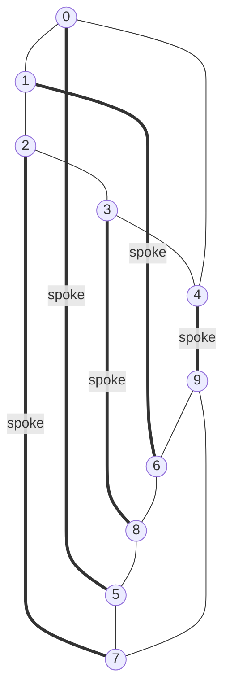

# Tutte's theorem: a graph has a perfect matching exactly when removing any set S leaves at most |S| pieces of odd size

[Syllabus](../../../SYLLABUS.md) → [Combinatorics and graphs](../README.md) → [Matchings and Flows](../README.md#s13) → Tutte's theorem

---

## General Overview

Four people share two twin rooms. A line joins two who agree to share. Kim agrees with Ali, Bo and Cy, who refuse each other. This is the star $`K(1,3)`$: one centre dot joined to three outer dots.

The rooms cannot be filled. Delete Kim and three lone dots remain. Each needs a partner outside its piece, and only Kim is outside.

A **perfect matching** pairs every dot exactly once ([Matchings](01-matchings-and-augmenting-paths.md)). An odd-sized piece cannot pair up inside itself, so it must borrow a deleted dot. W. T. Tutte proved in 1947 that this shortage is the only thing that blocks a perfect matching.

The test also guarantees pairings. The Petersen graph, ten dots with three lines each, pairs up by its five spokes.

**A graph pairs up perfectly exactly when no set of dots, once removed, leaves more odd-sized pieces than the set has dots.**

**What kind of fact this is:** a theorem, Tutte's, proved in Why it works; Petersen's theorem and the Tutte–Berge formula follow.

### The picture: the Petersen graph and its five spokes



Outer ring 0 to 4, inner star 5 to 9, thick spokes between. Fifteen lines, three at every dot.

---

## The formula

A **graph** $`G`$ is a set of dots $`V`$ with lines between some pairs; $`\lvert V\rvert`$ counts the dots. Delete any set $`S`$ of dots and their lines to get $`G - S`$. It falls into **pieces**: groups joined by routes, with no line between groups. $`o(G - S)`$ counts the pieces with an odd number of dots.

```math
G \text{ has a perfect matching} \iff o(G - S) \le \lvert S\rvert \text{ for every set } S \text{ of dots}
```

**Read it aloud:** the dots pair up exactly when, whatever dots you remove, the odd pieces left over are no more than the dots removed.

This is **Tutte's condition**. On the star, removing Kim gives 3 odd pieces against 1, so it fails.

The same count gives $`\nu(G)`$, read "nu of G": the size of the largest matching. This is the **Tutte–Berge formula**:

```math
\nu(G) = \min_{S} \frac{\lvert V\rvert + \lvert S\rvert - o(G - S)}{2}
```

**Read it aloud:** the largest matching is half of all the dots plus the removed dots minus the odd pieces, at the worst removed set.

On the star: (4 + 1 − 3) / 2 = 1. One room can be filled.

| Symbol | Plain meaning | In our example | Push it up and the answer… |
| --- | --- | --- | --- |
| $`G`$; $`K(1,3)`$ | the graph: dots, and lines joining pairs; the star | the star; the Petersen graph | more lines, easier to pair |
| $`V`$, $`\lvert V\rvert`$ | the dots, and how many there are | 4 people; 10 dots | an odd count can never pair |
| $`S`$, $`\lvert S\rvert`$ | a set of dots removed, and its size | Kim alone, so 1 | each removed dot excuses one odd piece |
| $`G - S`$ | what is left after deleting $`S`$ and its lines | Ali, Bo, Cy, each alone | — |
| $`o(G - S)`$ | how many pieces of $`G - S`$ have an odd number of dots | 3 | the test fails once it passes $`\lvert S\rvert`$ |
| $`M`$, $`M_1`$, $`M_2`$ | matchings: lines no two of which share a dot | the 5 spokes | — |
| $`\nu(G)`$ | the size of the largest matching | 1 for the star; 5 for Petersen | — |
| $`U`$; $`a`$–$`d`$, $`y`$; $`C`$; $`H`$; $`k`$ | in the proofs: dots joined to all others; named dots; a loop; an odd piece; the largest excess of odd pieces | $`k = 2`$ for the star | — |

### When it holds

- **Every set $`S`$, not a few.** The star passes with $`S`$ empty; only removing Kim exposes it.
- **Odd pieces, not all pieces.** The path a–b–c–d minus b leaves 2 pieces against 1 dot, yet a–b, c–d pair everything.
- **Finitely many dots.** The proof adds lines until no more fit; with infinitely many dots that may never end.
- **For Petersen's theorem, "3 lines at every dot" and "no bridge".** A **bridge** is a line whose removal splits the graph ([How many cuts break a network](07-connectivity-and-mengers-theorem.md)). A 16-dot graph with 3 lines at every dot and 3 bridges has no perfect matching.

---

## Why it works

### Step 0: an odd piece must borrow a removed dot

Pair dots inside a piece two at a time: an odd piece always has one left over. Its partner lies outside the piece, and every line leaving a piece of $`G - S`$ goes into $`S`$. Each dot of $`S`$ partners only one dot. So a perfect matching forces $`o(G - S) \le \lvert S\rvert`$, and with $`S`$ empty, an even number of dots.

The reverse is the hard half. Lovász's proof packs a graph that passes the test with lines, until a perfect matching is forced.

### Step 1: adding lines keeps the condition

Suppose $`G`$ passes the test but has no perfect matching. Add lines while none appears, until any further line would create one. Call the result **saturated**.

A new line never adds an odd piece: it joins two pieces or lands inside one, and odd plus odd is even, odd plus even is odd. So the saturated graph still passes.

### Step 2: if the leftover pieces are full, the graph pairs up

Let $`U`$ be the dots joined to every other dot. Suppose every piece of $`G - U`$ is **complete**: every two of its dots are joined.

1. Pair each even piece inside itself.
2. In each odd piece, pair all but one dot. Send the last dot to its own dot of $`U`$. There are enough, since $`o(G - U) \le \lvert U\rvert`$.
3. The dots of $`U`$ still free are joined to each other. An even number remain, since the whole count is even. Pair them.

That perfect matching cannot exist, so some piece of $`G - U`$ is not complete.

### Step 3: an incomplete piece also gives a perfect matching

An incomplete piece is connected, so it holds dots $`a`$, $`b`$, $`c`$ with $`a`$–$`b`$ and $`b`$–$`c`$ lines but no $`a`$–$`c`$ line. Since $`b`$ is not in $`U`$, some dot $`d`$ is not joined to $`b`$.

By saturation, adding $`a`$–$`c`$ creates a perfect matching $`M_1`$, and adding $`b`$–$`d`$ creates one, $`M_2`$. Swapping lines between them along one loop gives a perfect matching using neither added line. That contradicts saturation, so the starting graph had a perfect matching.

<details>
<summary>Detailed proof of the swap in Step 3</summary>

$`M_1`$ must use $`a`$–$`c`$, and $`M_2`$ must use $`b`$–$`d`$. The lines in exactly one of them form loops alternating between the two. Let $`C`$ be the loop through $`b`$–$`d`$.

If $`a`$–$`c`$ is off $`C`$: take $`M_1`$ on $`C`$ and $`M_2`$ elsewhere.

If $`a`$–$`c`$ is on $`C`$: walk round $`C`$ from $`d`$, away from $`b`$, to the first of $`a`$, $`c`$; call it $`y`$. The walk arrives by an $`M_2`$ line. The walk plus $`y`$–$`b`$ (a line, as $`b`$ is joined to $`a`$ and $`c`$) plus $`b`$–$`d`$ is an even loop. On it, swap $`M_2`$'s lines for the others. Neither added line survives.

</details>

### Step 4: Petersen's theorem, every bridgeless 3-regular graph pairs up

A **3-regular** graph has exactly 3 lines at every dot. Take any set $`S`$ and an odd piece $`H`$ of $`G - S`$. Its dots carry $`3 \times`$ (odd) line ends, an odd number. Lines inside $`H`$ use two ends each, so an odd number of lines leave $`H`$, all into $`S`$. One line would be a bridge, so at least 3 leave.

Count lines into $`S`$: at least 3 per odd piece, at most 3 per dot of $`S`$. So $`3\,o(G - S) \le 3\lvert S\rvert`$: Tutte's condition. Julius Petersen proved this in 1891.

### Step 5: Hall's theorem is the two-sided case

In a two-sided graph ([Bipartite graphs](../09-Graphs%20-%20Dots%20and%20Lines/05-bipartite-graphs-and-odd-cycles.md)), [Hall's theorem](02-halls-marriage-theorem.md) blames a crowded group: applicants who reach fewer posts than their number. Let $`S`$ be those posts. Each crowded applicant becomes a lone dot, an odd piece, so $`o(G - S)`$ beats $`\lvert S\rvert`$.

In Hall's hotel, removing front desk and accounts leaves Ana, Ben and Cleo alone plus one 7-dot piece: 4 odd pieces against 2. Tutte–Berge gives (12 + 2 − 4) / 2 = 5, Hall's answer.

Conversely, with equal sides, Hall's condition passes Tutte's test, so Tutte's theorem proves Hall's.

<details>
<summary>Proof that Hall's condition passes Tutte's test</summary>

Remove any set $`S`$ and compare applicants with posts in each piece left.

- Pieces with extra applicants: by Hall, those applicants reach enough posts, and the extra posts lie in $`S`$. So the surpluses total at most the posts in $`S`$.
- The sides are equal, so surpluses minus shortfalls equal posts in $`S`$ minus applicants in $`S`$. So the shortfalls total at most the applicants in $`S`$.
- An odd piece has a surplus or a shortfall, so the odd pieces number at most the dots of $`S`$.

</details>

<details>
<summary>Proof of the Tutte–Berge formula</summary>

At most: each odd piece of $`G - S`$ leaves a dot unmatched unless it borrows from $`S`$, so at least $`o(G - S) - \lvert S\rvert`$ dots stay unmatched.

At least: let $`k`$ be the largest value of $`o(G - S) - \lvert S\rvert`$. Only odd pieces change the parity of the dots left, so $`k`$ and the dot count are both even or both odd.

Add $`k`$ new dots joined to everything, for an even total. A set missing a new dot leaves one piece, which is even if the set is empty; a set holding all of them gains $`k`$ dots.

So the bigger graph passes Tutte's test and pairs up. Deleting the new dots loses at most $`k`$ pairs, leaving $`(\lvert V\rvert - k)/2`$.

</details>

---

## Worked numbers, by hand

| Step | Arithmetic | Value |
| --- | --- | --- |
| star: remove Kim | 3 lone dots, each odd | 3 odd pieces |
| star: Tutte's test | 3 odd pieces against 1 removed dot | **fails** |
| star: largest matching | (4 + 1 − 3) / 2 | **1** |
| Petersen: remove dot 0's neighbours 1, 4, 5 | dot 0 alone, plus a 6-dot piece | 1 odd piece, against 3 |
| Petersen: lines from one odd piece into $`S`$ | odd, and not 1 since no bridge | at least **3** |
| Petersen: largest matching | (10 + 0 − 0) / 2, with $`S`$ empty | **5**, the spokes |
| Petersen: all perfect matchings, counted | each leaves two 5-dot rings | **6** |
| 16-dot graph with bridges: remove the centre | three 5-dot pieces | (16 + 1 − 3) / 2 = **7**, not 8 |

The star fills one room of two; the Petersen graph pairs all ten dots, six ways.

### What breaks if you drop a piece

| Mistake | Comes out at | What went wrong |
| --- | --- | --- |
| Testing only $`S`$ empty | star: 0 odd pieces, passes, yet largest matching 1 of 2 | The blocking set is Kim, not the empty set |
| Counting every piece, not odd ones | path a–b–c–d minus b: 2 pieces against 1, yet it pairs perfectly | An even piece pairs up inside itself |
| Using Hall's test where lines run inside a group | two triangles: all 63 groups pass, yet largest matching 2 for 6 dots | Hall's count assumes two sides |
| Dropping "no bridge" from Petersen's theorem | 16-dot 3-regular graph: largest matching 7, not 8 | Each odd piece sends 1 line, not 3 |

---

## Code, from first principles, and it actually runs

Five graphs are settled by two independent roads: Tutte–Berge over every set $`S`$, and a largest-matching search that never mentions $`S`$. Two more roads check the Petersen graph: Petersen's line count, and a list of its perfect matchings.

### Python

```python
# Tutte's theorem -- the check behind the card.  Nothing is imported; a graph is one bitmask of neighbours per dot.
# Roads: Tutte's count over every set S, a matching search that never mentions S, Petersen's count of lines
# leaving odd pieces, and a census of the Petersen graph's perfect matchings.
def build(n, lines):
    adj = [0] * n
    for a, b in lines: adj[a] |= 1 << b; adj[b] |= 1 << a
    return adj
def pieces(adj, gone):                  # the pieces of G - S, each as a bitmask
    seen, out = gone, []
    for v in range(len(adj)):
        if not seen >> v & 1:
            stack, piece, seen = [v], 1 << v, seen | 1 << v
            while stack:
                new = adj[stack.pop()] & ~seen
                seen, piece = seen | new, piece | new
                stack += [w for w in range(len(adj)) if new >> w & 1]
            out.append(piece)
    return out
def odd(adj, s): return sum(p.bit_count() % 2 for p in pieces(adj, s))
def tutte_berge(adj): return min((len(adj) + s.bit_count() - odd(adj, s)) // 2 for s in range(1 << len(adj)))
def worst(adj): return max(odd(adj, s) - s.bit_count() for s in range(1 << len(adj)))
def nu(adj, free, memo):                # road two: largest matching by search
    if free == 0: return 0
    if free not in memo:
        v = (free & -free).bit_length() - 1; rest = free & ~(1 << v)
        memo[free] = max([nu(adj, rest, memo)] + [1 + nu(adj, rest & ~(1 << w), memo)
                         for w in range(len(adj)) if (rest & adj[v]) >> w & 1])
    return memo[free]
def perfect(adj, free):                 # every perfect matching, listed
    if free == 0: return [[]]
    v = (free & -free).bit_length() - 1; rest = free & ~(1 << v)
    return [[(v, w)] + m for w in range(len(adj)) if (rest & adj[v]) >> w & 1 for m in perfect(adj, rest & ~(1 << w))]
def bridges(adj, lines): return sum(len(pieces(build(len(adj), [e for e in lines if e != f]), 0)) > len(pieces(adj, 0)) for f in lines)
def mask(dots): return sum(1 << d for d in set(dots))
def sends(adj, s): return [sum((adj[u] & s).bit_count() for u in range(len(adj)) if p >> u & 1) for p in pieces(adj, s) if p.bit_count() % 2]
SPOKES = [(i, i + 5) for i in range(5)]
PET = [tuple(sorted((i, (i + 1) % 5))) for i in range(5)] + SPOKES + [tuple(sorted((5 + i, 5 + (i + 2) % 5))) for i in range(5)]
CUBIC = [e for b in (1, 6, 11) for e in [(0, b), (b, b + 1), (b, b + 2), (b + 1, b + 3), (b + 1, b + 4), (b + 2, b + 3), (b + 2, b + 4), (b + 3, b + 4)]]
HOTEL = [(i, 6 + j) for i, js in enumerate([[0, 5], [0, 5], [5], [1, 2, 3], [2, 4], [3, 4, 1]]) for j in js]
STAR, PATH, TRI = [(0, 1), (0, 2), (0, 3)], [(0, 1), (1, 2), (2, 3)], [(0, 1), (1, 2), (0, 2), (3, 4), (4, 5), (3, 5)]   # TRI: two triangles
for name, n, lines, s in [("star K(1,3)", 4, STAR, [0]), ("Petersen", 10, PET, [1, 4, 5]), ("16-dot cubic", 16, CUBIC, [0]),
                          ("hotel", 12, HOTEL, [6, 11]), ("path a-b-c-d", 4, PATH, [1])]:
    adj = build(n, lines); tb, m, w = tutte_berge(adj), nu(adj, (1 << n) - 1, {}), worst(adj)
    print(f"{name}: {n} dots, {len(lines)} lines; S = {s} leaves pieces of {sorted(p.bit_count() for p in pieces(adj, mask(s)))} dots, {odd(adj, mask(s))} odd; "
          f"worst odd - |S| = {w}; Tutte-Berge {tb}; search {m}; perfect {'yes' if 2 * m == n else 'no'}")
    assert tb == m and (w <= 0) == (2 * m == n)      # Tutte-Berge equals the search; Tutte's test decides
pet, cub, tri = build(10, PET), build(16, CUBIC), build(6, TRI); pms = perfect(pet, (1 << 10) - 1)
rings = [sorted(p.bit_count() for p in pieces(build(10, [e for e in PET if e not in pm]), 0)) for pm in pms]
out = [sends(pet, s) for s in range(1 << 10)]
hall = sum(mask([w for v in range(6) if g >> v & 1 for w in range(6) if tri[v] >> w & 1]).bit_count() >= g.bit_count() for g in range(1, 64))
print(f"Petersen: bridges {bridges(pet, PET)}; perfect matchings {len(pms)}; the 5 spokes among them: {'yes' if SPOKES in pms else 'no'}")
print(f"Petersen: lines left after each perfect matching form cycles of lengths {rings[0]}, the same for {rings.count([5, 5])} of {len(rings)}")
print(f"Petersen, all 1024 sets S: fewest lines from one odd piece to S = {min(min(x) for x in out if x)}; most odd pieces - |S| = {worst(pet)}")
print(f"16-dot cubic: bridges {bridges(cub, CUBIC)}; lines from each odd piece to S = centre: {sends(cub, 1)}")
print(f"mistake 1, star tested with S = [] only: {odd(build(4, STAR), 0)} odd pieces <= 0 passes, yet largest matching {nu(build(4, STAR), 15, {})} of 2")
print(f"mistake 2, two triangles under Hall's test: {hall} of 63 groups pass, yet largest matching {nu(tri, 63, {})} for 6 dots")
assert len(pms) == 6 and rings.count([5, 5]) == 6 and bridges(pet, PET) == 0 and bridges(cub, CUBIC) == 3
assert all(len(x) <= s.bit_count() and all(k >= 3 for k in x) for s, x in enumerate(out))   # Petersen's count
assert nu(build(12, HOTEL), (1 << 12) - 1, {}) == 5 and nu(cub, (1 << 16) - 1, {}) == 7 and hall == 63 and nu(tri, 63, {}) == 2
print("ALL CHECKS PASS")
```

**Ran 2026-11-23 on macOS, Python 3.14.10, standard library only. All checks passed. Output, pasted from the run:**

```
star K(1,3): 4 dots, 3 lines; S = [0] leaves pieces of [1, 1, 1] dots, 3 odd; worst odd - |S| = 2; Tutte-Berge 1; search 1; perfect no
Petersen: 10 dots, 15 lines; S = [1, 4, 5] leaves pieces of [1, 6] dots, 1 odd; worst odd - |S| = 0; Tutte-Berge 5; search 5; perfect yes
16-dot cubic: 16 dots, 24 lines; S = [0] leaves pieces of [5, 5, 5] dots, 3 odd; worst odd - |S| = 2; Tutte-Berge 7; search 7; perfect no
hotel: 12 dots, 13 lines; S = [6, 11] leaves pieces of [1, 1, 1, 7] dots, 4 odd; worst odd - |S| = 2; Tutte-Berge 5; search 5; perfect no
path a-b-c-d: 4 dots, 3 lines; S = [1] leaves pieces of [1, 2] dots, 1 odd; worst odd - |S| = 0; Tutte-Berge 2; search 2; perfect yes
Petersen: bridges 0; perfect matchings 6; the 5 spokes among them: yes
Petersen: lines left after each perfect matching form cycles of lengths [5, 5], the same for 6 of 6
Petersen, all 1024 sets S: fewest lines from one odd piece to S = 3; most odd pieces - |S| = 0
16-dot cubic: bridges 3; lines from each odd piece to S = centre: [1, 1, 1]
mistake 1, star tested with S = [] only: 0 odd pieces <= 0 passes, yet largest matching 1 of 2
mistake 2, two triangles under Hall's test: 63 of 63 groups pass, yet largest matching 2 for 6 dots
ALL CHECKS PASS
```

### Rust

Same numbers, same labels, built with `rustc --edition 2021 -O`.

```rust
// Tutte's theorem -- the same check as tutte_one_factor_theorem_check.py, in Rust.  No crates; a graph is one
// bitmask of neighbours per dot.  Roads: Tutte's count over every set S, a matching search that never mentions S,
// Petersen's count of lines leaving odd pieces, and a census of the Petersen graph's perfect matchings.
use std::collections::HashMap; type E = (usize, usize);
fn build(n: usize, lines: &[E]) -> Vec<u32> { let mut adj = vec![0u32; n]; for &(a, b) in lines { adj[a] |= 1 << b; adj[b] |= 1 << a; } adj }
fn pieces(adj: &[u32], gone: u32) -> Vec<u32> {             // the pieces of G - S, each as a bitmask
    let (mut seen, mut out) = (gone, Vec::new());
    for v in 0..adj.len() {
        if seen >> v & 1 == 1 { continue }
        let (mut stack, mut piece) = (vec![v], 1u32 << v); seen |= 1 << v;
        while let Some(u) = stack.pop() {
            let new = adj[u] & !seen;
            seen |= new; piece |= new;
            stack.extend((0..adj.len()).filter(|w| new >> w & 1 == 1));
        }
        out.push(piece);
    }
    out
}
fn odd(adj: &[u32], s: u32) -> i32 { pieces(adj, s).iter().map(|p| (p.count_ones() % 2) as i32).sum() }
fn subsets(adj: &[u32]) -> std::ops::Range<u32> { 0..(1u32 << adj.len()) }
fn tutte_berge(adj: &[u32]) -> i32 { subsets(adj).map(|s| (adj.len() as i32 + s.count_ones() as i32 - odd(adj, s)) / 2).min().unwrap() }
fn worst(adj: &[u32]) -> i32 { subsets(adj).map(|s| odd(adj, s) - s.count_ones() as i32).max().unwrap() }
fn nu(adj: &[u32], free: u32, memo: &mut HashMap<u32, i32>) -> i32 {   // road two: largest matching by search
    if free == 0 { return 0 }
    if let Some(&m) = memo.get(&free) { return m }
    let v = free.trailing_zeros() as usize; let rest = free & !(1 << v);
    let mut best = nu(adj, rest, memo);
    for w in 0..adj.len() { if (rest & adj[v]) >> w & 1 == 1 { best = best.max(1 + nu(adj, rest & !(1 << w), memo)) } }
    memo.insert(free, best); best
}
fn largest(adj: &[u32]) -> i32 { nu(adj, (1u32 << adj.len()) - 1, &mut HashMap::new()) }
fn perfect(adj: &[u32], free: u32) -> Vec<Vec<E>> {          // every perfect matching, listed
    if free == 0 { return vec![vec![]] }
    let (v, mut out) = (free.trailing_zeros() as usize, Vec::new()); let rest = free & !(1 << v);
    for w in 0..adj.len() { if (rest & adj[v]) >> w & 1 == 1 {
        for m in perfect(adj, rest & !(1 << w)) { let mut x = vec![(v, w)]; x.extend(m); out.push(x) } } }
    out
}
fn bridges(adj: &[u32], lines: &[E]) -> usize { let base = pieces(adj, 0).len();
    lines.iter().filter(|f| { let rest: Vec<E> = lines.iter().copied().filter(|e| e != *f).collect(); pieces(&build(adj.len(), &rest), 0).len() > base }).count() }
fn mask(dots: &[usize]) -> u32 { dots.iter().fold(0, |m, d| m | 1 << d) }
fn sends(adj: &[u32], s: u32) -> Vec<u32> { pieces(adj, s).iter().filter(|p| p.count_ones() % 2 == 1)
    .map(|p| (0..adj.len()).filter(|u| p >> u & 1 == 1).map(|u| (adj[u] & s).count_ones()).sum()).collect() }
fn main() {
    let spokes: Vec<E> = (0..5).map(|i| (i, i + 5)).collect();
    let mut pet: Vec<E> = (0..5).map(|i: usize| (i.min((i + 1) % 5), i.max((i + 1) % 5))).collect();
    pet.extend(spokes.iter().copied()); pet.extend((0..5).map(|i: usize| (5 + i.min((i + 2) % 5), 5 + i.max((i + 2) % 5))));
    let cubic: Vec<E> = [1, 6, 11].iter().flat_map(|&b| vec![(0, b), (b, b + 1), (b, b + 2), (b + 1, b + 3), (b + 1, b + 4), (b + 2, b + 3), (b + 2, b + 4), (b + 3, b + 4)]).collect();
    let jobs: [&[usize]; 6] = [&[0, 5], &[0, 5], &[5], &[1, 2, 3], &[2, 4], &[3, 4, 1]];
    let hotel: Vec<E> = jobs.iter().enumerate().flat_map(|(i, js)| js.iter().map(move |j| (i, 6 + j))).collect();
    let (star, path, tri_l): (Vec<E>, Vec<E>, Vec<E>) = (vec![(0, 1), (0, 2), (0, 3)], vec![(0, 1), (1, 2), (2, 3)], vec![(0, 1), (1, 2), (0, 2), (3, 4), (4, 5), (3, 5)]);   // tri_l: two triangles
    for (name, n, lines, s) in [("star K(1,3)", 4, &star, vec![0]), ("Petersen", 10, &pet, vec![1, 4, 5]), ("16-dot cubic", 16, &cubic, vec![0]),
                                ("hotel", 12, &hotel, vec![6, 11]), ("path a-b-c-d", 4, &path, vec![1])] {
        let adj = build(n, lines); let (tb, m, w) = (tutte_berge(&adj), largest(&adj), worst(&adj));
        println!("{}: {} dots, {} lines; S = {:?} leaves pieces of {:?} dots, {} odd; worst odd - |S| = {}; Tutte-Berge {}; search {}; perfect {}",
                 name, n, lines.len(), s, { let mut z: Vec<u32> = pieces(&adj, mask(&s)).iter().map(|q| q.count_ones()).collect(); z.sort(); z }, odd(&adj, mask(&s)), w, tb, m, if 2 * m == n as i32 { "yes" } else { "no" });
        assert!(tb == m && (w <= 0) == (2 * m == n as i32));    // Tutte-Berge equals the search; Tutte's test decides
    }
    let (p, c, t) = (build(10, &pet), build(16, &cubic), build(6, &tri_l)); let pms = perfect(&p, (1 << 10) - 1);
    let rings: Vec<Vec<u32>> = pms.iter().map(|pm| { let rest: Vec<E> = pet.iter().copied().filter(|e| !pm.contains(e)).collect();
        let mut r: Vec<u32> = pieces(&build(10, &rest), 0).iter().map(|q| q.count_ones()).collect(); r.sort(); r }).collect();
    let five = rings.iter().filter(|r| **r == vec![5, 5]).count();
    let out: Vec<Vec<u32>> = (0..1u32 << 10).map(|s| sends(&p, s)).collect();
    let hall = (1..64u32).filter(|g| (0..6).filter(|v| g >> v & 1 == 1).fold(0, |m, v| m | t[v]).count_ones() >= g.count_ones()).count();
    let least = out.iter().filter(|x| !x.is_empty()).map(|x| *x.iter().min().unwrap()).min().unwrap();
    println!("Petersen: bridges {}; perfect matchings {}; the 5 spokes among them: {}", bridges(&p, &pet), pms.len(), if pms.contains(&spokes) { "yes" } else { "no" });
    println!("Petersen: lines left after each perfect matching form cycles of lengths {:?}, the same for {} of {}", rings[0], five, rings.len());
    println!("Petersen, all 1024 sets S: fewest lines from one odd piece to S = {}; most odd pieces - |S| = {}", least, worst(&p));
    println!("16-dot cubic: bridges {}; lines from each odd piece to S = centre: {:?}", bridges(&c, &cubic), sends(&c, 1));
    println!("mistake 1, star tested with S = [] only: {} odd pieces <= 0 passes, yet largest matching {} of 2", odd(&build(4, &star), 0), largest(&build(4, &star)));
    println!("mistake 2, two triangles under Hall's test: {} of 63 groups pass, yet largest matching {} for 6 dots", hall, largest(&t));
    assert!(pms.len() == 6 && five == 6 && bridges(&p, &pet) == 0 && bridges(&c, &cubic) == 3);
    assert!(out.iter().enumerate().all(|(s, x)| x.len() as u32 <= (s as u32).count_ones() && x.iter().all(|&k| k >= 3)));   // Petersen's count
    assert!(largest(&build(12, &hotel)) == 5 && largest(&c) == 7 && hall == 63 && largest(&t) == 2);
    println!("ALL CHECKS PASS");
}
```

**Ran 2026-11-23 on macOS, rustc 1.98.1, no crates. All checks passed. Output, pasted from the run:**

```
star K(1,3): 4 dots, 3 lines; S = [0] leaves pieces of [1, 1, 1] dots, 3 odd; worst odd - |S| = 2; Tutte-Berge 1; search 1; perfect no
Petersen: 10 dots, 15 lines; S = [1, 4, 5] leaves pieces of [1, 6] dots, 1 odd; worst odd - |S| = 0; Tutte-Berge 5; search 5; perfect yes
16-dot cubic: 16 dots, 24 lines; S = [0] leaves pieces of [5, 5, 5] dots, 3 odd; worst odd - |S| = 2; Tutte-Berge 7; search 7; perfect no
hotel: 12 dots, 13 lines; S = [6, 11] leaves pieces of [1, 1, 1, 7] dots, 4 odd; worst odd - |S| = 2; Tutte-Berge 5; search 5; perfect no
path a-b-c-d: 4 dots, 3 lines; S = [1] leaves pieces of [1, 2] dots, 1 odd; worst odd - |S| = 0; Tutte-Berge 2; search 2; perfect yes
Petersen: bridges 0; perfect matchings 6; the 5 spokes among them: yes
Petersen: lines left after each perfect matching form cycles of lengths [5, 5], the same for 6 of 6
Petersen, all 1024 sets S: fewest lines from one odd piece to S = 3; most odd pieces - |S| = 0
16-dot cubic: bridges 3; lines from each odd piece to S = centre: [1, 1, 1]
mistake 1, star tested with S = [] only: 0 odd pieces <= 0 passes, yet largest matching 1 of 2
mistake 2, two triangles under Hall's test: 63 of 63 groups pass, yet largest matching 2 for 6 dots
ALL CHECKS PASS
```

### Lean

Lean proves Tutte's theorem, Petersen's theorem and the Tutte–Berge formula for every graph with finitely many dots.

- A graph pairs up perfectly exactly when every set $`S`$ of dots leaves at most $`\lvert S\rvert`$ odd pieces.
- Every 3-regular graph with no bridge has a perfect matching.
- Take any matching and any set $`S`$ of dots. Then twice its number of lines plus $`o(G - S)`$ is at most $`\lvert V\rvert + \lvert S\rvert`$.
- Some matching and some set $`S`$ make the two sides equal. So $`\nu(G)`$ is exactly the Tutte–Berge minimum.
- The star $`K(1,3)`$ has no perfect matching.
- As plain arithmetic, the four Tutte–Berge sums in the tables give 1, 5, 7 and 5.

The Petersen graph's six perfect matchings and the other graphs' counts are left to the Python and Rust checks.

```lean
-- Tutte's theorem: a finite graph has a perfect matching exactly when removing any set S of dots leaves at most |S| odd pieces, with Petersen's theorem and the Tutte–Berge formula as consequences.
import Mathlib.Combinatorics.SimpleGraph.Tutte
import Mathlib.Combinatorics.SimpleGraph.Connectivity.Connected
import Mathlib.Combinatorics.SimpleGraph.Finite
import Mathlib.Data.Fintype.Lattice

open SimpleGraph

section Helpers

open Finset

lemma card_pairs_eq_sum {V : Type*} [Fintype V] (R : V → V → Prop) [DecidableRel R] :
    #(univ.filter fun p : V × V => R p.1 p.2) = ∑ v, #(univ.filter (R v)) := by
  rw [Finset.card_filter, Fintype.sum_prod_type]
  refine Finset.sum_congr rfl fun v _ => ?_
  rw [Finset.card_filter]

lemma odd_card_out_of_regular {V : Type*} [Fintype V] [DecidableEq V] (G : SimpleGraph V)
    [DecidableRel G.Adj] (hreg : G.IsRegularOfDegree 3) (C : Finset V) (hC : Odd #C) :
    Odd #(univ.filter fun p : V × V => p.1 ∈ C ∧ p.2 ∉ C ∧ G.Adj p.1 p.2) := by
  let K : SimpleGraph V :=
    { Adj := fun v w => G.Adj v w ∧ v ∈ C ∧ w ∈ C
      symm := ⟨fun v w h => ⟨h.1.symm, h.2.2, h.2.1⟩⟩
      loopless := ⟨fun v h => G.loopless.irrefl v h.1⟩ }
  classical
  have hK := K.sum_degrees_eq_twice_card_edges
  have hA : #(univ.filter fun p : V × V => p.1 ∈ C ∧ G.Adj p.1 p.2) = 3 * #C := by
    rw [card_pairs_eq_sum (fun v w => v ∈ C ∧ G.Adj v w)]
    have : ∀ v, #(univ.filter fun w => v ∈ C ∧ G.Adj v w) = if v ∈ C then 3 else 0 := by
      intro v
      split_ifs with hv
      · rw [← hreg v, ← card_neighborFinset_eq_degree, neighborFinset_eq_filter]
        simp [hv]
      · simp [hv]
    simp only [this, Finset.sum_ite_mem, Finset.univ_inter, Finset.sum_const, smul_eq_mul]
    ring
  have hB : #(univ.filter fun p : V × V => p.1 ∈ C ∧ p.2 ∈ C ∧ G.Adj p.1 p.2) =
      ∑ v, K.degree v := by
    rw [card_pairs_eq_sum (fun v w => v ∈ C ∧ w ∈ C ∧ G.Adj v w)]
    refine Finset.sum_congr rfl fun v _ => ?_
    rw [← card_neighborFinset_eq_degree, neighborFinset_eq_filter]
    congr 1
    ext w
    simp [K]
    tauto
  have hsplit := Finset.card_filter_add_card_filter_not
    (s := univ.filter fun p : V × V => p.1 ∈ C ∧ G.Adj p.1 p.2) (fun p => p.2 ∈ C)
  rw [Finset.filter_filter, Finset.filter_filter, hA] at hsplit
  have e1 : (univ.filter fun p : V × V => (p.1 ∈ C ∧ G.Adj p.1 p.2) ∧ p.2 ∈ C) =
      univ.filter fun p : V × V => p.1 ∈ C ∧ p.2 ∈ C ∧ G.Adj p.1 p.2 := by
    ext p; simp; tauto
  have e2 : (univ.filter fun p : V × V => (p.1 ∈ C ∧ G.Adj p.1 p.2) ∧ ¬ p.2 ∈ C) =
      univ.filter fun p : V × V => p.1 ∈ C ∧ p.2 ∉ C ∧ G.Adj p.1 p.2 := by
    ext p; simp; tauto
  rw [e1, e2, hB, hK] at hsplit
  have h3 : Odd (3 * #C) := Nat.odd_mul.mpr ⟨by decide, hC⟩
  rw [← hsplit] at h3
  exact (Nat.odd_add'.mp h3).mpr (even_two_mul _)

lemma odd_pieces_le_of_bridgeless_regular {V : Type*} [Fintype V]
    (G : SimpleGraph V) [DecidableRel G.Adj] (hreg : G.IsRegularOfDegree 3)
    (hbridge : ∀ e ∈ G.edgeSet, ¬ G.IsBridge e) :
    ∀ S : Set V, ((⊤ : G.Subgraph).deleteVerts S).coe.oddComponents.ncard ≤ S.ncard := by
  classical
  intro S
  set H := ((⊤ : G.Subgraph).deleteVerts S).coe with hH
  have : Fintype H.ConnectedComponent := Fintype.ofFinite _
  let Cs : H.ConnectedComponent → Finset V := fun c => (Subtype.val '' c.supp).toFinset
  let P : H.ConnectedComponent → Finset (V × V) := fun c =>
    univ.filter fun p => p.1 ∈ Cs c ∧ p.2 ∉ Cs c ∧ G.Adj p.1 p.2
  have hCs : ∀ c, #(Cs c) = c.supp.ncard := by
    intro c
    rw [← Set.ncard_eq_toFinset_card', Set.ncard_image_of_injective _ Subtype.val_injective]
  -- (a) edges leaving a piece go into `S`
  have hout : ∀ c v w, v ∈ Cs c → G.Adj v w → w ∉ Cs c → w ∈ S := by
    intro c v w hv hadj hw
    by_contra hwS
    simp only [Cs, Set.mem_toFinset, Set.mem_image] at hv hw
    obtain ⟨x, hx, rfl⟩ := hv
    have hwv : w ∈ ((⊤ : G.Subgraph).deleteVerts S).verts := by simp [hwS]
    have hxw : H.Adj x ⟨w, hwv⟩ := by
      rw [hH, Subgraph.coe_adj, Subgraph.deleteVerts_adj]
      have := x.2
      simp only [Subgraph.deleteVerts_verts, Subgraph.verts_top, Set.mem_sdiff,
        Set.mem_univ, true_and] at this
      exact ⟨trivial, this, trivial, hwS, hadj⟩
    exact hw ⟨⟨w, hwv⟩, c.mem_supp_of_adj_mem_supp hx hxw, rfl⟩
  -- (b) each odd piece sends at least three edges out
  have h3 : ∀ c : H.ConnectedComponent, Odd c.supp.ncard → 3 ≤ #(P c) := by
    intro c hc
    have hodd := odd_card_out_of_regular G hreg (Cs c) (by rwa [hCs])
    have hne : #(P c) ≠ 1 := by
      intro h1
      obtain ⟨⟨v, w⟩, hp⟩ := Finset.card_eq_one.mp h1
      have hvw : (v, w) ∈ P c := by rw [hp]; simp
      simp only [P, Finset.mem_filter, Finset.mem_univ, true_and] at hvw
      obtain ⟨hv, hw, hadj⟩ := hvw
      apply hbridge s(v, w) (by simpa using hadj)
      rw [isBridge_iff]
      rintro ⟨p⟩
      obtain ⟨d, -, hd1, hd2⟩ := p.exists_boundary_dart (↑(Cs c) : Set V) hv hw
      have hdadj := d.adj
      rw [deleteEdges_adj] at hdadj
      have hd : (d.fst, d.snd) ∈ P c := by
        simp only [P, Finset.mem_filter, Finset.mem_univ, true_and]
        exact ⟨hd1, hd2, hdadj.1⟩
      rw [hp, Finset.mem_singleton, Prod.mk.injEq] at hd
      exact hdadj.2 (by simp [hd.1, hd.2])
    obtain ⟨k, hk⟩ := hodd
    change #(P c) = 2 * k + 1 at hk
    omega
  -- (c) different pieces give different edges
  have hdisj : ∀ c c', c ≠ c' → Disjoint (P c) (P c') := by
    intro c c' hcc'
    rw [Finset.disjoint_left]
    intro p hp hp'
    simp only [P, Cs, Finset.mem_filter, Finset.mem_univ, true_and, Set.mem_toFinset,
      Set.mem_image] at hp hp'
    obtain ⟨⟨x, hx, hxp⟩, -, -⟩ := hp
    obtain ⟨⟨x', hx', hxp'⟩, -, -⟩ := hp'
    have : x = x' := Subtype.val_injective (hxp.trans hxp'.symm)
    subst this
    exact hcc' (ConnectedComponent.eq_of_common_vertex hx hx')
  -- (d) at most `3 |S|` edges end in `S`
  let Q : Finset (V × V) := univ.filter fun p => p.2 ∈ S.toFinset ∧ G.Adj p.1 p.2
  have hQ : #Q = 3 * #S.toFinset := by
    have hQ' : #(univ.filter fun p : V × V => p.1 ∈ S.toFinset ∧ G.Adj p.1 p.2) =
        3 * #S.toFinset := by
      rw [card_pairs_eq_sum (fun v w => v ∈ S.toFinset ∧ G.Adj v w)]
      have : ∀ v, #(univ.filter fun w => v ∈ S.toFinset ∧ G.Adj v w) =
          if v ∈ S.toFinset then 3 else 0 := by
        intro v
        split_ifs with hv
        · rw [← hreg v, ← card_neighborFinset_eq_degree, neighborFinset_eq_filter]
          simp only [hv, true_and]
        · simp [hv]
      simp only [this, Finset.sum_ite_mem, Finset.univ_inter, Finset.sum_const, smul_eq_mul]
      ring
    rw [← hQ']
    refine Finset.card_bij (fun p _ => p.swap) ?_ ?_ ?_
    · intro p hp
      simp only [Q, Finset.mem_filter, Finset.mem_univ, true_and] at hp ⊢
      exact ⟨hp.1, hp.2.symm⟩
    · intro p _ q _ h
      exact Prod.swap_injective h
    · intro q hq
      refine ⟨q.swap, ?_, q.swap_swap⟩
      simp only [Q, Finset.mem_filter, Finset.mem_univ, true_and] at hq ⊢
      exact ⟨hq.1, hq.2.symm⟩
  let O := univ.filter fun c : H.ConnectedComponent => Odd c.supp.ncard
  have hO : H.oddComponents.ncard = #O := by
    rw [Set.ncard_eq_toFinset_card']
    congr 1
    ext c
    simp [O]
  have hsub : O.biUnion P ⊆ Q := by
    intro p hp
    simp only [Finset.mem_biUnion] at hp
    obtain ⟨c, -, hp⟩ := hp
    simp only [P, Q, Finset.mem_filter, Finset.mem_univ, true_and, Set.mem_toFinset] at hp ⊢
    exact ⟨hout c p.1 p.2 hp.1 hp.2.2 hp.2.1, hp.2.2⟩
  have hsum : 3 * #O ≤ #(O.biUnion P) := by
    rw [Finset.card_biUnion (fun c _ c' _ h => hdisj c c' h), mul_comm, ← smul_eq_mul,
      ← Finset.sum_const]
    exact Finset.sum_le_sum fun c hc => h3 c (by simpa [O] using hc)
  have := Finset.card_le_card hsub
  rw [hO, Set.ncard_eq_toFinset_card']
  omega

lemma ncard_oddComponents_of_iso {α β : Type*} {G : SimpleGraph α} {G' : SimpleGraph β}
    (φ : G ≃g G') : G.oddComponents.ncard = G'.oddComponents.ncard := by
  have hsupp : ∀ C : G.ConnectedComponent, (φ.connectedComponentEquiv C).supp = φ '' C.supp := by
    intro C
    ext v'
    rw [Iso.connectedComponentEquiv_apply, ConnectedComponent.mem_supp_iff,
      ← ConnectedComponent.iso_inv_image_comp_eq_iff_eq_map]
    constructor
    · intro h
      exact ⟨φ.symm v', h, φ.apply_symm_apply v'⟩
    · rintro ⟨v, hv, rfl⟩
      simpa using hv
  have hcard : ∀ C : G.ConnectedComponent,
      (φ.connectedComponentEquiv C).supp.ncard = C.supp.ncard := by
    intro C
    rw [hsupp, Set.ncard_image_of_injective _ φ.injective]
  have : G'.oddComponents = φ.connectedComponentEquiv '' G.oddComponents := by
    ext C'
    constructor
    · intro h
      refine ⟨φ.connectedComponentEquiv.symm C', ?_, by simp⟩
      change Odd _
      rw [← hcard]
      simpa using h
    · rintro ⟨C, hC, rfl⟩
      change Odd _
      rw [hcard]
      exact hC
  rw [this, Set.ncard_image_of_injective _ φ.connectedComponentEquiv.injective]

lemma exists_join {V : Type*} (G : SimpleGraph V) (d : ℕ) :
    ∃ J : SimpleGraph (V ⊕ Fin d), (∀ a b, J.Adj (.inl a) (.inl b) ↔ G.Adj a b) ∧
      (∀ a i, J.Adj (.inl a) (.inr i)) ∧ (∀ i j, i ≠ j → J.Adj (.inr i) (.inr j)) := by
  refine ⟨{ Adj := fun x y => x ≠ y ∧ ∀ a b, x = .inl a → y = .inl b → G.Adj a b
            symm := ⟨fun x y h => ⟨h.1.symm, fun a b hx hy => (h.2 b a hy hx).symm⟩⟩
            loopless := ⟨fun x h => h.1 rfl⟩ }, ?_, ?_, ?_⟩
  · intro a b
    simp only [ne_eq, Sum.inl.injEq]
    constructor
    · intro h; exact h.2 a b rfl rfl
    · intro h
      refine ⟨G.ne_of_adj h, ?_⟩
      rintro a' b' rfl rfl
      exact h
  · intro a i
    simp
  · intro i j hij
    simp [hij]

lemma matching_ncard_verts_eq {V : Type*} [Finite V] {G : SimpleGraph V} {M : G.Subgraph}
    (hM : M.IsMatching) : M.verts.ncard = 2 * M.edgeSet.ncard := by
  classical
  cases nonempty_fintype V
  have h := M.spanningCoe.sum_degrees_eq_twice_card_edges
  rw [← Set.ncard_coe_finset, coe_edgeFinset, Subgraph.edgeSet_spanningCoe] at h
  rw [← h, Set.ncard_eq_toFinset_card']
  rw [← Finset.sum_filter_add_sum_filter_not Finset.univ (· ∈ M.verts)]
  have h1 : ∀ v ∈ Finset.univ.filter (· ∈ M.verts), M.spanningCoe.degree v = 1 := by
    intro v hv
    simp only [Finset.mem_filter, Finset.mem_univ, true_and] at hv
    obtain ⟨w, hw, hu⟩ := hM hv
    rw [← card_neighborFinset_eq_degree, Finset.card_eq_one]
    refine ⟨w, ?_⟩
    ext u
    simp only [mem_neighborFinset, Subgraph.spanningCoe_adj, Finset.mem_singleton]
    exact ⟨hu u, fun h => h ▸ hw⟩
  have h0 : ∀ v ∈ Finset.univ.filter (· ∉ M.verts), M.spanningCoe.degree v = 0 := by
    intro v hv
    simp only [Finset.mem_filter, Finset.mem_univ, true_and] at hv
    rw [← card_neighborFinset_eq_degree, Finset.card_eq_zero]
    ext u
    simp only [mem_neighborFinset, Subgraph.spanningCoe_adj, Finset.notMem_empty, iff_false]
    exact fun h => hv (M.edge_vert h)
  rw [Finset.sum_congr rfl h1, Finset.sum_congr rfl h0, Finset.sum_const_zero, add_zero,
    Finset.sum_const, smul_eq_mul, mul_one]
  congr 1
  ext v
  simp

lemma join_transfer {V : Type*} [Finite V] (G : SimpleGraph V) (d : ℕ)
    (J : SimpleGraph (V ⊕ Fin d)) (hJ1 : ∀ a b, J.Adj (.inl a) (.inl b) ↔ G.Adj a b)
    (S : Set V) :
    ((⊤ : J.Subgraph).deleteVerts (Sum.inl '' S ∪ Set.range Sum.inr)).coe.oddComponents.ncard =
        ((⊤ : G.Subgraph).deleteVerts S).coe.oddComponents.ncard ∧
      (Sum.inl '' S ∪ Set.range Sum.inr : Set (V ⊕ Fin d)).ncard = S.ncard + d := by
  constructor
  · let f : ((⊤ : G.Subgraph).deleteVerts S).verts →
        ((⊤ : J.Subgraph).deleteVerts (Sum.inl '' S ∪ Set.range Sum.inr)).verts :=
      fun x => ⟨.inl x.1, by
        have := x.2
        simp only [Subgraph.deleteVerts_verts, Subgraph.verts_top, Set.mem_sdiff,
          Set.mem_univ, true_and] at this ⊢
        simpa using this⟩
    have hf : Function.Bijective f := by
      constructor
      · intro x y h
        apply Subtype.val_injective
        simpa [f] using h
      · rintro ⟨x, hx⟩
        simp only [Subgraph.deleteVerts_verts, Subgraph.verts_top, Set.mem_sdiff,
          Set.mem_univ, true_and, Set.mem_union, Set.mem_image, Set.mem_range, not_or,
          not_exists, not_and] at hx
        rcases x with a | i
        · refine ⟨⟨a, ?_⟩, rfl⟩
          simp only [Subgraph.deleteVerts_verts, Subgraph.verts_top, Set.mem_sdiff,
            Set.mem_univ, true_and]
          exact fun ha => hx.1 a ha rfl
        · exact absurd rfl (hx.2 i)
    let φ : ((⊤ : G.Subgraph).deleteVerts S).coe ≃g
        ((⊤ : J.Subgraph).deleteVerts (Sum.inl '' S ∪ Set.range Sum.inr)).coe :=
      { toEquiv := Equiv.ofBijective f hf
        map_rel_iff' := by
          intro x y
          simp only [Equiv.ofBijective_apply, Subgraph.coe_adj, Subgraph.deleteVerts_adj,
            Subgraph.top_adj, f]
          have hx := x.2
          have hy := y.2
          simp only [Subgraph.deleteVerts_verts, Subgraph.verts_top, Set.mem_sdiff,
            Set.mem_univ, true_and] at hx hy
          simp [hJ1, hx, hy] }
    exact (ncard_oddComponents_of_iso φ).symm
  · rw [Set.ncard_union_eq, Set.ncard_image_of_injective _ Sum.inl_injective,
      ← Set.image_univ, Set.ncard_image_of_injective _ Sum.inr_injective, Set.ncard_univ,
      Nat.card_eq_fintype_card, Fintype.card_fin]
    rw [Set.disjoint_left]
    rintro x ⟨a, -, rfl⟩ ⟨i, hi⟩
    exact Sum.inr_ne_inl hi

lemma tutte_berge_le {V : Type*} [Finite V] (G : SimpleGraph V) (M : G.Subgraph)
    (hM : M.IsMatching) (S : Set V) :
    2 * M.edgeSet.ncard + ((⊤ : G.Subgraph).deleteVerts S).coe.oddComponents.ncard
      ≤ Nat.card V + S.ncard := by
  classical
  set U := M.vertsᶜ with hU
  set d := Nat.card U with hd
  obtain ⟨J, hJ1, hJ2, -⟩ := exists_join G d
  let e : U ≃ Fin d := Finite.equivFin U
  let ι : G →g J := ⟨Sum.inl, fun h => (hJ1 _ _).2 h⟩
  let M1 : J.Subgraph := M.map ι
  let M2 : J.Subgraph := ⨆ i : Fin d, J.subgraphOfAdj (hJ2 (e.symm i).1 i)
  have hM1 : M1.IsMatching := hM.map ι Sum.inl_injective
  have hM2 : M2.IsMatching := by
    refine Subgraph.IsMatching.iSup (fun i => Subgraph.IsMatching.subgraphOfAdj _) ?_
    intro i j hij
    rw [(Subgraph.IsMatching.subgraphOfAdj _).support_eq_verts,
      (Subgraph.IsMatching.subgraphOfAdj _).support_eq_verts, subgraphOfAdj_verts,
      subgraphOfAdj_verts, Set.disjoint_left]
    intro x hx hx'
    simp only [Set.mem_insert_iff, Set.mem_singleton_iff] at hx hx'
    rcases hx with rfl | rfl <;> rcases hx' with h | h
    · simp only [Sum.inl.injEq] at h
      exact hij (e.symm.injective (Subtype.val_injective h))
    · exact Sum.inl_ne_inr h
    · exact Sum.inr_ne_inl h
    · exact hij (Sum.inr_injective h)
  have hd12 : Disjoint M1.support M2.support := by
    rw [hM1.support_eq_verts, hM2.support_eq_verts, Set.disjoint_left]
    intro x hx hx'
    simp only [M1, M2, Subgraph.map_verts, Subgraph.verts_iSup, subgraphOfAdj_verts,
      Set.mem_image, Set.mem_iUnion, Set.mem_insert_iff, Set.mem_singleton_iff] at hx hx'
    obtain ⟨a, ha, rfl⟩ := hx
    obtain ⟨i, h | h⟩ := hx'
    · simp only [ι, RelHom.coeFn_mk, Sum.inl.injEq] at h
      exact (e.symm i).2 (h ▸ ha)
    · exact Sum.inl_ne_inr h
  have hM' : (M1 ⊔ M2).IsPerfectMatching := by
    refine ⟨hM1.sup hM2 hd12, fun x => ?_⟩
    simp only [M1, M2, Subgraph.verts_sup, Subgraph.map_verts, Subgraph.verts_iSup,
      subgraphOfAdj_verts, Set.mem_union, Set.mem_image, Set.mem_iUnion, Set.mem_insert_iff,
      Set.mem_singleton_iff]
    rcases x with a | i
    · by_cases ha : a ∈ M.verts
      · exact Or.inl ⟨a, ha, rfl⟩
      · exact Or.inr ⟨e ⟨a, ha⟩, Or.inl (by simp)⟩
    · exact Or.inr ⟨i, Or.inr rfl⟩
  have : Finite (V ⊕ Fin d) := by cases nonempty_fintype V; infer_instance
  have ht := not_isTutteViolator_of_isPerfectMatching hM' (Sum.inl '' S ∪ Set.range Sum.inr)
  rw [IsTutteViolator, not_lt] at ht
  obtain ⟨h1, h2⟩ := join_transfer G d J hJ1 S
  rw [h1, h2] at ht
  have hv := matching_ncard_verts_eq hM
  have hc : U.ncard + M.verts.ncard = Nat.card V := Set.ncard_compl_add_ncard _
  have hdU : d = U.ncard := Nat.card_coe_set_eq U
  omega

end Helpers

#print axioms card_pairs_eq_sum
#print axioms odd_card_out_of_regular
#print axioms odd_pieces_le_of_bridgeless_regular
#print axioms ncard_oddComponents_of_iso
#print axioms exists_join
#print axioms matching_ncard_verts_eq
#print axioms join_transfer
#print axioms tutte_berge_le

/-- **Tutte's theorem.** A graph with finitely many dots has a perfect matching exactly when,
for every set `S` of dots, deleting `S` leaves at most `|S|` pieces with an odd number of dots:
`o(G - S) ≤ |S|`. -/
theorem perfect_matching_iff_odd_pieces_le {V : Type*} [Finite V] (G : SimpleGraph V) :
    (∃ M : G.Subgraph, M.IsPerfectMatching) ↔
      ∀ S : Set V, ((⊤ : G.Subgraph).deleteVerts S).coe.oddComponents.ncard ≤ S.ncard := by
  rw [tutte]
  simp only [IsTutteViolator, not_lt]

/-- **Petersen's theorem.** A finite graph with exactly 3 lines at every dot and no bridge
(no line whose removal disconnects its two ends) has a perfect matching. -/
theorem bridgeless_three_regular_has_perfect_matching {V : Type*} [Fintype V]
    (G : SimpleGraph V) [DecidableRel G.Adj] (hreg : G.IsRegularOfDegree 3)
    (hbridge : ∀ e ∈ G.edgeSet, ¬ G.IsBridge e) :
    ∃ M : G.Subgraph, M.IsPerfectMatching := by
  rw [perfect_matching_iff_odd_pieces_le]
  exact odd_pieces_le_of_bridgeless_regular G hreg hbridge

/-- **The Tutte–Berge formula.** In a finite graph, the largest matching has
`min over S of (|V| + |S| - o(G - S)) / 2` lines: every matching `M` and every set `S` satisfy
`2 |M| + o(G - S) ≤ |V| + |S|`, and some matching and some set make this an equality. -/
theorem largest_matching_eq_tutte_berge {V : Type*} [Finite V] (G : SimpleGraph V) :
    (∀ M : G.Subgraph, M.IsMatching → ∀ S : Set V,
        2 * M.edgeSet.ncard + ((⊤ : G.Subgraph).deleteVerts S).coe.oddComponents.ncard
          ≤ Nat.card V + S.ncard) ∧
    ∃ (M : G.Subgraph) (S : Set V), M.IsMatching ∧
        2 * M.edgeSet.ncard + ((⊤ : G.Subgraph).deleteVerts S).coe.oddComponents.ncard
          = Nat.card V + S.ncard := by
  classical
  refine ⟨fun M hM S => tutte_berge_le G M hM S, ?_⟩
  let f : Set V → ℤ := fun S =>
    (((⊤ : G.Subgraph).deleteVerts S).coe.oddComponents.ncard : ℤ) - S.ncard
  obtain ⟨S₀, hS₀⟩ := Finite.exists_max f
  have hf0 : 0 ≤ f S₀ := le_trans (by simp [f]) (hS₀ ∅)
  set d := (f S₀).toNat with hd
  have hdS₀ : ((⊤ : G.Subgraph).deleteVerts S₀).coe.oddComponents.ncard = S₀.ncard + d := by
    have := Int.toNat_of_nonneg hf0
    simp only [f] at this hd
    omega
  have hle : ∀ S : Set V,
      ((⊤ : G.Subgraph).deleteVerts S).coe.oddComponents.ncard ≤ S.ncard + d := by
    intro S
    have := hS₀ S
    have h2 := Int.toNat_of_nonneg hf0
    simp only [f] at this h2 hd
    omega
  obtain ⟨J, hJ1, hJ2, hJ3⟩ := exists_join G d
  have : Finite (V ⊕ Fin d) := by cases nonempty_fintype V; infer_instance
  -- the number of dots of `J` is even
  have hpar : Even (Nat.card V + d) := by
    have h := odd_ncard_oddComponents ((⊤ : G.Subgraph).deleteVerts S₀).coe
    rw [hdS₀, Nat.card_coe_set_eq, Subgraph.deleteVerts_verts, Subgraph.verts_top,
      ← Set.compl_eq_univ_sdiff] at h
    have hc := Set.ncard_compl_add_ncard S₀
    rw [Nat.odd_iff, Nat.odd_iff] at h
    rw [Nat.even_iff]
    rcases Nat.mod_two_eq_zero_or_one (S₀ᶜ.ncard) with h0 | h0
    · have : (S₀.ncard + d) % 2 ≠ 1 := fun h' => by have := h.mp h'; omega
      omega
    · have := h.mpr h0
      omega
  obtain ⟨M', hM'⟩ : ∃ M' : J.Subgraph, M'.IsPerfectMatching := by
    rw [perfect_matching_iff_odd_pieces_le]
    intro S'
    by_cases hS' : ∀ i, Sum.inr i ∈ S'
    · have hS'eq : S' = Sum.inl '' (Sum.inl ⁻¹' S') ∪ Set.range Sum.inr := by
        ext x
        rcases x with a | i <;> simp [hS']
      rw [hS'eq]
      obtain ⟨h1, h2⟩ := join_transfer G d J hJ1 (Sum.inl ⁻¹' S')
      rw [h1, h2]
      exact hle _
    · push Not at hS'
      obtain ⟨i, hi⟩ := hS'
      set H := ((⊤ : J.Subgraph).deleteVerts S').coe with hH
      have hi' : Sum.inr i ∈ ((⊤ : J.Subgraph).deleteVerts S').verts := by simp [hi]
      have hreach : ∀ x, H.Reachable x ⟨_, hi'⟩ := by
        intro x
        by_cases hx : x = ⟨_, hi'⟩
        · rw [hx]
        · apply Adj.reachable
          rw [hH, Subgraph.coe_adj, Subgraph.deleteVerts_adj]
          have hx2 := x.2
          simp only [Subgraph.deleteVerts_verts, Subgraph.verts_top, Set.mem_sdiff,
            Set.mem_univ, true_and] at hx2
          refine ⟨trivial, hx2, trivial, hi, ?_⟩
          obtain ⟨x, hxm⟩ := x
          rcases x with a | j
          · exact hJ2 a i
          · refine hJ3 j i fun hji => hx ?_
            subst hji
            rfl
      have hsub : Subsingleton H.ConnectedComponent := by
        constructor
        intro c c'
        induction c using ConnectedComponent.ind with | h x => ?_
        induction c' using ConnectedComponent.ind with | h y => ?_
        exact ConnectedComponent.sound ((hreach x).trans (hreach y).symm)
      have hle1 := Set.ncard_le_one_of_subsingleton H.oddComponents
      by_cases hS'e : S' = ∅
      · have h := odd_ncard_oddComponents H
        have hcard : ((⊤ : J.Subgraph).deleteVerts S').verts.ncard = Nat.card V + d := by
          rw [hS'e, Subgraph.deleteVerts_verts, Subgraph.verts_top, Set.sdiff_empty,
            Set.ncard_univ, Nat.card_sum, Nat.card_eq_fintype_card (α := Fin d),
            Fintype.card_fin]
        rw [Nat.card_coe_set_eq, hcard] at h
        have : ¬ Odd H.oddComponents.ncard := fun h' =>
          (Nat.not_odd_iff_even.mpr hpar) (h.mp h')
        rw [Nat.odd_iff] at this
        omega
      · have := (Set.ncard_pos (s := S')).mpr (Set.nonempty_iff_ne_empty.mpr hS'e)
        omega
  -- restrict the perfect matching of `J` to `G`
  let M : G.Subgraph :=
    { verts := {a | ∃ b, M'.Adj (.inl a) (.inl b)}
      Adj := fun a b => M'.Adj (.inl a) (.inl b)
      adj_sub := fun h => (hJ1 _ _).1 (M'.adj_sub h)
      edge_vert := fun h => ⟨_, h⟩
      symm := ⟨fun _ _ h => h.symm⟩ }
  have hM : M.IsMatching := by
    rintro a ⟨b, hb⟩
    refine ⟨b, hb, fun c hc => ?_⟩
    exact Sum.inl_injective (hM'.1.eq_of_adj_left hc hb)
  have hcov : M.vertsᶜ.ncard ≤ d := by
    have hex : ∀ a : ↥M.vertsᶜ, ∃ i : Fin d, M'.Adj (.inl a.1) (.inr i) := by
      intro a
      obtain ⟨w, hw, -⟩ := hM'.1 (hM'.2 (.inl a.1))
      rcases w with b | i
      · exact absurd ⟨b, hw⟩ a.2
      · exact ⟨i, hw⟩
    choose g hg using hex
    have hinj : Function.Injective g := by
      intro a a' h
      have := hM'.1.eq_of_adj_right (hg a) (h ▸ hg a')
      exact Subtype.val_injective (Sum.inl_injective this)
    have := Nat.card_le_card_of_injective g hinj
    rwa [Nat.card_coe_set_eq, Nat.card_eq_fintype_card, Fintype.card_fin] at this
  refine ⟨M, S₀, hM, ?_⟩
  have h1 := tutte_berge_le G M hM S₀
  have hv := matching_ncard_verts_eq hM
  have hc := Set.ncard_compl_add_ncard M.verts
  omega

-- The star K(1,3): one centre joined to three outer dots has no perfect matching.
example : ¬ ∃ M : (completeBipartiteGraph (Fin 1) (Fin 3)).Subgraph, M.IsPerfectMatching := by
  rintro ⟨M, hM⟩
  have key : ∀ j : Fin 3, M.Adj (Sum.inr j) (Sum.inl 0) := by
    intro j
    obtain ⟨w, hw, -⟩ := hM.1 (hM.2 (Sum.inr j))
    have := M.adj_sub hw
    rcases w with i | i
    · rwa [Subsingleton.elim i 0] at hw
    · simp at this
  have := hM.1.eq_of_adj_right (key 0) (key 1)
  simp at this

-- Worked numbers from the card's table (Tutte–Berge at the worst set S).
example : (4 + 1 - 3) / 2 = 1 := by norm_num      -- star K(1,3), S = centre
example : (10 + 0 - 0) / 2 = 5 := by norm_num     -- Petersen graph, S empty
example : (16 + 1 - 3) / 2 = 7 := by norm_num     -- 16-dot 3-regular graph with bridges, S = centre
example : (12 + 2 - 4) / 2 = 5 := by norm_num     -- Hall's hotel, S = front desk and accounts

#print axioms perfect_matching_iff_odd_pieces_le
#print axioms bridgeless_three_regular_has_perfect_matching
#print axioms largest_matching_eq_tutte_berge
```

**Checked 2026-11-23 on macOS, Lean 4.36.0-rc2, Mathlib v4.36.0-rc2. Every proof is complete and uses only Lean's standard axioms. Output, pasted from the run:**

```
'card_pairs_eq_sum' depends on axioms: [propext, Classical.choice, Quot.sound]
'odd_card_out_of_regular' depends on axioms: [propext, Classical.choice, Quot.sound]
'odd_pieces_le_of_bridgeless_regular' depends on axioms: [propext, Classical.choice, Quot.sound]
'ncard_oddComponents_of_iso' depends on axioms: [propext, Classical.choice, Quot.sound]
'exists_join' depends on axioms: [propext, Quot.sound]
'matching_ncard_verts_eq' depends on axioms: [propext, Classical.choice, Quot.sound]
'join_transfer' depends on axioms: [propext, Classical.choice, Quot.sound]
'tutte_berge_le' depends on axioms: [propext, Classical.choice, Quot.sound]
'perfect_matching_iff_odd_pieces_le' depends on axioms: [propext, Classical.choice, Quot.sound]
'bridgeless_three_regular_has_perfect_matching' depends on axioms: [propext, Classical.choice, Quot.sound]
'largest_matching_eq_tutte_berge' depends on axioms: [propext, Classical.choice, Quot.sound]
```

> [!TIP]
> **Try changing**
> Guess first, then run it.
> - **Let two outer people share.** Add `(1, 2)` to `STAR`. Removing Kim leaves 1 odd piece; the star line ends "perfect yes", Tutte–Berge 2.
> - **Untwist the inner star.** Change `(i + 2) % 5` to `(i + 1) % 5` in `PET`, giving the five-sided prism. It still pairs up, but 11 ways, not 6: the assert on 6 stops the run.
> - **Repair the hotel.** Change Cleo's `[5]` to `[5, 2]`, as on Hall's card. The hotel pairs perfectly, and the assert on 5 stops the run.

---

## The usual mistake

> [!warning]
> **Checking a few obvious sets and calling the graph fine.** Tutte's test covers every set $`S`$, and the blocking set can hide. The star passes with $`S`$ empty and fails only with Kim removed.
>
> - **Counting all pieces.** The path a–b–c–d minus b: 2 pieces against 1, yet it pairs.
> - **Reusing Hall's test.** Two separate triangles pass all 63 groups, yet pair 2 couples, not 3.
> - **Forgetting "bridgeless".** The 16-dot graph with 3 bridges pairs 7 couples, not 8.

---

## Where you meet it in real life

- **Chemistry.** A Kekulé structure, a molecule's pattern of double bonds, is a perfect matching of its carbon atoms. Buckminsterfullerene, C60, bonds each carbon to 3 neighbours and has no bridge, so Petersen's theorem guarantees one.
- **Edge colouring.** Colouring a 3-regular graph's lines with 3 colours, no two alike at a dot, splits it into 3 perfect matchings ([Edge colouring](../12-Planarity%20and%20Colouring/06-edge-colouring-and-round-robin.md)). The Petersen graph has no such colouring: every perfect matching leaves two 5-dot rings.

> **Say it back**
> A perfect matching pairs every dot once. Remove any set of dots: each odd piece left must borrow a dot from the set. Tutte proved nothing else blocks a perfect matching. With 3 lines per dot and no bridge, each odd piece sends 3 lines into the set, so the test passes: Petersen's theorem. The star fails with Kim removed.

---

## What this builds on

- [Matchings](01-matchings-and-augmenting-paths.md): matchings, perfect matchings, and $`\nu(G)`$.
- [Hall's theorem](02-halls-marriage-theorem.md): the two-sided test that Step 5 shows is a special case.
- [How many cuts break a network](07-connectivity-and-mengers-theorem.md): what a bridge is, used in Petersen's theorem.
- [Bipartite graphs](../09-Graphs%20-%20Dots%20and%20Lines/05-bipartite-graphs-and-odd-cycles.md): two-sided graphs, and the odd loops that make general graphs harder.

## Where this goes next

- [Edmonds' blossom algorithm](09-edmonds-blossom-algorithm.md): finds a largest matching in any graph quickly, and with it a set $`S`$ that proves no larger one exists.

Checking every set $`S`$ takes time that doubles with each dot; this card leaves open how to find the largest matching quickly.

---

## Sources

Verified 2026-11-23: every link below resolves to the publisher's page.

- Tutte, W. T. "The Factorization of Linear Graphs." *Journal of the London Mathematical Society* s1-22, no. 2 (1947): 107–111. [doi:10.1112/jlms/s1-22.2.107](https://doi.org/10.1112/jlms/s1-22.2.107). The theorem, first proved.
- Lovász, L. "Three Short Proofs in Graph Theory." *Journal of Combinatorial Theory, Series B* 19 (1975): 269–271. [doi:10.1016/0095-8956(75)90089-1](https://doi.org/10.1016/0095-8956%2875%2990089-1). The saturated-graph proof of Steps 1 to 3.
- Petersen, Julius. "Die Theorie der regulären graphs." *Acta Mathematica* 15 (1891): 193–220. [doi:10.1007/BF02392606](https://doi.org/10.1007/BF02392606). Bridgeless 3-regular graphs have perfect matchings.
- Diestel, Reinhard. "Matching, Covering and Packing." Chapter 2 of *Graph Theory*, 6th ed. Graduate Texts in Mathematics 173. Springer, 2025. [doi:10.1007/978-3-662-70107-2_2](https://doi.org/10.1007/978-3-662-70107-2_2). Section 2.2: Tutte's theorem and Petersen's theorem.
