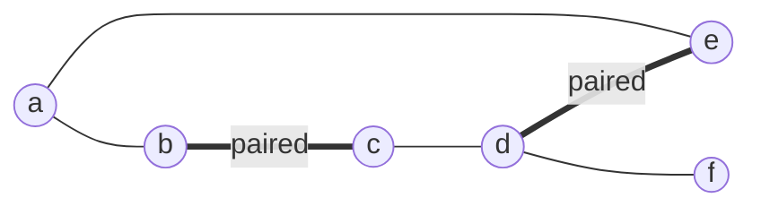
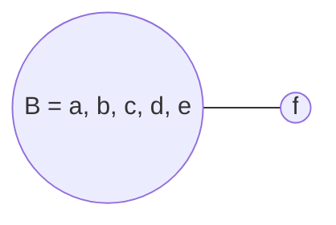

# Edmonds' blossom algorithm: search for improving routes in any graph by shrinking odd loops to a single point

[Syllabus](../../../SYLLABUS.md) → [Combinatorics and graphs](../README.md) → [Matchings and Flows](../README.md#s13) → Edmonds' blossom algorithm

---

## General Overview

Six club players, a to f, need doubles partners tonight. A line joins two players willing to play together. There are no fixed sides, so the graph need not be **two-sided** (two groups of dots, lines only between groups).

The willing pairs form a ring a–b–c–d–e–a, plus a tail d–f. The draft pairs b with c and d with e; a and f have no partner.

By [Matchings](01-matchings-and-augmenting-paths.md), the draft can grow exactly when an **augmenting path** exists: a route between two unpaired dots, its lines switching between unpaired and paired. Here a–e–d–f is one. Flip it, and a–e, b–c, d–f cover everyone.

The search on that card misses it. It walks a, b, c, d, treats d as a dot to pass through, never tries d–f, and stops. Jack Edmonds' 1965 fix: shrink the ring to one dot and keep searching.

**Edmonds' algorithm finds an augmenting path in any graph by shrinking each odd ring the search closes to a single dot, searching the smaller graph, and lifting the route back through the ring.**

**What kind of fact this is:** an algorithm, resting on a theorem proved in Why it works: shrinking keeps an augmenting path exactly when one exists.

### The picture: the club's willing pairs



Thick lines are the draft's pairs; a and f are unpaired.

---

## The formula

Notation from [Matchings](01-matchings-and-augmenting-paths.md): $`G`$ is the graph, and $`M`$ is a **matching** (lines no two of which share a dot). Write $`\lvert M\rvert`$ for its count of lines, and $`\nu(G)`$, read "nu of G", for the largest count any matching of $`G`$ reaches. A dot on no line of $`M`$ is **free**.

The search grows a tree from one free dot, the **root**. Each dot it reaches gets a label:

- **Outer**: the root, and the partner of any inner dot. The tree route back to the root has an even number of lines.
- **Inner**: a paired dot reached by an unpaired line. The route back is odd.

A **blossom** $`B`$ is an odd ring closed by a line between two outer dots of the same tree. It has $`2k+1`$ dots, with $`k`$ paired lines inside it. Its **base** is the one dot whose partner, if any, lies outside the ring. **Shrinking** replaces the ring by a single dot; the graph becomes $`G/B`$ and the matching $`M/B`$, which drops the $`k`$ lines inside.

```math
M \text{ is maximum in } G \iff M/B \text{ is maximum in } G/B, \qquad \lvert M/B\rvert = \lvert M\rvert - k
```

**Read it aloud:** the matching is as large as possible exactly when the shrunk matching is as large as possible in the shrunk graph. Shrinking removes the k lines inside the ring.

| Symbol | Plain meaning | In our example | Push it up and the answer… |
| --- | --- | --- | --- |
| $`G`$ | the graph: players as dots, willing pairs as lines | dots a to f | — |
| $`M`$, $`\lvert M\rvert`$, $`M'`$ | a matching, its count of lines, and (in the proof) a matching of the same count | b–c, d–e: 2 | — |
| $`B`$ | a blossom: an odd ring closed between two outer dots | a–b–c–d–e, 5 dots | — |
| $`k`$ | paired lines inside the blossom | 2 | — |
| $`G/B`$ | the graph with the blossom shrunk to one dot | dot B, dot f, line B–f | — |
| $`M/B`$ | the matching left after shrinking | 0 lines | — |
| $`\nu(G)`$ | the largest count of lines a matching of $`G`$ reaches | 3 | — |
| $`P`$, $`P'`$ | an augmenting path in $`G`$, and one in $`G/B`$ | a–e–d–f; B–f | — |

### When it holds

- **The ring must be a blossom the search found.** Shrink an odd ring with paired lines leaving it at several dots, and $`M/B`$ is no matching.
- **Finitely many dots.** Each flip adds a line, so the flips stop; with infinitely many dots they need not.
- **Size, not cost.** The cheapest pairing, with a price on each line, needs the weighted blossom method.

---

## Why it works

### Step 0: in a two-sided graph a dot's label never changes

In a two-sided graph every route from the root to a dot is even, or every one is odd. So a dot's first label is the only one it needs.

An odd ring breaks this. Dot d is 3 lines from a by a–b–c–d, and 2 by a–e–d. A search that labels each dot once, trying b before e, calls d inner and never leaves from it. Trying e first would find the route: the plain search depends on the order; Edmonds' does not. Shrinking the ring makes all its dots outer at once.

### Step 1: grow the alternating tree

1. Label the root outer.
2. From an outer dot, look along each line. A free dot at the other end gives an augmenting path.
3. An unlabelled paired dot at the other end becomes inner, and its partner becomes outer.
4. Another outer dot at the other end closes a blossom: Step 2. Skip an inner dot.

From a, in the plain search's order: b inner, c outer; then d inner, e outer.

### Step 2: a line between two outer dots closes a blossom

From e, the line e–a joins two outer dots. Walk back to the root from each: e–d–c–b–a, and a. The two walks meet at a, the base. Together with e–a they make the ring a–b–c–d–e: 5 dots, so $`k = 2`$.

### Step 3: shrink, and search the smaller graph

Replace the 5 dots by one outer dot, B, so d is outer at last. Lines from the ring to outside become lines from B: d–f becomes B–f. Both paired lines sat inside the ring, so $`M/B`$ is empty. B is free, because its base a was free.



In $`G/B`$ the line B–f joins two free dots: an augmenting path.

### Step 4: lift the route back through the ring

The line B–f really ends at d. Inside the ring, go from d to the base a the way that starts with a paired line: d–e, then e–a. The lifted route a–e–d–f runs unpaired, paired, unpaired: augmenting.

From any ring dot, one way round to the base is even and the other odd. The even way always starts with a paired line, so lifting always works.

### Step 5: shrinking keeps an augmenting path exactly when one exists

This is Edmonds' lemma, the formula above, in two halves.

- **Small to big.** A route in $`G/B`$ lifts to a route in $`G`$, as in Step 4.
- **Big to small.** A route in $`G`$ passes to $`G/B`$: free the base by flipping the tree route to it, then cut the route at its first ring dot.

<details>
<summary>Detailed proof of Edmonds' lemma</summary>

The **stem** is the even alternating route along the tree from the root to the base.

Small to big. Let $`P'`$ be augmenting for $`M/B`$ in $`G/B`$. If it misses B, it is augmenting in $`G`$.

Otherwise $`P'`$'s unpaired line at B meets the ring at some dot $`v`$, and if B is matched, its paired line meets the base. Replace B by the even way round the ring from $`v`$ to the base. That piece is empty if $`v`$ is the base, and otherwise starts with a paired line. Either way, the lines still alternate and the ends stay free, so $`M`$ is not maximum.

Big to small. Flip the stem to get $`M'`$. It has the same count of lines, the base is now free, and the ring still holds its $`k`$ paired lines. $`M`$ not maximum means $`M'`$ not maximum, so by [Matchings](01-matchings-and-augmenting-paths.md) there is an augmenting path $`P`$ for $`M'`$.

If $`P`$ misses the ring, it is augmenting in $`G/B`$. Otherwise, only the base is free in the ring, so one end of $`P`$ lies outside it.

Follow $`P`$ from that end to its first ring dot. No paired line of $`M'`$ leaves the ring, so in $`G/B`$ that piece is an augmenting path ending at the free dot B. So $`M'/B`$ is not maximum.

$`\lvert M'/B\rvert = \lvert M'\rvert - k = \lvert M\rvert - k = \lvert M/B\rvert`$, and $`G/B`$ is the same graph for both. So $`M/B`$ is not maximum either.

</details>

### Step 6: the whole algorithm

Search from each free dot in turn, shrinking blossoms, even blossoms inside blossoms, as they appear. When a search finds a free dot, lift the route ring by ring and flip it. When no free dot gives a route, the matching is maximum, by Berge's theorem.

Each dot starts at most one search. A shrink removes at least 2 dots, so a search shrinks fewer times than there are dots, each shrink one pass over them. So the work grows like a fixed power of the number of dots.

When the search from every free dot fails, remove all their inner dots. The shrunk blossoms and lone outer dots are odd pieces, outnumbering the removed dots by the number of free dots. So the Tutte–Berge formula on [Tutte's theorem](08-tutte-one-factor-theorem.md) proves no matching is larger.

---

## Worked numbers, by hand

| Step | Arithmetic | Value |
| --- | --- | --- |
| the draft | b–c, d–e | 2 lines; a, f free |
| search without shrinking, b before e | b, d inner; c, e outer; e's lines lead only to labelled dots | no route |
| Edmonds' tree, same order | b, d inner; c, e outer | line e–a joins two outer dots |
| the blossom | a–b–c–d–e, base a | 5 dots, $`k = 2`$ |
| shrink | d outer at last; d–f becomes B–f; both pairs inside | $`\lvert M/B\rvert = 2 - 2 = 0`$ |
| search $`G/B`$ | B and f both free | route B–f, so $`\nu(G/B) = 1`$ |
| lift | f meets the ring at d; even way d–e–a | a–e–d–f |
| flip | a–e, b–c, d–f: 2 + 1 | **3 lines** |
| check | brute force on $`G`$ | **3** |

Everyone gets a partner: the ring hid a route from the plain search.

### What breaks if you drop a piece

| Mistake | Comes out at | What went wrong |
| --- | --- | --- |
| Search without shrinking | no route; stays at 2 lines | d labelled inner only, so d–f never tried |
| Lift the odd way round, a–b–c–d–f | dot d on 3 lines | the route does not alternate |
| Stop in $`G/B`$ without lifting back | 1 line, not 3 | the route must be lifted and flipped in $`G`$ |
| Trust the plain search on every graph | short on 34 of 32,768 graphs on 6 dots, in this order | each of the 34 has an odd ring |

---

## Code, from first principles, and it actually runs

Nothing is imported. Road one is Edmonds' search: find the blossom, shrink it, lift the route. Road two is brute force over every matching. Both run on the club's graph and on all 32,768 graphs with 6 labelled dots, beside the plain search, and every result is checked to be a true matching.

### Python

```python
# Edmonds' blossom algorithm -- the check behind the card.  Nothing is imported.  Dots a to f are 0 to 5.
N, PAIRS = 6, [(i, j) for i in range(6) for j in range(i + 1, 6)]     # road two, brute force, tries all 15 lines
def adjacency(lines, n=N): return [sorted({j for i, j in lines if i == v} | {i for i, j in lines if j == v}) for v in range(n)]
def flip(match, path):                       # the route's outside lines go in, its inside lines out
    for i in range(0, len(path), 2): match[path[i]], match[path[i + 1]] = path[i + 1], path[i]
def edmonds(adj, match, root, log=None):     # road one: grow a tree from root; shrink each blossom to its base
    p, base, outer, q, todo = [-1] * N, list(range(N)), [v == root for v in range(N)], [root], [iter(a) for a in adj]
    up = lambda x: [base[x]] + (up(p[match[base[x]]]) if match[base[x]] >= 0 else [])   # bases back to root
    while q:                                 # depth first: the newest outer dot, q[-1], tries its next line
        if (t := next(todo[v := q[-1]], None)) is None: q.pop()   # every line tried: step back
        elif base[v] == base[t] or match[v] == t: continue
        elif t == root or match[t] >= 0 and p[match[t]] >= 0:        # two outer dots: a blossom
            b, flower = next(x for x in up(t) if x in up(v)), [False] * N
            for x, child in ((v, t), (t, v)):                  # point each dot back across the closing line
                while base[x] != b:
                    flower[base[x]] = flower[base[match[x]]] = True
                    p[x], child, x = child, match[x], p[match[x]]
            if log is not None: log.append((v, t, b, [i for i in range(N) if flower[base[i]] or base[i] == b]))
            for i in [i for i in range(N) if flower[base[i]]]: q += [i] * (not outer[i]); outer[i] = True; base[i] = b
        elif p[t] < 0:
            p[t], path = v, [t]
            if match[t] < 0:                                   # a free dot: lift the route
                while (u := p[path[-1]]) != root: path += [u, match[u]]
                return (path + [root])[::-1]
            outer[match[t]] = True; q.append(match[t])
def naive(adj, match, root):                 # the two-sided search: every dot labelled once, no shrinking
    seen = [v == root for v in range(N)] + [False]                 # the spare last slot absorbs match -1
    def go(v):
        for t in (t for t in adj[v] if not seen[t]):
            seen[t] = seen[match[t]] = True
            if match[t] < 0: return [v, t]
            if rest := go(match[t]): return [v, t] + rest
    return go(root)
def solve(adj, search):                      # one search from each free dot, flipping what it finds
    match = [-1] * N
    for v in range(N): flip(match, (match[v] < 0 and search(adj, match, v)) or [])
    assert all(match[match[v]] == v and match[v] in adj[v] for v in range(N) if match[v] >= 0)   # mutual pairs, real lines
    return N - match.count(-1) >> 1
def nu(adj, left):                           # brute force: leave the first dot out, or pair it each way
    return max([nu(adj, left[1:])] + [1 + nu(adj, [u for u in left[1:] if u != t]) for t in adj[left[0]] if t in left]) if left else 0
G, M, WRONG = [(0, 1), (1, 2), (2, 3), (3, 4), (0, 4), (3, 5)], [(1, 2), (3, 4)], [(0, 1), (1, 2), (2, 3), (3, 5)]
adj, name, m0, log = adjacency(G), lambda path: "-".join("abcdefB"[v] for v in path), [-1, 2, 1, 4, 3, -1], []
stuck = naive(adj, m0, 0); route = edmonds(adj, m0, 0, log); v, t, b, flower = log[0]; flip(m0, route)
out = lambda x: N if x in flower else x; shrunk = sorted({(out(i), out(j)) for i, j in G if out(i) != out(j)})
m_shrunk = [l for l in M if out(l[0]) != out(l[1])]; nu_shrunk = nu(adjacency(shrunk, N + 1), sorted({out(x) for x in range(N)}))
graphs = [adjacency([PAIRS[i] for i in range(15) if g >> i & 1]) for g in range(1 << 15)]
best = [nu(a, list(range(N))) for a in graphs]; ed = [solve(a, edmonds) for a in graphs]
short = [a for a, x in zip(graphs, best) if solve(a, naive) < x]; odd = [not any(all(c >> i & 1 != c >> j & 1 for i in range(N) for j in a[i]) for c in range(64)) for a in short]
print(f"search without shrinking from a: route {stuck or 'none'}; matching stays at {len(M)} lines")
print(f"blossom closed by {name([v, t])}: {name(flower)}, {len(flower)} dots, base {name([b])}, {len(flower) // 2} matched lines inside")
print(f"shrunk to B: lines {', '.join(map(name, shrunk))}; matching lines {len(m_shrunk)}; largest {nu_shrunk}")
print(f"lifted route {name(route)}; after the flip {', '.join(name([x, m0[x]]) for x in range(N) if x < m0[x])}")
print(f"lines after the flip: {N - m0.count(-1) >> 1}, the draft's {len(M)} plus 1; largest by brute force: {nu(adj, list(range(N)))}")
print(f"mistake, lift the odd way round, a-b-c-d-f: dot d on {sum(3 in l for l in M + WRONG if (l in M) != (l in WRONG))} lines")
print(f"all {len(graphs)} graphs on 6 dots: Edmonds equals brute force on {sum(e == x for e, x in zip(ed, best))}")
print(f"search without shrinking falls short on {len(short)}; with an odd loop: {sum(odd)}")
assert route == [0, 4, 3, 5] and stuck is None and N - m0.count(-1) >> 1 == nu(adj, list(range(N))) == 3   # the card's graph
assert ed == best and all(odd) and len(short) > 0      # Edmonds against brute force everywhere; the plain search fails only on odd loops
assert (nu_shrunk > len(m_shrunk)) == (nu(adj, list(range(N))) > len(M))   # shrinking lemma, both graphs
print("ALL CHECKS PASS")
```

**Ran 2026-11-23 on macOS, Python 3.14.10, standard library only. All checks passed. Output, pasted from the run:**

```
search without shrinking from a: route none; matching stays at 2 lines
blossom closed by e-a: a-b-c-d-e, 5 dots, base a, 2 matched lines inside
shrunk to B: lines B-f; matching lines 0; largest 1
lifted route a-e-d-f; after the flip a-e, b-c, d-f
lines after the flip: 3, the draft's 2 plus 1; largest by brute force: 3
mistake, lift the odd way round, a-b-c-d-f: dot d on 3 lines
all 32768 graphs on 6 dots: Edmonds equals brute force on 32768
search without shrinking falls short on 34; with an odd loop: 34
ALL CHECKS PASS
```

### Rust

Same numbers, same labels.

```rust
// Edmonds' blossom algorithm -- the same check as the Python, in Rust.  No crates.  Dots a to f are 0 to 5.
const N: usize = 6;                                  // the value N in a slot means "none": a free dot, no parent
type Adj = Vec<Vec<usize>>; type Log = Vec<(usize, usize, usize, Vec<usize>)>;
fn adjacency(lines: &[(usize, usize)], n: usize) -> Adj {
    let mut a = vec![vec![]; n]; for &(i, j) in lines { a[i].push(j); a[j].push(i) } for x in a.iter_mut() { x.sort(); x.dedup() } a
}
fn flip(m: &mut [usize], path: &[usize]) { for c in path.chunks(2) { m[c[0]] = c[1]; m[c[1]] = c[0] } }  // outside lines in, inside out
fn up(x: usize, base: &[usize], p: &[usize], m: &[usize]) -> Vec<usize> {    // the bases met walking back to the root
    if m[base[x]] == N { vec![base[x]] } else { [vec![base[x]], up(p[m[base[x]]], base, p, m)].concat() }
}
fn edmonds(adj: &Adj, m: &mut Vec<usize>, root: usize, log: &mut Log) -> Option<Vec<usize>> {  // road one
    let (mut p, mut base, mut q, mut tried) = (vec![N; N], (0..N).collect::<Vec<usize>>(), vec![root], vec![0; N]);
    let mut outer: Vec<bool> = (0..N).map(|v| v == root).collect();
    while let Some(&v) = q.last() {                   // depth first: the newest outer dot tries its next line
        if tried[v] == adj[v].len() { q.pop(); continue } let t = adj[v][tried[v]]; tried[v] += 1;   // all tried: step back
        if base[v] == base[t] || m[v] == t { continue }
        if t == root || m[t] != N && p[m[t]] != N {                    // two outer dots: a blossom
            let (upv, mut flower) = (up(v, &base, &p, m), vec![false; N]);
            let b = *up(t, &base, &p, m).iter().find(|x| upv.contains(x)).unwrap();
            for (mut x, mut child) in [(v, t), (t, v)] {               // point each dot back across the closing line
                while base[x] != b { flower[base[x]] = true; flower[base[m[x]]] = true; p[x] = child; child = m[x]; x = p[m[x]] } }
            log.push((v, t, b, (0..N).filter(|&i| flower[base[i]] || base[i] == b).collect()));
            for i in 0..N { if flower[base[i]] { if !outer[i] { outer[i] = true; q.push(i) } base[i] = b } }
        } else if p[t] == N {
            p[t] = v;
            if m[t] == N { let mut path = vec![t];                     // a free dot: lift the route
                while p[path[path.len() - 1]] != root { let u = p[path[path.len() - 1]]; path.extend([u, m[u]]) }
                path.push(root); path.reverse(); return Some(path);
            }
            outer[m[t]] = true; q.push(m[t]);
        } }
    None
}
fn go(v: usize, adj: &Adj, m: &[usize], seen: &mut Vec<bool>) -> Option<Vec<usize>> {
    for &t in &adj[v] {
        if seen[t] { continue } seen[t] = true; seen[m[t]] = true;     // the spare last slot absorbs a free dot's N
        if m[t] == N { return Some(vec![v, t]) }
        if let Some(rest) = go(m[t], adj, m, seen) { return Some([vec![v, t], rest].concat()) }
    } None
}
fn naive(adj: &Adj, m: &mut Vec<usize>, root: usize, _: &mut Log) -> Option<Vec<usize>> {  // no shrinking
    let mut seen = vec![false; N + 1]; seen[root] = true; go(root, adj, m, &mut seen)
}
fn solve(adj: &Adj, search: fn(&Adj, &mut Vec<usize>, usize, &mut Log) -> Option<Vec<usize>>) -> usize {
    let mut m = vec![N; N + 1];                      // one search from each free dot, flipping what it finds
    for v in 0..N { if m[v] == N { if let Some(path) = search(adj, &mut m, v, &mut vec![]) { flip(&mut m, &path) } } }
    assert!((0..N).all(|v| m[v] == N || m[m[v]] == v && adj[v].contains(&m[v])));   // mutual pairs, real lines
    (0..N).filter(|&v| m[v] != N).count() / 2
}
fn nu(adj: &Adj, left: &[usize]) -> usize {         // brute force: leave the first dot out, or pair it each way
    if left.is_empty() { return 0 } let rest = &left[1..];
    adj[left[0]].iter().filter(|t| rest.contains(t)).map(|&t| 1 + nu(adj, &rest.iter().copied().filter(|&u| u != t).collect::<Vec<_>>())).fold(nu(adj, rest), usize::max)
}
fn name(path: &[usize]) -> String { path.iter().map(|&v| ["a", "b", "c", "d", "e", "f", "B"][v]).collect::<Vec<_>>().join("-") }
fn main() {
    let (g, mm, wrong) = (vec![(0, 1), (1, 2), (2, 3), (3, 4), (0, 4), (3, 5)], vec![(1, 2), (3, 4)], vec![(0, 1), (1, 2), (2, 3), (3, 5)]);
    let (adj, mut m0, mut log, all) = (adjacency(&g, N), vec![N, 2, 1, 4, 3, N, N], Log::new(), (0..N).collect::<Vec<usize>>());
    let (stuck, route) = (naive(&adj, &mut m0, 0, &mut log), edmonds(&adj, &mut m0, 0, &mut log).unwrap());
    let (v, t, b, flower) = log[0].clone(); flip(&mut m0, &route); let out = |x: usize| if flower.contains(&x) { N } else { x };
    let mut shrunk: Vec<(usize, usize)> = g.iter().map(|&(i, j)| (out(i), out(j))).filter(|&(i, j)| i != j).collect(); shrunk.sort(); shrunk.dedup();
    let m_shrunk = mm.iter().filter(|&&(i, j)| out(i) != out(j)).count(); let mut left: Vec<usize> = all.iter().map(|&x| out(x)).collect(); left.sort(); left.dedup();
    let (nu_shrunk, best_g, after) = (nu(&adjacency(&shrunk, N + 1), &left), nu(&adj, &all), (0..N).filter(|&x| m0[x] != N).count() / 2);
    let pairs: Vec<(usize, usize)> = (0..N).flat_map(|i| (i + 1..N).map(move |j| (i, j))).collect();     // road two: all 15 lines
    let graphs: Vec<Adj> = (0..1usize << 15).map(|s| adjacency(&(0..15).filter(|i| s >> i & 1 == 1).map(|i| pairs[i]).collect::<Vec<_>>(), N)).collect();
    let (best, ed): (Vec<usize>, Vec<usize>) = (graphs.iter().map(|a| nu(a, &all)).collect(), graphs.iter().map(|a| solve(a, edmonds)).collect());
    let short: Vec<&Adj> = graphs.iter().zip(&best).filter(|&(a, &x)| solve(a, naive) < x).map(|(a, _)| a).collect();
    let odd: Vec<bool> = short.iter().map(|a| !(0..64usize).any(|c| (0..N).all(|i| a[i].iter().all(|&j| (c >> i & 1) != (c >> j & 1))))).collect();
    println!("search without shrinking from a: route {}; matching stays at {} lines", if stuck.is_none() { "none" } else { "found" }, mm.len());
    println!("blossom closed by {}: {}, {} dots, base {}, {} matched lines inside", name(&[v, t]), name(&flower), flower.len(), name(&[b]), flower.len() / 2);
    println!("shrunk to B: lines {}; matching lines {}; largest {}", shrunk.iter().map(|&(i, j)| name(&[i, j])).collect::<Vec<_>>().join(", "), m_shrunk, nu_shrunk);
    println!("lifted route {}; after the flip {}", name(&route), (0..N).filter(|&x| x < m0[x]).map(|x| name(&[x, m0[x]])).collect::<Vec<_>>().join(", "));
    println!("lines after the flip: {}, the draft's {} plus 1; largest by brute force: {}", after, mm.len(), best_g);
    println!("mistake, lift the odd way round, a-b-c-d-f: dot d on {} lines", mm.iter().chain(&wrong).filter(|l| mm.contains(l) != wrong.contains(l)).filter(|&&(i, j)| i == 3 || j == 3).count());
    println!("all {} graphs on 6 dots: Edmonds equals brute force on {}", graphs.len(), ed.iter().zip(&best).filter(|(e, x)| e == x).count());
    println!("search without shrinking falls short on {}; with an odd loop: {}", short.len(), odd.iter().filter(|&&o| o).count());
    assert!(route == vec![0, 4, 3, 5] && stuck.is_none() && after == best_g && best_g == 3);   // the card's graph
    assert!(ed == best && odd.iter().all(|&o| o) && !short.is_empty());   // Edmonds against brute force everywhere; the plain search fails only on odd loops
    assert!((nu_shrunk > m_shrunk) == (best_g > mm.len()));                       // shrinking lemma, both graphs
    println!("ALL CHECKS PASS");
}
```

**Ran 2026-11-23 on macOS, rustc 1.98.1, no crates. All checks passed. Output, pasted from the run:**

```
search without shrinking from a: route none; matching stays at 2 lines
blossom closed by e-a: a-b-c-d-e, 5 dots, base a, 2 matched lines inside
shrunk to B: lines B-f; matching lines 0; largest 1
lifted route a-e-d-f; after the flip a-e, b-c, d-f
lines after the flip: 3, the draft's 2 plus 1; largest by brute force: 3
mistake, lift the odd way round, a-b-c-d-f: dot d on 3 lines
all 32768 graphs on 6 dots: Edmonds equals brute force on 32768
search without shrinking falls short on 34; with an odd loop: 34
ALL CHECKS PASS
```

### Lean

Lean proves Edmonds' lemma and the shrinking count for every graph with finitely many dots, and checks the club's numbers.

- Take a blossom $`B`$ of $`2k+1`$ dots, joined to a free root by the stem. Then $`M`$ is maximum in $`G`$ exactly when $`M/B`$ is maximum in $`G/B`$.
- Take any ring of $`2k+1`$ dots whose lines switch unpaired, paired, and so on, starting and ending unpaired at the base. Then $`M/B`$ is a matching, and $`\lvert M/B\rvert = \lvert M\rvert - k`$.
- In a two-sided graph, any two routes between the same two dots are both even or both odd.
- Take the club's graph and the draft. Then a–e–d–f is an augmenting path, and shrinking leaves one line, B–f, with $`M/B`$ empty.

Running the search itself, and the test on all 32,768 graphs on 6 dots, are left to the Python and Rust checks.

```lean
-- Edmonds' blossom algorithm: shrinking a blossom the search found keeps a matching largest exactly when the shrunk matching is largest in the shrunk graph, and shrinking removes the k paired lines inside the ring.
import Mathlib.Combinatorics.SimpleGraph.Matching
import Mathlib.Combinatorics.SimpleGraph.Maps
import Mathlib.Combinatorics.SimpleGraph.Coloring.Vertex
import Mathlib.Combinatorics.SimpleGraph.Coloring.Constructions
import Mathlib.Order.Interval.Set.Nat

open SimpleGraph

/-! A matching is a `Subgraph` `M` of `G` in which every dot it uses has exactly one partner
(Mathlib's `Subgraph.IsMatching`); its count of lines is `M.edgeSet.ncard`. A dot is free when
it is not in `M.verts`. The ring is a cycle `c : G.Walk b b` (Mathlib's `Walk.IsCycle`) starting
and ending at its base `b`; its `i`-th line joins `c.getVert i` and `c.getVert (i + 1)`. -/

/-- `M` is a largest matching of `G`: it is a matching and no matching of `G` has more lines. -/
def IsMaximumMatching {V : Type*} {G : SimpleGraph V} (M : G.Subgraph) : Prop :=
  M.IsMatching ∧ ∀ N : G.Subgraph, N.IsMatching → N.edgeSet.ncard ≤ M.edgeSet.ncard

/-- The dots of the shrunk graph `G/B`: every dot outside the ring `S`, plus the base `b`,
which stands for the new single dot B. -/
abbrev ShrunkDot {V : Type*} (S : Set V) (b : V) : Type _ := {v : V // v ∉ S ∨ v = b}

/-- Shrinking the ring `S` to one dot: every dot of `S` goes to B (named by the base `b`),
every other dot stays where it is. -/
def shrink {V : Type*} (S : Set V) [DecidablePred (· ∈ S)] (b : V) (v : V) : ShrunkDot S b :=
  if h : v ∈ S then ⟨b, Or.inr rfl⟩ else ⟨v, Or.inl h⟩

/-- The shrunk graph `G/B` is `G.map f` for the shrinking map `f`: two dots of `G/B` are joined
when they are different and some line of `G` joins dots that go to them. Lines inside the ring
become loops and vanish. The shrunk matching `M/B` is the image of `M` in the same way: its lines
are the lines of `M` that do not lie inside the ring. -/
def shrunkMatching {V W : Type*} {G : SimpleGraph V} (M : G.Subgraph) (f : V → W) :
    (G.map f).Subgraph where
  verts := (M.spanningCoe.map f).support
  Adj := (M.spanningCoe.map f).Adj
  adj_sub h := SimpleGraph.map_monotone f M.spanningCoe_le h
  edge_vert h := ⟨_, h⟩
  symm := (M.spanningCoe.map f).symm

namespace Blossom

variable {V : Type*}

/-- Each dot has at most one partner. -/
def Fn {W : Type*} (H : SimpleGraph W) : Prop := ∀ ⦃u v w : W⦄, H.Adj u v → H.Adj u w → v = w

/-- The lines with both ends in `S`. -/
def inside (S : Set V) : Set (Sym2 V) := {e | ∀ v ∈ e, v ∈ S}

theorem fn_support_ncard {W : Type*} [Finite W] {H : SimpleGraph W} (hH : Fn H) :
    H.support.ncard = 2 * H.edgeSet.ncard := by
  classical
  have := Fintype.ofFinite W
  have hdeg : ∀ v, H.degree v = if v ∈ H.support then 1 else 0 := by
    intro v
    split_ifs with hv
    · obtain ⟨w, hw⟩ := (SimpleGraph.mem_support H).mp hv
      rw [← card_neighborFinset_eq_degree, Finset.card_eq_one]
      refine ⟨w, ?_⟩
      ext x
      simp only [mem_neighborFinset, Finset.mem_singleton]
      exact ⟨fun hx => hH hx hw, fun hx => hx ▸ hw⟩
    · rw [← card_neighborFinset_eq_degree, Finset.card_eq_zero]
      ext x
      simp only [mem_neighborFinset, Finset.notMem_empty, iff_false]
      exact fun hx => hv ((SimpleGraph.mem_support H).mpr ⟨x, hx⟩)
  have h1 := H.sum_degrees_eq_twice_card_edges
  simp only [hdeg, Finset.sum_boole] at h1
  rw [← coe_edgeFinset, Set.ncard_coe_finset, ← h1, Set.ncard_eq_toFinset_card']
  congr 1
  ext v
  simp

/-- A graph's lines as a subgraph whose dots are the dots it uses. -/
def toSub {W : Type*} {G' : SimpleGraph W} (H : SimpleGraph W) (h : H ≤ G') : G'.Subgraph where
  verts := H.support
  Adj := H.Adj
  adj_sub hh := h hh
  edge_vert hh := (SimpleGraph.mem_support _).mpr ⟨_, hh⟩
  symm := H.symm

theorem toSub_isMatching {W : Type*} {G' : SimpleGraph W} {H : SimpleGraph W} (h : H ≤ G')
    (hH : Fn H) : (toSub H h).IsMatching := by
  intro v hv
  obtain ⟨w, hw⟩ := (SimpleGraph.mem_support H).mp hv
  exact ⟨w, hw, fun w' hw' => hH hw' hw⟩

theorem toSub_edgeSet {W : Type*} {G' : SimpleGraph W} {H : SimpleGraph W} (h : H ≤ G') :
    (toSub H h).edgeSet = H.edgeSet := by
  ext e
  induction e using Sym2.ind with
  | _ v w => rfl

theorem fn_of_isMatching {W : Type*} {G' : SimpleGraph W} {M : G'.Subgraph} (hM : M.IsMatching) :
    Fn M.spanningCoe := fun _ _ _ h1 h2 => hM.eq_of_adj_left h1 h2

theorem shrunk_edgeSet {W : Type*} {G : SimpleGraph V} (M : G.Subgraph) (f : V → W) :
    (shrunkMatching M f).edgeSet = (M.spanningCoe.map f).edgeSet := by
  ext e
  induction e using Sym2.ind with
  | _ v w => rfl

theorem shrunk_isMatching {W : Type*} {G : SimpleGraph V} (M : G.Subgraph) (f : V → W)
    (h : Fn (M.spanningCoe.map f)) : (shrunkMatching M f).IsMatching := by
  intro v hv
  obtain ⟨w, hw⟩ := (SimpleGraph.mem_support _).mp hv
  exact ⟨w, hw, fun w' hw' => h hw' hw⟩

section shrinkS
variable {S : Set V} [DecidablePred (· ∈ S)] {b : V}

theorem shrink_of_mem {v : V} (h : v ∈ S) : shrink S b v = ⟨b, Or.inr rfl⟩ := by
  simp [shrink, h]

theorem shrink_of_not_mem {v : V} (h : v ∉ S) : shrink S b v = ⟨v, Or.inl h⟩ := by
  simp [shrink, h]

theorem shrink_eq_iff (hb : b ∈ S) {u v : V} :
    shrink S b u = shrink S b v ↔ u = v ∨ (u ∈ S ∧ v ∈ S) := by
  by_cases hu : u ∈ S <;> by_cases hv : v ∈ S
  · simp [shrink_of_mem hu, shrink_of_mem hv, hu, hv]
  · rw [shrink_of_mem hu, shrink_of_not_mem hv, Subtype.mk.injEq]
    constructor
    · rintro rfl; exact absurd hb hv
    · rintro (rfl | ⟨-, h⟩); exacts [absurd hu hv, absurd h hv]
  · rw [shrink_of_not_mem hu, shrink_of_mem hv, Subtype.mk.injEq]
    constructor
    · rintro rfl; exact absurd hb hu
    · rintro (rfl | ⟨h, -⟩); exacts [absurd hv hu, absurd h hu]
  · rw [shrink_of_not_mem hu, shrink_of_not_mem hv, Subtype.mk.injEq]
    simp [hu]

theorem shrink_eq_B_iff (hb : b ∈ S) {u : V} : shrink S b u = ⟨b, Or.inr rfl⟩ ↔ u ∈ S := by
  rw [← shrink_of_mem (S := S) (b := b) hb, shrink_eq_iff hb]
  constructor
  · rintro (rfl | ⟨h, -⟩); exacts [hb, h]
  · intro h; exact Or.inr ⟨h, hb⟩

theorem map_edgeSet (hb : b ∈ S) (H : SimpleGraph V) :
    (H.map (shrink S b)).edgeSet = Sym2.map (shrink S b) '' (H.edgeSet \ inside S) := by
  ext e
  induction e using Sym2.ind with
  | _ p q =>
  rw [mem_edgeSet, map_adj']
  constructor
  · rintro ⟨hne, u, v, huv, rfl, rfl⟩
    refine ⟨s(u, v), ⟨huv, ?_⟩, rfl⟩
    intro hin
    apply hne
    rw [shrink_eq_iff hb]
    exact Or.inr ⟨hin u (Sym2.mem_mk_left _ _), hin v (Sym2.mem_mk_right _ _)⟩
  · rintro ⟨e', ⟨he', hin⟩, heq⟩
    induction e' using Sym2.ind with
    | _ u v =>
    rw [Sym2.map_mk, Sym2.eq_iff] at heq
    rw [mem_edgeSet] at he'
    have hne : shrink S b u ≠ shrink S b v := by
      rw [Ne, shrink_eq_iff hb]
      rintro (h | ⟨hu, hv⟩)
      · subst h; exact he'.ne rfl
      · apply hin
        intro w hw
        rw [Sym2.mem_iff] at hw
        rcases hw with rfl | rfl <;> assumption
    rcases heq with ⟨rfl, rfl⟩ | ⟨rfl, rfl⟩
    · exact ⟨hne, u, v, he', rfl, rfl⟩
    · exact ⟨hne.symm, v, u, he'.symm, rfl, rfl⟩

theorem map_pair_inj (hb : b ∈ S) {H : SimpleGraph V} (hH : Fn H) {u1 v1 u2 v2 : V}
    (h1 : H.Adj u1 v1) (h2 : H.Adj u2 v2) (hn : ¬ (u1 ∈ S ∧ v1 ∈ S))
    (hu : shrink S b u1 = shrink S b u2) (hv : shrink S b v1 = shrink S b v2) :
    s(u1, v1) = s(u2, v2) := by
  rw [shrink_eq_iff hb] at hu hv
  rcases hu with rfl | ⟨hu1, hu2⟩ <;> rcases hv with rfl | ⟨hv1, hv2⟩
  · rfl
  · rw [hH h1 h2]
  · rw [hH h1.symm h2.symm]
  · exact absurd ⟨hu1, hv1⟩ hn

theorem injOn_map (hb : b ∈ S) {H : SimpleGraph V} (hH : Fn H) :
    Set.InjOn (Sym2.map (shrink S b)) (H.edgeSet \ inside S) := by
  rintro e1 ⟨h1, n1⟩ e2 ⟨h2, -⟩ heq
  induction e1 using Sym2.ind with
  | _ u1 v1 =>
  induction e2 using Sym2.ind with
  | _ u2 v2 =>
  rw [mem_edgeSet] at h1 h2
  have hn : ¬ (u1 ∈ S ∧ v1 ∈ S) := by
    rintro ⟨hu, hv⟩
    apply n1
    intro w hw
    rw [Sym2.mem_iff] at hw
    rcases hw with rfl | rfl <;> assumption
  rw [Sym2.map_mk, Sym2.map_mk, Sym2.eq_iff] at heq
  rcases heq with ⟨hu, hv⟩ | ⟨hu, hv⟩
  · exact map_pair_inj hb hH h1 h2 hn hu hv
  · rw [map_pair_inj hb hH h1 h2.symm hn hu hv, Sym2.eq_swap]

theorem card_map_add_inside [Finite V] (hb : b ∈ S) {H : SimpleGraph V} (hH : Fn H) :
    (H.map (shrink S b)).edgeSet.ncard + (H.edgeSet ∩ inside S).ncard = H.edgeSet.ncard := by
  rw [map_edgeSet hb, (injOn_map hb hH).ncard_image, add_comm,
    Set.ncard_inter_add_ncard_sdiff_eq_ncard _ _ (Set.toFinite _)]

theorem fn_map (hb : b ∈ S) {H : SimpleGraph V} (hH : Fn H)
    (hcross : ∀ u w, H.Adj u w → u ∈ S → w ∉ S → u = b) : Fn (H.map (shrink S b)) := by
  rintro p q q' ⟨hpq, u, v, huv, rfl, rfl⟩ ⟨hpq', u', v', huv', hu', rfl⟩
  have hu2 := hu'
  rw [shrink_eq_iff hb] at hu'
  rcases hu' with rfl | ⟨hu'S, huS⟩
  · rw [hH huv huv']
  · have hv : v ∉ S := fun hv => hpq ((shrink_eq_iff hb).mpr (Or.inr ⟨huS, hv⟩))
    have hv' : v' ∉ S := fun hv' => hpq' (hu2 ▸ (shrink_eq_iff hb).mpr (Or.inr ⟨hu'S, hv'⟩))
    have e1 := hcross u v huv huS hv
    have e2 := hcross u' v' huv' hu'S hv'
    subst e1 e2
    rw [hH huv huv']

end shrinkS

#print axioms fn_support_ncard
#print axioms toSub_isMatching
#print axioms toSub_edgeSet
#print axioms fn_of_isMatching
#print axioms shrunk_edgeSet
#print axioms shrunk_isMatching
#print axioms shrink_of_mem
#print axioms shrink_of_not_mem
#print axioms shrink_eq_iff
#print axioms shrink_eq_B_iff
#print axioms map_edgeSet
#print axioms map_pair_inj
#print axioms injOn_map
#print axioms card_map_add_inside
#print axioms fn_map

end Blossom

namespace Blossom

variable {V : Type*}

theorem sym2_ne_of {u w a c : V} (h1 : u ≠ a) (h2 : u ≠ c) : s(u, w) ≠ s(a, c) := by
  rw [Ne, Sym2.eq_iff]; tauto

theorem augment {W : Type*} [Finite W] {G' A : SimpleGraph W} (hA : A ≤ G') (hAf : Fn A)
    {p q : W} (hpq : G'.Adj p q) (hp : ∀ w, ¬ A.Adj p w) (hq : ∀ w, ¬ A.Adj q w) :
    ∃ K : SimpleGraph W, K ≤ G' ∧ Fn K ∧ A.edgeSet.ncard < K.edgeSet.ncard := by
  let K := SimpleGraph.fromEdgeSet (insert s(p, q) A.edgeSet)
  have hK : ∀ v w, K.Adj v w ↔ (s(v, w) = s(p, q) ∨ A.Adj v w) ∧ v ≠ w := by
    intro v w; simp [K, fromEdgeSet_adj]
  refine ⟨K, ?_, ?_, ?_⟩
  · intro v w h
    rw [hK] at h
    rcases h with ⟨h | h, -⟩
    · rw [Sym2.eq_iff] at h
      rcases h with ⟨rfl, rfl⟩ | ⟨rfl, rfl⟩
      exacts [hpq, hpq.symm]
    · exact hA h
  · intro v w w' h h'
    rw [hK] at h h'
    rcases h with ⟨h | h, hne⟩ <;> rcases h' with ⟨h' | h', hne'⟩
    · rw [Sym2.eq_iff] at h h'
      rcases h with ⟨rfl, rfl⟩ | ⟨rfl, rfl⟩ <;> rcases h' with ⟨h1, rfl⟩ | ⟨h1, rfl⟩ <;> simp_all
    · rw [Sym2.eq_iff] at h
      rcases h with ⟨rfl, rfl⟩ | ⟨rfl, rfl⟩
      exacts [absurd h' (hp _), absurd h' (hq _)]
    · rw [Sym2.eq_iff] at h'
      rcases h' with ⟨rfl, rfl⟩ | ⟨rfl, rfl⟩
      exacts [absurd h (hp _), absurd h (hq _)]
    · exact hAf h h'
  · apply Set.ncard_lt_ncard _ (Set.toFinite _)
    rw [Set.ssubset_def]
    constructor
    · intro e he
      induction e using Sym2.ind with
      | _ v w =>
      rw [mem_edgeSet] at he ⊢
      exact (hK v w).mpr ⟨Or.inr he, he.ne⟩
    · intro h
      have : s(p, q) ∈ K.edgeSet := by
        rw [mem_edgeSet]; exact (hK p q).mpr ⟨Or.inl rfl, hpq.ne⟩
      exact hp q (h this)

/-- Pass the partner of `y` from `z` to the free dot `x`. -/
def swap (H : SimpleGraph V) (x y z : V) : SimpleGraph V :=
  SimpleGraph.fromEdgeSet (insert s(x, y) (H.edgeSet \ {s(y, z)}))

theorem swap_adj {H : SimpleGraph V} {x y z u v : V} :
    (swap H x y z).Adj u v ↔ (s(u, v) = s(x, y) ∨ (H.Adj u v ∧ s(u, v) ≠ s(y, z))) ∧ u ≠ v := by
  simp [swap, fromEdgeSet_adj]

theorem swap_adj_of {H : SimpleGraph V} {x y z u v : V} (h1 : s(u, v) ≠ s(x, y))
    (h2 : s(u, v) ≠ s(y, z)) : (swap H x y z).Adj u v ↔ H.Adj u v := by
  rw [swap_adj]
  constructor
  · rintro ⟨h | ⟨h, -⟩, -⟩; exacts [absurd h h1, h]
  · intro h; exact ⟨Or.inr ⟨h, h2⟩, h.ne⟩

theorem swap_le {G H : SimpleGraph V} {x y z : V} (hH : H ≤ G) (hxy : G.Adj x y) :
    swap H x y z ≤ G := by
  intro u v h
  rw [swap_adj] at h
  rcases h with ⟨h | ⟨h, -⟩, -⟩
  · rw [Sym2.eq_iff] at h
    rcases h with ⟨rfl, rfl⟩ | ⟨rfl, rfl⟩
    exacts [hxy, hxy.symm]
  · exact hH h

theorem swap_fn {H : SimpleGraph V} {x y z : V} (hH : Fn H) (hx : ∀ w, ¬ H.Adj x w)
    (hyz : H.Adj y z) (hxy : x ≠ y) : Fn (swap H x y z) := by
  intro u v w h h'
  rw [swap_adj] at h h'
  rcases h with ⟨h | ⟨h, hn⟩, hne⟩ <;> rcases h' with ⟨h' | ⟨h', hn'⟩, hne'⟩
  · rw [Sym2.eq_iff] at h h'
    rcases h with ⟨rfl, rfl⟩ | ⟨rfl, rfl⟩ <;> rcases h' with ⟨h1, rfl⟩ | ⟨h1, rfl⟩ <;> simp_all
  · rw [Sym2.eq_iff] at h
    rcases h with ⟨rfl, rfl⟩ | ⟨rfl, rfl⟩
    · exact absurd h' (hx _)
    · have := hH h' hyz; subst this; exact absurd rfl hn'
  · rw [Sym2.eq_iff] at h'
    rcases h' with ⟨rfl, rfl⟩ | ⟨rfl, rfl⟩
    · exact absurd h (hx _)
    · have := hH h hyz; subst this; exact absurd rfl hn
  · exact hH h h'

theorem swap_edgeSet {H : SimpleGraph V} {x y z : V} (hxy : x ≠ y) :
    (swap H x y z).edgeSet = insert s(x, y) (H.edgeSet \ {s(y, z)}) := by
  ext e
  induction e using Sym2.ind with
  | _ u v =>
  rw [mem_edgeSet, swap_adj]
  simp only [Set.mem_insert_iff, Set.mem_sdiff, mem_edgeSet, Set.mem_singleton_iff]
  constructor
  · rintro ⟨h, -⟩; exact h
  · rintro (h | h)
    · refine ⟨Or.inl h, ?_⟩
      rintro rfl
      rw [Sym2.eq_iff] at h
      rcases h with ⟨rfl, rfl⟩ | ⟨rfl, rfl⟩ <;> exact hxy rfl
    · exact ⟨Or.inr h, h.1.ne⟩

theorem swap_card [Finite V] {H : SimpleGraph V} {x y z : V} (hx : ∀ w, ¬ H.Adj x w)
    (hyz : H.Adj y z) (hxy : x ≠ y) : (swap H x y z).edgeSet.ncard = H.edgeSet.ncard := by
  rw [swap_edgeSet hxy, Set.ncard_insert_of_notMem, Set.ncard_sdiff_singleton_add_one]
  · exact hyz
  · rintro ⟨h, -⟩; exact hx y h

theorem swap_z_free {H : SimpleGraph V} {x y z : V} (hH : Fn H) (hx : ∀ w, ¬ H.Adj x w)
    (hyz : H.Adj y z) : ∀ w, ¬ (swap H x y z).Adj z w := by
  intro w h
  rw [swap_adj] at h
  rcases h with ⟨h | ⟨h, hn⟩, -⟩
  · rw [Sym2.eq_iff] at h
    rcases h with ⟨rfl, rfl⟩ | ⟨rfl, rfl⟩
    · exact hx _ hyz.symm
    · exact hyz.ne rfl
  · have := hH h hyz.symm; subst this
    exact hn (Sym2.eq_swap)

theorem swap_adj_xy {H : SimpleGraph V} {x y z : V} (hxy : x ≠ y) : (swap H x y z).Adj x y :=
  swap_adj.mpr ⟨Or.inl rfl, hxy⟩

#print axioms sym2_ne_of
#print axioms augment
#print axioms swap_adj
#print axioms swap_adj_of
#print axioms swap_le
#print axioms swap_fn
#print axioms swap_edgeSet
#print axioms swap_card
#print axioms swap_z_free
#print axioms swap_adj_xy

end Blossom

namespace Blossom

variable {V : Type*}

section shrinkS
variable {S : Set V} [DecidablePred (· ∈ S)] {b : V}

theorem free_map (hb : b ∈ S) {H : SimpleGraph V} (h1 : ∀ u w, H.Adj u w → u ∈ S → w ∈ S)
    {v : V} (hv : v ∈ S ∨ ∀ w, ¬ H.Adj v w) : ∀ q, ¬ (H.map (shrink S b)).Adj (shrink S b v) q := by
  rintro q ⟨hne, u, w, huw, hu, rfl⟩
  rw [shrink_eq_iff hb] at hu
  rcases hu with rfl | ⟨huS, hvS⟩
  · rcases hv with hvS | hv
    · exact hne ((shrink_eq_iff hb).mpr (Or.inr ⟨hvS, h1 _ _ huw hvS⟩))
    · exact hv _ huw
  · exact hne ((shrink_eq_iff hb).mpr (Or.inr ⟨hvS, h1 _ _ huw huS⟩))

theorem main_aug [Finite V] (hb : b ∈ S) {G N : SimpleGraph V} (hN : N ≤ G) (hNf : Fn N) :
    ∀ n, ∀ H : SimpleGraph V, (N.edgeSet \ H.edgeSet).ncard = n → H ≤ G → Fn H →
      (∀ u w, H.Adj u w → u ∈ S → w ∈ S) → (∀ u ∈ S, u ≠ b → ∃ w, H.Adj u w) →
      H.edgeSet.ncard < N.edgeSet.ncard →
      ∃ K, K ≤ G.map (shrink S b) ∧ Fn K ∧
        (H.map (shrink S b)).edgeSet.ncard < K.edgeSet.ncard := by
  intro n
  induction n using Nat.strong_induction_on with
  | _ n ih =>
  intro H hn hHG hHf h1 h2 hlt
  have hcross : ∀ u w, H.Adj u w → u ∈ S → w ∉ S → u = b :=
    fun u w h hu hw => absurd (h1 u w h hu) hw
  have hAf : Fn (H.map (shrink S b)) := fn_map hb hHf hcross
  have hAG : H.map (shrink S b) ≤ G.map (shrink S b) := SimpleGraph.map_monotone _ hHG
  obtain ⟨x, hxS, hxH, y, hxy⟩ : ∃ x, x ∉ S ∧ (∀ w, ¬ H.Adj x w) ∧ ∃ y, N.Adj x y := by
    by_contra hcon
    push Not at hcon
    have hsub : N.support ⊆ H.support ∪ {b} := by
      intro v hv
      obtain ⟨y, hy⟩ := (SimpleGraph.mem_support N).mp hv
      by_cases hvH : ∃ w, H.Adj v w
      · exact Or.inl ((SimpleGraph.mem_support H).mpr hvH)
      · right
        push Not at hvH
        by_cases hvS : v ∈ S
        · by_contra hvb
          obtain ⟨w, hw⟩ := h2 v hvS hvb
          exact hvH w hw
        · exact absurd hy (hcon v hvS hvH y)
    have e1 := Set.ncard_le_ncard hsub (Set.toFinite _)
    have e2 := Set.ncard_union_le H.support {b}
    rw [fn_support_ncard hNf] at e1
    rw [fn_support_ncard hHf, Set.ncard_singleton] at e2
    omega
  have hGxy : G.Adj x y := hN hxy
  have hfx : ∀ q, ¬ (H.map (shrink S b)).Adj (shrink S b x) q := free_map hb h1 (Or.inr hxH)
  have hadj : (G.map (shrink S b)).Adj (shrink S b x) (shrink S b y) := by
    refine ⟨?_, x, y, hGxy, rfl, rfl⟩
    rw [Ne, shrink_eq_iff hb]
    rintro (h | ⟨h, -⟩)
    exacts [hGxy.ne h, hxS h]
  by_cases hy : ∃ z, H.Adj y z
  · obtain ⟨z, hyz⟩ := hy
    by_cases hyS : y ∈ S
    · obtain ⟨K, hK, hKf, hlt'⟩ := augment hAG hAf hadj hfx (free_map hb h1 (Or.inl hyS))
      exact ⟨K, hK, hKf, hlt'⟩
    · have hzS : z ∉ S := fun hz => hyS (h1 z y hyz.symm hz)
      have hxy' : x ≠ y := hGxy.ne
      have hzx : z ≠ x := fun h => hxH y (h ▸ hyz.symm)
      have hagree : ∀ u w, u ∈ S → ((swap H x y z).Adj u w ↔ H.Adj u w) := by
        intro u w hu
        apply swap_adj_of
        · exact sym2_ne_of (fun h => hxS (h ▸ hu)) (fun h => hyS (h ▸ hu))
        · exact sym2_ne_of (fun h => hyS (h ▸ hu)) (fun h => hzS (h ▸ hu))
      have hsub : N.edgeSet \ (swap H x y z).edgeSet ⊂ N.edgeSet \ H.edgeSet := by
        rw [Set.ssubset_def]
        constructor
        · rintro e ⟨heN, he1⟩
          refine ⟨heN, fun heH => he1 ?_⟩
          induction e using Sym2.ind with
          | _ u v =>
          rw [mem_edgeSet] at heN heH ⊢
          rw [swap_adj]
          refine ⟨Or.inr ⟨heH, ?_⟩, heH.ne⟩
          intro h
          rw [Sym2.eq_iff] at h
          rcases h with ⟨rfl, rfl⟩ | ⟨rfl, rfl⟩
          · exact hzx (hNf heN hxy.symm)
          · exact hzx (hNf heN.symm hxy.symm)
        · intro h
          have : s(x, y) ∈ N.edgeSet \ H.edgeSet := ⟨hxy, hxH y⟩
          exact (h this).2 (swap_adj_xy hxy')
      have hlt2 := Set.ncard_lt_ncard hsub (Set.toFinite _)
      rw [hn] at hlt2
      have hcard := swap_card (z := z) hxH hyz hxy'
      obtain ⟨K, hK, hKf, hlt'⟩ := ih _ hlt2 (swap H x y z) rfl (swap_le hHG hGxy)
        (swap_fn hHf hxH hyz hxy')
        (fun u w h hu => h1 u w ((hagree u w hu).mp h) hu)
        (fun u hu hub => by
          obtain ⟨w, hw⟩ := h2 u hu hub
          exact ⟨w, (hagree u w hu).mpr hw⟩)
        (by rw [hcard]; exact hlt)
      refine ⟨K, hK, hKf, ?_⟩
      have c1 := card_map_add_inside hb hHf
      have c2 := card_map_add_inside hb (swap_fn hHf hxH hyz hxy')
      have hin : (swap H x y z).edgeSet ∩ inside S = H.edgeSet ∩ inside S := by
        ext e
        induction e using Sym2.ind with
        | _ u v =>
        simp only [Set.mem_inter_iff, mem_edgeSet]
        constructor
        · rintro ⟨h, hi⟩
          exact ⟨(hagree u v (hi u (Sym2.mem_mk_left _ _))).mp h, hi⟩
        · rintro ⟨h, hi⟩
          exact ⟨(hagree u v (hi u (Sym2.mem_mk_left _ _))).mpr h, hi⟩
      rw [hin, hcard] at c2
      omega
  · push Not at hy
    by_cases hyS : y ∈ S
    · exact augment hAG hAf hadj hfx (free_map hb h1 (Or.inl hyS))
    · exact augment hAG hAf hadj hfx (free_map hb h1 (Or.inr hy))

theorem lift [Finite V] (hb : b ∈ S) {G : SimpleGraph V} {k : ℕ}
    (hfc : ∀ u ∈ S, ∃ Q : SimpleGraph V, Q ≤ G ∧ Fn Q ∧ (∀ v w, Q.Adj v w → v ∈ S ∧ v ≠ u) ∧
      k ≤ Q.edgeSet.ncard)
    {K : SimpleGraph (ShrunkDot S b)} (hK : K ≤ G.map (shrink S b)) (hKf : Fn K) :
    ∃ H : SimpleGraph V, H ≤ G ∧ Fn H ∧ K.edgeSet.ncard + k ≤ H.edgeSet.ncard := by
  set f := shrink S b with hf
  set B : ShrunkDot S b := ⟨b, Or.inr rfl⟩ with hB
  obtain ⟨u, huS, hu⟩ : ∃ u ∈ S, ∀ w, w ∉ S → K.Adj B (f w) → G.Adj u w := by
    by_cases h : ∃ q, K.Adj B q
    · obtain ⟨q, hq⟩ := h
      obtain ⟨-, u0, w0, hG, hu0, hw0⟩ := hK hq
      refine ⟨u0, (shrink_eq_B_iff hb).mp hu0, fun w hw hKw => ?_⟩
      have e1 : f w = f w0 := (hKf hKw hq).trans hw0.symm
      rw [hf, shrink_eq_iff hb] at e1
      rcases e1 with rfl | ⟨h, -⟩
      exacts [hG, absurd h hw]
    · push Not at h
      exact ⟨b, hb, fun w _ hKw => absurd hKw (h _)⟩
  obtain ⟨Q, hQG, hQf, hQS, hQk⟩ := hfc u huS
  have hfu : f u = B := shrink_of_mem huS
  let L : SimpleGraph V :=
    { Adj := fun v w => K.Adj (f v) (f w) ∧ (v ∉ S ∨ v = u) ∧ (w ∉ S ∨ w = u)
      symm := ⟨fun v w ⟨h, a, c⟩ => ⟨h.symm, c, a⟩⟩
      loopless := ⟨fun v ⟨h, _, _⟩ => h.ne rfl⟩ }
  have hinj : ∀ v w, (v ∉ S ∨ v = u) → (w ∉ S ∨ w = u) → f v = f w → v = w := by
    intro v w hv hw h
    rw [hf, shrink_eq_iff hb] at h
    rcases h with h | ⟨h1, h2⟩
    · exact h
    · rcases hv with hv | rfl
      · exact absurd h1 hv
      · rcases hw with hw | rfl
        · exact absurd h2 hw
        · rfl
  have hLG1 : ∀ v w, L.Adj v w → w ∉ S → G.Adj v w := by
    rintro v w ⟨h, hv, -⟩ hw
    rcases hv with hv | rfl
    · obtain ⟨-, v', w', hG, hv', hw'⟩ := hK h
      have e1 : v' = v := ((shrink_eq_iff hb).mp hv').resolve_right (fun h => hv h.2)
      have e2 : w' = w := ((shrink_eq_iff hb).mp hw').resolve_right (fun h => hw h.2)
      subst e1 e2
      exact hG
    · rw [hfu] at h
      exact hu w hw h
  let H := L ⊔ Q
  have hHG : H ≤ G := by
    apply sup_le
    · intro v w h
      by_cases hw : w ∈ S
      · have hw' : w = u := h.2.2.resolve_left (not_not.mpr hw)
        subst hw'
        have hv : v ∉ S := by
          intro hv
          have hv' : v = w := h.2.1.resolve_left (not_not.mpr hv)
          subst hv'; exact h.1.ne rfl
        exact (hLG1 w v h.symm hv).symm
      · exact hLG1 v w h hw
    · exact hQG
  have hHf : Fn H := by
    intro v w w' h h'
    rcases h with h | h <;> rcases h' with h' | h'
    · exact hinj w w' h.2.2 h'.2.2 (hKf h.1 h'.1)
    · exact absurd h.2.1 (by have := hQS v w' h'; tauto)
    · exact absurd h'.2.1 (by have := hQS v w h; tauto)
    · exact hQf h h'
  refine ⟨H, hHG, hHf, ?_⟩
  have hmap : H.map f = K := by
    ext p q
    rw [map_adj']
    constructor
    · rintro ⟨hne, v, w, h, rfl, rfl⟩
      rcases h with h | h
      · exact h.1
      · have hv := (hQS v w h).1
        have hw := (hQS w v h.symm).1
        exact absurd ((shrink_eq_iff hb).mpr (Or.inr ⟨hv, hw⟩)) hne
    · intro h
      let rep : ShrunkDot S b → V := fun p => if p.val ∈ S then u else p.val
      have hrep : ∀ p, f (rep p) = p ∧ (rep p ∉ S ∨ rep p = u) := by
        intro p
        by_cases hp : p.val ∈ S
        · have hr : rep p = u := ite_eq_left hp
          rw [hr]
          refine ⟨?_, Or.inr rfl⟩
          rw [hfu]
          rcases p with ⟨pv, hpv | hpv⟩
          · exact absurd hp hpv
          · subst hpv; rfl
        · have hr : rep p = p.val := ite_eq_right hp
          rw [hr]
          refine ⟨?_, Or.inl hp⟩
          rw [hf, shrink_of_not_mem hp]
      refine ⟨h.ne, rep p, rep q, Or.inl ⟨?_, (hrep p).2, (hrep q).2⟩, (hrep p).1, (hrep q).1⟩
      rw [(hrep p).1, (hrep q).1]; exact h
  have hQin : Q.edgeSet ⊆ H.edgeSet ∩ inside S := by
    intro e he
    induction e using Sym2.ind with
    | _ v w =>
    rw [mem_edgeSet] at he
    refine ⟨Or.inr he, ?_⟩
    intro x hx
    rw [Sym2.mem_iff] at hx
    rcases hx with rfl | rfl
    exacts [(hQS _ _ he).1, (hQS _ _ he.symm).1]
  have c1 := card_map_add_inside hb hHf
  rw [← hf, hmap] at c1
  have c2 := Set.ncard_le_ncard hQin (Set.toFinite _)
  omega

end shrinkS

theorem stem [Finite V] {G : SimpleGraph V} (n : ℕ) : ∀ {r b : V} (p : G.Walk r b),
    p.length = 2 * n → p.IsPath → ∀ H : SimpleGraph V, H ≤ G → Fn H → (∀ w, ¬ H.Adj r w) →
    (∀ i < p.length, (H.Adj (p.getVert i) (p.getVert (i + 1)) ↔ Odd i)) →
    ∃ H' : SimpleGraph V, H' ≤ G ∧ Fn H' ∧ H'.edgeSet.ncard = H.edgeSet.ncard ∧
      (∀ w, ¬ H'.Adj b w) ∧ (∀ u, u ∉ p.support → ∀ w, (H'.Adj u w ↔ H.Adj u w)) := by
  induction n with
  | zero =>
    intro r b p hlen _ H hHG hHf hr _
    cases p with
    | nil => exact ⟨H, hHG, hHf, rfl, hr, fun _ _ _ => Iff.rfl⟩
    | cons h q => simp at hlen
  | succ n ih =>
    intro r b p hlen hp H hHG hHf hr hpM
    cases p with
    | nil => simp at hlen
    | cons h01 p' =>
      cases p' with
      | nil => simp at hlen; omega
      | cons h12 q =>
        rename_i v1 v2
        simp only [Walk.cons_isPath_iff, Walk.support_cons, List.mem_cons, not_or] at hp
        obtain ⟨⟨hq, hv1q⟩, hrv1, hrq⟩ := hp
        have hlen' : q.length = 2 * n := by simp at hlen; omega
        have hv12 : H.Adj v1 v2 := by
          have := hpM 1 (by simp)
          simpa using this
        have hxy : r ≠ v1 := h01.ne
        have hagree : ∀ u w, u ≠ r → u ≠ v1 → u ≠ v2 →
            ((swap H r v1 v2).Adj u w ↔ H.Adj u w) := fun u w a c d =>
          swap_adj_of (sym2_ne_of a c) (sym2_ne_of c d)
        obtain ⟨H', h1, h2, h3, h4, h5⟩ := ih q hlen' hq (swap H r v1 v2) (swap_le hHG h01)
          (swap_fn hHf hr hv12 hxy) (swap_z_free hHf hr hv12) (by
            intro i hi
            have hqi := q.getVert_mem_support i
            have hqi1 := q.getVert_mem_support (i + 1)
            rw [swap_adj_of]
            · have := hpM (i + 2) (by simp; omega)
              simp only [Walk.getVert_cons_succ] at this
              rw [this]
              simp [Nat.odd_add]
            · exact sym2_ne_of (fun h => hrq (h ▸ hqi)) (fun h => hv1q (h ▸ hqi))
            · rw [Ne, Sym2.eq_iff]
              rintro (⟨h, -⟩ | ⟨-, h⟩)
              · exact hv1q (h ▸ hqi)
              · exact hv1q (h ▸ hqi1))
        refine ⟨H', h1, h2, h3.trans (swap_card hr hv12 hxy), h4, ?_⟩
        intro u hu w
        simp only [Walk.support_cons, List.mem_cons, not_or] at hu
        obtain ⟨hur, huv1, huq⟩ := hu
        rw [h5 u huq w]
        exact hagree u w hur huv1 (fun h => huq (h ▸ q.start_mem_support))

#print axioms free_map
#print axioms main_aug
#print axioms lift
#print axioms stem

end Blossom

namespace Blossom

variable {V : Type*}

theorem ring_inj {G : SimpleGraph V} {b : V} {c : G.Walk b b} (hc : c.IsCycle) {i j : ℕ}
    (hi1 : 1 ≤ i) (hi2 : i ≤ c.length) (hj1 : 1 ≤ j) (hj2 : j ≤ c.length)
    (h : c.getVert i = c.getVert j) : i = j :=
  hc.getVert_injOn (by simp [hi1, hi2]) (by simp [hj1, hj2]) h

theorem ring_ne_b {G : SimpleGraph V} {b : V} {c : G.Walk b b} (hc : c.IsCycle) {i : ℕ}
    (hi1 : 1 ≤ i) (hi2 : i < c.length) : c.getVert i ≠ b := by
  intro h
  have := ring_inj hc hi1 hi2.le (by omega) le_rfl (h.trans (c.getVert_length).symm)
  omega

theorem ring_vert {G : SimpleGraph V} {b v : V} {c : G.Walk b b} (hv : v ∈ c.support)
    (hvb : v ≠ b) : ∃ i, 1 ≤ i ∧ i < c.length ∧ c.getVert i = v := by
  obtain ⟨n, hn, hnl⟩ := Walk.mem_support_iff_exists_getVert.mp hv
  refine ⟨n, ?_, ?_, hn⟩
  · rcases Nat.eq_zero_or_pos n with rfl | h
    · rw [Walk.getVert_zero] at hn; exact absurd hn.symm hvb
    · exact h
  · rcases lt_or_eq_of_le hnl with h | rfl
    · exact h
    · rw [Walk.getVert_length] at hn; exact absurd hn.symm hvb

theorem ring_image_card [Finite V] {G : SimpleGraph V} {b : V} {c : G.Walk b b} (hc : c.IsCycle)
    {k : ℕ} (hlen : c.length = 2 * k + 1) : (c.getVert '' Set.Icc 1 (2 * k)).ncard = 2 * k := by
  rw [Set.InjOn.ncard_image, Set.ncard_Icc_nat]
  · omega
  · intro i hi j hj h
    simp only [Set.mem_Icc] at hi hj
    exact ring_inj hc hi.1 (by omega) hj.1 (by omega) h

theorem ring_fc [Finite V] {G : SimpleGraph V} {u : V} (c : G.Walk u u) (hc : c.IsCycle) (k : ℕ)
    (hlen : c.length = 2 * k + 1) :
    ∃ Q : SimpleGraph V, Q ≤ G ∧ Fn Q ∧ (∀ v w, Q.Adj v w → v ∈ c.support ∧ v ≠ u) ∧
      k ≤ Q.edgeSet.ncard := by
  let Q := SimpleGraph.fromEdgeSet
    {e | ∃ t < k, e = s(c.getVert (2 * t + 1), c.getVert (2 * t + 2))}
  have hQ : ∀ v w, Q.Adj v w ↔
      (∃ t < k, s(v, w) = s(c.getVert (2 * t + 1), c.getVert (2 * t + 2))) ∧ v ≠ w := by
    intro v w; simp [Q, fromEdgeSet_adj]
  have hQ' : ∀ v w, Q.Adj v w → ∃ t < k,
      (v = c.getVert (2 * t + 1) ∧ w = c.getVert (2 * t + 2)) ∨
      (v = c.getVert (2 * t + 2) ∧ w = c.getVert (2 * t + 1)) := by
    intro v w h
    obtain ⟨⟨t, ht, he⟩, -⟩ := (hQ v w).mp h
    exact ⟨t, ht, Sym2.eq_iff.mp he⟩
  have hinj := fun {i j : ℕ} (hi1 : 1 ≤ i) (hi2 : i ≤ 2 * k + 1) (hj1 : 1 ≤ j)
      (hj2 : j ≤ 2 * k + 1) (h : c.getVert i = c.getVert j) =>
    ring_inj hc hi1 (hlen ▸ hi2) hj1 (hlen ▸ hj2) h
  refine ⟨Q, ?_, ?_, ?_, ?_⟩
  · intro v w h
    obtain ⟨t, ht, ⟨rfl, rfl⟩ | ⟨rfl, rfl⟩⟩ := hQ' v w h
    · exact c.adj_getVert_succ (i := 2 * t + 1) (by omega)
    · exact (c.adj_getVert_succ (i := 2 * t + 1) (by omega)).symm
  · intro v w w' h h'
    obtain ⟨t, ht, ⟨rfl, rfl⟩ | ⟨rfl, rfl⟩⟩ := hQ' _ w h <;>
    obtain ⟨t', ht', ⟨h1, rfl⟩ | ⟨h1, rfl⟩⟩ := hQ' _ w' h'
    · have := hinj (by omega) (by omega) (by omega) (by omega) h1
      have : t = t' := by omega
      subst this; rfl
    · have := hinj (by omega) (by omega) (by omega) (by omega) h1
      omega
    · have := hinj (by omega) (by omega) (by omega) (by omega) h1
      omega
    · have := hinj (by omega) (by omega) (by omega) (by omega) h1
      have : t = t' := by omega
      subst this; rfl
  · intro v w h
    obtain ⟨t, ht, ⟨rfl, rfl⟩ | ⟨rfl, rfl⟩⟩ := hQ' v w h
    · exact ⟨c.getVert_mem_support _, ring_ne_b hc (by omega) (by omega)⟩
    · exact ⟨c.getVert_mem_support _, ring_ne_b hc (by omega) (by omega)⟩
  · have hfn : Fn Q := by
      intro v w w' h h'
      obtain ⟨t, ht, ⟨rfl, rfl⟩ | ⟨rfl, rfl⟩⟩ := hQ' _ w h <;>
      obtain ⟨t', ht', ⟨h1, rfl⟩ | ⟨h1, rfl⟩⟩ := hQ' _ w' h'
      · have := hinj (by omega) (by omega) (by omega) (by omega) h1
        have : t = t' := by omega
        subst this; rfl
      · have := hinj (by omega) (by omega) (by omega) (by omega) h1
        omega
      · have := hinj (by omega) (by omega) (by omega) (by omega) h1
        omega
      · have := hinj (by omega) (by omega) (by omega) (by omega) h1
        have : t = t' := by omega
        subst this; rfl
    have hsub : c.getVert '' Set.Icc 1 (2 * k) ⊆ Q.support := by
      rintro v ⟨j, hj, rfl⟩
      simp only [Set.mem_Icc] at hj
      rw [SimpleGraph.mem_support]
      rcases Nat.even_or_odd' j with ⟨m, rfl | rfl⟩
      · refine ⟨c.getVert (2 * m - 1), (hQ _ _).mpr ⟨⟨m - 1, by omega, ?_⟩, ?_⟩⟩
        · rw [show 2 * (m - 1) + 1 = 2 * m - 1 by omega, show 2 * (m - 1) + 2 = 2 * m by omega,
            Sym2.eq_swap]
        · intro h
          have := hinj (by omega) (by omega) (by omega) (by omega) h
          omega
      · refine ⟨c.getVert (2 * m + 2), (hQ _ _).mpr ⟨⟨m, by omega, rfl⟩, ?_⟩⟩
        intro h
        have := hinj (by omega) (by omega) (by omega) (by omega) h
        omega
    have e1 := Set.ncard_le_ncard hsub (Set.toFinite _)
    rw [ring_image_card hc hlen, fn_support_ncard hfn] at e1
    omega

section ringM
variable {G H : SimpleGraph V} {b : V} {c : G.Walk b b} {k : ℕ}

theorem ring_partner (hc : c.IsCycle) (hlen : c.length = 2 * k + 1)
    (hcM : ∀ i < c.length, (H.Adj (c.getVert i) (c.getVert (i + 1)) ↔ Odd i)) :
    ∀ v ∈ c.support, v ≠ b → ∃ w ∈ c.support, w ≠ b ∧ H.Adj v w := by
  intro v hv hvb
  obtain ⟨i, hi1, hi2, rfl⟩ := ring_vert hv hvb
  rcases Nat.even_or_odd' i with ⟨m, rfl | rfl⟩
  · refine ⟨c.getVert (2 * m - 1), c.getVert_mem_support _, ring_ne_b hc (by omega) (by omega), ?_⟩
    have := (hcM (2 * m - 1) (by omega)).mpr ⟨m - 1, by omega⟩
    rw [show 2 * m - 1 + 1 = 2 * m by omega] at this
    exact this.symm
  · refine ⟨c.getVert (2 * m + 1 + 1), c.getVert_mem_support _,
      ring_ne_b hc (by omega) (by omega), ?_⟩
    exact (hcM (2 * m + 1) hi2).mpr ⟨m, rfl⟩

theorem ring_b_free_inside (hc : c.IsCycle) (hlen : c.length = 2 * k + 1) (hHf : Fn H)
    (hcM : ∀ i < c.length, (H.Adj (c.getVert i) (c.getVert (i + 1)) ↔ Odd i)) :
    ∀ w ∈ c.support, ¬ H.Adj b w := by
  intro w hw h
  by_cases hwb : w = b
  · subst hwb; exact h.ne rfl
  · obtain ⟨w', -, hw'b, hww'⟩ := ring_partner hc hlen hcM w hw hwb
    exact hw'b (hHf hww' h.symm)

theorem ring_cross (hc : c.IsCycle) (hlen : c.length = 2 * k + 1) (hHf : Fn H)
    (hcM : ∀ i < c.length, (H.Adj (c.getVert i) (c.getVert (i + 1)) ↔ Odd i)) :
    ∀ u w, H.Adj u w → u ∈ {v | v ∈ c.support} → w ∉ {v | v ∈ c.support} → u = b := by
  intro u w h hu hw
  by_contra hub
  obtain ⟨w', hw', -, huw'⟩ := ring_partner hc hlen hcM u hu hub
  exact hw ((hHf h huw') ▸ hw')

theorem ring_inside_card [Finite V] (hc : c.IsCycle) (hlen : c.length = 2 * k + 1) (hHf : Fn H)
    (hcM : ∀ i < c.length, (H.Adj (c.getVert i) (c.getVert (i + 1)) ↔ Odd i)) :
    (H.edgeSet ∩ inside {v | v ∈ c.support}).ncard = k := by
  let Hin := SimpleGraph.fromEdgeSet (H.edgeSet ∩ inside {v | v ∈ c.support})
  have hadj : ∀ v w, Hin.Adj v w ↔ H.Adj v w ∧ v ∈ c.support ∧ w ∈ c.support := by
    intro v w
    simp only [Hin, fromEdgeSet_adj, Set.mem_inter_iff, mem_edgeSet, inside, Set.mem_ofPred_eq,
      Sym2.mem_iff, forall_eq_or_imp, forall_eq]
    constructor
    · rintro ⟨⟨h, hv, hw⟩, -⟩; exact ⟨h, hv, hw⟩
    · rintro ⟨h, hv, hw⟩; exact ⟨⟨h, hv, hw⟩, h.ne⟩
  have hfn : Fn Hin := fun u v w h h' => hHf ((hadj _ _).mp h).1 ((hadj _ _).mp h').1
  have hedge : Hin.edgeSet = H.edgeSet ∩ inside {v | v ∈ c.support} := by
    ext e
    induction e using Sym2.ind with
    | _ v w =>
    rw [mem_edgeSet, hadj]
    simp only [Set.mem_inter_iff, mem_edgeSet, inside, Set.mem_ofPred_eq, Sym2.mem_iff,
      forall_eq_or_imp, forall_eq]
  have hsupp : Hin.support = c.getVert '' Set.Icc 1 (2 * k) := by
    ext v
    rw [SimpleGraph.mem_support]
    constructor
    · rintro ⟨w, h⟩
      obtain ⟨hH, hv, hw⟩ := (hadj v w).mp h
      have hvb : v ≠ b := by
        rintro rfl; exact ring_b_free_inside hc hlen hHf hcM w hw hH
      obtain ⟨i, hi1, hi2, rfl⟩ := ring_vert hv hvb
      exact ⟨i, ⟨hi1, by omega⟩, rfl⟩
    · rintro ⟨i, hi, rfl⟩
      simp only [Set.mem_Icc] at hi
      obtain ⟨w, hw, -, h⟩ := ring_partner hc hlen hcM _ (c.getVert_mem_support i)
        (ring_ne_b hc hi.1 (by omega))
      exact ⟨w, (hadj _ _).mpr ⟨h, c.getVert_mem_support i, hw⟩⟩
  have e1 := fn_support_ncard hfn
  rw [hsupp, ring_image_card hc hlen, hedge] at e1
  omega

end ringM

#print axioms ring_inj
#print axioms ring_ne_b
#print axioms ring_vert
#print axioms ring_image_card
#print axioms ring_fc
#print axioms ring_partner
#print axioms ring_b_free_inside
#print axioms ring_cross
#print axioms ring_inside_card

end Blossom

/-- **Edmonds' lemma.** Let `M` be a matching of a graph `G` with finitely many dots, and let
`B` be a blossom the search found: an odd ring `c` of `2k + 1` lines through its base `b` whose
lines, going round from `b`, are unpaired, paired, unpaired, …, unpaired (so `k` paired lines
inside), reached from a free root `r` by the stem `p`: a path of even length from `r` to `b`
whose lines go unpaired, paired, …, paired, meeting the ring only at `b`. Then `M` is a largest
matching of `G` exactly when the shrunk matching `M/B` is a largest matching of the shrunk
graph `G/B`. -/
theorem maximum_iff_shrunk_maximum {V : Type*} [Finite V] [DecidableEq V]
    {G : SimpleGraph V} {M : G.Subgraph} (hM : M.IsMatching)
    {b : V} (c : G.Walk b b) (k : ℕ) (hc : c.IsCycle) (hlen : c.length = 2 * k + 1)
    (hcM : ∀ i < c.length, (M.Adj (c.getVert i) (c.getVert (i + 1)) ↔ Odd i))
    {r : V} (p : G.Walk r b) (hp : p.IsPath) (hr : r ∉ M.verts) (hpe : Even p.length)
    (hpM : ∀ i < p.length, (M.Adj (p.getVert i) (p.getVert (i + 1)) ↔ Odd i))
    (hpc : ∀ v ∈ p.support, v ∈ c.support → v = b) :
    IsMaximumMatching M ↔
      IsMaximumMatching (shrunkMatching M (shrink {v | v ∈ c.support} b)) := by
  have hHf := Blossom.fn_of_isMatching hM
  have hbS : b ∈ {v | v ∈ c.support} := c.start_mem_support
  have hcard : (M.spanningCoe.map (shrink {v | v ∈ c.support} b)).edgeSet.ncard + k =
      M.edgeSet.ncard := by
    rw [← Blossom.ring_inside_card (H := M.spanningCoe) hc hlen hHf hcM,
      Blossom.card_map_add_inside hbS hHf, Subgraph.edgeSet_spanningCoe]
  have hsm : (shrunkMatching M (shrink {v | v ∈ c.support} b)).IsMatching :=
    Blossom.shrunk_isMatching M _
      (Blossom.fn_map hbS hHf (Blossom.ring_cross (H := M.spanningCoe) hc hlen hHf hcM))
  constructor
  · rintro ⟨-, hmax⟩
    refine ⟨hsm, fun N' hN' => ?_⟩
    obtain ⟨H, hHG, hHf', hle⟩ := Blossom.lift hbS (k := k) (fun u hu => by
        obtain ⟨Q, h1, h2, h3, h4⟩ := Blossom.ring_fc (c.rotate u hu)
          ((Walk.isCycle_rotate hu).mpr hc) k (by rw [Walk.length_rotate]; exact hlen)
        exact ⟨Q, h1, h2, fun v w h =>
          ⟨(Walk.mem_support_rotate_iff _ _ _).mp (h3 v w h).1, (h3 v w h).2⟩, h4⟩)
      (Subgraph.spanningCoe_le N') (Blossom.fn_of_isMatching hN')
    have := hmax (Blossom.toSub H hHG) (Blossom.toSub_isMatching hHG hHf')
    rw [Blossom.toSub_edgeSet] at this
    rw [Subgraph.edgeSet_spanningCoe] at hle
    rw [Blossom.shrunk_edgeSet]
    omega
  · rintro ⟨-, hmax⟩
    refine ⟨hM, fun N hN => ?_⟩
    by_contra hlt
    push Not at hlt
    obtain ⟨n, hn⟩ := hpe
    obtain ⟨H', h1, h2, h3, h4, h5⟩ := Blossom.stem n p (by omega) hp M.spanningCoe
      M.spanningCoe_le hHf (fun w h => hr (M.edge_vert h)) hpM
    have hagr : ∀ u ∈ c.support, u ≠ b → ∀ w, (H'.Adj u w ↔ M.Adj u w) :=
      fun u hu hub w => h5 u (fun hup => hub (hpc u hup hu)) w
    obtain ⟨K, hK, hKf, hlt'⟩ := Blossom.main_aug hbS (Subgraph.spanningCoe_le N)
      (Blossom.fn_of_isMatching hN) _ H' rfl h1 h2
      (fun u w h hu => by
        by_cases hub : u = b
        · subst hub; exact absurd h (h4 w)
        · obtain ⟨w', hw', -, huw'⟩ :=
            Blossom.ring_partner (H := M.spanningCoe) hc hlen hcM u hu hub
          have := hHf ((hagr u hu hub w).mp h) huw'
          rw [this]; exact hw')
      (fun u hu hub => by
        obtain ⟨w', -, -, huw'⟩ := Blossom.ring_partner (H := M.spanningCoe) hc hlen hcM u hu hub
        exact ⟨w', (hagr u hu hub w').mpr huw'⟩)
      (by rw [h3, Subgraph.edgeSet_spanningCoe, Subgraph.edgeSet_spanningCoe]; exact hlt)
    have hK' := hmax (Blossom.toSub K hK) (Blossom.toSub_isMatching hK hKf)
    rw [Blossom.toSub_edgeSet, Blossom.shrunk_edgeSet] at hK'
    have c1 := Blossom.card_map_add_inside hbS h2
    have c2 := Blossom.card_map_add_inside hbS hHf
    have hin : H'.edgeSet ∩ Blossom.inside {v | v ∈ c.support} =
        M.spanningCoe.edgeSet ∩ Blossom.inside {v | v ∈ c.support} := by
      ext e
      induction e using Sym2.ind with
      | _ u v =>
      simp only [Set.mem_inter_iff, mem_edgeSet]
      constructor
      · rintro ⟨h, hi⟩
        refine ⟨?_, hi⟩
        have hu : u ∈ c.support := hi u (Sym2.mem_mk_left _ _)
        by_cases hub : u = b
        · subst hub; exact absurd h (h4 v)
        · exact (hagr u hu hub v).mp h
      · rintro ⟨h, hi⟩
        refine ⟨?_, hi⟩
        have hu : u ∈ c.support := hi u (Sym2.mem_mk_left _ _)
        have hv : v ∈ c.support := hi v (Sym2.mem_mk_right _ _)
        by_cases hub : u = b
        · subst hub
          exact absurd h (Blossom.ring_b_free_inside (H := M.spanningCoe) hc hlen hHf hcM v hv)
        · exact (hagr u hu hub v).mpr h
    rw [hin, h3] at c1
    omega

/-- **Shrinking drops the `k` paired lines inside the ring.** For a ring of `2k + 1` lines
through the base `b` whose lines alternate unpaired, paired, …, unpaired, the shrunk matching
`M/B` is a matching of `G/B`, and `|M/B| = |M| - k` (written `|M/B| + k = |M|`). -/
theorem shrunk_is_matching_and_card_add {V : Type*} [Finite V] [DecidableEq V]
    {G : SimpleGraph V} {M : G.Subgraph} (hM : M.IsMatching)
    {b : V} (c : G.Walk b b) (k : ℕ) (hc : c.IsCycle) (hlen : c.length = 2 * k + 1)
    (hcM : ∀ i < c.length, (M.Adj (c.getVert i) (c.getVert (i + 1)) ↔ Odd i)) :
    (shrunkMatching M (shrink {v | v ∈ c.support} b)).IsMatching ∧
      (shrunkMatching M (shrink {v | v ∈ c.support} b)).edgeSet.ncard + k = M.edgeSet.ncard := by
  have hHf := Blossom.fn_of_isMatching hM
  have hbS : b ∈ {v | v ∈ c.support} := c.start_mem_support
  refine ⟨Blossom.shrunk_isMatching M _
    (Blossom.fn_map hbS hHf (Blossom.ring_cross (H := M.spanningCoe) hc hlen hHf hcM)), ?_⟩
  rw [Blossom.shrunk_edgeSet, ← Blossom.ring_inside_card (H := M.spanningCoe) hc hlen hHf hcM,
    Blossom.card_map_add_inside hbS hHf, Subgraph.edgeSet_spanningCoe]

/-- **Step 0: in a two-sided graph a dot's label never changes.** If the dots split into two
groups with every line between the groups (`G.Colorable 2`), then any two routes between the
same two dots are both even or both odd. -/
theorem two_sided_routes_same_parity {V : Type*} {G : SimpleGraph V} (hG : G.Colorable 2)
    {u v : V} (p q : G.Walk u v) : Even p.length ↔ Even q.length := by
  obtain ⟨C⟩ := hG
  let C' : G.Coloring Bool := Coloring.mk (fun v => decide (C v = 0)) (fun {a d} h => by
    have := C.valid h
    revert this
    generalize C a = x
    generalize C d = y
    revert x y
    decide)
  rw [C'.even_length_iff_congr p, C'.even_length_iff_congr q]

/-! The club's graph from the card: dots a, b, c, d, e, f are 0, 1, 2, 3, 4, 5. -/

/-- The willing pairs: the ring a–b–c–d–e–a and the tail d–f. -/
def clubPairs : List (Fin 6 × Fin 6) := [(0, 1), (1, 2), (2, 3), (3, 4), (0, 4), (3, 5)]

def club : SimpleGraph (Fin 6) :=
  SimpleGraph.fromRel fun x y => (x, y) ∈ clubPairs

instance : DecidableRel club.Adj := fun x y =>
  inferInstanceAs (Decidable (x ≠ y ∧ ((x, y) ∈ clubPairs ∨ (y, x) ∈ clubPairs)))

/-- The draft matching: b–c and d–e. -/
def draftPairs : List (Fin 6 × Fin 6) := [(1, 2), (3, 4)]

def draft : SimpleGraph (Fin 6) :=
  SimpleGraph.fromRel fun x y => (x, y) ∈ draftPairs

instance : DecidableRel draft.Adj := fun x y =>
  inferInstanceAs (Decidable (x ≠ y ∧ ((x, y) ∈ draftPairs ∨ (y, x) ∈ draftPairs)))

-- The draft's pairs are lines of the graph, and each dot has at most one partner: a matching.
example : (∀ x y, draft.Adj x y → club.Adj x y) ∧
    (∀ x y z, draft.Adj x y → draft.Adj x z → y = z) := by decide

-- The augmenting path a–e–d–f: its lines are in the graph, a and f are free, and its lines go
-- unpaired (a–e), paired (e–d), unpaired (d–f).
example : club.Adj 0 4 ∧ club.Adj 4 3 ∧ club.Adj 3 5 ∧
    (∀ y, ¬ draft.Adj 0 y ∧ ¬ draft.Adj 5 y) ∧
    ¬ draft.Adj 0 4 ∧ draft.Adj 4 3 ∧ ¬ draft.Adj 3 5 := by decide

-- After the flip, a–e, b–c, d–f are lines of the graph and cover all 6 players: 3 lines.
example : club.Adj 0 4 ∧ club.Adj 1 2 ∧ club.Adj 3 5 ∧
    ({0, 4, 1, 2, 3, 5} : Finset (Fin 6)).card = 2 * 3 := by decide

-- Shrinking the ring a–b–c–d–e (every dot but f) to B, named by its base a, leaves exactly
-- one line, B–f, and the shrunk matching M/B has 0 lines: both draft pairs lay inside the ring.
example : (club.map (shrink {v : Fin 6 | v ≠ 5} 0)).edgeFinset.card = 1 ∧
    (club.map (shrink {v : Fin 6 | v ≠ 5} 0)).Adj (shrink {v : Fin 6 | v ≠ 5} 0 3)
      (shrink {v : Fin 6 | v ≠ 5} 0 5) ∧
    (draft.map (shrink {v : Fin 6 | v ≠ 5} 0)).edgeFinset.card = 0 := by decide

-- Worked numbers: k = 2 paired lines inside a 5-dot ring; |M/B| = 2 - 2 = 0; 2 + 1 = 3 lines.
example : 2 * 2 + 1 = 5 ∧ 2 - 2 = 0 ∧ 2 + 1 = 3 := by norm_num

-- 15 possible lines on 6 dots, so 2^15 = 32,768 graphs are checked.
example : Nat.choose 6 2 = 15 ∧ 2 ^ 15 = 32768 := by decide

#print axioms maximum_iff_shrunk_maximum
#print axioms shrunk_is_matching_and_card_add
#print axioms two_sided_routes_same_parity
```

**Checked 2026-11-23 on macOS, Lean 4.36.0-rc2, Mathlib v4.36.0-rc2. Every proof is complete and uses only Lean's standard axioms. Output, pasted from the run:**

```
'Blossom.fn_support_ncard' depends on axioms: [propext, Classical.choice, Quot.sound]
'Blossom.toSub_isMatching' does not depend on any axioms
'Blossom.toSub_edgeSet' depends on axioms: [propext, Classical.choice, Quot.sound]
'Blossom.fn_of_isMatching' does not depend on any axioms
'Blossom.shrunk_edgeSet' depends on axioms: [propext, Classical.choice, Quot.sound]
'Blossom.shrunk_isMatching' depends on axioms: [propext, Quot.sound]
'Blossom.shrink_of_mem' depends on axioms: [propext]
'Blossom.shrink_of_not_mem' depends on axioms: [propext]
'Blossom.shrink_eq_iff' depends on axioms: [propext]
'Blossom.shrink_eq_B_iff' depends on axioms: [propext]
'Blossom.map_edgeSet' depends on axioms: [propext, Classical.choice, Quot.sound]
'Blossom.map_pair_inj' depends on axioms: [propext]
'Blossom.injOn_map' depends on axioms: [propext, Classical.choice, Quot.sound]
'Blossom.card_map_add_inside' depends on axioms: [propext, Classical.choice, Quot.sound]
'Blossom.fn_map' depends on axioms: [propext, Quot.sound]
'Blossom.sym2_ne_of' depends on axioms: [propext, Quot.sound]
'Blossom.augment' depends on axioms: [propext, Classical.choice, Quot.sound]
'Blossom.swap_adj' depends on axioms: [propext, Classical.choice, Quot.sound]
'Blossom.swap_adj_of' depends on axioms: [propext, Classical.choice, Quot.sound]
'Blossom.swap_le' depends on axioms: [propext, Classical.choice, Quot.sound]
'Blossom.swap_fn' depends on axioms: [propext, Classical.choice, Quot.sound]
'Blossom.swap_edgeSet' depends on axioms: [propext, Classical.choice, Quot.sound]
'Blossom.swap_card' depends on axioms: [propext, Classical.choice, Quot.sound]
'Blossom.swap_z_free' depends on axioms: [propext, Classical.choice, Quot.sound]
'Blossom.swap_adj_xy' depends on axioms: [propext, Classical.choice, Quot.sound]
'Blossom.free_map' depends on axioms: [propext, Quot.sound]
'Blossom.main_aug' depends on axioms: [propext, Classical.choice, Quot.sound]
'Blossom.lift' depends on axioms: [propext, Classical.choice, Quot.sound]
'Blossom.stem' depends on axioms: [propext, Classical.choice, Quot.sound]
'Blossom.ring_inj' depends on axioms: [propext, Classical.choice, Quot.sound]
'Blossom.ring_ne_b' depends on axioms: [propext, Classical.choice, Quot.sound]
'Blossom.ring_vert' depends on axioms: [propext, Classical.choice, Quot.sound]
'Blossom.ring_image_card' depends on axioms: [propext, Classical.choice, Quot.sound]
'Blossom.ring_fc' depends on axioms: [propext, Classical.choice, Quot.sound]
'Blossom.ring_partner' depends on axioms: [propext, Classical.choice, Quot.sound]
'Blossom.ring_b_free_inside' depends on axioms: [propext, Classical.choice, Quot.sound]
'Blossom.ring_cross' depends on axioms: [propext, Classical.choice, Quot.sound]
'Blossom.ring_inside_card' depends on axioms: [propext, Classical.choice, Quot.sound]
'maximum_iff_shrunk_maximum' depends on axioms: [propext, Classical.choice, Quot.sound]
'shrunk_is_matching_and_card_add' depends on axioms: [propext, Classical.choice, Quot.sound]
'two_sided_routes_same_parity' depends on axioms: [propext, Classical.choice, Quot.sound]
```

> [!TIP]
> **Try changing**
> Guess first, then run it. The first assert is pinned to the route a–e–d–f.
> - **Move the tail to b.** Replace the line `(3, 5)` with `(1, 5)`. Same blossom, but f meets the ring at b. The lifted route is a–e–d–c–b–f, 5 lines, and the first assert stops it.
> - **Add the line c–f.** Add `(2, 5)` to the lines. The plain search now finds a–b–c–f, and the first assert stops it. Edmonds' search tries c–d first and still lifts a–e–d–f.
> - **Remove the tail.** Delete `(3, 5)`. The blossom still forms, but no route exists: five dots in a ring hold at most 2 pairs. The program halts at the flip.

---

## The usual mistake

> [!warning]
> **Labelling each dot once, as on a two-sided graph.** That search calls d inner, never tries d–f, and stops at 2 lines when 3 exist. An odd ring reaches a dot both ways; only shrinking makes it outer.
>
> - **Lifting the wrong way round.** Going d–c–b–a puts d on 3 lines after the flip.
> - **Stopping in the shrunk graph.** $`G/B`$ has 1 line. Adding the ring's 2 is safe only when the draft is already largest; lift and flip instead, for 2 + 1 = 3.
> - **Shrinking any odd ring.** Only a ring closed between two outer dots of the search keeps the lemma true.

---

## Where you meet it in real life

- **Kidney exchange.** Two patients whose donors do not suit them can swap donors. A largest set of swaps is a largest matching in a general graph.
- **Street sweeping and mail rounds.** [The Chinese postman](../11-Tours%20-%20Euler%20and%20Hamilton/02-chinese-postman.md) pairs up the junctions where an odd number of streets meet, as cheaply as possible, by the weighted blossom method.

> **Say it back**
> The search grows a tree from a free dot, labelling dots outer or inner. An odd ring reaches a dot both ways. Edmonds shrinks such a ring to one dot and keeps searching. A route in the smaller graph lifts back through the ring the even way round. Shrinking keeps a route exactly when one exists, so the algorithm finds a largest matching in any graph.

---

## What this builds on

- [Tutte's theorem](08-tutte-one-factor-theorem.md): the odd-pieces test, and the Tutte–Berge count that a failed search proves.
- [Matchings](01-matchings-and-augmenting-paths.md): Berge's theorem, no augmenting path means largest, and the two-sided search this card repairs.

## Where this goes next

- [Friends and strangers](../14-Ramsey%20and%20Extremal%2C%20in%20Outline/01-friends-and-strangers.md): starts the next shelf, turning from matchings to patterns forced by size alone.
- The weighted blossom method, for the cheapest pairing: planned, and used by [The Chinese postman](../11-Tours%20-%20Euler%20and%20Hamilton/02-chinese-postman.md).
- [The assignment problem](../../14-Applied%20and%20computational/05-Operations%20Research/05-assignment-and-the-hungarian-algorithm.md): the cheapest pairing in the two-sided case, by the Hungarian algorithm.

Edmonds finds a largest matching in time that grows like a fixed power of the size; how small that power can be is the question this card leaves open. That closes the Matchings and Flows shelf; the next shelf turns to patterns forced by size alone, starting with [Friends and strangers](../14-Ramsey%20and%20Extremal%2C%20in%20Outline/01-friends-and-strangers.md).

---

## Sources

Verified 2026-11-23: every link below resolves to the publisher's page.

- Edmonds, Jack. "Paths, Trees, and Flowers." *Canadian Journal of Mathematics* 17 (1965): 449–467. [doi:10.4153/CJM-1965-045-4](https://doi.org/10.4153/CJM-1965-045-4). The blossom algorithm, the shrinking lemma, and efficiency as a fixed power of the size.
- Berge, Claude. "Two Theorems in Graph Theory." *Proceedings of the National Academy of Sciences* 43, no. 9 (1957): 842–844. [doi:10.1073/pnas.43.9.842](https://doi.org/10.1073/pnas.43.9.842). The augmenting-path theorem the search relies on.
- Bondy, J. A., and U. S. R. Murty. "Matchings." Chapter 16 of *Graph Theory*. Graduate Texts in Mathematics 244. Springer, 2008. [doi:10.1007/978-1-84628-970-5_16](https://doi.org/10.1007/978-1-84628-970-5_16). Matchings in general graphs and the blossom search.
- Lovász, László, and Michael D. Plummer. *Matching Theory*. AMS Chelsea Publishing, 2009. [doi:10.1090/chel/367](https://doi.org/10.1090/chel/367). The full theory, including what a failed search leaves behind.
