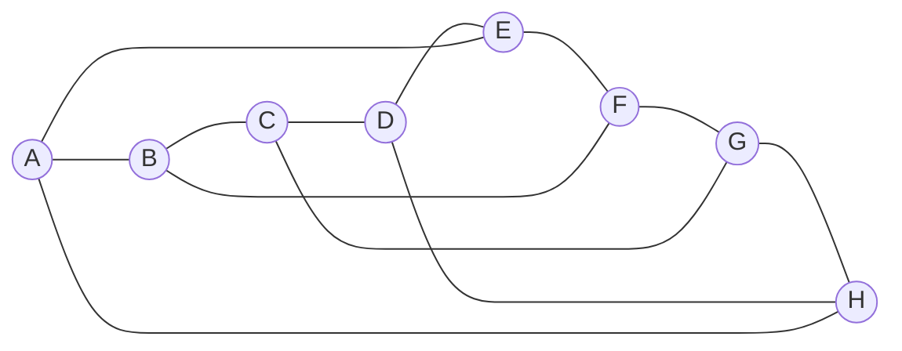
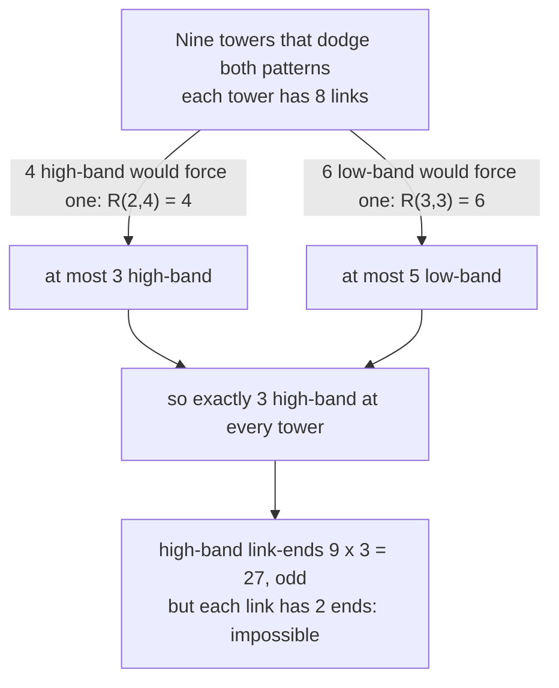

# Ramsey numbers: the size at which a pattern is forced, known exactly for only a handful of cases

[Syllabus](../../../SYLLABUS.md) → [Combinatorics and graphs](../README.md) → [Ramsey and Extremal, in Outline](../README.md#s14) → Ramsey numbers

---

## General Overview

Nine radio towers, A to I, sit within line of sight of each other. Every pair shares one direct radio link: 36 links. Each link runs on either the high band or the low band, giving 68719476736 ways to assign the bands.

To curb mutual interference, engineers try to avoid three towers all linked on the high band, or four all linked on the low band: a **high-band trio** or a **low-band foursome**. Whatever the assignment, nine towers force one of those two patterns. Eight towers can escape both, or **dodge**; the picture below shows how.

So nine is the threshold for "a high-band trio or a low-band foursome". Such thresholds are **Ramsey numbers**, after Frank Ramsey, who proved in 1930 that one always exists. The six-guest party of [Friends and strangers](01-friends-and-strangers.md) is the smallest case.

**Each threshold is at most the sum of the two below it, so every threshold exists; exact values also need a dodging example, and only a handful are known.**

**What kind of fact this is:** a theorem, proved on this card in Why it works. The larger values in the table rest on published proofs and computer searches. The code rechecks R(3,4) and the floors, or lower limits, for R(3,5) and R(4,4).

### The picture: eight towers that dodge both patterns



Lines are the 12 high-band links: a ring of eight, plus a link from each tower straight across to its opposite. Every link not drawn uses the low band, and every tower has 3 high-band links. Of the 56 trios and 70 foursomes, the code finds 0 high-band trios and 0 low-band foursomes.

---

## The formula

Notation first, in words. $`R(s,t)`$, read "R of s and t", is the fewest towers that force either $`s`$ towers all linked on the high band or $`t`$ towers all linked on the low band. $`C(n, k)`$ is "n choose k", the number of ways to pick k things from n ([Pascal's rule](../03-Binomial%20Coefficients%20and%20Identities/01-pascals-rule-and-the-triangle.md)).

```math
R(s,t) \le R(s-1,\,t) + R(s,\,t-1)
```

**Read it aloud:** the threshold is at most the threshold with one fewer high-band tower plus the one with one fewer low-band tower.

The two thresholds on the right are its feeders. A proved upper limit like this is a ceiling; a lower limit, shown by a network that dodges, is a floor.

Unrolled to the bottom, it becomes one count:

```math
R(s,t) \le C(s+t-2,\ s-1)
```

**Read it aloud:** the threshold is at most the number of ways to choose s − 1 things from s + t − 2.

For the radio network: $`R(3,4) \le R(2,4) + R(3,3) = 4 + 6 = 10`$, and $`C(5, 2) = 10`$ too. A parity step, an even-or-odd count in Step 2, cuts 10 to 9.

| Symbol | Plain meaning | In our example | Push it up and the answer… |
| --- | --- | --- | --- |
| $`R(s,t)`$ | fewest towers forcing s all-high-band or t all-low-band | $`R(3,4) = 9`$ | — |
| $`s`$ | size of the all-high-band group demanded | 3, a high-band trio | rises |
| $`t`$ | size of the all-low-band group demanded | 4, a low-band foursome | rises |
| $`n`$ | number of towers in the network | 8 dodge, 9 cannot | from R(s,t) on, the pattern is certain |
| $`C(n, k)`$ | n choose k: ways to pick k from n | C(9, 2) = 36 links | — |
| $`p`$ | high-band links at one tower | exactly 3, if nine towers were to dodge | — |

### When it holds

- **Every link assigned, one of two bands.** An unassigned link serves neither pattern, and the count no longer applies.
- **The recursion is a ceiling, not a value.** It is exact for $`R(3,5)`$ and $`R(4,4)`$, but gives 32 (31 after parity) for $`R(4,5)`$, whose true value is 25.
- **The parity step needs both feeders even.** 4 and 6 are, so 10 drops to 9. For $`R(4,4)`$ the feeders are 9 and 9: no drop.
- **More than two bands.** The same split still works, with bigger ceilings.

---

## Why it works

### Step 0: stand at one tower and split its links

Pick one tower and sort its links by band. The two piles add up to all its links, so one pile is large, and a large pile hands the problem down to a smaller threshold.

### Step 1: the ceiling R(3,4) ≤ 10

Take ten towers. Tower A has 9 links. Suppose 4 use the high band. $`R(2,4) = 4`$ says those four towers hold a high-band link or are a low-band foursome. A high-band link between two of them, with their high-band links to A, makes a high-band trio.

Otherwise at most 3 use the high band, so 6 use the low band. $`R(3,3) = 6`$ says those six hold a high-band trio or a low-band trio, and a low-band trio plus A is a low-band foursome.

### Step 2: the parity step cuts 10 to 9

Suppose nine towers dodge both patterns. Each tower has 8 links. By Step 1, 4 high-band or 6 low-band at one tower would force a pattern, so each tower has at most 3 high-band and at most 5 low-band. These add to 8, so every tower has exactly $`p = 3`$ high-band links.

Count high-band link-ends tower by tower: 9 × 3 = 27. Every link has 2 ends, so the count must be even. It is odd, so no such network exists: $`R(3,4) \le 9`$.



### Step 3: eight towers dodge, so R(3,4) = 9

The first picture's network dodges, so eight towers are not enough: $`R(3,4) = 9`$. The code's search, building every dodging network tower by tower, agrees: 17640 dodging band assignments of eight named towers, 0 of nine.

### Step 4: the general recursion and the binomial ceiling

Steps 1 and 2 used nothing special about 3 and 4, so the recursion holds for every $`s`$ and $`t`$.

<details>
<summary>Detailed proof: the recursion, the parity step, and the binomial ceiling</summary>

Let a = R(s−1, t) and b = R(s, t−1), and take a + b towers. A tower v has a + b − 1 links, so at least a use the high band or at least b use the low band.

**At least a high-band.** Those towers hold s − 1 all-high-band, which v joins on the high band to make s, or t all-low-band.

**At least b low-band.** Those towers hold s all-high-band, or t − 1 all-low-band, which v joins on the low band to make t.

**Parity.** Let a and b be even, and suppose a + b − 1 towers dodge. Each tower has a + b − 2 links, at most a − 1 high-band and at most b − 1 low-band, so exactly a − 1 high-band: odd.

An odd number of towers with odd high-band counts gives an odd total of high-band ends. Every link has two ends, so no such network exists: R(s, t) ≤ a + b − 1.

**Binomial ceiling.** R(2, t) = t = C(t, 1): t towers hold a high-band link or are all low-band, and t − 1 all-low-band towers dodge. Pascal's rule C(s+t−3, s−2) + C(s+t−3, s−1) = C(s+t−2, s−1) then carries the ceiling up by induction on s + t. The base R(s, 2) = s = C(s, s−1) works the same way.

</details>

The binomial ceiling is finite, so every Ramsey number exists. That is Ramsey's theorem in outline: however large the demanded pattern, some finite network forces it. Ramsey's 1930 version allows any number of bands, and labels groups of any fixed size rather than pairs; the proof is the same split, nested.

### Step 5: why the table stays so short

An exact value needs a ceiling and a dodging network one tower short. For $`R(4,4) = 18`$ that network is 17 towers round a clock face. A link uses the high band when its tower gap round the clock is 1, 2, 4, 8, 9, 13, 15 or 16 — the remainders of squares divided by 17.

None of its 2380 foursomes uses one band. For $`R(3,5) = 14`$, a 13-tower clock with high-band gaps 1, 5, 8 and 12 does the same.

Past that, search fails. For $`R(5,5)`$ the recursion gives 50 and the binomial 70. Geoffrey Exoo found a dodging network one tower short of 43 in 1989; Vigleik Angeltveit and Brendan McKay proved the ceiling 46 by computer, posted in 2024. The value lies from 43 to 46.

Floors can also come from counting bad assignments, without building a network ([Erdos's counting trick](03-probabilistic-method-by-counting.md)).

---

## Worked numbers, by hand

| Step | Arithmetic | Value |
| --- | --- | --- |
| links among nine towers | C(9, 2) | 36 |
| ceiling from the recursion | R(2,4) + R(3,3) = 4 + 6 | 10 |
| at one of nine towers | 4 − 1 high-band, 6 − 1 low-band | 3 and 5 |
| high-band link-ends | 9 × 3 | 27, odd |
| ceiling after parity | 10 − 1 | 9 |
| the eight-tower network | 56 trios and 70 foursomes checked | 0 bad |
| **R(3,4)** | ceiling meets floor | **9** |

| s, t | 3,3 | 3,4 | 3,5 | 4,4 | 4,5 | 5,5 |
| --- | --- | --- | --- | --- | --- | --- |
| known R(s,t) | 6 | 9 | 14 | 18 | 25 | 43 to 46 |
| binomial ceiling C(s+t−2, s−1) | 6 | 10 | 15 | 20 | 35 | 70 |
| recursion on known values | 6 | 10 | 14 | 18 | 32 | 50 |

The second table shows how fast exact knowledge runs out.

### What breaks if you drop a piece

| Mistake | Comes out at | What went wrong |
| --- | --- | --- |
| Skipping the parity step | R(3,4) ≤ 10 | True, but leaves 9 or 10 open |
| Binomial ceiling read as the value | R(5,5) = 70 | The truth is 43 to 46 |
| Looking only for high-band trios | 0 in an all-low-band network of 9 | The network picks the pattern |

---

## Code, from first principles, and it actually runs

Nothing is imported. Road one is the proof: feeders, recursion, parity. Road two is a search that adds one tower at a time, keeping every network that still dodges. On six towers the search is checked against brute force over all 32768 assignments. Ceilings come from factorials and from the recursion.

### Python

```python
# Ramsey numbers -- the check behind the card.  Nothing is imported.  Radio towers, every pair sharing
# one direct link, high-band or low-band.  A network is a list of bitmasks: bit j of adj[i] is set when
# link i-j uses the high band.  R(3,4) = 9 is reached twice: recursion with parity, and full search.
T, PAIRS = "ABCDEFGHI", [(3, 3), (3, 4), (3, 5), (4, 4), (4, 5), (5, 5)]
def cliques(adj, m, k, lo=0):                # k-sets inside the set m with every link among them in adj
    return 1 if k == 0 else sum(cliques(adj, adj[v] & m, k - 1, v + 1) for v in range(lo, len(adj)) if m >> v & 1)
def other(adj): return [((1 << len(adj)) - 1) ^ a ^ (1 << i) for i, a in enumerate(adj)]
def dodges(adj, s, t): return not cliques(adj, (1 << len(adj)) - 1, s) and not cliques(other(adj), (1 << len(adj)) - 1, t)
def sweep(s, t, top):                        # road two: add one tower at a time, keep every network that dodges
    level, counts = [[]], {}                 # S: the towers the new tower reaches on the high band
    for n in range(1, top + 1):
        level = [[a | (S >> i & 1) << len(adj) for i, a in enumerate(adj)] + [S] for adj in level for S in range(1 << len(adj))
                 if not cliques(adj, S, s - 1) and not cliques(other(adj), ((1 << len(adj)) - 1) & ~S, t - 1)]
        counts[n] = len(level)
    return counts
def labelled(col, n=6):                      # six towers, link number b high-band when bit b of col is set
    P = [(i, j) for i in range(n) for j in range(i + 1, n)]
    return [sum(1 << (x ^ y ^ i) for b, (x, y) in enumerate(P) if i in (x, y) and col >> b & 1) for i in range(n)]
def network(n, gaps): return [sum(1 << j for j in range(n) if (j - i) % n in gaps) for i in range(n)]
def fact(n): return 1 if n < 2 else n * fact(n - 1)
def binom(n, k): return fact(n) // (fact(k) * fact(n - k))    # n choose k from factorials
def rec(s, t): return t if s == 2 else s if t == 2 else rec(s - 1, t) + rec(s, t - 1)
def known(s, t): return {(2, t): t, (s, 2): s, (3, 3): 6, (3, 4): 9, (4, 3): 9, (3, 5): 14, (5, 3): 14,
                         (4, 4): 18, (4, 5): 25, (5, 4): 25}.get((s, t))
e33, e24, e34 = sweep(3, 3, 6), sweep(2, 4, 4), sweep(3, 4, 9)
r33, r24, r34 = (min(n for n in e if e[n] == 0) for e in (e33, e24, e34))   # first size with no escape
brute6 = sum(dodges(labelled(col), 3, 4) for col in range(1 << 15))   # road three: all 15 links of six towers
high = 8 - (r33 - 1); ends = 9 * high        # at most R(3,3) - 1 low-band of 8; high-band link-ends, tower by tower
ring, paley, c13 = network(8, {1, 4, 7}), network(17, {x * x % 17 for x in range(1, 17)}), network(13, {1, 5, 8, 12})
links = [T[i] + "-" + T[j] for i in range(8) for j in range(i + 1, 8) if ring[i] >> j & 1]
chain = [known(s - 1, t) + known(s, t - 1) for s, t in PAIRS]
print(f"nine towers {T}: links C(9,2) = {binom(9, 2)}, band assignments 2^36 = {2 ** 36}")
print(f"search, no high-band trio or low-band trio: 5 towers {e33[5]}, 6 towers {e33[6]}, so R(3,3) = {r33}")
print(f"search, no high-band link or low-band foursome: 3 towers {e24[3]}, 4 towers {e24[4]}, so R(2,4) = {r24}")
print(f"recursion: R(3,4) <= R(2,4) + R(3,3) = {r24} + {r33} = {r24 + r33}")
print(f"nine towers, 8 links each: high-band at most {r24 - 1}, low-band at most {r33 - 1}, so high-band exactly {high}")
print(f"high-band link-ends 9 x {high} = {ends}, odd, but every link has 2 ends: no such network, R(3,4) <= 9")
print("search, no high-band trio or low-band foursome: " + ", ".join(f"{n} towers {e34[n]}" for n in range(6, 10)))
print(f"six towers by brute force over all {2 ** 15} assignments: {brute6} dodge")
print(f"the 8-tower escape, high-band: {', '.join(links)}")
print(f"  high-band trios {cliques(ring, 255, 3)} of {binom(8, 3)}, low-band foursomes {cliques(other(ring), 255, 4)} "
      f"of {binom(8, 4)}, high-band links per tower {[bin(a).count('1') for a in ring]}, so R(3,4) = 9")
print("s,t            " + "".join(f"{s},{t}".rjust(8) for s, t in PAIRS))
print("known R(s,t)   " + "".join(str(known(s, t) or "43..46").rjust(8) for s, t in PAIRS))
print("C(s+t-2, s-1)  " + "".join(str(binom(s + t - 2, s - 1)).rjust(8) for s, t in PAIRS))
print("by recursion   " + "".join(str(rec(s, t)).rjust(8) for s, t in PAIRS))
print("chained known  " + "".join(str(c).rjust(8) for c in chain))
print(f"17 towers, high-band when the gap is a square mod 17: one-band foursomes {cliques(paley, (1 << 17) - 1, 4)}"
      f" + {cliques(other(paley), (1 << 17) - 1, 4)} of {binom(17, 4)}, so R(4,4) > 17")
print(f"13 towers, high-band at gaps 1, 5, 8, 12: high-band trios {cliques(c13, (1 << 13) - 1, 3)}, low-band five-sets "
      f"{cliques(other(c13), (1 << 13) - 1, 5)} of {binom(13, 5)}, so R(3,5) > 13")
print(f"mistake 1, parity step skipped: R(3,4) <= {r24 + r33}; mistake 2, ceiling read as the value: R(5,5) = "
      f"{binom(8, 4)}; mistake 3, only high-band trios counted: an all-low-band network of 9 has {cliques([0] * 9, 511, 3)}")
assert e34[9] == 0 and ends % 2 == 1         # the search and the parity step agree: nine towers never dodge
assert brute6 == e34[6]                      # one-tower-at-a-time search against assigning every link
assert all(binom(s + t - 2, s - 1) == rec(s, t) for s, t in PAIRS)
assert dodges(ring, 3, 4) and dodges(paley, 4, 4) and dodges(c13, 3, 5) and \
    (len(ring) + 1, len(c13) + 1, len(paley) + 1) == (r34, rec(2, 5) + r34, r34 + r34)   # floors meet ceilings
print("ALL CHECKS PASS")
```

**Ran 2026-11-25 on macOS, Python 3.14.10, standard library only. All checks passed. Output, pasted from the run:**

```
nine towers ABCDEFGHI: links C(9,2) = 36, band assignments 2^36 = 68719476736
search, no high-band trio or low-band trio: 5 towers 12, 6 towers 0, so R(3,3) = 6
search, no high-band link or low-band foursome: 3 towers 1, 4 towers 0, so R(2,4) = 4
recursion: R(3,4) <= R(2,4) + R(3,3) = 4 + 6 = 10
nine towers, 8 links each: high-band at most 3, low-band at most 5, so high-band exactly 3
high-band link-ends 9 x 3 = 27, odd, but every link has 2 ends: no such network, R(3,4) <= 9
search, no high-band trio or low-band foursome: 6 towers 2812, 7 towers 13842, 8 towers 17640, 9 towers 0
six towers by brute force over all 32768 assignments: 2812 dodge
the 8-tower escape, high-band: A-B, A-E, A-H, B-C, B-F, C-D, C-G, D-E, D-H, E-F, F-G, G-H
  high-band trios 0 of 56, low-band foursomes 0 of 70, high-band links per tower [3, 3, 3, 3, 3, 3, 3, 3], so R(3,4) = 9
s,t                 3,3     3,4     3,5     4,4     4,5     5,5
known R(s,t)          6       9      14      18      25  43..46
C(s+t-2, s-1)         6      10      15      20      35      70
by recursion          6      10      15      20      35      70
chained known         6      10      14      18      32      50
17 towers, high-band when the gap is a square mod 17: one-band foursomes 0 + 0 of 2380, so R(4,4) > 17
13 towers, high-band at gaps 1, 5, 8, 12: high-band trios 0, low-band five-sets 0 of 1287, so R(3,5) > 13
mistake 1, parity step skipped: R(3,4) <= 10; mistake 2, ceiling read as the value: R(5,5) = 70; mistake 3, only high-band trios counted: an all-low-band network of 9 has 0
ALL CHECKS PASS
```

### Rust

Same numbers, same labels, built with `rustc --edition 2021 -O`.

```rust
// Ramsey numbers -- the same check as the Python, in Rust.  No crates.  Radio towers, every pair sharing
// one direct link, high-band or low-band.  A network is a list of bitmasks: bit j of adj[i] is set when
// link i-j uses the high band.  R(3,4) = 9 is reached twice: recursion with parity, and full search.
const T: &str = "ABCDEFGHI";
const PAIRS: [(u64, u64); 6] = [(3, 3), (3, 4), (3, 5), (4, 4), (4, 5), (5, 5)];
fn cliques(adj: &[u32], m: u32, k: u32, lo: usize) -> u64 {  // k-sets inside m, every link among them in adj
    if k == 0 { return 1 }
    (lo..adj.len()).filter(|&v| m >> v & 1 == 1).map(|v| cliques(adj, adj[v] & m, k - 1, v + 1)).sum()
}
fn full(n: usize) -> u32 { ((1u64 << n) - 1) as u32 }
fn other(adj: &[u32]) -> Vec<u32> { adj.iter().enumerate().map(|(i, &a)| full(adj.len()) ^ a ^ (1 << i)).collect() }
fn dodges(adj: &[u32], s: u32, t: u32) -> bool { cliques(adj, full(adj.len()), s, 0) == 0 && cliques(&other(adj), full(adj.len()), t, 0) == 0 }
fn sweep(s: u32, t: u32, top: usize) -> Vec<usize> {  // road two: add one tower at a time, keep every network that dodges
    let (mut level, mut counts): (Vec<Vec<u32>>, Vec<usize>) = (vec![vec![]], vec![0]);
    for _ in 1..=top {                          // sm: the towers the new tower reaches on the high band
        level = level.iter().flat_map(|adj| (0..1u32 << adj.len())
            .filter(move |&sm| cliques(adj, sm, s - 1, 0) == 0 && cliques(&other(adj), full(adj.len()) & !sm, t - 1, 0) == 0)
            .map(move |sm| { let mut nx: Vec<u32> = adj.iter().enumerate().map(|(i, &a)| a | (sm >> i & 1) << adj.len()).collect(); nx.push(sm); nx }))
            .collect();
        counts.push(level.len());
    }
    counts
}
fn labelled(col: u32) -> Vec<u32> {           // six towers, link number b high-band when bit b of col is set
    let (mut adj, mut b) = (vec![0u32; 6], 0);
    for i in 0..6 { for j in i + 1..6 { if col >> b & 1 == 1 { adj[i] |= 1 << j; adj[j] |= 1 << i } b += 1 } }
    adj
}
fn network(n: usize, gaps: &[usize]) -> Vec<u32> {
    (0..n).map(|i| (0..n).filter(|&j| gaps.contains(&((j + n - i) % n))).map(|j| 1u32 << j).sum()).collect()
}
fn binom(n: u64, k: u64) -> u64 {             // n choose k from factorials
    let fact = |x: u64| (1..=x).product::<u64>();
    fact(n) / (fact(k) * fact(n - k))
}
fn rec(s: u64, t: u64) -> u64 { if s == 2 { t } else if t == 2 { s } else { rec(s - 1, t) + rec(s, t - 1) } }
fn known(s: u64, t: u64) -> Option<u64> {
    if s == 2 { return Some(t) } if t == 2 { return Some(s) }
    match (s.min(t), s.max(t)) { (3, 3) => Some(6), (3, 4) => Some(9), (3, 5) => Some(14), (4, 4) => Some(18), (4, 5) => Some(25), _ => None }
}
fn row(label: &str, cells: Vec<String>) { println!("{}{}", label, cells.iter().map(|c| format!("{:>8}", c)).collect::<String>()) }
fn main() {
    let (e33, e24, e34) = (sweep(3, 3, 6), sweep(2, 4, 4), sweep(3, 4, 9));
    let first_zero = |e: &Vec<usize>| (1..e.len()).find(|&n| e[n] == 0).unwrap() as u64;
    let (r33, r24, r34) = (first_zero(&e33), first_zero(&e24), first_zero(&e34));
    let brute6 = (0..1u32 << 15).filter(|&col| dodges(&labelled(col), 3, 4)).count();   // road three
    let (high, ends) = (8 - (r33 - 1), 9 * (8 - (r33 - 1)));   // at most R(3,3) - 1 low-band of 8; high-band link-ends
    let (ring, paley, c13) = (network(8, &[1, 4, 7]), network(17, &(1..17).map(|x| x * x % 17).collect::<Vec<usize>>()), network(13, &[1, 5, 8, 12]));
    let tb = T.as_bytes();
    let links: Vec<String> = (0..8).flat_map(|i| (i + 1..8).map(move |j| (i, j))).filter(|&(i, j)| ring[i] >> j & 1 == 1)
        .map(|(i, j)| format!("{}-{}", tb[i] as char, tb[j] as char)).collect();
    let chain: Vec<u64> = PAIRS.iter().map(|&(s, t)| known(s - 1, t).unwrap() + known(s, t - 1).unwrap()).collect();
    println!("nine towers {}: links C(9,2) = {}, band assignments 2^36 = {}", T, binom(9, 2), 1u64 << 36);
    println!("search, no high-band trio or low-band trio: 5 towers {}, 6 towers {}, so R(3,3) = {}", e33[5], e33[6], r33);
    println!("search, no high-band link or low-band foursome: 3 towers {}, 4 towers {}, so R(2,4) = {}", e24[3], e24[4], r24);
    println!("recursion: R(3,4) <= R(2,4) + R(3,3) = {} + {} = {}", r24, r33, r24 + r33);
    println!("nine towers, 8 links each: high-band at most {}, low-band at most {}, so high-band exactly {}", r24 - 1, r33 - 1, high);
    println!("high-band link-ends 9 x {} = {}, odd, but every link has 2 ends: no such network, R(3,4) <= 9", high, ends);
    println!("search, no high-band trio or low-band foursome: {}", (6..10).map(|n| format!("{} towers {}", n, e34[n])).collect::<Vec<_>>().join(", "));
    println!("six towers by brute force over all {} assignments: {} dodge", 1u32 << 15, brute6);
    println!("the 8-tower escape, high-band: {}", links.join(", "));
    println!("  high-band trios {} of {}, low-band foursomes {} of {}, high-band links per tower {:?}, so R(3,4) = 9",
             cliques(&ring, 255, 3, 0), binom(8, 3), cliques(&other(&ring), 255, 4, 0), binom(8, 4), ring.iter().map(|a| a.count_ones()).collect::<Vec<u32>>());
    row("s,t            ", PAIRS.iter().map(|&(s, t)| format!("{},{}", s, t)).collect());
    row("known R(s,t)   ", PAIRS.iter().map(|&(s, t)| known(s, t).map_or("43..46".to_string(), |v| v.to_string())).collect());
    row("C(s+t-2, s-1)  ", PAIRS.iter().map(|&(s, t)| binom(s + t - 2, s - 1).to_string()).collect());
    row("by recursion   ", PAIRS.iter().map(|&(s, t)| rec(s, t).to_string()).collect());
    row("chained known  ", chain.iter().map(|c| c.to_string()).collect());
    println!("17 towers, high-band when the gap is a square mod 17: one-band foursomes {} + {} of {}, so R(4,4) > 17",
             cliques(&paley, full(17), 4, 0), cliques(&other(&paley), full(17), 4, 0), binom(17, 4));
    println!("13 towers, high-band at gaps 1, 5, 8, 12: high-band trios {}, low-band five-sets {} of {}, so R(3,5) > 13",
             cliques(&c13, full(13), 3, 0), cliques(&other(&c13), full(13), 5, 0), binom(13, 5));
    println!("mistake 1, parity step skipped: R(3,4) <= {}; mistake 2, ceiling read as the value: R(5,5) = {}; mistake 3, only high-band trios counted: an all-low-band network of 9 has {}",
             r24 + r33, binom(8, 4), cliques(&[0u32; 9], 511, 3, 0));
    assert!(e34[9] == 0 && ends % 2 == 1);     // the search and the parity step agree: nine towers never dodge
    assert!(brute6 == e34[6]);                 // one-tower-at-a-time search against assigning every link
    assert!(PAIRS.iter().all(|&(s, t)| binom(s + t - 2, s - 1) == rec(s, t)));
    assert!(dodges(&ring, 3, 4) && dodges(&paley, 4, 4) && dodges(&c13, 3, 5) && (ring.len() as u64 + 1, c13.len() as u64 + 1, paley.len() as u64 + 1) == (r34, rec(2, 5) + r34, r34 + r34));
    println!("ALL CHECKS PASS");
}
```

**Ran 2026-11-25 on macOS, rustc 1.98.1, no crates. All checks passed. Output, pasted from the run:**

```
nine towers ABCDEFGHI: links C(9,2) = 36, band assignments 2^36 = 68719476736
search, no high-band trio or low-band trio: 5 towers 12, 6 towers 0, so R(3,3) = 6
search, no high-band link or low-band foursome: 3 towers 1, 4 towers 0, so R(2,4) = 4
recursion: R(3,4) <= R(2,4) + R(3,3) = 4 + 6 = 10
nine towers, 8 links each: high-band at most 3, low-band at most 5, so high-band exactly 3
high-band link-ends 9 x 3 = 27, odd, but every link has 2 ends: no such network, R(3,4) <= 9
search, no high-band trio or low-band foursome: 6 towers 2812, 7 towers 13842, 8 towers 17640, 9 towers 0
six towers by brute force over all 32768 assignments: 2812 dodge
the 8-tower escape, high-band: A-B, A-E, A-H, B-C, B-F, C-D, C-G, D-E, D-H, E-F, F-G, G-H
  high-band trios 0 of 56, low-band foursomes 0 of 70, high-band links per tower [3, 3, 3, 3, 3, 3, 3, 3], so R(3,4) = 9
s,t                 3,3     3,4     3,5     4,4     4,5     5,5
known R(s,t)          6       9      14      18      25  43..46
C(s+t-2, s-1)         6      10      15      20      35      70
by recursion          6      10      15      20      35      70
chained known         6      10      14      18      32      50
17 towers, high-band when the gap is a square mod 17: one-band foursomes 0 + 0 of 2380, so R(4,4) > 17
13 towers, high-band at gaps 1, 5, 8, 12: high-band trios 0, low-band five-sets 0 of 1287, so R(3,5) > 13
mistake 1, parity step skipped: R(3,4) <= 10; mistake 2, ceiling read as the value: R(5,5) = 70; mistake 3, only high-band trios counted: an all-low-band network of 9 has 0
ALL CHECKS PASS
```

The two outputs match line for line.

### Lean

Lean proves the recursion, its parity step, the binomial ceiling and $`R(3,4) = 9`$, for networks of any size.

- $`R(s,t) \le R(s-1,\,t) + R(s,\,t-1)`$ for every $`s`$ and $`t`$ of 2 or more.
- When both feeders are even, one tower fewer is enough.
- $`R(s,t) \le C(s+t-2,\ s-1)`$ for every $`s`$ and $`t`$, so every Ramsey number exists.
- Nine towers always hold a high-band trio or a low-band foursome, and some eight towers dodge both, so $`R(3,4) = 9`$.
- The picture's network has 12 high-band links, 3 at every tower, 0 high-band trios of 56 and 0 low-band foursomes of 70.

The searches, the six-tower brute force and the floors for $`R(3,5)`$ and $`R(4,4)`$ are left to the Python and Rust checks.

```lean
-- Ramsey numbers: when every radio link between towers uses the high band or the low band, the threshold for s all-high-band or t all-low-band towers is at most the sum of its two feeders (one less when both are even), it is at most C(s+t-2, s-1) so it always exists, and R(3,4) = 9.
import Mathlib.Combinatorics.SimpleGraph.Clique
import Mathlib.Combinatorics.SimpleGraph.DegreeSum
import Mathlib.Data.Nat.Choose.Basic

open SimpleGraph

/-- Helper: a clique-or-independent-set guarantee on `W` transfers along an embedding into `V`. -/
theorem ramsey_transfer {W V : Type} {n m : ℕ}
    (h : ∀ G : SimpleGraph W, ∃ S : Finset W, G.IsNClique n S ∨ G.IsNIndepSet m S)
    (f : W ↪ V) (G : SimpleGraph V) :
    ∃ S : Finset W, G.IsNClique n (S.map f) ∨ G.IsNIndepSet m (S.map f) := by
  obtain ⟨S, hS⟩ := h (G.comap f)
  refine ⟨S, ?_⟩
  rcases hS with hS | hS
  · left
    rw [isNClique_iff] at hS ⊢
    refine ⟨?_, by simpa using hS.2⟩
    intro x hx y hy hxy
    simp only [Finset.coe_map, Set.mem_image, Finset.mem_coe] at hx hy
    obtain ⟨x, hx, rfl⟩ := hx
    obtain ⟨y, hy, rfl⟩ := hy
    exact hS.1 hx hy (fun h => hxy (by rw [h]))
  · right
    rw [isNIndepSet_iff] at hS ⊢
    refine ⟨?_, by simpa using hS.2⟩
    intro x hx y hy hxy
    simp only [Finset.coe_map, Set.mem_image, Finset.mem_coe] at hx hy
    obtain ⟨x, hx, rfl⟩ := hx
    obtain ⟨y, hy, rfl⟩ := hy
    exact hS.1 hx hy (fun h => hxy (by rw [h]))

/-- Helper: an embedding of `Fin a` into a finset of size at least `a`. -/
theorem ramsey_embed {V : Type} (T : Finset V) {a : ℕ} (h : a ≤ T.card) :
    ∃ f : Fin a ↪ V, ∀ i, f i ∈ T := by
  obtain ⟨e⟩ := Function.Embedding.nonempty_of_card_le (α := Fin a) (β := T) (by simpa using h)
  exact ⟨e.trans (Function.Embedding.subtype _), fun i => (e i).2⟩

/-- Helper: the guarantee for `Fin 0` is impossible when both sizes are positive. -/
theorem ramsey_feeder_pos {a n m : ℕ} (hn : 1 ≤ n) (hm : 1 ≤ m)
    (h : ∀ G : SimpleGraph (Fin a), ∃ S : Finset (Fin a), G.IsNClique n S ∨ G.IsNIndepSet m S) :
    1 ≤ a := by
  by_contra ha
  obtain rfl : a = 0 := by omega
  obtain ⟨S, hS⟩ := h ⊥
  have : S = ∅ := Finset.eq_empty_of_isEmpty S
  subst this
  rcases hS with hS | hS
  · have := hS.card_eq; simp at this; omega
  · have := hS.card_eq; simp at this; omega

/-- Helper: one step of the recursion at a chosen tower `v`. -/
theorem ramsey_step {V : Type} [Fintype V] [DecidableEq V] (G : SimpleGraph V) [DecidableRel G.Adj]
    {s t a b : ℕ} (hs : 2 ≤ s) (ht : 2 ≤ t)
    (ha : ∀ G : SimpleGraph (Fin a), ∃ S : Finset (Fin a), G.IsNClique (s - 1) S ∨ G.IsNIndepSet t S)
    (hb : ∀ G : SimpleGraph (Fin b), ∃ S : Finset (Fin b), G.IsNClique s S ∨ G.IsNIndepSet (t - 1) S)
    (v : V) (hv : a ≤ G.degree v ∨ b ≤ Fintype.card V - 1 - G.degree v) :
    ∃ S : Finset V, G.IsNClique s S ∨ G.IsNIndepSet t S := by
  rcases hv with hv | hv
  · rw [← card_neighborFinset_eq_degree] at hv
    obtain ⟨f, hf⟩ := ramsey_embed _ hv
    obtain ⟨S, hS | hS⟩ := ramsey_transfer ha f G
    · refine ⟨insert v (S.map f), Or.inl ?_⟩
      have := hS.insert (a := v) (fun w hw => by
        obtain ⟨i, -, rfl⟩ := Finset.mem_map.1 hw
        simpa using hf i)
      rwa [show s - 1 + 1 = s by omega] at this
    · exact ⟨_, Or.inr hS⟩
  · set M := (G.neighborFinset v)ᶜ.erase v with hM
    have hcard : M.card = Fintype.card V - 1 - G.degree v := by
      rw [hM, Finset.card_erase_of_mem (by simp), Finset.card_compl, card_neighborFinset_eq_degree]
      omega
    rw [← hcard] at hv
    obtain ⟨f, hf⟩ := ramsey_embed _ hv
    obtain ⟨S, hS | hS⟩ := ramsey_transfer hb f G
    · exact ⟨_, Or.inl hS⟩
    · refine ⟨insert v (S.map f), Or.inr ?_⟩
      rw [← isNClique_compl] at hS ⊢
      have := hS.insert (a := v) (fun w hw => by
        obtain ⟨i, -, rfl⟩ := Finset.mem_map.1 hw
        have := hf i
        rw [hM, Finset.mem_erase, Finset.mem_compl, mem_neighborFinset] at this
        rw [compl_adj]
        exact ⟨Ne.symm this.1, this.2⟩)
      rwa [show t - 1 + 1 = t by omega] at this

/-- Helper: the eight-tower network, defined again here so the proof can use it. -/
def eightTowersAux : SimpleGraph (Fin 8) where
  Adj i j := (i.val + 8 - j.val) % 8 = 1 ∨ (i.val + 8 - j.val) % 8 = 4 ∨ (i.val + 8 - j.val) % 8 = 7
  symm := ⟨by decide⟩
  loopless := ⟨by decide⟩

instance : DecidableRel eightTowersAux.Adj := fun i j =>
  inferInstanceAs (Decidable ((i.val + 8 - j.val) % 8 = 1 ∨ (i.val + 8 - j.val) % 8 = 4 ∨
    (i.val + 8 - j.val) % 8 = 7))

#print axioms ramsey_transfer
#print axioms ramsey_embed
#print axioms ramsey_feeder_pos
#print axioms ramsey_step

/-- The recursion, with its parity step. Radio towers are the vertices of a finite type `V`; a link
uses the high band when it is an edge of `G` and the low band when it is not, so every link gets
exactly one of the two bands. Let `a` towers always force `s - 1` all-high-band or `t` all-low-band
(that is, `R(s-1, t) ≤ a`), and `b` towers always force `s` all-high-band or `t - 1` all-low-band
(`R(s, t-1) ≤ b`). Then any network of `a + b` or more towers holds `s` towers all linked on the
high band or `t` towers all linked on the low band: `R(s,t) ≤ R(s-1,t) + R(s,t-1)`. If `a` and `b`
are both even, `a + b - 1` towers already suffice. -/
theorem ramsey_le_sum_of_feeders {s t a b : ℕ} (hs : 2 ≤ s) (ht : 2 ≤ t)
    (ha : ∀ G : SimpleGraph (Fin a), ∃ S : Finset (Fin a), G.IsNClique (s - 1) S ∨ G.IsNIndepSet t S)
    (hb : ∀ G : SimpleGraph (Fin b), ∃ S : Finset (Fin b), G.IsNClique s S ∨ G.IsNIndepSet (t - 1) S) :
    (∀ {V : Type} [Fintype V], a + b ≤ Fintype.card V →
      ∀ G : SimpleGraph V, ∃ S : Finset V, G.IsNClique s S ∨ G.IsNIndepSet t S) ∧
    (Even a → Even b → ∀ {V : Type} [Fintype V], a + b - 1 ≤ Fintype.card V →
      ∀ G : SimpleGraph V, ∃ S : Finset V, G.IsNClique s S ∨ G.IsNIndepSet t S) := by
  classical
  have ha1 : 1 ≤ a := ramsey_feeder_pos (by omega) (by omega) ha
  have part1 : ∀ {V : Type} [Fintype V], a + b ≤ Fintype.card V →
      ∀ G : SimpleGraph V, ∃ S : Finset V, G.IsNClique s S ∨ G.IsNIndepSet t S := by
    intro V _ hV G
    have : Nonempty V := Fintype.card_pos_iff.1 (by omega)
    obtain ⟨v⟩ := this
    have hd := G.degree_lt_card_verts v
    exact ramsey_step G hs ht ha hb v (by omega)
  refine ⟨part1, ?_⟩
  intro hae hbe V _ hV G
  by_cases hV' : a + b ≤ Fintype.card V
  · exact part1 hV' G
  have hVeq : Fintype.card V = a + b - 1 := by omega
  have : ∃ v, G.degree v ≠ a - 1 := by
    by_contra hall
    push Not at hall
    have hsum := G.sum_degrees_eq_twice_card_edges
    simp only [hall, Finset.sum_const, Finset.card_univ, smul_eq_mul] at hsum
    have hev : Even (Fintype.card V * (a - 1)) := ⟨_, hsum.trans (two_mul _)⟩
    rcases Nat.even_mul.1 hev with h | h
    · obtain ⟨x, hx⟩ := hae; obtain ⟨y, hy⟩ := hbe; obtain ⟨k, hk⟩ := h; omega
    · obtain ⟨x, hx⟩ := hae; obtain ⟨k, hk⟩ := h; omega
  obtain ⟨v, hv⟩ := this
  have hd := G.degree_lt_card_verts v
  exact ramsey_step G hs ht ha hb v (by omega)

/-- The binomial ceiling, so every threshold exists: however the links among
`C(s+t-2, s-1)` or more towers are assigned, some `s` towers are all linked on the high band or
some `t` towers are all linked on the low band. That is, `R(s,t) ≤ C(s+t-2, s-1)`. -/
theorem ramsey_le_choose (s t : ℕ) {V : Type} [Fintype V]
    (hV : Nat.choose (s + t - 2) (s - 1) ≤ Fintype.card V) (G : SimpleGraph V) :
    ∃ S : Finset V, G.IsNClique s S ∨ G.IsNIndepSet t S := by
  have key : ∀ n s t : ℕ, s + t ≤ n → ∀ {V : Type} [Fintype V],
      Nat.choose (s + t - 2) (s - 1) ≤ Fintype.card V →
      ∀ G : SimpleGraph V, ∃ S : Finset V, G.IsNClique s S ∨ G.IsNIndepSet t S := by
    intro n
    induction n with
    | zero =>
      intro s t hst V _ _ G
      obtain rfl : s = 0 := by omega
      exact ⟨∅, Or.inl (by simp [isNClique_iff])⟩
    | succ n ih =>
      intro s t hst V _ hV G
      match s, t with
      | 0, _ => exact ⟨∅, Or.inl (by simp [isNClique_iff])⟩
      | _, 0 => exact ⟨∅, Or.inr (by simp [isNIndepSet_iff])⟩
      | 1, t =>
        have : Nonempty V := Fintype.card_pos_iff.1 (by simp at hV; omega)
        obtain ⟨v⟩ := this
        exact ⟨{v}, Or.inl (isNClique_singleton.2 rfl)⟩
      | s + 2, 1 =>
        have : Nonempty V := Fintype.card_pos_iff.1 (by simp at hV; omega)
        obtain ⟨v⟩ := this
        refine ⟨{v}, Or.inr ?_⟩
        rw [← isNClique_compl]
        exact isNClique_singleton.2 rfl
      | s + 2, t + 2 =>
        have ha : ∀ G : SimpleGraph (Fin (Nat.choose (s + t + 1) s)),
            ∃ S : Finset (Fin (Nat.choose (s + t + 1) s)),
              G.IsNClique (s + 2 - 1) S ∨ G.IsNIndepSet (t + 2) S := by
          intro G
          exact ih (s + 1) (t + 2) (by omega)
            (by rw [Fintype.card_fin, show s + 1 + (t + 2) - 2 = s + t + 1 by omega]; simp) G
        have hb : ∀ G : SimpleGraph (Fin (Nat.choose (s + t + 1) (s + 1))),
            ∃ S : Finset (Fin (Nat.choose (s + t + 1) (s + 1))),
              G.IsNClique (s + 2) S ∨ G.IsNIndepSet (t + 2 - 1) S := by
          intro G
          exact ih (s + 2) (t + 1) (by omega)
            (by rw [Fintype.card_fin, show s + 2 + (t + 1) - 2 = s + t + 1 by omega]; simp) G
        refine (ramsey_le_sum_of_feeders (by omega) (by omega) ha hb).1 ?_ G
        rw [show s + 2 + (t + 2) - 2 = (s + t + 1) + 1 by omega, show s + 2 - 1 = s + 1 by omega,
          Nat.choose_succ_succ] at hV
        exact hV
  exact key _ s t le_rfl hV G

/-- `R(3,4) = 9`: nine or more towers always hold a high-band trio or a low-band foursome, and some
band assignment of the links among eight towers has neither. -/
theorem ramsey_three_four_eq_nine :
    (∀ {V : Type} [Fintype V], 9 ≤ Fintype.card V →
      ∀ G : SimpleGraph V, ∃ S : Finset V, G.IsNClique 3 S ∨ G.IsNIndepSet 4 S) ∧
    (∃ G : SimpleGraph (Fin 8), ∀ S : Finset (Fin 8), ¬ G.IsNClique 3 S ∧ ¬ G.IsNIndepSet 4 S) := by
  refine ⟨?_, ?_⟩
  · intro V _ hV G
    have ha : ∀ G : SimpleGraph (Fin 4), ∃ S : Finset (Fin 4), G.IsNClique (3 - 1) S ∨ G.IsNIndepSet 4 S :=
      fun G => ramsey_le_choose 2 4 (by simp) G
    have hb : ∀ G : SimpleGraph (Fin 6), ∃ S : Finset (Fin 6), G.IsNClique 3 S ∨ G.IsNIndepSet (4 - 1) S :=
      fun G => ramsey_le_choose 3 3 (by simp; decide) G
    exact (ramsey_le_sum_of_feeders (by omega) (by omega) ha hb).2 ⟨2, rfl⟩ ⟨3, rfl⟩ (by omega) G
  · refine ⟨eightTowersAux, fun S => ⟨fun h => ?_, fun h => ?_⟩⟩
    · have hc : (eightTowersAux.cliqueFinset 3).card = 0 := by decide
      rw [Finset.card_eq_zero] at hc
      have := (mem_cliqueFinset_iff (G := eightTowersAux)).2 h
      simp [hc] at this
    · have hc : (eightTowersAux.indepSetFinset 4).card = 0 := by decide
      rw [Finset.card_eq_zero] at hc
      have := (mem_indepSetFinset_iff (G := eightTowersAux)).2 h
      simp [hc] at this

/-- The card's eight-tower network: towers `0..7` round a ring (A to H), with a high-band link when
the gap between two towers, counted round the ring, is 1, 4 or 7: the ring of eight plus the four
links straight across. -/
def eightTowers : SimpleGraph (Fin 8) where
  Adj i j := (i.val + 8 - j.val) % 8 = 1 ∨ (i.val + 8 - j.val) % 8 = 4 ∨ (i.val + 8 - j.val) % 8 = 7
  symm := ⟨by decide⟩
  loopless := ⟨by decide⟩

instance : DecidableRel eightTowers.Adj := fun i j =>
  inferInstanceAs (Decidable ((i.val + 8 - j.val) % 8 = 1 ∨ (i.val + 8 - j.val) % 8 = 4 ∨
    (i.val + 8 - j.val) % 8 = 7))

-- Nine towers: C(9,2) = 36 links and 2^36 = 68719476736 band assignments.
example : Nat.choose 9 2 = 36 ∧ 2 ^ 36 = 68719476736 := by decide
-- The ceiling: R(2,4) + R(3,3) = 4 + 6 = 10 = C(5,2).
example : 4 + 6 = 10 ∧ Nat.choose 5 2 = 10 := by decide
-- At one of nine towers: 4 - 1 = 3 high-band at most, 6 - 1 = 5 low-band at most, 3 + 5 = 8 links;
-- high-band link-ends 9 × 3 = 27, odd; ceiling after parity 10 - 1 = 9.
example : 4 - 1 = 3 ∧ 6 - 1 = 5 ∧ 3 + 5 = 8 ∧ 9 * 3 = 27 ∧ ¬ Even 27 ∧ 10 - 1 = 9 := by decide
-- The eight-tower network: 12 high-band links, 3 at every tower, 0 high-band trios of C(8,3) = 56
-- and 0 low-band foursomes of C(8,4) = 70.
example : eightTowers.edgeFinset.card = 12 ∧ (∀ v, eightTowers.degree v = 3) ∧
    Nat.choose 8 3 = 56 ∧ Nat.choose 8 4 = 70 ∧
    (eightTowers.cliqueFinset 3).card = 0 ∧ (eightTowers.indepSetFinset 4).card = 0 := by decide
-- Binomial ceilings C(s+t-2, s-1) for (3,3), (3,4), (3,5), (4,4), (4,5), (5,5).
example : Nat.choose 4 2 = 6 ∧ Nat.choose 5 2 = 10 ∧ Nat.choose 6 2 = 15 ∧
    Nat.choose 6 3 = 20 ∧ Nat.choose 7 3 = 35 ∧ Nat.choose 8 4 = 70 := by decide
-- The recursion on known values: 3 + 3, 4 + 6, 5 + 9, 9 + 9, 14 + 18, 25 + 25.
example : 3 + 3 = 6 ∧ 4 + 6 = 10 ∧ 5 + 9 = 14 ∧ 9 + 9 = 18 ∧ 14 + 18 = 32 ∧ 25 + 25 = 50 := by
  decide
-- The 17-tower and 13-tower clocks: C(17,4) = 2380 foursomes, C(13,5) = 1287 five-sets, and the
-- squares mod 17 are the gaps 1, 2, 4, 8, 9, 13, 15, 16.
example : Nat.choose 17 4 = 2380 ∧ Nat.choose 13 5 = 1287 ∧
    (Finset.range 17).filter (fun g => ∃ x ∈ Finset.Ioo 0 17, x * x % 17 = g) =
      {1, 2, 4, 8, 9, 13, 15, 16} := by decide

#print axioms ramsey_le_sum_of_feeders
#print axioms ramsey_le_choose
#print axioms ramsey_three_four_eq_nine
```

**Checked 2026-11-25 on macOS, Lean 4.36.0-rc2, Mathlib v4.36.0-rc2. Every proof is complete and uses only Lean's standard axioms. Output, pasted from the run:**

```
'ramsey_transfer' depends on axioms: [propext, Classical.choice, Quot.sound]
'ramsey_embed' depends on axioms: [propext, Classical.choice, Quot.sound]
'ramsey_feeder_pos' depends on axioms: [propext, Classical.choice, Quot.sound]
'ramsey_step' depends on axioms: [propext, Classical.choice, Quot.sound]
'ramsey_le_sum_of_feeders' depends on axioms: [propext, Classical.choice, Quot.sound]
'ramsey_le_choose' depends on axioms: [propext, Classical.choice, Quot.sound]
'ramsey_three_four_eq_nine' depends on axioms: [propext, Classical.choice, Quot.sound]
```

> [!TIP]
> **Try changing**
> Guess first, then run it.
> - **A plain ring.** Change the gaps `{1, 4, 7}` to `{1, 7}`. Towers A, C, E, G become a low-band foursome, and the fourth assert stops it.
> - **Break the parity.** Change `high = 8 - (r33 - 1)` to `high = 8 - r33`. The link-end count turns even and the first assert stops it.
> - **Wrong base.** In `rec`, return `t + 1` when `s == 2`. The factorial road disagrees and the third assert stops it.

---

## The usual mistake

> [!warning]
> **Treating a ceiling as the answer.** The recursion and the binomial are safe but usually too big: 10 for $`R(3,4)`$, 70 for $`R(5,5)`$. A value is known only when a ceiling meets a dodging network one tower short. For $`R(5,5)`$ they have not met.
>
> - **Demanding one pattern.** The promise is high-band trio or low-band foursome, the network's choice. An all-low-band network of 9 has 0 high-band trios.
> - **Parity where it does not apply.** $`R(4,4) \le 9 + 9`$: both feeders odd, no cut. The 18 stands, and is exact.

---

## Where you meet it in real life

- **Computer search at its limit.** Small Ramsey numbers are a standard hard test for search. Nine towers already allow 68719476736 band assignments; the code copes only by dropping failures early.
- **Forced order in sequences and number patterns.** [Erdos-Szekeres](04-erdos-szekeres.md) forces a rising or falling run in any long list; [Mantel and Turan](05-mantel-and-turan.md) asks how many links force a trio when only one kind counts.

> **Say it back**
> R(s,t) is the fewest towers that force s towers all linked on the high band or t all on the low band. Splitting one tower's links shows R(s,t) is at most R(s−1,t) plus R(s,t−1), which runs down to C(s+t−2, s−1). For three and four that gives 10; parity cuts it to 9, and a dodging eight-tower network shows 9 is exact. Every Ramsey number exists, but R(5,5) is only known to lie from 43 to 46.

---

## What this builds on

- [Friends and strangers](01-friends-and-strangers.md): R(3,3) = 6, the feeder used in Step 1.
- [Pascal's rule](../03-Binomial%20Coefficients%20and%20Identities/01-pascals-rule-and-the-triangle.md): the rule that turns the recursion into C(s+t−2, s−1).

## Where this goes next

- [Erdos's counting trick](03-probabilistic-method-by-counting.md): floors for R(k,k) by counting bad assignments.
- [The probabilistic method](../../09-Probability%20and%20statistics/14-Random%20Graphs%20and%20the%20Probabilistic%20Method/03-probabilistic-method.md): the same idea with chance made precise.
- [Long progressions](../../21-Algebraic%20and%20analytic%20number%20theory/08-Additive%20Combinatorics%20and%20Probabilistic%20Number%20Theory/05-szemeredi-and-green-tao-in-outline.md): forced patterns among whole numbers.
- [The Lovasz local lemma](08-lovasz-local-lemma.md): many bad events, each rare and each tied to few others, can all be avoided at once.
- [Ramsey theory on the whole numbers](09-schur-and-van-der-waerden.md): Schur's single-coloured x + y = z, van der Waerden's single-coloured progressions, and the Hales-Jewett theorem behind both.
- [Diagonal Ramsey numbers](../../25-Frontier/04-Geometry%20and%20Combinatorics/10-diagonal-ramsey-numbers.md): R(k, k) between root 2 to the k and 4 to the k, and the first exponential improvement in 88 years.

Here floors come only from finding a network; how to prove a dodging network exists without finding one is the next card's question.

---

## Sources

Verified 2026-11-11: every link below resolves to the publisher's page.

- Ramsey, F. P. "On a Problem of Formal Logic." *Proceedings of the London Mathematical Society* s2-30 (1930). [doi:10.1112/plms/s2-30.1.264](https://doi.org/10.1112/plms/s2-30.1.264). The theorem, proved for a question in logic.
- Greenwood, R. E., and A. M. Gleason. "Combinatorial Relations and Chromatic Graphs." *Canadian Journal of Mathematics* 7 (1955). [Publisher page](https://www.cambridge.org/core/journals/canadian-journal-of-mathematics/article/combinatorial-relations-and-chromatic-graphs/BF0DEBC881488344266BCD77CBBCD86B). The first exact values: R(3,4) = 9, R(3,5) = 14, R(4,4) = 18.
- Radziszowski, S. "Small Ramsey Numbers." *Electronic Journal of Combinatorics*, Dynamic Survey DS1, version of 24 April 2026. [Journal page](https://www.combinatorics.org/ojs/index.php/eljc/article/view/DS1). Every known value and bound, including Exoo's 43.
- Angeltveit, V., and B. D. McKay. "R(5,5) ≤ 46." [arXiv:2409.15709](https://arxiv.org/abs/2409.15709). The current ceiling for R(5,5).
