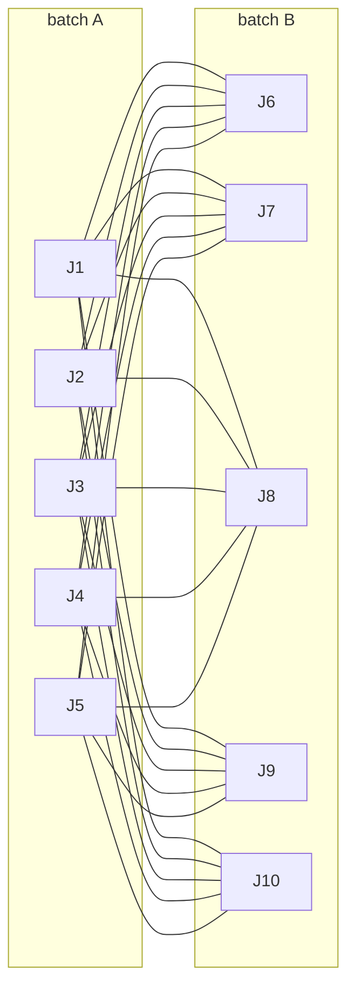
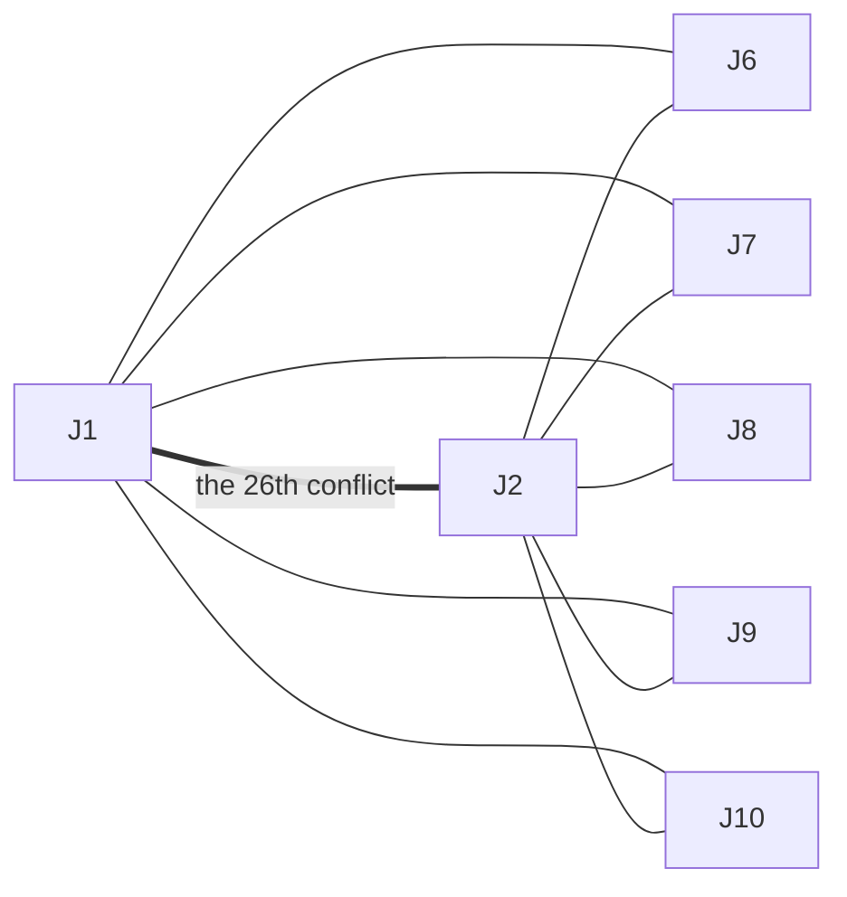

# Mantel and Turan: more than n^2/4 edges force a triangle, and the balanced multipartite graph is the most you can have without a clique

[Syllabus](../../../SYLLABUS.md) → [Combinatorics and graphs](../README.md) → [Ramsey and Extremal, in Outline](../README.md#s14) → Mantel and Turan

---

## General Overview

Ten jobs sit on a schedule, J1 to J10. Any two may conflict and be unable to run together: 45 pairs, so at most 45 pairwise conflicts. How many conflicts can exist before some three jobs all conflict with each other, a **three-way conflict**?

Split the jobs into two batches of five and let every job conflict with all five in the other batch: 5 × 5 = 25 conflicts. Any three jobs include two from one batch, which do not conflict, so no three-way conflict forms. A 26th conflict must join two jobs in one batch, both already conflicting with the other five: five three-way conflicts at once.

No schedule does better. Willem Mantel proved in 1907 that 26 conflicts on 10 jobs always force a three-way conflict. Paul Turán extended it in 1941: to avoid four jobs all conflicting with each other, split into three batches as evenly as possible.

**With no triangle, n points carry at most n^2/4 links, rounded down; to avoid any clique of r + 1 points, split into r near-equal groups, fully cross-linked.**

**What kind of fact this is:** a theorem, proved on this card in Why it works, Turán's half in a folded callout.

### The picture: the 25 links, two batches of five



Every line crosses between the batches, so no three-way conflict forms.

---

## The formula

Notation first, in words. The schedule is a graph: jobs are vertices, conflicts are edges (links), and $`\lvert E\rvert`$ counts the links. $`K(r+1)`$ names r + 1 points all linked to each other, a **clique**; $`K(3)`$ is a three-way conflict, a triangle.

$`K(a, b)`$ names groups of a and b points with every cross pair linked. $`T(n, r)`$, the **Turán graph**, is n points in r groups whose sizes differ by at most one, cross pairs linked. $`\lfloor x \rfloor`$ rounds x down.

Mantel's theorem, for a network with no triangle:

```math
\lvert E\rvert \le \left\lfloor \frac{n^2}{4} \right\rfloor
```

**Read it aloud:** a graph on n points with no triangle has at most n squared over four links, rounded down.

Turán's theorem, for a graph with no $`K(r+1)`$:

```math
\lvert E\rvert \le \text{links of } T(n, r) \le \left(1 - \frac{1}{r}\right)\frac{n^2}{2}
```

**Read it aloud:** with no r + 1 points all linked, the link count is at most that of the evenly split r-group graph, never past (1 − 1/r) of n squared over two.

Mantel is Turán with r = 2: for 10 jobs $`T(10, 2)`$ is $`K(5, 5)`$.

| Symbol | Plain meaning | In our example | Push it up and the answer… |
| --- | --- | --- | --- |
| $`n`$ | points (jobs) | 10 | cap grows as n squared |
| $`\lvert E\rvert`$ | links (conflicts) | 25 at the cap | past it, a clique |
| $`\deg(v)`$, $`u`$, $`v`$ | links at v; u, v a link's ends | 5 each | — |
| $`C(n, 2)`$ | n choose 2: all pairs | 45 | — |
| $`\sum`$ | add up over what is written beneath | ten degrees squared: 250 | — |
| $`K(a, b)`$ | two groups, cross pairs linked | $`K(5, 5)`$, 25 links | uneven: fewer |
| $`K(r+1)`$ | r + 1 all linked: a clique | $`K(3)`$, a triangle | easier to avoid |
| $`T(n, r)`$, $`r`$ | Turán graph: r near-equal groups | $`T(10, 3)`$: 4, 3, 3 | more links |
| $`\lfloor x \rfloor`$ | round x down | 20.25 becomes 20 | — |

The links of $`T(n, r)`$ are all pairs minus the pairs inside each group: for batches of 4, 3 and 3, 45 − 6 − 3 − 3 = 33.

### When it holds

- **Plain links.** At most one per pair, none from a job to itself. Count multiple reasons for one conflict as separate links and the count has no ceiling, since repeats close no triangle.
- **A full clique is forbidden.** Forbid a ring of four instead and the cap is a different, much smaller count from a harder theory ([Beyond Turan](06-erdos-stone-and-kovari-sos-turan.md)).
- **The cap is a best case.** A star, one job conflicting with all nine others, has 9 links; each of its 36 missing links closes a triangle.

---

## Why it works

### Step 0: a link's two ends share no neighbour

Take a conflict, say J1–J6, in a schedule with no triangle. A job conflicting with both would close a three-way conflict, so their neighbours are distinct, at most n in all: $`\deg(u) + \deg(v) \le n`$ for every link u–v, where $`\deg(v)`$ counts v's links. In the two-batch schedule, 5 + 5 = 10 = n.

### Step 1: add that inequality over every link

Add this over all links. Job v sits on $`\deg(v)`$ links and brings $`\deg(v)`$ to each, so it contributes $`\deg(v)`$ squared:

```math
\sum_{\text{links } uv} \big(\deg(u) + \deg(v)\big) = \sum_{v} \deg(v)^2 \le n\,\lvert E\rvert
```

In the example: 25 links of 10 make 250; ten degrees of 5, squared, make 250; n × 25 = 250.

### Step 2: squares cannot be too small

The degrees add to $`2\lvert E\rvert`$, since each link has two ends. Numbers with a fixed total have the smallest sum of squares when all are equal, so

```math
\sum_{v} \deg(v)^2 \ge \frac{(2\lvert E\rvert)^2}{n}
```

<details>
<summary>The algebra behind this</summary>

Let a be the average degree, $`2\lvert E\rvert / n`$. Each $`(\deg(v) - a)^2`$ is at least 0. Summed and expanded, that says the sum of squares minus $`n a^2`$ is at least 0, since the degrees add to $`n a`$. And $`n a^2 = (2\lvert E\rvert)^2 / n`$.

</details>

### Step 3: squeeze

Steps 1 and 2 hold the same sum between two bounds:

```math
\frac{4\lvert E\rvert^2}{n} \le \sum_{v} \deg(v)^2 \le n\,\lvert E\rvert
```

When $`\lvert E\rvert > 0`$, divide by $`\lvert E\rvert`$ and multiply by n/4: $`\lvert E\rvert \le n^2/4`$, so a whole number of links sits at or below $`\lfloor n^2/4 \rfloor`$ (0 links trivially passes). For 10 jobs, 4 × 25 × 25 / 10 = 250 and the bounds meet; 26 links would push the left past the right.

Equality needs every degree equal to n/2 and every link's ends to see all n jobs. So the two neighbour sets of any link split the jobs into two batches of n/2, neither linked inside and every cross pair linked.

Thus $`K(5, 5)`$ is the only 25-link schedule, up to relabelling. It is bipartite, two sides with no link inside a side ([Bipartite graphs](../09-Graphs%20-%20Dots%20and%20Lines/05-bipartite-graphs-and-odd-cycles.md)), so every loop is even and none is a triangle.

### The picture: where the 26th link lands



J1 and J2 share all five of batch B as neighbours, so each of J6 to J10 closes a triangle with them: five from one conflict.

### Step 4: Turán, the same cap for bigger cliques

Forbid four jobs all conflicting with each other. Batches of 4, 3 and 3 give 33 links, and any four jobs include two from one batch, so no $`K(4)`$ appears. Turán's theorem says 33 is the most. The bound $`(1 - 1/r)\,n^2/2`$ is exact when r divides n; here it reads 33.33, and the truth is 33.

<details>
<summary>Detailed proof: Turán's theorem by removing one clique</summary>

Take G on n points with no $`K(r+1)`$ and the most links. For n at most r, $`T(n, r)`$ links every pair: nothing to prove. Otherwise G holds a $`K(r)`$, a set A of r points all linked: without one, any missing link could be added safely, contradicting maximality.

Count G's links in three parts:

- Inside A: $`C(r, 2)`$.
- From A to the other n − r points: each links to at most r − 1 of A (otherwise it completes a $`K(r+1)`$), so at most $`(n - r)(r - 1)`$.
- Among the other n − r points: no $`K(r+1)`$ either, so by induction on n at most the links of $`T(n - r, r)`$.

Now take one point from each group of $`T(n, r)`$. They form a $`K(r)`$ with $`C(r, 2)`$ links, each remaining point links to r − 1 of them, and what is left is $`T(n - r, r)`$.

The three parts match term by term, so G has at most the links of $`T(n, r)`$. With r = 2 this is a second proof of Mantel: the caps run 1, 4, 9, 16, 25 on 2, 4, 6, 8, 10 points.

</details>

A different road to a forced triangle is [Friends and strangers](01-friends-and-strangers.md), which labels every pair of six guests; Mantel counts only the links present.

---

## Worked numbers, by hand

| Step | Arithmetic | Value |
| --- | --- | --- |
| all pairs of jobs | C(10, 2) = 10 × 9 / 2 | 45 |
| Mantel's cap | 10 × 10 / 4 | **25** |
| two batches of five | 5 × 5 cross pairs | 25 |
| three-way conflicts in it | 120 trios checked | 0 |
| triangles from a 26th conflict | its two ends share the other batch's 5 | 5 |
| degree squeeze | 4 × 25 × 25 / 10; ten 5 × 5; 10 × 25 | 250, 250, 250 |
| no four-way conflict, batches 4, 3, 3 | 45 − 6 − 3 − 3 | **33** |
| Turán's share bound | (1 − 1/3) × 100 / 2 | 33.33 |

### What breaks if you drop a piece

| Mistake | Comes out at | What went wrong |
| --- | --- | --- |
| Batches of 4 and 6 | 24 links | Splits 1+9 to 5+5 give 9, 16, 21, 24, 25 |
| Stopping when stuck | 9 links, the star | Stuck is not maximum |
| Two batches, four-way conflict forbidden | 25 links | Three batches give 33, 8 more |
| No rounding, 9 jobs | 20.25 links | Batches of 4 and 5 give 20 |

The code prints all four.

---

## Code, from first principles, and it actually runs

Nothing is imported. Three roads run: the formulas, each graph built pair by pair with all 120 trios or 210 foursomes scanned, and a search of every conflict graph on up to 6 jobs (32768 on 6). The asserts demand that search and formulas agree, and that the built graphs are clique-free and full.

### Python

```python
# Mantel and Turan -- the check behind the card.  Nothing is imported.  Jobs are
# numbered 0 to n-1 and a conflict is a pair (a, b) with a < b.  Road one is the formula;
# road two builds each schedule pair by pair and scans every trio or foursome in it;
# road three searches every possible conflict graph on up to 6 jobs.
def pairs(xs): return [(a, b) for i, a in enumerate(xs) for b in xs[i + 1:]]
def subsets(xs, k):
    return [[]] if k == 0 else [[x] + s for i, x in enumerate(xs) for s in subsets(xs[i + 1:], k - 1)]
def c2(n): return n * (n - 1) // 2
def turan(n, r):                        # road one: all pairs minus the pairs inside each batch
    sizes = [n // r + (1 if i < n % r else 0) for i in range(r)]
    return c2(n) - sum(c2(s) for s in sizes), sizes
def groups_graph(sizes):                # road two: link every pair that sits in different batches
    tag = [g for g, s in enumerate(sizes) for _ in range(s)]
    return {(a, b) for (a, b) in pairs(list(range(len(tag)))) if tag[a] != tag[b]}
def cliques(links, n, k):               # every k jobs that all conflict with each other
    return [q for q in subsets(list(range(n)), k) if all(p in links for p in pairs(q))]
def added(links, n, k):                 # cliques made by each missing conflict, added on its own
    return [len(cliques(links | {m}, n, k)) for m in pairs(list(range(n))) if m not in links]
def best(n, k):                         # road three: every conflict graph on n jobs, no k all conflicting
    ps = pairs(list(range(n)))
    masks = [sum(1 << ps.index(p) for p in pairs(q)) for q in subsets(list(range(n)), k)]
    return max(bin(g).count("1") for g in range(1 << len(ps)) if all(g & m != m for m in masks))
N = 10
k55 = groups_graph([5, 5])
deg = [sum(1 for l in k55 if v in l) for v in range(N)]
around = [deg[a] + deg[b] for (a, b) in k55]
star, t3, t2 = groups_graph([1, 9]), groups_graph([4, 3, 3]), groups_graph([5, 5])
tri, grow, grow_star = cliques(k55, N, 3), added(k55, N, 3), added(star, N, 3)
t_formula, t_sizes = turan(N, 3)
quads, grow4 = cliques(t3, N, 4), added(t3, N, 4)
brute3, brute4 = [best(n, 3) for n in range(1, 7)], [best(n, 4) for n in range(1, 7)]
print(f"jobs {N}, pairs C(10,2) = {c2(N)}")
print(f"two batches of 5, every cross pair conflicting: {len(k55)} links; three-way conflicts: {len(tri)} of {len(subsets(list(range(N)), 3))}")
print(f"Mantel's bound 10 x 10 / 4 = {N * N / 4:.2f}, rounded down: {N * N // 4}")
print(f"each of the {len(grow)} within-batch links, added as a 26th: {min(grow)} to {max(grow)} triangles")
print(f"around each link deg(u) + deg(v) = {min(around)} to {max(around)}; summed over links {sum(around)}; "
      f"squared degrees {sum(d * d for d in deg)}; 4 x 25 x 25 / 10 = {4 * len(k55) ** 2 // N}")
print(f"splits 1+9 to 5+5, links: {[len(groups_graph([a, N - a])) for a in range(1, 6)]}")
print(f"star, 1 hub and 9 leaves: {len(star)} links; a triangle from each of its {len(grow_star)} missing links: {'yes' if min(grow_star) > 0 else 'no'}")
print(f"9 jobs: 81 / 4 = {81 / 4:.2f}, most links with batches of 4 and 5: {len(groups_graph([4, 5]))}")
print(f"no four-way conflict, batches {t_sizes}: formula 45 - 6 - 3 - 3 = {t_formula}, counted pair by pair {len(t3)}")
print(f"four-way conflicts in it: {len(quads)} of {len(subsets(list(range(N)), 4))}; bound (1 - 1/3) x 100 / 2 = {(1 - 1 / 3) * N * N / 2:.2f}")
print(f"each of the {len(grow4)} within-batch links, added: {min(grow4)} to {max(grow4)} four-way conflicts")
print(f"two batches instead of three, no four-way conflict: {len(t2)} links, {t_formula - len(t2)} short of {t_formula}")
print(f"share of all pairs, no triangle: 10 jobs {N * N // 4} of {c2(N)}, 100 jobs {turan(100, 2)[0]} of {c2(100)} = {turan(100, 2)[0] / c2(100):.3f}")
print(f"graphs on 6 jobs searched: {1 << c2(6)}")
print(f"most links with no triangle, n = 1 to 6, by search:     {brute3}")
print(f"n x n / 4 rounded down:                                  {[n * n // 4 for n in range(1, 7)]}")
print(f"most links with no four-way conflict, n = 1 to 6:       {brute4}")
print(f"Turan graph, three batches, by formula:                 {[turan(n, 3)[0] for n in range(1, 7)]}")
assert brute3 == [n * n // 4 for n in range(1, 7)]                # search agrees with Mantel
assert brute4 == [turan(n, 3)[0] for n in range(1, 7)]            # search agrees with Turan
assert len(k55) == N * N // 4 and not tri and min(grow) > 0       # 25 built, triangle-free, full
assert len(t3) == t_formula and not quads and min(grow4) > 0      # 33 built, no foursome, full
print("ALL CHECKS PASS")
```

**Ran 2026-11-25 on macOS, Python 3.14.10, standard library only. All checks passed. Output, pasted from the run:**

```
jobs 10, pairs C(10,2) = 45
two batches of 5, every cross pair conflicting: 25 links; three-way conflicts: 0 of 120
Mantel's bound 10 x 10 / 4 = 25.00, rounded down: 25
each of the 20 within-batch links, added as a 26th: 5 to 5 triangles
around each link deg(u) + deg(v) = 10 to 10; summed over links 250; squared degrees 250; 4 x 25 x 25 / 10 = 250
splits 1+9 to 5+5, links: [9, 16, 21, 24, 25]
star, 1 hub and 9 leaves: 9 links; a triangle from each of its 36 missing links: yes
9 jobs: 81 / 4 = 20.25, most links with batches of 4 and 5: 20
no four-way conflict, batches [4, 3, 3]: formula 45 - 6 - 3 - 3 = 33, counted pair by pair 33
four-way conflicts in it: 0 of 210; bound (1 - 1/3) x 100 / 2 = 33.33
each of the 12 within-batch links, added: 9 to 12 four-way conflicts
two batches instead of three, no four-way conflict: 25 links, 8 short of 33
share of all pairs, no triangle: 10 jobs 25 of 45, 100 jobs 2500 of 4950 = 0.505
graphs on 6 jobs searched: 32768
most links with no triangle, n = 1 to 6, by search:     [0, 1, 2, 4, 6, 9]
n x n / 4 rounded down:                                  [0, 1, 2, 4, 6, 9]
most links with no four-way conflict, n = 1 to 6:       [0, 1, 3, 5, 8, 12]
Turan graph, three batches, by formula:                 [0, 1, 3, 5, 8, 12]
ALL CHECKS PASS
```

### Rust

Same numbers, same labels, built with `rustc --edition 2021 -O`.

```rust
// Mantel and Turan -- the same check as the Python, in Rust.  No crates.  Jobs are
// numbered 0 to n-1 and a conflict is a pair (a, b) with a < b.  Road one is the formula;
// road two builds each schedule pair by pair and scans every trio or foursome in it;
// road three searches every possible conflict graph on up to 6 jobs.
use std::collections::BTreeSet;
type Links = BTreeSet<(usize, usize)>;
fn pairs(xs: &[usize]) -> Vec<(usize, usize)> {
    (0..xs.len()).flat_map(|i| (i + 1..xs.len()).map(move |j| (xs[i], xs[j]))).collect()
}
fn subsets(xs: &[usize], k: usize) -> Vec<Vec<usize>> {
    if k == 0 { return vec![vec![]] }
    (0..xs.len()).flat_map(|i| subsets(&xs[i + 1..], k - 1).into_iter()
        .map(move |mut s| { s.insert(0, xs[i]); s })).collect()
}
fn c2(n: usize) -> usize { n * n.saturating_sub(1) / 2 }
fn turan(n: usize, r: usize) -> (usize, Vec<usize>) {   // road one: all pairs minus pairs inside batches
    let sizes: Vec<usize> = (0..r).map(|i| n / r + if i < n % r { 1 } else { 0 }).collect();
    (c2(n) - sizes.iter().map(|&s| c2(s)).sum::<usize>(), sizes)
}
fn groups_graph(sizes: &[usize]) -> Links {             // road two: link every pair in different batches
    let tag: Vec<usize> = sizes.iter().enumerate().flat_map(|(g, &s)| vec![g; s]).collect();
    let all: Vec<usize> = (0..tag.len()).collect();
    pairs(&all).into_iter().filter(|&(a, b)| tag[a] != tag[b]).collect()
}
fn cliques(links: &Links, n: usize, k: usize) -> Vec<Vec<usize>> {
    let all: Vec<usize> = (0..n).collect();
    subsets(&all, k).into_iter().filter(|q| pairs(q).iter().all(|p| links.contains(p))).collect()
}
fn added(links: &Links, n: usize, k: usize) -> Vec<usize> {   // cliques made by each missing conflict
    let all: Vec<usize> = (0..n).collect();
    pairs(&all).into_iter().filter(|m| !links.contains(m))
        .map(|m| { let mut l = links.clone(); l.insert(m); cliques(&l, n, k).len() }).collect()
}
fn best(n: usize, k: usize) -> usize {                  // road three: every conflict graph on n jobs
    let all: Vec<usize> = (0..n).collect();
    let ps = pairs(&all);
    let masks: Vec<u32> = subsets(&all, k).iter()
        .map(|q| pairs(q).iter().map(|p| 1u32 << ps.iter().position(|x| x == p).unwrap()).sum()).collect();
    (0u32..1 << ps.len()).filter(|g| masks.iter().all(|&m| g & m != m)).map(|g| g.count_ones() as usize).max().unwrap()
}
fn main() {
    let n = 10;
    let all: Vec<usize> = (0..n).collect();
    let k55 = groups_graph(&[5, 5]);
    let deg: Vec<usize> = (0..n).map(|v| k55.iter().filter(|&&(a, b)| a == v || b == v).count()).collect();
    let around: Vec<usize> = k55.iter().map(|&(a, b)| deg[a] + deg[b]).collect();
    let (star, t3, t2) = (groups_graph(&[1, 9]), groups_graph(&[4, 3, 3]), groups_graph(&[5, 5]));
    let (tri, grow, grow_star) = (cliques(&k55, n, 3), added(&k55, n, 3), added(&star, n, 3));
    let (t_formula, t_sizes) = turan(n, 3);
    let (quads, grow4) = (cliques(&t3, n, 4), added(&t3, n, 4));
    let (brute3, brute4): (Vec<usize>, Vec<usize>) = ((1..7).map(|m| best(m, 3)).collect(), (1..7).map(|m| best(m, 4)).collect());
    let (mn, mx) = (|v: &Vec<usize>| *v.iter().min().unwrap(), |v: &Vec<usize>| *v.iter().max().unwrap());
    let (floor4, tur): (Vec<usize>, Vec<usize>) = ((1..7).map(|m| m * m / 4).collect(), (1..7).map(|m| turan(m, 3).0).collect());
    println!("jobs {}, pairs C(10,2) = {}", n, c2(n));
    println!("two batches of 5, every cross pair conflicting: {} links; three-way conflicts: {} of {}", k55.len(), tri.len(), subsets(&all, 3).len());
    println!("Mantel's bound 10 x 10 / 4 = {:.2}, rounded down: {}", (n * n) as f64 / 4.0, n * n / 4);
    println!("each of the {} within-batch links, added as a 26th: {} to {} triangles", grow.len(), mn(&grow), mx(&grow));
    println!("around each link deg(u) + deg(v) = {} to {}; summed over links {}; squared degrees {}; 4 x 25 x 25 / 10 = {}",
             mn(&around), mx(&around), around.iter().sum::<usize>(), deg.iter().map(|d| d * d).sum::<usize>(), 4 * k55.len() * k55.len() / n);
    println!("splits 1+9 to 5+5, links: {:?}", (1..6).map(|a| groups_graph(&[a, n - a]).len()).collect::<Vec<_>>());
    println!("star, 1 hub and 9 leaves: {} links; a triangle from each of its {} missing links: {}", star.len(), grow_star.len(), if mn(&grow_star) > 0 { "yes" } else { "no" });
    println!("9 jobs: 81 / 4 = {:.2}, most links with batches of 4 and 5: {}", 81.0 / 4.0, groups_graph(&[4, 5]).len());
    println!("no four-way conflict, batches {:?}: formula 45 - 6 - 3 - 3 = {}, counted pair by pair {}", t_sizes, t_formula, t3.len());
    println!("four-way conflicts in it: {} of {}; bound (1 - 1/3) x 100 / 2 = {:.2}", quads.len(), subsets(&all, 4).len(), (1.0 - 1.0 / 3.0) * (n * n) as f64 / 2.0);
    println!("each of the {} within-batch links, added: {} to {} four-way conflicts", grow4.len(), mn(&grow4), mx(&grow4));
    println!("two batches instead of three, no four-way conflict: {} links, {} short of {}", t2.len(), t_formula - t2.len(), t_formula);
    println!("share of all pairs, no triangle: 10 jobs {} of {}, 100 jobs {} of {} = {:.3}", n * n / 4, c2(n), turan(100, 2).0, c2(100), turan(100, 2).0 as f64 / c2(100) as f64);
    println!("graphs on 6 jobs searched: {}", 1u32 << c2(6));
    println!("most links with no triangle, n = 1 to 6, by search:     {:?}", brute3);
    println!("n x n / 4 rounded down:                                  {:?}", floor4);
    println!("most links with no four-way conflict, n = 1 to 6:       {:?}", brute4);
    println!("Turan graph, three batches, by formula:                 {:?}", tur);
    assert!(brute3 == floor4);                                          // search agrees with Mantel
    assert!(brute4 == tur);                                             // search agrees with Turan
    assert!(k55.len() == n * n / 4 && tri.is_empty() && mn(&grow) > 0); // 25 built, triangle-free, full
    assert!(t3.len() == t_formula && quads.is_empty() && mn(&grow4) > 0); // 33 built, no foursome, full
    println!("ALL CHECKS PASS");
}
```

**Ran 2026-11-25 on macOS, rustc 1.98.1, no crates. All checks passed. Output, pasted from the run:**

```
jobs 10, pairs C(10,2) = 45
two batches of 5, every cross pair conflicting: 25 links; three-way conflicts: 0 of 120
Mantel's bound 10 x 10 / 4 = 25.00, rounded down: 25
each of the 20 within-batch links, added as a 26th: 5 to 5 triangles
around each link deg(u) + deg(v) = 10 to 10; summed over links 250; squared degrees 250; 4 x 25 x 25 / 10 = 250
splits 1+9 to 5+5, links: [9, 16, 21, 24, 25]
star, 1 hub and 9 leaves: 9 links; a triangle from each of its 36 missing links: yes
9 jobs: 81 / 4 = 20.25, most links with batches of 4 and 5: 20
no four-way conflict, batches [4, 3, 3]: formula 45 - 6 - 3 - 3 = 33, counted pair by pair 33
four-way conflicts in it: 0 of 210; bound (1 - 1/3) x 100 / 2 = 33.33
each of the 12 within-batch links, added: 9 to 12 four-way conflicts
two batches instead of three, no four-way conflict: 25 links, 8 short of 33
share of all pairs, no triangle: 10 jobs 25 of 45, 100 jobs 2500 of 4950 = 0.505
graphs on 6 jobs searched: 32768
most links with no triangle, n = 1 to 6, by search:     [0, 1, 2, 4, 6, 9]
n x n / 4 rounded down:                                  [0, 1, 2, 4, 6, 9]
most links with no four-way conflict, n = 1 to 6:       [0, 1, 3, 5, 8, 12]
Turan graph, three batches, by formula:                 [0, 1, 3, 5, 8, 12]
ALL CHECKS PASS
```

The two outputs match line for line.

### Lean

Lean proves both theorems, and when each cap is reached, for every network of plain links and every whole number r.

- With no triangle, a network on n points has at most n^2/4 links, rounded down.
- It has exactly that many only when it is two groups as equal as possible, every cross pair linked, none inside.
- With no r + 1 points all linked, it has at most the links of $`T(n, r)`$, and only $`T(n, r)`$ has exactly that many, up to relabelling.
- $`T(n, r)`$ itself has no r + 1 points all linked, and its links are at most $`(1 - 1/r)\,n^2/2`$.

The star, the search through every graph on up to six jobs, and the decimal shares are left to the Python and Rust checks.

```lean
-- Mantel and Turan: a simple graph on n vertices with no triangle has at most n^2/4 edges (rounded down), with equality exactly for two groups as equal as possible fully cross-linked, and with no r + 1 vertices all linked it has at most the edges of the Turan graph T(n, r), with equality exactly for T(n, r).
import Mathlib.Combinatorics.SimpleGraph.Extremal.Turan
import Mathlib.Tactic.NormNum
import Mathlib.Tactic

open SimpleGraph

/-- A graph that links exactly the pairs split by `A` has `|A| · (n − |A|)` links. -/
theorem card_edgeFinset_of_adj_iff_split {V : Type*} [Fintype V] [DecidableEq V]
    (G : SimpleGraph V) [DecidableRel G.Adj] (A : Finset V)
    (hA : ∀ v w : V, G.Adj v w ↔ (v ∈ A ↔ w ∉ A)) :
    G.edgeFinset.card = A.card * (Fintype.card V - A.card) := by
  have hdeg : ∀ v, G.degree v = if v ∈ A then Fintype.card V - A.card else A.card := by
    intro v
    rw [← G.card_neighborFinset_eq_degree, G.neighborFinset_eq_filter]
    split_ifs with hv
    · rw [← Finset.card_compl]
      congr 1; ext w; simp [hA, hv]
    · congr 1; ext w; simp [hA, hv]
  have h2 := G.sum_degrees_eq_twice_card_edges
  simp_rw [hdeg] at h2
  rw [Finset.sum_ite, Finset.sum_const, Finset.sum_const, smul_eq_mul, smul_eq_mul,
    Finset.filter_mem_eq_inter, Finset.univ_inter] at h2
  have hc : (Finset.univ.filter fun v => v ∉ A).card = Fintype.card V - A.card := by
    rw [Finset.filter_not, Finset.filter_mem_eq_inter, Finset.univ_inter, ← Finset.card_compl]
    simp [Finset.compl_eq_univ_sdiff]
  rw [hc] at h2
  have : A.card * (Fintype.card V - A.card) + (Fintype.card V - A.card) * A.card =
      2 * (A.card * (Fintype.card V - A.card)) := by ring
  omega

/-- `a · b = (a + b)^2 / 4` holds exactly when `a` and `b` differ by at most one. -/
theorem mul_eq_sq_div_four_iff (a b : ℕ) :
    a * b = (a + b) ^ 2 / 4 ↔ a ≤ b + 1 ∧ b ≤ a + 1 := by
  constructor
  · intro h
    have h1 : 4 * (a * b) ≤ (a + b) ^ 2 := by
      rw [h]; exact Nat.mul_div_le _ _
    have h2 : (a + b) ^ 2 < 4 * (a * b) + 4 := by
      rw [h]; have := Nat.lt_mul_div_succ ((a + b) ^ 2) (show 0 < 4 by norm_num); linarith
    constructor
    · by_contra hc; rw [not_le] at hc; nlinarith
    · by_contra hc; rw [not_le] at hc; nlinarith
  · rintro ⟨h1, h2⟩
    symm
    apply Nat.div_eq_of_lt_le
    · rcases Nat.lt_or_ge a b with h | h
      · obtain rfl : b = a + 1 := by omega
        ring_nf; omega
      · obtain ⟨c, rfl⟩ : ∃ c, a = b + c := ⟨a - b, by omega⟩
        nlinarith
    · rcases Nat.lt_or_ge a b with h | h
      · obtain rfl : b = a + 1 := by omega
        ring_nf; omega
      · obtain ⟨c, rfl⟩ : ∃ c, a = b + c := ⟨a - b, by omega⟩
        obtain rfl | rfl : c = 0 ∨ c = 1 := by omega
        · ring_nf; omega
        · ring_nf; omega

#print axioms card_edgeFinset_of_adj_iff_split
#print axioms mul_eq_sq_div_four_iff

/-- Turán's theorem with its equality case, read off Mathlib's `IsTuranMaximal` results. -/
theorem card_edgeFinset_le_turan_and_eq_iff {V : Type*} [Fintype V] (G : SimpleGraph V)
    [DecidableRel G.Adj] (r : ℕ) (h : G.CliqueFree (r + 1)) :
    G.edgeFinset.card ≤ (turanGraph (Fintype.card V) r).edgeFinset.card ∧
      (G.edgeFinset.card = (turanGraph (Fintype.card V) r).edgeFinset.card ↔
        Nonempty (G ≃g turanGraph (Fintype.card V) r)) := by
  have hle : G.edgeFinset.card ≤ (turanGraph (Fintype.card V) r).edgeFinset.card :=
    h.card_edgeFinset_le
  refine ⟨hle, ⟨fun heq => ?_, fun ⟨f⟩ => f.card_edgeFinset_eq⟩⟩
  rcases r.eq_zero_or_pos with rfl | hr
  · have hV : IsEmpty V := by rwa [cliqueFree_one] at h
    exact ⟨⟨Fintype.equivFin V, fun {a} => isEmptyElim a⟩⟩
  · refine (isTuranMaximal_iff_nonempty_iso_turanGraph hr).mp ⟨h, fun H _ hH => ?_⟩
    rw [heq]
    exact hH.card_edgeFinset_le

#print axioms card_edgeFinset_le_turan_and_eq_iff

/-- Mantel's theorem, as the card states it. A network of plain links (a simple graph: at most one
link per pair, no link from a point to itself) on `n` points with no triangle (no three points all
linked) has at most `n^2/4` links, rounded down. It reaches that count exactly when the points split
into two groups as equal as possible (sizes `⌊n/2⌋` and `⌈n/2⌉`) with every cross pair linked and no
pair inside a group linked. -/
theorem mantel_triangle_free_edges_le_sq_div_four {V : Type*} [Fintype V] [DecidableEq V]
    (G : SimpleGraph V) [DecidableRel G.Adj] (h : G.CliqueFree 3) :
    G.edgeFinset.card ≤ Fintype.card V ^ 2 / 4 ∧
      (G.edgeFinset.card = Fintype.card V ^ 2 / 4 ↔
        ∃ A : Finset V, Fintype.card V / 2 ≤ A.card ∧ A.card ≤ (Fintype.card V + 1) / 2 ∧
          ∀ v w : V, G.Adj v w ↔ (v ∈ A ↔ w ∉ A)) := by
  have hT := card_edgeFinset_le_turan_and_eq_iff G 2 h
  have h2 : (turanGraph (Fintype.card V) 2).edgeFinset.card = Fintype.card V ^ 2 / 4 :=
    turanNumber_two
  rw [h2] at hT
  refine ⟨hT.1, ?_⟩
  rw [hT.2]
  constructor
  · rintro ⟨f⟩
    refine ⟨Finset.univ.filter fun v => (f v).val % 2 = 0, ?_⟩
    set A := Finset.univ.filter fun v => (f v).val % 2 = 0 with hAdef
    have hA : ∀ v w : V, G.Adj v w ↔ (v ∈ A ↔ w ∉ A) := by
      intro v w
      rw [← f.map_adj_iff, turanGraph_adj]
      simp only [hAdef, Finset.mem_filter, Finset.mem_univ, true_and]
      omega
    have hcard := card_edgeFinset_of_adj_iff_split G A hA
    rw [f.card_edgeFinset_eq, h2] at hcard
    have hAle : A.card ≤ Fintype.card V := Finset.card_le_univ A
    have key : A.card * (Fintype.card V - A.card) =
        (A.card + (Fintype.card V - A.card)) ^ 2 / 4 := by
      rw [Nat.add_sub_cancel' hAle]; exact hcard.symm
    rw [mul_eq_sq_div_four_iff] at key
    refine ⟨?_, ?_, hA⟩ <;> omega
  · rintro ⟨A, hA1, hA2, hA⟩
    have hcard := card_edgeFinset_of_adj_iff_split G A hA
    have hAle : A.card ≤ Fintype.card V := Finset.card_le_univ A
    have key : A.card * (Fintype.card V - A.card) =
        (A.card + (Fintype.card V - A.card)) ^ 2 / 4 := by
      rw [mul_eq_sq_div_four_iff]; omega
    rw [Nat.add_sub_cancel' hAle] at key
    rw [← hT.2, hcard, key]

/-- Turán's theorem, as the card states it. For any whole number `r`, a network of plain links on
`n` points with no `r + 1` points all linked (no clique `K(r+1)`) has at most as many links as the
Turán graph `T(n, r)`: `n` points in `r` groups whose sizes differ by at most one, every cross pair
linked. It reaches that count exactly when it is `T(n, r)`, up to relabelling the points. -/
theorem turan_clique_free_edges_le_turanGraph {V : Type*} [Fintype V] (G : SimpleGraph V)
    [DecidableRel G.Adj] (r : ℕ) (h : G.CliqueFree (r + 1)) :
    G.edgeFinset.card ≤ (turanGraph (Fintype.card V) r).edgeFinset.card ∧
      (G.edgeFinset.card = (turanGraph (Fintype.card V) r).edgeFinset.card ↔
        Nonempty (G ≃g turanGraph (Fintype.card V) r)) := by
  exact card_edgeFinset_le_turan_and_eq_iff G r h

/-- The Turán graph `T(n, r)`, for `r ≥ 1` groups, has no `r + 1` points all linked, and its links
number at most `(1 − 1/r) · n^2/2`. -/
theorem turanGraph_clique_free_and_edges_le (n r : ℕ) (hr : 0 < r) :
    (turanGraph n r).CliqueFree (r + 1) ∧
      ((turanGraph n r).edgeFinset.card : ℚ) ≤ (1 - 1 / (r : ℚ)) * (n : ℚ) ^ 2 / 2 := by
  refine ⟨turanGraph_cliqueFree hr, ?_⟩
  have h := mul_turanNumber_le (n := n) (r := r)
  have hq : (2 * r * (turanGraph n r).edgeFinset.card : ℚ) ≤ ((r - 1 : ℕ) : ℚ) * (n : ℚ) ^ 2 := by
    exact_mod_cast h
  rw [Nat.cast_sub (by omega : 1 ≤ r), Nat.cast_one] at hq
  have hr' : (0 : ℚ) < r := by exact_mod_cast hr
  rw [show (1 - 1 / (r : ℚ)) * (n : ℚ) ^ 2 / 2 = ((r : ℚ) - 1) * (n : ℚ) ^ 2 / (2 * r) by
    field_simp]
  rw [le_div_iff₀ (by positivity)]
  linarith

-- The ten jobs: 45 pairs, Mantel's cap 10 × 10 / 4 = 25, two batches of five give 5 × 5 = 25.
example : Nat.choose 10 2 = 45 := by decide
example : 10 ^ 2 / 4 = 25 ∧ 5 * 5 = 25 := by decide
-- T(10, 2), the two batches of five, has 25 links and no three-way conflict among its 120 trios.
example : (turanGraph 10 2).edgeFinset.card = 25 := by decide
example : ∀ a b c : Fin 10, ¬ ((turanGraph 10 2).Adj a b ∧ (turanGraph 10 2).Adj b c ∧
    (turanGraph 10 2).Adj a c) := by decide
-- A 26th conflict inside one batch, say between jobs 0 and 2: they share all five of the other
-- batch as neighbours, so it closes five triangles.
example : (Finset.univ.filter fun w : Fin 10 =>
    (turanGraph 10 2).Adj 0 w ∧ (turanGraph 10 2).Adj 2 w).card = 5 := by decide
-- The degree squeeze: 4 × 25 × 25 / 10 = 250, ten degrees of 5 squared = 250, 10 × 25 = 250.
example : 4 * 25 * 25 / 10 = 250 ∧ 10 * 5 ^ 2 = 250 ∧ 10 * 25 = 250 := by decide
-- No four-way conflict, batches 4, 3, 3: 45 − 6 − 3 − 3 = 33 links, and T(10, 3) has 33.
example : Nat.choose 10 2 - Nat.choose 4 2 - Nat.choose 3 2 - Nat.choose 3 2 = 33 := by decide
example : (turanGraph 10 3).edgeFinset.card = 33 := by decide
-- Turán's share bound (1 − 1/3) × 100 / 2 = 100/3, just above 33.
example : (1 - 1 / (3 : ℚ)) * 100 / 2 = 100 / 3 ∧ (33 : ℚ) ≤ 100 / 3 := by norm_num
-- What breaks: splits 1+9 to 5+5 give 9, 16, 21, 24, 25; two batches with four-way conflicts forbidden
-- give 25, 8 short of 33; 9 jobs give 81 / 4 rounded down = 20, batches of 4 and 5 give 20.
example : 1 * 9 = 9 ∧ 2 * 8 = 16 ∧ 3 * 7 = 21 ∧ 4 * 6 = 24 ∧ 5 * 5 = 25 := by decide
example : 33 - 25 = 8 := by decide
example : 9 ^ 2 / 4 = 20 ∧ 4 * 5 = 20 := by decide
-- The search over every conflict graph on 1 to 6 jobs: the most links with no triangle are
-- 0, 1, 2, 4, 6, 9 = n^2/4 rounded down, and with no four-way conflict 0, 1, 3, 5, 8, 12 = links of T(n, 3).
example : [1, 2, 3, 4, 5, 6].map (fun n => n ^ 2 / 4) = [0, 1, 2, 4, 6, 9] := by decide
example : (turanGraph 1 3).edgeFinset.card = 0 ∧ (turanGraph 2 3).edgeFinset.card = 1 ∧
    (turanGraph 3 3).edgeFinset.card = 3 ∧ (turanGraph 4 3).edgeFinset.card = 5 ∧
    (turanGraph 5 3).edgeFinset.card = 8 ∧ (turanGraph 6 3).edgeFinset.card = 12 := by decide
-- Mantel's caps by the induction: 1, 4, 9, 16, 25 on 2, 4, 6, 8, 10 points.
example : [2, 4, 6, 8, 10].map (fun n => n ^ 2 / 4) = [1, 4, 9, 16, 25] := by decide

#print axioms mantel_triangle_free_edges_le_sq_div_four
#print axioms turan_clique_free_edges_le_turanGraph
#print axioms turanGraph_clique_free_and_edges_le
```

**Checked 2026-11-25 on macOS, Lean 4.36.0-rc2, Mathlib v4.36.0-rc2. Every proof is complete and uses only Lean's standard axioms. Output, pasted from the run:**

```
'card_edgeFinset_of_adj_iff_split' depends on axioms: [propext, Classical.choice, Quot.sound]
'mul_eq_sq_div_four_iff' depends on axioms: [propext, Classical.choice, Quot.sound]
'card_edgeFinset_le_turan_and_eq_iff' depends on axioms: [propext, Classical.choice, Quot.sound]
'mantel_triangle_free_edges_le_sq_div_four' depends on axioms: [propext, Classical.choice, Quot.sound]
'turan_clique_free_edges_le_turanGraph' depends on axioms: [propext, Classical.choice, Quot.sound]
'turanGraph_clique_free_and_edges_le' depends on axioms: [propext, Classical.choice, Quot.sound]
```

> [!TIP]
> **Try changing**
> Guess first, then run it. The asserts are pinned to the ten jobs, so one will stop the program.
> - **Unbalance the batches.** Set `k55 = groups_graph([4, 6])`: 24 links, no triangle, and the third assert stops it.
> - **Forbid five, not four.** Change `best(n, 4)` to `best(n, 5)`: the search gives 0, 1, 3, 6, 9, 13, Turán with four batches, and the second assert stops it.
> - **Split three ways badly.** Set the three batches to `[4, 4, 2]`: 32 links against the formula's 33; the fourth assert stops it.

---

## The usual mistake

> [!warning]
> **Taking a graph that cannot grow for one that is full.** The star on 10 jobs has 9 conflicts, and any added conflict closes a three-way conflict. It is stuck, yet the two-batch schedule holds 16 more.
>
> - **Reading the cap as a force.** 25 conflicts on 10 jobs can avoid a triangle; 26 cannot.

---

## Where you meet it in real life

- **Social networks.** More than n^2/4 friendships among n people guarantee three mutual friends.
- **Extremal combinatorics.** The most links avoiding a shape is the field's founding question; [Erdos's counting trick](03-probabilistic-method-by-counting.md) proves shape-avoiding networks exist without building them.

> **Say it back**
> With no triangle, a link's two ends share no neighbour, so their degrees add to at most n. Summed over links, that caps the links at n squared over four. Ten jobs take 25 conflicts, as two batches of five cross-linked; a 26th closes five triangles. To avoid r + 1 all linked, cut into r equal groups: 4, 3 and 3 give 33.

---

## What this builds on

- [Degrees and the handshaking lemma](../09-Graphs%20-%20Dots%20and%20Lines/02-degree-and-handshaking.md): degrees add to twice the links, used in Step 2.
- [Bipartite graphs](../09-Graphs%20-%20Dots%20and%20Lines/05-bipartite-graphs-and-odd-cycles.md): two-sided networks have only even loops, so no triangle.
- [Combinations, n choose k](../01-Counting%20Principles/05-n-choose-k.md): C(10, 2) = 45 possible links.

## Where this goes next

- [Beyond Turan](06-erdos-stone-and-kovari-sos-turan.md): forbid any graph H and its colour count sets the edge cap (Erdos-Stone), except when H is two-sided, where Kovari-Sos-Turan caps a network with no 4-cycle near n^(3/2)/2 edges.
- [The regularity lemma](07-szemeredi-regularity-lemma.md): every large network splits into a bounded number of parts with random-looking links between almost every pair.
- [The probabilistic method](../../09-Probability%20and%20statistics/14-Random%20Graphs%20and%20the%20Probabilistic%20Method/03-probabilistic-method.md): networks that avoid a shape, shown to exist by chance and averages rather than built.
- [Erdos problems](../../21-Algebraic%20and%20analytic%20number%20theory/08-Additive%20Combinatorics%20and%20Probabilistic%20Number%20Theory/07-erdos-problems-and-computer-search.md): how computer searches probe open Erdős-style problems, and what a finite search can and cannot prove.

Turán settles every full clique; what happens when you forbid a shape that is not a clique, such as a ring of four, is the next card's question.

---

## Sources

Verified 2026-11-11: every link below resolves to the publisher's page.

- Aigner, Martin, and Günter M. Ziegler. *Proofs from THE BOOK*, 6th ed. Springer, 2018. [Publisher page](https://link.springer.com/book/10.1007/978-3-662-57265-8). A chapter of proofs of Turán's graph theorem.
- Bollobás, Béla. *Extremal Graph Theory*. Dover, 2004. [Publisher page](https://store.doverpublications.com/products/9780486435961). The standard monograph on the field.
- Diestel, Reinhard. *Graph Theory*, 6th ed. Springer, 2025. [Publisher page](https://link.springer.com/book/10.1007/978-3-662-70107-2). Its extremal chapter opens with Turán's theorem.
- O'Connor, J. J., and E. F. Robertson. "Paul Turán." MacTutor Archive, University of St Andrews. [Biography](https://mathshistory.st-andrews.ac.uk/Biographies/Turan/). The labour-camp years where several of his theorems began.
