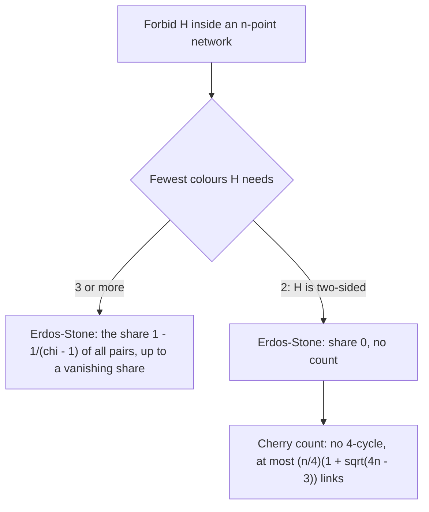

# Beyond Turan: forbid any graph H and its colour count sets the edge cap (Erdos-Stone), except when H is two-sided, where Kovari-Sos-Turan caps a network with no 4-cycle near n^(3/2)/2 edges

[Syllabus](../../../SYLLABUS.md) → [Combinatorics and graphs](../README.md) → [Ramsey and Extremal, in Outline](../README.md#s14) → Beyond Turan

---

## General Overview

Ten sensor stations are to be wired with direct links, each merging the readings its neighbours pass on. No two may share two neighbours: a reading would then pass between them by two routes and count twice. Two shared neighbours close a **4-cycle**: four stations a, b, c, d linked in a ring a–b–c–d–a.

How many links fit? The Petersen graph has ten points, three links at each, 15 links in all, and no 4-cycle. A counting argument in the style of Kővári, Sós and Turán (1954) caps every such network at 17.7 links, so at most 17. The true maximum is 16.

With no triangle, half of all pairs can be linked ([Mantel and Turan](05-mantel-and-turan.md)). With no 4-cycle the share shrinks as the network grows: about 3 pairs in 100 for 1,000 stations.

The Erdős–Stone theorem (1946) explains the split. It sets the cap for any forbidden network H by H's colour count, and a 4-cycle needs only 2 colours, where the share is zero.

**Forbid H and its colour count sets the large-n link share to 1 − 1/(χ(H) − 1); for two-sided H that share vanishes, and 4-cycle-free networks stay near n^(3/2)/2 links.**

**What kind of fact this is:** two theorems. The 4-cycle cap is proved on this card in Why it works. Erdős–Stone is stated; its easy half is proved here, its hard half left to [The regularity lemma](07-szemeredi-regularity-lemma.md) and the sources.

### The picture: which theorem answers which question



A triangle and the Petersen graph need 3 colours; a 4-cycle needs 2.

---

## The formula

Notation first, in words. A network on $`n`$ points has $`e`$ links. $`C_4`$ is the 4-cycle. A **cherry** is two links sharing a point: a path a–v–b with **middle** v and **ends** a and b. The degree $`d(v)`$ counts the links at v. $`\mathrm{ex}(n, H)`$, the **extremal number**, is the most links on n points with no copy of H.

The cap for no 4-cycle:

```math
\mathrm{ex}(n, C_4) \le \frac{n}{4}\left(1 + \sqrt{4n - 3}\right)
```

**Read it aloud:** a network on n points with no 4-cycle has at most n over four, times one plus the square root of 4n minus 3, links.

For 10 stations: 2.5 × 7.083 ≈ 17.71, so at most 17. For large n the square root is close to $`2\sqrt{n}`$, so the cap nears its leading term $`n^{3/2}/2`$, which is 15.81 at n = 10.

The Erdős–Stone theorem, for any forbidden network H:

```math
\mathrm{ex}(n, H) = \left(1 - \frac{1}{\chi(H) - 1}\right)\frac{n^2}{2} + o(n^2)
```

**Read it aloud:** the most links avoiding H is 1 − 1/(chi(H) − 1) of n squared over two, plus a vanishing share of n squared.

Here $`\chi(H)`$, chi, is the fewest colours that colour H with linked points different ([Colouring](../12-Planarity%20and%20Colouring/03-vertex-colouring-and-chromatic-number.md)). A **two-sided** (bipartite) network splits into two sides with links only across: exactly $`\chi(H) = 2`$.

| Symbol | Plain meaning | In our example | Push it up and the answer… |
| --- | --- | --- | --- |
| $`n`$ | points (stations) | 10 | cap grows like n to the power 3/2 |
| $`e`$ | links | 15 in the Petersen graph | past the cap, a 4-cycle |
| $`d(v)`$, $`a`$ | links at point v; average degree 2e/n | 3 and 3 | more cherries |
| $`C(n, 2)`$ | n choose 2: all pairs of points | 45 | room for more cherries |
| $`H`$, $`C_4`$, $`\mathrm{ex}(n, H)`$ | the forbidden network; the 4-cycle; the most links avoiding H | $`\mathrm{ex}(10, C_4) = 16`$ | — |
| $`\chi(H)`$ | fewest colours H needs | triangle 3, Petersen 3, 4-cycle 2 | larger share allowed |
| $`o(n^2)`$ | a remainder whose ratio to n squared shrinks to 0 | not a count for any one n | — |
| $`q`$ | a prime: the size of the number system for the polarity graph | 2 and 3 | more points, nearer the cap |

### When it holds

- **Plain links.** At most one per pair, none from a point to itself. Allow repeats and the cherry count limits nothing.
- **Any 4-cycle counts**, even one with links across it. Forbid only bare rings and all 45 pairs on 10 points can be linked.
- **Erdős–Stone needs large n.** The remainder $`o(n^2)`$ can be large for small n, so it gives no count for 10 points.
- **Its share is informative only for χ(H) of 3 or more.** For χ(H) = 2 it reads 0, true but empty: 10 points carry 16 links with no 4-cycle.

---

## Why it works

### Step 0: a 4-cycle is two cherries with the same ends

The ring a–b–c–d–a holds two cherries from a to c: one through b and one through d. So a network has no 4-cycle exactly when every pair of points is the pair of ends of at most one cherry.

### Step 1: count the cherries two ways

By middles: a point with d links is the middle of C(d, 2) cherries, one per pair of its links. By ends: each of the C(n, 2) pairs ends at most one cherry. Both count one collection ([Bijections and double counting](../02-Repeats%2C%20Groups%20and%20Double%20Counting/05-bijection-and-double-counting.md)), so

```math
\sum_{v} C\big(d(v), 2\big) \le C(n, 2)
```

The sign $`\sum_{v}`$ means add over every point v. In the Petersen graph the middles give 10 × C(3, 2) = 30 cherries, and their ends are 30 different pairs of the 45: each unlinked pair has exactly one shared neighbour.

### Step 2: equal degrees give the fewest cherries

The degrees add to 2e, since each link has two ends. With that total fixed, the number of cherries is smallest when every degree equals the average $`a = 2e/n`$. So

```math
n \cdot \frac{a(a - 1)}{2} \le \sum_{v} C\big(d(v), 2\big) \le \frac{n(n - 1)}{2}
```

<details>
<summary>Why equal degrees give the fewest cherries</summary>

C(d, 2) = d(d − 1)/2. Each term $`(d(v) - a)^2`$ is at least 0. Add them over all points and expand: the sum of the squares $`d(v)^2`$ is at least $`n a^2`$, because the degrees add to $`n a`$. Subtract the degrees, which add to $`n a`$, and halve:

$`\displaystyle \sum_{v} \frac{d(v)\big(d(v) - 1\big)}{2} \ge \frac{n a^2 - n a}{2} = n \cdot \frac{a(a - 1)}{2}`$

This is the same squeeze as Step 2 of [Mantel and Turan](05-mantel-and-turan.md).

</details>

### Step 3: solve for the links

Cancel n/2 on both sides: $`a(a - 1) \le n - 1`$. Solving the quadratic $`a^2 - a - (n - 1) = 0`$ gives the largest allowed average:

```math
a \le \frac{1 + \sqrt{4n - 3}}{2}, \qquad e = \frac{n a}{2} \le \frac{n}{4}\left(1 + \sqrt{4n - 3}\right)
```

For 10 points, a ≤ 3.54, where a(a − 1) = 9.00 = 10 − 1, so e ≤ 17.71. The Petersen graph has a = 3: 3 × 2 = 6, below 9.

### Step 4: how close real networks come

- **Small n, by search.** Searching every network on 1 to 8 points gives maxima 0, 1, 3, 4, 6, 7, 9, 11. The cap, rounded down, gives 0, 1, 3, 4, 6, 8, 10, 12: never below, at most one above.
- **Ten points.** The published maximum is 16 (Sources); the code checks a 16-link network listed by hand. The Petersen graph cannot grow: each of its 30 missing links closes a 4-cycle. So stuck is not largest.
- **The polarity graph.** Its points are non-zero triples of numbers 0 to q − 1 for a prime q, with multiples counted as one point. Two distinct points are linked when the sum of their coordinate products leaves remainder 0 on division by q. Two points share at most one neighbour, so no 4-cycle appears.
- **Polarity graph sizes.** Prime q = 2 gives 7 points, 9 links (cap 10); q = 3 gives 13 points, 24 links (cap 26). In general q² + q + 1 points carry q(q + 1)²/2 links, growing like $`n^{3/2}/2`$: the true rate, not only a cap.

### Step 5: Erdős–Stone, the easy half

Take the Turán graph with χ(H) − 1 groups, as equal as possible, every cross pair linked. One colour per group colours it properly with χ(H) − 1 colours. A copy of H inside would inherit that colouring, but H needs χ(H). So no copy fits, and the Turán graph's links, about $`(1 - 1/(\chi(H) - 1))\,n^2/2`$, are a lower bound.

For the Petersen graph, χ = 3: two groups of 500 on 1,000 points give 250,000 links with no Petersen graph inside.

### Step 6: Erdős–Stone, the hard half, stated

No network does much better: any fixed extra share of n² links forces a copy of H once n is large. The standard proof uses [The regularity lemma](07-szemeredi-regularity-lemma.md), which cuts a network into a few groups whose links look random.

### Step 7: why it says nothing exact for two-sided H

For χ(H) = 2 the share is 1 − 1/1 = 0: Erdős–Stone says only that the share vanishes. The cherry count gives the size, and the share shrinks like one over the square root of n:

```
share of all pairs: most links with no triangle, or the 4-cycle cap
no triangle, n = 1000    |#########################  0.501
no 4-cycle,  n = 10      |###################        0.378
no 4-cycle,  n = 100     |#####                      0.106
no 4-cycle,  n = 1000    |##                         0.032
no 4-cycle,  n = 10000   |#                          0.010
```

The same count, with larger stars in place of cherries, caps every two-sided H at a power of n below 2.

---

## Worked numbers, by hand

| Step | Arithmetic | Value |
| --- | --- | --- |
| one plus the square root | 1 + √(4 × 10 − 3) = 1 + √37 | 7.083 |
| the cap | 10/4 × 7.083 | **17.71, so at most 17** |
| cherries in the Petersen graph | 10 points × C(3, 2) | 30 |
| pairs of ends available | C(10, 2) | 45 |
| average-degree test | 3 × 2 = 6 against 10 − 1 = 9 | 6 ≤ 9 |
| largest allowed average | 7.083/2 | 3.54 |
| leading term | 10^1.5 / 2 | 15.81 |
| Erdős–Stone share for χ = 3 and χ = 2 | 1 − 1/2; 1 − 1/1 | 0.500; 0 |

No 10-point network without a 4-cycle has more than 17 links; the Petersen graph has 15, and the true maximum is 16.

### What breaks if you drop a piece

| Mistake | Comes out at | What went wrong |
| --- | --- | --- |
| No rounding | 17.71 links | Links come whole: 17 |
| Ends taken in order | 60 cherries > 45 pairs, so "a 4-cycle" | Each cherry counted twice; the Petersen graph has 0 4-cycles |
| χ(H) in place of χ(H) − 1, no triangle, n = 10 | 33.33 links | Mantel's cap is 25 |
| Erdős–Stone read as exact for a 4-cycle | 0 links | The Petersen graph has 15 |

---

## Code, from first principles, and it actually runs

Nothing is imported. Four roads run: the cap formula, a scan of every walk a–b–c–d–a for 4-cycles, cherries counted by middles and ends, and a search of every network on up to 8 points.

Chi comes from trying every colouring. The asserts tie the cap to Step 3's quadratic up to n = 10,000, match the search to published values, and confirm no 4-cycle in the Petersen and polarity graphs.

### Python

```python
# Erdos-Stone and Kovari-Sos-Turan -- the check behind the card.  Nothing is imported.  Points are
# 0 to n-1.  Road one is the cap formula; road two scans every walk a-b-c-d-a for a 4-cycle; road
# three counts cherries two ways; road four searches every network on up to 8 points.
def net(n, links):
    nb = [set() for _ in range(n)]
    for a, b in links: nb[a].add(b); nb[b].add(a)
    return nb
def four_cycles(nb):                    # road two: a-b-c-d-a, each cycle met 8 times
    return sum(1 for a in range(len(nb)) for b in nb[a] for c in nb[b] if c != a
               for d in nb[c] if d not in (a, b) and a in nb[d]) // 8
def cap(n): return n / 4 * (1 + (4 * n - 3) ** 0.5)
def links(nb): return sum(len(s) for s in nb) // 2
def search(n):                          # road four: add pairs one by one, refuse a 4-cycle
    ps, nb, best = [(a, b) for b in range(n) for a in range(b)], [set() for _ in range(n)], [0]
    def go(i, e):
        best[0] = max(best[0], e)
        if i == len(ps) or e + len(ps) - i <= best[0]: return
        a, b = ps[i]
        if not any(nb[x] & nb[a] - {b} for x in nb[b] - {a}):
            nb[a].add(b); nb[b].add(a); go(i + 1, e + 1); nb[a].discard(b); nb[b].discard(a)
        go(i + 1, e)
    go(0, 0); return best[0]
def chi(n, links):                      # fewest colours, by trying every colouring
    k = 1
    while not any(all(c // k ** a % k != c // k ** b % k for a, b in links) for c in range(k ** n)): k += 1
    return k
def polarity(q):                        # points of the plane over 0..q-1; link x, y when x.y = 0 mod q
    pts = [(1, y, z) for y in range(q) for z in range(q)] + [(0, 1, z) for z in range(q)] + [(0, 0, 1)]
    return net(len(pts), [(i, j) for j in range(len(pts)) for i in range(j)
                          if sum(u * v for u, v in zip(pts[i], pts[j])) % q == 0])
two = [(a, b) for b in range(5) for a in range(b)]            # Petersen: pairs from 5, linked if disjoint
pet_links = [(i, j) for j in range(10) for i in range(j) if not set(two[i]) & set(two[j])]
pet = net(10, pet_links); deg = [len(s) for s in pet]; cherries = sum(d * (d - 1) // 2 for d in deg)   # road three, by middles
ends = {(a, b) for v in range(10) for a in pet[v] for b in pet[v] if a < b}  # road three, by end pairs
grown = [four_cycles(net(10, pet_links + [(a, b)])) for b in range(10) for a in range(b) if b not in pet[a]]
found = net(10, [(0, 1), (0, 2), (1, 2), (0, 3), (0, 4), (3, 4), (1, 5), (1, 6), (5, 6), (2, 7), (3, 8), (5, 8), (7, 8), (4, 9), (6, 9), (7, 9)])
brute, pol = [search(n) for n in range(1, 9)], {q: polarity(q) for q in (2, 3)}
x = {"triangle": chi(3, [(0, 1), (1, 2), (0, 2)]), "Petersen": chi(10, pet_links), "4-cycle": chi(4, [(0, 1), (1, 2), (2, 3), (0, 3)])}
a, tri = (1 + 37 ** 0.5) / 2, 1000 * 1000 // 4
print(f"cap on 10 points: 2.5 x (1 + sqrt(37)) = 2.5 x {1 + 37 ** 0.5:.3f} ~= {cap(10):.2f}, rounded down {int(cap(10))}; 10^1.5 / 2 = {10 ** 1.5 / 2:.2f}")
print(f"Petersen graph: {len(pet)} points, {links(pet)} links, degrees {sorted(set(deg))}, 4-cycles found {four_cycles(pet)}")
print(f"cherries by middles 10 x C(3,2) = {cherries}; distinct end pairs {len(ends)} of C(10,2) = 45")
print(f"average degree 3: 3 x 2 = 6 <= 10 - 1 = 9; at the cap a = {a:.2f}, a(a - 1) = {a * (a - 1):.2f}")
print(f"each of its {len(grown)} missing links, added alone, makes a 4-cycle: {'yes' if min(grown) > 0 else 'no'}")
print(f"a network listed by hand: 10 points, {links(found)} links, 4-cycles {four_cycles(found)}")
print(f"most links with no 4-cycle, n = 1 to 8, by search: {brute}")
print(f"cap rounded down, n = 1 to 8:                       {[int(cap(n)) for n in range(1, 9)]}")
for q, g in pol.items(): print(f"polarity graph q = {q}: {len(g)} points, {links(g)} links, q(q+1)^2/2 = {q * (q + 1) ** 2 // 2}, 4-cycles {four_cycles(g)}, cap {int(cap(len(g)))}")
print(f"colours needed: triangle {x['triangle']}, Petersen {x['Petersen']}, 4-cycle {x['4-cycle']}")
print(f"Erdos-Stone share 1 - 1/(chi - 1): {', '.join(f'{k} {1 - 1 / (v - 1):.3f}' for k, v in x.items())}")
print(f"n = 1000, of 499500 pairs: no triangle {tri} ({tri / 499500:.3f}); no 4-cycle at most {int(cap(1000))}")
print(f"share of pairs at the 4-cycle cap, n = 10, 100, 1000, 10000: {', '.join(f'{int(cap(n)) / (n * (n - 1) // 2):.3f}' for n in (10, 100, 1000, 10000))}")
print(f"mistake, ends taken in order: {2 * cherries} > 45, yet the Petersen graph has {four_cycles(pet)} 4-cycles")
print(f"mistake, chi in place of chi - 1, no triangle, n = 10: {(1 - 1 / 3) * 50:.2f}, Mantel says 25")
assert brute == [0, 1, 3, 4, 6, 7, 9, 11] and all(b <= int(cap(n)) for n, b in zip(range(1, 9), brute))
assert all(abs(2 * cap(n) / n * (2 * cap(n) / n - 1) - (n - 1)) < 1e-6 for n in range(1, 10001))  # a(a-1) = n-1
assert four_cycles(pet) == 0 and len(ends) == cherries == 30 and min(grown) > 0
assert [links(g) for g in pol.values()] == [9, 24] and all(four_cycles(g) == 0 for g in pol.values())
assert list(x.values()) == [3, 3, 2] and links(found) == 16 and four_cycles(found) == 0
print("ALL CHECKS PASS")
```

**Ran 2026-11-25 on macOS, Python 3.14.10, standard library only. All checks passed. Output, pasted from the run:**

```
cap on 10 points: 2.5 x (1 + sqrt(37)) = 2.5 x 7.083 ~= 17.71, rounded down 17; 10^1.5 / 2 = 15.81
Petersen graph: 10 points, 15 links, degrees [3], 4-cycles found 0
cherries by middles 10 x C(3,2) = 30; distinct end pairs 30 of C(10,2) = 45
average degree 3: 3 x 2 = 6 <= 10 - 1 = 9; at the cap a = 3.54, a(a - 1) = 9.00
each of its 30 missing links, added alone, makes a 4-cycle: yes
a network listed by hand: 10 points, 16 links, 4-cycles 0
most links with no 4-cycle, n = 1 to 8, by search: [0, 1, 3, 4, 6, 7, 9, 11]
cap rounded down, n = 1 to 8:                       [0, 1, 3, 4, 6, 8, 10, 12]
polarity graph q = 2: 7 points, 9 links, q(q+1)^2/2 = 9, 4-cycles 0, cap 10
polarity graph q = 3: 13 points, 24 links, q(q+1)^2/2 = 24, 4-cycles 0, cap 26
colours needed: triangle 3, Petersen 3, 4-cycle 2
Erdos-Stone share 1 - 1/(chi - 1): triangle 0.500, Petersen 0.500, 4-cycle 0.000
n = 1000, of 499500 pairs: no triangle 250000 (0.501); no 4-cycle at most 16055
share of pairs at the 4-cycle cap, n = 10, 100, 1000, 10000: 0.378, 0.106, 0.032, 0.010
mistake, ends taken in order: 60 > 45, yet the Petersen graph has 0 4-cycles
mistake, chi in place of chi - 1, no triangle, n = 10: 33.33, Mantel says 25
ALL CHECKS PASS
```

### Rust

Same numbers, same labels, built with `rustc --edition 2021 -O`.

```rust
// Erdos-Stone and Kovari-Sos-Turan -- the same check as the Python, in Rust.  No crates.  Points are
// 0 to n-1 and a network is a list of neighbour bitmasks.  Road one is the cap formula; road two scans
// every walk a-b-c-d-a; road three counts cherries two ways; road four searches up to 8 points.
type Net = Vec<u32>;
fn net(n: usize, links: &[(usize, usize)]) -> Net {
    let mut nb = vec![0u32; n]; for &(a, b) in links { nb[a] |= 1 << b; nb[b] |= 1 << a } nb
}
fn has(nb: &Net, a: usize, b: usize) -> bool { nb[a] >> b & 1 == 1 }
fn four_cycles(nb: &Net) -> usize {         // road two: a-b-c-d-a, each cycle met 8 times
    let n = nb.len();
    (0..n * n * n * n).filter(|&i| { let (a, b, c, d) = (i / (n * n * n), i / (n * n) % n, i / n % n, i % n);
        c != a && d != a && d != b && has(nb, a, b) && has(nb, b, c) && has(nb, c, d) && has(nb, d, a) }).count() / 8
}
fn cap(n: usize) -> f64 { n as f64 / 4.0 * (1.0 + ((4 * n - 3) as f64).sqrt()) }
fn links(nb: &Net) -> usize { nb.iter().map(|s| s.count_ones() as usize).sum::<usize>() / 2 }
fn go(ps: &[(usize, usize)], nb: &mut Net, i: usize, e: usize, best: &mut usize) {
    if e > *best { *best = e }
    if i == ps.len() || e + ps.len() - i <= *best { return }
    let (a, b) = ps[i];
    let blocked = (0..nb.len()).any(|x| x != a && has(nb, b, x) && nb[x] & nb[a] & !(1 << b) != 0);
    if !blocked { nb[a] |= 1 << b; nb[b] |= 1 << a; go(ps, nb, i + 1, e + 1, best); nb[a] &= !(1 << b); nb[b] &= !(1 << a) }
    go(ps, nb, i + 1, e, best);
}
fn search(n: usize) -> usize {              // road four: add pairs one by one, refuse a 4-cycle
    let ps: Vec<(usize, usize)> = (0..n).flat_map(|b| (0..b).map(move |a| (a, b))).collect();
    let mut best = 0; go(&ps, &mut vec![0u32; n], 0, 0, &mut best); best
}
fn chi(n: u32, links: &[(usize, usize)]) -> u32 {   // fewest colours, by trying every colouring
    let mut k = 1u32;
    while !(0..k.pow(n)).any(|c| links.iter().all(|&(a, b)| c / k.pow(a as u32) % k != c / k.pow(b as u32) % k)) { k += 1 }
    k
}
fn polarity(q: usize) -> Net {              // points of the plane over 0..q-1; link x, y when x.y = 0 mod q
    let mut pts: Vec<[usize; 3]> = (0..q * q).map(|i| [1, i / q, i % q]).collect();
    pts.extend((0..q).map(|z| [0, 1, z])); pts.push([0, 0, 1]);
    let l: Vec<(usize, usize)> = (0..pts.len()).flat_map(|j| (0..j).map(move |i| (i, j))).collect();
    let l: Vec<(usize, usize)> = l.into_iter().filter(|&(i, j)| (0..3).map(|t| pts[i][t] * pts[j][t]).sum::<usize>() % q == 0).collect();
    net(pts.len(), &l)
}
fn main() {
    let two: Vec<(usize, usize)> = (0..5).flat_map(|b| (0..b).map(move |a| (a, b))).collect();
    let pet_links: Vec<(usize, usize)> = (0..10).flat_map(|j| (0..j).map(move |i| (i, j)))
        .filter(|&(i, j)| ![two[i].0, two[i].1].iter().any(|&p| p == two[j].0 || p == two[j].1)).collect();
    let pet = net(10, &pet_links);
    let deg: Vec<usize> = pet.iter().map(|s| s.count_ones() as usize).collect();
    let cherries: usize = deg.iter().map(|d| d * (d - 1) / 2).sum();                   // road three, by middles
    let mut ends: Vec<(usize, usize)> = (0..10).flat_map(|v| (0..10).flat_map(move |b| (0..b).map(move |a| (a, b, v))))
        .filter(|&(a, b, v)| has(&pet, v, a) && has(&pet, v, b)).map(|(a, b, _)| (a, b)).collect();
    ends.sort(); ends.dedup();                                                              // road three, by end pairs
    let grown: Vec<usize> = (0..10).flat_map(|b| (0..b).map(move |a| (a, b))).filter(|&(a, b)| !has(&pet, a, b))
        .map(|m| { let mut l = pet_links.clone(); l.push(m); four_cycles(&net(10, &l)) }).collect();
    let found = net(10, &[(0, 1), (0, 2), (1, 2), (0, 3), (0, 4), (3, 4), (1, 5), (1, 6), (5, 6), (2, 7), (3, 8), (5, 8), (7, 8), (4, 9), (6, 9), (7, 9)]);
    let brute: Vec<usize> = (1..9).map(search).collect();
    let floors: Vec<usize> = (1..9).map(|n| cap(n) as usize).collect();
    let pol = [(2, polarity(2)), (3, polarity(3))];
    let x = [("triangle", chi(3, &[(0, 1), (1, 2), (0, 2)])), ("Petersen", chi(10, &pet_links)), ("4-cycle", chi(4, &[(0, 1), (1, 2), (2, 3), (0, 3)]))];
    let (a, tri) = ((1.0 + 37f64.sqrt()) / 2.0, 1000 * 1000 / 4);
    let mut dset = deg.clone(); dset.sort(); dset.dedup();
    println!("cap on 10 points: 2.5 x (1 + sqrt(37)) = 2.5 x {:.3} ~= {:.2}, rounded down {}; 10^1.5 / 2 = {:.2}", 1.0 + 37f64.sqrt(), cap(10), cap(10) as usize, 10f64.powf(1.5) / 2.0);
    println!("Petersen graph: {} points, {} links, degrees {:?}, 4-cycles found {}", pet.len(), links(&pet), dset, four_cycles(&pet));
    println!("cherries by middles 10 x C(3,2) = {}; distinct end pairs {} of C(10,2) = 45", cherries, ends.len());
    println!("average degree 3: 3 x 2 = 6 <= 10 - 1 = 9; at the cap a = {:.2}, a(a - 1) = {:.2}", a, a * (a - 1.0));
    println!("each of its {} missing links, added alone, makes a 4-cycle: {}", grown.len(), if *grown.iter().min().unwrap() > 0 { "yes" } else { "no" });
    println!("a network listed by hand: 10 points, {} links, 4-cycles {}", links(&found), four_cycles(&found));
    println!("most links with no 4-cycle, n = 1 to 8, by search: {:?}", brute);
    println!("cap rounded down, n = 1 to 8:                       {:?}", floors);
    for (q, g) in &pol { println!("polarity graph q = {}: {} points, {} links, q(q+1)^2/2 = {}, 4-cycles {}, cap {}", q, g.len(), links(g), q * (q + 1) * (q + 1) / 2, four_cycles(g), cap(g.len()) as usize) }
    println!("colours needed: triangle {}, Petersen {}, 4-cycle {}", x[0].1, x[1].1, x[2].1);
    println!("Erdos-Stone share 1 - 1/(chi - 1): {}", x.iter().map(|(k, v)| format!("{} {:.3}", k, 1.0 - 1.0 / (*v as f64 - 1.0))).collect::<Vec<_>>().join(", "));
    println!("n = 1000, of 499500 pairs: no triangle {} ({:.3}); no 4-cycle at most {}", tri, tri as f64 / 499500.0, cap(1000) as usize);
    println!("share of pairs at the 4-cycle cap, n = 10, 100, 1000, 10000: {}", [10usize, 100, 1000, 10000].iter().map(|&n| format!("{:.3}", (cap(n) as usize) as f64 / (n * (n - 1) / 2) as f64)).collect::<Vec<_>>().join(", "));
    println!("mistake, ends taken in order: {} > 45, yet the Petersen graph has {} 4-cycles", 2 * cherries, four_cycles(&pet));
    println!("mistake, chi in place of chi - 1, no triangle, n = 10: {:.2}, Mantel says 25", (1.0 - 1.0 / 3.0) * 50.0);
    assert!(brute == vec![0, 1, 3, 4, 6, 7, 9, 11] && brute.iter().zip(&floors).all(|(b, f)| b <= f));
    assert!((1..10001usize).all(|n| { let a = 2.0 * cap(n) / n as f64; (a * (a - 1.0) - (n - 1) as f64).abs() < 1e-6 }));   // a(a-1) = n-1
    assert!(four_cycles(&pet) == 0 && ends.len() == cherries && cherries == 30 && *grown.iter().min().unwrap() > 0);
    assert!(links(&pol[0].1) == 9 && links(&pol[1].1) == 24 && pol.iter().all(|(_, g)| four_cycles(g) == 0));
    assert!(x.iter().map(|p| p.1).collect::<Vec<_>>() == vec![3, 3, 2] && links(&found) == 16 && four_cycles(&found) == 0);
    println!("ALL CHECKS PASS");
}
```

**Ran 2026-11-25 on macOS, rustc 1.98.1, no crates. All checks passed. Output, pasted from the run:**

```
cap on 10 points: 2.5 x (1 + sqrt(37)) = 2.5 x 7.083 ~= 17.71, rounded down 17; 10^1.5 / 2 = 15.81
Petersen graph: 10 points, 15 links, degrees [3], 4-cycles found 0
cherries by middles 10 x C(3,2) = 30; distinct end pairs 30 of C(10,2) = 45
average degree 3: 3 x 2 = 6 <= 10 - 1 = 9; at the cap a = 3.54, a(a - 1) = 9.00
each of its 30 missing links, added alone, makes a 4-cycle: yes
a network listed by hand: 10 points, 16 links, 4-cycles 0
most links with no 4-cycle, n = 1 to 8, by search: [0, 1, 3, 4, 6, 7, 9, 11]
cap rounded down, n = 1 to 8:                       [0, 1, 3, 4, 6, 8, 10, 12]
polarity graph q = 2: 7 points, 9 links, q(q+1)^2/2 = 9, 4-cycles 0, cap 10
polarity graph q = 3: 13 points, 24 links, q(q+1)^2/2 = 24, 4-cycles 0, cap 26
colours needed: triangle 3, Petersen 3, 4-cycle 2
Erdos-Stone share 1 - 1/(chi - 1): triangle 0.500, Petersen 0.500, 4-cycle 0.000
n = 1000, of 499500 pairs: no triangle 250000 (0.501); no 4-cycle at most 16055
share of pairs at the 4-cycle cap, n = 10, 100, 1000, 10000: 0.378, 0.106, 0.032, 0.010
mistake, ends taken in order: 60 > 45, yet the Petersen graph has 0 4-cycles
mistake, chi in place of chi - 1, no triangle, n = 10: 33.33, Mantel says 25
ALL CHECKS PASS
```

The outputs match.

### Lean

Lean proves the 4-cycle cap, the cherry count and the easy half of Erdős–Stone, for every n and every H.

- Take a network on n points with no 4-cycle, where any 4-cycle counts. Then it has at most (n/4)(1 + √(4n − 3)) links.
- Suppose a network has no 4-cycle. Then its cherries, counted by their middles, number at most C(n, 2), the pairs of points.
- Take an H that needs χ(H) colours, at least 2. Then the Turán graph with χ(H) − 1 groups holds no copy of H, so its links are a lower bound.
- The worked numbers come out exactly: the cap of 17 on 10 points, 30 Petersen cherries of 45 pairs, and polarity caps 10 and 26.
- The Turán graph with 2 groups on 10 points has exactly 25 links, Mantel's cap.

Python and Rust alone search every network up to 8 points and test the Petersen, polarity and 16-link networks for 4-cycles.

```lean
-- Beyond Turan: a graph on n vertices with no 4-cycle has at most (n/4)(1 + sqrt(4n - 3)) edges, and for any H the Turan graph with chi(H) - 1 parts is H-free, the easy half of Erdos-Stone.
import Mathlib.Combinatorics.SimpleGraph.Extremal.Turan
import Mathlib.Combinatorics.SimpleGraph.CycleGraph
import Mathlib.Combinatorics.SimpleGraph.Coloring.Vertex
import Mathlib.Analysis.Real.Sqrt
import Mathlib.Combinatorics.SimpleGraph.Coloring.Constructions
import Mathlib.Combinatorics.SimpleGraph.DegreeSum
import Mathlib.Algebra.Order.Chebyshev
import Mathlib.Data.Nat.Choose.Cast
import Mathlib.Algebra.BigOperators.Field

open Finset SimpleGraph

/-- The cherry count, stated before the main theorems so they can use it. -/
theorem sum_choose_degree_le_choose_card_aux
    {V : Type*} [Fintype V] (G : SimpleGraph V) [DecidableRel G.Adj]
    (hG : (cycleGraph 4).Free G) :
    ∑ v, (G.degree v).choose 2 ≤ (Fintype.card V).choose 2 := by
  classical
  have hL : ∑ v, (G.degree v).choose 2 = #(univ.sigma fun v => (G.neighborFinset v).powersetCard 2) := by
    rw [card_sigma]
    simp [card_powersetCard]
  rw [hL]
  calc _ ≤ #((univ : Finset V).powersetCard 2) := ?_
    _ = _ := by simp [card_powersetCard]
  refine card_le_card_of_injOn (fun x => x.2) ?_ ?_
  · intro x hx
    simp only [coe_sigma, Set.mem_sigma_iff, mem_coe, mem_univ, true_and, mem_powersetCard] at hx ⊢
    exact ⟨subset_univ _, hx.2⟩
  · rintro ⟨v, s⟩ hv ⟨w, t⟩ hw (hst : s = t)
    subst hst
    simp only [coe_sigma, Set.mem_sigma_iff, mem_coe, mem_univ, true_and, mem_powersetCard] at hv hw
    obtain ⟨hsv, hs2⟩ := hv
    obtain ⟨hsw, -⟩ := hw
    by_contra hne
    have hvw : v ≠ w := fun h => hne (by subst h; rfl)
    obtain ⟨a, b, hab, rfl⟩ := card_eq_two.mp hs2
    have hva : G.Adj v a := (mem_neighborFinset _ _ _).mp (hsv (by simp))
    have hvb : G.Adj v b := (mem_neighborFinset _ _ _).mp (hsv (by simp))
    have hwa : G.Adj w a := (mem_neighborFinset _ _ _).mp (hsw (by simp))
    have hwb : G.Adj w b := (mem_neighborFinset _ _ _).mp (hsw (by simp))
    apply hG
    refine ⟨⟨⟨![v, a, w, b], ?_⟩, ?_⟩⟩
    · intro i j h
      fin_cases i <;> fin_cases j <;>
        first | (exfalso; revert h; decide) | simp [hva, hva.symm, hvb, hvb.symm, hwa, hwa.symm, hwb, hwb.symm]
    · intro i j h
      fin_cases i <;> fin_cases j <;> simp at h ⊢ <;>
        first | exact hva.ne h | exact hva.ne h.symm | exact hvb.ne h | exact hvb.ne h.symm | exact hwa.ne h | exact hwa.ne h.symm | exact hwb.ne h | exact hwb.ne h.symm | exact hvw h | exact hvw h.symm | exact hab h | exact hab h.symm

#print axioms sum_choose_degree_le_choose_card_aux

/-- **Kovari-Sos-Turan for the 4-cycle.** A simple graph on `n` vertices with no 4-cycle
(any copy of the 4-cycle counts, not only an induced one) has at most
`(n/4)(1 + sqrt(4n - 3))` edges: `ex(n, C₄) ≤ (n/4)(1 + √(4n - 3))`. -/
theorem extremalNumber_cycleGraph_four_le (n : ℕ) :
    (extremalNumber n (cycleGraph 4) : ℝ) ≤ (n : ℝ) / 4 * (1 + Real.sqrt (4 * n - 3)) := by
  rcases Nat.eq_zero_or_pos n with rfl | hn
  · simp [extremalNumber]
  have hnn : (0 : ℝ) ≤ (n : ℝ) / 4 * (1 + Real.sqrt (4 * n - 3)) := by positivity
  suffices key : ∀ ⦃G : SimpleGraph (Fin n)⦄ [DecidableRel G.Adj], (cycleGraph 4).Free G →
      (#G.edgeFinset : ℝ) ≤ (n : ℝ) / 4 * (1 + Real.sqrt (4 * n - 3)) by
    simpa using (extremalNumber_le_iff_of_nonneg (V := Fin n) (cycleGraph 4) hnn).mpr key
  intro G _ hG
  have h2 := sum_choose_degree_le_choose_card_aux G hG
  have h2' : ((∑ v, (G.degree v).choose 2 : ℕ) : ℝ) ≤ ((Fintype.card (Fin n)).choose 2 : ℕ) := by
    exact_mod_cast h2
  simp only [Nat.cast_sum, Nat.cast_choose_two, Fintype.card_fin] at h2'
  have hsum : (∑ v, (G.degree v : ℝ)) = 2 * #G.edgeFinset := by
    exact_mod_cast G.sum_degrees_eq_twice_card_edges
  have hcs := sq_sum_le_card_mul_sum_sq (s := (univ : Finset (Fin n))) (f := fun v => (G.degree v : ℝ))
  simp only [card_univ, Fintype.card_fin] at hcs
  rw [hsum] at hcs
  have hq : (∑ v, (G.degree v : ℝ) ^ 2) - ∑ v, (G.degree v : ℝ) ≤ n * (n - 1) := by
    have : ∑ v, (G.degree v : ℝ) * (G.degree v - 1) / 2 = ((∑ v, (G.degree v : ℝ) ^ 2) - ∑ v, (G.degree v : ℝ)) / 2 := by
      rw [← Finset.sum_sub_distrib, Finset.sum_div]
      congr 1; ext v; ring
    rw [this] at h2'
    linarith
  rw [hsum] at hq
  set e : ℝ := (#G.edgeFinset : ℝ)
  set Q := ∑ v, (G.degree v : ℝ) ^ 2
  have hn1 : (1 : ℝ) ≤ n := by exact_mod_cast hn
  have hineq : (4 * e - n) ^ 2 ≤ (n : ℝ) ^ 2 * (4 * n - 3) := by nlinarith
  set s := Real.sqrt (4 * n - 3)
  have hs0 : 0 ≤ s := Real.sqrt_nonneg _
  have hss : s ^ 2 = 4 * n - 3 := Real.sq_sqrt (by linarith)
  by_contra hc
  push Not at hc
  have ha : 0 < 4 * e - n - n * s := by linarith
  have hb : 0 < 4 * e - n + n * s := by nlinarith
  nlinarith [mul_pos ha hb]

/-- **The cherry count.** In a simple graph with no 4-cycle, every pair of vertices is the
pair of ends of at most one cherry, so the cherries counted by their middles,
`∑ v, C(d(v), 2)`, number at most `C(n, 2)`, the pairs of vertices. -/
theorem sum_choose_degree_le_choose_card_of_cycleGraph_four_free
    {V : Type*} [Fintype V] (G : SimpleGraph V) [DecidableRel G.Adj]
    (hG : (cycleGraph 4).Free G) :
    ∑ v, (G.degree v).choose 2 ≤ (Fintype.card V).choose 2 := by
  exact sum_choose_degree_le_choose_card_aux G hG

/-- **Erdos-Stone, the easy half.** If `H` needs exactly `r + 1` colours with `r ≥ 1`, the
Turan graph on `n` vertices with `r = χ(H) - 1` parts contains no copy of `H`, so its edge
count is a lower bound for `ex(n, H)`. -/
theorem card_edgeFinset_turanGraph_le_extremalNumber
    {W : Type*} (H : SimpleGraph W) {r : ℕ} (hr : 0 < r)
    (hχ : H.chromaticNumber = r + 1) (n : ℕ) :
    #(turanGraph n r).edgeFinset ≤ extremalNumber n H := by
  have hfree : H.Free (turanGraph n r) := by
    rintro ⟨f⟩
    have : NeZero r := ⟨hr.ne'⟩
    have hc : H.Colorable r := Colorable.of_hom f.toHom (Colorable.turanGraph n r)
    have := hc.chromaticNumber_le
    rw [hχ] at this
    norm_cast at this
    omega
  simpa using card_edgeFinset_le_extremalNumber hfree

-- The cap on 10 points is 17.71, so at most 17 edges: in whole numbers,
-- 4e ≤ n(1 + √(4n - 3)) with 4e ≥ n means (4e - n)² ≤ n²(4n - 3).
example : (4 * 17 - 10) ^ 2 ≤ 10 ^ 2 * (4 * 10 - 3) := by norm_num
example : ¬ ((4 * 18 - 10) ^ 2 ≤ 10 ^ 2 * (4 * 10 - 3)) := by norm_num

-- The Petersen graph: 10 middles of degree 3 give 10 × C(3, 2) = 30 cherries, at most C(10, 2) = 45.
example : 10 * Nat.choose 3 2 = 30 ∧ Nat.choose 10 2 = 45 ∧ 30 ≤ 45 := by decide

-- Average-degree test for the Petersen graph: a(a - 1) = 3 × 2 = 6 ≤ n - 1 = 9.
example : 3 * (3 - 1) ≤ 10 - 1 := by decide

-- Polarity graphs: q(q + 1)²/2 edges, 9 for q = 2 and 24 for q = 3, on q² + q + 1 = 7 and 13 points.
example : 2 * (2 + 1) ^ 2 / 2 = 9 ∧ 3 * (3 + 1) ^ 2 / 2 = 24 := by decide
example : 2 ^ 2 + 2 + 1 = 7 ∧ 3 ^ 2 + 3 + 1 = 13 := by decide

-- Caps rounded down for the polarity graphs: 9 ≤ 10 on 7 points, 24 ≤ 26 on 13 points.
example : (4 * 10 - 7) ^ 2 ≤ 7 ^ 2 * (4 * 7 - 3) ∧ ¬ ((4 * 11 - 7) ^ 2 ≤ 7 ^ 2 * (4 * 7 - 3)) := by
  norm_num
example : (4 * 26 - 13) ^ 2 ≤ 13 ^ 2 * (4 * 13 - 3) ∧ ¬ ((4 * 27 - 13) ^ 2 ≤ 13 ^ 2 * (4 * 13 - 3)) := by
  norm_num

-- Easy half on 1,000 points with two groups of 500: 500 × 500 = 250,000 cross links.
example : 500 * 500 = 250000 := by norm_num

-- Mantel's 25 on 10 points: the Turan graph with 2 parts on 10 vertices has 25 edges.
example : #(turanGraph 10 2).edgeFinset = 25 := by decide

#print axioms extremalNumber_cycleGraph_four_le
#print axioms sum_choose_degree_le_choose_card_of_cycleGraph_four_free
#print axioms card_edgeFinset_turanGraph_le_extremalNumber
```

**Checked 2026-11-23 on macOS, Lean 4.36.0-rc2, Mathlib v4.36.0-rc2. Every proof is complete and uses only Lean's standard axioms. Output, pasted from the run:**

```
'sum_choose_degree_le_choose_card_aux' depends on axioms: [propext, Classical.choice, Quot.sound]
'extremalNumber_cycleGraph_four_le' depends on axioms: [propext, Classical.choice, Quot.sound]
'sum_choose_degree_le_choose_card_of_cycleGraph_four_free' depends on axioms: [propext, Classical.choice, Quot.sound]
'card_edgeFinset_turanGraph_le_extremalNumber' depends on axioms: [propext, Classical.choice, Quot.sound]
```

> [!TIP]
> **Try changing**
> Guess first, then run it. Each change stops at an assert.
> - **A bigger plane.** Change `(2, 3)` in the `pol` line to `(2, 3, 5)`. Guess first: how close does q = 5 come to the cap? 31 points, 90 links, no 4-cycle, cap 93. The fourth assert stops it.
> - **Link pairs that overlap.** In `pet_links`, drop the `not`. Guess first: how many 4-cycles? 90, on 30 links of degree 6, with 150 cherries on 45 pairs. The third assert stops it.
> - **Drop a link from the 16-link network.** Delete `(7, 9)` from `found`. Guess first: 15 links, no 4-cycle. The fifth assert stops it.

---

## The usual mistake

> [!warning]
> **Reading Erdős–Stone as a count for a two-sided H.** For the 4-cycle it says 0 × n²/2 plus a vanishing share: true, but no number. The Petersen graph alone has 15 links, and the cap on 1,000 points is 16,055.
>
> - **Forgetting to round.** The cap 17.71 means 17 links.
> - **Counting cherries with ends in order.** That gives 60 for the Petersen graph, above the 45 pairs, and suggests a 4-cycle that is not there.
> - **Using χ(H) where the formula needs χ(H) − 1.** For a triangle on 10 points that gives 33.33, not Mantel's 25.

---

## Where you meet it in real life

- **Error-correcting codes.** The codes in Wi-Fi and 5G are drawn as two-sided networks of bits and checks. Designers avoid 4-cycles, which make decoders pass the same evidence round a loop; the cherry count caps how densely such a network can be wired.
- **Extremal graph theory.** Erdős–Stone sorts forbidden networks by colour count; the main open problems are the two-sided ones.

> **Say it back**
> A 4-cycle is two cherries with the same ends. With no 4-cycle, the cherries counted at their middles are at most C(n, 2). Equal degrees give the fewest cherries, so at most (n/4)(1 + √(4n − 3)) links: 17 on 10 points, where the Petersen graph has 15. Erdős–Stone caps any forbidden H at the share 1 − 1/(χ(H) − 1) of all pairs, zero when H is two-sided.

---

## What this builds on

- [Mantel and Turan](05-mantel-and-turan.md): the clique caps, the Turán graph of Step 5 and the equal-degree squeeze.
- [Bijections and double counting](../02-Repeats%2C%20Groups%20and%20Double%20Counting/05-bijection-and-double-counting.md): one collection counted two ways, here the cherries.
- [Colouring](../12-Planarity%20and%20Colouring/03-vertex-colouring-and-chromatic-number.md): the chromatic number χ that sorts forbidden networks.
- [Bipartite graphs](../09-Graphs%20-%20Dots%20and%20Lines/05-bipartite-graphs-and-odd-cycles.md): two-sided networks, the ones with χ = 2.

## Where this goes next

- [The regularity lemma](07-szemeredi-regularity-lemma.md): the tool that proves the hard half of Erdős–Stone in outline.
- [Finite planes and orthogonal Latin squares](../16-Designs/03-projective-planes-and-orthogonal-latin-squares.md): the planes behind the polarity graph of Step 4.

For many two-sided networks H, such as the 8-cycle, the right power of n stays open. The next card builds the regularity lemma that backs the hard half of Erdős–Stone.

---

## Sources

Verified 2026-11-23: every link below resolves to the publisher's page.

- Kővári, T., V. T. Sós and P. Turán. "On a problem of K. Zarankiewicz." *Colloquium Mathematicum* 3 (1954), 50–57. [DOI](https://doi.org/10.4064/cm-3-1-50-57). The double count behind the cap, first made for two-sided networks.
- Erdős, P., and A. H. Stone. "On the structure of linear graphs." *Bulletin of the American Mathematical Society* 52 (1946), 1087–1091. [DOI](https://doi.org/10.1090/S0002-9904-1946-08715-7). The theorem that sets the share by the colour count.
- Clapham, C. R. J., A. Flockhart and J. Sheehan. "Graphs without four-cycles." *Journal of Graph Theory* 13 (1989), 29–47. [DOI](https://doi.org/10.1002/jgt.3190130107). Exact maxima for small n: 16 on 10 points.
- Diestel, Reinhard. *Graph Theory*, 6th ed. Springer, 2025. [Publisher page](https://link.springer.com/book/10.1007/978-3-662-70107-2). Its extremal chapter proves Erdős–Stone by the regularity lemma.
