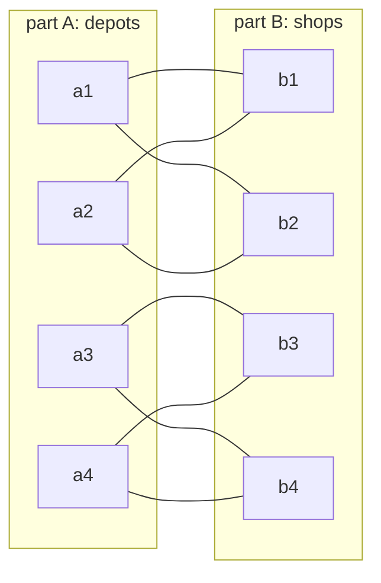

# The regularity lemma: every large network splits into a bounded number of parts with random-looking links between almost every pair

[Syllabus](../../../SYLLABUS.md) → [Combinatorics and graphs](../README.md) → [Ramsey and Extremal, in Outline](../README.md#s14) → The regularity lemma

---

## General Overview

Four depots, a1 to a4, can each send vans to four shops, b1 to b4. Of the 16 possible routes, 8 run. The **density** is 8/16 = 1/2: the share of possible links that exist.

That average hides two clusters. Depots a1 and a2 serve only shops b1 and b2; a3 and a4 serve only b3 and b4. Between {a1, a2} and {b1, b2} all 4 routes run: density 1, not 1/2.

A pair of groups is **regular** when every large sub-pair has about the overall density. A random half of the 16 routes behaves that way.

In 1978 Endre Szemerédi proved that every large network can be cut into a bounded number of equal parts with almost every pair of parts regular. The bound depends only on the error allowed, not on the network's size. So any huge network is a small table of densities plus noise, enough to count triangles.

**Every large network splits into a bounded number of equal parts such that almost every pair of parts has random-looking links, so the densities alone predict how many triangles it holds.**

**What kind of fact this is:** a theorem, proved in outline in Why it works; the triangle removal lemma is proved from it, and the Erdős–Stone theorem sketched.

### The picture: half the routes, in two clusters



The pair has density 1/2 overall, but 1 or 0 on its halves.

---

## The formula

A **graph** is a set of n points, called vertices, joined by links, called edges. For vertex sets X and Y, $`e(X, Y)`$ counts the edges between them and $`\lvert X\rvert`$ counts the vertices in X.

```math
d(X, Y) = \frac{e(X, Y)}{\lvert X\rvert\,\lvert Y\rvert}
```

**Read it aloud:** the density is the edges between X and Y divided by the pairs that could be edges.

Fix an allowed error ε (epsilon). A pair of parts (A, B) is **ε-regular** when every big enough sub-pair keeps the density to within ε:

```math
\lvert d(X, Y) - d(A, B)\rvert \le \varepsilon \text{ whenever } X \subseteq A,\ Y \subseteq B,\ \lvert X\rvert \ge \varepsilon\lvert A\rvert,\ \lvert Y\rvert \ge \varepsilon\lvert B\rvert
```

**Read it aloud:** any piece of A holding an ε share of it, against any such piece of B, has a density within ε of the whole pair's.

The depots fail for every ε below 1/2: {a1, a2} and {b1, b2} hold half of each part and show a gap of 0.5.

The **regularity lemma**: for every ε > 0 and whole number m, there is a ceiling M(ε, m). Every graph with at least m vertices splits into k parts, with $`m \le k \le M(\varepsilon, m)`$, whose sizes differ by at most one. At most $`\varepsilon k^2`$ pairs of parts fail to be ε-regular.

| Symbol | Plain meaning | In our example | Push it up and the answer… |
| --- | --- | --- | --- |
| $`n`$ | vertices in the graph | 4 + 4 | M does not move |
| $`A`$, $`B`$, $`V_i`$ | parts; $`V_i`$ is the i-th of k | depots, shops | — |
| $`X`$, $`Y`$, $`Z`$ | pieces tested inside parts, or a third part | {a1, a2}, {b1, b2} | small pieces stray further from the average |
| $`e(X, Y)`$, $`\lvert X\rvert`$ | edges between; vertices in X | 4; 2 | — |
| $`d(X, Y)`$, $`d_{XY}`$ | density | 0.5 whole, 1 on halves | — |
| $`\varepsilon`$ | allowed error, in density and in piece size | smallest the depots pass: 0.5 | weaker promise, fewer parts |
| $`k`$, $`m`$, $`M(\varepsilon, m)`$ | parts; their floor; their ceiling | k = 2 | M grows as a tower of 2s as ε shrinks |
| $`q`$, $`\delta`$, $`\gamma`$, $`r`$, $`t`$ | energy (Step 1); removal and Erdős–Stone constants (Steps 6, 7) | q = 0.0625 | — |

### When it holds

- **A large graph.** M is a tower of 2s, so the lemma says something only when n is far above it.
- **A dense graph.** The error is about $`\varepsilon n^2`$ edges. A sparse graph, such as a road map, has every pair regular at density near 0, and the lemma says nothing.
- **Large pieces only.** At single vertices almost no pair is regular: one linked pair has density 1.
- **Almost every pair.** Some graphs force a few irregular pairs in any partition, so the $`\varepsilon k^2`$ allowance is needed.

---

## Why it works

### Step 0: a score that only goes up, and has a ceiling

Score each partition by its **energy**, a size-weighted average of squared densities. Cutting parts finer never lowers it. Cutting along an irregular pair raises it by a fixed amount. The score cannot pass 1, so the cutting stops after a bounded number of rounds, with almost every pair regular.

### Step 1: the energy of a partition

```math
q = \sum_{i < j} \frac{\lvert V_i\rvert\,\lvert V_j\rvert}{n^2}\, d(V_i, V_j)^2
```

**Read it aloud:** for each pair of parts, its share of all vertex pairs times its density squared, added up.

Densities are at most 1 and the shares add to less than 1, so $`q \le 1`$. Depots and shops as two parts: $`16 \times 0.5^2 / 64 = 0.0625`$. Cut each part in half: the two cluster pairs have density 1, the rest 0, so $`q = (4 + 4)/64 = 0.1250`$.

### Step 2: cutting finer never lowers the energy

A pair's density is the size-weighted average of its sub-pairs' densities, and an average of squares is at least the square of the average. The rise is exactly the weighted sum of squared gaps from the old density.

For the depots: four sub-pairs, each 4/64 of the vertex pairs, each with a gap of 1/2, give 4 × (4/64) × 0.25 = 0.0625.

### Step 3: an irregular pair pays a fixed amount

If (A, B) is not ε-regular, some X and Y of sizes at least ε|A| and ε|B| show a gap above ε. Cutting A along X and B along Y gains at least

```math
\frac{\lvert X\rvert\,\lvert Y\rvert}{n^2}\,\varepsilon^2 \ge \varepsilon^4\,\frac{\lvert A\rvert\,\lvert B\rvert}{n^2}
```

**Read it aloud:** the gain is at least ε to the fourth times the pair's share of all vertex pairs.

At the boundary ε = 1/2 the depots' gap equals ε, and the bound still promises $`(1/2)^4 \times 16/64 = 0.0156`$; they gained 0.0625.

### Step 4: count the rounds

If more than $`\varepsilon k^2`$ pairs are irregular, cut every part along all its witnesses at once. Each pair holds about $`1/k^2`$ of the vertex pairs, so energy rises by at least $`\varepsilon k^2 \times \varepsilon^4 / k^2 = \varepsilon^5`$. Energy stays below 1, so there are at most $`\varepsilon^{-5}`$ rounds.

<details>
<summary>Why the part count becomes a tower of 2s</summary>

In one round, each part is cut by up to k − 1 witnesses, so it can fall into $`2^{k-1}`$ pieces. The part count jumps from k to about $`k\,2^k`$.

Up to $`\varepsilon^{-5}`$ such jumps make a tower of 2s. Each round also chops the pieces into equal blocks, which costs far less energy than it gains. Gowers showed in 1997 that some graphs really need a tower.

</details>

### Step 5: the triangle counting lemma

Take parts X, Y, Z whose three pairs are ε-regular with densities $`d_{XY}`$, $`d_{YZ}`$, $`d_{XZ}`$, each at least 2ε. The triangles with a corner in each part number at least

```math
(1 - 2\varepsilon)(d_{XY} - \varepsilon)(d_{YZ} - \varepsilon)(d_{XZ} - \varepsilon)\,\lvert X\rvert\,\lvert Y\rvert\,\lvert Z\rvert
```

**Read it aloud:** roughly the three densities times the three part sizes, each density lowered by ε.

Why: all but fewer than 2ε|X| vertices x have about $`d_{XY}\lvert Y\rvert`$ neighbours in Y and $`d_{XZ}\lvert Z\rvert`$ in Z. Those neighbour sets are large, so regularity of (Y, Z) makes about $`d_{YZ}`$ of the pairs between them edges, and each closes a triangle with x.

Three parts of 16 at density 0.5 predict 0.5³ × 16³ = 512 triangles. Random links give 492. Blocks with the same densities, but with X–Z joining opposite halves, give 0.

### Step 6: the triangle removal lemma

For every ε > 0 there is a δ > 0 with the following guarantee. Any graph on n vertices with fewer than $`\delta n^3`$ triangles becomes triangle-free after deleting at most $`\varepsilon n^2`$ edges: few triangles means close to none.

Apply the regularity lemma with error ε/4 and at least 4/ε parts. Delete:

1. edges inside a part: at most εn²/8;
2. edges in irregular pairs: at most εn²/4;
3. edges in pairs of density below ε/2: at most εn²/4.

If a triangle survives, its corners sit in three parts whose pairs are regular with density at least ε/2. Step 5 then finds at least a fixed share of $`n^3`$ triangles, depending on ε and M only. Choose δ below that share and no triangle can survive.

<details>
<summary>The share, worked out</summary>

Each part has at least about n/(2M) vertices, and each density, less ε/4, is at least ε/4. With 1 − ε/2 ≥ 1/2, Step 5 gives

$`\displaystyle \Big(1 - \frac{\varepsilon}{2}\Big)\Big(\frac{\varepsilon}{4}\Big)^3 \Big(\frac{n}{2M}\Big)^3 \ge \frac{\varepsilon^3}{1024\,M^3}\, n^3`$

triangles. So δ can be any number below $`\varepsilon^3 / (1024\,M^3)`$: tiny, but free of n.

</details>

### Step 7: Erdős–Stone, in outline

[Beyond Turan](06-erdos-stone-and-kovari-sos-turan.md) states it for any forbidden graph with t vertices and r + 1 colours. Colouring it puts it inside r + 1 groups of t vertices with every cross pair linked. So it suffices that at least $`(1 - 1/r + \gamma)\,n^2/2`$ edges, for fixed γ > 0 and large n, force such groups.

1. Take a regular partition and delete the edges of Step 6.
2. Form the **reduced graph**: one point per part, linked when the pair is regular and dense. It keeps over $`(1 - 1/r)\,k^2/2`$ links, so Turán's theorem ([Mantel and Turan](05-mantel-and-turan.md)) gives r + 1 points all linked.
3. A counting lemma for larger shapes, built like Step 5, finds the r + 1 groups of t inside those parts.

---

## Worked numbers, by hand

| Step | Arithmetic | Value |
| --- | --- | --- |
| whole-pair density | 8 of 16 | 0.500 |
| density on {a1, a2}, {b1, b2} | 4 of 4 | 1.000 |
| gap | 1.000 − 0.500 | 0.500 |
| worst gap, pieces of 3 or more | {a1, a2, a3}, {b1, b2, b3}: 5/9 − 1/2 | 0.056 |
| smallest ε that passes | pieces of 2 force ε ≥ 0.500 | **0.500** |
| energy, two parts | 16 × 0.25 / 64 | 0.0625 |
| energy, four halves | (4 + 4) / 64 | 0.1250 |
| gain, from squared gaps | 4 × (4/64) × 0.25 | **0.0625** |

The depots pass only from ε = 0.500 up, which allows a gap of half the whole range: as irregular as a pair at density 1/2 can be.

### What breaks if you drop a piece

| Mistake | Comes out at | What went wrong |
| --- | --- | --- |
| Checking only the whole-pair density | 0.500 for blocks and random alike | The blocks' halves sit at 1 and 0 |
| Testing pieces down to single vertices | worst gap 0.500 even for the random pair | One linked pair always has density 1 |
| Product rule without regularity | 512 predicted, 0 in the blocks | The clusters never line up |

---

## Code, from first principles, and it actually runs

Nothing is imported. The depots' worst gap comes by two roads: all 121 sub-pairs with at least two vertices a side, and a sort that fixes Y and takes the best- and worst-linked X of each size. Both roads also agree on a random 5 + 5 corner.

The energy gain is found twice, as a difference and as squared gaps. A 16 + 16 random pair from a hand-written generator is set against the blocks, and triangles are counted edge by edge.

### Python

```python
# The regularity lemma -- the check behind the card.  Nothing is imported.  A pair of
# parts is one bitmask per vertex of A: bit j is set when it links to b(j+1).  Road one
# tries every sub-pair X, Y; road two fixes Y and sorts A by links into Y, since the
# densest X of each size takes the top of that list and the sparsest the bottom.
seed = [2026]
def key():                               # a 64-bit linear congruential generator
    seed[0] = (seed[0] * 6364136223846793005 + 1442695040888963407) % 2 ** 64
    return seed[0]
def rand(n):                             # exactly half the n x n pairs: those with the smallest keys
    keys, nb = [key() for _ in range(n * n)], [0] * n
    for i in sorted(range(n * n), key=keys.__getitem__)[:n * n // 2]: nb[i // n] |= 1 << i % n
    return nb
def blocks(n): return [(2 ** (n // 2) - 1) << (n // 2 if a >= n // 2 else 0) for a in range(n)]
def dens(nb): return sum(v.bit_count() for v in nb) / len(nb) ** 2
def sets(n, m): return [Y for Y in range(1, 2 ** n) if Y.bit_count() >= m]
def brute(nb, n, m):                     # road one: every X and every Y with at least m vertices
    return max(abs(sum((nb[a] & Y).bit_count() for a in range(n) if X >> a & 1)
                   / X.bit_count() / Y.bit_count() - dens(nb)) for X in sets(n, m) for Y in sets(n, m))
def greedy(nb, n, m):                    # road two: for each Y, only the top and bottom s of A
    d, worst = dens(nb), 0.0
    for Y in sets(n, m):
        deg, t = sorted((v & Y).bit_count() for v in nb), Y.bit_count()
        for s in range(m, n + 1):
            worst = max(worst, sum(deg[-s:]) / s / t - d, d - sum(deg[:s]) / s / t)
    return worst
def eps_star(nb, n):                     # smallest eps the pair passes, with sides >= eps x n
    return min(max(g, (m - 1) / n) for m in range(1, n + 1) for g in [greedy(nb, n, m)] if g <= m / n)
def energy(parts, nb, n):                # sum over pairs of parts of |P||Q| d(P,Q)^2 / n^2
    return sum(len(P) * len(Q) * (sum(nb[p] >> q & 1 for p in P for q in Q) / len(P) / len(Q)) ** 2
               for P in parts[0] for Q in parts[1]) / n / n
def triangles(xy, yz, xz, n):            # x-y linked, then count z linked to both
    return sum((yz[y] & xz[x]).bit_count() for x in range(n) for y in range(n) if xy[x] >> y & 1)
b4, r16 = blocks(4), rand(16)
br2, gr2, gr1, gr3, es = brute(b4, 4, 2), greedy(b4, 4, 2), greedy(b4, 4, 1), greedy(b4, 4, 3), eps_star(b4, 4)
b16g, r16g, r16g1 = greedy(blocks(16), 16, 8), greedy(r16, 16, 8), greedy(r16, 16, 1)
whole, halves = [[[0, 1, 2, 3]], [[0, 1, 2, 3]]], [[[0, 1], [2, 3]], [[0, 1], [2, 3]]]
e1, e2 = energy(whole, b4, 8), energy(halves, b4, 8)
sq = sum(4 * (sum(b4[p] >> q & 1 for p in P for q in Q) / 4 - 0.5) ** 2 for P in halves[0] for Q in halves[1]) / 64
promised = 0.5 ** 4 * 16 / 64
same, opp = blocks(16), [2 ** 16 - 1 - v for v in blocks(16)]
t_rand, t_block = triangles(rand(16), rand(16), rand(16), 16), triangles(same, same, opp, 16)
print(f"pair A-B, 4 + 4 vertices: {dens(b4) * 16:.0f} of 16 links, density {dens(b4):.3f}")
print(f"halves a1,a2 and b1,b2: {(b4[0] & 3).bit_count() * 2} of 4 links, density {dens([b4[0] & 3, b4[1] & 3]):.3f}, gap {dens([b4[0] & 3, b4[1] & 3]) - 0.5:.3f}")
print(f"worst gap, sides >= 2: {br2:.3f} over all 121 such sub-pairs, {gr2:.3f} by sorting")
print(f"worst gap, sides >= 1: {gr1:.3f}; sides >= 3: {gr3:.3f}")
print(f"smallest eps that makes the pair eps-regular: {es:.3f}")
print(f"16 + 16, worst gap on sides >= 8: blocks {b16g:.3f}, random {r16g:.3f}")
print(f"energy: parts A, B {e1:.4f}; halves {e2:.4f}; gain {e2 - e1:.4f}")
print(f"gain from squared gaps {sq:.4f}; promised at least (1/2)^4 x 16/64 = {promised:.4f}")
print(f"three parts of 16, density 0.5 each: product rule 0.5^3 x 16^3 = {0.5 ** 3 * 16 ** 3:.0f} triangles")
print(f"random links: {t_rand} triangles; blocks, X-Z opposite halves: {t_block}")
print(f"mistake 1, whole-pair density only: blocks {dens(blocks(16)):.3f}, random {dens(r16):.3f}")
print(f"mistake 2, single vertices allowed: random pair's worst gap {r16g1:.3f}")
assert br2 == gr2 == 0.5 and gr1 == 0.5 and abs(gr3 - 1 / 18) < 1e-12  # two roads agree, by hand 1/18
assert abs(brute(b4, 4, 3) - 1 / 18) < 1e-12 and all(abs(brute(c, 5, m) - greedy(c, 5, m)) < 1e-12 for c in [[v & 31 for v in r16[:5]]] for m in range(1, 6))
assert es == 0.5 and b16g == 0.5 and r16g < 0.4                        # blocks fail, random does better
assert abs((e2 - e1) - sq) < 1e-12 and e2 - e1 >= promised              # energy rises by the squared gaps
assert t_block == 0 and abs(t_rand - 512) < 128                         # density alone does not count triangles
print("ALL CHECKS PASS")
```

**Ran 2026-11-23 on macOS, Python 3.14.10, standard library only. All checks passed. Output, pasted from the run:**

```
pair A-B, 4 + 4 vertices: 8 of 16 links, density 0.500
halves a1,a2 and b1,b2: 4 of 4 links, density 1.000, gap 0.500
worst gap, sides >= 2: 0.500 over all 121 such sub-pairs, 0.500 by sorting
worst gap, sides >= 1: 0.500; sides >= 3: 0.056
smallest eps that makes the pair eps-regular: 0.500
16 + 16, worst gap on sides >= 8: blocks 0.500, random 0.266
energy: parts A, B 0.0625; halves 0.1250; gain 0.0625
gain from squared gaps 0.0625; promised at least (1/2)^4 x 16/64 = 0.0156
three parts of 16, density 0.5 each: product rule 0.5^3 x 16^3 = 512 triangles
random links: 492 triangles; blocks, X-Z opposite halves: 0
mistake 1, whole-pair density only: blocks 0.500, random 0.500
mistake 2, single vertices allowed: random pair's worst gap 0.500
ALL CHECKS PASS
```

### Rust

Same numbers, same labels, built with `rustc --edition 2021 -O`.

```rust
// The regularity lemma -- the same check as the Python, in Rust.  No crates.  A pair of
// parts is one bitmask per vertex of A: bit j is set when it links to b(j+1).  Road one
// tries every sub-pair X, Y; road two fixes Y and sorts A by links into Y, since the
// densest X of each size takes the top of that list and the sparsest the bottom.
fn key(seed: &mut u64) -> u64 {          // a 64-bit linear congruential generator
    *seed = seed.wrapping_mul(6364136223846793005).wrapping_add(1442695040888963407); *seed }
fn rand(n: usize, seed: &mut u64) -> Vec<u32> { // exactly half the pairs: the smallest keys
    let keys: Vec<u64> = (0..n * n).map(|_| key(seed)).collect();
    let mut idx: Vec<usize> = (0..n * n).collect();
    idx.sort_by_key(|&i| keys[i]);
    let mut nb = vec![0u32; n];
    for &i in &idx[..n * n / 2] { nb[i / n] |= 1 << (i % n) }
    nb }
fn blocks(n: usize) -> Vec<u32> { (0..n).map(|a| ((1u32 << (n / 2)) - 1) << (if a >= n / 2 { n / 2 } else { 0 })).collect() }
fn dens(nb: &[u32]) -> f64 { nb.iter().map(|v| v.count_ones()).sum::<u32>() as f64 / (nb.len() * nb.len()) as f64 }
fn sets(n: usize, m: u32) -> Vec<u32> { (1..1u32 << n).filter(|y| y.count_ones() >= m).collect() }
fn brute(nb: &[u32], n: usize, m: u32) -> f64 { // road one: every X and every Y with at least m vertices
    let mut worst = 0.0f64;
    for &x in &sets(n, m) { for &y in &sets(n, m) {
        let e: u32 = (0..n).filter(|a| x >> a & 1 == 1).map(|a| (nb[a] & y).count_ones()).sum();
        worst = worst.max((e as f64 / x.count_ones() as f64 / y.count_ones() as f64 - dens(nb)).abs());
    } }
    worst }
fn greedy(nb: &[u32], n: usize, m: u32) -> f64 { // road two: for each Y, only the top and bottom s of A
    let (d, mut worst) = (dens(nb), 0.0f64);
    for &y in &sets(n, m) {
        let mut deg: Vec<u32> = nb.iter().map(|v| (v & y).count_ones()).collect();
        deg.sort();
        let t = y.count_ones() as f64;
        for s in m as usize..=n {
            let (hi, lo): (u32, u32) = (deg[n - s..].iter().sum(), deg[..s].iter().sum());
            worst = worst.max(hi as f64 / s as f64 / t - d).max(d - lo as f64 / s as f64 / t);
        } }
    worst }
fn eps_star(nb: &[u32], n: usize) -> f64 {   // smallest eps the pair passes, with sides >= eps x n
    (1..=n).map(|m| (m, greedy(nb, n, m as u32))).filter(|&(m, g)| g <= m as f64 / n as f64)
        .map(|(m, g)| g.max((m - 1) as f64 / n as f64)).fold(f64::INFINITY, f64::min) }
fn energy(parts: &[Vec<Vec<usize>>; 2], nb: &[u32], n: f64) -> f64 { // sum of |P||Q| d(P,Q)^2 / n^2
    let mut s = 0.0;
    for p in &parts[0] { for q in &parts[1] {
        let e: u32 = p.iter().map(|&a| q.iter().map(|&b| nb[a] >> b & 1).sum::<u32>()).sum();
        let size = (p.len() * q.len()) as f64;
        s += size * (e as f64 / size).powi(2); } }
    s / n / n }
fn triangles(xy: &[u32], yz: &[u32], xz: &[u32], n: usize) -> u32 { // x-y linked, then count z linked to both
    (0..n).map(|x| (0..n).filter(|&y| xy[x] >> y & 1 == 1).map(|y| (yz[y] & xz[x]).count_ones()).sum::<u32>()).sum() }
fn main() {
    let mut seed: u64 = 2026;
    let (b4, r16) = (blocks(4), rand(16, &mut seed));
    let (br2, gr2, gr1, gr3, es) = (brute(&b4, 4, 2), greedy(&b4, 4, 2), greedy(&b4, 4, 1), greedy(&b4, 4, 3), eps_star(&b4, 4));
    let (b16g, r16g, r16g1) = (greedy(&blocks(16), 16, 8), greedy(&r16, 16, 8), greedy(&r16, 16, 1));
    let whole = [vec![vec![0, 1, 2, 3]], vec![vec![0, 1, 2, 3]]];
    let halves = [vec![vec![0, 1], vec![2, 3]], vec![vec![0, 1], vec![2, 3]]];
    let (e1, e2) = (energy(&whole, &b4, 8.0), energy(&halves, &b4, 8.0));
    let sq: f64 = halves[0].iter().map(|p| halves[1].iter().map(|q| 4.0 * ((p.iter().map(|&a|
        q.iter().map(|&b| b4[a] >> b & 1).sum::<u32>()).sum::<u32>() as f64) / 4.0 - 0.5).powi(2)).sum::<f64>()).sum::<f64>() / 64.0;
    let promised = 0.5f64.powi(4) * 16.0 / 64.0;
    let same = blocks(16); let opp: Vec<u32> = same.iter().map(|v| 0xFFFF - v).collect();
    let (rx, ry, rz) = (rand(16, &mut seed), rand(16, &mut seed), rand(16, &mut seed));
    let (t_rand, t_block) = (triangles(&rx, &ry, &rz, 16), triangles(&same, &same, &opp, 16));
    let h = [b4[0] & 3, b4[1] & 3];
    println!("pair A-B, 4 + 4 vertices: {:.0} of 16 links, density {:.3}", dens(&b4) * 16.0, dens(&b4));
    println!("halves a1,a2 and b1,b2: {} of 4 links, density {:.3}, gap {:.3}", (b4[0] & 3).count_ones() * 2, dens(&h), dens(&h) - 0.5);
    println!("worst gap, sides >= 2: {:.3} over all 121 such sub-pairs, {:.3} by sorting", br2, gr2);
    println!("worst gap, sides >= 1: {:.3}; sides >= 3: {:.3}", gr1, gr3);
    println!("smallest eps that makes the pair eps-regular: {:.3}", es);
    println!("16 + 16, worst gap on sides >= 8: blocks {:.3}, random {:.3}", b16g, r16g);
    println!("energy: parts A, B {:.4}; halves {:.4}; gain {:.4}", e1, e2, e2 - e1);
    println!("gain from squared gaps {:.4}; promised at least (1/2)^4 x 16/64 = {:.4}", sq, promised);
    println!("three parts of 16, density 0.5 each: product rule 0.5^3 x 16^3 = {:.0} triangles", 0.5f64.powi(3) * 4096.0);
    println!("random links: {} triangles; blocks, X-Z opposite halves: {}", t_rand, t_block);
    println!("mistake 1, whole-pair density only: blocks {:.3}, random {:.3}", dens(&blocks(16)), dens(&r16));
    println!("mistake 2, single vertices allowed: random pair's worst gap {:.3}", r16g1);
    assert!(br2 == 0.5 && gr2 == 0.5 && gr1 == 0.5 && (gr3 - 1.0 / 18.0).abs() < 1e-12); // two roads agree
    assert!((brute(&b4, 4, 3) - 1.0 / 18.0).abs() < 1e-12 && (1..=5).all(|m| { let c: Vec<u32> = r16[..5].iter().map(|v| v & 31).collect(); (brute(&c, 5, m) - greedy(&c, 5, m)).abs() < 1e-12 }));
    assert!(es == 0.5 && b16g == 0.5 && r16g < 0.4);                    // blocks fail, random does better
    assert!(((e2 - e1) - sq).abs() < 1e-12 && e2 - e1 >= promised);     // energy rises by the squared gaps
    assert!(t_block == 0 && (t_rand as i64 - 512).abs() < 128);         // density alone does not count triangles
    println!("ALL CHECKS PASS");
}
```

**Ran 2026-11-23 on macOS, rustc 1.98.1, no crates. All checks passed. Output, pasted from the run:**

```
pair A-B, 4 + 4 vertices: 8 of 16 links, density 0.500
halves a1,a2 and b1,b2: 4 of 4 links, density 1.000, gap 0.500
worst gap, sides >= 2: 0.500 over all 121 such sub-pairs, 0.500 by sorting
worst gap, sides >= 1: 0.500; sides >= 3: 0.056
smallest eps that makes the pair eps-regular: 0.500
16 + 16, worst gap on sides >= 8: blocks 0.500, random 0.266
energy: parts A, B 0.0625; halves 0.1250; gain 0.0625
gain from squared gaps 0.0625; promised at least (1/2)^4 x 16/64 = 0.0156
three parts of 16, density 0.5 each: product rule 0.5^3 x 16^3 = 512 triangles
random links: 492 triangles; blocks, X-Z opposite halves: 0
mistake 1, whole-pair density only: blocks 0.500, random 0.500
mistake 2, single vertices allowed: random pair's worst gap 0.500
ALL CHECKS PASS
```

The outputs match line for line.

### Lean

Lean proves the regularity, triangle counting and triangle removal lemmas for every graph, and checks the depots' numbers.

- Take ε > 0 and a whole number m. Then one M serves every graph with at least m vertices: it splits into k parts, $`m \le k \le M`$.
- Those part sizes differ by at most one, and all but at most $`\varepsilon k^2`$ pairs of parts are ε-regular.
- Take parts X, Y, Z whose three pairs are ε-regular, each with density at least 2ε. Then the triangles with a corner in each part number at least Step 5's bound.
- Take ε > 0. Then one δ > 0 serves every graph on n vertices with fewer than $`\delta n^3`$ triangles.
- Deleting at most $`\varepsilon n^2`$ edges from such a graph leaves it triangle-free.
- The depots' pair has 8 of 16 routes, density 1/2. The halves {a1, a2} and {b1, b2} have density 1.
- The pieces {a1, a2, a3} and {b1, b2, b3} have density 5/9, a gap of 1/18.
- The energy sums work out: 0.0625 for two parts, 0.1250 for halves, and a gain of 0.0625 against the promised 0.0156.
- The product rule for three parts of 16 at density 0.5 gives 512 triangles.

The worst-gap searches, the random pairs, the triangle counts and the Erdős–Stone sketch are left to the Python and Rust checks.

```lean
-- The regularity lemma: every graph with at least m vertices splits into a bounded number of near-equal parts with all but an ε share of the pairs of parts ε-regular, regular pairs count triangles, and few triangles can be removed by deleting few edges.
import Mathlib.Combinatorics.SimpleGraph.Regularity.Lemma
import Mathlib.Combinatorics.SimpleGraph.Triangle.Removal

open Finset

universe u

theorem tc_card_interedges {V : Type u} [DecidableEq V] (G : SimpleGraph V) [DecidableRel G.Adj]
    (s t : Finset V) :
    #(G.interedges s t) = ∑ x ∈ s, #{y ∈ t | G.Adj x y} := by
  rw [SimpleGraph.interedges_def, card_filter, sum_product]
  refine sum_congr rfl fun x _ => ?_
  rw [card_filter]

#print axioms tc_card_interedges

theorem tc_bad_card {V : Type u} [DecidableEq V] (G : SimpleGraph V) [DecidableRel G.Adj]
    (ε : ℝ) (hε : 0 < ε) (s t : Finset V)
    (r : ∀ s' ⊆ s, ∀ t' ⊆ t, ε * #s ≤ #s' → ε * #t ≤ #t' →
      |(G.edgeDensity s' t' : ℝ) - G.edgeDensity s t| ≤ ε)
    (d : 2 * ε ≤ (G.edgeDensity s t : ℝ)) :
    (#{x ∈ s | (#{y ∈ t | G.Adj x y} : ℝ) < ((G.edgeDensity s t : ℝ) - ε) * #t} : ℝ) ≤
      ε * #s := by
  set B := {x ∈ s | (#{y ∈ t | G.Adj x y} : ℝ) < ((G.edgeDensity s t : ℝ) - ε) * #t} with hBdef
  by_contra h
  push Not at h
  have hd1 : (G.edgeDensity s t : ℝ) ≤ 1 := by exact_mod_cast G.edgeDensity_le_one s t
  have hε1 : ε ≤ 1 := by linarith
  have ht : (0 : ℝ) < #t := by
    rcases Nat.eq_zero_or_pos #t with h0 | h0
    · rw [card_eq_zero] at h0
      subst h0
      simp at d
      linarith
    · exact_mod_cast h0
  have hs0 : (0 : ℝ) ≤ #s := Nat.cast_nonneg _
  have hB : (0 : ℝ) < #B := lt_of_le_of_lt (by positivity) h
  have hBne : B.Nonempty := by
    rw [← card_pos]; exact_mod_cast hB
  have key := r B (filter_subset _ _) t Subset.rfl h.le (by nlinarith)
  have hsum : (#(G.interedges B t) : ℝ) < #B * (((G.edgeDensity s t : ℝ) - ε) * #t) := by
    rw [tc_card_interedges, Nat.cast_sum]
    calc ∑ x ∈ B, (#{y ∈ t | G.Adj x y} : ℝ)
        < ∑ x ∈ B, (((G.edgeDensity s t : ℝ) - ε) * #t) :=
          sum_lt_sum_of_nonempty hBne fun x hx => (mem_filter.1 hx).2
      _ = _ := by rw [sum_const, nsmul_eq_mul]
  have hdB : (G.edgeDensity B t : ℝ) < (G.edgeDensity s t : ℝ) - ε := by
    rw [SimpleGraph.edgeDensity_def]
    push_cast
    rw [div_lt_iff₀ (by positivity)]
    linarith
  rw [abs_le] at key
  linarith

#print axioms tc_bad_card

/-- **The regularity lemma.** For every allowed error ε > 0 and whole number m there is a number
M, depending only on ε and m, such that every graph with at least m vertices splits into k parts,
m ≤ k ≤ M, of sizes differing by at most one, with all but at most ε k² pairs of parts ε-regular:
for such a pair (A, B), every X ⊆ A and Y ⊆ B with |X| ≥ ε|A| and |Y| ≥ ε|B| has
|d(X, Y) - d(A, B)| ≤ ε, where d(X, Y) = e(X, Y) / (|X| |Y|) is the edge density. -/
theorem szemeredi_regularity_lemma (ε : ℝ) (hε : 0 < ε) (m : ℕ) :
    ∃ M : ℕ, ∀ (V : Type u) [Fintype V] [DecidableEq V] (G : SimpleGraph V) [DecidableRel G.Adj],
      m ≤ Fintype.card V →
      ∃ P : Finpartition (univ : Finset V),
        P.IsEquipartition ∧ m ≤ #P.parts ∧ #P.parts ≤ M ∧
        ∃ irregular : Finset (Finset V × Finset V),
          (#irregular : ℝ) ≤ ε * (#P.parts : ℝ) ^ 2 ∧
          ∀ A ∈ P.parts, ∀ B ∈ P.parts, A ≠ B → (A, B) ∉ irregular →
            ∀ X ⊆ A, ∀ Y ⊆ B, ε * #A ≤ #X → ε * #B ≤ #Y →
              |(G.edgeDensity X Y : ℝ) - G.edgeDensity A B| ≤ ε := by
  refine ⟨SzemerediRegularity.bound ε m, fun V _ _ G _ hm => ?_⟩
  obtain ⟨P, hP1, hP2, hP3, hP4⟩ := szemeredi_regularity G hε hm
  refine ⟨P, hP1, hP2, hP3, P.nonUniforms G ε, ?_, ?_⟩
  · refine hP4.trans ?_
    have hk : (0 : ℝ) ≤ #P.parts := Nat.cast_nonneg _
    rcases Nat.eq_zero_or_pos #P.parts with h0 | h0
    · simp [h0]
    · rw [Nat.cast_mul, Nat.cast_sub h0]
      push_cast
      nlinarith
  · intro A hA B hB hAB hirr X hX Y hY hXc hYc
    have hu : G.IsUniform ε A B := by
      by_contra hc
      exact hirr ((P.mk_mem_nonUniforms G).2 ⟨hA, hB, hAB, hc⟩)
    exact (hu hX hY (by rwa [mul_comm]) (by rwa [mul_comm])).le

/-- **The triangle counting lemma.** If the three pairs among X, Y, Z are ε-regular, with
densities d_XY, d_YZ, d_XZ each at least 2ε, then the triangles with a corner in each of X, Y, Z
number at least (1 - 2ε)(d_XY - ε)(d_YZ - ε)(d_XZ - ε)|X||Y||Z|. -/
theorem triangle_counting_lemma {V : Type u} [Fintype V] [DecidableEq V] (G : SimpleGraph V)
    [DecidableRel G.Adj] (ε : ℝ) (X Y Z : Finset V)
    (rXY : ∀ X' ⊆ X, ∀ Y' ⊆ Y, ε * #X ≤ #X' → ε * #Y ≤ #Y' →
      |(G.edgeDensity X' Y' : ℝ) - G.edgeDensity X Y| ≤ ε)
    (rYZ : ∀ Y' ⊆ Y, ∀ Z' ⊆ Z, ε * #Y ≤ #Y' → ε * #Z ≤ #Z' →
      |(G.edgeDensity Y' Z' : ℝ) - G.edgeDensity Y Z| ≤ ε)
    (rXZ : ∀ X' ⊆ X, ∀ Z' ⊆ Z, ε * #X ≤ #X' → ε * #Z ≤ #Z' →
      |(G.edgeDensity X' Z' : ℝ) - G.edgeDensity X Z| ≤ ε)
    (dXY : 2 * ε ≤ (G.edgeDensity X Y : ℝ)) (dYZ : 2 * ε ≤ (G.edgeDensity Y Z : ℝ))
    (dXZ : 2 * ε ≤ (G.edgeDensity X Z : ℝ)) :
    (1 - 2 * ε) * ((G.edgeDensity X Y : ℝ) - ε) * ((G.edgeDensity Y Z : ℝ) - ε) *
        ((G.edgeDensity X Z : ℝ) - ε) * #X * #Y * #Z ≤
      #{t ∈ X ×ˢ Y ×ˢ Z | G.Adj t.1 t.2.1 ∧ G.Adj t.2.1 t.2.2 ∧ G.Adj t.1 t.2.2} := by
  rcases lt_trichotomy ε 0 with hε | rfl | hε
  · exfalso
    have hX : (0 : ℝ) ≤ #X := Nat.cast_nonneg _
    have hY : (0 : ℝ) ≤ #Y := Nat.cast_nonneg _
    have := rXY X Subset.rfl Y Subset.rfl (by nlinarith) (by nlinarith)
    simp at this
    linarith
  · have := rXY ∅ (empty_subset _) Y Subset.rfl (by simp) (by simp)
    simp only [SimpleGraph.edgeDensity_empty_left, Rat.cast_zero, zero_sub, abs_neg,
      abs_nonpos_iff] at this
    rw [this]
    simp
  set NY : V → Finset V := fun x => {y ∈ Y | G.Adj x y} with hNY
  set NZ : V → Finset V := fun x => {z ∈ Z | G.Adj x z} with hNZ
  set dxy : ℝ := (G.edgeDensity X Y : ℝ) with hdxy
  set dyz : ℝ := (G.edgeDensity Y Z : ℝ) with hdyz
  set dxz : ℝ := (G.edgeDensity X Z : ℝ) with hdxz
  have hY0 : (0 : ℝ) < #Y := by
    rcases Nat.eq_zero_or_pos #Y with h0 | h0
    · rw [card_eq_zero] at h0
      subst h0
      simp [dxy] at dXY
      linarith
    · exact_mod_cast h0
  have hZ0 : (0 : ℝ) < #Z := by
    rcases Nat.eq_zero_or_pos #Z with h0 | h0
    · rw [card_eq_zero] at h0
      subst h0
      simp [dxz] at dXZ
      linarith
    · exact_mod_cast h0
  set good := {x ∈ X | (dxy - ε) * #Y ≤ (#(NY x) : ℝ) ∧ (dxz - ε) * #Z ≤ (#(NZ x) : ℝ)}
    with hgood
  have hbY := tc_bad_card G ε hε X Y rXY dXY
  have hbZ := tc_bad_card G ε hε X Z rXZ dXZ
  have hgood_card : (1 - 2 * ε) * #X ≤ (#good : ℝ) := by
    have hsub : X ⊆ good ∪ ({x ∈ X | (#{y ∈ Y | G.Adj x y} : ℝ) < (dxy - ε) * #Y} ∪
        {x ∈ X | (#{y ∈ Z | G.Adj x y} : ℝ) < (dxz - ε) * #Z}) := by
      intro x hx
      simp only [mem_union, mem_filter, hgood, hNY, hNZ]
      by_contra hc
      push Not at hc
      obtain ⟨h1, h2, h3⟩ := hc
      exact absurd (h1 hx (h2 hx)) (not_lt.2 (h3 hx))
    have := (card_le_card hsub).trans ((card_union_le _ _).trans
      (Nat.add_le_add_left (card_union_le _ _) _))
    have : (#X : ℝ) ≤ #good + (#{x ∈ X | (#{y ∈ Y | G.Adj x y} : ℝ) < (dxy - ε) * #Y} +
        #{x ∈ X | (#{y ∈ Z | G.Adj x y} : ℝ) < (dxz - ε) * #Z} : ℕ) := by
      exact_mod_cast this
    push_cast at this
    linarith
  have hx : ∀ x ∈ good, (dyz - ε) * (dxy - ε) * (dxz - ε) * #Y * #Z ≤
      (#(G.interedges (NY x) (NZ x)) : ℝ) := by
    intro x hx
    obtain ⟨-, h1, h2⟩ := (mem_filter.1 hx)
    have hY : ε * #Y ≤ (#(NY x) : ℝ) :=
      le_trans (mul_le_mul_of_nonneg_right (by linarith) (Nat.cast_nonneg _)) h1
    have hZ : ε * #Z ≤ (#(NZ x) : ℝ) :=
      le_trans (mul_le_mul_of_nonneg_right (by linarith) (Nat.cast_nonneg _)) h2
    have hNY0 : (0 : ℝ) < #(NY x) := lt_of_lt_of_le (by positivity) hY
    have hNZ0 : (0 : ℝ) < #(NZ x) := lt_of_lt_of_le (by positivity) hZ
    have key := rYZ (NY x) (filter_subset _ _) (NZ x) (filter_subset _ _) hY hZ
    rw [abs_le] at key
    have hden : (G.edgeDensity (NY x) (NZ x) : ℝ) * (#(NY x) * #(NZ x)) =
        #(G.interedges (NY x) (NZ x)) := by
      rw [SimpleGraph.edgeDensity_def]
      push_cast
      field_simp
    rw [← hden]
    calc (dyz - ε) * (dxy - ε) * (dxz - ε) * #Y * #Z
        = (dyz - ε) * (((dxy - ε) * #Y) * ((dxz - ε) * #Z)) := by ring
      _ ≤ (dyz - ε) * (#(NY x) * #(NZ x)) := by
          gcongr
          · linarith
          · nlinarith
      _ ≤ _ := by
          gcongr
          linarith
  have hcount : ∑ x ∈ X, #(G.interedges (NY x) (NZ x)) =
      #{t ∈ X ×ˢ Y ×ˢ Z | G.Adj t.1 t.2.1 ∧ G.Adj t.2.1 t.2.2 ∧ G.Adj t.1 t.2.2} := by
    rw [card_filter, sum_product]
    refine sum_congr rfl fun x _ => ?_
    rw [← card_filter]
    congr 1
    ext ⟨y, z⟩
    simp only [SimpleGraph.mk_mem_interedges_iff, mem_filter, mem_product, hNY, hNZ]
    tauto
  rw [← hcount]
  have hc0 : 0 ≤ (dxy - ε) * (dyz - ε) * (dxz - ε) * #Y * #Z := by
    have : 0 ≤ dxy - ε := by linarith
    have : 0 ≤ dyz - ε := by linarith
    have : 0 ≤ dxz - ε := by linarith
    positivity
  calc (1 - 2 * ε) * (dxy - ε) * (dyz - ε) * (dxz - ε) * #X * #Y * #Z
      = ((1 - 2 * ε) * #X) * ((dxy - ε) * (dyz - ε) * (dxz - ε) * #Y * #Z) := by ring
    _ ≤ #good * ((dxy - ε) * (dyz - ε) * (dxz - ε) * #Y * #Z) :=
        mul_le_mul_of_nonneg_right hgood_card hc0
    _ = ∑ x ∈ good, (dyz - ε) * (dxy - ε) * (dxz - ε) * #Y * #Z := by
        rw [sum_const, nsmul_eq_mul]; ring
    _ ≤ ∑ x ∈ good, (#(G.interedges (NY x) (NZ x)) : ℝ) := sum_le_sum hx
    _ ≤ ∑ x ∈ X, (#(G.interedges (NY x) (NZ x)) : ℝ) :=
        sum_le_sum_of_subset_of_nonneg (filter_subset _ _) fun _ _ _ => Nat.cast_nonneg _
    _ = _ := by push_cast; rfl

/-- **The triangle removal lemma.** For every ε > 0 there is a δ > 0 such that a graph on n
vertices with fewer than δ n³ triangles becomes triangle-free after deleting at most ε n² edges. -/
theorem triangle_removal_lemma (ε : ℝ) (hε : 0 < ε) :
    ∃ δ : ℝ, 0 < δ ∧
      ∀ (V : Type u) [Fintype V] [DecidableEq V] (G : SimpleGraph V) [DecidableRel G.Adj],
        (#(G.cliqueFinset 3) : ℝ) < δ * (Fintype.card V : ℝ) ^ 3 →
        ∃ H : SimpleGraph V, ∃ _ : DecidableRel H.Adj, H ≤ G ∧ H.CliqueFree 3 ∧
          (#(G.edgeFinset \ H.edgeFinset) : ℝ) ≤ ε * (Fintype.card V : ℝ) ^ 2 := by
  refine ⟨SimpleGraph.triangleRemovalBound ε, SimpleGraph.triangleRemovalBound_pos hε,
    fun V _ _ G _ hG => ?_⟩
  obtain ⟨H, hHG, hdec, hcard, hfree⟩ := G.triangle_removal hG
  refine ⟨H, hdec, hHG, hfree, ?_⟩
  have hsub : H.edgeFinset ⊆ G.edgeFinset := SimpleGraph.edgeFinset_subset_edgeFinset.2 hHG
  rw [card_sdiff_of_subset hsub, Nat.cast_sub (card_le_card hsub)]
  push_cast at hcard
  exact hcard.le

/-- The depots and shops: vertices 0-3 are a1-a4, vertices 4-7 are b1-b4; a1, a2 link to b1, b2
and a3, a4 link to b3, b4. -/
def depots : SimpleGraph (Fin 8) where
  Adj i j := i.val / 2 + 2 = j.val / 2 ∨ j.val / 2 + 2 = i.val / 2
  symm := ⟨fun i j h => by omega⟩
  loopless := ⟨fun i h => by omega⟩

instance : DecidableRel depots.Adj := fun i j =>
  inferInstanceAs (Decidable (i.val / 2 + 2 = j.val / 2 ∨ j.val / 2 + 2 = i.val / 2))

-- 8 of the 16 routes run: density 1/2.
example : #(depots.interedges {0, 1, 2, 3} {4, 5, 6, 7}) = 8 := by decide
example : depots.edgeDensity {0, 1, 2, 3} {4, 5, 6, 7} = 1 / 2 := by
  rw [SimpleGraph.edgeDensity_def,
    show #(depots.interedges {0, 1, 2, 3} {4, 5, 6, 7}) = 8 by decide]
  norm_num
-- On the halves {a1, a2} and {b1, b2}: 4 of 4 routes, density 1, gap 1 - 1/2 = 1/2.
example : depots.edgeDensity {0, 1} {4, 5} = 1 := by
  rw [SimpleGraph.edgeDensity_def, show #(depots.interedges {0, 1} {4, 5}) = 4 by decide]
  norm_num
-- Pieces of 3: {a1, a2, a3} and {b1, b2, b3} hold 5 of 9 routes, a gap of 5/9 - 1/2 = 1/18.
example : depots.edgeDensity {0, 1, 2} {4, 5, 6} = 5 / 9 := by
  rw [SimpleGraph.edgeDensity_def, show #(depots.interedges {0, 1, 2} {4, 5, 6}) = 5 by decide]
  norm_num
example : (5 / 9 : ℚ) - 1 / 2 = 1 / 18 := by norm_num
-- Energy: two parts 16 × (1/2)² / 64 = 1/16; four halves (4 + 4)/64 = 1/8; gain 1/16.
example : (16 * (1 / 2) ^ 2 / 64 : ℚ) = 1 / 16 := by norm_num
example : ((4 + 4) / 64 : ℚ) - 1 / 16 = 1 / 16 := by norm_num
-- The gain from squared gaps, 4 × (4/64) × (1/2)², and the promised floor (1/2)⁴ × 16/64 = 1/64.
example : (4 * (4 / 64) * (1 / 2) ^ 2 : ℚ) = 1 / 16 := by norm_num
example : ((1 / 2) ^ 4 * 16 / 64 : ℚ) = 1 / 64 := by norm_num
-- Three parts of 16 at density 1/2: the product rule predicts (1/2)³ × 16³ = 512 triangles.
example : ((1 / 2) ^ 3 * 16 ^ 3 : ℚ) = 512 := by norm_num

#print axioms szemeredi_regularity_lemma
#print axioms triangle_counting_lemma
#print axioms triangle_removal_lemma
```

**Checked 2026-11-23 on macOS, Lean 4.36.0-rc2, Mathlib v4.36.0-rc2. Every proof is complete and uses only Lean's standard axioms. Output, pasted from the run:**

```
'tc_card_interedges' depends on axioms: [propext, Classical.choice, Quot.sound]
'tc_bad_card' depends on axioms: [propext, Classical.choice, Quot.sound]
'szemeredi_regularity_lemma' depends on axioms: [propext, Classical.choice, Quot.sound]
'triangle_counting_lemma' depends on axioms: [propext, Classical.choice, Quot.sound]
'triangle_removal_lemma' depends on axioms: [propext, Classical.choice, Quot.sound]
```

> [!TIP]
> **Try changing**
> - Guess first: does another random pair look regular too? Change `2026` to `7` in the `seed` line: worst gap 0.297 on sides of 8 or more, 512 triangles, every assert passes.
> - Guess first: how does the random pair's worst gap move as pieces shrink from 8 to 1? It climbs from 0.266 to 0.500. Change the `8` in `greedy(r16, 16, 8)`.
> - Guess first: set `opp` equal to `same`. The clusters now line up, and the block triangle count jumps far above 512.

---

## The usual mistake

> [!warning]
> **Reading a pair's density as a description of the pair.** The depots and a random pair both have density 0.500, but only the random one has large pieces near 0.500. Regularity is a claim about every large piece, never the total.
>
> - **Regular does not mean dense.** A pair with no edges is ε-regular for every ε.
> - **Allowing tiny pieces.** At single vertices the random pair also shows a gap of 0.500.
> - **Trusting the product rule without regularity.** It predicts 512 triangles; the blocks hold 0.

---

## Where you meet it in real life

- **Testing huge networks.** By the removal lemma, a network far from triangle-free has many triangles, so a sample of fixed size finds one, however big the network.
- **Whole numbers.** Ruzsa and Szemerédi derived Roth's theorem from the removal lemma: any set holding a fixed share of the whole numbers contains three evenly spaced members.
- **Community detection.** A regular partition is a block model: a few groups, a link rate for each pair of groups, plus noise.

> **Say it back**
> A pair of groups is regular when every large piece has about the pair's density. The depots fail: half the routes run, all inside two clusters. The regularity lemma cuts any large network into a bounded number of equal parts with almost every pair regular, because cutting along irregular pairs raises an energy that cannot pass 1. Regular pairs let densities count triangles, which proves the removal lemma and Erdős–Stone.

---

## What this builds on

- [Beyond Turan](06-erdos-stone-and-kovari-sos-turan.md): the Erdős–Stone theorem, proved in outline in Step 7.
- [Mantel and Turan](05-mantel-and-turan.md): Turán's theorem inside the reduced graph, and the averaging of squares behind Step 2.

## Where this goes next

- [The Lovasz local lemma](08-lovasz-local-lemma.md): next on this shelf, a probabilistic tool for avoiding many rare, locally tied bad events at once.
- [Random graphs](../../09-Probability%20and%20statistics/14-Random%20Graphs%20and%20the%20Probabilistic%20Method/01-random-graphs-erdos-renyi.md): Erdős–Rényi random graphs, the model regular pairs imitate.
- [Long progressions](../../21-Algebraic%20and%20analytic%20number%20theory/08-Additive%20Combinatorics%20and%20Probabilistic%20Number%20Theory/05-szemeredi-and-green-tao-in-outline.md): Szemerédi's theorem on progressions, where the lemma was born.

The lemma needs dense graphs and a tower of parts; regularity for sparse networks with sane bounds stays open. The next card returns to proving good structures exist when bad events overlap only locally.

---

## Sources

Verified 2026-11-23: every link below resolves to the publisher's page.

- Szemerédi, E. "On sets of integers containing k elements in arithmetic progression." *Acta Arithmetica* 27 (1975). [DOI 10.4064/aa-27-1-199-245](https://doi.org/10.4064/aa-27-1-199-245). The first form of the lemma.
- Gowers, W. T. "Lower bounds of tower type for Szemerédi's uniformity lemma." *Geometric and Functional Analysis* 7 (1997). [DOI 10.1007/PL00001621](https://doi.org/10.1007/PL00001621). Graphs that need a tower of parts.
- Conlon, David, and Jacob Fox. "Graph removal lemmas." *Surveys in Combinatorics 2013*, Cambridge University Press. [DOI 10.1017/CBO9781139506748.002](https://doi.org/10.1017/CBO9781139506748.002). The removal lemma and its uses.
- Diestel, Reinhard. *Graph Theory*, 6th ed. Springer, 2025. [DOI 10.1007/978-3-662-70107-2](https://doi.org/10.1007/978-3-662-70107-2). A textbook proof by energy increments.
