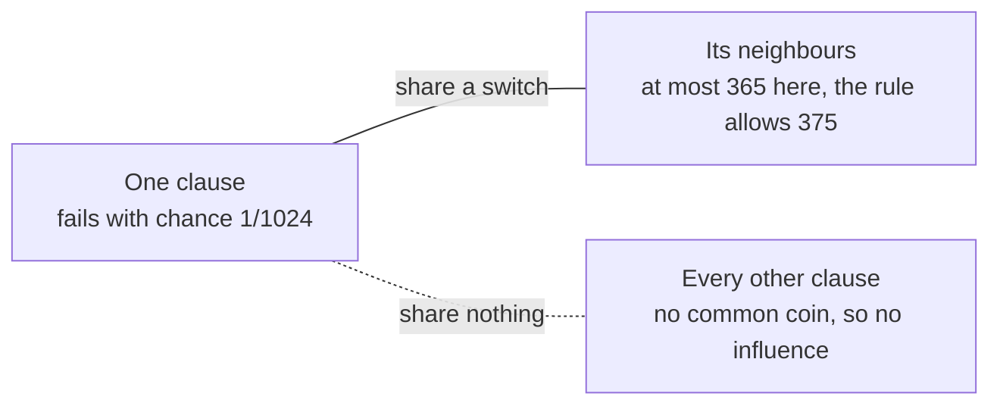

# The Lovasz local lemma: many bad events, each rare and each tied to few others, can all be avoided at once

[Syllabus](../../../SYLLABUS.md) → [Combinatorics and graphs](../README.md) → [Ramsey and Extremal, in Outline](../README.md#s14) → The Lovasz local lemma

---

## General Overview

A chip design has 1000 on/off switches. Its test team writes 3800 rules. Each rule names 10 switches and forbids exactly one setting of them, say "not all of these off". Is there a setting of all 1000 switches that breaks no rule?

This is a **10-SAT formula**: **clauses** (rules), each on 10 **variables** (switches), each failing at one of its 1024 settings. SAT solvers, programs that answer such questions, check chip designs.

Flip a fair coin for every switch. Each clause then fails with chance 1/1024. [Erdos's counting trick](03-probabilistic-method-by-counting.md) adds those chances, the **union bound** (if the chances add to under 1, some outcome avoids them all): 3800/1024 = 3.71. That is over 1, so the count proves nothing.

The local lemma looks closer. Each clause shares a switch with at most 365 others here, and nothing with the rest. That is enough: when each clause fails rarely and touches few others, some setting satisfies all 3800.

**When each bad event has chance at most p and depends on at most d others, and e × p × (d + 1) is at most 1, with e = 2.718281828…, there is an outcome where none of them happens.**

**What kind of fact this is:** a theorem, proved on this card in Why it works. Erdos and Lovasz published it in 1975 with the condition 4 × p × d ≤ 1; the sharper form here, with e, is the one textbooks now state.

### The picture: one clause and the clauses it touches



The lemma counts only the solid lines.

---

## The formula

Notation first, in words. A **bad event** is something we want to avoid, here "clause i fails". $`A_1, \dots, A_m`$ are the $`m`$ bad events. $`\Pr(\cdot)`$ is the chance of what is in the brackets. $`\overline{A_i}`$, read "not $`A_i`$", is the event that $`A_i`$ does not happen.

Two events are **independent** when knowing one gives no information about the other. The lemma needs more: each $`A_i`$ is independent of everything its non-neighbours do together. Clauses that share no variable meet this, because they read disjoint coins.

```math
e\,p\,(d+1) \le 1 \quad\Longrightarrow\quad \Pr\big(\overline{A_1} \text{ and } \overline{A_2} \text{ and } \dots \text{ and } \overline{A_m}\big) \;\ge\; \Big(1 - \frac{1}{d+1}\Big)^{m} \;>\; 0
```

**Read it aloud:** if e times the chance times one more than the number of neighbours is at most 1, then all the bad events are avoided together with positive chance.

On the formula: $`e \times (1/1024) \times 376 = 0.99812`$, under 1. At 376 neighbours it would be 1.00077, over. So 375 is the largest neighbour count the rule allows for 10-SAT.

| Symbol | Plain meaning | In our example | Push it up and the answer… |
| --- | --- | --- | --- |
| $`A_i`$, $`m`$ | the i-th bad event, out of m | clause i fails, of 3800 | more events: the floor falls, but stays above 0 |
| $`p`$ | the largest chance of one bad event | 1/1024 | the rule breaks sooner |
| $`d`$ | most other events one event depends on | 365, rule allows 375 | the rule breaks past 375 |
| $`e`$ | the number 2.718281828…, the sum 1/0! + 1/1! + 1/2! + … | 2.718281828 | — |
| $`x`$ | $`1/(d+1)`$: the cap on a bad event's chance once others are avoided | 1/3 on the ring in Why it works | — |
| $`k`$ | variables per clause, or size of a set; in the Ramsey table, a group of k dots out of n | 10 | p halves for each step |
| $`\Pr`$ | chance of an event | — | — |
| $`S`$ | a set of other events known to be avoided (proof only) | — | — |

### When it holds

- **Dependence is counted against everything at once.** $`A_i`$ must be independent of all its non-neighbours together, not of each one alone. The proof's Step 1 fails without it.
- **The worst event sets $`p`$ and $`d`$.** One clause with more than 375 neighbours breaks the symmetric rule, however sparse the rest are.
- **It proves existence only.** Finding the setting is a separate job, done here by **resampling**: re-flip the switches of a failing clause until none fail.

---

## Why it works

### Step 0: avoid the events one at a time

Order the events. The chance that all are avoided is the chance the first is avoided, times the chance the second is avoided given the first was, and so on. So it is enough to show: **once any collection of other events is avoided, each remaining event still has chance at most $`x = 1/(d+1)`$.** Then every factor is at least $`1 - x`$, and the product is at least $`(1-x)^m > 0`$.

### Step 1: split the conditions into neighbours and strangers

Fix an event $`A_i`$ and a set $`S`$ of other events known to be avoided. Some of $`S`$ are $`A_i`$'s neighbours, at most $`d`$ of them. The rest are strangers: $`A_i`$ ignores them.

The chance of $`A_i`$ given all of $`S`$ avoided counts only outcomes where all of $`S`$ is avoided. It is a fraction, top over bottom:

- **Top:** chance of $`A_i`$, with the neighbours avoided, given the strangers avoided. Dropping "neighbours avoided" can only raise it. With strangers alone, $`A_i`$ keeps its own chance. So the top is at most $`p`$.
- **Bottom:** chance the neighbours are all avoided, given the strangers avoided. A small bottom would inflate the fraction.

### Step 2: the bottom stays large, by the same claim on fewer events

Avoid the neighbours one at a time, as in Step 0. Each is a smaller case of the same claim, so each has chance at most $`x`$ and is avoided with chance at least $`1 - x`$. At most $`d`$ neighbours give a bottom of at least $`(1-x)^d`$. The fraction is then at most $`p/(1-x)^d`$.

The claim holds if $`p \le x(1-x)^d`$. This is an induction on the size of $`S`$: the empty case is $`p \le x`$, and each larger case uses only smaller ones.

### Step 3: where the e comes from

With $`x = 1/(d+1)`$, the needed bound is $`p \le \frac{1}{d+1}\big(\frac{d}{d+1}\big)^d`$. The factor $`\big(\frac{d}{d+1}\big)^d`$ is never below $`1/e`$, because $`(1 + 1/d)^d`$ climbs towards e and never reaches it. So $`e\,p\,(d+1) \le 1`$ is enough.

<details>
<summary>Detailed proof: the induction written out</summary>

Claim: for every $`i`$ and every set $`S`$ of other indices with all of $`S`$ avoided, $`\Pr(A_i \mid S \text{ avoided}) \le x`$. Here the bar, $`\mid`$, reads "given".

Split $`S`$ into neighbours $`S_1`$ and strangers $`S_2`$. If $`S_1`$ is empty, $`A_i`$ is independent of $`S_2`$, so the chance is at most $`p \le x`$. Otherwise:

$`\displaystyle \Pr(A_i \mid S) = \frac{\Pr(A_i \text{ and } S_1 \text{ avoided} \mid S_2)}{\Pr(S_1 \text{ avoided} \mid S_2)} \le \frac{\Pr(A_i \mid S_2)}{\Pr(S_1 \text{ avoided} \mid S_2)} \le \frac{p}{\Pr(S_1 \text{ avoided} \mid S_2)}.`$

List $`S_1`$ as $`j_1, \dots, j_r`$ with $`r \le d`$. The bottom is a product of $`r`$ factors, $`\Pr(\overline{A_{j_t}} \mid S_2 \text{ and } j_1, \dots, j_{t-1} \text{ avoided})`$. Each conditions on a set smaller than $`S`$, so the claim gives each at least $`1 - x`$. Hence

$`\displaystyle \Pr(A_i \mid S) \le \frac{p}{(1-x)^{d}} \le \frac{1}{e(d+1)} \cdot e = x,`$

using $`(1-x)^d = (d/(d+1))^d \ge 1/e`$. Step 0's product finishes the proof. ∎

</details>

The ring in the code tests Steps 0 to 2 directly. Six 4-variable clauses sit in a circle, each sharing one variable with each neighbour, so $`d = 2`$ and $`e \times 3/16 = 0.50968`$. Listing all 262144 settings, the worst chance of a clause failing, given any others hold, is 0.07180. That is above its plain 1/16, since neighbours push it up, but far below the cap 1/3.

---

## Worked numbers, by hand

| Step | Arithmetic | Value |
| --- | --- | --- |
| chance a clause fails | one setting of 10 coins | 1/1024 |
| rule at the limit | 2.718281828 × 376 / 1024 | 0.99812 |
| one neighbour more | 2.718281828 × 377 / 1024 | 1.00077 |
| largest d allowed | whole part of 1024/e, minus 1 | **375** |
| this formula's worst clause | shares a switch with | 365 others |
| union bound | 3800/1024 | 3.71, over 1: proves nothing |
| verdict | 365 is at most 375 | **satisfiable** |

All 3800 rules can be met at once, though a random setting breaks 3.71 of them on average.

**2-colouring sets.** Colour 1000 points red or blue at random. A set of 10 is bad if all one colour, chance $`2/1024`$. The rule allows $`d`$ up to 187. The code builds 1900 ten-sets where each meets at most 180 others, so a colouring with no one-colour set exists. Resampling finds one.

**Ramsey lower bounds.** Colour the edges of $`K(n)`$, the complete graph on $`n`$ dots ([Ramsey numbers](02-ramsey-numbers.md)). The bad event for a k-set is "all its edges one colour", chance $`2^{1 - C(k,2)}`$, where $`C(k,2) = k(k-1)/2`$ is the number of edges among k dots. Two k-sets depend only if they share an edge, so at least 2 dots. Then $`d`$ is the count of k-sets meeting a given one in 2 to $`k-1`$ dots. Any $`n`$ passing the rule gives $`R(k,k) > n`$.

| k | Largest n, counting (Erdos 1947) | Largest n, local lemma | Ratio |
| --- | --- | --- | --- |
| 10 | 100 | 104 | 1.04 |
| 20 | 5817 | 7753 | 1.33 |
| 30 | 272717 | 406690 | 1.49 |
| 40 | 11490820 | 18213047 | 1.59 |

Spencer (1975) showed the ratio tends to 2 as k grows.

### What breaks if you drop a piece

| Mistake | Comes out at | What went wrong |
| --- | --- | --- |
| Drop the e: use $`p(d+1) \le 1`$ | 1024 clauses on 10 variables pass at 1.0; 0 settings work | The proof needs $`(1-x)^d \ge 1/e`$; without it the claim is false |
| Use the union bound instead | 3800/1024 = 3.71 | It ignores that most clauses share nothing |
| Read the floor as the real chance | ring floor 0.08779, true share 0.65967 | The lemma guarantees a floor, not an estimate |

---

## Code, from first principles, and it actually runs

Nothing is imported. Four roads: the largest allowed $`d`$ by formula and by stepping up; a real 10-SAT formula solved by resampling, which Moser and Tardos proved ends fast under the same rule; the ring listed in full and recounted, worst chance included, by 2 × 2 matrix powers; and the Ramsey table, with whole-number binomials in Python and floating point in Rust.

### Python

```python
# The Lovasz local lemma -- the check behind the card.  Nothing is imported.  A
# 10-SAT formula: 1000 on/off variables, 3800 clauses of 10.  The rule e p (d+1) <= 1
# is tested, resampling finds a setting, and a ring of six clauses is listed in full.
def rnd(n, s=[2026]):                     # a fixed pseudo-random stream, the same in Rust
    s[0] = (s[0] * 6364136223846793005 + 1442695040888963407) & ((1 << 64) - 1)
    return (s[0] >> 33) % n
def C(n, k): return 1 if k == 0 else C(n, k - 1) * (n - k + 1) // k   # n choose k
E, f = 0.0, 1                             # e = 1/0! + 1/1! + 1/2! + ...
for j in range(20): E, f = E + 1 / f, f * (j + 1)
def formula(layers, colour):              # sets of 10: one shuffle of all 1000 per layer
    sets, bad = [], []
    for p in (list(range(1000)) for _ in range(layers)):
        for i in range(999, 0, -1): j = rnd(i + 1); p[i], p[j] = p[j], p[i]
        for b in range(0, 1000, 10): sets.append(p[b:b + 10]); bad.append([rnd(2) for _ in range(10)])
    use = [[c for c, vs in enumerate(sets) if v in vs] for v in range(1000)]   # clauses per variable
    d = max(len({o for v in vs for o in use[v]}) - 1 for vs in sets)   # neighbours, worst set
    x = [rnd(2) for _ in range(1000)]
    fails = lambda c: len({x[v] for v in sets[c]}) == 1 if colour else [x[v] for v in sets[c]] == bad[c]
    start, fixes = sum(map(fails, range(len(sets)))), 0
    while (c := next((c for c in range(len(sets)) if fails(c)), None)) is not None:
        for v in sets[c]: x[v] = rnd(2)   # resample the failing clause's variables
        fixes += 1
    ok = all(0 < sum(x[v] for v in vs) < 10 if colour else any(x[v] != b for v, b in zip(vs, bb))
             for vs, bb in zip(sets, bad))   # checked literal by literal, not by fails()
    return len(sets), d, start, fixes, ok
d_top = next(d for d in range(2000) if E * (d + 2) / 1024 > 1)   # step d up until the rule breaks
(m, d, start, fixes, ok), (h, hd, hs, hf, hok) = formula(38, False), formula(19, True)
hist = [0] * 64                           # ring: clause i fails iff v_i, a_i, b_i = 0 and v_i+1 = 1
for a in range(1 << 18):
    hist[sum(1 << i for i in range(6) if a & (1 << i | 3 << 6 + 2 * i | 1 << (i + 1) % 6) == 1 << (i + 1) % 6)] += 1
P = [[1, 0], [0, 1]]                      # second road to the ring: a 2 x 2 matrix to the 5th and 6th powers
for _ in range(6): P5, P = P, [[P[i][0] * 4 + P[i][1] * 4, P[i][0] * 3 + P[i][1] * 4] for i in range(2)]
worst = max(sum(hist[q] for q in range(64) if q & S == 0 and q >> i & 1) / sum(hist[q] for q in range(64) if q & S == 0)
            for i in range(6) for S in range(64) if not S >> i & 1)
erd = lambda n, k: 2 * C(n, k) < 2 ** C(k, 2)
lll = lambda n, k: E * (sum(C(k, i) * C(n - k, k - i) for i in range(2, k)) + 1) / 2 ** (C(k, 2) - 1) <= 1
def top(test, k, lo):                      # largest n passing the test: double, then halve the gap
    while test(2 * lo, k): lo *= 2
    for step in (1 << t for t in range(lo.bit_length() - 1, -1, -1)): lo += step if test(lo + step, k) else 0
    return lo
rows = [(k, top(erd, k, k), top(lll, k, k)) for k in (10, 20, 30, 40)]
none = sum(not any(all(z >> v & 1 == c >> v & 1 for v in range(10)) for c in range(1024)) for z in range(1024))
print(f"10-SAT: p = 1/1024; e = {E:.9f}; e x p x (d + 1) at d = 375: {E * 376 / 1024:.5f}, at 376: {E * 377 / 1024:.5f}")
print(f"largest d the rule allows: {int(1024 / E) - 1} by floor(1024/e) - 1, {d_top} by stepping up")
print(f"formula: 1000 variables, {m} clauses of 10, each variable in {m // 100}; worst clause meets {d} others")
print(f"union bound: {m}/1024 = {m / 1024:.2f}, over 1, so counting alone says nothing")
print(f"resampling: {start} clauses fail at the random start; after {fixes} fixes, all hold: {['no', 'yes'][ok]}")
print(f"2-colouring {h} ten-sets: rule allows d up to {int(512 / E) - 1}, worst here {hd}; "
      f"{hs} one-colour at start, after {hf} fixes none: {['no', 'yes'][hok]}")
print(f"ring of 6 clauses, 4 variables each, d = 2: e x 3/16 = {E * 3 / 16:.5f}")
print(f"ring good settings: {hist[0]} of {1 << 18} by listing, {P[0][0] + P[1][1]} by matrix power, share {hist[0] / (1 << 18):.5f}")
print(f"lemma's floor (2/3)^6 = {(2 / 3) ** 6:.5f}; worst chance a clause fails given others hold: {worst:.5f}, cap 1/3")
print("Ramsey, largest n each test clears (counting, local lemma, ratio):")
for k, a, b in rows: print(f"k = {k}: {a}, {b}, {b / a:.2f}")
print(f"mistake, drop the e: 1024 clauses on 10 variables give p(d+1) = {1024 / 1024:.1f}; settings that work: {none}")
assert d_top == int(1024 / E) - 1 == 375 and d <= d_top and ok and hok and hd <= int(512 / E) - 1
assert hist[0] == P[0][0] + P[1][1] and abs(worst - P5[1][0] / (P5[1][0] + P[0][0] + P[1][1])) < 1e-12  # listing against the matrix powers
assert hist[0] / (1 << 18) >= (2 / 3) ** 6 and worst <= 1 / 3  # the lemma's two claims, listed
assert [r[1:] for r in rows] == [(100, 104), (5817, 7753), (272717, 406690), (11490820, 18213047)] and not any(erd(a + 1, k) or lll(b + 1, k) for k, a, b in rows)
print("ALL CHECKS PASS")
```

**Ran 2026-11-23 on macOS, Python 3.14.10, standard library only. All checks passed. Output, pasted from the run:**

```
10-SAT: p = 1/1024; e = 2.718281828; e x p x (d + 1) at d = 375: 0.99812, at 376: 1.00077
largest d the rule allows: 375 by floor(1024/e) - 1, 375 by stepping up
formula: 1000 variables, 3800 clauses of 10, each variable in 38; worst clause meets 365 others
union bound: 3800/1024 = 3.71, over 1, so counting alone says nothing
resampling: 5 clauses fail at the random start; after 5 fixes, all hold: yes
2-colouring 1900 ten-sets: rule allows d up to 187, worst here 180; 3 one-colour at start, after 3 fixes none: yes
ring of 6 clauses, 4 variables each, d = 2: e x 3/16 = 0.50968
ring good settings: 172928 of 262144 by listing, 172928 by matrix power, share 0.65967
lemma's floor (2/3)^6 = 0.08779; worst chance a clause fails given others hold: 0.07180, cap 1/3
Ramsey, largest n each test clears (counting, local lemma, ratio):
k = 10: 100, 104, 1.04
k = 20: 5817, 7753, 1.33
k = 30: 272717, 406690, 1.49
k = 40: 11490820, 18213047, 1.59
mistake, drop the e: 1024 clauses on 10 variables give p(d+1) = 1.0; settings that work: 0
ALL CHECKS PASS
```

### Rust

Same numbers, same labels, built with `rustc --edition 2021 -O`.

```rust
// The Lovasz local lemma -- the same check as the Python, in Rust, no crates.  A
// 10-SAT formula: 1000 on/off variables, 3800 clauses of 10.  The rule e p (d+1) <= 1
// is tested, resampling finds a setting, a ring of six clauses is listed in full.
fn rnd(s: &mut u64, n: u64) -> u64 {     // a fixed pseudo-random stream, the same as the Python
    *s = s.wrapping_mul(6364136223846793005).wrapping_add(1442695040888963407);
    (*s >> 33) % n
}
fn c(n: f64, k: u32) -> f64 { (0..k).fold(1.0, |o, i| o * (n - i as f64) / (i as f64 + 1.0)) }
fn yn(claim: bool) -> &'static str { if claim { "yes" } else { "no" } }
fn formula(r: &mut u64, layers: usize, colour: bool) -> (usize, usize, usize, usize, bool) {
    let (mut sets, mut bad): (Vec<Vec<usize>>, Vec<Vec<u64>>) = (vec![], vec![]);
    for _ in 0..layers {                  // one shuffle of all 1000 variables per layer
        let mut p: Vec<usize> = (0..1000).collect();
        for i in (1..1000).rev() { let j = rnd(r, i as u64 + 1) as usize; p.swap(i, j) }
        for b in (0..1000).step_by(10) { sets.push(p[b..b + 10].to_vec()); bad.push((0..10).map(|_| rnd(r, 2)).collect()) }
    }
    let mut used = vec![vec![]; 1000];    // clauses per variable
    for (ci, vs) in sets.iter().enumerate() { for &v in vs { used[v].push(ci) } }
    let d = sets.iter().map(|vs| {        // neighbours of the worst set
        let mut nb: Vec<usize> = vs.iter().flat_map(|&v| used[v].iter().copied()).collect();
        nb.sort(); nb.dedup(); nb.len() - 1 }).max().unwrap();
    let mut x: Vec<u64> = (0..1000).map(|_| rnd(r, 2)).collect();
    let fails = |x: &Vec<u64>, ci: usize| if colour { sets[ci].iter().all(|&v| x[v] == x[sets[ci][0]]) }
        else { sets[ci].iter().zip(&bad[ci]).all(|(&v, &b)| x[v] == b) };
    let (start, mut fixes) = ((0..sets.len()).filter(|&ci| fails(&x, ci)).count(), 0);
    while let Some(ci) = (0..sets.len()).find(|&ci| fails(&x, ci)) {
        for &v in &sets[ci] { x[v] = rnd(r, 2) }   // resample the failing clause's variables
        fixes += 1;
    }
    let ok = sets.iter().zip(&bad).all(|(vs, bb)| if colour { let t: u64 = vs.iter().map(|&v| x[v]).sum(); t > 0 && t < 10 }
        else { vs.iter().zip(bb).any(|(&v, &b)| x[v] != b) });   // checked literal by literal
    (sets.len(), d, start, fixes, ok)
}
fn top(test: &dyn Fn(f64, u32) -> bool, k: u32) -> u64 {   // largest n passing: double, then halve the gap
    let mut lo = k as u64;
    while test(2.0 * lo as f64, k) { lo *= 2 }
    for t in (0..64 - lo.leading_zeros()).rev() { if test((lo + (1 << t)) as f64, k) { lo += 1 << t } }
    lo
}
fn main() {
    let (mut e, mut f) = (0.0f64, 1.0f64);   // e = 1/0! + 1/1! + 1/2! + ...
    for j in 0..20 { e += 1.0 / f; f *= (j + 1) as f64 }
    let d_top = (0..2000).find(|&d| e * (d + 2) as f64 / 1024.0 > 1.0).unwrap();
    let mut r = 2026u64;                 // floating-point Ramsey counts here; the Python's are exact
    let (m, d, start, fixes, ok) = formula(&mut r, 38, false);
    let (h, hd, hs, hf, hok) = formula(&mut r, 19, true);
    let mut hist = [0u64; 64];            // ring: clause i fails iff v_i, a_i, b_i = 0 and v_i+1 = 1
    for a in 0u32..1 << 18 {
        let q = (0..6).filter(|&i| a & (1 << i | 3 << (6 + 2 * i) | 1 << ((i + 1) % 6)) == 1 << ((i + 1) % 6)).fold(0, |q, i| q | 1 << i);
        hist[q] += 1;
    }
    let (mut p, mut p5) = ([[1u64, 0], [0, 1]], [[0u64; 2]; 2]);   // second road: a 2 x 2 matrix to the 5th and 6th powers
    for _ in 0..6 { p5 = p; p = [0, 1].map(|i| [p[i][0] * 4 + p[i][1] * 4, p[i][0] * 3 + p[i][1] * 4]) }
    let cnt = |mask: &dyn Fn(usize) -> bool| (0..64).filter(|&q| mask(q)).map(|q| hist[q]).sum::<u64>() as f64;
    let worst = (0..6).flat_map(|i| (0..64usize).filter(move |s| s >> i & 1 == 0).map(move |s| (i, s)))
        .map(|(i, s)| cnt(&|q| q & s == 0 && q >> i & 1 == 1) / cnt(&|q| q & s == 0)).fold(0.0, f64::max);
    let erd = |n: f64, k: u32| 2.0 * c(n, k) < 2f64.powi(c(k as f64, 2) as i32);
    let lll = move |n: f64, k: u32| e * ((2..k).map(|i| c(k as f64, i) * c(n - k as f64, k - i)).sum::<f64>() + 1.0)
        / 2f64.powi(c(k as f64, 2) as i32 - 1) <= 1.0;
    let rows: Vec<(u32, u64, u64)> = [10, 20, 30, 40].iter().map(|&k| (k, top(&erd, k), top(&lll, k))).collect();
    let none = (0..1024u32).filter(|z| !(0..1024u32).any(|cl| (0..10).all(|v| z >> v & 1 == cl >> v & 1))).count();   // clause cl bans setting cl
    println!("10-SAT: p = 1/1024; e = {:.9}; e x p x (d + 1) at d = 375: {:.5}, at 376: {:.5}", e, e * 376.0 / 1024.0, e * 377.0 / 1024.0);
    println!("largest d the rule allows: {} by floor(1024/e) - 1, {} by stepping up", (1024.0 / e) as i64 - 1, d_top);
    println!("formula: 1000 variables, {} clauses of 10, each variable in {}; worst clause meets {} others", m, m / 100, d);
    println!("union bound: {}/1024 = {:.2}, over 1, so counting alone says nothing", m, m as f64 / 1024.0);
    println!("resampling: {} clauses fail at the random start; after {} fixes, all hold: {}", start, fixes, yn(ok));
    println!("2-colouring {} ten-sets: rule allows d up to {}, worst here {}; {} one-colour at start, after {} fixes none: {}",
             h, (512.0 / e) as i64 - 1, hd, hs, hf, yn(hok));
    println!("ring of 6 clauses, 4 variables each, d = 2: e x 3/16 = {:.5}", e * 3.0 / 16.0);
    println!("ring good settings: {} of {} by listing, {} by matrix power, share {:.5}", hist[0], 1 << 18, p[0][0] + p[1][1], hist[0] as f64 / 262144.0);
    println!("lemma's floor (2/3)^6 = {:.5}; worst chance a clause fails given others hold: {:.5}, cap 1/3", (2.0f64 / 3.0).powi(6), worst);
    println!("Ramsey, largest n each test clears (counting, local lemma, ratio):");
    for &(k, a, b) in &rows { println!("k = {}: {}, {}, {:.2}", k, a, b, b as f64 / a as f64) }
    println!("mistake, drop the e: 1024 clauses on 10 variables give p(d+1) = {:.1}; settings that work: {}", 1024.0 / 1024.0, none);
    assert!(d_top == (1024.0 / e) as usize - 1 && d_top == 375 && d <= d_top && ok && hok && hd <= (512.0 / e) as usize - 1);
    assert!(hist[0] == p[0][0] + p[1][1] && (worst - p5[1][0] as f64 / (p5[1][0] + p[0][0] + p[1][1]) as f64).abs() < 1e-12);   // listing against the matrix powers
    assert!(hist[0] as f64 / 262144.0 >= (2.0f64 / 3.0).powi(6) && worst <= 1.0 / 3.0);   // the lemma's two claims
    assert!(rows.iter().map(|&(_, a, b)| (a, b)).collect::<Vec<_>>() == [(100, 104), (5817, 7753), (272717, 406690), (11490820, 18213047)] && rows.iter().all(|&(k, a, b)| !erd((a + 1) as f64, k) && !lll((b + 1) as f64, k)));
    println!("ALL CHECKS PASS");
}
```

**Ran 2026-11-23 on macOS, rustc 1.98.1, no crates. All checks passed. Output, pasted from the run:**

```
10-SAT: p = 1/1024; e = 2.718281828; e x p x (d + 1) at d = 375: 0.99812, at 376: 1.00077
largest d the rule allows: 375 by floor(1024/e) - 1, 375 by stepping up
formula: 1000 variables, 3800 clauses of 10, each variable in 38; worst clause meets 365 others
union bound: 3800/1024 = 3.71, over 1, so counting alone says nothing
resampling: 5 clauses fail at the random start; after 5 fixes, all hold: yes
2-colouring 1900 ten-sets: rule allows d up to 187, worst here 180; 3 one-colour at start, after 3 fixes none: yes
ring of 6 clauses, 4 variables each, d = 2: e x 3/16 = 0.50968
ring good settings: 172928 of 262144 by listing, 172928 by matrix power, share 0.65967
lemma's floor (2/3)^6 = 0.08779; worst chance a clause fails given others hold: 0.07180, cap 1/3
Ramsey, largest n each test clears (counting, local lemma, ratio):
k = 10: 100, 104, 1.04
k = 20: 5817, 7753, 1.33
k = 30: 272717, 406690, 1.49
k = 40: 11490820, 18213047, 1.59
mistake, drop the e: 1024 clauses on 10 variables give p(d+1) = 1.0; settings that work: 0
ALL CHECKS PASS
```

The two outputs match line for line.

### Lean

Lean proves the local lemma for any number of bad events, any p and any d, and checks the card's rule numbers.

- Suppose each bad event has chance at most p and at most d neighbours, is independent of its non-neighbours together, and the rule holds. Then some outcome avoids every bad event.
- Take the same conditions. Then all the bad events are avoided together with chance at least $`(1 - 1/(d+1))^m`$.
- Take any whole number d. Then $`(d/(d+1))^d`$ is never below $`1/e`$, as Step 3 uses.
- For 10-SAT, the rule holds at d = 375 and fails at d = 376.
- For 2-colouring ten-sets, the rule holds at d = 187 and fails at d = 188.
- The union bound fails for the 3800 clauses, since 3800/1024 is over 1.
- The ring of six clauses passes the rule: e × 3/16 is under 1.
- Erdos's counting bound for k = 10 clears n = 100 but not n = 101.

The Python and Rust checks still carry the resampling runs, the ring listing, and the Ramsey table beyond k = 10.

```lean
-- The Lovasz local lemma: if each of m bad events has chance at most p, each is independent of all the events outside its at most d neighbours together, and e p (d + 1) <= 1, then all of them are avoided at once with chance at least (1 - 1/(d + 1))^m, so some outcome avoids them all.
import Mathlib.Probability.Independence.Basic
import Mathlib.Analysis.Complex.ExponentialBounds
import Mathlib.MeasureTheory.Measure.Real

open MeasureTheory ProbabilityTheory

/-- Helper: `(1 + 1/d)^d ≤ e`, in the form `exp (-1) ≤ (d/(d+1))^d`. -/
theorem lll_aux_exp_bound (d : ℕ) :
    Real.exp (-1) ≤ ((d : ℝ) / (d + 1)) ^ d := by
  rcases Nat.eq_zero_or_pos d with rfl | hd
  · simp only [pow_zero]
    rw [Real.exp_le_one_iff]; norm_num
  have hdpos : (0 : ℝ) < d := by exact_mod_cast hd
  have h1 : 1 / (d : ℝ) + 1 ≤ Real.exp (1 / d) := by
    have := Real.add_one_le_exp (1 / (d : ℝ)); linarith
  have h2 : (1 / (d : ℝ) + 1) ^ d ≤ Real.exp 1 := by
    calc (1 / (d : ℝ) + 1) ^ d ≤ Real.exp (1 / d) ^ d :=
          pow_le_pow_left₀ (by positivity) h1 d
      _ = Real.exp 1 := by
          rw [← Real.exp_nat_mul]; congr 1; field_simp
  have h3 : ((d : ℝ) / (d + 1)) ^ d = 1 / (1 / (d : ℝ) + 1) ^ d := by
    rw [one_div, ← inv_pow]; congr 1; field_simp; ring
  rw [h3, Real.exp_neg, ← one_div]
  apply one_div_le_one_div_of_le (by positivity) h2

/-- Helper: the general local lemma with a weight `x`, in multiplicative form. -/
theorem lll_aux_general {Ω : Type*} [MeasurableSpace Ω] (μ : Measure Ω)
    [IsProbabilityMeasure μ] {m : ℕ} (A : Fin m → Set Ω) (hA : ∀ i, MeasurableSet (A i))
    (Γ : Fin m → Finset (Fin m)) (p x : ℝ) (d : ℕ)
    (hp : ∀ i, μ.real (A i) ≤ p) (hd : ∀ i, (Γ i).card ≤ d)
    (hind : ∀ i, Indep (MeasurableSpace.generateFrom {A i})
      (⨆ (j : Fin m) (_ : j ≠ i ∧ j ∉ Γ i), MeasurableSpace.generateFrom {A j}) μ)
    (hx0 : 0 ≤ x) (hx1 : x ≤ 1) (hpx : p ≤ x * (1 - x) ^ d) :
    (1 - x) ^ m ≤ μ.real (⋂ i, (A i)ᶜ) := by
  classical
  set B : Finset (Fin m) → Set Ω := fun S => ⋂ j ∈ S, (A j)ᶜ with hBdef
  have hBmeas : ∀ S, MeasurableSet (B S) := fun S =>
    Finset.measurableSet_biInter S (fun j _ => (hA j).compl)
  have hx1' : 0 ≤ 1 - x := by linarith
  -- chain bound
  have chain : ∀ U V : Finset (Fin m), Disjoint U V →
      (∀ W : Finset (Fin m), W.card < U.card + V.card → ∀ i ∉ W,
        μ.real (A i ∩ B W) ≤ x * μ.real (B W)) →
      (1 - x) ^ V.card * μ.real (B U) ≤ μ.real (B (U ∪ V)) := by
    intro U V
    induction V using Finset.induction_on with
    | empty => intro _ _; simp
    | @insert j V hjV ih =>
      intro hdisj hcl
      have hdisj' : Disjoint U V := Finset.disjoint_of_subset_right (Finset.subset_insert _ _) hdisj
      have hjU : j ∉ U := fun h => Finset.disjoint_left.mp hdisj h (Finset.mem_insert_self _ _)
      have hcardUV : (U ∪ V).card = U.card + V.card := Finset.card_union_of_disjoint hdisj'
      have ih' := ih hdisj' (fun W hW i hi => hcl W (by rw [Finset.card_insert_of_notMem hjV]; omega) i hi)
      have hjUV : j ∉ U ∪ V := by simp [hjU, hjV]
      have hstep := hcl (U ∪ V) (by rw [Finset.card_insert_of_notMem hjV]; omega) j hjUV
      have hsplit := measureReal_inter_add_sdiff (μ := μ) (s := B (U ∪ V)) (hA j)
      have hBins : B (U ∪ insert j V) = B (U ∪ V) \ A j := by
        simp only [hBdef, Finset.union_insert, Finset.set_biInter_insert]
        rw [Set.sdiff_eq, Set.inter_comm]
      rw [hBins, Finset.card_insert_of_notMem hjV, pow_succ]
      rw [Set.inter_comm] at hstep
      have hB0 : 0 ≤ μ.real (B U) := measureReal_nonneg
      calc (1 - x) ^ V.card * (1 - x) * μ.real (B U)
          = (1 - x) * ((1 - x) ^ V.card * μ.real (B U)) := by ring
        _ ≤ (1 - x) * μ.real (B (U ∪ V)) := mul_le_mul_of_nonneg_left ih' hx1'
        _ ≤ μ.real (B (U ∪ V) \ A j) := by linarith
  -- main claim
  have key : ∀ n, ∀ S : Finset (Fin m), S.card = n → ∀ i ∉ S,
      μ.real (A i ∩ B S) ≤ x * μ.real (B S) := by
    intro n
    induction n using Nat.strong_induction_on with
    | _ n ihn =>
    intro S hS i hi
    set S2 := S.filter (fun j => j ∉ Γ i) with hS2
    set S1 := S.filter (fun j => j ∈ Γ i) with hS1
    have hdisj : Disjoint S2 S1 := by
      rw [hS2, hS1, Finset.disjoint_filter]; intro j _ h1 h2; exact h1 h2
    have hunion : S2 ∪ S1 = S := by
      ext j; simp only [hS2, hS1, Finset.mem_union, Finset.mem_filter]; tauto
    have hcard : S2.card + S1.card = S.card := by
      rw [← Finset.card_union_of_disjoint hdisj, hunion]
    have hch := chain S2 S1 hdisj (fun W hW k hk => ihn W.card (by omega) W rfl k hk)
    rw [hunion] at hch
    have hS1card : S1.card ≤ d := (Finset.card_le_card (by
      intro j hj; rw [hS1, Finset.mem_filter] at hj; exact hj.2)).trans (hd i)
    -- independence
    have hmeas2 : MeasurableSet[⨆ (j : Fin m) (_ : j ≠ i ∧ j ∉ Γ i),
        MeasurableSpace.generateFrom {A j}] (B S2) := by
      apply Finset.measurableSet_biInter
      intro j hj0
      have hj : j ∈ S ∧ j ∉ Γ i := by simpa [hS2] using hj0
      have hji : j ≠ i := fun h => hi (h ▸ hj.1)
      apply MeasurableSet.compl
      have h0 : MeasurableSet[MeasurableSpace.generateFrom {A j}] (A j) :=
        MeasurableSpace.measurableSet_generateFrom (Set.mem_singleton _)
      exact (le_iSup₂ (f := fun (j : Fin m) (_ : j ≠ i ∧ j ∉ Γ i) =>
        MeasurableSpace.generateFrom {A j}) j ⟨hji, hj.2⟩) _ h0
    have hmeas1 : MeasurableSet[MeasurableSpace.generateFrom {A i}] (A i) :=
      MeasurableSpace.measurableSet_generateFrom (Set.mem_singleton _)
    have hindeq := (Indep_iff _ _ μ).mp (hind i) (A i) (B S2) hmeas1 hmeas2
    have hindr : μ.real (A i ∩ B S2) = μ.real (A i) * μ.real (B S2) := by
      simp only [Measure.real, hindeq, ENNReal.toReal_mul]
    have hsub : B S ⊆ B S2 := by
      simp only [hBdef]
      exact Set.biInter_subset_biInter_left (fun j hj => by
        exact (by simpa [hS2] using hj : j ∈ S ∧ j ∉ Γ i).1)
    have hB2 : 0 ≤ μ.real (B S2) := measureReal_nonneg
    have hpow : (1 - x) ^ d ≤ (1 - x) ^ S1.card := pow_le_pow_of_le_one hx1' (by linarith) hS1card
    calc μ.real (A i ∩ B S) ≤ μ.real (A i ∩ B S2) :=
          measureReal_mono (Set.inter_subset_inter_right _ hsub)
      _ = μ.real (A i) * μ.real (B S2) := hindr
      _ ≤ p * μ.real (B S2) := mul_le_mul_of_nonneg_right (hp i) hB2
      _ ≤ (x * (1 - x) ^ d) * μ.real (B S2) := mul_le_mul_of_nonneg_right hpx hB2
      _ ≤ (x * (1 - x) ^ S1.card) * μ.real (B S2) :=
          mul_le_mul_of_nonneg_right (mul_le_mul_of_nonneg_left hpow hx0) hB2
      _ = x * ((1 - x) ^ S1.card * μ.real (B S2)) := by ring
      _ ≤ x * μ.real (B S) := mul_le_mul_of_nonneg_left hch hx0
  have hfin := chain ∅ Finset.univ (Finset.disjoint_empty_left _)
    (fun W hW i hi => key W.card W rfl i hi)
  have hBe : B ∅ = Set.univ := by simp [hBdef]
  have hBu : B (∅ ∪ Finset.univ) = ⋂ i, (A i)ᶜ := by simp [hBdef]
  rw [hBe, hBu, probReal_univ, mul_one, Finset.card_univ, Fintype.card_fin] at hfin
  exact hfin

#print axioms lll_aux_exp_bound
#print axioms lll_aux_general

/-- The symmetric Lovasz local lemma. Take bad events `A 0, ..., A (m - 1)` on a probability
space. Each has chance at most `p`. Event `i` has a set `Γ i` of at most `d` neighbours, and it is
independent of all its non-neighbours together. If `e * p * (d + 1) ≤ 1`, there is an outcome in
which none of the bad events happens. -/
theorem lovasz_local_lemma_symmetric {Ω : Type*} [MeasurableSpace Ω] (μ : Measure Ω)
    [IsProbabilityMeasure μ] {m : ℕ} (A : Fin m → Set Ω) (hA : ∀ i, MeasurableSet (A i))
    (Γ : Fin m → Finset (Fin m)) (p : ℝ) (d : ℕ)
    (hp : ∀ i, μ.real (A i) ≤ p) (hd : ∀ i, (Γ i).card ≤ d)
    (hind : ∀ i, Indep (MeasurableSpace.generateFrom {A i})
      (⨆ (j : Fin m) (_ : j ≠ i ∧ j ∉ Γ i), MeasurableSpace.generateFrom {A j}) μ)
    (he : Real.exp 1 * p * (d + 1) ≤ 1) :
    ∃ ω : Ω, ∀ i, ω ∉ A i := by
  classical
  have h3 := lll_aux_exp_bound (d + 1)
  push_cast at h3
  have hd1 : (0 : ℝ) < (d : ℝ) + 1 := by positivity
  have hd2 : (0 : ℝ) < (d : ℝ) + 1 + 1 := by positivity
  have hxp : p ≤ (1 / ((d : ℝ) + 2)) * (1 - 1 / ((d : ℝ) + 2)) ^ d := by
    have hval : (1 / ((d : ℝ) + 2)) * (1 - 1 / ((d : ℝ) + 2)) ^ d
        = (1 / ((d : ℝ) + 1)) * (((d : ℝ) + 1) / ((d : ℝ) + 1 + 1)) ^ (d + 1) := by
      rw [pow_succ]
      have : (1 - 1 / ((d : ℝ) + 2)) = ((d : ℝ) + 1) / ((d : ℝ) + 1 + 1) := by
        field_simp; ring
      rw [this]; field_simp; ring
    rw [hval]
    have he' : p ≤ Real.exp (-1) / ((d : ℝ) + 1) := by
      have he1 := Real.exp_pos 1
      rw [le_div_iff₀ hd1, Real.exp_neg, ← one_div, le_div_iff₀ he1]; nlinarith [he]
    calc p ≤ Real.exp (-1) / ((d : ℝ) + 1) := he'
      _ ≤ (((d : ℝ) + 1) / ((d : ℝ) + 1 + 1)) ^ (d + 1) / ((d : ℝ) + 1) :=
          div_le_div_of_nonneg_right h3 hd1.le
      _ = _ := by ring
  have hx0 : (0 : ℝ) ≤ 1 / ((d : ℝ) + 2) := by positivity
  have hx1 : 1 / ((d : ℝ) + 2) < 1 := by rw [div_lt_one (by positivity)]; linarith
  have hmain := lll_aux_general μ A hA Γ p _ d hp hd hind hx0 hx1.le hxp
  have hpos : 0 < μ.real (⋂ i, (A i)ᶜ) :=
    lt_of_lt_of_le (pow_pos (by linarith) m) hmain
  have hne : (⋂ i, (A i)ᶜ).Nonempty := by
    by_contra h
    rw [Set.not_nonempty_iff_eq_empty] at h
    rw [h, measureReal_empty] at hpos
    exact lt_irrefl _ hpos
  obtain ⟨ω, hω⟩ := hne
  exact ⟨ω, fun i => Set.mem_iInter.mp hω i⟩

/-- The card's formula: under the same conditions, the chance that every bad event is avoided is
at least `(1 - 1/(d + 1))^m`. -/
theorem lovasz_local_lemma_floor {Ω : Type*} [MeasurableSpace Ω] (μ : Measure Ω)
    [IsProbabilityMeasure μ] {m : ℕ} (A : Fin m → Set Ω) (hA : ∀ i, MeasurableSet (A i))
    (Γ : Fin m → Finset (Fin m)) (p : ℝ) (d : ℕ)
    (hp : ∀ i, μ.real (A i) ≤ p) (hd : ∀ i, (Γ i).card ≤ d)
    (hind : ∀ i, Indep (MeasurableSpace.generateFrom {A i})
      (⨆ (j : Fin m) (_ : j ≠ i ∧ j ∉ Γ i), MeasurableSpace.generateFrom {A j}) μ)
    (he : Real.exp 1 * p * (d + 1) ≤ 1) :
    (1 - 1 / ((d : ℝ) + 1)) ^ m ≤ μ.real (⋂ i, (A i)ᶜ) := by
  have h3 := lll_aux_exp_bound d
  have hd1 : (0 : ℝ) < (d : ℝ) + 1 := by positivity
  have hxp : p ≤ (1 / ((d : ℝ) + 1)) * (1 - 1 / ((d : ℝ) + 1)) ^ d := by
    have hval : (1 - 1 / ((d : ℝ) + 1)) = (d : ℝ) / ((d : ℝ) + 1) := by
      field_simp; ring
    rw [hval]
    have he1 := Real.exp_pos 1
    have he' : p ≤ Real.exp (-1) / ((d : ℝ) + 1) := by
      rw [le_div_iff₀ hd1, Real.exp_neg, ← one_div, le_div_iff₀ he1]; nlinarith [he]
    calc p ≤ Real.exp (-1) / ((d : ℝ) + 1) := he'
      _ ≤ ((d : ℝ) / ((d : ℝ) + 1)) ^ d / ((d : ℝ) + 1) :=
          div_le_div_of_nonneg_right h3 hd1.le
      _ = _ := by ring
  have hx0 : (0 : ℝ) ≤ 1 / ((d : ℝ) + 1) := by positivity
  have hx1 : 1 / ((d : ℝ) + 1) ≤ 1 := by
    rw [div_le_one hd1]; have : (0:ℝ) ≤ d := Nat.cast_nonneg d; linarith
  exact lll_aux_general μ A hA Γ p _ d hp hd hind hx0 hx1 hxp

/-- Step 3, where the e comes from: `(d / (d + 1))^d` is never below `1/e`. -/
theorem one_div_e_le_pow_d_div_succ (d : ℕ) :
    Real.exp (-1) ≤ ((d : ℝ) / (d + 1)) ^ d := by
  exact lll_aux_exp_bound d

-- 10-SAT: p = 1/1024. The rule holds at d = 375 (e × 376/1024 ≤ 1) and fails at d = 376.
example : Real.exp 1 * (1 / 1024) * (375 + 1) ≤ 1 := by
  have := Real.exp_one_lt_d9; norm_num at this ⊢; linarith
example : 1 < Real.exp 1 * (1 / 1024) * (376 + 1) := by
  have := Real.exp_one_gt_d9; norm_num at this ⊢; linarith

-- The union bound fails for the 3800-clause formula: 3800/1024 is over 1.
example : (1 : ℚ) < 3800 / 1024 := by norm_num

-- 2-colouring ten-sets: p = 2/1024. The rule holds at d = 187 and fails at d = 188.
example : Real.exp 1 * (2 / 1024) * (187 + 1) ≤ 1 := by
  have := Real.exp_one_lt_d9; norm_num at this ⊢; linarith
example : 1 < Real.exp 1 * (2 / 1024) * (188 + 1) := by
  have := Real.exp_one_gt_d9; norm_num at this ⊢; linarith

-- The ring of six 4-variable clauses: p = 1/16, d = 2, and e × 3/16 is under 1.
example : Real.exp 1 * (1 / 16) * (2 + 1) ≤ 1 := by
  have := Real.exp_one_lt_d9; norm_num at this ⊢; linarith

-- Erdos's counting bound for k = 10: n = 100 passes (2 C(n,10) < 2^C(10,2)) and n = 101 fails.
example : 2 * Nat.choose 100 10 < 2 ^ Nat.choose 10 2 := by decide
example : ¬ 2 * Nat.choose 101 10 < 2 ^ Nat.choose 10 2 := by decide

#print axioms lovasz_local_lemma_symmetric
#print axioms lovasz_local_lemma_floor
#print axioms one_div_e_le_pow_d_div_succ
```

**Checked 2026-11-23 on macOS, Lean 4.36.0-rc2, Mathlib v4.36.0-rc2. Every proof is complete and uses only Lean's standard axioms. Output, pasted from the run:**

```
'lll_aux_exp_bound' depends on axioms: [propext, Classical.choice, Quot.sound]
'lll_aux_general' depends on axioms: [propext, Classical.choice, Quot.sound]
'lovasz_local_lemma_symmetric' depends on axioms: [propext, Classical.choice, Quot.sound]
'lovasz_local_lemma_floor' depends on axioms: [propext, Classical.choice, Quot.sound]
'one_div_e_le_pow_d_div_succ' depends on axioms: [propext, Classical.choice, Quot.sound]
```

> [!TIP]
> **Try changing**
> Guess first, then run it. An assert is a line that stops the program when a number comes out wrong.
> - **Add two clauses per switch.** Guess first: does the rule still hold? Change `formula(38, False)` to `formula(40, False)`. The worst clause now meets 385 others, over 375, and the first assert stops it. Resampling still succeeds: the rule is sufficient, not necessary.
> - **Drop the e.** Guess first: how many neighbours would the rule allow? In the `d_top` line, replace `E *` with `1 *`. It allows 1023, the first assert stops it, and the 1024-clause formula shows why that is wrong.
> - **A new random formula.** Guess first: does anything break? Change `2026` to `7`. The worst clause meets 366 others and resampling takes 2 fixes; every assert passes.

---

## The usual mistake

> [!warning]
> **Dropping the e.** The rule $`p(d+1) \le 1`$ looks natural and is false. Take all 1024 clauses on the same 10 variables, one forbidding each setting. Each shares all 10 variables with every other, so $`p(d+1) = 1.0`$, and 0 settings work. The e pays for neighbours raising each other's chances.
>
> - **Adding the chances.** The union bound gives 3800/1024 = 3.71 and says nothing.
> - **Reading the floor as the chance.** Ring floor 0.08779; true share 0.65967.
> - **Expecting a random setting to work.** At the random start 5 clauses fail; resampling needed 5 fixes.

---

## Where you meet it in real life

- **SAT solvers.** The lemma explains why formulas whose clauses each touch few enough others are always satisfiable, and resampling is a working algorithm for them.
- **Parallel algorithms.** Resampling is local: each failing clause is fixed by re-flipping its own variables. Moser and Tardos also gave a parallel version.
- **Ramsey numbers.** Spencer's local-lemma bound is still the best known general lower bound for $`R(k,k)`$.
- **Hypergraph colouring.** Splitting sets so none falls all on one side is where Erdos and Lovasz first used the lemma.

> **Say it back**
> Bad events that are each rare and each tied to few others can all be avoided together. The rule is $`e\,p\,(d+1) \le 1`$, where p is the largest chance and d the most neighbours. The proof avoids events one at a time and shows each keeps chance at most 1/(d+1); the e comes from $`(d/(d+1))^d \ge 1/e`$. A 10-SAT formula whose clauses each touch at most 375 others is satisfiable, since $`e \times 376/1024 = 0.99812`$. Adding the chances fails there, at 3.71.

---

## What this builds on

- [Erdos's counting trick](03-probabilistic-method-by-counting.md): the union bound this card beats, and the Ramsey bound it improves.
- [Ramsey numbers](02-ramsey-numbers.md): what $`R(k,k)`$ means, and why one good colouring proves a lower bound.

## Where this goes next

- [The probabilistic method](../../09-Probability%20and%20statistics/14-Random%20Graphs%20and%20the%20Probabilistic%20Method/03-probabilistic-method.md): the same style of proof with expected values and averages, which places this lemma among its tools.

The lemma's general form (in Alon and Spencer) handles events with different chances; still open is whether any lower bound for $`R(k,k)`$ grows exponentially faster than Erdos's $`2^{k/2}`$.

---

## Sources

Verified 2026-11-23: every link below resolves to the publisher's page.

- Alon, Noga, and Joel H. Spencer. *The Probabilistic Method*, 4th ed. Wiley, 2016. [Publisher page](https://www.wiley.com/en-us/The+Probabilistic+Method%2C+4th+Edition-p-9781119061953). The standard text; its Local Lemma chapter proves the symmetric and general forms.
- Spencer, Joel. "Ramsey's theorem — a new lower bound." *Journal of Combinatorial Theory, Series A* 18, no. 1 (1975): 108–115. [doi:10.1016/0097-3165(75)90071-0](https://doi.org/10.1016/0097-3165(75)90071-0). The local-lemma Ramsey bound, twice Erdos's in the limit.
- Moser, Robin A., and Gabor Tardos. "A constructive proof of the general Lovász local lemma." *Journal of the ACM* 57, no. 2 (2010). [doi:10.1145/1667053.1667060](https://doi.org/10.1145/1667053.1667060). Resampling finds the good outcome quickly.
- Erdos, P. "Some remarks on the theory of graphs." *Bulletin of the American Mathematical Society* 53 (1947): 292–294. [doi:10.1090/S0002-9904-1947-08785-1](https://doi.org/10.1090/S0002-9904-1947-08785-1). The counting bound in the comparison table.
