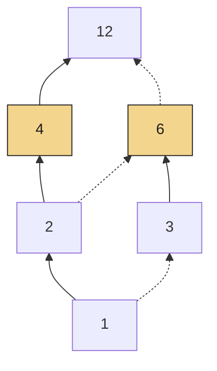

# Dilworth's theorem: the fewest chains that cover an order equals the most items no two of which compare

[Syllabus](../../../SYLLABUS.md) → [Combinatorics and graphs](../README.md) → [Orders and Set Systems](../README.md#s15) → Dilworth's theorem

---

## General Overview

Take the six divisors of 12: 1, 2, 3, 4, 6, 12. Put a below b when a divides b, so 2 is below 4 and 4 is below 12 ([Orders](../../01-Foundations/08-Relations%20and%20Functions/07-partial-and-total-orders.md)). Some pairs never compare: 2 and 3, 3 and 4, 4 and 6.

A **chain** is a set of items in which every two compare: 1, 2, 4, 12 is one, since each divides the next. An **antichain** is a set in which no two compare: 4 and 6 is one.

Ask two questions. How few chains hold all six items? Two do: 1, 2, 4, 12 and 3, 6. How many items can be chosen with no two comparable? Two at most: 4 and 6, or 2 and 3, or 3 and 4.

The first answer can never be smaller than the second. Two items of an antichain cannot sit in one chain, so each needs its own. Robert Dilworth proved in 1950 that the two answers are always equal, in every finite order.

So each answer certifies the other: the two chains rule out an antichain of three, and 4, 6 rules out a single chain. The same count gives the Erdős–Szekeres theorem on rising and falling prices.

**In a finite order, the fewest chains that hold every item equals the largest antichain, and a largest matching on the graph of comparable pairs finds both at once.**

**What kind of fact this is:** a theorem, proved on this card in Why it works from Kőnig's theorem; chain and antichain are definitions.

### The picture: two chains and an antichain



The Hasse diagram: up the page means "divides into", and only short steps are drawn. Solid arrows link the two chains; dotted steps go unused. The shaded antichain, 4 and 6, has one item in each chain.

---

## The formula

Write $`P`$ for a finite order: a set of items with a rule that passes the three tests of [Orders](../../01-Foundations/08-Relations%20and%20Functions/07-partial-and-total-orders.md). Write $`n`$ for its number of items. A **chain cover** is a list of chains $`C_1, \dots, C_k`$ that between them hold every item.

```math
\min \{\, k : C_1 \cup \dots \cup C_k = P \,\} \;=\; \max \{\, \lvert A\rvert : A \text{ an antichain of } P \,\}
```

**Read it aloud:** the fewest chains that hold every item equals the size of the largest set of items no two of which compare.

The proof uses a two-sided graph $`G`$. Give each item a left copy and a right copy. Join the left copy of $`a`$ to the right copy of $`b`$ whenever $`a`$ is below $`b`$ and $`a \neq b`$: 12 lines here.

```math
k \;=\; n - \nu(G) \;=\; n - \tau(G) \;=\; \lvert A\rvert
```

**Read it aloud:** the fewest chains is the item count minus the largest matching, which by Kőnig equals the item count minus the smallest cover, which is the largest antichain.

Here $`6 - 4 = 2`$.

| Symbol | Plain meaning | In our example | Push it up and the answer… |
| --- | --- | --- | --- |
| $`P`$ | the order: items and the rule | divisors of 12 under "divides" | — |
| $`n`$ | how many items | 6 | more chains may be needed |
| $`a`$, $`b`$ | two items, $`a`$ below $`b`$ | 2 and 4 | — |
| $`C_1, \dots, C_k`$ | the chains in a cover, $`k`$ of them | 1, 2, 4, 12 and 3, 6; $`k = 2`$ | — |
| $`A`$, $`\lvert A\rvert`$ | an antichain, and its number of items | 4 and 6; 2 | $`k`$ rises with it |
| $`G`$ | two-sided graph: left copy of $`a`$ joined to right copy of $`b`$ | 12 lines | — |
| $`\nu`$, $`\tau`$ | most lines sharing no copy; fewest copies touching every line ([Konig's theorem](../13-Matchings%20and%20Flows/03-konigs-theorem-and-vertex-cover.md)) | 4 and 4 | $`k`$ falls by as much |
| $`h`$ | the longest chain (Step 4) | 4: 1, 2, 4, 12 | more antichains needed |

### When it holds

- **Finitely many items.** The matching argument needs a finite graph. Dilworth's paper also covers infinite orders whose antichains never pass some fixed size; with no such cap the equality can fail.
- **The rule is transitive.** Links 1 to 2 and 2 to 4 make 1, 2, 4 a chain only because 1 then divides 4. With the rule "b is twice a", 1 and 4 would not compare, and the linked items would not be a chain.
- **Two different items are never each below the other.** If they were, their two links could close a loop with no bottom item to climb from, and $`n - \nu`$ would undercount the chains.

---

## Why it works

### Step 0: each link saves one chain

Start with every item alone: $`n`$ chains of one. Link an item to one item above it, and let each item have at most one link up and one link down. Each link joins two pieces into one, so each link lowers the chain count by one.

Links with that "one up, one down" rule are exactly a matching in $`G`$. So the fewest chains is $`n`$ minus the largest matching. Kőnig's theorem turns that matching into a cover, and the items the cover misses form the antichain.

### Step 1: no cover can beat an antichain

Two items of an antichain cannot share a chain, since members of a chain compare. So every chain cover has at least $`\lvert A\rvert`$ chains: here at least 2.

### Step 2: a largest matching builds the chains

$`G`$ has 12 lines, one per comparable pair. A largest matching has 4: left 1 to right 2, left 2 to right 4, left 4 to right 12, left 3 to right 6.

Follow the links up from each item with nothing linked below it. From 1: 1, 2, 4, 12. From 3: 3, 6. Transitivity makes each linked run a chain. That is $`6 - 4 = 2`$ chains. The matching is grown by alternating walks, as in [Matchings](../13-Matchings%20and%20Flows/01-matchings-and-augmenting-paths.md).

### Step 3: Kőnig's cover leaves an antichain

By [Konig's theorem](../13-Matchings%20and%20Flows/03-konigs-theorem-and-vertex-cover.md), a smallest cover of $`G`$ also has 4 copies. The walks of that card build one: left 1, left 2, left 3 and right 12. Every line touches one of them.

The items with neither copy in the cover are 4 and 6. They form an antichain: if one were below the other, the line between their copies would be uncovered. The cover touches at most 4 items, so at least $`6 - 4 = 2`$ stay untouched. With Step 1, chains and antichain match: 2 and 2.

<details>
<summary>Detailed proof: any finite order</summary>

Take a largest matching in $`G`$, with $`\nu`$ lines. Follow its lines upward from each item whose right copy is unmatched. Each step goes to an item above, so by transitivity every two items on a run compare: each run is a chain. The runs hold all $`n`$ items, one run per unmatched right copy: $`n - \nu`$ runs.

By Kőnig, $`G`$ has a cover with $`\tau = \nu`$ copies. Let $`A`$ be the items with neither copy in the cover. If $`a`$ were below $`b`$ in $`A`$, the line from left $`a`$ to right $`b`$ would be uncovered. So $`A`$ is an antichain. The cover touches at most $`\tau`$ items, so

$`\displaystyle \lvert A\rvert \;\ge\; n - \tau \;=\; n - \nu \;\ge\; k .`$

Step 1 gives $`k \ge \lvert A\rvert`$, so all three are equal.

</details>

### Step 4: the mirror image, Mirsky's theorem

Swap the roles: how few antichains hold every item? Give each item its **height**: the longest chain ending there. 1 has height 1; 2 and 3 have height 2; 4 and 6 have 3; 12 has 4.

Two items of equal height never compare: if $`a`$ were below $`b`$, any chain ending at $`a`$ would stretch to $`b`$, and $`b`$ would be higher. So the layers {1}, {2, 3}, {4, 6}, {12} are 4 antichains. An antichain holds at most one item of the chain 1, 2, 4, 12, so $`h = 4`$ is the fewest. Leon Mirsky published this dual in 1971.

```math
h \;=\; \text{fewest antichains that hold every item}
```

**Read it aloud:** the longest chain equals the fewest antichains that hold every item.

### Step 5: Erdős–Szekeres as a corollary

Take the ten daily closing prices of one stock from [Erdos-Szekeres](../14-Ramsey%20and%20Extremal%2C%20in%20Outline/04-erdos-szekeres.md). Put day i below day j when i is earlier and its price is lower. A chain is then a rising run. An antichain is a falling run, since a later day in it must be cheaper.

The matching gives 7 links, so $`10 - 7 = 3`$ rising runs hold all ten days: days 1, 5, 10; days 2, 3, 6, 9; days 4, 7, 8. Kőnig's cover leaves days 3, 5, 7 untouched: 44.60, 43.95, 42.88, a falling run of 3.

Each rising run has at most 4 days, so $`10 \le 3 \times 4 = 12`$. For any list of different numbers:

```math
n \;\le\; (\text{longest falling run}) \times (\text{longest rising run})
```

**Read it aloud:** the list's length is at most the longest fall times the longest rise: the Erdős–Szekeres bound.

The 16 subsets of {1, 2, 3, 4}, ordered by "inside", need 6 chains; the six two-element subsets are the only antichain that large ([Sperner's theorem](02-sperner-and-lym.md)).

---

## Worked numbers, by hand

| Step | Arithmetic | Value |
| --- | --- | --- |
| items | 1, 2, 3, 4, 6, 12 | 6 |
| comparable pairs, lines of $`G`$ | pairs where one divides the other | 12 |
| largest matching | links 1–2, 2–4, 4–12, 3–6 | 4 |
| chains | 6 − 4 | **2** |
| Kőnig's cover | left 1, 2, 3 and right 12 | 4 copies |
| untouched items | 4 and 6 | antichain of **2** |
| every antichain checked | {2, 3}, {3, 4}, {4, 6} are the largest | 2 |
| ways to deal the six into 2 chains | 1 and 12 may join either chain | 4 |
| longest chain, Mirsky | 1, 2, 4, 12, and 4 height layers | 4 |

Two chains hold the six divisors, and the antichain 4, 6 proves one chain cannot.

### What breaks if you drop a piece

| Mistake | Comes out at | What went wrong |
| --- | --- | --- |
| Greedy links: each item to its largest free item above, 1 to 12 first | matching 2, so 4 chains | a matching that is not largest |
| Longest chain counted as the number of chains | 4, not 2 | that is Mirsky's count of antichains |
| Rising stretches of days in a row, for the prices | 5, not 3 | chains may skip days |

The code prints all three.

---

## Code, from first principles, and it actually runs

Nothing is imported. Road one grows a largest matching, follows its links into chains and reads Kőnig's antichain off the same walks. Road two ignores the graph: it tries every set of items, and every way of dealing items into chains. Mirsky's layers and the three mistakes are computed too.

### Python

```python
# Dilworth's theorem -- the check behind the card.  Nothing is imported.  Three orders: the divisors of 12
# under "divides", ten closing prices (day i below day j when earlier and cheaper), the subsets of {1, 2, 3, 4}
# under "inside".  Road one: a largest matching, then Konig's cover.  Road two: every set, every dealing.
D, CENTS = [1, 2, 3, 4, 6, 12], [4320, 4210, 4460, 4165, 4395, 4630, 4288, 4515, 4705, 4570]
DIV = lambda i, j: i != j and D[j] % D[i] == 0
DAY = lambda i, j: i < j and CENTS[i] < CENTS[j]
SUB = lambda a, b: a != b and a & b == a          # subsets of {1, 2, 3, 4} as 4-bit numbers
def match(n, below):                   # left copy i links to right copy j when i is below j
    mate = {}                          # mate[j] = i: i sits just under j in one chain
    def grow(i, seen):                 # an alternating walk from i, as on the Konig card
        for j in (j for j in range(n) if below(i, j) and j not in seen):
            seen.add(j)
            if j not in mate or grow(mate[j], seen): mate[j] = i; return True
        return False
    for i in range(n): grow(i, set())
    return mate
def chains(n, mate):                   # climb the links from every item with nothing linked below
    up, climb = {i: j for j, i in mate.items()}, lambda x: [x] + climb(up[x]) if x in up else [x]
    return [climb(s) for s in range(n) if s not in mate]
def konig_antichain(n, below, mate):   # walk from unlinked left copies; keep items reached on the left only
    zl, zr, todo = set(), set(), [i for i in range(n) if i not in mate.values()]
    while todo:
        i = todo.pop(); zl.add(i)
        new = [j for j in range(n) if below(i, j) and j not in zr]
        zr |= set(new); todo += [mate[j] for j in new if j in mate and mate[j] not in zl]
    return [x for x in range(n) if x in zl and x not in zr]
def best_antichains(n, below):         # road two: every set, keep the largest with no two comparable
    comp = [sum(1 << y for y in range(n) if below(x, y) or below(y, x)) for x in range(n)]
    ok = [s for s in range(1 << n) if all(not (s >> x & 1 and comp[x] & s) for x in range(n))]
    top = max(s.bit_count() for s in ok)
    return [[x for x in range(n) if s >> x & 1] for s in ok if s.bit_count() == top]
def fewest_dealing(n, below):          # road two: deal items into k unlabelled piles, each pile a chain
    for k in range(1, 4):
        ways = sum(all(c // k ** x % k != c // k ** y % k or below(x, y) or below(y, x) for x in range(n) for y in range(x)) for c in range(k ** n))
        if ways: return k, ways // [1, 1, 2, 6][k]
def layers(n, below):                  # Mirsky: height = longest chain ending at an item
    h = []
    for y in range(n): h.append(1 + max([h[x] for x in range(y) if below(x, y)], default=0))
    return [[x for x in range(n) if h[x] == t] for t in range(1, max(h) + 1)]
def study(n, below): return (m := match(n, below)), chains(n, m), konig_antichain(n, below, m), best_antichains(n, below), layers(n, below)
(m, cd, ad, bd, ld), (mh, ch, ah, bh, lh), (ms, cs, As, bs, ls) = study(6, DIV), study(10, DAY), study(16, SUB)
(kd, wd), (kh, wh), nm, g = fewest_dealing(6, DIV), fewest_dealing(10, DAY), lambda grp, xs: [[xs[x] for x in c] for c in grp], {}
for i in range(6):                     # mistake 1: link each divisor to its largest free multiple
    if free := [j for j in range(6) if DIV(i, j) and j not in g]: g[max(free)] = i
print(f"divisors of 12: 6 items, {sum(DIV(i, j) for i in range(6) for j in range(6))} comparable pairs, largest matching {len(m)}")
print(f"road one: chains 6 - {len(m)} = {len(cd)}: {nm(cd, D)}; Konig antichain {nm([ad], D)[0]}")
print(f"road two: largest antichains {nm(bd, D)}; fewest chains {kd}, in {wd} ways")
print(f"Mirsky: longest chain {len(ld)}, height layers {nm(ld, D)}")
print(f"prices: matching {len(mh)}, rising runs {len(ch)}: {nm(ch, range(1, 11))}")
print(f"falling run from the cover: days {nm([ah], range(1, 11))[0]} at {', '.join(f'{CENTS[x] // 100}.{CENTS[x] % 100:02d}' for x in ah)}; every set: {len(bh[0])}, dealing: {kh}")
print(f"longest rising run {len(lh)}; 10 days <= {len(ch)} runs x {len(lh)} = {len(ch) * len(lh)}")
print(f"16 subsets: matching {len(ms)}, chains {len(cs)}, antichain {len(As)}; every set: {len(bs[0])}, found {len(bs)} time")
print(f"mistake 1, greedy links (1 to 12 first): matching {len(g)}, chains {6 - len(g)}")
print(f"mistake 2, longest chain taken as the count: {len(ld)}, not {len(cd)}")
print(f"mistake 3, rising stretches of days in a row: {1 + sum(CENTS[i + 1] < CENTS[i] for i in range(9))}, not {len(ch)}")
assert len(cd) == kd == len(ad) == len(bd[0]) == 2 and sorted(x for c in cd for x in c) == list(range(6)) and all(DIV(c[t], c[t + 1]) for c in cd for t in range(len(c) - 1))
assert len(ch) == kh == len(ah) == len(bh[0]) == 3 and all(DAY(c[t], c[t + 1]) for c in ch for t in range(len(c) - 1))
assert len(cs) == len(As) == len(bs[0]) == 6 and len(bs) == 1 and all(SUB(c[t], c[t + 1]) for c in cs for t in range(len(c) - 1)) and len(ld) == len(lh) == 4 and len(g) == 2
assert all(not DIV(x, y) for x in ad for y in ad) and all(not DAY(x, y) for x in ah for y in ah) and all(not SUB(x, y) for x in As for y in As)
print("ALL CHECKS PASS")
```

**Ran 2026-11-23 on macOS, Python 3.14.10, standard library only. All checks passed. Output, pasted from the run:**

```
divisors of 12: 6 items, 12 comparable pairs, largest matching 4
road one: chains 6 - 4 = 2: [[1, 2, 4, 12], [3, 6]]; Konig antichain [4, 6]
road two: largest antichains [[2, 3], [3, 4], [4, 6]]; fewest chains 2, in 4 ways
Mirsky: longest chain 4, height layers [[1], [2, 3], [4, 6], [12]]
prices: matching 7, rising runs 3: [[1, 5, 10], [2, 3, 6, 9], [4, 7, 8]]
falling run from the cover: days [3, 5, 7] at 44.60, 43.95, 42.88; every set: 3, dealing: 3
longest rising run 4; 10 days <= 3 runs x 4 = 12
16 subsets: matching 10, chains 6, antichain 6; every set: 6, found 1 time
mistake 1, greedy links (1 to 12 first): matching 2, chains 4
mistake 2, longest chain taken as the count: 4, not 2
mistake 3, rising stretches of days in a row: 5, not 3
ALL CHECKS PASS
```

### Rust

Same numbers, same labels, built with `rustc --edition 2021 -O`.

```rust
// Dilworth's theorem -- the same check as the Python, in Rust.  No crates.  Three orders: the divisors of 12
// under "divides", ten closing prices (day i below day j when earlier and cheaper), the subsets of {1, 2, 3, 4}
// under "inside".  Road one: a largest matching, then Konig's cover.  Road two: every set, every dealing.
const D: [usize; 6] = [1, 2, 3, 4, 6, 12];
const CENTS: [u32; 10] = [4320, 4210, 4460, 4165, 4395, 4630, 4288, 4515, 4705, 4570];
type Below = fn(usize, usize) -> bool;
fn div(i: usize, j: usize) -> bool { i != j && D[j] % D[i] == 0 }
fn day(i: usize, j: usize) -> bool { i < j && CENTS[i] < CENTS[j] }
fn sub(a: usize, b: usize) -> bool { a != b && a & b == a }   // subsets of {1, 2, 3, 4} as 4-bit numbers
fn grow(i: usize, n: usize, below: Below, mate: &mut Vec<Option<usize>>, seen: &mut Vec<bool>) -> bool {
    for j in 0..n {                    // an alternating walk from i, as on the Konig card
        if !below(i, j) || seen[j] { continue }
        seen[j] = true;
        if mate[j].is_none() || grow(mate[j].unwrap(), n, below, mate, seen) { mate[j] = Some(i); return true }
    }
    false
}
fn matching(n: usize, below: Below) -> Vec<Option<usize>> {   // mate[j] = i: i sits just under j in one chain
    (0..n).fold(vec![None; n], |mut mate, i| { grow(i, n, below, &mut mate, &mut vec![false; n]); mate })
}
fn chains(n: usize, mate: &[Option<usize>]) -> Vec<Vec<usize>> {   // climb the links from every unlinked bottom
    let mut up = vec![None; n];
    for j in 0..n { if let Some(i) = mate[j] { up[i] = Some(j) } }
    (0..n).filter(|&s| mate[s].is_none()).map(|s| { let mut c = vec![s]; while let Some(j) = up[c[c.len() - 1]] { c.push(j) } c }).collect()
}
fn konig_antichain(n: usize, below: Below, mate: &[Option<usize>]) -> Vec<usize> {
    let (mut zl, mut zr) = (vec![false; n], vec![false; n]);   // walk from unlinked left copies
    let mut todo: Vec<usize> = (0..n).filter(|&i| !mate.contains(&Some(i))).collect();
    while let Some(i) = todo.pop() {
        zl[i] = true; for j in 0..n { if below(i, j) && !zr[j] { zr[j] = true; if let Some(k) = mate[j] { if !zl[k] { todo.push(k) } } } }
    }
    (0..n).filter(|&x| zl[x] && !zr[x]).collect()   // keep items reached on the left only
}
fn best_antichains(n: usize, below: Below) -> Vec<Vec<usize>> {   // road two: every set of items
    let comp: Vec<u32> = (0..n).map(|x| (0..n).filter(|&y| below(x, y) || below(y, x)).map(|y| 1 << y).sum()).collect();
    let ok: Vec<u32> = (0..1u32 << n).filter(|&s| (0..n).all(|x| s >> x & 1 == 0 || comp[x] & s == 0)).collect();
    let top = ok.iter().map(|s| s.count_ones()).max().unwrap();
    ok.iter().filter(|s| s.count_ones() == top).map(|&s| (0..n).filter(|&x| s >> x & 1 == 1).collect()).collect()
}
fn fewest_dealing(n: usize, below: Below) -> (usize, usize) {   // road two: deal into k unlabelled piles
    for k in 1..4usize {
        let lab = |c: usize, x: usize| c / k.pow(x as u32) % k;
        let ways = (0..k.pow(n as u32)).filter(|&c| (0..n).all(|x| (0..x).all(|y| lab(c, x) != lab(c, y) || below(x, y) || below(y, x)))).count();
        if ways > 0 { return (k, ways / [1, 1, 2, 6][k]) }
    }
    (0, 0)
}
fn layers(n: usize, below: Below) -> Vec<Vec<usize>> {   // Mirsky: height = longest chain ending at an item
    let mut h = vec![0usize; n];
    for y in 0..n { h[y] = 1 + (0..y).filter(|&x| below(x, y)).map(|x| h[x]).max().unwrap_or(0) }
    (1..=*h.iter().max().unwrap()).map(|t| (0..n).filter(|&x| h[x] == t).collect()).collect()
}
fn nm(grp: &[Vec<usize>], xs: &[usize]) -> Vec<Vec<usize>> { grp.iter().map(|c| c.iter().map(|&x| xs[x]).collect()).collect() }
fn main() {
    let (days, m, mh, ms): (Vec<usize>, _, _, _) = ((1..11).collect(), matching(6, div), matching(10, day), matching(16, sub));
    let size = |m: &[Option<usize>]| m.iter().filter(|x| x.is_some()).count();
    let (cd, ad, bd, ld) = (chains(6, &m), konig_antichain(6, div, &m), best_antichains(6, div), layers(6, div));
    let (ch, ah, bh, lh) = (chains(10, &mh), konig_antichain(10, day, &mh), best_antichains(10, day), layers(10, day));
    let (cs, as_, bs) = (chains(16, &ms), konig_antichain(16, sub, &ms), best_antichains(16, sub));
    let ((kd, wd), (kh, _)) = (fewest_dealing(6, div), fewest_dealing(10, day));
    let mut g: Vec<Option<usize>> = vec![None; 6];   // mistake 1: link each divisor to its largest free multiple
    for i in 0..6 { if let Some(j) = (0..6).filter(|&j| div(i, j) && g[j].is_none()).max() { g[j] = Some(i) } }
    println!("divisors of 12: 6 items, {} comparable pairs, largest matching {}", (0..6).map(|i| (0..6).filter(|&j| div(i, j)).count()).sum::<usize>(), size(&m));
    println!("road one: chains 6 - {} = {}: {:?}; Konig antichain {:?}", size(&m), cd.len(), nm(&cd, &D), nm(&[ad.clone()], &D)[0]);
    println!("road two: largest antichains {:?}; fewest chains {}, in {} ways", nm(&bd, &D), kd, wd);
    println!("Mirsky: longest chain {}, height layers {:?}", ld.len(), nm(&ld, &D));
    println!("prices: matching {}, rising runs {}: {:?}", size(&mh), ch.len(), nm(&ch, &days));
    println!("falling run from the cover: days {:?} at {}; every set: {}, dealing: {}", nm(&[ah.clone()], &days)[0], ah.iter().map(|&x| format!("{}.{:02}", CENTS[x] / 100, CENTS[x] % 100)).collect::<Vec<_>>().join(", "), bh[0].len(), kh);
    println!("longest rising run {}; 10 days <= {} runs x {} = {}", lh.len(), ch.len(), lh.len(), ch.len() * lh.len());
    println!("16 subsets: matching {}, chains {}, antichain {}; every set: {}, found {} time", size(&ms), cs.len(), as_.len(), bs[0].len(), bs.len());
    println!("mistake 1, greedy links (1 to 12 first): matching {}, chains {}", size(&g), 6 - size(&g));
    println!("mistake 2, longest chain taken as the count: {}, not {}", ld.len(), cd.len());
    println!("mistake 3, rising stretches of days in a row: {}, not {}", 1 + (0..9).filter(|&i| CENTS[i + 1] < CENTS[i]).count(), ch.len());
    let mut all: Vec<usize> = cd.concat(); all.sort();
    assert!(cd.len() == kd && kd == ad.len() && ad.len() == bd[0].len() && bd[0].len() == 2 && all == (0..6).collect::<Vec<usize>>() && cd.iter().all(|c| c.windows(2).all(|w| div(w[0], w[1]))));
    assert!(ch.len() == kh && kh == ah.len() && ah.len() == bh[0].len() && bh[0].len() == 3 && ch.iter().all(|c| c.windows(2).all(|w| day(w[0], w[1]))));
    assert!(cs.len() == as_.len() && as_.len() == bs[0].len() && bs[0].len() == 6 && bs.len() == 1 && cs.iter().all(|c| c.windows(2).all(|w| sub(w[0], w[1]))) && ld.len() == 4 && lh.len() == 4 && size(&g) == 2);
    assert!(ad.iter().all(|&x| ad.iter().all(|&y| !div(x, y))) && ah.iter().all(|&x| ah.iter().all(|&y| !day(x, y))) && as_.iter().all(|&x| as_.iter().all(|&y| !sub(x, y))));
    println!("ALL CHECKS PASS");
}
```

**Ran 2026-11-23 on macOS, rustc 1.98.1, no crates. All checks passed. Output, pasted from the run:**

```
divisors of 12: 6 items, 12 comparable pairs, largest matching 4
road one: chains 6 - 4 = 2: [[1, 2, 4, 12], [3, 6]]; Konig antichain [4, 6]
road two: largest antichains [[2, 3], [3, 4], [4, 6]]; fewest chains 2, in 4 ways
Mirsky: longest chain 4, height layers [[1], [2, 3], [4, 6], [12]]
prices: matching 7, rising runs 3: [[1, 5, 10], [2, 3, 6, 9], [4, 7, 8]]
falling run from the cover: days [3, 5, 7] at 44.60, 43.95, 42.88; every set: 3, dealing: 3
longest rising run 4; 10 days <= 3 runs x 4 = 12
16 subsets: matching 10, chains 6, antichain 6; every set: 6, found 1 time
mistake 1, greedy links (1 to 12 first): matching 2, chains 4
mistake 2, longest chain taken as the count: 4, not 2
mistake 3, rising stretches of days in a row: 5, not 3
ALL CHECKS PASS
```

The two outputs match line for line.

### Lean

Lean proves Dilworth's theorem and Mirsky's dual for every finite order, and the Erdős–Szekeres bound for every list.

- In a finite order, the fewest chains that hold every item equals the size of the largest antichain.
- In a finite order, the longest chain equals the fewest antichains that hold every item.
- Take a list of $`n`$ different numbers with no rising run over $`r`$ items and no falling run over $`s`$. Then $`n \le s \times r`$.
- On the divisors of 12, two chains hold all six items, and no antichain has three.
- Mirsky's four layers hold all six divisors, and the price runs of Step 5 rise and fall as stated.

The matching, Kőnig's cover, the four ways to deal and the three mistakes are left to the Python and Rust checks.

```lean
-- Dilworth's theorem: in every finite order the fewest chains that hold every item equals the size of the largest antichain, with Mirsky's dual and the Erdos-Szekeres bound.
import Mathlib.Order.Antichain
import Mathlib.Order.Preorder.Chain
import Mathlib.Order.Monotone.Defs
import Mathlib.Data.Fintype.Card
import Mathlib.Data.Fintype.Powerset
import Mathlib.Order.Lattice.Nat
import Mathlib.Order.SetNotation
import Mathlib.NumberTheory.Divisors
import Mathlib.Order.Preorder.Finite
import Mathlib.Algebra.Order.Group.Nat
import Mathlib.Data.Finset.Max
import Mathlib.Data.Set.Monotone
import Mathlib.Order.Interval.Finset.Nat

/-- Helper for Dilworth. If `c` colors a finite set `S` with fewer than `m` colors so that each
color class is a chain, then an antichain `A` of `m` items inside `S` meets every color. -/
theorem dilworth_antichain_meets_every_color {α : Type*} [PartialOrder α] (S A : Finset α)
    (m : ℕ) (c : α → ℕ) (hAS : A ⊆ S) (hA : IsAntichain (· ≤ ·) (A : Set α)) (hcard : A.card = m)
    (hc1 : ∀ x ∈ S, c x < m) (hc2 : ∀ x ∈ S, ∀ y ∈ S, c x = c y → x ≤ y ∨ y ≤ x) :
    ∀ z ∈ S, ∃ a ∈ A, c a = c z := by
  classical
  intro z hz
  have hinj : Set.InjOn c (A : Set α) := by
    intro a ha b hb hab
    by_contra hne
    rcases hc2 a (hAS ha) b (hAS hb) hab with h | h
    · exact hA ha hb hne h
    · exact hA hb ha (Ne.symm hne) h
  have hsub : A.image c ⊆ Finset.range m := by
    intro k hk
    obtain ⟨a, ha, rfl⟩ := Finset.mem_image.1 hk
    exact Finset.mem_range.2 (hc1 a (hAS ha))
  have heq : A.image c = Finset.range m :=
    Finset.eq_of_subset_of_card_le hsub
      (by rw [Finset.card_image_of_injOn hinj, hcard, Finset.card_range])
  have hz' : c z ∈ A.image c := heq ▸ Finset.mem_range.2 (hc1 z hz)
  simpa using hz'

/-- Helper for Dilworth, the induction. If no antichain inside the finite set `s` has more than
`m` items, then `s` can be colored with the colors `0, ..., m - 1` so that each color class is a
chain. -/
theorem dilworth_chain_coloring {α : Type*} [PartialOrder α] (s : Finset α) :
    ∀ m : ℕ, (∀ A ⊆ s, IsAntichain (· ≤ ·) (A : Set α) → A.card ≤ m) →
      ∃ c : α → ℕ, (∀ x ∈ s, c x < m) ∧ ∀ x ∈ s, ∀ y ∈ s, c x = c y → x ≤ y ∨ y ≤ x := by
  classical
  induction s using Finset.strongInduction with
  | H s ih =>
  intro m hm
  rcases s.eq_empty_or_nonempty with rfl | ⟨y0, hy0⟩
  · exact ⟨fun _ => 0, by simp, by simp⟩
  -- a top item `y` and a bottom item `x ≤ y`
  obtain ⟨y, -, hymax⟩ := s.exists_le_maximal hy0
  have hys : y ∈ s := hymax.1
  obtain ⟨x, hxy, hxmin⟩ :=
    (s.filter (· ≤ y)).exists_le_minimal (a := y) (Finset.mem_filter.2 ⟨hys, le_rfl⟩)
  have hxs : x ∈ s := (Finset.mem_filter.1 hxmin.1).1
  have hxmin' : ∀ z ∈ s, z ≤ x → x ≤ z := fun z hz hzx =>
    hxmin.2 (Finset.mem_filter.2 ⟨hz, hzx.trans hxy⟩) hzx
  have hm1 : 1 ≤ m := by
    have := hm {y} (by simpa using hys) (by simp)
    simpa using this
  set t := (s.erase x).erase y with ht
  have hts : t ⊂ s := by
    refine Finset.ssubset_iff_subset_ne.2 ⟨fun z hz => ?_, fun h => ?_⟩
    · simp only [ht, Finset.mem_erase] at hz
      exact hz.2.2
    · have : y ∈ t := h ▸ hys
      simp [ht] at this
  by_cases hcase : ∀ A ⊆ t, IsAntichain (· ≤ ·) (A : Set α) → A.card ≤ m - 1
  · -- the rest needs only `m - 1` chains; the chain `x ≤ y` takes the last color
    obtain ⟨c, hc1, hc2⟩ := ih t hts (m - 1) hcase
    refine ⟨fun z => if z ∈ t then c z else m - 1, ?_, ?_⟩
    · intro z hz
      by_cases hzt : z ∈ t
      · simp only [hzt, ite_true]; have := hc1 z hzt; omega
      · simp only [hzt, ite_false]; omega
    · have hxy' : ∀ z ∈ s, z ∉ t → z = x ∨ z = y := by
        intro z hz hzt
        by_contra h
        push Not at h
        exact hzt (by simp [ht, h.1, h.2, hz])
      intro z1 hz1 z2 hz2 h
      by_cases h1 : z1 ∈ t <;> by_cases h2 : z2 ∈ t <;> simp only [h1, h2, ite_true, ite_false] at h
      · exact hc2 z1 h1 z2 h2 h
      · have := hc1 z1 h1; omega
      · have := hc1 z2 h2; omega
      · rcases hxy' z1 hz1 h1 with rfl | rfl <;> rcases hxy' z2 hz2 h2 with rfl | rfl <;> simp [hxy]
  · -- an antichain `A` of `m` items avoiding `x` and `y`: split into the items below and above it
    push Not at hcase
    obtain ⟨A, hAt, hA, hAcard⟩ := hcase
    have hAs : A ⊆ s := hAt.trans hts.subset
    have hAm : A.card = m := le_antisymm (hm A hAs hA) (by omega)
    set D := s.filter (fun z => ∃ a ∈ A, z ≤ a) with hD
    set U := s.filter (fun z => ∃ a ∈ A, a ≤ z) with hU
    have hyA : y ∉ A := fun h => by have := hAt h; simp [ht] at this
    have hxA : x ∉ A := fun h => by have := hAt h; simp [ht] at this
    have hDs : D ⊂ s := by
      refine Finset.ssubset_iff_subset_ne.2 ⟨Finset.filter_subset _ _, fun h => ?_⟩
      have : y ∈ D := h ▸ hys
      obtain ⟨-, a, ha, hya⟩ := Finset.mem_filter.1 this
      have : a = y := le_antisymm (hymax.2 (hAs ha) hya) hya
      exact hyA (this ▸ ha)
    have hUs : U ⊂ s := by
      refine Finset.ssubset_iff_subset_ne.2 ⟨Finset.filter_subset _ _, fun h => ?_⟩
      have : x ∈ U := h ▸ hxs
      obtain ⟨-, a, ha, hax⟩ := Finset.mem_filter.1 this
      have : x = a := le_antisymm (hxmin' a (hAs ha) hax) hax
      exact hxA (this ▸ ha)
    have hAD : A ⊆ D := fun a ha => Finset.mem_filter.2 ⟨hAs ha, a, ha, le_rfl⟩
    have hAU : A ⊆ U := fun a ha => Finset.mem_filter.2 ⟨hAs ha, a, ha, le_rfl⟩
    have hcover : ∀ z ∈ s, z ∈ D ∨ z ∈ U := by
      intro z hz
      by_contra h
      push Not at h
      have hzD : ∀ a ∈ A, ¬ z ≤ a := fun a ha hza => h.1 (Finset.mem_filter.2 ⟨hz, a, ha, hza⟩)
      have hzU : ∀ a ∈ A, ¬ a ≤ z := fun a ha haz => h.2 (Finset.mem_filter.2 ⟨hz, a, ha, haz⟩)
      have hzA : z ∉ A := fun hzA => hzD z hzA le_rfl
      have hanti : IsAntichain (· ≤ ·) ((insert z A : Finset α) : Set α) := by
        rw [Finset.coe_insert]
        exact hA.insert (fun b hb _ => hzU b hb) (fun b hb _ => hzD b hb)
      have := hm (insert z A) (Finset.insert_subset hz hAs) hanti
      rw [Finset.card_insert_of_notMem hzA] at this
      omega
    obtain ⟨c1, hc1, hc1'⟩ := ih D hDs m (fun B hB hB' => hm B (hB.trans hDs.subset) hB')
    obtain ⟨c2, hc2, hc2'⟩ := ih U hUs m (fun B hB hB' => hm B (hB.trans hUs.subset) hB')
    have hDle : ∀ z ∈ D, ∀ a ∈ A, c1 a = c1 z → z ≤ a := by
      intro z hz a ha hca
      obtain ⟨-, a', ha', hza'⟩ := Finset.mem_filter.1 hz
      rcases hc1' z hz a (hAD ha) hca.symm with h | h
      · exact h
      · by_cases haa : a = a'
        · exact haa ▸ hza'
        · exact absurd (h.trans hza') (hA ha ha' haa)
    have hUle : ∀ z ∈ U, ∀ a ∈ A, c2 a = c2 z → a ≤ z := by
      intro z hz a ha hca
      obtain ⟨-, a', ha', ha'z⟩ := Finset.mem_filter.1 hz
      rcases hc2' z hz a (hAU ha) hca.symm with h | h
      · by_cases haa : a' = a
        · exact haa ▸ ha'z
        · exact absurd (ha'z.trans h) (hA ha' ha haa)
      · exact h
    have hAinj : ∀ a ∈ A, ∀ b ∈ A, c1 a = c1 b → a = b := by
      intro a ha b hb hab
      by_contra hne
      rcases hc1' a (hAD ha) b (hAD hb) hab with h | h
      · exact hA ha hb hne h
      · exact hA hb ha (Ne.symm hne) h
    have hsurj := dilworth_antichain_meets_every_color U A m c2 hAU hA hAm hc2 hc2'
    choose! g hgA hg using hsurj
    refine ⟨fun z => if z ∈ D then c1 z else c1 (g z), ?_, ?_⟩
    · intro z hz
      by_cases hzD : z ∈ D
      · simp only [hzD, ite_true]; exact hc1 z hzD
      · have hzU : z ∈ U := (hcover z hz).resolve_left hzD
        simp only [hzD, ite_false]; exact hc1 _ (hAD (hgA z hzU))
    · intro z1 hz1 z2 hz2 h
      by_cases h1 : z1 ∈ D <;> by_cases h2 : z2 ∈ D <;> simp only [h1, h2, ite_true, ite_false] at h
      · exact hc1' z1 h1 z2 h2 h
      · have hz2U : z2 ∈ U := (hcover z2 hz2).resolve_left h2
        exact Or.inl ((hDle z1 h1 _ (hgA z2 hz2U) h.symm).trans
          (hUle z2 hz2U _ (hgA z2 hz2U) (hg z2 hz2U)))
      · have hz1U : z1 ∈ U := (hcover z1 hz1).resolve_left h1
        exact Or.inr ((hDle z2 h2 _ (hgA z1 hz1U) h).trans
          (hUle z1 hz1U _ (hgA z1 hz1U) (hg z1 hz1U)))
      · have hz1U : z1 ∈ U := (hcover z1 hz1).resolve_left h1
        have hz2U : z2 ∈ U := (hcover z2 hz2).resolve_left h2
        have hgg := hAinj _ (hgA z1 hz1U) _ (hgA z2 hz2U) h
        refine hc2' z1 hz1U z2 hz2U ?_
        rw [← hg z1 hz1U, ← hg z2 hz2U, hgg]

/-- Helper for Mirsky: the height of `x`, the most items in a chain whose items all lie at or
below `x`. -/
noncomputable def mirskyHeight {α : Type*} [PartialOrder α] [Fintype α] (x : α) : ℕ :=
  open scoped Classical in
  (Finset.univ.filter (fun C : Finset α => IsChain (· ≤ ·) (C : Set α) ∧ ∀ y ∈ C, y ≤ x)).sup
    Finset.card

/-- Helper for Mirsky: the height of `x` is at least 1, since `{x}` is a chain. -/
theorem mirskyHeight_pos {α : Type*} [PartialOrder α] [Fintype α] (x : α) :
    1 ≤ mirskyHeight x := by
  classical
  unfold mirskyHeight
  have hx : ({x} : Finset α) ∈ Finset.univ.filter
      (fun C : Finset α => IsChain (· ≤ ·) (C : Set α) ∧ ∀ y ∈ C, y ≤ x) :=
    Finset.mem_filter.2 ⟨Finset.mem_univ _, by simp, by simp⟩
  have := Finset.le_sup (f := Finset.card) hx
  simpa using this

/-- Helper for Mirsky: the height rises strictly along `<`. -/
theorem mirskyHeight_lt {α : Type*} [PartialOrder α] [Fintype α] {x y : α} (hxy : x < y) :
    mirskyHeight x < mirskyHeight y := by
  classical
  unfold mirskyHeight
  set F := fun z : α => Finset.univ.filter
      (fun C : Finset α => IsChain (· ≤ ·) (C : Set α) ∧ ∀ w ∈ C, w ≤ z) with hF
  have hne : (F x).Nonempty := ⟨∅, by simp [hF]⟩
  obtain ⟨C, hC, hCeq⟩ := Finset.exists_mem_eq_sup (F x) hne Finset.card
  simp only [hF, Finset.mem_filter, Finset.mem_univ, true_and] at hC
  have hyC : y ∉ C := fun hy => absurd (hC.2 y hy) (not_le_of_gt hxy)
  have hins : insert y C ∈ F y := by
    simp only [hF, Finset.mem_filter, Finset.mem_univ, true_and, Finset.coe_insert,
      Finset.mem_insert, forall_eq_or_imp, le_rfl]
    refine ⟨hC.1.insert fun b hb _ => Or.inr ((hC.2 b hb).trans hxy.le), fun w hw =>
      (hC.2 w hw).trans hxy.le⟩
  have := Finset.le_sup (f := Finset.card) hins
  rw [Finset.card_insert_of_notMem hyC] at this
  have hsx : (F x).sup Finset.card = C.card := hCeq
  simp only [hF] at hsx this ⊢
  omega

/-- Helper for Erdos-Szekeres: the possible lengths of a rising run that ends at place `i`. -/
noncomputable def esRunsTo {ι β : Type*} [Fintype ι] [LinearOrder ι] [LinearOrder β]
    (f : ι → β) (i : ι) : Finset ℕ :=
  open scoped Classical in
  Finset.image Finset.card {t : Finset ι | IsGreatest (t : Set ι) i ∧ StrictMonoOn f t}

/-- Helper for Erdos-Szekeres: the longest rising run that ends at place `i`. -/
noncomputable def esLongestTo {ι β : Type*} [Fintype ι] [LinearOrder ι] [LinearOrder β]
    (f : ι → β) (i : ι) : ℕ :=
  (esRunsTo f i).max' ⟨1, Finset.mem_image.2 ⟨{i}, by simp⟩⟩

/-- Helper for Erdos-Szekeres (after Bhavik Mehta's proof in Mathlib's archive): if `i < j` and
`f i < f j`, a longest rising run ending at `i` grows by `j`, so the longest run ending at `j` is
longer. -/
theorem esLongestTo_lt {ι β : Type*} [Fintype ι] [LinearOrder ι] [LinearOrder β] {f : ι → β}
    {i j : ι} (hij : i < j) (hfij : f i < f j) : esLongestTo f i < esLongestTo f j := by
  classical
  rw [Nat.lt_iff_add_one_le]
  refine Finset.le_max' _ _ ?_
  have : esLongestTo f i ∈ esRunsTo f i := Finset.max'_mem _ _
  simp only [esRunsTo, Finset.mem_image, Finset.mem_filter, Finset.mem_univ, true_and,
    and_assoc] at this
  obtain ⟨t, hti, ht₁, ht₂⟩ := this
  simp only [esRunsTo, Finset.mem_image, Finset.mem_filter, Finset.mem_univ, true_and, and_assoc]
  have hlt : ∀ x ∈ t, x < j := fun x hx => (hti.2 hx).trans_lt hij
  refine ⟨insert j t, ?_, ?_, ?_⟩
  · convert hti.insert j
    · simp
    · rw [max_eq_left hij.le]
  · simp only [Finset.coe_insert]
    rw [strictMonoOn_insert_iff_of_forall_le]
    · exact ⟨fun x hx _ => (ht₁.monotoneOn hx hti.1 (hti.2 hx)).trans_lt hfij, ht₁⟩
    · exact fun x hx => (hlt x hx).le
  · have : j ∉ t := fun hj => lt_irrefl _ (hlt _ hj)
    simp [this, ht₂]

#print axioms dilworth_antichain_meets_every_color
#print axioms dilworth_chain_coloring
#print axioms mirskyHeight_pos
#print axioms mirskyHeight_lt
#print axioms esLongestTo_lt

/-- Dilworth's theorem. In a finite order, the fewest chains `C 0, ..., C (k - 1)` whose union is
every item equals the largest number of items in an antichain (a set no two of whose items
compare). -/
theorem dilworth_min_chain_cover_eq_max_antichain (α : Type*) [PartialOrder α] [Fintype α] :
    sInf {k : ℕ | ∃ C : Fin k → Set α,
        (∀ i, IsChain (· ≤ ·) (C i)) ∧ (⋃ i, C i) = Set.univ} =
      sSup {m : ℕ | ∃ A : Finset α, IsAntichain (· ≤ ·) (A : Set α) ∧ A.card = m} := by
  classical
  set S := {m : ℕ | ∃ A : Finset α, IsAntichain (· ≤ ·) (A : Set α) ∧ A.card = m} with hS
  have hbdd : BddAbove S := ⟨Fintype.card α, by rintro _ ⟨A, -, rfl⟩; exact A.card_le_univ⟩
  have hSne : S.Nonempty := ⟨0, ∅, by simp⟩
  -- `sSup S` chains suffice: color the items, one chain per color
  have hmem : sSup S ∈ {k : ℕ | ∃ C : Fin k → Set α,
      (∀ i, IsChain (· ≤ ·) (C i)) ∧ (⋃ i, C i) = Set.univ} := by
    obtain ⟨c, hc1, hc2⟩ := dilworth_chain_coloring (Finset.univ : Finset α) (sSup S)
      (fun A _ hA => le_csSup hbdd ⟨A, hA, rfl⟩)
    refine ⟨fun i => {x | c x = i}, fun i x hx y hy _ => ?_, ?_⟩
    · exact hc2 x (Finset.mem_univ _) y (Finset.mem_univ _) (hx.trans hy.symm)
    · ext x
      simp only [Set.mem_iUnion, Set.mem_ofPred_eq, Set.mem_univ, iff_true]
      exact ⟨⟨c x, hc1 x (Finset.mem_univ _)⟩, rfl⟩
  refine le_antisymm (Nat.sInf_le hmem) (le_csInf ⟨_, hmem⟩ ?_)
  -- no fewer chains: each chain holds at most one item of an antichain
  rintro k ⟨C, hC, hU⟩
  refine csSup_le hSne ?_
  rintro _ ⟨A, hA, rfl⟩
  have hin : ∀ a : α, ∃ i, a ∈ C i := fun a => Set.mem_iUnion.1 (hU ▸ Set.mem_univ a)
  choose idx hidx using hin
  have hinj : Set.InjOn idx (A : Set α) := by
    intro a ha b hb hab
    by_contra hne
    have hb' : b ∈ C (idx a) := by rw [hab]; exact hidx b
    rcases hC (idx a) (hidx a) hb' hne with h | h
    · exact hA ha hb hne h
    · exact hA hb ha (Ne.symm hne) h
  simpa using Finset.card_le_card_of_injOn idx (t := Finset.univ)
    (fun _ _ => Finset.mem_coe.2 (Finset.mem_univ _)) hinj

/-- Mirsky's theorem, the mirror image. In a finite order, the most items in one chain equals
the fewest antichains whose union is every item. -/
theorem mirsky_max_chain_eq_min_antichain_cover (α : Type*) [PartialOrder α] [Fintype α] :
    sSup {m : ℕ | ∃ C : Finset α, IsChain (· ≤ ·) (C : Set α) ∧ C.card = m} =
      sInf {k : ℕ | ∃ A : Fin k → Set α,
        (∀ i, IsAntichain (· ≤ ·) (A i)) ∧ (⋃ i, A i) = Set.univ} := by
  classical
  set S := {m : ℕ | ∃ C : Finset α, IsChain (· ≤ ·) (C : Set α) ∧ C.card = m} with hS
  have hbdd : BddAbove S := ⟨Fintype.card α, by rintro _ ⟨C, -, rfl⟩; exact C.card_le_univ⟩
  have hSne : S.Nonempty := ⟨0, ∅, by simp⟩
  have hle : ∀ x : α, mirskyHeight x ≤ sSup S := fun x =>
    Finset.sup_le fun C hC => le_csSup hbdd ⟨C, (Finset.mem_filter.1 hC).2.1, rfl⟩
  -- `sSup S` antichains suffice: layer `i` holds the items of height `i + 1`
  have hmem : sSup S ∈ {k : ℕ | ∃ A : Fin k → Set α,
      (∀ i, IsAntichain (· ≤ ·) (A i)) ∧ (⋃ i, A i) = Set.univ} := by
    refine ⟨fun i => {x | mirskyHeight x = i.val + 1}, fun i x hx y hy hxy hle' => ?_, ?_⟩
    · have := mirskyHeight_lt (lt_of_le_of_ne hle' hxy)
      simp only [Set.mem_ofPred_eq] at hx hy
      omega
    · ext x
      simp only [Set.mem_iUnion, Set.mem_ofPred_eq, Set.mem_univ, iff_true]
      have h1 := mirskyHeight_pos x
      have h2 := hle x
      exact ⟨⟨mirskyHeight x - 1, by omega⟩, by simp only; omega⟩
  refine le_antisymm (le_csInf ⟨_, hmem⟩ ?_) (Nat.sInf_le hmem)
  -- no fewer antichains: each antichain holds at most one item of a chain
  rintro k ⟨A, hA, hU⟩
  refine csSup_le hSne ?_
  rintro _ ⟨C, hC, rfl⟩
  have hin : ∀ a : α, ∃ i, a ∈ A i := fun a => Set.mem_iUnion.1 (hU ▸ Set.mem_univ a)
  choose idx hidx using hin
  have hinj : Set.InjOn idx (C : Set α) := by
    intro a ha b hb hab
    by_contra hne
    have hb' : b ∈ A (idx a) := by rw [hab]; exact hidx b
    rcases hC ha hb hne with h | h
    · exact hA (idx a) (hidx a) hb' hne h
    · exact hA (idx a) hb' (hidx a) (Ne.symm hne) h
  simpa using Finset.card_le_card_of_injOn idx (t := Finset.univ)
    (fun _ _ => Finset.mem_coe.2 (Finset.mem_univ _)) hinj

/-- The Erdos-Szekeres bound, as a corollary. For a list of `n` different numbers, if no rising
run (items picked in order, each larger than the one before) has more than `r` items and no
falling run has more than `s` items, then `n ≤ s * r`. -/
theorem erdos_szekeres_length_le_falling_mul_rising {α : Type*} [LinearOrder α] {n : ℕ}
    (f : Fin n → α) (hf : Function.Injective f) (r s : ℕ)
    (hr : ∀ t : Finset (Fin n), StrictMonoOn f (t : Set (Fin n)) → t.card ≤ r)
    (hs : ∀ t : Finset (Fin n), StrictAntiOn f (t : Set (Fin n)) → t.card ≤ s) :
    n ≤ s * r := by
  classical
  by_contra hlt
  push Not at hlt
  -- label place `i` by the longest rising run and the longest falling run ending there
  let g : Fin n → αᵒᵈ := fun i => OrderDual.toDual (f i)
  let p : Fin n → ℕ × ℕ := fun i => (esLongestTo f i, esLongestTo g i)
  have hp : Function.Injective p := by
    apply Function.Injective.of_lt_imp_ne
    intro i j hij q
    rcases lt_or_gt_of_ne (hf.ne hij.ne) with h | h
    · exact (esLongestTo_lt hij h).ne congr($q.1)
    · exact (esLongestTo_lt (f := g) hij h).ne congr($q.2)
  have hmaps : Set.MapsTo p (Finset.univ : Finset (Fin n))
      (Finset.Icc 1 r ×ˢ Finset.Icc 1 s : Finset (ℕ × ℕ)) := by
    intro i _
    have hf1 : esLongestTo f i ∈ esRunsTo f i := Finset.max'_mem _ _
    have hg1 : esLongestTo g i ∈ esRunsTo g i := Finset.max'_mem _ _
    have hf0 : 1 ≤ esLongestTo f i := Finset.le_max' _ 1 (Finset.mem_image.2 ⟨{i}, by simp⟩)
    have hg0 : 1 ≤ esLongestTo g i := Finset.le_max' _ 1 (Finset.mem_image.2 ⟨{i}, by simp⟩)
    simp only [esRunsTo, Finset.mem_image, Finset.mem_filter, Finset.mem_univ, true_and]
      at hf1 hg1
    obtain ⟨t, ht, htc⟩ := hf1
    obtain ⟨u, hu, huc⟩ := hg1
    have h1 := hr t ht.2
    have h2 := hs u (fun a ha b hb hab => hu.2 ha hb hab)
    simp only [p, Finset.coe_product, Set.mem_prod, Finset.coe_Icc, Set.mem_Icc]
    omega
  have := Finset.card_le_card_of_injOn p hmaps hp.injOn
  simp only [Finset.card_univ, Fintype.card_fin, Finset.card_product, Nat.card_Icc,
    Nat.add_sub_cancel] at this
  rw [Nat.mul_comm] at hlt
  omega

/-! The card's example: the divisors of 12 under "divides". -/

-- The six items.
example : Nat.divisors 12 = {1, 2, 3, 4, 6, 12} := by decide

-- 12 comparable pairs, the 12 lines of the two-sided graph.
example : ((Nat.divisors 12 ×ˢ Nat.divisors 12).filter
    (fun p => p.1 ≠ p.2 ∧ p.1 ∣ p.2)).card = 12 := by decide

-- Two chains, 1 | 2 | 4 | 12 and 3 | 6, hold all six items.
example : ∀ a ∈ ({1, 2, 4, 12} : Finset ℕ), ∀ b ∈ ({1, 2, 4, 12} : Finset ℕ), a ∣ b ∨ b ∣ a := by
  decide
example : ∀ a ∈ ({3, 6} : Finset ℕ), ∀ b ∈ ({3, 6} : Finset ℕ), a ∣ b ∨ b ∣ a := by decide
example : ({1, 2, 4, 12} : Finset ℕ) ∪ {3, 6} = Nat.divisors 12 := by decide

-- 4 and 6 form an antichain, as do 2 and 3, and 3 and 4.
example : ¬ 4 ∣ 6 ∧ ¬ 6 ∣ 4 := by decide
example : ¬ 2 ∣ 3 ∧ ¬ 3 ∣ 2 := by decide
example : ¬ 3 ∣ 4 ∧ ¬ 4 ∣ 3 := by decide

-- No antichain has 3 items: every 3 divisors contain a pair where one divides the other.
example : ∀ t ∈ (Nat.divisors 12).powerset, t.card = 3 →
    ∃ a ∈ t, ∃ b ∈ t, a ≠ b ∧ a ∣ b := by decide

-- One chain cannot hold all six: 4 and 6 do not compare.
example : ¬ ∀ a ∈ Nat.divisors 12, ∀ b ∈ Nat.divisors 12, a ∣ b ∨ b ∣ a := by decide

-- Mirsky's layers {1}, {2, 3}, {4, 6}, {12}: 4 antichains, matching the longest chain 1, 2, 4, 12.
example : ({1} : Finset ℕ) ∪ {2, 3} ∪ {4, 6} ∪ {12} = Nat.divisors 12 := by decide

/-! The prices of Step 5, in cents. -/

-- The falling run on days 3, 5, 7.
example : (4460 : ℕ) > 4395 ∧ (4395 : ℕ) > 4288 := by decide

-- The three rising runs: days 1, 5, 10; days 2, 3, 6, 9; days 4, 7, 8.
example : (4320 : ℕ) < 4395 ∧ (4395 : ℕ) < 4570 := by decide
example : (4210 : ℕ) < 4460 ∧ (4460 : ℕ) < 4630 ∧ (4630 : ℕ) < 4705 := by decide
example : (4165 : ℕ) < 4288 ∧ (4288 : ℕ) < 4515 := by decide

-- The 16 subsets of {1, 2, 3, 4}: the two-element subsets number 6.
example : ((Finset.univ : Finset (Fin 4)).powerset.filter (fun t => t.card = 2)).card = 6 := by
  decide

#print axioms dilworth_min_chain_cover_eq_max_antichain
#print axioms mirsky_max_chain_eq_min_antichain_cover
#print axioms erdos_szekeres_length_le_falling_mul_rising
```

**Checked 2026-11-23 on macOS, Lean 4.36.0-rc2, Mathlib v4.36.0-rc2. Every proof is complete and uses only Lean's standard axioms. Output, pasted from the run:**

```
'dilworth_antichain_meets_every_color' depends on axioms: [propext, Classical.choice, Quot.sound]
'dilworth_chain_coloring' depends on axioms: [propext, Classical.choice, Quot.sound]
'mirskyHeight_pos' depends on axioms: [propext, Classical.choice, Quot.sound]
'mirskyHeight_lt' depends on axioms: [propext, Classical.choice, Quot.sound]
'esLongestTo_lt' depends on axioms: [propext, Classical.choice, Quot.sound]
'dilworth_min_chain_cover_eq_max_antichain' depends on axioms: [propext, Classical.choice, Quot.sound]
'mirsky_max_chain_eq_min_antichain_cover' depends on axioms: [propext, Classical.choice, Quot.sound]
'erdos_szekeres_length_le_falling_mul_rising' depends on axioms: [propext, Classical.choice, Quot.sound]
```

> [!TIP]
> **Try changing**
> - **Guess first:** link greedily to the *smallest* free multiple. Change `max(free)` to `min(free)`. Answer: links 1–2, 2–4, 3–6, 4–12 are a largest matching by luck; mistake 1 reports 2 chains and the third assert stops the run.
> - **Guess first:** drop the alternating walk. Change `if j not in mate or grow(mate[j], seen)` to `if j not in mate`. Answer: still 3 runs, now days 1, 3, 6, 9; days 2, 5, 8; days 4, 7, 10. Here the first links found happen to be largest; road two proves it.
> - **Guess first:** set the last price `4570` to `4750`. Answer: the longest rising run becomes 5, so 10 ≤ 3 × 5 = 15, with 3 runs still; the third assert stops the run.

---

## The usual mistake

> [!warning]
> **Trusting the first matching found.** Any set of links gives a chain cover, but only a largest matching gives the smallest one. Linking 1 to 12, then 2 to 6, leaves 3, 4 and 6 nothing free above: 2 links, 4 chains, not 2. The antichain is the receipt: with no antichain as large as the chain count, the cover is not smallest.
>
> - **Longest chain read as the number of chains.** 1, 2, 4, 12 has 4 items, but 2 chains suffice. The longest chain counts antichain layers (Mirsky), not chains.
> - **Chains read as neighbours only.** The prices have 5 stretches of rising days in a row, but 3 chains cover them, because a chain may skip days.
> - **An antichain read off the diagram's steps.** 1 and 4 have no drawn step, yet 1 divides 4. Check every pair.

---

## Where you meet it in real life

- **Scheduling with one-way order.** Jobs where some must come before others form an order. If one worker can do any chain in turn, the fewest workers needed is the largest set of jobs no two of which are ordered.
- **Fleet sizing.** Trips one vehicle can run in sequence form an order; the fewest vehicles for a timetable is the fewest chains.
- **Version histories.** The saved versions of a software project form an order by ancestry. The fewest lines of descent that hold every version equals the largest set of versions with no ancestry between them.

> **Say it back**
> A chain is a set of items that all compare; an antichain is a set where none do. A chain holds at most one item of an antichain, so chains needed are at least the largest antichain. Links up between items form a matching, each link saving a chain. Kőnig's cover of the same size leaves an antichain of the same count. On the divisors of 12 both answers are 2; on ten prices they are 3, which gives Erdős–Szekeres.

---

## What this builds on

- [Orders](../../01-Foundations/08-Relations%20and%20Functions/07-partial-and-total-orders.md): the three tests, comparable pairs and the Hasse diagram of the divisors of 12.
- [Konig's theorem](../13-Matchings%20and%20Flows/03-konigs-theorem-and-vertex-cover.md): the largest matching equals the smallest cover, which turns links into an antichain.
- [Erdos-Szekeres](../14-Ramsey%20and%20Extremal%2C%20in%20Outline/04-erdos-szekeres.md): the price list and the rising and falling runs that Step 5 recovers.

## Where this goes next

- [Sperner's theorem](02-sperner-and-lym.md): in the subsets of a set, the largest antichain is the middle layer, the 6 two-element subsets here.
- [Mobius inversion on an order](03-mobius-inversion-on-posets.md): counting on any order by undoing sums over the items below.
- [Erdos-Ko-Rado](04-erdos-ko-rado-and-shadows.md): the largest family of sets in which every two meet.

Which antichain is largest among the subsets of any set, this card leaves open; Sperner answers it.

---

## Sources

Verified 2026-11-23: every link below resolves to the publisher's page.

- Dilworth, R. P. "A decomposition theorem for partially ordered sets." *Annals of Mathematics* 51 (1950), 161–166. [DOI 10.2307/1969503](https://doi.org/10.2307/1969503). The theorem, finite and infinite cases.
- Mirsky, L. "A dual of Dilworth's decomposition theorem." *The American Mathematical Monthly* 78 (1971), 876–877. [DOI 10.1080/00029890.1971.11992886](https://doi.org/10.1080/00029890.1971.11992886). The height-layer argument of Step 4.
- van Lint, J. H., and R. M. Wilson. *A Course in Combinatorics*, 2nd ed. Cambridge University Press, 2001. [Publisher page](https://doi.org/10.1017/CBO9780511987045). Chapter 6 proves Dilworth's theorem and opens extremal set theory.
- Diestel, Reinhard. *Graph Theory*, 5th ed. Springer, Graduate Texts in Mathematics 173, 2017. [Publisher page](https://doi.org/10.1007/978-3-662-53622-3). Section 2.5 derives Dilworth's theorem from path covers; chapter 2 proves Kőnig's theorem.
