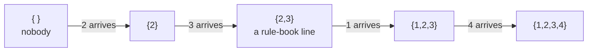

# Sperner's theorem: a family of subsets in which none contains another has at most the middle binomial coefficient of members, by the LYM inequality

[Syllabus](../../../SYLLABUS.md) → [Combinatorics and graphs](../README.md) → [Orders and Set Systems](../README.md#s15) → Sperner's theorem

---

## General Overview

A bank vault has four managers, numbered 1 to 4. Its rule book lists the groups of managers who may open the vault together. One bank writes four lines: manager 1 alone, or any two of managers 2, 3 and 4. As sets: {1}, {2,3}, {2,4}, {3,4}.

A tidy rule book never lists one group inside another: a line for {2,3,4} adds nothing, since it includes the pair {2,3}. A family of sets in which no member sits inside another is an **antichain** (also called a **Sperner family**).

How many lines can a tidy book for four managers hold? Sixteen groups exist, from nobody to all four. The answer is 6: the six pairs, the rule "any two of four". No other tidy book has 6 lines, and none has 7.

Emanuel Sperner proved the general case in 1928. David Lubell found the short proof on this card in 1966.

The proof gives each family a score. A member holding k managers scores 1 over the number of groups of that size. The four-line book scores 1/4 + 3/6 = 0.75, and no antichain scores more than 1.

**Score each member 1 over the sets of its size; an antichain totals at most 1, capping it at the middle layer, which only a whole middle layer reaches.**

**What kind of fact this is:** two theorems, the LYM inequality and Sperner's theorem, both proved on this card in Why it works.

### The picture: the 16 groups, by size

```
size 0  █                    1
size 1  ████                 4
size 2  ██████               6
size 3  ████                 4
size 4  █                    1
```

Each size class is a **layer**. Sets of equal size never nest, so every layer is an antichain. The middle layer is the biggest ([The middle of the row](../03-Binomial%20Coefficients%20and%20Identities/07-central-binomial-and-bounds.md)). Sperner's theorem says no mix of layers does better.

---

## The formula

Notation first, in words. $`n`$ is the number of things, here managers. $`F`$ is a family: a list of sets of those things, here the rule book. $`A`$ is one member of $`F`$, and $`\lvert A\rvert`$ is how many things it holds. $`C(n,k)`$ counts the sets of size $`k`$ ([Combinations, n choose k](../01-Counting%20Principles/05-n-choose-k.md)).

```math
\sum_{A \in F} \frac{1}{C(n,\lvert A\rvert)} \le 1 \quad \text{when } F \text{ is an antichain}
```

**Read it aloud:** for each member, take 1 over the number of sets of its size; across an antichain these add to at most 1.

This is the **LYM inequality**, named for Lubell, Yamamoto and Meshalkin, who found it separately. On the vault: $`1/C(4,1) + 3/C(4,2) = 1/4 + 3/6 = 0.75`$.

Every member scores at least $`1/C(n,\lfloor n/2\rfloor)`$, because the middle count is the largest. That gives Sperner's bound:

```math
\lvert F\rvert \le C(n,\lfloor n/2\rfloor)
```

**Read it aloud:** an antichain has at most as many members as the middle entry of row n of Pascal's triangle.

| Symbol | Plain meaning | In our example | Push it up and the answer… |
| --- | --- | --- | --- |
| $`n`$ | how many things there are | 4 managers | the cap grows: 6, then 10, 20 |
| $`A`$, $`B`$; ⊂ | sets of things, $`A`$ a member of the family; ⊂: sits inside | {2,3} | — |
| $`\lvert A\rvert`$, $`k`$ | how many things that member holds | 1 or 2 | its score falls toward the middle size, then rises |
| $`F`$ | the family: the rule book | {1}, {2,3}, {2,4}, {3,4} | — |
| $`\lvert F\rvert`$ | how many members the family has | 4 | the score rises |
| $`C(n,k)`$ | how many sets of size $`k`$ exist | C(4,2) = 6 | that size scores less per member |
| $`\lfloor n/2\rfloor`$ | n/2 rounded down: the middle size | 2 | — |
| $`n!`$, $`k!\,(n-k)!`$ | arrival orders: all of them, and those passing through one set of size $`k`$ | 24; 6 for {1}, 4 for a pair | — |

### When it holds

- **Finitely many things.** With infinitely many things, the single-thing sets form an endless antichain.
- **No member inside another.** Allow nesting and the score passes 1: the six pairs plus {1} hold 3 nested pairs and score 30/24.
- **The bound uses sizes only.** It cannot see extra rules such as "every two lines share a manager"; those need [Erdos-Ko-Rado](04-erdos-ko-rado-and-shadows.md).
- **An odd n has two winners.** For n = 5 the ten 2-groups and the ten 3-groups both reach the cap of 10.

---

## Why it works

### Step 0: count arrival orders, not sets

Let the managers arrive one at a time. The group present grows: nobody, one manager, two, three, all four.

A list of sets, each inside the next, is a **chain**. One that grows by exactly one thing per step, from nothing to everything, is a **maximal chain**: no set can be added to it. Each arrival order gives one, so four managers give 4! = 24 maximal chains.



The order 2, 3, 1, 4 passes through the line {2,3} and through no other line.

### Step 1: an antichain meets each chain at most once

Two sets on one chain are nested, and an antichain holds no nested pair. So each arrival order passes through at most one member. The run confirms it: no order meets the vault's book more than once.

### Step 2: a set of size k lies on k!(n−k)! chains

An order passes through the set $`A`$ exactly when $`A`$'s members arrive first. They can arrive in $`k!`$ orders, and the rest then in $`(n-k)!`$ orders.

- {1}: manager 1 first, then the other three in 3! ways, so 1 × 6 = 6 orders.
- {2,3}: managers 2 and 3 first in 2! ways, then the other two in 2! ways, so 4 orders.

### Step 3: add up, then divide

The vault's book meets 6 + 4 + 4 + 4 = 18 orders, and Step 1 says no order is counted twice. In general the total cannot pass the number of orders:

```math
\sum_{A \in F} \lvert A\rvert!\,(n-\lvert A\rvert)! \le n!
```

Divide every term by $`n!`$. Each $`k!\,(n-k)!/n!`$ is exactly $`1/C(n,k)`$, and the LYM inequality appears. On the vault, 18/24 = 0.75.

### Step 4: Sperner's bound

The middle entry is the largest in its row ([The middle of the row](../03-Binomial%20Coefficients%20and%20Identities/07-central-binomial-and-bounds.md)). So no member scores less than $`1/C(n,\lfloor n/2\rfloor)`$, and $`\lvert F\rvert / C(n,\lfloor n/2\rfloor) \le 1`$. For four managers each line scores at least 1/6, so a tidy book holds at most 6 lines.

### Step 5: only a middle layer reaches the cap

Take n even. A member off the middle scores more than $`1/C(n,n/2)`$. If a family with $`C(n,n/2)`$ members held one, its score would pass 1. So every member has the middle size, and there are as many members as middle sets: the family is the whole middle layer.

Trying every family of the 16 groups finds 168 antichains, and exactly one with 6 members: the six pairs.

<details>
<summary>Detailed proof: the odd case, where either middle layer can win</summary>

Let n be odd and write $`k = (n-1)/2`$, so the two middle layers hold the sets of size $`k`$ and $`k+1`$. They have the same count, and every other layer is smaller. As in Step 5, a family that reaches the cap uses only these two layers, and its score is exactly 1.

A score of exactly 1 means every one of the $`n!`$ orders meets the family once.

Suppose the family holds a set $`A`$ of size $`k`$. Add one more thing to get $`B`$, of size $`k+1`$. $`B`$ contains $`A`$, so $`B`$ is not in the family.

Now take any order that passes through $`B`$. It must meet the family, at size $`k`$ or $`k+1`$. It cannot meet it at $`B`$, so the $`k`$-set it passed just before $`B`$ is in the family. That set can be any $`k`$-subset of $`B`$.

So swapping one member of $`A`$ for one thing outside $`A`$ stays inside the family. Repeated swaps reach every $`k`$-set. The family holds the whole layer of size $`k`$, which already fills the cap, so it holds nothing else. If the family holds no $`k`$-set, all of it lies in the layer of size $`k+1`$, and it is that whole layer.

For n = 5 the run confirms both layers: 10 sets each, both antichains, both meeting all 120 orders.

</details>

### Step 6: a second road, six chains that cover everything

Split the 16 groups into 6 chains (⊂: sits inside):

- { } ⊂ {1} ⊂ {1,2} ⊂ {1,2,3} ⊂ {1,2,3,4}
- {2} ⊂ {2,3} ⊂ {2,3,4}
- {3} ⊂ {1,3} ⊂ {1,3,4}
- {4} ⊂ {1,4} ⊂ {1,2,4}
- {2,4}
- {3,4}

An antichain takes at most one set per chain, so at most 6 in all. This is the easy half of [Dilworth's theorem](01-dilworths-theorem.md): an antichain is never larger than any cover by chains. Dilworth's theorem and Step 4 give such a split for every n, one chain per middle set.

---

## Worked numbers, by hand

| Step | Arithmetic | Value |
| --- | --- | --- |
| arrival orders of 4 managers | 4 × 3 × 2 × 1 | 24 |
| orders through {1} | 1! × 3! | 6 |
| orders through each pair | 2! × 2! | 4 |
| orders meeting the book | 6 + 4 + 4 + 4 | 18 |
| LYM score | 18/24 = 1/4 + 3/6 | **0.75** |
| largest tidy book | each line scores at least 1/6, total at most 1 | **6** |

The vault's book uses three quarters of the room LYM allows. No group fits beside it, yet it is not the largest.

### What breaks if you drop a piece

| Mistake | Comes out at | What went wrong |
| --- | --- | --- |
| Six pairs plus {1} | 7 lines, 3 nested, score 30/24 | {1} sits inside {1,2}, {1,3} and {1,4}: not an antichain |
| One member per order, with no weights | at most 24 lines, not 6 | a set lies on many orders; each needs its k!(n−k)! weight |
| A full score means the largest family | the four single managers meet 24 of 24 orders, with 4 lines | LYM caps the score; the size cap needs the middle layer |
| "The" largest family for odd n | n = 5: the 2-groups and the 3-groups, 10 lines each | two middle layers, two winners |

---

## Code, from first principles, and it actually runs

Nothing is imported; each group is a 4-bit number, one bit per manager. Three roads lead to the cap of 6. Road one tries every family of the 16 groups and keeps the antichains. Road two walks the 24 arrival orders for each antichain and compares meetings with the k!(n−k)! weights. Road three checks a cover by 6 chains.

### Python

```python
# Sperner and LYM -- the check behind the card.  Nothing is imported.  Managers
# 1 to 4; a group of them is a 4-bit mask.  Road one tries all 2^16 families of
# groups and keeps the antichains.  Road two walks the 24 arrival orders.  Road
# three splits the 16 groups into 6 chains.  The odd case n = 5 comes last.
def size(s): return bin(s).count("1")
def fact(k): return 1 if k < 2 else k * fact(k - 1)
def show(s, n=4): return "{" + ",".join(str(i + 1) for i in range(n) if s >> i & 1) + "}"
def weight(fam, n): return sum(fact(size(a)) * fact(n - size(a)) for a in fam)
def orders(rest):                         # every arrival order, built one place at a time
    return [[x] + o for x in rest for o in orders([y for y in rest if y != x])] if rest else [[]]
def hits(fam, n):                         # orders whose growing group meets fam, and the most meetings
    met = []
    for o in orders(list(range(n))):
        groups = [sum(1 << x for x in o[:j]) for j in range(n + 1)]
        met.append(sum(g in fam for g in groups))
    return sum(m > 0 for m in met), max(met)
def antichain(fam): return all(a & b != a for a in fam for b in fam if a != b)
above = [sum(1 << b for b in range(16) if a & b == a and a != b) for a in range(16)]
anti = [f for f in range(1 << 16) if all(f & above[a] == 0 for a in range(16) if f >> a & 1)]
fams = [[a for a in range(16) if f >> a & 1] for f in anti]
best = max(len(f) for f in fams)
tops = [f for f in fams if len(f) == best]
example = [0b0001, 0b0110, 0b1010, 0b1100]
print(f"groups of each size, 0 to 4: {[sum(size(a) == k for a in range(16)) for k in range(5)]}")
print(f"tidy rule books (antichains) of 4 managers: {len(fams)}; largest has {best} lines")
print(f"rule books with {best} lines: {len(tops)}: {[show(a) for a in tops[0]]}")
h, most = hits(example, 4)
print(f"example {[show(a) for a in example]}: 1/4 + 3/6 = {sum(1 / (24 // fact(size(a)) // fact(4 - size(a))) for a in example):.2f}")
room = [b for b in range(16) if b not in example and antichain(example + [b])]
print(f"  arrival orders meeting it: {h} of 24 = {h / 24:.2f}; most meetings in one order: {most}; groups that still fit: {len(room)}")
print(f"  orders through each line, k!(4-k)!: {[fact(size(a)) * fact(4 - size(a)) for a in example]}")
road_two = all(hits(f, 4) == (weight(f, 4), min(1, len(f))) for f in fams)
print(f"every antichain: orders met = sum of k!(4-k)!, never twice: {'yes' if road_two else 'no'}")
print(f"largest LYM score over all antichains: {max(weight(f, 4) for f in fams)}/24")
chains = [[0, 1, 3, 7, 15], [2, 6, 14], [4, 5, 13], [8, 9, 11], [10], [12]]
cover = sorted(a for c in chains for a in c) == list(range(16))
nested = all(c[i] & c[i + 1] == c[i] for c in chains for i in range(len(c) - 1))
print(f"16 groups split into {len(chains)} chains, sizes {[len(c) for c in chains]}: {'yes' if cover and nested else 'no'}")
pairs = [a for a in range(16) if size(a) == 2]
plus1 = pairs + [0b0001]
print(f"mistake 1, six pairs plus {{1}}: {len(plus1)} lines, {sum(a & b == a and a != b for a in plus1 for b in plus1)} nested, score {weight(plus1, 4)}/24")
print(f"mistake 2, one member per order, unweighted: at most {fact(4)} lines, not {best}")
singles = [1, 2, 4, 8]
print(f"mistake 3, the four singles meet {hits(singles, 4)[0]} of 24 orders but have {len(singles)} lines")
mid5 = {k: [a for a in range(32) if size(a) == k] for k in (2, 3)}
for k, lay in mid5.items():
    print(f"n = 5, all {k}-groups: {len(lay)} lines, antichain {'yes' if antichain(lay) else 'no'}, orders met {hits(lay, 5)[0]} of 120")
caps = [fact(n) // fact(n // 2) // fact(n - n // 2) for n in range(1, 11)]
print(f"largest tidy rule book, C(n, n//2), for n = 1 to 10: {caps}")
assert len(fams) == 168 and best == 6 == 24 // fact(2) // fact(2)     # Dedekind number; C(4,2)
assert len(tops) == 1 and tops[0] == pairs                           # only the middle layer
assert road_two and h == 18 == weight(example, 4) and room == []                   # chains agree with weights
assert max(weight(f, 4) for f in fams) == 24 and cover and nested     # LYM <= 1; 6 chains cover
assert hits(singles, 4)[0] == 24 and all(len(l) == 10 and antichain(l) for l in mid5.values())
print("ALL CHECKS PASS")
```

**Ran 2026-11-23 on macOS, Python 3.14.10, standard library only. All checks passed. Output, pasted from the run:**

```
groups of each size, 0 to 4: [1, 4, 6, 4, 1]
tidy rule books (antichains) of 4 managers: 168; largest has 6 lines
rule books with 6 lines: 1: ['{1,2}', '{1,3}', '{2,3}', '{1,4}', '{2,4}', '{3,4}']
example ['{1}', '{2,3}', '{2,4}', '{3,4}']: 1/4 + 3/6 = 0.75
  arrival orders meeting it: 18 of 24 = 0.75; most meetings in one order: 1; groups that still fit: 0
  orders through each line, k!(4-k)!: [6, 4, 4, 4]
every antichain: orders met = sum of k!(4-k)!, never twice: yes
largest LYM score over all antichains: 24/24
16 groups split into 6 chains, sizes [5, 3, 3, 3, 1, 1]: yes
mistake 1, six pairs plus {1}: 7 lines, 3 nested, score 30/24
mistake 2, one member per order, unweighted: at most 24 lines, not 6
mistake 3, the four singles meet 24 of 24 orders but have 4 lines
n = 5, all 2-groups: 10 lines, antichain yes, orders met 120 of 120
n = 5, all 3-groups: 10 lines, antichain yes, orders met 120 of 120
largest tidy rule book, C(n, n//2), for n = 1 to 10: [1, 2, 3, 6, 10, 20, 35, 70, 126, 252]
ALL CHECKS PASS
```

### Rust

Same numbers, same labels, built with `rustc --edition 2021 -O`.

```rust
// Sperner and LYM -- the same check as the Python, in Rust.  No crates.  Managers
// 1 to 4; a group of them is a 4-bit mask.  Road one tries all 2^16 families of
// groups and keeps the antichains.  Road two walks the 24 arrival orders.  Road
// three splits the 16 groups into 6 chains.  The odd case n = 5 comes last.
fn size(s: u32) -> u64 { s.count_ones() as u64 }
fn fact(k: u64) -> u64 { if k < 2 { 1 } else { k * fact(k - 1) } }
fn show(fam: &[u32]) -> String {
    let one = |s: &u32| format!("'{{{}}}'", (0..4).filter(|i| s >> i & 1 == 1)
        .map(|i| (i + 1).to_string()).collect::<Vec<_>>().join(","));
    format!("[{}]", fam.iter().map(one).collect::<Vec<_>>().join(", "))
}
fn weight(fam: &[u32], n: u64) -> u64 { fam.iter().map(|&a| fact(size(a)) * fact(n - size(a))).sum() }
fn orders(rest: &[u32]) -> Vec<Vec<u32>> {          // every arrival order, built one place at a time
    if rest.is_empty() { return vec![vec![]] }
    let mut out = vec![];
    for &x in rest {
        for o in orders(&rest.iter().copied().filter(|&y| y != x).collect::<Vec<u32>>()) { let mut v = vec![x]; v.extend(o); out.push(v) }
    }
    out
}
fn hits(fam: &[u32], n: u32) -> (u64, u64) {        // orders whose growing group meets fam, and the most meetings
    let (mut met, mut most) = (0, 0);
    for o in orders(&(0..n).collect::<Vec<u32>>()) {
        let m = (0..=n as usize).filter(|&j| fam.contains(&o[..j].iter().map(|x| 1u32 << x).sum::<u32>())).count() as u64;
        if m > 0 { met += 1 }
        most = most.max(m);
    }
    (met, most)
}
fn antichain(fam: &[u32]) -> bool { fam.iter().all(|&a| fam.iter().all(|&b| a == b || a & b != a)) }
fn yn(c: bool) -> &'static str { if c { "yes" } else { "no" } }
fn main() {
    let above: Vec<u32> = (0..16).map(|a: u32| (0..16).filter(|&b: &u32| a & b == a && a != b).map(|b| 1u32 << b).sum()).collect();
    let fams: Vec<Vec<u32>> = (0u32..1 << 16)
        .filter(|&f| (0..16).all(|a| f >> a & 1 == 0 || f & above[a as usize] == 0))
        .map(|f| (0..16).filter(|a| f >> a & 1 == 1).collect()).collect();
    let best = fams.iter().map(|f| f.len()).max().unwrap();
    let tops: Vec<&Vec<u32>> = fams.iter().filter(|f| f.len() == best).collect();
    let example = vec![0b0001u32, 0b0110, 0b1010, 0b1100];
    println!("groups of each size, 0 to 4: {:?}", (0..5).map(|k| (0..16).filter(|&a| size(a) == k).count()).collect::<Vec<_>>());
    println!("tidy rule books (antichains) of 4 managers: {}; largest has {} lines", fams.len(), best);
    println!("rule books with {} lines: {}: {}", best, tops.len(), show(tops[0]));
    let (h, most) = hits(&example, 4);
    let score: f64 = example.iter().map(|&a| 1.0 / (24 / fact(size(a)) / fact(4 - size(a))) as f64).sum();
    println!("example {}: 1/4 + 3/6 = {:.2}", show(&example), score);
    let room = (0..16u32).filter(|b| !example.contains(b) && antichain(&[example.clone(), vec![*b]].concat())).count();
    println!("  arrival orders meeting it: {} of 24 = {:.2}; most meetings in one order: {}; groups that still fit: {}", h, h as f64 / 24.0, most, room);
    println!("  orders through each line, k!(4-k)!: {:?}", example.iter().map(|&a| fact(size(a)) * fact(4 - size(a))).collect::<Vec<_>>());
    let road_two = fams.iter().all(|f| hits(f, 4) == (weight(f, 4), f.len().min(1) as u64));
    println!("every antichain: orders met = sum of k!(4-k)!, never twice: {}", yn(road_two));
    let top_score = fams.iter().map(|f| weight(f, 4)).max().unwrap();
    println!("largest LYM score over all antichains: {}/24", top_score);
    let chains: Vec<Vec<u32>> = vec![vec![0, 1, 3, 7, 15], vec![2, 6, 14], vec![4, 5, 13], vec![8, 9, 11], vec![10], vec![12]];
    let mut all: Vec<u32> = chains.iter().flatten().copied().collect();
    all.sort();
    let cover = all == (0..16).collect::<Vec<u32>>();
    let nested = chains.iter().all(|c| c.windows(2).all(|w| w[0] & w[1] == w[0]));
    println!("16 groups split into {} chains, sizes {:?}: {}", chains.len(), chains.iter().map(|c| c.len()).collect::<Vec<_>>(), yn(cover && nested));
    let pairs: Vec<u32> = (0..16).filter(|&a| size(a) == 2).collect();
    let plus1: Vec<u32> = pairs.iter().copied().chain([0b0001]).collect();
    let nest = plus1.iter().map(|&a| plus1.iter().filter(|&&b| a & b == a && a != b).count()).sum::<usize>();
    println!("mistake 1, six pairs plus {{1}}: {} lines, {} nested, score {}/24", plus1.len(), nest, weight(&plus1, 4));
    println!("mistake 2, one member per order, unweighted: at most {} lines, not {}", fact(4), best);
    let singles = vec![1u32, 2, 4, 8];
    println!("mistake 3, the four singles meet {} of 24 orders but have {} lines", hits(&singles, 4).0, singles.len());
    let mut layers_ok = true;
    for k in [2u64, 3] {
        let lay: Vec<u32> = (0..32).filter(|&a| size(a) == k).collect();
        println!("n = 5, all {}-groups: {} lines, antichain {}, orders met {} of 120", k, lay.len(), yn(antichain(&lay)), hits(&lay, 5).0);
        layers_ok &= lay.len() == 10 && antichain(&lay);
    }
    let caps: Vec<u64> = (1..=10u64).map(|n| fact(n) / fact(n / 2) / fact(n - n / 2)).collect();
    println!("largest tidy rule book, C(n, n//2), for n = 1 to 10: {:?}", caps);
    assert!(fams.len() == 168 && best == 6 && best as u64 == 24 / fact(2) / fact(2)); // Dedekind; C(4,2)
    assert!(tops.len() == 1 && *tops[0] == pairs);                                    // only the middle layer
    assert!(road_two && h == 18 && h == weight(&example, 4) && room == 0);                       // chains agree with weights
    assert!(top_score == 24 && cover && nested);                                      // LYM <= 1; 6 chains cover
    assert!(hits(&singles, 4).0 == 24 && layers_ok);
    println!("ALL CHECKS PASS");
}
```

**Ran 2026-11-23 on macOS, rustc 1.98.1, no crates. All checks passed. Output, pasted from the run:**

```
groups of each size, 0 to 4: [1, 4, 6, 4, 1]
tidy rule books (antichains) of 4 managers: 168; largest has 6 lines
rule books with 6 lines: 1: ['{1,2}', '{1,3}', '{2,3}', '{1,4}', '{2,4}', '{3,4}']
example ['{1}', '{2,3}', '{2,4}', '{3,4}']: 1/4 + 3/6 = 0.75
  arrival orders meeting it: 18 of 24 = 0.75; most meetings in one order: 1; groups that still fit: 0
  orders through each line, k!(4-k)!: [6, 4, 4, 4]
every antichain: orders met = sum of k!(4-k)!, never twice: yes
largest LYM score over all antichains: 24/24
16 groups split into 6 chains, sizes [5, 3, 3, 3, 1, 1]: yes
mistake 1, six pairs plus {1}: 7 lines, 3 nested, score 30/24
mistake 2, one member per order, unweighted: at most 24 lines, not 6
mistake 3, the four singles meet 24 of 24 orders but have 4 lines
n = 5, all 2-groups: 10 lines, antichain yes, orders met 120 of 120
n = 5, all 3-groups: 10 lines, antichain yes, orders met 120 of 120
largest tidy rule book, C(n, n//2), for n = 1 to 10: [1, 2, 3, 6, 10, 20, 35, 70, 126, 252]
ALL CHECKS PASS
```

The two outputs match line for line.

### Lean

Lean proves the card's three claims for every number of things n, not just four managers.

- Take an antichain $`F`$ of sets of $`n`$ things. Then the scores $`1/C(n,\lvert A\rvert)`$ add to at most 1, the LYM inequality.
- Take an antichain $`F`$ of sets of $`n`$ things. Then $`\lvert F\rvert \le C(n,\lfloor n/2\rfloor)`$, Sperner's bound.
- Suppose an antichain has exactly $`C(n,\lfloor n/2\rfloor)`$ members. Then it is a whole middle layer, and every whole middle layer reaches that cap.
- For odd n, either of the two middle layers can be the winner.
- The worked numbers hold exactly: the 16 groups by size, the vault's book and its score of 0.75, the six chains, and the mistakes.

The count of 168 antichains and the walk through all 24 arrival orders are left to the Python and Rust checks.

```lean
-- Sperner's theorem: for an antichain of subsets of an n-element set, the LYM scores 1/C(n, |A|) add to at most 1, so it has at most C(n, ⌊n/2⌋) members, and only a whole middle layer has exactly that many.
import Mathlib.Combinatorics.SetFamily.LYM
import Mathlib.Combinatorics.Enumerative.DoubleCounting
import Mathlib.Data.Fintype.Powerset
import Mathlib.Tactic.NormNum

open Finset

/-- Off the two middle sizes, the binomial coefficient is strictly below the middle one. -/
theorem choose_lt_middle_of_ne {n r : ℕ} (hr : r ≤ n) (h1 : r ≠ n / 2) (h2 : r ≠ (n + 1) / 2) :
    n.choose r < n.choose (n / 2) := by
  have step : ∀ m, m < n / 2 → n.choose m < n.choose (n / 2) := by
    intro m hm
    have hpos : 0 < n.choose m := Nat.choose_pos (by omega)
    have key := Nat.choose_succ_right_eq n m
    have hlt : n.choose m < n.choose (m + 1) := by
      by_contra hcon
      push Not at hcon
      have : n.choose (m + 1) * (m + 1) < n.choose m * (n - m) := by
        calc n.choose (m + 1) * (m + 1) ≤ n.choose m * (m + 1) := Nat.mul_le_mul_right _ hcon
          _ < n.choose m * (n - m) := Nat.mul_lt_mul_of_pos_left (by omega) hpos
      omega
    exact lt_of_lt_of_le hlt (Nat.choose_le_middle _ _)
  rcases lt_or_gt_of_ne h1 with h | h
  · exact step r h
  · rw [← Nat.choose_symm hr]
    exact step (n - r) (by omega)

#print axioms choose_lt_middle_of_ne

/-- The two middle layers have the same size. -/
theorem choose_half_succ_eq (n : ℕ) : n.choose ((n + 1) / 2) = n.choose (n / 2) :=
  Nat.choose_symm_of_eq_add (by omega)

#print axioms choose_half_succ_eq

/-- In an odd-size ground set of size `2k+1`, a family of `(k+1)`-sets whose shadow is no
larger than itself is closed: every `(k+1)`-set above a shadow member is in the family. -/
theorem upper_closed_of_card_shadow_le {α : Type*} [Fintype α] [DecidableEq α] {k : ℕ}
    (hα : Fintype.card α = 2 * k + 1) (U : Finset (Finset α))
    (hU : (U : Set (Finset α)).Sized (k + 1)) (hle : #((shadow U)) ≤ #U) :
    ∀ X ∈ (shadow U), ∀ T : Finset α, X ⊆ T → #T = k + 1 → T ∈ U := by
  by_contra hcon
  push Not at hcon
  obtain ⟨X, hX, T, hXT, hT, hTU⟩ := hcon
  have hsh : ∀ a ∈ (shadow U), #a = k := fun a ha => by
    have := hU.shadow ha
    simpa using this
  have key := sum_card_bipartiteAbove_eq_sum_card_bipartiteBelow
    (r := fun (a b : Finset α) => a ⊆ b) (s := (shadow U)) (t := U)
  have hbelow : ∀ b ∈ U, k + 1 ≤ #(((shadow U)).bipartiteBelow (fun a b => a ⊆ b) b) := by
    intro b hb
    rw [← hU hb, ← card_image_of_injOn b.erase_injOn]
    refine card_le_card ?_
    intro x hx
    rw [mem_image] at hx
    obtain ⟨a, ha, rfl⟩ := hx
    rw [mem_bipartiteBelow]
    exact ⟨erase_mem_shadow hb ha, erase_subset _ _⟩
  have habove_sub : ∀ a ∈ (shadow U),
      U.bipartiteAbove (fun a b => a ⊆ b) a ⊆ aᶜ.image (fun x => insert x a) := by
    intro a ha b hb
    rw [mem_bipartiteAbove] at hb
    obtain ⟨x, hx, rfl⟩ := exists_eq_insert_iff.2 ⟨hb.2, by rw [hsh a ha, hU hb.1]⟩
    exact mem_image_of_mem _ (mem_compl.2 hx)
  have hcompl : ∀ a ∈ (shadow U), #aᶜ = k + 1 := fun a ha => by
    rw [card_compl, hα, hsh a ha]; omega
  have habove : ∀ a ∈ (shadow U), #(U.bipartiteAbove (fun a b => a ⊆ b) a) ≤ k + 1 := by
    intro a ha
    calc _ ≤ #(aᶜ.image (fun x => insert x a)) := card_le_card (habove_sub a ha)
      _ ≤ #aᶜ := card_image_le
      _ = k + 1 := hcompl a ha
  have hTmem : T ∈ Xᶜ.image (fun x => insert x X) := by
    obtain ⟨x, hx, rfl⟩ := exists_eq_insert_iff.2 ⟨hXT, by rw [hsh X hX, hT]⟩
    exact mem_image_of_mem _ (mem_compl.2 hx)
  have hX_lt : #(U.bipartiteAbove (fun a b => a ⊆ b) X) < k + 1 := by
    have hsub : U.bipartiteAbove (fun a b => a ⊆ b) X ⊆ (Xᶜ.image (fun x => insert x X)).erase T := by
      intro b hb
      refine mem_erase.2 ⟨?_, habove_sub X hX hb⟩
      rintro rfl
      exact hTU ((mem_bipartiteAbove _).1 hb).1
    calc _ ≤ #((Xᶜ.image (fun x => insert x X)).erase T) := card_le_card hsub
      _ = #(Xᶜ.image (fun x => insert x X)) - 1 := card_erase_of_mem hTmem
      _ < k + 1 := by
        have h1 : #(Xᶜ.image (fun x => insert x X)) ≤ k + 1 :=
          card_image_le.trans (hcompl X hX).le
        have h2 : 0 < #(Xᶜ.image (fun x => insert x X)) := card_pos.2 ⟨T, hTmem⟩
        omega
  have hlhs : ∑ a ∈ (shadow U), #(U.bipartiteAbove (fun a b => a ⊆ b) a) < ∑ _a ∈ (shadow U), (k + 1) :=
    sum_lt_sum habove ⟨X, hX, hX_lt⟩
  have hrhs : ∑ _b ∈ U, (k + 1) ≤ ∑ b ∈ U, #(((shadow U)).bipartiteBelow (fun a b => a ⊆ b) b) :=
    sum_le_sum hbelow
  rw [sum_const] at hlhs hrhs
  rw [Nat.nsmul_eq_mul] at hlhs hrhs
  have : #U * (k + 1) < #((shadow U)) * (k + 1) := by omega
  have := Nat.lt_of_mul_lt_mul_right this
  omega

#print axioms upper_closed_of_card_shadow_le

/-- A nonempty closed family of `(k+1)`-sets (as above) is the whole layer: any `(k+1)`-set is
reached from a member by swapping one element at a time. -/
theorem eq_powersetCard_of_upper_closed {α : Type*} [Fintype α] [DecidableEq α] {k : ℕ}
    (U : Finset (Finset α)) (hU : (U : Set (Finset α)).Sized (k + 1))
    (hcl : ∀ X ∈ (shadow U), ∀ T : Finset α, X ⊆ T → #T = k + 1 → T ∈ U) (hne : U.Nonempty) :
    U = (univ : Finset α).powersetCard (k + 1) := by
  obtain ⟨T0, hT0⟩ := hne
  have hT0c : #T0 = k + 1 := hU hT0
  have claim : ∀ d : ℕ, ∀ T : Finset α, #T = k + 1 → #(T0 \ T) ≤ d → T ∈ U := by
    intro d
    induction d with
    | zero =>
      intro T hT hd
      have h0 : T0 \ T = ∅ := card_eq_zero.1 (by omega)
      have hsub : T0 ⊆ T := sdiff_eq_empty_iff_subset.1 h0
      have : T0 = T := eq_of_subset_of_card_le hsub (by omega)
      exact this ▸ hT0
    | succ d ih =>
      intro T hT hd
      by_cases hd' : #(T0 \ T) ≤ d
      · exact ih T hT hd'
      have hpos : 0 < #(T0 \ T) := by omega
      obtain ⟨a, ha⟩ := card_pos.1 hpos
      have hcomm : #(T \ T0) = #(T0 \ T) := card_sdiff_comm (by omega)
      obtain ⟨b, hb⟩ := card_pos.1 (hcomm ▸ hpos : 0 < #(T \ T0))
      rw [mem_sdiff] at ha hb
      have hbT : b ∈ T := hb.1
      have haT' : a ∉ T.erase b := fun h => ha.2 (mem_of_mem_erase h)
      have hXc : #(T.erase b) = k := by rw [card_erase_of_mem hbT, hT]; omega
      have hT''c : #(insert a (T.erase b)) = k + 1 := by
        rw [card_insert_of_notMem haT', hXc]
      have hsd : T0 \ insert a (T.erase b) ⊆ (T0 \ T).erase a := by
        intro x hx
        rw [mem_sdiff, mem_insert, not_or, mem_erase, not_and] at hx
        rw [mem_erase, mem_sdiff]
        refine ⟨hx.2.1, hx.1, fun hxT => ?_⟩
        have hxb : x ≠ b := fun h => hb.2 (h ▸ hx.1)
        exact hx.2.2 hxb hxT
      have hd2 : #(T0 \ insert a (T.erase b)) ≤ d := by
        calc _ ≤ #((T0 \ T).erase a) := card_le_card hsd
          _ = #(T0 \ T) - 1 := card_erase_of_mem (mem_sdiff.2 ha)
          _ ≤ d := by omega
      have hT'' := ih _ hT''c hd2
      have hXsh : T.erase b ∈ (shadow U) :=
        mem_shadow_iff_exists_mem_card_add_one.2 ⟨_, hT'', subset_insert _ _, by rw [hT''c, hXc]⟩
      exact hcl _ hXsh T (erase_subset _ _) hT
  ext T
  rw [mem_powersetCard]
  constructor
  · intro hT
    exact ⟨subset_univ _, hU hT⟩
  · rintro ⟨-, hT⟩
    exact claim (k + 1) T hT (by
      calc _ ≤ #T0 := card_le_card sdiff_subset
        _ = k + 1 := hT0c)

#print axioms eq_powersetCard_of_upper_closed

/-- The odd case of the equality: an antichain of `k`- and `(k+1)`-sets of a `(2k+1)`-set with
`C(2k+1, k)` members is a whole layer. -/
theorem antichain_odd_eq_layer {α : Type*} [Fintype α] [DecidableEq α] {k : ℕ}
    (hα : Fintype.card α = 2 * k + 1) (𝒜 : Finset (Finset α))
    (h𝒜 : IsAntichain (· ⊆ ·) (𝒜 : Set (Finset α)))
    (hsize : ∀ A ∈ 𝒜, #A = k ∨ #A = k + 1) (hcard : #𝒜 = (2 * k + 1).choose k) :
    𝒜 = (univ : Finset α).powersetCard k ∨ 𝒜 = (univ : Finset α).powersetCard (k + 1) := by
  set U := 𝒜.filter (fun A => #A = k + 1) with hUdef
  set L := 𝒜.filter (fun A => ¬ #A = k + 1) with hLdef
  have hUL : #U + #L = #𝒜 := card_filter_add_card_filter_not _
  have hUs : (U : Set (Finset α)).Sized (k + 1) := fun A hA => (mem_filter.1 hA).2
  have hLs : ∀ A ∈ L, #A = k := fun A hA => by
    rw [mem_filter] at hA
    rcases hsize A hA.1 with h | h
    · exact h
    · exact absurd h hA.2
  have hdisj : Disjoint ((shadow U)) L := by
    rw [disjoint_left]
    intro X hX hXL
    obtain ⟨s, hs, hXs, hsc⟩ := mem_shadow_iff_exists_mem_card_add_one.1 hX
    have hXA : X ∈ 𝒜 := (mem_filter.1 hXL).1
    have hsA : s ∈ 𝒜 := (mem_filter.1 hs).1
    have hne : X ≠ s := by rintro rfl; omega
    exact h𝒜 hXA hsA hne hXs
  have hsub : (shadow U) ∪ L ⊆ (univ : Finset α).powersetCard k := by
    intro X hX
    rw [mem_powersetCard]
    refine ⟨subset_univ _, ?_⟩
    rcases mem_union.1 hX with h | h
    · simpa using hUs.shadow h
    · exact hLs X h
  have hcardk : #((univ : Finset α).powersetCard k) = (2 * k + 1).choose k := by
    rw [card_powersetCard, card_univ, hα]
  have hle : #((shadow U)) ≤ #U := by
    have := card_le_card hsub
    rw [card_union_of_disjoint hdisj, hcardk] at this
    omega
  rcases U.eq_empty_or_nonempty with hU0 | hU0
  · left
    refine eq_of_subset_of_card_le ?_ (by rw [hcardk, hcard])
    intro A hA
    rw [mem_powersetCard]
    refine ⟨subset_univ _, ?_⟩
    rcases hsize A hA with h | h
    · exact h
    · have : A ∈ U := mem_filter.2 ⟨hA, h⟩
      rw [hU0] at this
      exact absurd this (notMem_empty _)
  · right
    have hUeq := eq_powersetCard_of_upper_closed U hUs
      (upper_closed_of_card_shadow_le hα U hUs hle) hU0
    have hUA : U = 𝒜 := by
      refine eq_of_subset_of_card_le (filter_subset _ _) ?_
      rw [hcard, hUeq, card_powersetCard, card_univ, hα]
      exact (Nat.choose_symm_of_eq_add (by omega)).le
    rw [← hUA, hUeq]

#print axioms antichain_odd_eq_layer

/-- **Sperner's theorem.** Take `n` things. A family `𝒜` of groups of them in which no member
sits inside another (an antichain) has at most `C(n, ⌊n/2⌋)` members, the size of the
middle layer. -/
theorem antichain_card_le_middle_choose {n : ℕ} (𝒜 : Finset (Finset (Fin n)))
    (h𝒜 : IsAntichain (· ⊆ ·) (𝒜 : Set (Finset (Fin n)))) :
    #𝒜 ≤ n.choose (n / 2) := by
  simpa using h𝒜.sperner

/-- **The LYM inequality.** Score each member `A` of an antichain of groups of `n` things
`1 / C(n, |A|)`; the scores add up to at most `1`. -/
theorem lym_sum_inv_choose_le_one {n : ℕ} (𝒜 : Finset (Finset (Fin n)))
    (h𝒜 : IsAntichain (· ⊆ ·) (𝒜 : Set (Finset (Fin n)))) :
    ∑ A ∈ 𝒜, (1 : ℚ) / n.choose #A ≤ 1 := by
  simpa [one_div] using lubell_yamamoto_meshalkin_inequality_sum_inv_choose (𝕜 := ℚ) h𝒜

/-- **Only a middle layer reaches the cap.** An antichain of groups of `n` things has exactly
`C(n, ⌊n/2⌋)` members if and only if it is the whole layer of groups of size `⌊n/2⌋` or the
whole layer of size `⌈n/2⌉`. For even `n` these are the same layer; for odd `n` there are two
winners. -/
theorem antichain_card_eq_middle_choose_iff {n : ℕ} (𝒜 : Finset (Finset (Fin n)))
    (h𝒜 : IsAntichain (· ⊆ ·) (𝒜 : Set (Finset (Fin n)))) :
    #𝒜 = n.choose (n / 2) ↔
      𝒜 = (univ : Finset (Fin n)).powersetCard (n / 2) ∨
        𝒜 = (univ : Finset (Fin n)).powersetCard ((n + 1) / 2) := by
  constructor
  · intro hcard
    have hsize : ∀ A ∈ 𝒜, #A = n / 2 ∨ #A = (n + 1) / 2 := by
      by_contra hcon
      push Not at hcon
      obtain ⟨A, hA, h1, h2⟩ := hcon
      have hAn : #A ≤ n := by simpa using card_le_univ A
      have hlt := choose_lt_middle_of_ne hAn h1 h2
      have hmid : (0 : ℚ) < n.choose (n / 2) := by
        exact_mod_cast Nat.choose_pos (Nat.div_le_self _ _)
      have hlym := lym_sum_inv_choose_le_one 𝒜 h𝒜
      have hlow : ∑ _B ∈ 𝒜, (1 : ℚ) / n.choose (n / 2) < ∑ B ∈ 𝒜, (1 : ℚ) / n.choose #B := by
        refine sum_lt_sum (fun B hB => ?_) ⟨A, hA, ?_⟩
        · have hBn : #B ≤ n := by simpa using card_le_univ B
          have hpos : (0 : ℚ) < n.choose #B := by exact_mod_cast Nat.choose_pos hBn
          gcongr
          exact_mod_cast Nat.choose_le_middle _ _
        · have hpos : (0 : ℚ) < n.choose #A := by exact_mod_cast Nat.choose_pos hAn
          gcongr
      rw [sum_const, nsmul_eq_mul, hcard, mul_one_div, div_self hmid.ne'] at hlow
      exact lt_irrefl _ (hlow.trans_le hlym)
    rcases Nat.even_or_odd' n with ⟨k, rfl | rfl⟩
    · left
      have hk : 2 * k / 2 = k := by omega
      rw [hk]
      refine eq_of_subset_of_card_le ?_ (by rw [card_powersetCard, card_univ, Fintype.card_fin, hcard, hk])
      intro A hA
      rw [mem_powersetCard]
      refine ⟨subset_univ _, ?_⟩
      rcases hsize A hA with h | h <;> omega
    · have hk1 : (2 * k + 1) / 2 = k := by omega
      have hk2 : (2 * k + 1 + 1) / 2 = k + 1 := by omega
      rw [hk1, hk2]
      rw [hk1] at hcard
      exact antichain_odd_eq_layer (Fintype.card_fin _) 𝒜 h𝒜
        (fun A hA => by rcases hsize A hA with h | h <;> omega) hcard
  · rintro (rfl | rfl)
    · rw [card_powersetCard, card_univ, Fintype.card_fin]
    · rw [card_powersetCard, card_univ, Fintype.card_fin, choose_half_succ_eq]

-- Managers 1, 2, 3, 4 are `0, 1, 2, 3` in `Fin 4`.
-- The 16 groups by size: 1, 4, 6, 4, 1.
example : (List.range 5).map
    (fun k => #((univ : Finset (Fin 4)).powersetCard k)) = [1, 4, 6, 4, 1] := by decide
-- The six pairs are an antichain with C(4, 2) = 6 members.
example : #((univ : Finset (Fin 4)).powersetCard 2) = 6 ∧ Nat.choose 4 2 = 6 ∧
    ∀ A ∈ (univ : Finset (Fin 4)).powersetCard 2,
      ∀ B ∈ (univ : Finset (Fin 4)).powersetCard 2, A ⊆ B → A = B := by decide
-- The vault book {1}, {2,3}, {2,4}, {3,4} is an antichain with no room left for any other group.
example : (∀ A ∈ ({{0}, {1, 2}, {1, 3}, {2, 3}} : Finset (Finset (Fin 4))),
      ∀ B ∈ ({{0}, {1, 2}, {1, 3}, {2, 3}} : Finset (Finset (Fin 4))), A ⊆ B → A = B) ∧
    ∀ B : Finset (Fin 4), B ∉ ({{0}, {1, 2}, {1, 3}, {2, 3}} : Finset (Finset (Fin 4))) →
      ∃ A ∈ ({{0}, {1, 2}, {1, 3}, {2, 3}} : Finset (Finset (Fin 4))), A ⊆ B ∨ B ⊆ A := by
  decide
-- Orders through each line, k!(4-k)!: 6, 4, 4, 4, so the book meets 18 of the 4! = 24 orders.
example : (∑ A ∈ ({{0}, {1, 2}, {1, 3}, {2, 3}} : Finset (Finset (Fin 4))),
    (#A).factorial * (4 - #A).factorial) = 18 ∧ Nat.factorial 4 = 24 := by decide
-- The vault book's LYM score: 1/4 + 3/6 = 3/4.
example : ∑ A ∈ ({{0}, {1, 2}, {1, 3}, {2, 3}} : Finset (Finset (Fin 4))),
    (1 : ℚ) / (Nat.choose 4 #A) = 3 / 4 := by
  rw [sum_insert (by decide), sum_insert (by decide), sum_insert (by decide), sum_singleton]
  have h1 : #({0} : Finset (Fin 4)) = 1 := by decide
  have h2 : #({1, 2} : Finset (Fin 4)) = 2 := by decide
  have h3 : #({1, 3} : Finset (Fin 4)) = 2 := by decide
  have h4 : #({2, 3} : Finset (Fin 4)) = 2 := by decide
  rw [h1, h2, h3, h4]
  norm_num [Nat.choose]
-- Mistake 1: the six pairs plus {1} have 7 lines, 3 nested pairs, and weight 30 of 24.
example : #(insert {0} ((univ : Finset (Fin 4)).powersetCard 2)) = 7 ∧
    #((((univ : Finset (Fin 4)).powersetCard 2)).filter (fun B => ({0} : Finset (Fin 4)) ⊆ B)) = 3 ∧
    (∑ A ∈ insert {0} ((univ : Finset (Fin 4)).powersetCard 2),
      (#A).factorial * (4 - #A).factorial) = 30 := by decide
-- Mistake 3: the four singles meet all 24 orders but have only 4 lines.
example : #((univ : Finset (Fin 4)).powersetCard 1) = 4 ∧
    (∑ A ∈ (univ : Finset (Fin 4)).powersetCard 1, (#A).factorial * (4 - #A).factorial) = 24 := by
  decide
-- Step 6: six chains cover the 16 groups, each nested step by step.
example :
    let chains : List (List (Finset (Fin 4))) :=
      [[∅, {0}, {0, 1}, {0, 1, 2}, univ], [{1}, {1, 2}, {1, 2, 3}], [{2}, {0, 2}, {0, 2, 3}],
        [{3}, {0, 3}, {0, 1, 3}], [{1, 3}], [{2, 3}]]
    (∀ B : Finset (Fin 4), ∃ c ∈ chains, B ∈ c) ∧ (chains.map List.length).sum = 16 ∧
      ∀ c ∈ chains, c.IsChain (· ⊆ ·) := by
  decide
-- n = 5: the 2-groups and the 3-groups each hold C(5, 2) = 10 sets.
example : #((univ : Finset (Fin 5)).powersetCard 2) = 10 ∧
    #((univ : Finset (Fin 5)).powersetCard 3) = 10 ∧ Nat.choose 5 2 = 10 := by decide
-- The cap C(n, ⌊n/2⌋) for n = 1 to 10.
example : (List.range 10).map (fun m => (m + 1).choose ((m + 1) / 2)) =
    [1, 2, 3, 6, 10, 20, 35, 70, 126, 252] := by decide

#print axioms antichain_card_le_middle_choose
#print axioms lym_sum_inv_choose_le_one
#print axioms antichain_card_eq_middle_choose_iff
```

**Checked 2026-11-23 on macOS, Lean 4.36.0-rc2, Mathlib v4.36.0-rc2. Every proof is complete and uses only Lean's standard axioms. Output, pasted from the run:**

```
'choose_lt_middle_of_ne' depends on axioms: [propext, Classical.choice, Quot.sound]
'choose_half_succ_eq' depends on axioms: [propext, Classical.choice, Quot.sound]
'upper_closed_of_card_shadow_le' depends on axioms: [propext, Classical.choice, Quot.sound]
'eq_powersetCard_of_upper_closed' depends on axioms: [propext, Classical.choice, Quot.sound]
'antichain_odd_eq_layer' depends on axioms: [propext, Classical.choice, Quot.sound]
'antichain_card_le_middle_choose' depends on axioms: [propext, Classical.choice, Quot.sound]
'lym_sum_inv_choose_le_one' depends on axioms: [propext, Classical.choice, Quot.sound]
'antichain_card_eq_middle_choose_iff' depends on axioms: [propext, Classical.choice, Quot.sound]
```

> [!TIP]
> **Try changing**
> Guess first, then run it. Each change stops an assert.
> - **A shorter book.** Set `example` to `[0b0001, 0b0110]`, the lines {1} and {2,3}. Guess the score first: 10 of 24 orders, 0.42, and 3 groups now fit.
> - **Break a chain.** Replace `[10], [12]` with `[10, 12]`. Guess first: {2,4} does not sit inside {3,4}, so the 5 chains print "no".
> - **The wrong layers.** In the n = 5 loop, use sizes `(1, 2)`. Guess first: the 1-groups are an antichain meeting all 120 orders, but only 5 lines.

---

## The usual mistake

> [!warning]
> **Stopping when nothing more fits.** The vault's four lines leave no room: every other group contains a line or sits inside one. Yet the book is not the largest. A full antichain can score 0.75 and hold 4 lines, while the largest holds 6.
>
> - **Adding a single.** The six pairs plus {1}: 7 lines, 3 nested pairs, score 30/24.
> - **Counting orders without weights.** A cap of 24, not 6.
> - **Reading a full score as a size.** The four singles meet all 24 orders with 4 lines.
> - **Expecting one winner for odd n.** Five managers allow two books of 10 lines.

---

## Where you meet it in real life

- **Access rules.** For a vault or a signing key shared by n people, the smallest working groups form an antichain: at most 252 of them for 10 holders, reached by "any five of ten".
- **Database keys.** A key is a smallest set of columns that picks out each row of a table. No key contains another, so n columns allow at most C(n, ⌊n/2⌋) keys.
- **Monotone switching circuits.** A circuit built only from AND and OR gates is fixed by its smallest switching sets, an antichain. For 4 inputs there are 168 such switching rules, always-off and always-on included, as the run counts.
- **Probability bounds.** Paul Erdős used Sperner's theorem in 1945 to bound how often a sum of numbers with random signs lands in a short interval.

> **Say it back**
> An antichain is a family of sets in which none sits inside another. Each arrival order meets it at most once, and a set of size k lies on k!(n−k)! orders. Adding up and dividing by n! gives the LYM inequality: the scores 1/C(n, k) add to at most 1. Since the middle size scores least, an antichain has at most C(n, ⌊n/2⌋) members. For four managers that is 6, the six pairs, and nothing else reaches it.

---

## What this builds on

- [Dilworth's theorem](01-dilworths-theorem.md): chains and antichains in any order, and why a cover by chains caps an antichain.
- [The middle of the row](../03-Binomial%20Coefficients%20and%20Identities/07-central-binomial-and-bounds.md): the middle entry is the largest, which turns LYM into Sperner's bound.
- [Combinations, n choose k](../01-Counting%20Principles/05-n-choose-k.md): the count C(n, k) and the identity k!(n−k)!/n! = 1/C(n, k).

## Where this goes next

- [Mobius inversion on an order](03-mobius-inversion-on-posets.md): undoing sums taken over every set below a set, on these same 16 groups and on any other order.
- [Erdos-Ko-Rado](04-erdos-ko-rado-and-shadows.md): for sets all of one size $`k`$ (with $`n \ge 2k`$) where every two meet, a counting argument on circular orders caps the family at $`C(n-1, k-1)`$.

Sperner says how large an antichain can be; how many antichains exist (168 for four things) has no known closed formula. Next on this shelf, [Mobius inversion on an order](03-mobius-inversion-on-posets.md) stays on these 16 sets and asks how to undo a sum taken over every set below a set.

---

## Sources

Verified 2026-11-23: every link below resolves to the publisher's page.

- Sperner, Emanuel. "Ein Satz über Untermengen einer endlichen Menge." *Mathematische Zeitschrift* 27 (1928), 544–548. [DOI 10.1007/BF01171114](https://doi.org/10.1007/BF01171114). The original theorem.
- Lubell, D. "A short proof of Sperner's lemma." *Journal of Combinatorial Theory* 1 (1966), 299. [DOI 10.1016/S0021-9800(66)80035-2](https://doi.org/10.1016/S0021-9800%2866%2980035-2). The proof by counting maximal chains used on this card.
- van Lint, J. H., and R. M. Wilson. *A Course in Combinatorics*, 2nd ed. Cambridge University Press, 2001. [Chapter 6, "Dilworth's theorem and extremal set theory"](https://doi.org/10.1017/CBO9780511987045.008). Sperner, LYM and the chain covers in one place.
- "A000372: Dedekind numbers." On-Line Encyclopedia of Integer Sequences. [Sequence page](https://oeis.org/A000372). The count of antichains of subsets; its term for 4 things is 168.
