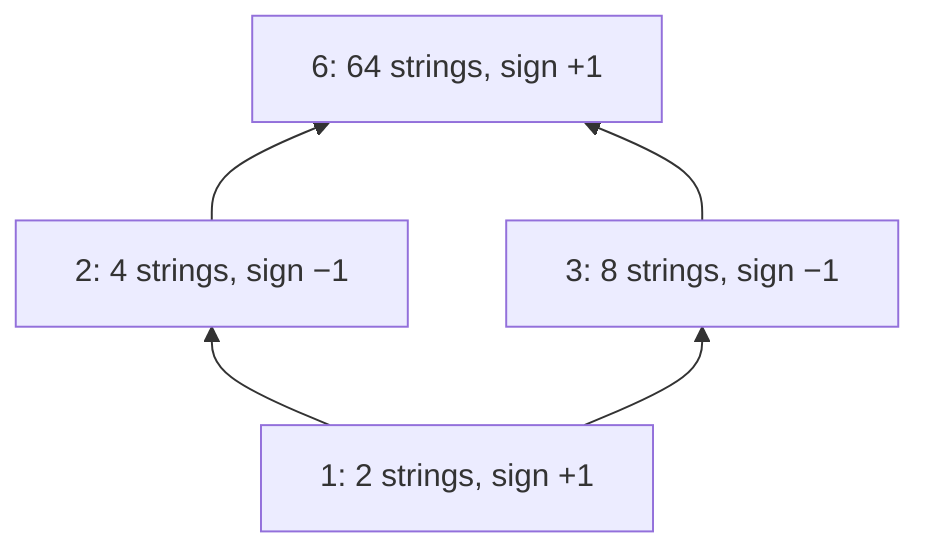

# Mobius inversion on an order: a sum over everything below can always be undone, and inclusion-exclusion and number theory's Mobius function are two cases

[Syllabus](../../../SYLLABUS.md) → [Combinatorics and graphs](../README.md) → [Orders and Set Systems](../README.md#s15) → Mobius inversion on an order

---

## General Overview

There are $`2^6 = 64`$ strings of six bits. Some are a shorter block written out again: 010101 is 01 three times. How many are not? Call those **primitive** strings.

Counting the repeats head-on is awkward, because they overlap: 000000 repeats a block of 1, of 2 and of 3. The other direction is easy. Every string is its shortest repeating block written out end to end; that block is primitive, and its length divides 6. So the 64 strings split, with no overlap, by that length:

```math
64 = f(1) + f(2) + f(3) + f(6)
```

Here $`f(d)`$ counts the primitive strings of length $`d`$. Each total $`2^n`$, for length $`n`$, is a sum of the unknown $`f`$ over the divisors of $`n`$; this card undoes that sum:

```math
f(6) = 2^6 - 2^3 - 2^2 + 2^1 = 64 - 8 - 4 + 2 = 54
```

The signs 1, −1, −1, 1 come from the **Möbius function** of the divisors of 6. The card defines it for any order, proves the undoing always works, and finds inclusion-exclusion and number theory's Möbius function inside it.

**When each total in a finite order adds up unknowns over everything below it, the Möbius function, read off the order alone, recovers every unknown from the totals.**

**What kind of fact this is:** a theorem, proved on this card in Why it works. The Möbius function itself is a definition.

### The picture: the divisors of 6, with their signs



An arrow runs from a divisor to a larger one it divides. Weight each count by its sign and add: 2 − 4 − 8 + 64 = 54.

---

## The formula

An **order** (a partially ordered set) is a set with a relation $`x \le y`$, "x is below y". Every member is below itself, two different members are never each below the other, and $`x \le z \le y`$ gives $`x \le y`$. Some pairs are unrelated: 2 and 3 do not divide each other.

The **interval** from $`x`$ to $`y`$ is every $`z`$ with $`x \le z \le y`$. The Möbius function $`\mu`$ (the Greek letter mu) gives each pair $`x \le y`$ a whole number, built upward from $`x`$:

```math
\mu(x,x) = 1, \qquad \mu(x,y) = -\sum_{x \le z < y} \mu(x,z) \ \text{ when } x < y
```

**Read it aloud:** start at 1, then give each higher member minus the total already given below it, so every interval with $`x < y`$ adds to 0.

On the divisors of 6, taking $`x`$ = 1: $`\mu(1,2) = -1`$, $`\mu(1,3) = -1`$, and $`\mu(1,6) = -(1 - 1 - 1) = 1`$. The inversion formula is a pair of statements, each true exactly when the other is:

```math
g(y) = \sum_{x \le y} f(x) \ \text{ for every } y \quad\Longleftrightarrow\quad f(y) = \sum_{x \le y} \mu(x,y)\, g(x) \ \text{ for every } y
```

**Read it aloud:** if each total is the sum of the unknowns at and below it, then each unknown is the totals at and below it, weighted by the Möbius function.

With $`g(d) = 2^d`$ and $`y = 6`$, the right side is $`1 \cdot 2 - 1 \cdot 4 - 1 \cdot 8 + 1 \cdot 64 = 54`$.

| Symbol | Plain meaning | In our example | Push it up and the answer… |
| --- | --- | --- | --- |
| $`\le`$ | the order: "is below" | "divides", on 1, 2, 3, 6 | more pairs related, more terms |
| $`x, y, z, w`$; $`d, n`$; $`S, T, \varnothing`$ | members of the order: any member; divisors; sets, ∅ being the empty set | $`y`$ = 6; $`S`$ = ∅ | — |
| $`f`$ | the unknown amount at each member | primitive strings: $`f(6)`$ = 54 | — |
| $`g`$ | the total over everything at and below | all strings: $`g(6)`$ = 64 | $`f`$ at that member rises |
| $`\mu(x, y)`$ | the Möbius function: the sign on $`g(x)`$ when solving for $`f(y)`$ | $`\mu(3, 6)`$ = −1 | — |
| $`\zeta(x, y)`$, $`\delta(x, y)`$ | zeta: 1 on every pair $`x \le y`$; delta: 1 if $`x = y`$, else 0 | $`\zeta(2, 6)`$ = 1, $`\delta(2, 6)`$ = 0 | — |
| $`\alpha, \beta, \gamma, \nu`$; $`*`$ | any functions on pairs; their product (Why it works, Step 1) | $`\mu * \zeta = \delta`$ | — |
| $`\lvert T\rvert`$; $`k, j, r`$ | the size of a set; counts: extra members, members chosen, primes | $`\lvert\{1, 2, 3\}\rvert`$ = 3 | — |

### When it holds

- **Everything below each member is finite.** Finite intervals would give μ, but the totals need finite sums too. On the fractions between 0 and 1, neither holds.
- **The total includes the member itself.** $`g(6)`$ = 64 counts the 54 primitive strings too; a total over members strictly below needs a different inversion.
- **The right order.** Ordering 1 to 6 by size puts 4 and 5 below 6, yet no block of a 6-bit string has length 4 or 5.

---

## Why it works

### Step 0: the totals form a staircase, so peel from the bottom

Each total $`g(y)`$ is $`f(y)`$ plus unknowns from lower down, so solve from the bottom up:

1. $`f(1) = g(1) = 2`$: the strings 0 and 1.
2. $`f(2) = g(2) - f(1) = 4 - 2 = 2`$: 01 and 10.
3. $`f(3) = g(3) - f(1) = 8 - 2 = 6`$.
4. $`f(6) = 64 - 2 - 2 - 6 = 54`$.

Written in the totals $`g`$ alone, the coefficients depend only on the order. They are the Möbius function; the proof shows the recursion produces them.

### Step 1: functions on pairs multiply

For functions $`\alpha`$ and $`\beta`$ giving a number to each pair $`x \le y`$, the **product** adds over every stop between:

```math
(\alpha * \beta)(x, y) = \sum_{x \le z \le y} \alpha(x, z)\, \beta(z, y)
```

These functions with this product form the **incidence algebra** of the order. Three facts carry the proof.

- $`\delta`$ changes nothing: $`\delta * \alpha = \alpha * \delta = \alpha`$.
- The product is associative: $`(\alpha * \beta) * \gamma = \alpha * (\beta * \gamma)`$, since both sides add over every chain $`x \le z \le w \le y`$.
- The recursion says exactly $`\mu * \zeta = \delta`$: μ values over an interval add to 1 if it is a single point, else 0.

Summing over everything below is multiplying by ζ, and μ is the undo of ζ.

### Step 2: μ undoes ζ from the other side too

The proof also needs $`\zeta * \mu = \delta`$: μ(x, y) summed over $`x`$ from $`w`$ up to $`y`$ is 1 when $`w = y`$, else 0. That mirror recursion, run downward from $`y`$, gives the same μ.

<details>
<summary>Detailed proof: the two recursions agree</summary>

Let ν be built by the mirror recursion, so that $`\zeta * \nu = \delta`$. Then, using associativity once:

$`\displaystyle \mu = \mu * \delta = \mu * (\zeta * \nu) = (\mu * \zeta) * \nu = \delta * \nu = \nu`$

The code checks the mirror sums directly on three orders: the divisors of 6, the subsets of {1, 2, 3} and the subsets of {1, 2, 3, 4}.

</details>

### Step 3: substitute and swap the sums

Put the totals into the right side. Each unknown $`f(w)`$ appears once for every $`x`$ between $`w`$ and $`y`$, with weight $`\mu(x, y)`$. By Step 2 those weights add to 0 unless $`w = y`$, so only $`f(y)`$ survives.

<details>
<summary>Detailed proof: both directions of the inversion formula</summary>

Suppose $`g(y) = \sum_{x \le y} f(x)`$ for every $`y`$. Then

$`\displaystyle \sum_{x \le y} \mu(x,y)\, g(x) = \sum_{x \le y} \mu(x,y) \sum_{w \le x} f(w) = \sum_{w \le y} f(w) \sum_{w \le x \le y} \mu(x,y) = \sum_{w \le y} f(w)\, \delta(w,y) = f(y)`$

The middle step swaps two finite sums; the next uses Step 2.

Now suppose $`f(y) = \sum_{x \le y} \mu(x,y)\, g(x)`$ for every $`y`$. Then

$`\displaystyle \sum_{x \le y} f(x) = \sum_{x \le y} \sum_{w \le x} \mu(w,x)\, g(w) = \sum_{w \le y} g(w) \sum_{w \le x \le y} \mu(w,x) = g(y)`$

Here the inner sum is $`(\mu * \zeta)(w, y) = \delta(w, y)`$, the recursion itself.

</details>

Upside down, the same proof undoes sums over everything above: $`f(x) = \sum_{y \ge x} \mu(x,y)\, g(y)`$.

### Step 4: on subsets, μ is a sign

Order the subsets of a set by "is contained in". For $`S \subseteq T`$:

```math
\mu(S, T) = (-1)^{\lvert T\rvert - \lvert S\rvert}
```

**Read it aloud:** plus 1 if T has an even number of extra members over S, minus 1 if odd.

If T has $`k \ge 1`$ extra members, the sets between S and T are S plus any $`j`$ of them, in C(k, j) ways ("k choose j"). The signs add to C(k, 0) − C(k, 1) + C(k, 2) − ⋯ = 0 ([Alternating sums](../03-Binomial%20Coefficients%20and%20Identities/06-alternating-sums-and-binomial-inversion.md)). So the sign obeys the recursion, which has one solution. Thus μ(∅, {1, 2, 3}) = −1.

### Step 5: inclusion-exclusion is the subset case

For a set S of properties, let $`f(S)`$ count members of a pool with exactly the properties in S, and $`g(S)`$ those with at least them. Then $`g(S)`$ adds $`f`$ over every set above S. The upside-down inversion gives the members with no property:

```math
f(\varnothing) = \sum_{T} (-1)^{\lvert T\rvert}\, g(T)
```

That is [Inclusion-exclusion for any number of sets](../04-Inclusion-Exclusion%20and%20Pigeonhole/01-inclusion-exclusion-for-n-sets.md). Its hotel's layers give 100 − 120 + 45 − 5 = 20 guests with no extra.

### Step 6: on divisors, μ is number theory's Möbius function

Dividing by $`d`$ turns the interval from $`d`$ to $`n`$ into the interval from 1 to $`n/d`$. So $`\mu(d, n)`$ depends on $`n/d`$ alone; number theory writes it $`\mu(n/d)`$.

- If $`n/d`$ is a product of $`r`$ different primes, its divisors are the subsets of those primes, and Step 4 gives $`(-1)^r`$. For 6 = 2 × 3, $`\mu(1, 6) = 1`$.
- If a prime squared divides $`n/d`$, the value is 0. The smallest case: $`\mu(1,4) = -(1 - 1) = 0`$. The general case follows from a product rule for orders (Stanley, chapter 3).

---

## Worked numbers, by hand

| Step | Arithmetic | Value |
| --- | --- | --- |
| μ(d, d) | the start of every recursion | 1 |
| μ(2, 6) and μ(3, 6) | −μ(2, 2) and −μ(3, 3) | −1 each |
| μ(1, 6) | −(μ(1, 1) + μ(1, 2) + μ(1, 3)) = −(1 − 1 − 1) | 1 |
| weight the totals | 1 × 2 − 1 × 4 − 1 × 8 + 1 × 64 | **54** |
| check by peeling | 64 − 2 − 2 − 6 | 54 |
| necklaces with no repeating block | 54 ÷ 6 turns | **9** |

Of the 64 six-bit strings, 54 are not a shorter block repeated. Turning a primitive string 1 to 5 places always gives a new string, so the 54 fall into groups of 6: 9 **necklaces** (strings read round a circle with no fixed start).

### What breaks if you drop a piece

| Mistake | Comes out at | What went wrong |
| --- | --- | --- |
| Subtract every shorter block | 64 − 2 − 4 − 8 = 50 | 000000 and 111111 sit in all three piles: removed three times, not once |
| Subtract only the blocks of 3 and 2 | 64 − 8 − 4 = 52 | The same two strings, removed twice; μ(1, 6) = +1 adds one copy back |
| Share all 64 strings among 6 turns | 64 ÷ 6 = 10.67 | Repeating strings have fewer than 6 distinct turns |


---

## Code, from first principles, and it actually runs

Nothing is imported. The code builds μ from the recursion on any order, given as a list and a "below" test. Each count comes by two independent roads: inversion against testing every string, dividing by 6 against listing necklaces, the sign rule against the recursion, and the hotel's inversion against walking its roster.

### Python

```python
# Mobius inversion on an order -- the check behind the card.  Nothing is imported.
# An order is a list of members and a test "x is below y".  mu comes from the
# recursion alone, then every count it recovers is rebuilt by brute force.
def mobius(xs, le):                      # mu(x, y) for every x below y, bottom up
    mu = {}
    for x in xs:
        for y in sorted((y for y in xs if le(x, y)), key=lambda y: sum(le(z, y) for z in xs)):
            mu[x, y] = 1 if x == y else -sum(mu[x, z] for z in xs if le(x, z) and le(z, y) and z != y)
    return mu
def mirror_ok(xs, le, mu):               # Step 2: mu(x, y) summed over x from w up to y is 1 or 0
    return all(sum(mu[x, y] for x in xs if le(w, x) and le(x, y)) == (w == y)
               for w in xs for y in xs if le(w, y))
def divisors(n): return [d for d in range(1, n + 1) if n % d == 0]
divides, subset = (lambda a, b: b % a == 0), (lambda a, b: a <= b)    # the two orders
def subsets(items): return [frozenset(x for j, x in enumerate(items) if k >> j & 1) for k in range(2 ** len(items))]
def by_inversion(n):                     # f(n) = sum over d dividing n of mu(d, n) 2^d
    mu = mobius(divisors(n), divides)
    return sum(mu[d, n] * 2 ** d for d in divisors(n))
def strings(n): return [format(k, f"0{n}b") for k in range(2 ** n)]
def primitive(s):                        # road two: not a shorter block written out again and again
    return all(s != s[:d] * (len(s) // d) for d in divisors(len(s)) if d < len(s))
def necklaces(ss): return {min(s[i:] + s[:i] for i in range(len(s))) for s in ss}
def yn(claim): return "yes" if claim else "no"
D6 = divisors(6); mu6 = mobius(D6, divides); f6 = by_inversion(6)
brute = [s for s in strings(6) if primitive(s)]
inv8 = [by_inversion(n) for n in range(1, 9)]
brute8 = [sum(1 for s in strings(n) if primitive(s)) for n in range(1, 9)]
E, B3, B4 = frozenset(), subsets([1, 2, 3]), subsets([1, 2, 3, 4])
muB3, muB4 = mobius(B3, subset), mobius(B4, subset)
pairs = [(S, T) for S in B3 for T in B3 if S <= T]
signs = all(muB3[S, T] == (-1) ** len(T - S) for S, T in pairs)
top4 = [muB4[E, T] for T in B4]
REGIONS = {"BPS": 5, "BP": 15, "BS": 10, "PS": 5, "B": 20, "P": 15, "S": 10, "": 20}
ROSTER = [set(r) for r, n in REGIONS.items() for _ in range(n)]
H = subsets("BPS"); muH = mobius(H, subset)
g = {S: sum(1 for guest in ROSTER if S <= guest) for S in H}     # guests with at least S
layers = [sum(g[T] for T in H if len(T) == j) for j in range(4)]
none = sum(muH[E, T] * g[T] for T in H)
print(f"divisors of 6 under 'divides'; mu(d, 6) for d = {D6}: {[mu6[d, 6] for d in D6]}; "
      f"mu(1, 4) = {mobius(divisors(4), divides)[1, 4]}")
print(f"f(6) = 2 - 4 - 8 + 64 = {f6}; testing all {2 ** 6} strings: {len(brute)}")
print(f"lengths 1 to 8, by inversion:   {inv8}")
print(f"lengths 1 to 8, by brute force: {brute8}")
print(f"necklaces with no repeating block: {f6} / 6 = {f6 // 6}, listing {len(necklaces(brute))}")
print(f"all necklaces of length 6, repeats allowed: {len(necklaces(strings(6)))}")
print(f"mu(empty, {{1, 2, 3}}) = {muB3[E, frozenset([1, 2, 3])]}; "
      f"(-1)^(|T| - |S|) on all {len(pairs)} pairs: {yn(signs)}")
print(f"16 subsets of {{1, 2, 3, 4}}: mu(empty, T) is +1 for {top4.count(1)}, -1 for {top4.count(-1)}, "
      f"total {sum(top4)}; mu(empty, {{1, 2, 3, 4}}) = {muB4[E, frozenset([1, 2, 3, 4])]}")
print(f"mirror sums are 1 or 0 on all three orders: {yn(all(mirror_ok(*o) for o in ((D6, divides, mu6), (B3, subset, muB3), (B4, subset, muB4))))}")
print(f"hotel: layers {layers}; none = 100 - 120 + 45 - 5 = {none}; walking the roster: {sum(1 for x in ROSTER if not x)}")
print(f"mistake 1, subtract every shorter block: 64 - 2 - 4 - 8 = {64 - 2 - 4 - 8}, not {f6}")
print(f"mistake 2, subtract only the blocks of 3 and 2: 64 - 8 - 4 = {64 - 8 - 4}, not {f6}")
print(f"mistake 3, all 64 strings shared by 6 turns: 64 / 6 = {64 / 6:.2f}, not a whole number")
assert f6 == len(brute) == 54 and inv8 == brute8                 # inversion against brute force
assert f6 // 6 == len(necklaces(brute)) == 9 and f6 % 6 == 0       # every turn of a primitive string differs
assert signs and muB3[E, frozenset([1, 2, 3])] == -1 and sum(top4) == 0
assert none == sum(1 for x in ROSTER if not x) == 20 and layers == [100, 120, 45, 5]  # the hotel card's layers
assert all(mirror_ok(*o) for o in ((D6, divides, mu6), (B3, subset, muB3), (B4, subset, muB4)))
print("ALL CHECKS PASS")
```

**Ran 2026-11-23 on macOS, Python 3.14.10, standard library only. All checks passed. Output, pasted from the run:**

```
divisors of 6 under 'divides'; mu(d, 6) for d = [1, 2, 3, 6]: [1, -1, -1, 1]; mu(1, 4) = 0
f(6) = 2 - 4 - 8 + 64 = 54; testing all 64 strings: 54
lengths 1 to 8, by inversion:   [2, 2, 6, 12, 30, 54, 126, 240]
lengths 1 to 8, by brute force: [2, 2, 6, 12, 30, 54, 126, 240]
necklaces with no repeating block: 54 / 6 = 9, listing 9
all necklaces of length 6, repeats allowed: 14
mu(empty, {1, 2, 3}) = -1; (-1)^(|T| - |S|) on all 27 pairs: yes
16 subsets of {1, 2, 3, 4}: mu(empty, T) is +1 for 8, -1 for 8, total 0; mu(empty, {1, 2, 3, 4}) = 1
mirror sums are 1 or 0 on all three orders: yes
hotel: layers [100, 120, 45, 5]; none = 100 - 120 + 45 - 5 = 20; walking the roster: 20
mistake 1, subtract every shorter block: 64 - 2 - 4 - 8 = 50, not 54
mistake 2, subtract only the blocks of 3 and 2: 64 - 8 - 4 = 52, not 54
mistake 3, all 64 strings shared by 6 turns: 64 / 6 = 10.67, not a whole number
ALL CHECKS PASS
```

### Rust

Same numbers, same labels, built with `rustc --edition 2021 -O`.

```rust
// Mobius inversion on an order -- the same check as the Python, in Rust.  No crates.
// An order is a list of members and a test "x is below y".  mu comes from the
// recursion alone, then every count it recovers is rebuilt by brute force.
use std::collections::{BTreeSet, HashMap};
type Mu = HashMap<(u32, u32), i64>;

fn mobius(xs: &[u32], le: fn(u32, u32) -> bool) -> Mu {   // mu(x, y) for every x below y, bottom up
    let mut mu = Mu::new();
    for &x in xs {
        let mut ys: Vec<u32> = xs.iter().copied().filter(|&y| le(x, y)).collect();
        ys.sort_by_key(|&y| xs.iter().filter(|&&z| le(z, y)).count());
        for y in ys {
            let v = if x == y { 1 } else {
                -xs.iter().filter(|&&z| le(x, z) && le(z, y) && z != y).map(|&z| mu[&(x, z)]).sum::<i64>() };
            mu.insert((x, y), v);
        }
    }
    mu
}
fn mirror_ok(xs: &[u32], le: fn(u32, u32) -> bool, mu: &Mu) -> bool {   // Step 2
    xs.iter().all(|&w| xs.iter().filter(|&&y| le(w, y)).all(|&y|
        xs.iter().filter(|&&x| le(w, x) && le(x, y)).map(|&x| mu[&(x, y)]).sum::<i64>() == (w == y) as i64))
}
fn divisors(n: u32) -> Vec<u32> { (1..=n).filter(|d| n % d == 0).collect() }
fn divides(a: u32, b: u32) -> bool { b % a == 0 }
fn subset(a: u32, b: u32) -> bool { a & !b == 0 }          // subsets written as bit patterns
fn by_inversion(n: u32) -> i64 {                           // f(n) = sum over d dividing n of mu(d, n) 2^d
    let mu = mobius(&divisors(n), divides);
    divisors(n).iter().map(|&d| mu[&(d, n)] * (1i64 << d)).sum()
}
fn strings(n: u32) -> Vec<String> { (0..1u32 << n).map(|k| format!("{:0w$b}", k, w = n as usize)).collect() }
fn primitive(s: &str) -> bool {                            // road two: not a shorter block repeated
    let n = s.len() as u32;
    divisors(n).iter().filter(|&&d| d < n).all(|&d| s != s[..d as usize].repeat((n / d) as usize))
}
fn necklaces(ss: &[String]) -> usize {
    ss.iter().map(|s| (0..s.len()).map(|i| format!("{}{}", &s[i..], &s[..i])).min().unwrap()).collect::<BTreeSet<_>>().len()
}
fn yn(claim: bool) -> &'static str { if claim { "yes" } else { "no" } }

fn main() {
    let d6 = divisors(6); let mu6 = mobius(&d6, divides); let f6 = by_inversion(6);
    let brute: Vec<String> = strings(6).into_iter().filter(|s| primitive(s)).collect();
    let inv8: Vec<i64> = (1..=8).map(by_inversion).collect();
    let brute8: Vec<i64> = (1..=8).map(|n| strings(n).iter().filter(|s| primitive(s)).count() as i64).collect();
    let (b3, b4): (Vec<u32>, Vec<u32>) = ((0..8).collect(), (0..16).collect());
    let (mub3, mub4) = (mobius(&b3, subset), mobius(&b4, subset));
    let pairs: Vec<(u32, u32)> = b3.iter().flat_map(|&s| b3.iter().filter(move |&&t| subset(s, t)).map(move |&t| (s, t))).collect();
    let signs = pairs.iter().all(|&(s, t)| mub3[&(s, t)] == if (t & !s).count_ones() % 2 == 0 { 1 } else { -1 });
    let top4: Vec<i64> = b4.iter().map(|&t| mub4[&(0, t)]).collect();
    // hotel: bit 1 breakfast, bit 2 parking, bit 4 spa; how many guests in each region
    let regions = [(7, 5), (3, 15), (5, 10), (6, 5), (1, 20), (2, 15), (4, 10), (0, 20)];
    let roster: Vec<u32> = regions.iter().flat_map(|&(r, n)| std::iter::repeat(r).take(n)).collect();
    let g = |s: u32| roster.iter().filter(|&&guest| subset(s, guest)).count() as i64;   // at least s
    let layers: Vec<i64> = (0..4).map(|j| b3.iter().filter(|t| t.count_ones() == j).map(|&t| g(t)).sum()).collect();
    let none: i64 = b3.iter().map(|&t| mub3[&(0, t)] * g(t)).sum();
    let walk = roster.iter().filter(|&&x| x == 0).count() as i64;
    let mirrors = mirror_ok(&d6, divides, &mu6) && mirror_ok(&b3, subset, &mub3) && mirror_ok(&b4, subset, &mub4);
    println!("divisors of 6 under 'divides'; mu(d, 6) for d = {:?}: {:?}; mu(1, 4) = {}", d6,
             d6.iter().map(|&d| mu6[&(d, 6)]).collect::<Vec<_>>(), mobius(&divisors(4), divides)[&(1, 4)]);
    println!("f(6) = 2 - 4 - 8 + 64 = {}; testing all {} strings: {}", f6, 1 << 6, brute.len());
    println!("lengths 1 to 8, by inversion:   {:?}", inv8);
    println!("lengths 1 to 8, by brute force: {:?}", brute8);
    println!("necklaces with no repeating block: {} / 6 = {}, listing {}", f6, f6 / 6, necklaces(&brute));
    println!("all necklaces of length 6, repeats allowed: {}", necklaces(&strings(6)));
    println!("mu(empty, {{1, 2, 3}}) = {}; (-1)^(|T| - |S|) on all {} pairs: {}", mub3[&(0, 7)], pairs.len(), yn(signs));
    println!("16 subsets of {{1, 2, 3, 4}}: mu(empty, T) is +1 for {}, -1 for {}, total {}; mu(empty, {{1, 2, 3, 4}}) = {}",
             top4.iter().filter(|&&v| v == 1).count(), top4.iter().filter(|&&v| v == -1).count(), top4.iter().sum::<i64>(), mub4[&(0, 15)]);
    println!("mirror sums are 1 or 0 on all three orders: {}", yn(mirrors));
    println!("hotel: layers {:?}; none = 100 - 120 + 45 - 5 = {}; walking the roster: {}", layers, none, walk);
    println!("mistake 1, subtract every shorter block: 64 - 2 - 4 - 8 = {}, not {}", 64 - 2 - 4 - 8, f6);
    println!("mistake 2, subtract only the blocks of 3 and 2: 64 - 8 - 4 = {}, not {}", 64 - 8 - 4, f6);
    println!("mistake 3, all 64 strings shared by 6 turns: 64 / 6 = {:.2}, not a whole number", 64.0 / 6.0);
    assert!(f6 == brute.len() as i64 && f6 == 54 && inv8 == brute8);    // inversion against brute force
    assert!(f6 / 6 == necklaces(&brute) as i64 && f6 / 6 == 9 && f6 % 6 == 0);
    assert!(signs && mub3[&(0, 7)] == -1 && top4.iter().sum::<i64>() == 0);
    assert!(none == walk && none == 20 && layers == [100, 120, 45, 5]);  // the hotel card's layers
    assert!(mirrors);
    println!("ALL CHECKS PASS");
}
```

**Ran 2026-11-23 on macOS, rustc 1.98.1, no crates. All checks passed. Output, pasted from the run:**

```
divisors of 6 under 'divides'; mu(d, 6) for d = [1, 2, 3, 6]: [1, -1, -1, 1]; mu(1, 4) = 0
f(6) = 2 - 4 - 8 + 64 = 54; testing all 64 strings: 54
lengths 1 to 8, by inversion:   [2, 2, 6, 12, 30, 54, 126, 240]
lengths 1 to 8, by brute force: [2, 2, 6, 12, 30, 54, 126, 240]
necklaces with no repeating block: 54 / 6 = 9, listing 9
all necklaces of length 6, repeats allowed: 14
mu(empty, {1, 2, 3}) = -1; (-1)^(|T| - |S|) on all 27 pairs: yes
16 subsets of {1, 2, 3, 4}: mu(empty, T) is +1 for 8, -1 for 8, total 0; mu(empty, {1, 2, 3, 4}) = 1
mirror sums are 1 or 0 on all three orders: yes
hotel: layers [100, 120, 45, 5]; none = 100 - 120 + 45 - 5 = 20; walking the roster: 20
mistake 1, subtract every shorter block: 64 - 2 - 4 - 8 = 50, not 54
mistake 2, subtract only the blocks of 3 and 2: 64 - 8 - 4 = 52, not 54
mistake 3, all 64 strings shared by 6 turns: 64 / 6 = 10.67, not a whole number
ALL CHECKS PASS
```

The two outputs match line for line.

### Lean

Lean proves the inversion formula for every order where everything below each member is finite, plus the subset and divisor cases.

- Take any order where everything below each member is finite. Then the totals add up the unknowns at and below each member exactly when each unknown is the totals at and below it, weighted by μ.
- Take two sets $`S \subseteq T`$, ordered by "is contained in". Then $`\mu(S, T) = (-1)^{\lvert T\rvert - \lvert S\rvert}`$.
- Take $`g(n)`$ as the sum of $`f(d)`$ over the divisors $`d`$ of $`n`$, for every positive $`n`$. Then $`f(n)`$ is the sum of $`\mu(n/d)\, g(d)`$ over those divisors, and each formula gives the other.
- The count 54 comes out three ways: the formula, testing all 64 strings, and number theory's Möbius function on 1, 2, 3, 6.
- Number theory's $`\mu(4) = 0`$, and peeling gives 64 − 2 − 2 − 6 = 54, with 54 ÷ 6 = 9.
- Length 12 gives 4,020, the 16 subsets of {1, 2, 3, 4} split 8 and 8 by sign, and the hotel gives 20.

Proving that the poset function $`\mu(d, n)`$ on divisors matches number theory's $`\mu(n/d)`$, and the upside-down inversion of Step 5, are left to the prose. Listing the necklaces, the counts for lengths 1 to 8, and walking the hotel's roster are left to the Python and Rust checks.

```lean
-- Mobius inversion on an order: on any order where everything below each member is finite, totals over everything below can be undone with the Mobius function, which is a sign on subsets and number theory's Mobius function on divisors.
import Mathlib.Combinatorics.Enumerative.IncidenceAlgebra
import Mathlib.Data.Finset.Interval
import Mathlib.NumberTheory.ArithmeticFunction.Moebius
import Mathlib.Data.Fintype.Pi
import Mathlib.Data.Nat.Choose.Sum

open Finset IncidenceAlgebra

/-- Swap the order of a double sum over `z ≤ x ≤ y`. -/
theorem iic_iic_sum_swap {𝕜 α : Type*} [AddCommMonoid 𝕜] [PartialOrder α] [LocallyFiniteOrder α]
    [LocallyFiniteOrderBot α] (F : α → α → 𝕜) (y : α) :
    ∑ x ∈ Iic y, ∑ z ∈ Iic x, F z x = ∑ z ∈ Iic y, ∑ x ∈ Icc z y, F z x := by
  apply Finset.sum_comm'
  intro x z
  simp only [mem_Iic, mem_Icc]
  constructor
  · rintro ⟨hxy, hzx⟩; exact ⟨⟨hzx, hxy⟩, hzx.trans hxy⟩
  · rintro ⟨⟨hzx, hxy⟩, -⟩; exact ⟨hxy, hzx⟩

/-- On subsets between `S` and a strictly larger `T`, the signs `(-1)^(|U| - |S|)` sum to zero. -/
theorem sum_Icc_sign_subsets {α : Type*} [DecidableEq α] {S T : Finset α} (h : S ⊆ T)
    (hne : S ≠ T) : ∑ U ∈ Icc S T, (-1 : ℤ) ^ (U.card - S.card) = 0 := by
  rw [Finset.Icc_eq_image_powerset h, Finset.sum_image]
  · have hcard : ∀ V ∈ (T \ S).powerset, (-1 : ℤ) ^ ((S ∪ V).card - S.card) = (-1) ^ V.card := by
      intro V hV
      have hd : Disjoint S V :=
        Finset.disjoint_of_subset_right (Finset.mem_powerset.1 hV) Finset.disjoint_sdiff
      rw [Finset.card_union_of_disjoint hd, Nat.add_sub_cancel_left]
    rw [Finset.sum_congr rfl hcard]
    apply Finset.sum_powerset_neg_one_pow_card_of_nonempty
    rw [Finset.sdiff_nonempty]
    intro hTS
    exact hne (Finset.Subset.antisymm h hTS)
  · intro V hV W hW hVW
    have hV' := Finset.mem_powerset.1 (Finset.mem_coe.1 hV)
    have hW' := Finset.mem_powerset.1 (Finset.mem_coe.1 hW)
    simp only at hVW
    ext a
    constructor
    · intro ha
      have : a ∈ S ∪ W := hVW ▸ Finset.mem_union_right S ha
      rcases Finset.mem_union.1 this with hS | hW2
      · exact absurd hS (Finset.mem_sdiff.1 (hV' ha)).2
      · exact hW2
    · intro ha
      have : a ∈ S ∪ V := hVW.symm ▸ Finset.mem_union_right S ha
      rcases Finset.mem_union.1 this with hS | hV2
      · exact absurd hS (Finset.mem_sdiff.1 (hW' ha)).2
      · exact hV2

/-- Mobius inversion on an order. In a partial order where everything below each member is
finite, the totals `g y` are the sums of the unknowns `f x` over every `x ≤ y` (the member itself
included) exactly when each unknown `f y` is the sum over every `x ≤ y` of `μ(x, y) * g x`, where
`μ` is the Mobius function of the order (`IncidenceAlgebra.mu`, built by the card's recursion
`μ(x, x) = 1`, `μ(x, y) = -∑_{x ≤ z < y} μ(x, z)`). Finite sets below each member also make every
interval finite, so `LocallyFiniteOrder` adds nothing beyond `LocallyFiniteOrderBot`. -/
theorem mobius_inversion_on_order {𝕜 α : Type*} [Ring 𝕜] [PartialOrder α] [LocallyFiniteOrder α]
    [LocallyFiniteOrderBot α] [DecidableEq α] (f g : α → 𝕜) :
    (∀ y, g y = ∑ x ∈ Iic y, f x) ↔ (∀ y, f y = ∑ x ∈ Iic y, mu 𝕜 x y * g x) := by
  constructor
  · intro h y
    calc f y = ∑ z ∈ Iic y, (if z = y then (1 : 𝕜) else 0) * f z := by
          rw [Finset.sum_congr rfl (fun z _ => ite_mul _ _ _ _)]
          simp
      _ = ∑ z ∈ Iic y, (∑ x ∈ Icc z y, mu 𝕜 x y) * f z := by
          refine Finset.sum_congr rfl (fun z _ => ?_)
          rw [sum_Icc_mu_left]
      _ = ∑ z ∈ Iic y, ∑ x ∈ Icc z y, mu 𝕜 x y * f z := by
          simp_rw [Finset.sum_mul]
      _ = ∑ x ∈ Iic y, ∑ z ∈ Iic x, mu 𝕜 x y * f z :=
          (iic_iic_sum_swap (fun z x => mu 𝕜 x y * f z) y).symm
      _ = ∑ x ∈ Iic y, mu 𝕜 x y * g x := by
          refine Finset.sum_congr rfl (fun x _ => ?_)
          rw [h x, Finset.mul_sum]
  · intro h y
    calc g y = ∑ z ∈ Iic y, (if z = y then (1 : 𝕜) else 0) * g z := by
          rw [Finset.sum_congr rfl (fun z _ => ite_mul _ _ _ _)]
          simp
      _ = ∑ z ∈ Iic y, (∑ x ∈ Icc z y, mu 𝕜 z x) * g z := by
          refine Finset.sum_congr rfl (fun z _ => ?_)
          rw [sum_Icc_mu_right]
      _ = ∑ z ∈ Iic y, ∑ x ∈ Icc z y, mu 𝕜 z x * g z := by
          simp_rw [Finset.sum_mul]
      _ = ∑ x ∈ Iic y, ∑ z ∈ Iic x, mu 𝕜 z x * g z :=
          (iic_iic_sum_swap (fun z x => mu 𝕜 z x * g z) y).symm
      _ = ∑ x ∈ Iic y, f x := by
          refine Finset.sum_congr rfl (fun x _ => ?_)
          rw [h x]

/-- On the subsets of a set ordered by inclusion, the Mobius function is a sign:
`μ(S, T) = (-1)^(|T| - |S|)` whenever `S ⊆ T`. -/
theorem mu_subsets_eq_sign {α : Type*} [DecidableEq α] {S T : Finset α} (h : S ⊆ T) :
    mu ℤ S T = (-1) ^ (T.card - S.card) := by
  induction T using Finset.strongInduction with
  | H T ih =>
    by_cases hST : S = T
    · subst hST; simp
    · have hsum := sum_Icc_sign_subsets h hST
      rw [Finset.Icc_eq_cons_Ico h, Finset.sum_cons] at hsum
      rw [mu_eq_neg_sum_Ico_of_ne hST]
      have hIco : ∑ U ∈ Ico S T, mu ℤ S U = ∑ U ∈ Ico S T, (-1 : ℤ) ^ (U.card - S.card) := by
        refine Finset.sum_congr rfl (fun U hU => ?_)
        rw [Finset.mem_Ico] at hU
        exact ih U hU.2 hU.1
      rw [hIco]
      linarith

/-- On divisors, the inversion uses number theory's Mobius function: for positive whole numbers,
`g n = ∑_{d ∣ n} f d` for every `n` exactly when `f n = ∑_{d ∣ n} μ(n / d) * g d` for every `n`. -/
theorem mobius_inversion_on_divisors (f g : ℕ → ℤ) :
    (∀ n > 0, g n = ∑ d ∈ n.divisors, f d) ↔
      (∀ n > 0, f n = ∑ d ∈ n.divisors, (ArithmeticFunction.moebius (n / d) : ℤ) * g d) := by
  have key := ArithmeticFunction.sum_eq_iff_sum_mul_moebius_eq (R := ℤ) (f := f) (g := g)
  have hswap : ∀ n : ℕ, ∑ x ∈ n.divisorsAntidiagonal, (ArithmeticFunction.moebius x.1 : ℤ) * g x.2 =
      ∑ d ∈ n.divisors, (ArithmeticFunction.moebius (n / d) : ℤ) * g d := fun n =>
    Nat.sum_divisorsAntidiagonal' (fun a b => (ArithmeticFunction.moebius a : ℤ) * g b)
  simp only [Int.cast_id, hswap] at key
  constructor
  · intro h n hn
    exact (key.1 (fun m hm => (h m hm).symm) n hn).symm
  · intro h n hn
    exact (key.2 (fun m hm => (h m hm).symm) n hn).symm

-- Six-bit strings that are not a shorter block repeated: 2^6 - 2^3 - 2^2 + 2^1 = 54.
example : (2 : ℤ) ^ 6 - 2 ^ 3 - 2 ^ 2 + 2 ^ 1 = 54 := by norm_num
-- The same count by brute force over all 64 strings: no shift by 1, 2 or 3 places leaves it unchanged.
example : (univ.filter (fun s : Fin 6 → Bool =>
    ∀ d ∈ ({1, 2, 3} : Finset (Fin 6)), ∃ i, s i ≠ s (i + d))).card = 54 := by decide
-- The same 54 from number theory's Mobius function on the divisors 1, 2, 3, 6 of 6:
-- mu(6 / d) is 1, -1, -1, 1, so the sum is 2 - 4 - 8 + 64.
open ArithmeticFunction in
example : ∑ d ∈ (6 : ℕ).divisors, (moebius (6 / d) : ℤ) * 2 ^ d = 54 := by
  rw [show (6 : ℕ).divisors = {1, 2, 3, 6} from by decide]
  have h2 : moebius 2 = -1 := moebius_apply_prime Nat.prime_two
  have h3 : moebius 3 = -1 := moebius_apply_prime Nat.prime_three
  have h6 : moebius 6 = 1 := by
    rw [show (6 : ℕ) = 2 * 3 from rfl, isMultiplicative_moebius.map_mul_of_coprime (by norm_num),
      h2, h3]; rfl
  simp [h2, h3, h6]
-- mu(1, 4) = 0 on divisors, since 2 squared divides 4.
example : ArithmeticFunction.moebius 4 = 0 :=
  ArithmeticFunction.moebius_eq_zero_of_not_squarefree (by decide)
-- Peeling from the bottom: f(6) = 64 - 2 - 2 - 6 = 54, and 54 strings make 54 / 6 = 9 necklaces.
example : 64 - 2 - 2 - 6 = 54 ∧ 54 / 6 = 9 := by decide
-- Length 12: 2^12 - 2^6 - 2^4 + 2^2 = 4020.
example : (2 : ℤ) ^ 12 - 2 ^ 6 - 2 ^ 4 + 2 ^ 2 = 4020 := by norm_num
-- On the subsets of {1, 2, 3, 4}, the signs (-1)^|T| are +1 for 8 subsets and -1 for 8.
example : ((range 4).powerset.filter (fun T => Even T.card)).card = 8 ∧
    ((range 4).powerset.filter (fun T => ¬ Even T.card)).card = 8 := by decide
-- The hotel: 100 - 120 + 45 - 5 = 20 guests with no extra.
example : (100 : ℤ) - 120 + 45 - 5 = 20 := by norm_num

#print axioms iic_iic_sum_swap
#print axioms sum_Icc_sign_subsets
#print axioms mobius_inversion_on_order
#print axioms mu_subsets_eq_sign
#print axioms mobius_inversion_on_divisors
```

**Checked 2026-11-23 on macOS, Lean 4.36.0-rc2, Mathlib v4.36.0-rc2. Every proof is complete and uses only Lean's standard axioms. Output, pasted from the run:**

```
'iic_iic_sum_swap' depends on axioms: [propext, Classical.choice, Quot.sound]
'sum_Icc_sign_subsets' depends on axioms: [propext, Classical.choice, Quot.sound]
'mobius_inversion_on_order' depends on axioms: [propext, Classical.choice, Quot.sound]
'mu_subsets_eq_sign' depends on axioms: [propext, Classical.choice, Quot.sound]
'mobius_inversion_on_divisors' depends on axioms: [propext, Classical.choice, Quot.sound]
```

> [!TIP]
> **Try changing**
> Guess first, then run it.
> - **Flip the recursion's sign.** In `mobius`, change `-sum(` to `sum(`. Guess first: μ(1, 6) becomes 1 + 1 + 1 = 3, so f(6) reads 3 × 2 + 4 + 8 + 64 = 82. The first assert stops it.
> - **Go to length 12.** Change both `range(1, 9)` to `range(1, 13)`. Guess the last entry: μ(1, 12) and μ(3, 12) are 0, since 4 divides 12 and 12/3, so it is 2^12 − 2^6 − 2^4 + 2^2 = 4,020. The run passes.
> - **Add a fifth member.** Change `subsets([1, 2, 3, 4])` to `subsets([1, 2, 3, 4, 5])`. Guess first: +1 for 16 subsets, −1 for 16, total 0 again. The run passes.

---

## The usual mistake

> [!warning]
> **Subtracting each smaller block once.** The repeats overlap: 000000 and 111111 repeat a block of 1, of 2 and of 3, so 64 − 2 − 4 − 8 = 50 removes them three times. The sign μ(1, 6) = +1 corrects this, giving 54.
>
> - **Stopping after the largest blocks.** 64 − 8 − 4 = 52 removes the two constant strings twice each.
> - **Dividing every string by the number of turns.** 64 ÷ 6 = 10.67; only primitive strings have 6 distinct turns.
> - **Mixing up the two necklace counts.** All six-bead two-colour necklaces number 14; those with no repeating block, 9.

---

## Where you meet it in real life

- **Finite fields.** AES encryption and Reed–Solomon codes build their arithmetic from an irreducible polynomial over two symbols (one with no smaller factor). Inversion on divisors counts these for every degree: 9 of degree 6, the same as the necklaces here.
- **Counting by properties.** Every inclusion-exclusion count is this inversion on the subset order.
- **Strings.** Each of the 9 necklaces has one turn first in dictionary order, a Lyndon word. String algorithms use them to factor text and to build [De Bruijn sequences](../11-Tours%20-%20Euler%20and%20Hamilton/05-de-bruijn-sequences.md). The 14 necklaces with repeats allowed come from [Polya counting](../02-Repeats%2C%20Groups%20and%20Double%20Counting/06-polya-enumeration.md).

> **Say it back**
> Totals that add up unknowns over everything below can be solved from the bottom up. The coefficients depend only on the order: they are the Möbius function, whose values over every interval of two or more members add to 0. On subsets it is an alternating sign, giving inclusion-exclusion. On divisors it is number theory's Möbius function. For six-bit strings it gives 64 − 8 − 4 + 2 = 54 primitive ones.

---

## What this builds on

- [Dilworth's theorem](01-dilworths-theorem.md): orders, chains and the "below" relation this card computes on.
- [Sperner's theorem](02-sperner-and-lym.md): the subset order on the 16 subsets of {1, 2, 3, 4}, on which this card checks that $`\mu(\varnothing, T)`$ is +1 for 8 subsets and −1 for 8.
- [Inclusion-exclusion for any number of sets](../04-Inclusion-Exclusion%20and%20Pigeonhole/01-inclusion-exclusion-for-n-sets.md): the hotel count that Step 5 recovers as the subset case.
- [Alternating sums](../03-Binomial%20Coefficients%20and%20Identities/06-alternating-sums-and-binomial-inversion.md): the binomial identity that makes μ on subsets a sign.

## Where this goes next

- [Erdos-Ko-Rado](04-erdos-ko-rado-and-shadows.md): back to families of equal-sized subsets, now asking how many can pairwise meet.
- [The Mobius function](../../21-Algebraic%20and%20analytic%20number%20theory/01-Arithmetic%20Functions%20Again/03-mobius-inversion.md): the divisor case in full, recovering Euler's totient.

On which orders $`\mu`$ has a simple closed form, as it does on subsets and divisors, stays open here. Next on this shelf, [Erdos-Ko-Rado](04-erdos-ko-rado-and-shadows.md) returns to families of subsets and asks how large a family of equal-sized sets can be when every two meet.

---

## Sources

Verified 2026-11-23: every link below resolves to the publisher's page.

- Stanley, Richard P. *Enumerative Combinatorics, Volume 1*, 2nd ed. Cambridge University Press, 2011. [doi:10.1017/CBO9781139058520](https://doi.org/10.1017/CBO9781139058520). Chapter 3: the incidence algebra, inversion, μ on subsets and divisors, the product rule.
- Rota, Gian-Carlo. "On the foundations of combinatorial theory I. Theory of Möbius functions." *Zeitschrift für Wahrscheinlichkeitstheorie und verwandte Gebiete* 2 (1964), 340–368. [doi:10.1007/BF00531932](https://doi.org/10.1007/BF00531932). Möbius inversion on any order.
- OEIS A027375, "Number of aperiodic binary strings of length n." [Sequence page](https://oeis.org/A027375). Matches the code's counts.
- OEIS A001037, binary Lyndon words and irreducible polynomials over two symbols. [Sequence page](https://oeis.org/A001037). Gives 9 for length 6.
