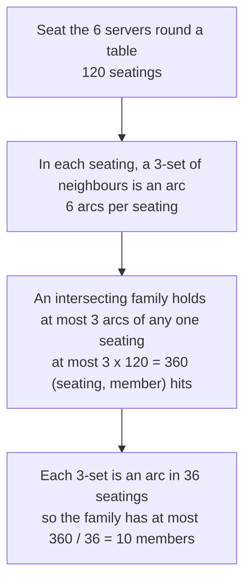

# Erdos-Ko-Rado: if every two k-sets in a family share a member, the family is no bigger than all k-sets through one point, provided n is at least 2k

[Syllabus](../../../SYLLABUS.md) → [Combinatorics and graphs](../README.md) → [Orders and Set Systems](../README.md#s15) → Erdos-Ko-Rado

---

## General Overview

A database runs on six servers, numbered 1 to 6. A write is approved by a group of three servers. The safety rule: any two approved groups must share a server, so that server can refuse the second of two conflicting writes. Such groups are called **quorums**.

How many groups can the approved list hold? There are $`C(6,3) = 20`$ groups of three ([Combinations, n choose k](../01-Counting%20Principles/05-n-choose-k.md)). They fall into 10 pairs of opposites: {1,2,3} and {4,5,6} share nobody, so at most one of each pair can be on the list. The list holds at most 10.

Ten is reached: take every group containing server 1. There are $`C(5,2) = 10`$ of them, and any two meet at server 1.

A list of sets all of size $`k`$ is a **family of k-sets**, also called a **k-uniform hypergraph** (a graph whose edges join $`k`$ points, not two). A family is **intersecting** when every two members share at least one point. The family of all k-sets through one fixed point is a **star**.

**If every two k-sets in a family share a point, and there are at least 2k points, the family is no bigger than a star: at most C(n−1, k−1) members.**

**What kind of fact this is:** a theorem of Erdős, Ko and Rado (1961), proved on this card in Why it works by Katona's circle argument (1972). The Kruskal–Katona theorem near the end is stated and checked on small cases, not proved.

### The picture: Katona's count in four moves



---

## The formula

Notation first, in words: $`n`$ is the number of points (servers), $`k`$ the size of every member, $`F`$ the family and $`\lvert F\rvert`$ its member count.

```math
\lvert F\rvert \le C(n-1,\,k-1) \quad \text{when } F \text{ is intersecting and } n \ge 2k
```

**Read it aloud:** an intersecting family of k-sets has at most as many members as there are ways to fill the other $`k-1`$ places once one point is fixed.

On the servers: $`C(5,2) = 10`$. The proof rests on one inequality from counting seatings round a table:

```math
\lvert F\rvert \times k!\,(n-k)! \le k \times (n-1)!
```

**Read it aloud:** each member shows up as a block of neighbours in $`k!\,(n-k)!`$ seatings, and each seating shows at most $`k`$ members.

With our numbers: $`\lvert F\rvert \times 36 \le 3 \times 120 = 360`$, so $`\lvert F\rvert \le 10`$. Dividing $`k\,(n-1)!`$ by $`k!\,(n-k)!`$ gives exactly $`C(n-1,k-1)`$.

| Symbol | Plain meaning | In our example | Push it up and the answer… |
| --- | --- | --- | --- |
| $`n`$ | how many points: the servers | 6 | the cap grows: 15 at 7 servers |
| $`k`$ | how many points each member holds | 3 | members clash less; at $`2k > n`$ every pair meets |
| $`F`$, $`\lvert F\rvert`$ | the family, and its member count | the approved list, at most 10 | — |
| $`C(n-1,\,k-1)`$ | the size of a star: k-sets through one point | $`C(5,2) = 10`$ | — |
| $`(n-1)!`$ | seatings round a table, turns counted as one | 120 | — |
| $`k!\,(n-k)!`$ | seatings in which one fixed k-set sits as a block | $`3! \times 3! = 36`$ | — |
| $`\partial F`$, $`\lvert\partial F\rvert`$ | the shadow: all $`(k-1)`$-sets inside some member, and their count | the star's shadow has 15 pairs | — |
| $`m`$; $`a, b, c`$ | a family size; its digits in the greedy split $`m = C(a,3) + C(b,2) + C(c,1)`$ | $`7 = C(4,3) + C(3,2)`$ | — |

### When it holds

- **At least 2k points.** Below that, two k-sets always meet: with 5 servers, all 10 groups of 3 meet, not the bound's 6.
- **Every member the same size.** Step 1 counts blocks of one length; mixed sizes need a different count.
- **The star is the unique winner only when n > 2k.** At 7 servers the largest families are exactly the 7 stars. At $`n = 2k`$ many families tie: 1,024 at 6 servers, of which only 6 are stars.

---

## Why it works

### Step 0: spread the family over seatings, then average

Katona's idea: seat the points round a table and look at the **arcs**: blocks of $`k`$ neighbours. A family holds few arcs of one seating, and every k-set is an arc equally often. Counting arcs over all seatings bounds the family.

### Step 1: count seatings and arcs

Seatings of 6 servers round a table, turns counted as one, number $`5! = 120`$ ([Round tables and bracelets](../02-Repeats%2C%20Groups%20and%20Double%20Counting/04-circular-arrangements.md)). Each has 6 arcs, one starting at each seat.

Glue {1,2,3} into one block: its servers sit in $`3! = 6`$ orders inside it. The block and the other 3 servers make 4 units round a table: $`3! = 6`$ seatings. So {1,2,3} is an arc in $`6 \times 6 = 36`$ of the 120 seatings. Every 3-set gets 36. This $`k!\,(n-k)!`$ also counts chains through a set on [Sperner's theorem](02-sperner-and-lym.md).

### Step 2: one seating holds at most k arcs of the family

Take the seating 1, 2, 3, 4, 5, 6 in order round the table. Its arcs are:

| Arc starts at | 1 | 2 | 3 | 4 | 5 | 6 |
| --- | --- | --- | --- | --- | --- | --- |
| The arc | 1,2,3 | 2,3,4 | 3,4,5 | 4,5,6 | 5,6,1 | 6,1,2 |

Suppose arc 1,2,3 is in the family. Every other arc meeting it ends or starts inside it. Pair the arc ending at a seat with the arc starting at the next seat: 5,6,1 with 2,3,4, and 6,1,2 with 3,4,5. Each pair is disjoint, so the family holds at most one. That leaves at most $`1 + 2 = 3`$ arcs. The star through server 1 holds exactly 3: 1,2,3 and 5,6,1 and 6,1,2.

<details>
<summary>Detailed proof: at most k arcs, for any n at least 2k</summary>

Number the seats $`0`$ to $`n-1`$ and suppose the arc on seats $`0, \dots, k-1`$ is in the family. Any arc meeting it, other than itself, either starts at a seat $`i`$ with $`1 \le i \le k-1`$, or ends at a seat $`i-1`$ with $`1 \le i \le k-1`$.

For each such $`i`$, the arc ending at seat $`i-1`$ covers seats $`i-k`$ to $`i-1`$, and the arc starting at seat $`i`$ covers seats $`i`$ to $`i+k-1`$. Together they cover $`2k`$ consecutive seats. When $`n \ge 2k`$ no seat is covered twice, so the two arcs are disjoint and at most one is in the family.

That is $`k-1`$ pairs, at most one arc from each, plus the first arc: at most $`k`$ arcs.

</details>

### Step 3: count the pairs two ways

Count the **hits**: pairs (seating, member of $`F`$ that is an arc of it). By seatings: at most $`3 \times 120 = 360`$. By members: each is an arc in 36 seatings, so exactly $`36 \times \lvert F\rvert`$. Hence $`36 \times \lvert F\rvert \le 360`$, and $`\lvert F\rvert \le 10`$. The star through server 1 makes 360 hits exactly, so the bound is reached.

### Step 4: why n must be at least 2k

With 5 servers and groups of 3, the Step 2 pairing breaks: arcs 1,2,3 and 3,4,5 share seat 3, so all 5 arcs of a seating meet, and all 10 groups meet.

At exactly $`n = 2k`$, opposite pairs give the bound too. The 20 groups make 10 opposite pairs, a family takes at most one from each, and any one-from-each choice works: $`2^{10} = 1{,}024`$ largest families. One of them is "every group holding at least two of servers 1, 2, 3": 10 groups, any two meet, and no server is in all of them.

The shelf's house example is the case $`n = 4`$, $`k = 2`$: of the 6 pairs from {1,2,3,4}, at most $`C(3,1) = 3`$ pairwise meet. Eight families reach 3: four stars, such as 12, 13, 14, and four triangles, such as 12, 13, 23.

### Step 5: shadows and the Kruskal–Katona theorem

The **shadow** $`\partial F`$ of a family of k-sets is every $`(k-1)`$-set inside some member. For groups of 3 servers: every pair that works together in some group.

How small can the shadow of $`m`$ members be? Put the k-sets in **colex order** (colexicographic: compare largest points first, so all sets inside {1,…,a} come before any set holding a larger point). The **Kruskal–Katona theorem** says the first $`m`$ sets in colex order have the smallest shadow. Write $`m`$ greedily as $`C(a,3) + C(b,2) + C(c,1)`$, each term as large as fits. Then:

```math
\lvert\partial F\rvert \ge C(a,2) + C(b,1) + C(c,0)
```

**Read it aloud:** lower every bottom number in the greedy split by one, and add up, skipping any term the split left unused.

For $`m = 7 = C(4,3) + C(3,2)`$ the shadow has at least $`C(4,2) + C(3,1) = 9`$ pairs. For $`m = 10 = C(5,3)`$, the first ten sets are all 3-sets of {1,…,5}, with 10 pairs in their shadow. The star through server 1 also has 10 members but 15 shadow pairs. The code checks every $`m`$ from 1 to 20.

---

## Worked numbers, by hand

| Step | Arithmetic | Value |
| --- | --- | --- |
| groups of 3 from 6 servers | $`C(6,3)`$ | 20 |
| seatings round a table | $`5!`$ | 120 |
| seatings with {1,2,3} as an arc | $`3! \times 3!`$ | 36 |
| arcs of one seating in the family | Step 2 pairing | at most 3 |
| hits, counted by seatings | $`3 \times 120`$ | 360 |
| largest family | $`360 / 36`$ | **10** |
| the star through server 1 | $`C(5,2)`$ | 10 |

### What breaks if you drop a piece

| Mistake | Comes out at | What went wrong |
| --- | --- | --- |
| Using the bound with 5 servers | 6, but all 10 groups meet | $`n < 2k`$: two groups of 3 cannot avoid each other |
| Assuming the largest family is a star | 6 stars, but 1,024 largest families | At $`n = 2k`$ any one-from-each-pair choice ties |
| Taking the star as the smallest shadow | 15 pairs, but 10 is possible | The first 10 sets in colex order do better |

The code prints all three.

---

## Code, from first principles, and it actually runs

Only `itertools` is imported. Three roads reach the cap of 10: a full search that also counts ties, Katona's count over 120 seatings, and opposite pairs. For Kruskal–Katona, a search over all $`2^{20}`$ families of 3-sets is checked against the greedy formula and colex order.

### Python

```python
# Erdos-Ko-Rado and shadows -- the check behind the card.  itertools lists subsets and orders;
# nothing else is imported.  A k-set is a bit pattern: bit i is on when point i + 1 is in it.
# Road one searches every family, road two is Katona's circle count, and Kruskal-Katona is searched.
from itertools import combinations, permutations
def C(n, k): return 0 if k < 0 or k > n else (1 if k == 0 else C(n - 1, k - 1) * n // k)
def ksets(n, k): return sorted(sum(1 << (p - 1) for p in s) for s in combinations(range(1, n + 1), k))
def best(sets):                    # largest family in which every two meet, and how many reach it
    memo = {}
    def go(left):                  # left: which of the sets are still allowed, as bits
        if left not in memo:
            live = [i for i in range(len(sets)) if left >> i & 1]
            clash = {i: sum(1 << j for j in live if sets[i] & sets[j] == 0) for i in live}
            v = max(live, key=lambda i: clash[i].bit_count(), default=None)
            if v is None or clash[v] == 0: return (len(live), 1)
            s1, c1 = go(left & ~(1 << v))                  # families without set v
            s2, c2 = go(left & ~(1 << v) & ~clash[v]); s2 += 1  # families with set v
            memo[left] = (s1, c1 + c2) if s1 == s2 else max((s1, c1), (s2, c2))
        return memo[left]
    return go((1 << len(sets)) - 1)
def circles(n): return [(1,) + p for p in permutations(range(2, n + 1))]
def arcs(o, k): return [sum(1 << (o[(s + j) % len(o)] - 1) for j in range(k)) for s in range(len(o))]
def stars(n, k, top): return sum(1 for p in range(n) if sum(1 for s in ksets(n, k) if s >> p & 1) == top)
def shadow(fam): return len({s & ~(1 << p) for s in fam for p in range(8) if s >> p & 1})  # (k-1)-sets inside
n, k = 6, 3; fact = lambda m: m * fact(m - 1) if m else 1
S = ksets(n, k); size, count = best(S); star = [s for s in S if s & 1]; pairs = {min(s, 63 - s) for s in S}
two = [s for s in S if (s & 7).bit_count() >= 2]; ok2 = all(a & b for a in two for b in two)
print(f"n = 6, k = 3: {len(S)} three-sets, the star through 1 holds C(5, 2) = {len(star)}")
print(f"largest intersecting family, by search: {size}; families reaching it: {count}; stars among them: {stars(n, k, size)}")
print(f"complementary pairs: {len(pairs)}; one set from each pair, any way: 2^{len(pairs)} = {2 ** len(pairs)}")
print(f"sets holding 2 of 1,2,3: {len(two)}; every two meet: {'yes' if ok2 else 'no'}; "
      f"a point in all: {'yes' if any(all(s >> p & 1 for s in two) for p in range(n)) else 'no'}")
circ = [arcs(o, k) for o in circles(n)]; in_arc = sum(1 for a in circ if 7 in a)
most = max(best(a)[0] for a in circ); star_arcs = sum(1 for a in circ for s in a if s & 1)
print(f"circles of 6: {len(circ)}; circles where 1,2,3 is an arc: {in_arc} = 3! x 3!")
print(f"most arcs of one circle that pairwise meet: {most} of {n}")
print(f"Katona: |F| x {in_arc} <= {most} x {len(circ)} = {most * len(circ)}, so |F| <= {most * len(circ) // in_arc}")
print(f"arcs from the star, over all {len(circ)} circles: {star_arcs}")
s7, c7 = best(ksets(7, 3)); s5 = best(ksets(5, 3))[0]; m5 = best(arcs(circles(5)[0], 3))[0]; s4, c4 = best(ksets(4, 2))
print(f"n = 7, k = 3: bound C(6, 2) = {C(6, 2)}; search: {s7}; families reaching it: {c7}; stars: {stars(7, 3, s7)}")
print(f"n = 5, k = 3: largest intersecting family {s5}; bound C(4, 2) = {C(4, 2)} fails; arcs of one circle meeting: {m5} of 5")
print(f"house, n = 4, k = 2: largest intersecting family of pairs {s4} = C(3, 1); families reaching it: {c4}; stars: {stars(4, 2, s4)}")
print(f"shadow of the star through 1: {shadow(star)} pairs; of the first 10 in colex: {shadow(S[:10])} pairs")
low, u = [99] * 21, [0] * (1 << 20)                  # u[f]: the shadow of family f, as bits
sh = [sum(1 << (s & ~(1 << p)) for p in range(n) if s >> p & 1) for s in S]
for f in range(1, 1 << 20):
    u[f] = u[f & (f - 1)] | sh[(f & -f).bit_length() - 1]
    low[f.bit_count()] = min(low[f.bit_count()], u[f].bit_count())
def kk(m, j):                      # write m greedily as C(a, j) + C(b, j - 1) + ..., lower each j by one
    if m == 0 or j == 0: return 0
    a = max(a for a in range(j, 40) if C(a, j) <= m)
    return C(a, j - 1) + kk(m - C(a, j), j - 1)
print(f"smallest shadow, search,  m = 1..20: {low[1:]}")
print(f"Kruskal-Katona formula,   m = 1..20: {[kk(m, 3) for m in range(1, 21)]}")
print(f"first m sets in colex,    m = 1..20: {[shadow(S[:m]) for m in range(1, 21)]}")
print(f"m = 7 = C(4, 3) + C(3, 2): smallest shadow C(4, 2) + C(3, 1) = {C(4, 2) + C(3, 1)}")
assert size == len(star) == most * len(circ) // in_arc and count == 2 ** len(pairs) and ok2
assert len(circ) == fact(n - 1) and in_arc == fact(k) * fact(n - k) and in_arc * len(S) == len(circ) * n and star_arcs == most * len(circ)  # (n-1)!, k!(n-k)!, double counting
assert (s7, c7) == (C(6, 2), stars(7, 3, s7)) and s5 == len(ksets(5, 3)) and m5 == 5 and (s4, c4) == (C(3, 1), 2 ** 3)
assert low[1:] == [kk(m, 3) for m in range(1, 21)] == [shadow(S[:m]) for m in range(1, 21)]
print("ALL CHECKS PASS")
```

**Ran 2026-11-23 on macOS, Python 3.14.10, standard library only. All checks passed. Output, pasted from the run:**

```
n = 6, k = 3: 20 three-sets, the star through 1 holds C(5, 2) = 10
largest intersecting family, by search: 10; families reaching it: 1024; stars among them: 6
complementary pairs: 10; one set from each pair, any way: 2^10 = 1024
sets holding 2 of 1,2,3: 10; every two meet: yes; a point in all: no
circles of 6: 120; circles where 1,2,3 is an arc: 36 = 3! x 3!
most arcs of one circle that pairwise meet: 3 of 6
Katona: |F| x 36 <= 3 x 120 = 360, so |F| <= 10
arcs from the star, over all 120 circles: 360
n = 7, k = 3: bound C(6, 2) = 15; search: 15; families reaching it: 7; stars: 7
n = 5, k = 3: largest intersecting family 10; bound C(4, 2) = 6 fails; arcs of one circle meeting: 5 of 5
house, n = 4, k = 2: largest intersecting family of pairs 3 = C(3, 1); families reaching it: 8; stars: 4
shadow of the star through 1: 15 pairs; of the first 10 in colex: 10 pairs
smallest shadow, search,  m = 1..20: [3, 5, 6, 6, 8, 9, 9, 10, 10, 10, 12, 13, 13, 14, 14, 14, 15, 15, 15, 15]
Kruskal-Katona formula,   m = 1..20: [3, 5, 6, 6, 8, 9, 9, 10, 10, 10, 12, 13, 13, 14, 14, 14, 15, 15, 15, 15]
first m sets in colex,    m = 1..20: [3, 5, 6, 6, 8, 9, 9, 10, 10, 10, 12, 13, 13, 14, 14, 14, 15, 15, 15, 15]
m = 7 = C(4, 3) + C(3, 2): smallest shadow C(4, 2) + C(3, 1) = 9
ALL CHECKS PASS
```

### Rust

Same numbers, same labels, built with `rustc --edition 2021 -O`.

```rust
// Erdos-Ko-Rado and shadows -- the same check as the Python, in Rust.  No crates.
// A k-set is a bit pattern: bit i is on when point i + 1 is in it.  Road one searches
// every family, road two is Katona's circle count, and Kruskal-Katona is searched.
use std::collections::{HashMap, HashSet};
fn c(n: i64, k: i64) -> i64 { if k < 0 || k > n { 0 } else if k == 0 { 1 } else { c(n - 1, k - 1) * n / k } }
fn ksets(n: u32, k: u32) -> Vec<u64> { (0..1u64 << n).filter(|s| s.count_ones() == k).collect() }
fn go(sets: &[u64], left: u64, memo: &mut HashMap<u64, (usize, u64)>) -> (usize, u64) {
    if let Some(&r) = memo.get(&left) { return r; }      // largest family in which every two meet, and how many
    let live: Vec<usize> = (0..sets.len()).filter(|&i| left >> i & 1 == 1).collect();
    let clash = |i: usize| live.iter().filter(|&&j| sets[i] & sets[j] == 0).fold(0u64, |a, &j| a | 1 << j);
    let v = match live.iter().copied().max_by_key(|&i| (clash(i).count_ones(), usize::MAX - i)) {
        Some(v) if clash(v) != 0 => v, _ => return (live.len(), 1) };
    let (s1, c1) = go(sets, left & !(1 << v), memo);                 // families without set v
    let (s2, c2) = go(sets, left & !(1 << v) & !clash(v), memo);     // families with set v
    let r = if s1 == s2 + 1 { (s1, c1 + c2) } else if s1 > s2 + 1 { (s1, c1) } else { (s2 + 1, c2) };
    memo.insert(left, r); r
}
fn best(sets: &[u64]) -> (usize, u64) { go(sets, (1u64 << sets.len()) - 1, &mut HashMap::new()) }
fn circles(n: u64) -> Vec<Vec<u64>> {                                 // every order of 1..n with 1 first
    if n == 1 { return vec![vec![1]]; }
    let mut out = vec![];
    for o in circles(n - 1) { for i in 1..=o.len() { let mut p = o.clone(); p.insert(i, n); out.push(p); } }
    out.sort(); out
}
fn arcs(o: &[u64], k: usize) -> Vec<u64> {
    (0..o.len()).map(|s| (0..k).fold(0, |a, j| a | 1 << (o[(s + j) % o.len()] - 1))).collect()
}
fn stars(n: u32, k: u32, top: usize) -> usize { (0..n).filter(|p| ksets(n, k).iter().filter(|&&s| s >> p & 1 == 1).count() == top).count() }
fn shadow(fam: &[u64]) -> usize {                                     // (k-1)-sets inside some member
    fam.iter().flat_map(|&s| (0..8).filter(move |p| s >> p & 1 == 1).map(move |p| s & !(1 << p))).collect::<HashSet<u64>>().len()
}
fn kk(m: i64, j: i64) -> i64 {     // write m greedily as C(a, j) + C(b, j - 1) + ..., lower each j by one
    if m == 0 || j == 0 { return 0; }
    let a = (j..40).filter(|&a| c(a, j) <= m).max().unwrap();
    c(a, j - 1) + kk(m - c(a, j), j - 1)
}
fn yn(b: bool) -> &'static str { if b { "yes" } else { "no" } }
fn main() {
    let (n, k) = (6u32, 3u32); let fact = |m: u32| (1..=m as usize).product::<usize>();
    let s = ksets(n, k); let (size, count) = best(&s);
    let star: Vec<u64> = s.iter().copied().filter(|x| x & 1 == 1).collect();
    let pairs: HashSet<u64> = s.iter().map(|&x| x.min(63 - x)).collect();
    let two: Vec<u64> = s.iter().copied().filter(|x| (x & 7).count_ones() >= 2).collect();
    let ok2 = two.iter().all(|a| two.iter().all(|b| a & b != 0));
    let common = (0..n).any(|p| two.iter().all(|x| x >> p & 1 == 1));
    println!("n = 6, k = 3: {} three-sets, the star through 1 holds C(5, 2) = {}", s.len(), star.len());
    println!("largest intersecting family, by search: {}; families reaching it: {}; stars among them: {}", size, count, stars(n, k, size));
    println!("complementary pairs: {}; one set from each pair, any way: 2^{} = {}", pairs.len(), pairs.len(), 1u64 << pairs.len());
    println!("sets holding 2 of 1,2,3: {}; every two meet: {}; a point in all: {}", two.len(), yn(ok2), yn(common));
    let circ: Vec<Vec<u64>> = circles(6).iter().map(|o| arcs(o, 3)).collect();
    let in_arc = circ.iter().filter(|a| a.contains(&7)).count();
    let most = circ.iter().map(|a| best(a).0).max().unwrap();
    let star_arcs = circ.iter().flatten().filter(|&&x| x & 1 == 1).count();
    println!("circles of 6: {}; circles where 1,2,3 is an arc: {} = 3! x 3!", circ.len(), in_arc);
    println!("most arcs of one circle that pairwise meet: {} of {}", most, n);
    println!("Katona: |F| x {} <= {} x {} = {}, so |F| <= {}", in_arc, most, circ.len(), most * circ.len(), most * circ.len() / in_arc);
    println!("arcs from the star, over all {} circles: {}", circ.len(), star_arcs);
    let (s7, c7) = best(&ksets(7, 3)); let s5 = best(&ksets(5, 3)).0; let m5 = best(&arcs(&circles(5)[0], 3)).0; let (s4, c4) = best(&ksets(4, 2));
    println!("n = 7, k = 3: bound C(6, 2) = {}; search: {}; families reaching it: {}; stars: {}", c(6, 2), s7, c7, stars(7, 3, s7));
    println!("n = 5, k = 3: largest intersecting family {}; bound C(4, 2) = {} fails; arcs of one circle meeting: {} of 5", s5, c(4, 2), m5);
    println!("house, n = 4, k = 2: largest intersecting family of pairs {} = C(3, 1); families reaching it: {}; stars: {}", s4, c4, stars(4, 2, s4));
    println!("shadow of the star through 1: {} pairs; of the first 10 in colex: {} pairs", shadow(&star), shadow(&s[..10]));
    let sh: Vec<u64> = s.iter().map(|&x| (0..n).filter(|p| x >> p & 1 == 1).fold(0u64, |a, p| a | 1 << (x & !(1 << p)))).collect();
    let (mut low, mut u) = (vec![99u32; 21], vec![0u64; 1 << 20]);   // u[f]: the shadow of family f, as bits
    for f in 1usize..1 << 20 {
        u[f] = u[f & (f - 1)] | sh[f.trailing_zeros() as usize];
        let m = f.count_ones() as usize; low[m] = low[m].min(u[f].count_ones());
    }
    let formula: Vec<i64> = (1..21).map(|m| kk(m, 3)).collect();
    let colex: Vec<usize> = (1..21).map(|m| shadow(&s[..m])).collect();
    println!("smallest shadow, search,  m = 1..20: {:?}", &low[1..]);
    println!("Kruskal-Katona formula,   m = 1..20: {:?}", formula);
    println!("first m sets in colex,    m = 1..20: {:?}", colex);
    println!("m = 7 = C(4, 3) + C(3, 2): smallest shadow C(4, 2) + C(3, 1) = {}", c(4, 2) + c(3, 1));
    assert!(size == star.len() && star.len() == most * circ.len() / in_arc && count == 1u64 << pairs.len() && ok2);
    assert!(circ.len() == fact(n - 1) && in_arc == fact(k) * fact(n - k) && in_arc * s.len() == circ.len() * n as usize && star_arcs == most * circ.len());   // (n-1)!, k!(n-k)!, double counting
    assert!(s7 as i64 == c(6, 2) && c7 as usize == stars(7, 3, s7) && s5 == ksets(5, 3).len() && m5 == 5 && s4 as i64 == c(3, 1) && c4 == 8);
    assert!(low[1..].iter().zip(&formula).zip(&colex).all(|((&a, &b), &d)| a as i64 == b && b as usize == d));
    println!("ALL CHECKS PASS");
}
```

**Ran 2026-11-23 on macOS, rustc 1.98.1, no crates. All checks passed. Output, pasted from the run:**

```
n = 6, k = 3: 20 three-sets, the star through 1 holds C(5, 2) = 10
largest intersecting family, by search: 10; families reaching it: 1024; stars among them: 6
complementary pairs: 10; one set from each pair, any way: 2^10 = 1024
sets holding 2 of 1,2,3: 10; every two meet: yes; a point in all: no
circles of 6: 120; circles where 1,2,3 is an arc: 36 = 3! x 3!
most arcs of one circle that pairwise meet: 3 of 6
Katona: |F| x 36 <= 3 x 120 = 360, so |F| <= 10
arcs from the star, over all 120 circles: 360
n = 7, k = 3: bound C(6, 2) = 15; search: 15; families reaching it: 7; stars: 7
n = 5, k = 3: largest intersecting family 10; bound C(4, 2) = 6 fails; arcs of one circle meeting: 5 of 5
house, n = 4, k = 2: largest intersecting family of pairs 3 = C(3, 1); families reaching it: 8; stars: 4
shadow of the star through 1: 15 pairs; of the first 10 in colex: 10 pairs
smallest shadow, search,  m = 1..20: [3, 5, 6, 6, 8, 9, 9, 10, 10, 10, 12, 13, 13, 14, 14, 14, 15, 15, 15, 15]
Kruskal-Katona formula,   m = 1..20: [3, 5, 6, 6, 8, 9, 9, 10, 10, 10, 12, 13, 13, 14, 14, 14, 15, 15, 15, 15]
first m sets in colex,    m = 1..20: [3, 5, 6, 6, 8, 9, 9, 10, 10, 10, 12, 13, 13, 14, 14, 14, 15, 15, 15, 15]
m = 7 = C(4, 3) + C(3, 2): smallest shadow C(4, 2) + C(3, 1) = 9
ALL CHECKS PASS
```

The two outputs match line for line.

### Lean

Lean proves the card's three general claims for every number of points $`n`$ and set size $`k`$, not just six servers.

- Suppose a family of k-sets is intersecting, and $`n \ge 2k`$. Then it has at most $`C(n-1,k-1)`$ members.
- Take $`k`$ at least 1 and any point. Then the star through that point is an intersecting family of k-sets with exactly $`C(n-1,k-1)`$ members.
- Take any family of $`m`$ k-sets. Then its shadow is at least as big as the shadow of the first $`m`$ k-sets in colex order.
- The worked numbers hold exactly: the 20 groups, the star of 10, and Katona's 120, 36 and 360.
- So do the five-server case, the family holding two of servers 1, 2, 3, and the shadows of 15 and 10 pairs.

Counting all the largest families, at 6 and 7 servers, and the greedy shadow formula are left to the Python and Rust checks.

```lean
-- Erdos-Ko-Rado: an intersecting family of k-sets on n ≥ 2k points has at most C(n-1, k-1) members, the star reaches it, and initial colex segments have the smallest shadow.
import Mathlib.Combinatorics.SetFamily.KruskalKatona

open Finset
open scoped FinsetFamily

/-- **Erdős–Ko–Rado.** Take `n` points (here `Fin n`) and a family `𝒜` of sets that all have
`k` members. If every two members of the family share a point, and `n ≥ 2k`, then the family has
at most `C(n - 1, k - 1)` members: no more than the star of all `k`-sets through one point. -/
theorem erdos_ko_rado_intersecting_family_le_star {n k : ℕ} {𝒜 : Finset (Finset (Fin n))}
    (hinter : (𝒜 : Set (Finset (Fin n))).Intersecting)
    (hsize : (𝒜 : Set (Finset (Fin n))).Sized k)
    (hn : 2 * k ≤ n) :
    #𝒜 ≤ (n - 1).choose (k - 1) := by
  exact erdos_ko_rado hinter hsize (by omega)

/-- **The bound is reached by a star.** For `k ≥ 1` and any point `a` among `n` points, the star
of all `k`-sets containing `a` is an intersecting family of `k`-sets with exactly
`C(n - 1, k - 1)` members. -/
theorem star_intersecting_and_card_eq {n k : ℕ} (hk : 1 ≤ k) (a : Fin n) :
    (((univ.powersetCard k).filter (fun s => a ∈ s) : Finset (Finset (Fin n))) :
        Set (Finset (Fin n))).Intersecting ∧
      (((univ.powersetCard k).filter (fun s => a ∈ s) : Finset (Finset (Fin n))) :
        Set (Finset (Fin n))).Sized k ∧
      #((univ.powersetCard k).filter (fun s => a ∈ s) : Finset (Finset (Fin n))) =
        (n - 1).choose (k - 1) := by
  refine ⟨?_, ?_, ?_⟩
  · intro s hs t ht hst
    simp only [coe_filter, Set.mem_ofPred_eq] at hs ht
    exact Finset.disjoint_left.1 hst hs.2 ht.2
  · intro s hs
    simp only [coe_filter, Set.mem_ofPred_eq, mem_powersetCard_univ] at hs
    exact hs.1
  · have h := card_filter_powersetCard_subset ({a} : Finset (Fin n)) univ k (subset_univ _)
      (by simpa using hk)
    simp only [singleton_subset_iff, card_univ, Fintype.card_fin, card_singleton] at h
    exact h

/-- **Kruskal–Katona.** Among all families of `k`-sets on `n` points with the same number of
members, the first ones in colex order (an initial segment of colex) have the smallest shadow:
the fewest `(k - 1)`-sets lying inside some member. -/
theorem kruskal_katona_colex_smallest_shadow {n k : ℕ} {𝒜 𝒞 : Finset (Finset (Fin n))}
    (hsize : (𝒜 : Set (Finset (Fin n))).Sized k)
    (hcolex : Colex.IsInitSeg 𝒞 k)
    (hcard : #𝒞 = #𝒜) :
    #(∂ 𝒞) ≤ #(∂ 𝒜) := by
  exact kruskal_katona hsize hcard.le hcolex

/-! The card's worked numbers. Points are numbered `0, …, n - 1` here, so the card's server 1
is point `0`. -/

-- Six servers, groups of three: 20 groups, and the star through one server holds C(5, 2) = 10.
example : Nat.choose 6 3 = 20 := by decide
example : Nat.choose 5 2 = 10 := by decide
example : #((univ.powersetCard 3).filter (fun s => (0 : Fin 6) ∈ s)) = 10 := by decide

-- Katona's count: 5! = 120 seatings, 3! × 3! = 36 seatings per arc, 3 × 120 = 360 hits, 360 / 36 = 10.
example : Nat.factorial 5 = 120 := by decide
example : Nat.factorial 3 * Nat.factorial 3 = 36 := by decide
example : 3 * Nat.factorial 5 = 360 ∧ 360 / 36 = 10 := by decide
example : 3 * Nat.factorial 5 / (Nat.factorial 3 * Nat.factorial 3) = Nat.choose 5 2 := by decide

-- Five servers, groups of three: all C(5, 3) = 10 groups meet pairwise, more than C(4, 2) = 6.
example : ∀ A ∈ (univ : Finset (Fin 5)).powersetCard 3,
    ∀ B ∈ (univ : Finset (Fin 5)).powersetCard 3, ¬ Disjoint A B := by decide
example : #((univ : Finset (Fin 5)).powersetCard 3) = 10 ∧ Nat.choose 4 2 = 6 := by decide

-- The groups holding at least two of servers 1, 2, 3: 10 groups, every two meet, no common server.
example :
    #((univ.powersetCard 3).filter
      (fun s : Finset (Fin 6) => 2 ≤ #(s ∩ {0, 1, 2}))) = 10 := by decide
example : ∀ A ∈ (univ.powersetCard 3).filter
      (fun s : Finset (Fin 6) => 2 ≤ #(s ∩ {0, 1, 2})),
    ∀ B ∈ (univ.powersetCard 3).filter
      (fun s : Finset (Fin 6) => 2 ≤ #(s ∩ {0, 1, 2})), ¬ Disjoint A B := by decide
example : ¬ ∃ p : Fin 6, ∀ A ∈ (univ.powersetCard 3).filter
      (fun s : Finset (Fin 6) => 2 ≤ #(s ∩ {0, 1, 2})), p ∈ A := by decide

-- At n = 2k = 6: 10 opposite pairs, so 2 ^ 10 = 1024 ways to take one group from each.
example : Nat.choose 6 3 / 2 = 10 ∧ 2 ^ 10 = 1024 := by decide

-- House example, n = 4, k = 2: 6 pairs, at most C(3, 1) = 3 pairwise meeting.
example : Nat.choose 4 2 = 6 ∧ Nat.choose 3 1 = 3 := by decide

-- Shadows: the star through server 1 has 15 pairs in its shadow; all 3-sets of the first five
-- servers (the first 10 in colex order) have 10.
example : #(∂ ((univ.powersetCard 3).filter (fun s => (0 : Fin 6) ∈ s))) = 15 := by decide
example : #(∂ ((univ.filter (fun i : Fin 6 => i < 5)).powersetCard 3)) = 10 := by decide

-- Kruskal-Katona's greedy split: 7 = C(4, 3) + C(3, 2), so the shadow has at least C(4, 2) + C(3, 1) = 9.
example : 7 = Nat.choose 4 3 + Nat.choose 3 2 ∧ Nat.choose 4 2 + Nat.choose 3 1 = 9 := by decide

#print axioms erdos_ko_rado_intersecting_family_le_star
#print axioms star_intersecting_and_card_eq
#print axioms kruskal_katona_colex_smallest_shadow
```

**Checked 2026-11-23 on macOS, Lean 4.36.0-rc2, Mathlib v4.36.0-rc2. Every proof is complete and uses only Lean's standard axioms. Output, pasted from the run:**

```
'erdos_ko_rado_intersecting_family_le_star' depends on axioms: [propext, Classical.choice, Quot.sound]
'star_intersecting_and_card_eq' depends on axioms: [propext, Classical.choice, Quot.sound]
'kruskal_katona_colex_smallest_shadow' depends on axioms: [propext, Classical.choice, Quot.sound]
```

> [!TIP]
> **Try changing**
> Guess first, then run it. The asserts are pinned to the card's numbers.
> - **Loosen the two-of-three rule.** Change `>= 2` in the line that builds `two` to `>= 1`. Guess first: do the 19 groups still meet pairwise? No: {1,4,5} and {2,3,6} share nobody, and the first assert stops it.
> - **Shadow of the last ten.** Change `shadow(S[:10])` to `shadow(S[-10:])`. Guess first: the last ten are the star through server 6, so the shadow is 15 pairs.
> - **Seat seven, not five.** Change `circles(5)` to `circles(7)`. Guess first: with $`n \ge 2k`$ the pairing of Step 2 works, so only 3 arcs meet pairwise. The line reads "3 of 5" (the label stays) and the third assert stops it.

---

## The usual mistake

> [!warning]
> **Using the bound when the sets are more than half the points.** With 5 servers, all 10 groups of 3 meet. The bound $`C(4,2) = 6`$ needs $`n \ge 2k`$.
>
> - **Assuming every largest family is a star.** At 6 servers, 1,024 families reach 10 and only 6 of them are stars. Only for $`n > 2k`$ is the star the single shape.
> - **Forgetting to divide by the seatings per set.** 3 arcs in each of 120 seatings gives 360 hits, not a family size: each member counts 36 times.
> - **Taking the star as the family with the smallest shadow.** Ten groups through one server touch 15 pairs; the first ten in colex order touch 10.

---

## Where you meet it in real life

- **Distributed databases.** Quorums must overlap pairwise. Majority groups (3 of 5) always do. Smaller ones do not: at 7 servers with groups of 3, the largest safe lists (15 groups) are the 7 stars, so one server is in every group: a single point of failure.
- **Voting rules.** A rule is proper when two winning coalitions always overlap, so opposite motions cannot both pass. With coalitions of one size below half the voters, reaching the cap needs one voter in every coalition: a veto.
- **Triangulated shapes.** A shape glued from triangles (a simplicial complex) includes every edge of every triangle: the shadow. Kruskal–Katona says which counts of points, edges and triangles are possible at all; 10 triangles need at least 10 edges.

> **Say it back**
> A family of k-sets is intersecting when every two members share a point. Seat the n points round a table: one seating shows at most k members as blocks of neighbours, and each k-set is such a block in $`k!\,(n-k)!`$ seatings. Counting both ways caps the family at $`C(n-1,k-1)`$, the size of a star, when $`n \ge 2k`$. For six servers and groups of three that cap is 10. Below $`n = 2k`$ every two k-sets meet and the cap fails; the shadow of a family is smallest when it is an early block in colex order.

---

## What this builds on

- [Sperner's theorem](02-sperner-and-lym.md): the same proof shape, averaging over orders, with chains there and seatings here.
- [Combinations, n choose k](../01-Counting%20Principles/05-n-choose-k.md): the counts $`C(6,3) = 20`$ and $`C(5,2) = 10`$.
- [Round tables and bracelets](../02-Repeats%2C%20Groups%20and%20Double%20Counting/04-circular-arrangements.md): the $`(n-1)! = 120`$ seatings.

## Where this goes next

- [Simplicial complexes and chains](../../17-Topology/05-Homology/01-simplicial-complexes-and-chains.md): triangles glued along their edges, where shadows are the faces Kruskal–Katona counts.
- [Sunflowers and union-closed families](../../25-Frontier/04-Geometry%20and%20Combinatorics/05-sunflower-and-union-closed-conjectures.md): two open questions about families of sets.

The card leaves open how large an intersecting family can be when no point lies in every member, the question the Hilton–Milner theorem answers.

---

## Sources

Verified 2026-11-23: every link below resolves to the publisher's page.

- Erdős, P., Chao Ko and R. Rado. "Intersection theorems for systems of finite sets." *Quarterly Journal of Mathematics* 12 (1961), 313–320. [doi:10.1093/qmath/12.1.313](https://doi.org/10.1093/qmath/12.1.313). The original theorem and its condition on n.
- Katona, G. O. H. "A simple proof of the Erdős–Chao Ko–Rado theorem." *Journal of Combinatorial Theory, Series B* 13 (1972), 183–184. [doi:10.1016/0095-8956(72)90054-8](https://doi.org/10.1016/0095-8956%2872%2990054-8). The circle argument used in Why it works.
- Frankl, P. "A new short proof for the Kruskal–Katona theorem." *Discrete Mathematics* 48 (1984), 327–329. [doi:10.1016/0012-365X(84)90193-6](https://doi.org/10.1016/0012-365X%2884%2990193-6). A short proof of the shadow theorem stated here.
- van Lint, J. H., and R. M. Wilson. *A Course in Combinatorics*, 2nd ed. Cambridge University Press, 2001. [Publisher page](https://doi.org/10.1017/CBO9780511987045). Chapter 6 covers extremal set theory.
