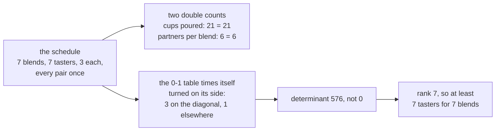

# Block designs: v points in b blocks of size k with every pair together exactly lambda times, two counts any design must obey, and Fisher's inequality that blocks never number fewer than points when k is below v, v at least 2 and lambda at least 1

[Syllabus](../../../SYLLABUS.md) → [Combinatorics and graphs](../README.md) → [Designs](../README.md#s16) → Block designs

---

## General Overview

A coffee roaster has 7 new blends, numbered 1 to 7, and wants each pair compared side by side. A taster's palate dulls after 3 cups, so no one can taste all 7. The fair plan: every pair of blends lands in front of the same taster exactly once, so no pair gets more attention than another.

Seven tasters, A to G, do it:

| Taster | A | B | C | D | E | F | G |
| --- | --- | --- | --- | --- | --- | --- | --- |
| Blends tasted | 1, 2, 4 | 2, 3, 5 | 3, 4, 6 | 4, 5, 7 | 5, 6, 1 | 6, 7, 2 | 7, 1, 3 |

Pick any two blends, say 3 and 6: only taster C has both. Each taster covers 3 pairs, and 7 tasters cover 21 pairs, which is every pair of 7 blends exactly once. This schedule is the **Fano plane**, the smallest projective plane: any two points lie on exactly one line, and any two lines meet in exactly one point. Blends are its points and tasters its lines.

A schedule like this is a **block design**: things to compare, called **points**, sorted into groups of equal size, called **blocks**, so that every pair of points shares a block the same number of times. The statistician R. A. Fisher needed them for farm trials, where a field strip holds too few plots for every crop variety. In 1940 he proved the fact this card ends on: a design never has fewer blocks than points.

**In a block design two double counts fix how often each point appears and how many blocks there are, and a matrix-rank argument proves the blocks can never be fewer than the points.**

**What kind of fact this is:** a definition (the block design), two counting identities and Fisher's inequality, all theorems proved on this card in Why it works.

### The picture: from the schedule to Fisher



---

## The formula

A **2-(v, k, λ) design** is a set of $`v`$ points and a list of $`b`$ blocks, each block holding $`k`$ of the points, such that every pair of distinct points sits together in exactly $`\lambda`$ blocks (λ is the Greek letter lambda). The "2" says the rule is about pairs. The schedule above is a 2-(7, 3, 1) design.

Each point then lies in the same number of blocks, $`r`$, and the four numbers obey two counts:

```math
bk = vr \qquad\qquad r(k-1) = \lambda(v-1)
```

**Read it aloud:** blocks times block size equals points times blocks per point; and the partners one point meets, counted through its blocks, equal its partners counted pair by pair.

For the blends: 7 × 3 = 7 × 3 = 21 cups poured, and 3 × 2 = 1 × 6 = 6 partners for each blend.

Write the design as a table of 0s and 1s, the **incidence matrix** $`N`$: one row per point, one column per block, a 1 where the point is in the block. $`N^T`$ is its transpose, the same table turned on its side. Then

```math
NN^T = (r-\lambda)I + \lambda J \qquad\Longrightarrow\qquad b \ge v
```

**Read it aloud:** the matrix N times its transpose has r down the diagonal and λ everywhere else, and from that alone the blocks number at least the points.

The second statement is **Fisher's inequality**. For the blends, $`NN^T = 2I + J`$: 3 on the diagonal, 1 everywhere else.

| Symbol | Plain meaning | In our example | Push it up and the answer… |
| --- | --- | --- | --- |
| $`v`$ | points: the things compared | 7 blends | Fisher demands more blocks |
| $`b`$ | blocks: the groups | 7 tasters | — |
| $`k`$ | block size: points per block | 3 cups each | fewer blocks needed, $`b = vr/k`$ |
| $`r`$ | blocks through each point | each blend tasted 3 times | more cups poured |
| $`\lambda`$ | blocks through each pair | 1 | $`r`$ rises with it |
| $`N`$, $`N^T`$ | the 0-1 incidence matrix, and the same table turned on its side | 7 rows, 7 columns | — |
| $`I`$, $`J`$ | the identity matrix (1 on the diagonal, 0 elsewhere) and the all-ones matrix, both $`v`$ by $`v`$ | 7 by 7 | — |
| $`\det`$, rank | the determinant, and the number of independent rows | $`\det NN^T = 576`$, rank 7 | — |

### When it holds

- **Every pair exactly λ times.** "At most λ times" is a weaker object, a packing: drop one taster and some pairs never meet, Step 3's matrix loses its shape, and Fisher's bound no longer applies.
- **Blocks all the same size.** Mixed sizes break $`bk = vr`$, since there is no single $`k`$ to multiply by.
- **Blocks smaller than the whole set, $`k < v`$.** Then $`r > \lambda`$ and the determinant is not 0. One taster given all 7 blends is a design with $`r = \lambda = 1`$, and $`b = 1 < 7`$.
- **λ at least 1.** With $`\lambda = 0`$ no block can hold two points, so the pair rule says nothing, and Step 4's ratio $`r/\lambda`$ divides by 0.
- **At least 2 points ($`v \ge 2`$).** With fewer than two points there are no pairs to test. One point with no blocks and $`k = 0`$ meets $`k < v`$ and $`\lambda \ge 1`$, yet has $`b = 0 < v`$.

---

## Why it works

### Step 0: count one collection two ways

Each identity counts one collection of things twice, by rows and by columns ([Bijections and double counting](../02-Repeats%2C%20Groups%20and%20Double%20Counting/05-bijection-and-double-counting.md)). Fisher's inequality then turns the identities into a matrix whose determinant cannot be 0.

### Step 1: cups poured, b k = v r

Count every (blend, taster) pairing where the taster has that blend: every cup poured.

- By tasters: 7 tasters, 3 cups each, 21 cups.
- By blends: 7 blends, $`r`$ cups each, $`7r`$ cups.

So $`7r = 21`$ and $`r = 3`$. In general $`bk = vr`$. This step needs only equal block sizes; Step 2 shows every point gets the same $`r`$.

### Step 2: partners met, r(k − 1) = λ(v − 1)

Fix blend 1 and count pairs (other blend, taster) where the taster has both.

- By tasters: blend 1 sits in $`r`$ blocks, and each holds $`k - 1 = 2`$ other blends: $`2r`$.
- By other blends: each of the 6 others meets blend 1 in exactly $`\lambda = 1`$ block: 6.

So $`2r = 6`$ and $`r = 3`$ again. The right side, $`\lambda(v-1)`$, does not depend on which blend was fixed, so every point lies in the same number of blocks: $`r = \lambda(v-1)/(k-1)`$. That is why $`r`$ must be a whole number.

### Step 3: the matrix N N^T

Each entry of $`NN^T`$ takes one blend's row of $`N`$, multiplies it place by place against another blend's row, and adds. A product is 1 only where both rows hold a 1: a block containing both blends.

- On the diagonal, a blend against itself: the blocks through one point, $`r = 3`$.
- Off it: the blocks through a pair, $`\lambda = 1`$.

So $`NN^T`$ has 3 down the diagonal and 1 elsewhere, which is $`2I + J`$.

### Step 4: its determinant is not zero

For any $`v`$ by $`v`$ matrix of this shape,

```math
\det\big((r-\lambda)I + \lambda J\big) = (r-\lambda)^{v-1}\,\big(r + (v-1)\lambda\big) = (r-\lambda)^{v-1}\,rk
```

The last step uses Step 2: $`r + \lambda(v-1) = r + r(k-1) = rk`$. For the blends: $`2^6 \times 9 = 576`$. The proof is two rounds of row and column moves, in the fold.

When $`k < v`$, Step 2 gives $`r/\lambda = (v-1)/(k-1) > 1`$, so $`r - \lambda > 0`$ and the determinant is positive ([Determinants](../../03-Algebra/05-Solving%20Systems/04-determinants.md)).

<details>
<summary>Detailed proof: the determinant of (r − λ)I + λJ</summary>

Start from $`(r-\lambda)I + \lambda J`$: $`r`$ on the diagonal, $`\lambda`$ elsewhere. Subtracting one row from another leaves a determinant unchanged, and so does adding one column to another.

Subtract row 1 from every other row. Row $`i`$ now holds $`\lambda - r`$ in column 1, $`r - \lambda`$ in column $`i`$, and 0 elsewhere.

Add every other column to column 1. Row 1's first entry becomes $`r + (v-1)\lambda`$. In row $`i`$ the $`\lambda - r`$ and the $`r - \lambda`$ cancel, so column 1 is 0 below the top.

Now every entry below the diagonal is 0, so the determinant is the product of the diagonal:

$`\displaystyle \det\big((r-\lambda)I + \lambda J\big) = \big(r + (v-1)\lambda\big)\,(r-\lambda)^{v-1}`$

</details>

### Step 5: rank forces b ≥ v

A $`v`$ by $`v`$ matrix with nonzero determinant has rank $`v`$: all its rows are independent ([Rank and nullity](../../03-Algebra/05-Solving%20Systems/05-rank-nullity.md)).

Every column of $`NN^T`$ is a mix of the columns of $`N`$, so the rank of $`NN^T`$ is at most the rank of $`N`$. And $`N`$ has only $`b`$ columns, so its rank is at most $`b`$. Chain them:

```math
v = \mathrm{rank}(NN^T) \le \mathrm{rank}(N) \le b
```

For the blends, 7 ≤ 7: the Fano plane uses the fewest tasters any 7-blend design can. A design with $`b = v`$ is called **symmetric**.

---

## Worked numbers, by hand

| Step | Arithmetic | Value |
| --- | --- | --- |
| cups poured | b k = 7 × 3, v r = 7 × 3 | 21 = 21 |
| partners per blend | r(k − 1) = 3 × 2, λ(v − 1) = 1 × 6 | 6 = 6 |
| pairs covered | 3 pairs per taster × 7 tasters | 21, all of them |
| first row of N N^T | blend 1 alone, then with each other blend | 3, 1, 1, 1, 1, 1, 1 |
| determinant | (r − λ)^6 × r k = 2^6 × 9 | 576 |
| determinant of N | 24, and 24 × 24 | 576 |
| rank, then Fisher | 576 is not 0 | **rank 7, so b = 7 ≥ 7** |

The Fano plane meets Fisher's bound exactly: no fair 7-blend schedule can use fewer than 7 tasters.

### What breaks if you drop a piece

| Mistake | Comes out at | What went wrong |
| --- | --- | --- |
| Asking for (v, k, λ) = (8, 3, 1) | r = 7/2 = 3.5 | Step 2 needs a whole number: no such design |
| Trusting the counts alone for (16, 6, 1) | r = 3, b = 8, both whole | Fisher needs b ≥ 16: no such design |
| Reading Fisher into k = v | one block of all 7, det N N^T = 0 | r = λ, so the rank argument has nothing to say |

The code prints all three.

---

## Code, from first principles, and it actually runs

Nothing is imported. The code builds the incidence matrix from the schedule. It checks the counts two ways: read straight off the table, and from $`bk = vr`$ and $`r(k-1) = \lambda(v-1)`$. It finds the determinant of $`NN^T`$ three independent ways: by exact whole-number elimination, as the square of $`\det N`$, and from the closed form. A fourth check runs the closed form against elimination on 196 small cases.

### Python

```python
# Block designs and Fisher's inequality -- the check behind the card.  Nothing
# is imported.  The design is the Fano plane: 7 blends, 7 tasters, 3 blends
# each.  The counts are read off the schedule and from the two formulas; the
# determinant of N N^T is found three ways: by elimination, as (det N)^2 and
# from the closed form (r - lambda)^(v - 1) x r k.
LINES = [(1, 2, 4), (2, 3, 5), (3, 4, 6), (4, 5, 7), (5, 6, 1), (6, 7, 2), (7, 1, 3)]
v, b, k = 7, len(LINES), 3

def det(m):                                     # exact whole-number elimination (Bareiss)
    a, n, sign, prev = [row[:] for row in m], len(m), 1, 1
    for i in range(n):
        p = next((r for r in range(i, n) if a[r][i] != 0), None)
        if p is None:
            return 0                            # no pivot left: the matrix is flat
        if p != i:
            a[i], a[p], sign = a[p], a[i], -sign
        for r in range(i + 1, n):
            for c in range(i + 1, n):
                a[r][c] = (a[r][c] * a[i][i] - a[r][i] * a[i][c]) // prev
        prev = a[i][i]
    return sign * a[n - 1][n - 1]

def gram(n_mat):                                # N times N transposed
    return [[sum(x * y for x, y in zip(p, q)) for q in n_mat] for p in n_mat]

def counts(v, k, lam):                          # the two counts solved for r, then b = v r / k
    r = lam * (v - 1) / (k - 1)
    return r, v * r / k

N = [[1 if x in line else 0 for line in LINES] for x in range(1, v + 1)]
r_seen = sorted({sum(row) for row in N})        # road one: read the schedule
pairs = {(x, y): sum(x in L and y in L for L in LINES) for x in range(1, 8) for y in range(x + 1, 8)}
lam_seen = sorted(set(pairs.values()))
r = b * k // v                                  # road two: b k = v r ...
lam = r * (k - 1) // (v - 1)                    # ... and r(k - 1) = lambda(v - 1)
G = gram(N)
closed = (r - lam) ** (v - 1) * r * k
print(f"blocks: {LINES}")
print(f"v = {v}, b = {b}, k = {k}; each blend tasted {r_seen} times; each pair together {lam_seen} times")
print(f"b k = {b * k}, v r = {v * r}; r (k - 1) = {r * (k - 1)}, lambda (v - 1) = {lam * (v - 1)}")
print(f"pairs per taster {k * (k - 1) // 2} x {b} tasters = {b * k * (k - 1) // 2} = all {len(pairs)} pairs")
print(f"N N^T row 1: {G[0]}; diagonal {sorted({G[i][i] for i in range(v)})}, off-diagonal "
      f"{sorted({G[i][j] for i in range(v) for j in range(v) if i != j})}")
print(f"det(N N^T): elimination {det(G)}; (det N)^2 = ({det(N)})^2 = {det(N) ** 2}; "
      f"closed form {r - lam}^{v - 1} x {r * k} = {closed}")
print(f"rank N = {v} since det N is not 0, so b = {b} >= v = {v}")
tested = [(rr, ll, vv) for rr in range(2, 9) for ll in range(1, rr) for vv in range(2, 9)]
ok = all(det([[rr if i == j else ll for j in range(vv)] for i in range(vv)])
         == (rr - ll) ** (vv - 1) * (rr + (vv - 1) * ll) for rr, ll, vv in tested)
print(f"closed form against elimination on {len(tested)} small (r, lambda, v) cases: {'agree' if ok else 'DIFFER'}")
(r81, _), (r16, b16) = counts(8, 3, 1), counts(16, 6, 1)
print(f"mistake 1, (8, 3, 1): r = (8 - 1)/(3 - 1) = {r81:g}, not whole; upside down (3 - 1)/(8 - 1) = 1/r = {1 / r81:.2f}")
print(f"mistake 2, (16, 6, 1): r = {r16:g}, b = 16 x {r16:g} / 6 = {b16:g}, whole, but {b16:g} < 16")
one = [[1] for _ in range(v)]                   # one taster given all 7 blends
print(f"mistake 3, k = v: one block, N N^T = J, det {det(gram(one))}, so b = 1 < 7 is no contradiction")
assert r_seen == [r] and lam_seen == [lam] == [1] and counts(v, k, lam_seen[0]) == (r_seen[0], b)
assert det(G) == det(N) ** 2 == closed == 576 and ok
assert all(G[i][j] == (r - lam) * (i == j) + lam for i in range(v) for j in range(v))
assert det(gram(one)) == 0 and r81 % 1 != 0 and r16 % 1 == b16 % 1 == 0 and b16 < 16
print("ALL CHECKS PASS")
```

**Ran 2026-11-23 on macOS, Python 3.14.10, standard library only. All checks passed. Output, pasted from the run:**

```
blocks: [(1, 2, 4), (2, 3, 5), (3, 4, 6), (4, 5, 7), (5, 6, 1), (6, 7, 2), (7, 1, 3)]
v = 7, b = 7, k = 3; each blend tasted [3] times; each pair together [1] times
b k = 21, v r = 21; r (k - 1) = 6, lambda (v - 1) = 6
pairs per taster 3 x 7 tasters = 21 = all 21 pairs
N N^T row 1: [3, 1, 1, 1, 1, 1, 1]; diagonal [3], off-diagonal [1]
det(N N^T): elimination 576; (det N)^2 = (24)^2 = 576; closed form 2^6 x 9 = 576
rank N = 7 since det N is not 0, so b = 7 >= v = 7
closed form against elimination on 196 small (r, lambda, v) cases: agree
mistake 1, (8, 3, 1): r = (8 - 1)/(3 - 1) = 3.5, not whole; upside down (3 - 1)/(8 - 1) = 1/r = 0.29
mistake 2, (16, 6, 1): r = 3, b = 16 x 3 / 6 = 8, whole, but 8 < 16
mistake 3, k = v: one block, N N^T = J, det 0, so b = 1 < 7 is no contradiction
ALL CHECKS PASS
```

### Rust

Same numbers, same labels, built with `rustc --edition 2021 -O`.

```rust
// Block designs and Fisher's inequality -- the same check as the Python, in
// Rust.  No crates.  The design is the Fano plane: 7 blends, 7 tasters, 3
// blends each.  The counts are read off the schedule and from the two formulas;
// the determinant of N N^T is found three ways: by elimination, as (det N)^2
// and from the closed form (r - lambda)^(v - 1) x r k.
const LINES: [[i64; 3]; 7] = [[1, 2, 4], [2, 3, 5], [3, 4, 6], [4, 5, 7], [5, 6, 1], [6, 7, 2], [7, 1, 3]];

fn det(m: &Vec<Vec<i64>>) -> i64 {                // exact whole-number elimination (Bareiss)
    let (mut a, n, mut sign, mut prev) = (m.clone(), m.len(), 1, 1);
    for i in 0..n {
        let p = match (i..n).find(|&r| a[r][i] != 0) { Some(p) => p, None => return 0 };
        if p != i { a.swap(i, p); sign = -sign; }
        for r in i + 1..n {
            for c in i + 1..n { a[r][c] = (a[r][c] * a[i][i] - a[r][i] * a[i][c]) / prev; }
        }
        prev = a[i][i];
    }
    sign * a[n - 1][n - 1]
}

fn gram(n: &Vec<Vec<i64>>) -> Vec<Vec<i64>> {     // N times N transposed
    n.iter().map(|p| n.iter().map(|q| p.iter().zip(q).map(|(x, y)| x * y).sum()).collect()).collect()
}

fn set(mut xs: Vec<i64>) -> Vec<i64> { xs.sort(); xs.dedup(); xs }

fn counts(v: f64, k: f64, lam: f64) -> (f64, f64) {  // the two counts solved for r, then b = v r / k
    let r = lam * (v - 1.0) / (k - 1.0);
    (r, v * r / k)
}

fn main() {
    let (v, b, k) = (7usize, LINES.len(), 3usize);
    let n: Vec<Vec<i64>> = (1..=7).map(|x| LINES.iter().map(|l| l.contains(&x) as i64).collect()).collect();
    let r_seen = set(n.iter().map(|row| row.iter().sum()).collect());      // road one: read the schedule
    let mut pairs = Vec::new();
    for x in 1..=7 { for y in x + 1..=7 {
        pairs.push(LINES.iter().filter(|l| l.contains(&x) && l.contains(&y)).count() as i64);
    } }
    let lam_seen = set(pairs.clone());
    let r = (b * k / v) as i64;                       // road two: b k = v r ...
    let lam = r * (k as i64 - 1) / (v as i64 - 1);    // ... and r(k - 1) = lambda(v - 1)
    let g = gram(&n);
    let closed = (r - lam).pow(v as u32 - 1) * r * k as i64;
    let lines: Vec<String> = LINES.iter().map(|l| format!("({}, {}, {})", l[0], l[1], l[2])).collect();
    println!("blocks: [{}]", lines.join(", "));
    println!("v = {}, b = {}, k = {}; each blend tasted {:?} times; each pair together {:?} times", v, b, k, r_seen, lam_seen);
    println!("b k = {}, v r = {}; r (k - 1) = {}, lambda (v - 1) = {}", b * k, v as i64 * r, r * (k as i64 - 1), lam * (v as i64 - 1));
    println!("pairs per taster {} x {} tasters = {} = all {} pairs", k * (k - 1) / 2, b, b * k * (k - 1) / 2, pairs.len());
    let diag = set((0..v).map(|i| g[i][i]).collect());
    let off = set((0..v).flat_map(|i| (0..v).filter(move |&j| j != i).map(move |j| (i, j))).map(|(i, j)| g[i][j]).collect());
    println!("N N^T row 1: {:?}; diagonal {:?}, off-diagonal {:?}", g[0], diag, off);
    println!("det(N N^T): elimination {}; (det N)^2 = ({})^2 = {}; closed form {}^{} x {} = {}",
             det(&g), det(&n), det(&n).pow(2), r - lam, v - 1, r * k as i64, closed);
    println!("rank N = {} since det N is not 0, so b = {} >= v = {}", v, b, v);
    let mut tested = 0;
    let mut ok = true;
    for rr in 2..9i64 { for ll in 1..rr { for vv in 2..9usize {
        let m: Vec<Vec<i64>> = (0..vv).map(|i| (0..vv).map(|j| if i == j { rr } else { ll }).collect()).collect();
        ok &= det(&m) == (rr - ll).pow(vv as u32 - 1) * (rr + (vv as i64 - 1) * ll);
        tested += 1;
    } } }
    println!("closed form against elimination on {} small (r, lambda, v) cases: {}", tested, if ok { "agree" } else { "DIFFER" });
    let ((r81, _), (r16, b16)) = (counts(8.0, 3.0, 1.0), counts(16.0, 6.0, 1.0));
    println!("mistake 1, (8, 3, 1): r = (8 - 1)/(3 - 1) = {}, not whole; upside down (3 - 1)/(8 - 1) = 1/r = {:.2}", r81, 1.0 / r81);
    println!("mistake 2, (16, 6, 1): r = {}, b = 16 x {} / 6 = {}, whole, but {} < 16", r16, r16, b16, b16);
    let one: Vec<Vec<i64>> = (0..v).map(|_| vec![1]).collect();          // one taster given all 7 blends
    println!("mistake 3, k = v: one block, N N^T = J, det {}, so b = 1 < 7 is no contradiction", det(&gram(&one)));
    assert!(r_seen == vec![r] && lam_seen == vec![lam] && lam == 1
            && counts(v as f64, k as f64, lam_seen[0] as f64) == (r_seen[0] as f64, b as f64));
    assert!(det(&g) == det(&n).pow(2) && det(&g) == closed && closed == 576 && ok);
    assert!((0..v).all(|i| (0..v).all(|j| g[i][j] == (r - lam) * (i == j) as i64 + lam)));
    assert!(det(&gram(&one)) == 0 && r81.fract() != 0.0 && r16.fract() == 0.0 && b16.fract() == 0.0 && b16 < 16.0);
    println!("ALL CHECKS PASS");
}
```

**Ran 2026-11-23 on macOS, rustc 1.98.1, no crates. All checks passed. Output, pasted from the run:**

```
blocks: [(1, 2, 4), (2, 3, 5), (3, 4, 6), (4, 5, 7), (5, 6, 1), (6, 7, 2), (7, 1, 3)]
v = 7, b = 7, k = 3; each blend tasted [3] times; each pair together [1] times
b k = 21, v r = 21; r (k - 1) = 6, lambda (v - 1) = 6
pairs per taster 3 x 7 tasters = 21 = all 21 pairs
N N^T row 1: [3, 1, 1, 1, 1, 1, 1]; diagonal [3], off-diagonal [1]
det(N N^T): elimination 576; (det N)^2 = (24)^2 = 576; closed form 2^6 x 9 = 576
rank N = 7 since det N is not 0, so b = 7 >= v = 7
closed form against elimination on 196 small (r, lambda, v) cases: agree
mistake 1, (8, 3, 1): r = (8 - 1)/(3 - 1) = 3.5, not whole; upside down (3 - 1)/(8 - 1) = 1/r = 0.29
mistake 2, (16, 6, 1): r = 3, b = 16 x 3 / 6 = 8, whole, but 8 < 16
mistake 3, k = v: one block, N N^T = J, det 0, so b = 1 < 7 is no contradiction
ALL CHECKS PASS
```

The two outputs match line for line.

### Lean

Lean proves the card's general facts for every 2-(v, k, λ) design, and re-checks the Fano plane's numbers.

- Take a 2-(v, k, λ) design with at least 2 points and λ at least 1. Then every point lies in the same number $`r`$ of blocks.
- Take that same design. Then $`bk = vr`$ and $`r(k-1) = \lambda(v-1)`$.
- Suppose every point lies in $`r`$ blocks and every pair in $`\lambda`$ blocks. Then $`NN^T = (r-\lambda)I + \lambda J`$.
- Take a 2-(v, k, λ) design with at least 2 points, $`k < v`$ and λ at least 1. Then $`b \ge v`$: Fisher's inequality.
- In the Fano plane: 3 blends per taster, 3 tasters per blend, and each pair together once.
- It also re-checks the Fano plane's counts: 21 = 21, 6 = 6, and all 21 pairs covered.
- Take the Fano plane. Then $`NN^T = 2I + J`$ and $`\det N = 24`$, and 24 × 24 = 576.
- Take the parameters (8, 3, 1). Then no whole $`r`$ solves $`r(3-1) = 1 \times (8-1)`$.
- Take the parameters (16, 6, 1). Then $`r = 3`$ and $`b = 8`$ pass both counts, yet 8 < 16.

The determinant's closed form and the k = v mistake are left to the Python and Rust checks.

```lean
-- Block designs: in every 2-(v, k, λ) design each point lies in the same number r of blocks with b k = v r and r (k − 1) = λ (v − 1), the incidence matrix satisfies N Nᵀ = (r − λ) I + λ J, the blocks never number fewer than the points (Fisher's inequality), and the card's Fano plane numbers check out.
import Mathlib.LinearAlgebra.Matrix.Determinant.Basic
import Mathlib.LinearAlgebra.Matrix.Notation
import Mathlib.LinearAlgebra.Matrix.Rank
import Mathlib.LinearAlgebra.Matrix.NonsingularInverse

namespace BlockDesignsAndFishersInequality

open Finset

variable {α ι : Type*} [Fintype α] [DecidableEq α] [Fintype ι]

/-- The incidence matrix `N` of a list of blocks `B` on the points `α`: one row per point, one
column per block, `1` where the point is in the block and `0` elsewhere. -/
def incidence (B : ι → Finset α) : Matrix α ι ℚ :=
  Matrix.of fun x i => if x ∈ B i then 1 else 0

/-- For each point `x`, (blocks through `x`) × (k − 1) = λ (v − 1), by counting pairs. -/
theorem deg_mul_eq (B : ι → Finset α) (k lam : ℕ)
    (hk : ∀ i, (B i).card = k)
    (hpair : ∀ x y : α, x ≠ y → (univ.filter fun i => x ∈ B i ∧ y ∈ B i).card = lam) (x : α) :
    (univ.filter fun i => x ∈ B i).card * (k - 1) = lam * (Fintype.card α - 1) := by
  classical
  have h1 : ∑ y ∈ univ.erase x, (univ.filter fun i => x ∈ B i ∧ y ∈ B i).card
      = lam * (Fintype.card α - 1) := by
    rw [Finset.sum_congr rfl (fun y hy => hpair x y (Finset.ne_of_mem_erase hy).symm)]
    rw [sum_const, card_erase_of_mem (mem_univ x), card_univ, smul_eq_mul, mul_comm]
  rw [← h1, ← smul_eq_mul, ← sum_const, Finset.sum_filter]
  simp_rw [card_filter]
  rw [Finset.sum_comm]
  refine Finset.sum_congr rfl (fun i _ => ?_)
  by_cases hi : x ∈ B i
  swap
  · simp [hi]
  simp only [hi, true_and, ite_true]
  rw [← card_filter, ← hk i, ← card_erase_of_mem hi]
  congr 1
  ext y
  simp [and_comm]

#print axioms deg_mul_eq

/-- Helper copy of `block_design_counts`, placed early so `fisher_inequality` can use it. -/
theorem counts_aux (B : ι → Finset α) (k lam : ℕ)
    (hk : ∀ i, (B i).card = k)
    (hpair : ∀ x y : α, x ≠ y → (univ.filter fun i => x ∈ B i ∧ y ∈ B i).card = lam)
    (hlam : 1 ≤ lam) (hv : 2 ≤ Fintype.card α) :
    ∃ r : ℕ, (∀ x : α, (univ.filter fun i => x ∈ B i).card = r) ∧
      Fintype.card ι * k = Fintype.card α * r ∧
      r * (k - 1) = lam * (Fintype.card α - 1) := by
  have hne : Nonempty α := Fintype.card_pos_iff.mp (by omega)
  obtain ⟨x0⟩ := hne
  have hpos : 0 < lam * (Fintype.card α - 1) := Nat.mul_pos (by omega) (by omega)
  have hk1 : 0 < k - 1 := by
    rcases Nat.eq_zero_or_pos (k - 1) with h | h
    · have := deg_mul_eq B k lam hk hpair x0
      rw [h, mul_zero] at this; omega
    · exact h
  have hr : ∀ x : α, (univ.filter fun i => x ∈ B i).card
      = (univ.filter fun i => x0 ∈ B i).card := fun x =>
    Nat.eq_of_mul_eq_mul_right hk1
      ((deg_mul_eq B k lam hk hpair x).trans (deg_mul_eq B k lam hk hpair x0).symm)
  refine ⟨_, hr, ?_, deg_mul_eq B k lam hk hpair x0⟩
  have : ∑ i : ι, (B i).card = ∑ x : α, (univ.filter fun i => x ∈ B i).card := by
    simp_rw [card_filter]
    rw [Finset.sum_comm]
    refine Finset.sum_congr rfl (fun i _ => ?_)
    rw [← card_filter]
    congr 1; ext; simp
  rw [Finset.sum_congr rfl (fun i _ => hk i), Finset.sum_congr rfl (fun x _ => hr x)] at this
  simpa [sum_const, card_univ, smul_eq_mul] using this

#print axioms counts_aux

/-- Helper copy of `incidence_mul_transpose`, placed early so `fisher_inequality` can use it. -/
theorem incidence_mul_transpose_aux (B : ι → Finset α) (r lam : ℕ)
    (hr : ∀ x : α, (univ.filter fun i => x ∈ B i).card = r)
    (hpair : ∀ x y : α, x ≠ y → (univ.filter fun i => x ∈ B i ∧ y ∈ B i).card = lam) :
    incidence B * (incidence B).transpose =
      ((r : ℚ) - lam) • (1 : Matrix α α ℚ) + (lam : ℚ) • Matrix.of fun _ _ => 1 := by
  ext x y
  have : (incidence B * (incidence B).transpose) x y
      = ((univ.filter fun i => x ∈ B i ∧ y ∈ B i).card : ℚ) := by
    simp only [Matrix.mul_apply, incidence, Matrix.transpose_apply, Matrix.of_apply]
    rw [card_filter]; push_cast
    refine Finset.sum_congr rfl (fun i _ => ?_)
    split_ifs <;> simp_all
  rw [this]
  by_cases hxy : x = y
  · subst hxy
    simp only [and_self, hr]
    simp
  · rw [hpair x y hxy]
    simp [Matrix.one_apply_ne hxy]

#print axioms incidence_mul_transpose_aux

/-- Fisher's inequality. Take `v` points and a list of `b` blocks `B`, every block holding `k`
points, every pair of distinct points together in exactly `λ` blocks, with `k < v` and `λ ≥ 1`
(so the design has at least one pair of points, `v ≥ 2`). Then the blocks never number fewer
than the points: `v ≤ b`. -/
theorem fisher_inequality (B : ι → Finset α) (k lam : ℕ)
    (hk : ∀ i, (B i).card = k)
    (hpair : ∀ x y : α, x ≠ y → (univ.filter fun i => x ∈ B i ∧ y ∈ B i).card = lam)
    (hkv : k < Fintype.card α) (hlam : 1 ≤ lam) (hv : 2 ≤ Fintype.card α) :
    Fintype.card α ≤ Fintype.card ι := by
  obtain ⟨r, hr, -, hrk⟩ := counts_aux B k lam hk hpair hlam hv
  have hpos : 0 < lam * (Fintype.card α - 1) := Nat.mul_pos (by omega) (by omega)
  have hk1 : 0 < k - 1 := by
    rcases Nat.eq_zero_or_pos (k - 1) with h | h
    · rw [h, mul_zero] at hrk; omega
    · exact h
  have hrl : lam < r := by
    by_contra h
    replace h := not_lt.mp h
    have h1 : r * (k - 1) ≤ lam * (k - 1) := Nat.mul_le_mul_right _ h
    have h2 : lam * (k - 1) < lam * (Fintype.card α - 1) :=
      Nat.mul_lt_mul_of_pos_left (by omega) (by omega)
    omega
  have hM := incidence_mul_transpose_aux B r lam hr hpair
  set c : ℚ := (r : ℚ) - lam with hc
  have hcpos : 0 < c := by
    rw [hc, sub_pos]; exact_mod_cast hrl
  have hunit : IsUnit (incidence B * (incidence B).transpose) := by
    rw [← Matrix.mulVec_injective_iff_isUnit, hM]
    intro u w huw
    have key : ∀ d : α → ℚ,
        (c • (1 : Matrix α α ℚ) + (lam : ℚ) • Matrix.of fun _ _ => (1 : ℚ)).mulVec d = 0 →
        d = 0 := by
      intro d hd
      have hx : ∀ x, c * d x + lam * ∑ y, d y = 0 := by
        intro x
        have := congrFun hd x
        simp only [Matrix.add_mulVec, Matrix.smul_mulVec, Matrix.one_mulVec, Pi.add_apply,
          Pi.smul_apply, smul_eq_mul, Pi.zero_apply] at this
        simpa [Matrix.mulVec, dotProduct] using this
      have hs : ∑ y, d y = 0 := by
        have := Finset.sum_congr rfl (fun x (_ : x ∈ (univ : Finset α)) => hx x)
        rw [Finset.sum_add_distrib, ← Finset.mul_sum, sum_const, card_univ, nsmul_eq_mul] at this
        simp only [sum_const_zero] at this
        have hfac : (c + Fintype.card α * lam) * ∑ y, d y = 0 := by linarith
        have hne : c + Fintype.card α * lam ≠ 0 := by positivity
        exact (mul_eq_zero.mp hfac).resolve_left hne
      funext x
      have := hx x
      rw [hs, mul_zero, add_zero] at this
      exact (mul_eq_zero.mp this).resolve_left hcpos.ne'
    have := key (u - w) (by rw [Matrix.mulVec_sub, huw, sub_self])
    exact sub_eq_zero.mp this
  have h1 := Matrix.rank_of_isUnit _ hunit
  have h2 := Matrix.rank_mul_le_left (incidence B) (incidence B).transpose
  have h3 := Matrix.rank_le_card_width (incidence B)
  omega

/-- The two counts. In a 2-(v, k, λ) design with `λ ≥ 1` (and so `v ≥ 2`), every point lies
in the same number `r` of blocks, and `b k = v r` and `r (k − 1) = λ (v − 1)`. -/
theorem block_design_counts (B : ι → Finset α) (k lam : ℕ)
    (hk : ∀ i, (B i).card = k)
    (hpair : ∀ x y : α, x ≠ y → (univ.filter fun i => x ∈ B i ∧ y ∈ B i).card = lam)
    (hlam : 1 ≤ lam) (hv : 2 ≤ Fintype.card α) :
    ∃ r : ℕ, (∀ x : α, (univ.filter fun i => x ∈ B i).card = r) ∧
      Fintype.card ι * k = Fintype.card α * r ∧
      r * (k - 1) = lam * (Fintype.card α - 1) := by
  exact counts_aux B k lam hk hpair hlam hv

/-- The incidence matrix. If every point lies in `r` blocks and every pair of distinct points
lies together in `λ` blocks, then `N Nᵀ = (r − λ) I + λ J`: `r` down the diagonal and `λ`
everywhere else, where `J` is the all-ones matrix. -/
theorem incidence_mul_transpose (B : ι → Finset α) (r lam : ℕ)
    (hr : ∀ x : α, (univ.filter fun i => x ∈ B i).card = r)
    (hpair : ∀ x y : α, x ≠ y → (univ.filter fun i => x ∈ B i ∧ y ∈ B i).card = lam) :
    incidence B * (incidence B).transpose =
      ((r : ℚ) - lam) • (1 : Matrix α α ℚ) + (lam : ℚ) • Matrix.of fun _ _ => 1 := by
  exact incidence_mul_transpose_aux B r lam hr hpair

/-- The Fano plane, the card's coffee schedule with blends 1 to 7 renamed 0 to 6 and tasters
A to G as blocks 0 to 6. -/
def fano : Fin 7 → Finset (Fin 7) :=
  ![{0, 1, 3}, {1, 2, 4}, {2, 3, 5}, {3, 4, 6}, {4, 5, 0}, {5, 6, 1}, {6, 0, 2}]

-- Every taster has 3 blends, every blend is tasted 3 times, every pair of blends meets once.
example : ∀ i, (fano i).card = 3 := by decide
example : ∀ x : Fin 7, (univ.filter fun i => x ∈ fano i).card = 3 := by decide
example : ∀ x y : Fin 7, x ≠ y → (univ.filter fun i => x ∈ fano i ∧ y ∈ fano i).card = 1 := by
  decide

-- The two counts: b k = 7 × 3 = 21 = 7 × 3 = v r, and r (k − 1) = 3 × 2 = 6 = 1 × 6 = λ (v − 1).
example : 7 * 3 = 7 * 3 ∧ 7 * 3 = 21 ∧ 3 * (3 - 1) = 1 * (7 - 1) ∧ 3 * (3 - 1) = 6 := by decide

-- 3 pairs per taster times 7 tasters is all 21 pairs of 7 blends.
example : Nat.choose 3 2 * 7 = Nat.choose 7 2 ∧ Nat.choose 7 2 = 21 := by decide

-- For the Fano plane, N Nᵀ = 2 I + J: 3 down the diagonal and 1 elsewhere.
example : incidence fano * (incidence fano).transpose =
    (2 : ℚ) • (1 : Matrix (Fin 7) (Fin 7) ℚ) + Matrix.of fun _ _ => 1 := by
  rw [incidence_mul_transpose fano 3 1 (by decide) (by decide)]
  norm_num

-- det N = 24 for the Fano incidence matrix, and det N Nᵀ = 24 × 24 = 576 = 2^6 × 9.
example : (incidence fano).det = 24 := by
  have h : incidence fano = !![1,0,0,0,1,0,1; 1,1,0,0,0,1,0; 0,1,1,0,0,0,1;
      1,0,1,1,0,0,0; 0,1,0,1,1,0,0; 0,0,1,0,1,1,0; 0,0,0,1,0,1,1] := by
    ext i j
    fin_cases i <;> fin_cases j <;> decide
  rw [h]
  simp [Matrix.det_succ_row_zero, Fin.sum_univ_succ]
  norm_num [Fin.succAbove, Fin.lt_def]
example : 24 * 24 = 576 ∧ 2 ^ 6 * 9 = 576 := by norm_num

-- Parameters (8, 3, 1) are impossible: r (3 − 1) = 1 × (8 − 1) has no whole-number solution r.
example : ¬ ∃ r : ℕ, r * (3 - 1) = 1 * (8 - 1) := by
  rintro ⟨r, hr⟩; omega

-- Parameters (16, 6, 1) pass both counts with r = 3 and b = 8, yet 8 < 16 breaks Fisher.
example : 3 * (6 - 1) = 1 * (16 - 1) ∧ 8 * 6 = 16 * 3 ∧ 8 < 16 := by norm_num

#print axioms fisher_inequality
#print axioms block_design_counts
#print axioms incidence_mul_transpose

end BlockDesignsAndFishersInequality
```

**Checked 2026-11-23 on macOS, Lean 4.36.0-rc2, Mathlib v4.36.0-rc2. Every proof is complete and uses only Lean's standard axioms. Output, pasted from the run:**

```
'BlockDesignsAndFishersInequality.deg_mul_eq' depends on axioms: [propext, Classical.choice, Quot.sound]
'BlockDesignsAndFishersInequality.counts_aux' depends on axioms: [propext, Classical.choice, Quot.sound]
'BlockDesignsAndFishersInequality.incidence_mul_transpose_aux' depends on axioms: [propext, Classical.choice, Quot.sound]
'BlockDesignsAndFishersInequality.fisher_inequality' depends on axioms: [propext, Classical.choice, Quot.sound]
'BlockDesignsAndFishersInequality.block_design_counts' depends on axioms: [propext, Classical.choice, Quot.sound]
'BlockDesignsAndFishersInequality.incidence_mul_transpose' depends on axioms: [propext, Classical.choice, Quot.sound]
```

> [!TIP]
> **Try changing**
> Guess first, then run it. The asserts are pinned to the Fano plane, so expect some changes to stop the program.
> - **List the tasters backwards.** Reverse the order of `LINES`. Guess first: does anything change? Only the sign of det N, now −24. Its square is still 576, and every assert passes.
> - **Swap one blend.** Change `(7, 1, 3)` to `(7, 1, 2)`. Blends are now tasted 2, 3 or 4 times and pairs meet 0, 1 or 2 times. The determinant drops to 144 and the first assert stops it.
> - **Drop the minus one.** In the 196-case loop, change `(vv - 1) * ll` to `vv * ll`. The closed form now disagrees with elimination, the line prints DIFFER and the second assert stops it.

---

## The usual mistake

> [!warning]
> **Treating the two counts as enough.** They are necessary, not sufficient. Parameters (16, 6, 1) give $`r = 3`$ and $`b = 8`$, both whole, yet 8 blocks for 16 points breaks Fisher's inequality, so that design cannot exist. Passing the tests does not build a design; only a construction does.
>
> - **Dividing the wrong way round.** $`r = \lambda(v-1)/(k-1)`$, not the reverse. For (8, 3, 1) it is 7/2 = 3.5, and the fraction is the proof of impossibility. Upside down it comes out at 2/7 ≈ 0.29, which is $`1/r`$: under one block per point and a fraction for real designs too, so it rules nothing out.
> - **Applying Fisher when blocks are the whole set.** One block of all 7 has $`r = \lambda = 1`$, $`\det NN^T = 0`$, and $`b = 1 < 7`$. The theorem needs $`k < v`$.
> - **Counting pairs instead of blocks.** 21 pairs, not 21 tasters: each taster covers 3 pairs at once, so 7 tasters suffice.

---

## Where you meet it in real life

- **Field and taste trials.** A block is one field strip, one judge or one batch. When it holds too few units for every treatment, a balanced design makes every comparison equally precise ([Blocking and factorial designs](../../09-Probability%20and%20statistics/13-Survival%2C%20Design%20and%20Causality/05-blocking-and-factorial-designs.md)).
- **Tournament and meeting schedules.** Groups of 3 where every pair of people meets exactly once is the Fano plane at 7 people; larger cases are [Steiner triple systems](02-steiner-triple-systems.md).
- **Error-correcting codes.** The rows of the Fano incidence matrix, with their complements and the all-0 and all-1 words, form a Hamming code: one bit flip in a 7-bit word can be found and undone ([Hamming and Reed-Solomon](../../14-Applied%20and%20computational/03-Information%20Theory/08-error-correcting-codes-hamming-and-reed-solomon.md)).

> **Say it back**
> A block design puts v points into b blocks of size k so every pair shares exactly λ blocks. Counting cups gives b k = v r, and counting one point's partners gives r(k − 1) = λ(v − 1), so r must be whole. The incidence matrix N satisfies N N^T = (r − λ)I + λJ, whose determinant is (r − λ)^(v − 1) r k, never 0 when k < v. Full rank v needs at least v columns, so b ≥ v. The Fano plane, 7 blends and 7 tasters, meets that bound exactly.

---

## What this builds on

- [Bijections and double counting](../02-Repeats%2C%20Groups%20and%20Double%20Counting/05-bijection-and-double-counting.md): counting one collection two ways, behind both identities.
- [Determinants](../../03-Algebra/05-Solving%20Systems/04-determinants.md): row and column moves, and a nonzero determinant as the test for full rank.
- [Rank and nullity](../../03-Algebra/05-Solving%20Systems/05-rank-nullity.md): rank as the count of independent rows or columns, never more than the columns there are.

## Where this goes next

- [Steiner triple systems](02-steiner-triple-systems.md): designs with $`k = 3`$, $`\lambda = 1`$, and exactly which $`v`$ allow one.
- [Finite planes and orthogonal Latin squares](03-projective-planes-and-orthogonal-latin-squares.md): the Fano plane as the smallest of a family of symmetric designs.
- [Hadamard matrices](04-hadamard-matrices.md): ±1 matrices whose rows are all at right angles, and the symmetric designs they hide.

The counts and Fisher's inequality rule designs out; they never build one, so when do admissible parameters always have a design?

---

## Sources

Verified 2026-11-23: every link below resolves to the publisher's page.

- Fisher, R. A. "An examination of the different possible solutions of a problem in incomplete blocks." *Annals of Eugenics* 10 (1940), 52–75. [doi:10.1111/j.1469-1809.1940.tb02237.x](https://doi.org/10.1111/j.1469-1809.1940.tb02237.x). The original statement and proof that blocks are never fewer than varieties.
- van Lint, J. H., and R. M. Wilson. *A Course in Combinatorics*, 2nd ed. Cambridge University Press, 2001. [doi:10.1017/CBO9780511987045](https://doi.org/10.1017/CBO9780511987045). Chapter 19 gives the two counts, the incidence matrix and the rank proof of Fisher's inequality.
- Stinson, D. R. *Combinatorial Designs: Constructions and Analysis*. Springer, 2004. [doi:10.1007/b97564](https://doi.org/10.1007/b97564). Chapters 1 and 2: definitions, necessary conditions and symmetric designs.
