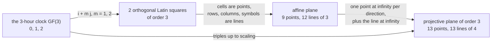

# Finite planes and orthogonal Latin squares: build a plane of order q from a field with q elements, read off q - 1 Latin squares that pair perfectly, and why order 6 has none

[Syllabus](../../../SYLLABUS.md) → [Combinatorics and graphs](../README.md) → [Designs](../README.md#s16) → Finite planes and orthogonal Latin squares

---

## General Overview

A farm trial tests 3 fertilisers and 3 seed types on a 3 × 3 grid of plots. Soil changes north to south and east to west. So each fertiliser should appear once in every row and column, and so should each seed type. And each of the 9 fertiliser–seed pairs should be tried exactly once.

A grid with each symbol once per row and once per column is a **Latin square**. Two Latin squares are **orthogonal** when, laid on top of each other, every ordered pair of symbols appears exactly once. The 3-hour clock (arithmetic mod 3: keep the remainder after dividing by 3) gives a pair: $`i + j`$ in row $`i`$, column $`j`$, and $`i + 2j`$, both wrapped at 3.

Its 9 cells are the points of a plane with 12 lines. Add 4 points "at infinity" and one more line, and out comes the **plane of order 3**: 13 points, 13 lines of 4, any two points on exactly one line.

In 1782 Euler asked for 36 officers, 6 ranks from each of 6 regiments, in a 6 × 6 square: an orthogonal pair of order 6. None exists.

**A full set of n − 1 orthogonal Latin squares of order n is the same object as a finite plane of order n; a field with q elements builds both, and order 6 has neither.**

**What kind of fact this is:** theorems, proved in Why it works, except four stated results: order 6 (also searched by the code), order 10 (a computer proof), the 1960 pairs result and Bruck–Ryser.

### The picture: one field, three objects



---

## The formula

- **GF(q)** is the field with $`q`$ elements: every nonzero element has a reciprocal ([Finite fields](../../03-Algebra/09-Rings%20and%20Fields/05-finite-fields.md)). For a prime $`q`$ it is the $`q`$-hour clock.
- A **projective plane of order n**: points and lines where any two points share exactly one line, any two lines share exactly one point, every line has $`n + 1`$ points, and some four points have no three on a line.
- An **affine plane of order n**: $`n^2`$ points, lines of $`n`$ points, any two points on exactly one line. Lines that never meet are **parallel**; the lines fall into **parallel classes** (directions) of $`n`$ lines each.
- **MOLS**, mutually orthogonal Latin squares: a set in which every two squares are orthogonal. $`N(n)`$ is the largest number of MOLS of order $`n`$.

```math
\text{points} = \text{lines} = n^2 + n + 1, \qquad n + 1 \text{ points on each line}
```

**Read it aloud:** a plane of order n has n squared plus n plus 1 points, as many lines, and n plus 1 points on each line.

Order 2, the Fano plane, gives 7 points on lines of 3; order 3 gives 13 on lines of 4.

```math
L_m(i, j) = i + m\,j \ \text{ computed in } \mathrm{GF}(q), \qquad m = 1, 2, \ldots, q - 1
```

**Read it aloud:** square number m puts row plus m times column in each cell, in the field's arithmetic.

```math
N(n) \le n - 1, \qquad N(n) = n - 1 \iff \text{an affine plane of order } n \text{ exists} \iff \text{a projective plane of order } n \text{ exists}
```

**Read it aloud:** order n allows at most n − 1 mutually orthogonal squares, and reaching that limit is the same as having a plane of order n.

| Symbol | Plain meaning | In our example | Push it up and the answer… |
| --- | --- | --- | --- |
| $`n`$ | the order: symbols per square | 3 | 21 points at order 4 |
| $`q`$, $`\mathrm{GF}(q)`$ | the size of the field that builds the plane, and the field itself | 3, the 3-hour clock | only prime powers have a field |
| $`i`$, $`j`$ | row and column of a cell, 0 to $`n - 1`$ | cell (1, 2) | — |
| $`m`$; $`a`$, $`b`$ | which square: a nonzero field element; $`a`$, $`b`$ are two different ones in Why it works | 1 or 2 | another square |
| $`L_m(i, j)`$ | the symbol square $`m`$ puts in cell $`(i, j)`$ | $`L_2(1, 2)`$: 1 + 4 wraps to 2 | — |
| $`N(n)`$ | the most MOLS of order $`n`$ | $`N(3) = 2`$ | never above $`n - 1`$ |

### When it holds

- **The arithmetic must divide.** On the 4-hour clock, row 0 of $`i + 2j`$ reads 0, 2, 0, 2: not Latin. Order 4 needs GF(4).
- **Some orders have no plane.** Order 6 has no orthogonal pair; order 10 has pairs but no plane.
- **The only known orders are prime powers.** Order 12 is the smallest open case as of 2026-11-23.

---

## Why it works

### Step 0: a line is a set of cells sharing one value

Sort the 9 cells by row, by column, by the symbol in $`L_1`$, and by the symbol in $`L_2`$. Each sorting gives 3 groups of 3. Call every group a line.

Two groups from different sortings share exactly one cell: row against column at their crossing, a row or column against a square by the Latin rule, two squares by orthogonality.

### Step 1: the field's squares are Latin and orthogonal

If two cells in row $`i`$ of square $`m`$ match, $`i + mj = i + mj'`$, so $`m(j - j') = 0`$. Multiply by the reciprocal of $`m`$: $`j = j'`$. Columns work the same way.

If squares $`a`$ and $`b`$ show the same pair at cells $`(i, j)`$ and $`(i', j')`$, subtracting gives $`(a - b)(j - j') = 0`$. Divide by $`a - b`$: $`j = j'`$, then $`i = i'`$. No pair repeats, so all $`q^2`$ appear.

Both steps divided. On the 6-hour clock, $`i + j`$ and $`i + 5j`$ are Latin but show only 18 of 36 pairs: $`a - b`$ is 2 there, and 2 times 3 wraps to 0.

### Step 2: no more than n − 1 squares

Relabel each square's symbols so its top row reads 0, 1, …, $`n - 1`$. It stays Latin and orthogonal.

Now look at row 1, column 0. No square has 0 there: column 0 has its 0 in row 0. No two squares share a symbol there: that symbol paired with itself already appears in row 0. So each square needs its own nonzero symbol, and only $`n - 1`$ exist. Among all 12 Latin squares of order 3, the code finds at most 2 orthogonal.

### Step 3: n − 1 squares make an affine plane

Take the $`n^2`$ cells as points. The lines are the rows, the columns and each square's symbol groups: $`n + 1`$ parallel classes of $`n`$ lines of $`n`$ points.

Two lines from different classes share one cell (Step 0). So no two points share two lines. A cell lies on $`n + 1`$ lines, each with $`n - 1`$ other cells: $`(n + 1)(n - 1) = n^2 - 1`$ cells, all different, which is every other cell. So any two points share exactly one line.

<details>
<summary>The converse: an affine plane gives n − 1 squares</summary>

Number the lines of one parallel class 0 to $`n - 1`$ and call them rows; do the same with a second class for columns. Each point is then a cell $`(i, j)`$.

Each other class becomes a square: in cell $`(i, j)`$ write the number of that class's line through the point. A row meets each such line once, so the square is Latin. Two classes give orthogonal squares, because their lines meet in exactly one point. A point lies on $`(n^2 - 1)/(n - 1) = n + 1`$ lines, one per class, so $`n + 1 - 2 = n - 1`$ MOLS.

</details>

### Step 4: points at infinity close the plane

Give each parallel class one new point, its **point at infinity**, on every line of that class. Join the $`n + 1`$ new points by one new line, the **line at infinity**.

Now any two lines meet once, and the count is $`n^2 + n + 1`$ points and lines. Deleting any line and its points reverses this: lines that met there become parallel. The Fano plane minus its line 1, 2, 4 leaves 4 points and 6 lines of 2: the affine plane of order 2.

The second road starts from the field. Points are nonzero triples over GF(q), counting multiples as one point. Each triple also names a line: the points whose triple, multiplied entry by entry with it and summed, gives 0. That is $`q^3 - 1`$ nonzero triples, $`q - 1`$ to a point: $`q^2 + q + 1`$ points.

Two different points give two independent equations in three unknowns, solved by one line, up to scaling; likewise for two lines. For $`q = 3`$ this gives 13 points and lines of 4; for $`q = 2`$, the Fano plane, relabelled. These are the coordinates of [Perspective](../../05-Geometry%20and%20trig/05-Vectors%20in%20Space/05-perspective-and-projective-coordinates.md), over a finite field.

### Step 5: order 6 has none, order 10 has none

Tarry settled order 6 by hand in 1900. The code repeats the search:

1. **Reduce.** Shuffling rows, columns and symbols turns any orthogonal pair into one whose first square has top row and left column 0, 1, …, $`n - 1`$. Searching these **reduced** squares is enough.
2. **Look for a mate.** A **transversal** is $`n`$ cells, one per row and column, all symbols different. Each symbol of a mate marks a transversal, so a mate exists exactly when $`n`$ disjoint transversals cover the square.
3. **Count.** Order 6 has 9408 reduced squares, and none has a mate.

Euler guessed orders 6, 10, 14, … have none; Bose, Shrikhande and Parker found pairs at every order but 2 and 6 (1960).

A plane needs all $`n - 1`$ squares. The Bruck–Ryser theorem (1949) rules out order 6 and infinitely many others by a sum-of-two-squares test. Order 10 passes it; Lam, Thiel and Swiercz closed it in 1989 by computer search.

---

## Worked numbers, by hand

| Step | Arithmetic | Value |
| --- | --- | --- |
| $`L_1`$, rows | $`i + j`$ mod 3 | 012 / 120 / 201 |
| $`L_2`$, rows | $`i + 2j`$ mod 3 | 021 / 102 / 210 |
| row 1, column 2 | $`L_1`$: 1 + 2 wraps to 0; $`L_2`$: 1 + 4 wraps to 2 | pair 02 |
| all 9 cells on top | 00 12 21 / 11 20 02 / 22 01 10 | **9 different pairs** |
| affine plane | 3 rows, 3 columns, 3 + 3 symbol lines | 9 points, **12 lines** of 3 |
| add infinity | 4 new points, 1 new line | **13 points, 13 lines** of 4 |

Each of the 9 plots gets its own fertiliser–seed pair.

| Order | Reduced Latin squares | With an orthogonal mate |
| --- | ---: | ---: |
| 2 | 1 | 0 |
| 3 | 1 | 1 |
| 4 | 4 | 1 |
| 5 | 56 | 6 |
| 6 | 9408 | **0** |

### What breaks if you drop a piece

| Mistake | Comes out at | What went wrong |
| --- | --- | --- |
| The 4-hour clock for GF(4) | row 0 of $`i + 2j`$: 0, 2, 0, 2 | 2 has no reciprocal mod 4 |
| Second square $`2(i + j)`$ mod 3 | 3 of 9 pairs | a relabelled copy of the first |
| $`i + j`$ and $`i + 5j`$ mod 6 | 18 of 36 pairs | the difference 2 times 3 wraps to 0 |


---

## Code, from first principles, and it actually runs

The only import is `itertools`, for looping over tuples. Two roads build the plane of order 3, sharing no arithmetic: squares plus points at infinity, and triples over GF(3). Two searches back the theory: the $`n - 1`$ limit at order 3, and mates up to order 6.

### Python

```python
# Finite planes and orthogonal Latin squares -- the check behind the card.  Only itertools is imported, to loop over
# tuples.  Order 3 squares, the plane of order 3 built two ways, the Fano plane, and a full search for mates up to order 6.
from itertools import combinations, permutations, product
def square(m, n): return [[(i + m * j) % n for j in range(n)] for i in range(n)]
def latin(L): return all(len(set(r)) == len(L) for r in L) and all(len(set(c)) == len(L) for c in zip(*L))
def pairs(A, B): return len({(a, b) for ra, rb in zip(A, B) for a, b in zip(ra, rb)})
def yn(claim): return "yes" if claim else "no"
def plane_ok(pts, lines):                    # two points share one line, two lines share one point
    return all(sum(a in l and b in l for l in lines) == 1 for a, b in combinations(pts, 2)) and all(len(l & m) == 1 for l, m in combinations(lines, 2))
def from_squares(sqs, n):                    # road one: cells, plus a point at infinity per class
    keys = [lambda i, j: i, lambda i, j: j] + [lambda i, j, S=S: S[i][j] for S in sqs]
    lines = [frozenset([(i, j) for i in range(n) for j in range(n) if f(i, j) == s] + [(n, c)])
             for c, f in enumerate(keys) for s in range(n)] + [frozenset((n, c) for c in range(n + 1))]
    return [(i, j) for i in range(n) for j in range(n)] + [(n, c) for c in range(n + 1)], lines
def gf_plane(q):                             # road two: triples over GF(q), first nonzero entry 1
    pts = [t for t in product(range(q), repeat=3) if any(t) and t[[x > 0 for x in t].index(True)] == 1]
    return pts, [frozenset(p for p in pts if sum(a * b for a, b in zip(p, l)) % q == 0) for l in pts]
def reduced(n):                              # every Latin square with first row and column 0..n-1
    L, out = [[i if j == 0 else j if i == 0 else -1 for j in range(n)] for i in range(n)], []
    def fill(c):
        if c == n * n: return out.append([r[:] for r in L])
        i, j = divmod(c, n)
        if L[i][j] >= 0: return fill(c + 1)
        for s in set(range(n)) - set(L[i]) - {L[k][j] for k in range(n)}:
            L[i][j] = s; fill(c + 1); L[i][j] = -1
    fill(0); return out
def has_mate(L):                             # a mate exists exactly when n transversals tile the grid
    n, T = len(L), []
    def tr(i, cols, syms):
        if i == n: return T.append(cols)
        for j in set(range(n)) - set(cols):
            if L[i][j] not in syms: tr(i + 1, cols + (j,), syms | {L[i][j]})
    tr(0, (), set()); masks = [sum(1 << (i * n + t[i]) for i in range(n)) for t in T]
    def tile(k, used): return k == n or any(t[0] == k and not m & used and tile(k + 1, used | m) for t, m in zip(T, masks))
    return tile(0, 0)
L1, L2 = square(1, 3), square(2, 3); print("L1 = i + j mod 3:", L1, "  L2 = i + 2j mod 3:", L2)
print(f"both Latin: {yn(latin(L1) and latin(L2))}; ordered pairs seen when laid on top: {pairs(L1, L2)} of 9")
print("laid on top, row by row:", " | ".join(" ".join(f"{a}{b}" for a, b in zip(ra, rb)) for ra, rb in zip(L1, L2)))
sq3 = [L for L in ([list(g[0:3]), list(g[3:6]), list(g[6:9])] for g in product(range(3), repeat=9)) if latin(L)]
best = max(k for k in range(1, 5) if any(all(pairs(A, B) == 9 for A, B in combinations(c, 2)) for c in combinations(sq3, k)))
print(f"Latin squares of order 3: {len(sq3)}; largest mutually orthogonal set: {best} = 3 - 1")
PA, LA = from_squares([L1, L2], 3); PB, LB = gf_plane(3); ns = (2, 3, 4, 5, 7)
print(f"n = {ns}: points n^2 + n + 1 = {[n * n + n + 1 for n in ns]}, points per line n + 1 = {[n + 1 for n in ns]}")
for name, P, Ls in [("from the two squares", PA, LA), ("from triples over GF(3)", PB, LB)]:
    print(f"plane {name}: {len(P)} points, {len(Ls)} lines, points per line {min(map(len, Ls))} to {max(map(len, Ls))}, a plane: {yn(plane_ok(P, Ls))}")
inf = {(3, c) for c in range(4)}; aff3 = [l - inf for l in LA if not l <= inf]
print(f"minus its line at infinity: {len(set().union(*aff3))} points, {len(aff3)} lines of {len(aff3[0])}, in {len({l & inf for l in LA if not l <= inf})} parallel classes")
fano, (P2, G2) = {frozenset(l) for l in [(1, 2, 4), (2, 3, 5), (3, 4, 6), (4, 5, 7), (5, 6, 1), (6, 7, 2), (7, 1, 3)]}, gf_plane(2)
aff = [l - {1, 2, 4} for l in fano if l != {1, 2, 4}]; same = any({frozenset(p[P2.index(x)] for x in l) for l in G2} == fano for p in permutations(range(1, 8)))
print(f"Fano plane: {len(set().union(*fano))} points, {len(fano)} lines of 3, a plane: {yn(plane_ok(range(1, 8), fano))}; the GF(2) plane, relabelled: {yn(same)}")
print(f"Fano minus the line 1 2 4: {len(set().union(*aff))} points, {len(aff)} lines of {len(aff[0])}")
mates = {n: (len(R), sum(map(has_mate, R))) for n in range(2, 7) for R in [reduced(n)]}
for n in mates: print(f"order {n}: reduced Latin squares {mates[n][0]}, with an orthogonal mate {mates[n][1]}")
print(f"mistake 1, the 4-hour clock for GF(4): i + 2j mod 4 row 0 = {square(2, 4)[0]}, Latin: {yn(latin(square(2, 4)))}")
print(f"mistake 2, second square 2(i + j) mod 3: ordered pairs {pairs(L1, [[2 * x % 3 for x in r] for r in L1])} of 9")
print(f"mistake 3, i + j and i + 5j mod 6: ordered pairs {pairs(square(1, 6), square(5, 6))} of 36")
assert pairs(L1, L2) == 9 and best == 2 and len(sq3) == 12
assert plane_ok(PA, LA) and plane_ok(PB, LB) and len(PA) == len(PB) == 3 * 3 + 3 + 1
assert same and mates[6][1] == 0 and mates[5][1] > 0 and mates[2][1] == 0
print("ALL CHECKS PASS")
```

**Ran 2026-11-23 on macOS, Python 3.14.10, standard library only. All checks passed. Output, pasted from the run:**

```
L1 = i + j mod 3: [[0, 1, 2], [1, 2, 0], [2, 0, 1]]   L2 = i + 2j mod 3: [[0, 2, 1], [1, 0, 2], [2, 1, 0]]
both Latin: yes; ordered pairs seen when laid on top: 9 of 9
laid on top, row by row: 00 12 21 | 11 20 02 | 22 01 10
Latin squares of order 3: 12; largest mutually orthogonal set: 2 = 3 - 1
n = (2, 3, 4, 5, 7): points n^2 + n + 1 = [7, 13, 21, 31, 57], points per line n + 1 = [3, 4, 5, 6, 8]
plane from the two squares: 13 points, 13 lines, points per line 4 to 4, a plane: yes
plane from triples over GF(3): 13 points, 13 lines, points per line 4 to 4, a plane: yes
minus its line at infinity: 9 points, 12 lines of 3, in 4 parallel classes
Fano plane: 7 points, 7 lines of 3, a plane: yes; the GF(2) plane, relabelled: yes
Fano minus the line 1 2 4: 4 points, 6 lines of 2
order 2: reduced Latin squares 1, with an orthogonal mate 0
order 3: reduced Latin squares 1, with an orthogonal mate 1
order 4: reduced Latin squares 4, with an orthogonal mate 1
order 5: reduced Latin squares 56, with an orthogonal mate 6
order 6: reduced Latin squares 9408, with an orthogonal mate 0
mistake 1, the 4-hour clock for GF(4): i + 2j mod 4 row 0 = [0, 2, 0, 2], Latin: no
mistake 2, second square 2(i + j) mod 3: ordered pairs 3 of 9
mistake 3, i + j and i + 5j mod 6: ordered pairs 18 of 36
ALL CHECKS PASS
```

### Rust

Same numbers, same labels, built with `rustc --edition 2021 -O`.

```rust
// Finite planes and orthogonal Latin squares -- the same check as the Python, in Rust.  No crates.  Lines are
// bit masks over numbered points.  Order 3 squares, the order 3 plane built two ways, Fano, and mates up to order 6.
use std::collections::HashSet;
type Sq = Vec<Vec<usize>>;
fn square(m: usize, n: usize) -> Sq { (0..n).map(|i| (0..n).map(|j| (i + m * j) % n).collect()).collect() }
fn latin(l: &Sq) -> bool { let n = l.len();
    (0..n).all(|i| (0..n).map(|j| l[i][j]).collect::<HashSet<_>>().len() == n && (0..n).map(|j| l[j][i]).collect::<HashSet<_>>().len() == n) }
fn pairs(a: &Sq, b: &Sq) -> usize { let n = a.len(); (0..n * n).map(|c| (a[c / n][c % n], b[c / n][c % n])).collect::<HashSet<_>>().len() }
fn yn(claim: bool) -> &'static str { if claim { "yes" } else { "no" } }
fn plane_ok(pts: &[usize], lines: &[u64]) -> bool {          // two points share one line, two lines share one point
    pts.iter().enumerate().all(|(k, &a)| pts[k + 1..].iter().all(|&b| lines.iter().filter(|&&l| l >> a & 1 == 1 && l >> b & 1 == 1).count() == 1))
        && (0..lines.len()).all(|x| (x + 1..lines.len()).all(|y| (lines[x] & lines[y]).count_ones() == 1)) }
fn from_squares(sqs: &[Sq], n: usize) -> Vec<u64> {          // road one: cell i*n+j, point at infinity n*n+class
    let key = |c: usize, i: usize, j: usize| if c == 0 { i } else if c == 1 { j } else { sqs[c - 2][i][j] };
    let mut lines: Vec<u64> = (0..n + 1).flat_map(|c| (0..n).map(move |s| (c, s))).map(|(c, s)| (0..n * n)
        .filter(|&p| key(c, p / n, p % n) == s).fold(1u64 << (n * n + c), |m, p| m | 1 << p)).collect();
    lines.push((n * n..n * n + n + 1).fold(0, |m, p| m | 1 << p)); lines }
fn gf_plane(q: usize) -> (usize, Vec<u64>) {                 // road two: triples over GF(q), first nonzero entry 1
    let pts: Vec<[usize; 3]> = (0..q * q * q).map(|x| [x / (q * q), x / q % q, x % q])
        .filter(|t| t.iter().any(|&v| v > 0) && *t.iter().find(|&&v| v > 0).unwrap() == 1).collect();
    let on = |p: &[usize; 3], l: &[usize; 3]| (0..3).map(|k| p[k] * l[k]).sum::<usize>() % q == 0;
    (pts.len(), pts.iter().map(|l| (0..pts.len()).filter(|&k| on(&pts[k], l)).fold(0, |m, k| m | 1 << k)).collect()) }
fn transversals(l: &Sq, i: usize, cols: u64, syms: u64, first: usize, mask: u64, out: &mut Vec<(usize, u64)>) {
    let n = l.len(); if i == n { out.push((first, mask)); return }
    for j in 0..n { if cols >> j & 1 == 0 && syms >> l[i][j] & 1 == 0 {
        transversals(l, i + 1, cols | 1 << j, syms | 1 << l[i][j], if i == 0 { j } else { first }, mask | 1 << (i * n + j), out) } } }
fn tile(t: &[(usize, u64)], k: usize, n: usize, used: u64) -> bool {
    k == n || t.iter().any(|&(f, m)| f == k && m & used == 0 && tile(t, k + 1, n, used | m)) }
fn has_mate(l: &Sq) -> bool { let mut t = Vec::new(); transversals(l, 0, 0, 0, 0, 0, &mut t); tile(&t, 0, l.len(), 0) }
fn fill(l: &mut Sq, c: usize, count: &mut [usize; 2]) {      // every Latin square with first row and column 0..n-1
    let n = l.len(); if c == n * n { count[0] += 1; if has_mate(l) { count[1] += 1 } return }
    let (i, j) = (c / n, c % n); if i == 0 || j == 0 { return fill(l, c + 1, count) }
    for s in 0..n { if (0..n).all(|k| l[i][k] != s && l[k][j] != s) { l[i][j] = s; fill(l, c + 1, count); l[i][j] = n } } }
fn main() {
    let (l1, l2) = (square(1, 3), square(2, 3)); println!("L1 = i + j mod 3: {:?}   L2 = i + 2j mod 3: {:?}", l1, l2);
    println!("both Latin: {}; ordered pairs seen when laid on top: {} of 9", yn(latin(&l1) && latin(&l2)), pairs(&l1, &l2));
    let rows: Vec<String> = (0..3).map(|i| (0..3).map(|j| format!("{}{}", l1[i][j], l2[i][j])).collect::<Vec<_>>().join(" ")).collect();
    println!("laid on top, row by row: {}", rows.join(" | "));
    let sq3: Vec<Sq> = (0..19683usize).map(|g| (0..3).map(|i| (0..3).map(|j| g / 3usize.pow(8 - 3 * i - j as u32) % 3).collect()).collect())
        .filter(|l| latin(l)).collect();
    let mo = |c: &[usize]| c.iter().enumerate().all(|(x, &a)| c[x + 1..].iter().all(|&b| pairs(&sq3[a], &sq3[b]) == 9));
    let k3 = sq3.len(); let best = if (0..k3.pow(3)).any(|x| { let c = [x / k3 / k3, x / k3 % k3, x % k3]; c[0] < c[1] && c[1] < c[2] && mo(&c) }) { 3 }
        else if (0..k3 * k3).any(|x| x / k3 < x % k3 && mo(&[x / k3, x % k3])) { 2 } else { 1 };
    println!("Latin squares of order 3: {}; largest mutually orthogonal set: {} = 3 - 1", k3, best);
    let la = from_squares(&[l1.clone(), l2.clone()], 3); let (nb, lb) = gf_plane(3); let pa: Vec<usize> = (0..13).collect();
    let ns = [2usize, 3, 4, 5, 7]; println!("n = ({}): points n^2 + n + 1 = {:?}, points per line n + 1 = {:?}", ns.map(|n| n.to_string()).join(", "),
             ns.map(|n| n * n + n + 1), ns.map(|n| n + 1));
    for (name, np, ls) in [("from the two squares", 13, &la), ("from triples over GF(3)", nb, &lb)] {
        let sz: Vec<u32> = ls.iter().map(|l| l.count_ones()).collect();
        println!("plane {}: {} points, {} lines, points per line {} to {}, a plane: {}", name, np, ls.len(), sz.iter().min().unwrap(),
                 sz.iter().max().unwrap(), yn(plane_ok(&(0..np).collect::<Vec<_>>(), ls))) }
    let inf: u64 = 0b1111 << 9; let aff3: Vec<u64> = la.iter().filter(|&&l| l & !inf != 0).map(|l| l & !inf).collect();
    let classes: HashSet<u64> = la.iter().filter(|&&l| l & !inf != 0).map(|l| l & inf).collect();
    println!("minus its line at infinity: {} points, {} lines of {}, in {} parallel classes",
             aff3.iter().fold(0, |m, l| m | l).count_ones(), aff3.len(), aff3[0].count_ones(), classes.len());
    let fano: Vec<u64> = [[1, 2, 4], [2, 3, 5], [3, 4, 6], [4, 5, 7], [5, 6, 1], [6, 7, 2], [7, 1, 3]].iter().map(|l| l.iter().fold(0, |m, p| m | 1 << p)).collect();
    let (_, g2) = gf_plane(2); let mut fs = fano.clone(); fs.sort();
    let same = (0..823543usize).any(|x| { let p: Vec<usize> = (0..7).map(|k| 1 + x / 7usize.pow(k) % 7).collect();
        if p.iter().fold(0u64, |m, &v| m | 1 << v) != 0b11111110 { return false }
        let mut img: Vec<u64> = g2.iter().map(|&l| (0..7).filter(|&k| l >> k & 1 == 1).fold(0, |m, k| m | 1 << p[k as usize])).collect();
        img.sort(); img == fs });
    println!("Fano plane: {} points, {} lines of 3, a plane: {}; the GF(2) plane, relabelled: {}", fano.iter().fold(0, |m, l| m | l).count_ones(), fano.len(),
             yn(plane_ok(&(1..8).collect::<Vec<_>>(), &fano)), yn(same));
    let aff: Vec<u64> = fano.iter().filter(|&&l| l != fano[0]).map(|l| l & !fano[0]).collect();
    println!("Fano minus the line 1 2 4: {} points, {} lines of {}", aff.iter().fold(0, |m, l| m | l).count_ones(), aff.len(), aff[0].count_ones());
    let mut mates = [[0usize; 2]; 7];
    for n in 2..7 { let mut l: Sq = (0..n).map(|i| (0..n).map(|j| if j == 0 { i } else if i == 0 { j } else { n }).collect()).collect();
        fill(&mut l, 0, &mut mates[n]); println!("order {}: reduced Latin squares {}, with an orthogonal mate {}", n, mates[n][0], mates[n][1]) }
    println!("mistake 1, the 4-hour clock for GF(4): i + 2j mod 4 row 0 = {:?}, Latin: {}", square(2, 4)[0], yn(latin(&square(2, 4))));
    let twice: Sq = l1.iter().map(|r| r.iter().map(|x| 2 * x % 3).collect()).collect();
    println!("mistake 2, second square 2(i + j) mod 3: ordered pairs {} of 9", pairs(&l1, &twice));
    println!("mistake 3, i + j and i + 5j mod 6: ordered pairs {} of 36", pairs(&square(1, 6), &square(5, 6)));
    assert!(pairs(&l1, &l2) == 9 && best == 2 && k3 == 12);
    assert!(plane_ok(&pa, &la) && plane_ok(&(0..nb).collect::<Vec<_>>(), &lb) && nb == 3 * 3 + 3 + 1);
    assert!(same && mates[6][1] == 0 && mates[5][1] > 0 && mates[2][1] == 0);
    println!("ALL CHECKS PASS");
}
```

**Ran 2026-11-23 on macOS, rustc 1.98.1, no crates. All checks passed. Output, pasted from the run:**

```
L1 = i + j mod 3: [[0, 1, 2], [1, 2, 0], [2, 0, 1]]   L2 = i + 2j mod 3: [[0, 2, 1], [1, 0, 2], [2, 1, 0]]
both Latin: yes; ordered pairs seen when laid on top: 9 of 9
laid on top, row by row: 00 12 21 | 11 20 02 | 22 01 10
Latin squares of order 3: 12; largest mutually orthogonal set: 2 = 3 - 1
n = (2, 3, 4, 5, 7): points n^2 + n + 1 = [7, 13, 21, 31, 57], points per line n + 1 = [3, 4, 5, 6, 8]
plane from the two squares: 13 points, 13 lines, points per line 4 to 4, a plane: yes
plane from triples over GF(3): 13 points, 13 lines, points per line 4 to 4, a plane: yes
minus its line at infinity: 9 points, 12 lines of 3, in 4 parallel classes
Fano plane: 7 points, 7 lines of 3, a plane: yes; the GF(2) plane, relabelled: yes
Fano minus the line 1 2 4: 4 points, 6 lines of 2
order 2: reduced Latin squares 1, with an orthogonal mate 0
order 3: reduced Latin squares 1, with an orthogonal mate 1
order 4: reduced Latin squares 4, with an orthogonal mate 1
order 5: reduced Latin squares 56, with an orthogonal mate 6
order 6: reduced Latin squares 9408, with an orthogonal mate 0
mistake 1, the 4-hour clock for GF(4): i + 2j mod 4 row 0 = [0, 2, 0, 2], Latin: no
mistake 2, second square 2(i + j) mod 3: ordered pairs 3 of 9
mistake 3, i + j and i + 5j mod 6: ordered pairs 18 of 36
ALL CHECKS PASS
```

The two outputs match line for line.

### Lean

Lean proves the main claim for every order from 2 up, the n − 1 limit, the field's squares, and the worked numbers.

- Take an order $`n \ge 2`$. Then $`n - 1`$ MOLS of order $`n`$ exist exactly when a projective plane of order $`n`$ exists.
- Take any set of MOLS whose squares have $`n \ge 2`$ symbols. Then the set has at most $`n - 1`$ squares.
- Take a field with $`q`$ elements. Then the squares $`L_m(i, j) = i + m\,j`$, one per nonzero $`m`$, are $`q - 1`$ MOLS.
- Take $`i + j`$ and $`i + 2j`$ on the 3-hour clock. Then both are Latin, they are orthogonal, and all 9 pairs appear.
- Row 1, column 2 shows the pair 0, 2.
- Both counts for the plane of order 3 give 13 points.
- The Fano plane has 7 lines of 3. Any two points share exactly one line, and any two lines share exactly one point.
- The three mistakes in the table come out as shown: not Latin, 3 of 9 pairs, and 18 of 36 pairs.

The plane from triples, the order 3 search and the mate counts up to order 6 are left to the Python and Rust checks.

```lean
-- Finite planes and orthogonal Latin squares: n - 1 mutually orthogonal Latin squares of order n exist exactly when a projective plane of order n does, no order allows more, and a finite field builds a full set.
import Mathlib.Combinatorics.Configuration
import Mathlib.Data.ZMod.Defs
import Mathlib.Data.Fintype.Prod
import Mathlib.Data.Fintype.Pi
import Mathlib.Tactic.LinearCombination

open Function

/-- A Latin square on the symbol set `α`: rows, columns and symbols are all `α`, and each
symbol appears exactly once in every row and exactly once in every column. -/
def IsLatinSquare {α : Type*} (L : α → α → α) : Prop :=
  (∀ i, Bijective (L i)) ∧ ∀ j, Bijective (fun i => L i j)

/-- Two squares are orthogonal when, laid on top of each other, every ordered pair of symbols
appears in exactly one cell. -/
def AreOrthogonal {α : Type*} (A B : α → α → α) : Prop :=
  Bijective (fun c : α × α => (A c.1 c.2, B c.1 c.2))

/-- A family of mutually orthogonal Latin squares (MOLS): every square is Latin and every two
different squares are orthogonal. -/
def IsMOLS {ι α : Type*} (F : ι → α → α → α) : Prop :=
  (∀ k, IsLatinSquare (F k)) ∧ Pairwise fun a b => AreOrthogonal (F a) (F b)

instance {α : Type*} [Fintype α] [DecidableEq α] (L : α → α → α) :
    Decidable (IsLatinSquare L) :=
  inferInstanceAs (Decidable ((∀ i, Bijective (L i)) ∧ ∀ j, Bijective (fun i => L i j)))

instance {α : Type*} [Fintype α] [DecidableEq α] (A B : α → α → α) :
    Decidable (AreOrthogonal A B) :=
  inferInstanceAs (Decidable (Bijective (fun c : α × α => (A c.1 c.2, B c.1 c.2))))

namespace PPMOLS
open Configuration

section PlaneToMOLS
open Configuration

variable {P L : Type} [Membership P L] [Configuration.ProjectivePlane P L]

theorem line_eq_of_two {p₁ p₂ : P} {l₁ l₂ : L} (h : p₁ ≠ p₂) (h1 : p₁ ∈ l₁) (h2 : p₂ ∈ l₁)
    (h3 : p₁ ∈ l₂) (h4 : p₂ ∈ l₂) : l₁ = l₂ :=
  (Configuration.Nondegenerate.eq_or_eq h1 h2 h3 h4).resolve_left h

theorem affine_eq {l0 m1 m2 : L} {a b x x' : P} (hab : a ≠ b) (ha : a ∈ l0) (hb : b ∈ l0)
    (hx : x ∉ l0) (ha1 : a ∈ m1) (hx1 : x ∈ m1) (hx1' : x' ∈ m1) (hb2 : b ∈ m2) (hx2 : x ∈ m2)
    (hx2' : x' ∈ m2) : x = x' := by
  by_contra hne
  have h12 : m1 = m2 := line_eq_of_two hne hx1 hx1' hx2 hx2'
  subst h12
  have : m1 = l0 := line_eq_of_two hab ha1 hb2 ha hb
  subst this
  exact hx hx1

theorem line_eq_through {l0 m1 m2 : L} {a x : P} (ha : a ∈ l0) (hx : x ∉ l0) (ha1 : a ∈ m1)
    (hx1 : x ∈ m1) (ha2 : a ∈ m2) (hx2 : x ∈ m2) : m1 = m2 :=
  line_eq_of_two (fun (h : a = x) => hx (h ▸ ha)) ha1 hx1 ha2 hx2

theorem card_lines_through_ne [Finite P] [Finite L] {l0 : L} {p : P} (hp : p ∈ l0) :
    Nat.card {l : L // p ∈ l ∧ l ≠ l0} = ProjectivePlane.order P L := by
  classical
  have := Fintype.ofFinite L
  have h1 := ProjectivePlane.lineCount_eq L p
  rw [lineCount, Nat.card_eq_fintype_card, Fintype.card_subtype] at h1
  rw [Nat.card_eq_fintype_card, Fintype.card_subtype]
  have : (Finset.univ.filter fun l : L => p ∈ l ∧ l ≠ l0) =
      (Finset.univ.filter fun l : L => p ∈ l).erase l0 := by
    ext l; simp [and_comm]
  rw [this, Finset.card_erase_of_mem (by simpa using hp), h1]
  simp

theorem mols_of_plane [Finite P] [Finite L] (n : ℕ) (hn : 2 ≤ n)
    (hord : ProjectivePlane.order P L = n) :
    ∃ F : Fin (n - 1) → Fin n → Fin n → Fin n, IsMOLS F := by
  classical
  obtain ⟨-, -, -, l0, -, -, -⟩ := @ProjectivePlane.exists_config P L _ _
  have hpts : Nat.card {p : P // p ∈ l0} = n + 1 := by
    rw [← hord]; exact ProjectivePlane.pointCount_eq P l0
  obtain ⟨a, ha_inj, ha⟩ : ∃ a : Fin (n + 1) → P, Function.Injective a ∧ ∀ k, a k ∈ l0 := by
    let e := (Finite.equivFinOfCardEq hpts).symm
    exact ⟨fun k => (e k).1, fun x y h => e.injective (Subtype.ext h), fun k => (e k).2⟩
  have hT : ∀ p, p ∈ l0 → Nat.card {l : L // p ∈ l ∧ l ≠ l0} = n :=
    fun p hp => hord ▸ card_lines_through_ne hp
  -- n lines through a point of l0, other than l0
  have hfam : ∀ p, p ∈ l0 → ∃ R : Fin n → L, Function.Injective R ∧ ∀ i, p ∈ R i ∧ R i ≠ l0 := by
    intro p hp
    let e := (Finite.equivFinOfCardEq (hT p hp)).symm
    exact ⟨fun i => (e i).1, fun x y h => e.injective (Subtype.ext h), fun i => (e i).2⟩
  -- labels for lines through a point of l0
  have hlab : ∀ p, p ∈ l0 → ∃ g : L → Fin n, ∀ m m', p ∈ m → m ≠ l0 → p ∈ m' → m' ≠ l0 →
      g m = g m' → m = m' := by
    intro p hp
    let e := Finite.equivFinOfCardEq (hT p hp)
    refine ⟨fun m => if h : p ∈ m ∧ m ≠ l0 then e ⟨m, h⟩ else ⟨0, by omega⟩, ?_⟩
    intro m m' h1 h2 h3 h4 h
    simp only [h1, h2, h3, h4, ne_eq, not_false_eq_true, and_self, dite_true] at h
    exact congrArg Subtype.val (e.injective h)
  have hline : ∀ p x : P, p ≠ x → ∃ m : L, p ∈ m ∧ x ∈ m :=
    fun p x h => ⟨HasLines.mkLine h, HasLines.mkLine_ax h⟩
  let idx : Fin (n - 1) → Fin (n + 1) := fun k => ⟨k.1 + 2, by omega⟩
  obtain ⟨z0, z1, hz0, hz1⟩ : ∃ z0 z1 : Fin (n + 1), z0.val = 0 ∧ z1.val = 1 :=
    ⟨⟨0, by omega⟩, ⟨1, by omega⟩, rfl, rfl⟩
  have h01 : a z0 ≠ a z1 := fun h => by
    have := congrArg Fin.val (ha_inj h); omega
  have h0k : ∀ k, a z0 ≠ a (idx k) := fun k h => by
    have := congrArg Fin.val (ha_inj h); simp only [idx] at this; omega
  have h1k : ∀ k, a z1 ≠ a (idx k) := fun k h => by
    have := congrArg Fin.val (ha_inj h); simp only [idx] at this; omega
  have hkk : ∀ k k', k ≠ k' → a (idx k) ≠ a (idx k') := fun k k' hk h => by
    have := congrArg Fin.val (ha_inj h); simp only [idx] at this; exact hk (Fin.ext (by omega))
  obtain ⟨R, hR_inj, hR⟩ := hfam (a z0) (ha z0)
  obtain ⟨C, hC_inj, hC⟩ := hfam (a z1) (ha z1)
  choose g hg using fun k : Fin (n - 1) => hlab (a (idx k)) (ha _)
  -- the affine point in row i and column j
  obtain ⟨pt, hpt⟩ : ∃ pt : Fin n → Fin n → P,
      ∀ i j, pt i j ∈ R i ∧ pt i j ∈ C j ∧ pt i j ∉ l0 := by
    have hRC : ∀ i j, R i ≠ C j := by
      intro i j h
      apply (hR i).2
      exact line_eq_of_two h01 (hR i).1 (h ▸ (hC j).1) (ha z0) (ha z1)
    refine ⟨fun i j => HasPoints.mkPoint (P := P) (hRC i j), fun i j => ?_⟩
    obtain ⟨h1, h2⟩ := HasPoints.mkPoint_ax (P := P) (hRC i j)
    refine ⟨h1, h2, fun h => ?_⟩
    have e1 := (Configuration.Nondegenerate.eq_or_eq h1 (hR i).1 h (ha z0)).resolve_right (hR i).2
    have e2 := (Configuration.Nondegenerate.eq_or_eq h2 (hC j).1 h (ha z1)).resolve_right (hC j).2
    exact h01 (e1.symm.trans e2)
  choose M hM using fun (k : Fin (n - 1)) (i j : Fin n) =>
    hline (a (idx k)) (pt i j) (fun h => (hpt i j).2.2 (h ▸ ha _))
  have hMne : ∀ k i j, M k i j ≠ l0 := fun k i j h => (hpt i j).2.2 (h ▸ (hM k i j).2)
  have hMeq : ∀ k i j i' j', g k (M k i j) = g k (M k i' j') → M k i j = M k i' j' :=
    fun k i j i' j' h => hg k _ _ (hM k i j).1 (hMne k i j) (hM k i' j').1 (hMne k i' j') h
  refine ⟨fun k i j => g k (M k i j), fun k => ⟨fun i => ?_, fun j => ?_⟩, fun k k' hk => ?_⟩
  · apply Finite.injective_iff_bijective.mp
    intro j j' h
    have hm := hMeq k i j i j' h
    have hp : pt i j = pt i j' := affine_eq (h0k k) (ha z0) (ha _) (hpt i j).2.2 (hR i).1
      (hpt i j).1 (hpt i j').1 (hM k i j).1 (hM k i j).2 (hm ▸ (hM k i j').2)
    apply hC_inj
    exact line_eq_through (ha z1) (hpt i j).2.2 (hC j).1 (hpt i j).2.1 (hC j').1
      (hp ▸ (hpt i j').2.1)
  · apply Finite.injective_iff_bijective.mp
    intro i i' h
    have hm := hMeq k i j i' j h
    have hp : pt i j = pt i' j := affine_eq (h1k k) (ha z1) (ha _) (hpt i j).2.2 (hC j).1
      (hpt i j).2.1 (hpt i' j).2.1 (hM k i j).1 (hM k i j).2 (hm ▸ (hM k i' j).2)
    apply hR_inj
    exact line_eq_through (ha z0) (hpt i j).2.2 (hR i).1 (hpt i j).1 (hR i').1
      (hp ▸ (hpt i' j).1)
  · apply Finite.injective_iff_bijective.mp
    rintro ⟨i, j⟩ ⟨i', j'⟩ h
    simp only [Prod.mk.injEq] at h
    have hm := hMeq k i j i' j' h.1
    have hm' := hMeq k' i j i' j' h.2
    have hp : pt i j = pt i' j' := affine_eq (hkk k k' hk) (ha _) (ha _) (hpt i j).2.2
      (hM k i j).1 (hM k i j).2 (hm ▸ (hM k i' j').2) (hM k' i j).1 (hM k' i j).2
      (hm' ▸ (hM k' i' j').2)
    have e1 : i = i' := hR_inj (line_eq_through (ha z0) (hpt i j).2.2 (hR i).1 (hpt i j).1
      (hR i').1 (hp ▸ (hpt i' j').1))
    have e2 : j = j' := hC_inj (line_eq_through (ha z1) (hpt i j).2.2 (hC j).1 (hpt i j).2.1
      (hC j').1 (hp ▸ (hpt i' j').2.1))
    rw [e1, e2]


end PlaneToMOLS

section Net
variable {D α : Type}

/-- Points of the plane built from a net: affine cells and one point at infinity per direction. -/
inductive NPt (_G : D → α × α → α) : Type
  | aff (c : α × α)
  | inf (d : D)

/-- Lines of the plane built from a net: one per direction and value, plus the line at infinity. -/
inductive NLn (_G : D → α × α → α) : Type
  | ln (d : D) (v : α)
  | inf

def netMem (G : D → α × α → α) : NLn G → NPt G → Prop
  | .inf, .aff _ => False
  | .inf, .inf _ => True
  | .ln d v, .aff c => G d c = v
  | .ln d _, .inf e => e = d

instance (G : D → α × α → α) : Membership (NPt G) (NLn G) := ⟨netMem G⟩

variable {G : D → α × α → α}

@[simp] theorem mem_inf_aff (c : α × α) : ¬ ((NPt.aff c : NPt G) ∈ (NLn.inf : NLn G)) :=
  fun h => h
@[simp] theorem mem_inf_inf (e : D) : (NPt.inf e : NPt G) ∈ (NLn.inf : NLn G) := trivial
@[simp] theorem mem_ln_aff (c : α × α) (d : D) (v : α) :
    (NPt.aff c : NPt G) ∈ (NLn.ln d v : NLn G) ↔ G d c = v := Iff.rfl
@[simp] theorem mem_ln_inf (e d : D) (v : α) :
    (NPt.inf e : NPt G) ∈ (NLn.ln d v : NLn G) ↔ e = d := Iff.rfl

def NPt.equiv : NPt G ≃ (α × α) ⊕ D where
  toFun | .aff c => Sum.inl c | .inf d => Sum.inr d
  invFun | Sum.inl c => .aff c | Sum.inr d => .inf d
  left_inv p := by cases p <;> rfl
  right_inv p := by cases p <;> rfl

def NLn.equiv : NLn G ≃ Option (D × α) where
  toFun | .ln d v => some (d, v) | .inf => none
  invFun | some (d, v) => .ln d v | none => .inf
  left_inv p := by cases p <;> rfl
  right_inv p := by rcases p with _ | ⟨d, v⟩ <;> rfl

instance [Fintype D] [Fintype α] : Fintype (NPt G) := Fintype.ofEquiv _ NPt.equiv.symm
instance [Fintype D] [Fintype α] : Fintype (NLn G) := Fintype.ofEquiv _ NLn.equiv.symm

theorem net_nondeg (hG : ∀ d d', d ≠ d' → Function.Injective fun c => (G d c, G d' c))
    (hD : ∀ d : D, ∃ d', d' ≠ d) (hα : Nonempty α) : Nondegenerate (NPt G) (NLn G) where
  exists_point := by
    intro l
    rcases l with ⟨d, v⟩ | _
    · obtain ⟨d', hd'⟩ := hD d
      exact ⟨.inf d', by simpa using hd'⟩
    · exact ⟨.aff (hα.some, hα.some), mem_inf_aff _⟩
  exists_line := by
    intro p
    rcases p with c | e
    · exact ⟨.inf, mem_inf_aff c⟩
    · obtain ⟨d', hd'⟩ := hD e
      exact ⟨.ln d' hα.some, by simpa using hd'.symm⟩
  eq_or_eq := by
    intro p₁ p₂ l₁ l₂ h1 h2 h3 h4
    rcases p₁ with c₁ | e₁ <;> rcases p₂ with c₂ | e₂ <;>
      rcases l₁ with ⟨d₁, v₁⟩ | _ <;> rcases l₂ with ⟨d₂, v₂⟩ | _ <;>
      simp only [mem_ln_aff, mem_ln_inf, mem_inf_aff, mem_inf_inf] at h1 h2 h3 h4 <;>
      try exact Or.inr rfl
    · by_cases hd : d₁ = d₂
      · subst hd; right; rw [← h1, ← h3]
      · left; congr 1
        exact hG d₁ d₂ hd (by simp only [Prod.mk.injEq]; exact ⟨h1.trans h2.symm, h3.trans h4.symm⟩)
    · subst h2; subst h4; right; rw [← h1, ← h3]
    · subst h1; subst h3; right; rw [← h2, ← h4]
    all_goals (left; subst_vars; rfl)


theorem net_meet (hG : ∀ d d', d ≠ d' → Function.Bijective fun c => (G d c, G d' c))
    (l₁ l₂ : NLn G) (h : l₁ ≠ l₂) : ∃ p : NPt G, p ∈ l₁ ∧ p ∈ l₂ := by
  rcases l₁ with ⟨d₁, v₁⟩ | _ <;> rcases l₂ with ⟨d₂, v₂⟩ | _
  · by_cases hd : d₁ = d₂
    · exact ⟨.inf d₁, by simp [hd]⟩
    · obtain ⟨c, hc⟩ := (hG d₁ d₂ hd).2 (v₁, v₂)
      simp only [Prod.mk.injEq] at hc
      exact ⟨.aff c, by simpa using hc⟩
  · exact ⟨.inf d₁, by simp⟩
  · exact ⟨.inf d₂, by simp⟩
  · exact absurd rfl h

theorem card_NPt [Fintype D] [Fintype α] :
    Fintype.card (NPt G) = Fintype.card α * Fintype.card α + Fintype.card D := by
  rw [Fintype.card_congr NPt.equiv, Fintype.card_sum, Fintype.card_prod]

theorem card_NLn [Fintype D] [Fintype α] :
    Fintype.card (NLn G) = Fintype.card D * Fintype.card α + 1 := by
  rw [Fintype.card_congr NLn.equiv, Fintype.card_option, Fintype.card_prod]

theorem pointCount_inf [Fintype D] :
    Nat.card {p : NPt G // p ∈ (NLn.inf : NLn G)} = Fintype.card D := by
  rw [← Nat.card_eq_fintype_card]
  refine (Nat.card_congr (Equiv.ofBijective (fun d : D => (⟨.inf d, trivial⟩ :
    {p : NPt G // p ∈ (NLn.inf : NLn G)})) ⟨fun a b h => ?_, ?_⟩)).symm
  · exact NPt.inf.inj (congrArg Subtype.val h)
  · rintro ⟨p, hp⟩
    rcases p with c | d
    · exact absurd hp (mem_inf_aff c)
    · exact ⟨d, rfl⟩

theorem net_plane [Fintype D] [DecidableEq D] [Fintype α] [DecidableEq α]
    (hG : ∀ d d', d ≠ d' → Function.Injective fun c => (G d c, G d' c)) (n : ℕ) (hn : 2 ≤ n)
    (hα : Fintype.card α = n) (hD : Fintype.card D = n + 1) :
    ∃ (P L : Type) (_ : Membership P L) (_ : Configuration.ProjectivePlane P L)
      (_ : Finite P) (_ : Finite L), Configuration.ProjectivePlane.order P L = n := by
  have hGb : ∀ d d', d ≠ d' → Function.Bijective fun c => (G d c, G d' c) :=
    fun d d' h => Finite.injective_iff_bijective.mp (hG d d' h)
  obtain ⟨d₀, d₁, d₂, h01, h02, h12⟩ : ∃ d₀ d₁ d₂ : D, d₀ ≠ d₁ ∧ d₀ ≠ d₂ ∧ d₁ ≠ d₂ := by
    have : 2 < Fintype.card D := by omega
    obtain ⟨s, hs⟩ := Finset.exists_subset_card_eq (s := (Finset.univ : Finset D)) (n := 3)
      (by simp; omega)
    obtain ⟨x, y, z, hxy, hxz, hyz, -⟩ := Finset.card_eq_three.mp hs.2
    exact ⟨x, y, z, hxy, hxz, hyz⟩
  have hD' : ∀ d : D, ∃ d', d' ≠ d := fun d => by
    by_cases h : d₀ = d
    · exact ⟨d₁, fun h' => h01 (h.trans h'.symm)⟩
    · exact ⟨d₀, h⟩
  have : Nontrivial α := Fintype.one_lt_card_iff_nontrivial.mp (by omega)
  have hne : Nonempty α := inferInstance
  have hcard : Fintype.card (NPt G) = Fintype.card (NLn G) := by
    rw [card_NPt, card_NLn, hα, hD]; ring
  let hP : HasPoints (NPt G) (NLn G) :=
    { net_nondeg hG hD' hne with
      mkPoint := fun h => Classical.choose (net_meet hGb _ _ h)
      mkPoint_ax := fun h => Classical.choose_spec (net_meet hGb _ _ h) }
  let hL : HasLines (NPt G) (NLn G) := HasPoints.hasLines hcard
  let c₀ : α × α := (hne.some, hne.some)
  obtain ⟨w, hw⟩ := exists_ne (G d₁ c₀)
  let plane : ProjectivePlane (NPt G) (NLn G) :=
    { hP, hL with
      exists_config := ⟨.inf d₂, .aff c₀, .inf d₀, .ln d₁ w, .ln d₀ (G d₀ c₀), .ln d₁ (G d₁ c₀),
        by simpa using h02.symm, by simpa using h12.symm, by simpa using hw.symm, by simp, by simp,
        by simpa using h01, by simp, by simpa using h01⟩ }
  refine ⟨NPt G, NLn G, inferInstance, plane, inferInstance, inferInstance, ?_⟩
  have := ProjectivePlane.pointCount_eq (NPt G) (NLn.inf : NLn G)
  rw [pointCount, pointCount_inf, hD] at this
  omega

end Net

theorem plane_of_mols (n : ℕ) (hn : 2 ≤ n) (F : Fin (n - 1) → Fin n → Fin n → Fin n)
    (hF : IsMOLS F) :
    ∃ (P L : Type) (_ : Membership P L) (_ : Configuration.ProjectivePlane P L)
      (_ : Finite P) (_ : Finite L), Configuration.ProjectivePlane.order P L = n := by
  let G : Option (Option (Fin (n - 1))) → Fin n × Fin n → Fin n := fun d c =>
    match d with
    | none => c.1
    | some none => c.2
    | some (some k) => F k c.1 c.2
  refine net_plane (G := G) ?_ n hn (by simp) (by simp; omega)
  intro d d' hdd'
  rintro ⟨i, j⟩ ⟨i', j'⟩ h
  simp only [Prod.mk.injEq] at h
  obtain ⟨h1, h2⟩ := h
  rcases d with _ | _ | k <;> rcases d' with _ | _ | k' <;> simp only [G] at h1 h2
  · exact absurd rfl hdd'
  · rw [h1, h2]
  · subst h1; rw [((hF.1 k').1 i).1 h2]
  · rw [h1, h2]
  · exact absurd rfl hdd'
  · subst h1; rw [((hF.1 k').2 j).1 h2]
  · subst h2; rw [((hF.1 k).1 i).1 h1]
  · subst h2; rw [((hF.1 k).2 j).1 h1]
  · have hk : k ≠ k' := fun h => hdd' (by rw [h])
    have := (hF.2 hk).1 (a₁ := (i, j)) (a₂ := (i', j')) (by simp only [Prod.mk.injEq]; exact ⟨h1, h2⟩)
    exact this

#print axioms line_eq_of_two
#print axioms affine_eq
#print axioms line_eq_through
#print axioms card_lines_through_ne
#print axioms mols_of_plane
#print axioms mem_inf_aff
#print axioms mem_inf_inf
#print axioms mem_ln_aff
#print axioms mem_ln_inf
#print axioms net_nondeg
#print axioms net_meet
#print axioms card_NPt
#print axioms card_NLn
#print axioms pointCount_inf
#print axioms net_plane
#print axioms plane_of_mols

end PPMOLS


/-- The card's main claim: for every order `n ≥ 2`, a full set of `n - 1` mutually orthogonal
Latin squares of order `n` exists exactly when a projective plane of order `n` exists
(`n ≥ 2` is needed: at orders 0 and 1 the empty set of squares exists but no plane does). -/
theorem full_mols_iff_projective_plane (n : ℕ) (hn : 2 ≤ n) :
    (∃ F : Fin (n - 1) → Fin n → Fin n → Fin n, IsMOLS F) ↔
      ∃ (P L : Type) (_ : Membership P L) (_ : Configuration.ProjectivePlane P L)
        (_ : Finite P) (_ : Finite L), Configuration.ProjectivePlane.order P L = n := by
  constructor
  · rintro ⟨F, hF⟩
    exact PPMOLS.plane_of_mols n hn F hF
  · rintro ⟨P, L, _, _, _, _, hord⟩
    exact PPMOLS.mols_of_plane n hn hord

/-- No order allows more than `n - 1` mutually orthogonal Latin squares: a family of MOLS on
`n ≥ 2` symbols has at most `n - 1` squares. -/
theorem mols_card_le {ι α : Type*} [Fintype ι] [Fintype α] (hα : 2 ≤ Fintype.card α)
    (F : ι → α → α → α) (hF : IsMOLS F) : Fintype.card ι ≤ Fintype.card α - 1 := by
  classical
  obtain ⟨i0, i1, hi⟩ := Fintype.exists_pair_of_one_lt_card hα
  have hne : Nonempty α := ⟨i0⟩
  let j0 : α := i0
  have ht : ∀ k, ∃ t : α, F k i1 t = F k i0 j0 := fun k => ((hF.1 k).1 i1).2 _
  choose t ht using ht
  have htne : ∀ k, t k ≠ j0 := by
    intro k h
    have h' := ht k
    rw [h] at h'
    exact hi (((hF.1 k).2 j0).1 h').symm
  have hinj : Function.Injective fun k => (⟨t k, htne k⟩ : {x : α // x ≠ j0}) := by
    intro a b hab
    by_contra hab'
    have h1 : t a = t b := congrArg Subtype.val hab
    have := (hF.2 hab').1 (a₁ := (i0, j0)) (a₂ := (i1, t a)) (by
      simp only [Prod.mk.injEq]
      exact ⟨(ht a).symm, by rw [h1, ht b]⟩)
    simp only [Prod.mk.injEq] at this
    exact hi this.1
  have := Fintype.card_le_of_injective _ hinj
  simpa [Fintype.card_subtype_compl] using this


/-- The field construction: over a finite field `K` with `q` elements, the squares
`L_m(i, j) = i + m j`, one for each nonzero `m`, are `q - 1` mutually orthogonal Latin squares. -/
theorem field_squares_are_mols (K : Type*) [Field K] [Fintype K] [DecidableEq K] :
    IsMOLS (fun (m : {m : K // m ≠ 0}) (i j : K) => i + m.1 * j) ∧
      Fintype.card {m : K // m ≠ 0} = Fintype.card K - 1 := by
  refine ⟨⟨fun m => ⟨fun i => ?_, fun j => ?_⟩, fun a b hab => ?_⟩, ?_⟩
  · apply Finite.injective_iff_bijective.mp
    intro x y h
    simpa [m.2] using h
  · apply Finite.injective_iff_bijective.mp
    intro x y h
    simpa using h
  · apply Finite.injective_iff_bijective.mp
    rintro ⟨x1, x2⟩ ⟨y1, y2⟩ h
    simp only [Prod.mk.injEq] at h
    obtain ⟨h1, h2⟩ := h
    have hab' : a.1 - b.1 ≠ 0 := sub_ne_zero.mpr (fun h => hab (Subtype.ext h))
    have e2 : x2 = y2 := by
      have : (a.1 - b.1) * x2 = (a.1 - b.1) * y2 := by linear_combination h1 - h2
      exact mul_left_cancel₀ hab' this
    subst e2
    have : x1 = y1 := by simpa using h1
    rw [this]
  · rw [Fintype.card_subtype_compl, Fintype.card_subtype_eq]

/-- The card's two squares of order 3, `i + j` and `i + 2j` mod 3. -/
def L1 : ZMod 3 → ZMod 3 → ZMod 3 := fun i j => i + j
def L2 : ZMod 3 → ZMod 3 → ZMod 3 := fun i j => i + 2 * j

/-- The number of different ordered pairs seen when two squares are laid on top of each other. -/
def pairCount {α : Type*} [Fintype α] [DecidableEq α] (A B : α → α → α) : ℕ :=
  (Finset.univ.image fun c : α × α => (A c.1 c.2, B c.1 c.2)).card

-- Order 3: both squares are Latin, they are orthogonal, and all 9 ordered pairs appear.
example : IsLatinSquare L1 ∧ IsLatinSquare L2 := by decide
example : AreOrthogonal L1 L2 := by decide
example : pairCount L1 L2 = 9 := by decide
-- Row 1, column 2 shows the pair 0, 2.
example : L1 1 2 = 0 ∧ L2 1 2 = 2 := by decide
-- The plane of order 3: 3^2 + 3 + 1 = 13 points, and (3^3 - 1)/(3 - 1) = 13 triples up to scaling.
example : 3 ^ 2 + 3 + 1 = 13 ∧ (3 ^ 3 - 1) / (3 - 1) = 13 := by norm_num

/-- The Fano plane's seven lines on the points 1 to 7. -/
def fano : Finset (Finset ℕ) :=
  {{1, 2, 4}, {2, 3, 5}, {3, 4, 6}, {4, 5, 7}, {5, 6, 1}, {6, 7, 2}, {7, 1, 3}}

-- The Fano plane: 7 lines of 3, every two points on exactly one line, every two lines share one point.
example : fano.card = 7 ∧ ∀ l ∈ fano, l.card = 3 := by decide
example : ∀ a ∈ Finset.Icc 1 7, ∀ b ∈ Finset.Icc 1 7, a ≠ b →
    (fano.filter fun l => a ∈ l ∧ b ∈ l).card = 1 := by decide
example : ∀ l ∈ fano, ∀ m ∈ fano, l ≠ m → (l ∩ m).card = 1 := by decide

-- Mistake 1: on the 4-hour clock, i + 2j is not Latin (row 0 reads 0, 2, 0, 2).
example : ¬ IsLatinSquare (fun i j : ZMod 4 => i + 2 * j) := by decide
-- Mistake 2: 2(i + j) mod 3 against i + j shows only 3 of 9 pairs.
example : pairCount L1 (fun i j => 2 * (i + j)) = 3 := by decide
-- Mistake 3: i + j and i + 5j mod 6 are Latin but show only 18 of 36 pairs.
example : IsLatinSquare (fun i j : ZMod 6 => i + j) ∧ IsLatinSquare (fun i j : ZMod 6 => i + 5 * j) := by decide
example : pairCount (fun i j : ZMod 6 => i + j) (fun i j => i + 5 * j) = 18 := by decide

#print axioms full_mols_iff_projective_plane
#print axioms mols_card_le
#print axioms field_squares_are_mols
```

**Checked 2026-11-23 on macOS, Lean 4.36.0-rc2, Mathlib v4.36.0-rc2. Every proof is complete and uses only Lean's standard axioms. Output, pasted from the run:**

```
'PPMOLS.line_eq_of_two' does not depend on any axioms
'PPMOLS.affine_eq' depends on axioms: [propext, Classical.choice, Quot.sound]
'PPMOLS.line_eq_through' does not depend on any axioms
'PPMOLS.card_lines_through_ne' depends on axioms: [propext, Classical.choice, Quot.sound]
'PPMOLS.mols_of_plane' depends on axioms: [propext, Classical.choice, Quot.sound]
'PPMOLS.mem_inf_aff' does not depend on any axioms
'PPMOLS.mem_inf_inf' does not depend on any axioms
'PPMOLS.mem_ln_aff' does not depend on any axioms
'PPMOLS.mem_ln_inf' does not depend on any axioms
'PPMOLS.net_nondeg' depends on axioms: [propext, Classical.choice, Quot.sound]
'PPMOLS.net_meet' depends on axioms: [propext, Classical.choice, Quot.sound]
'PPMOLS.card_NPt' depends on axioms: [propext, Classical.choice, Quot.sound]
'PPMOLS.card_NLn' depends on axioms: [propext, Classical.choice, Quot.sound]
'PPMOLS.pointCount_inf' depends on axioms: [propext, Classical.choice, Quot.sound]
'PPMOLS.net_plane' depends on axioms: [propext, Classical.choice, Quot.sound]
'PPMOLS.plane_of_mols' depends on axioms: [propext, Classical.choice, Quot.sound]
'full_mols_iff_projective_plane' depends on axioms: [propext, Classical.choice, Quot.sound]
'mols_card_le' depends on axioms: [propext, Classical.choice, Quot.sound]
'field_squares_are_mols' depends on axioms: [propext, Classical.choice, Quot.sound]
```

> [!TIP]
> **Try changing**
> Guess first, then run the Python.
> - **A bigger prime.** Change `gf_plane(3)` to `gf_plane(5)` where `PB` is built. Answer: 31 points, lines of 6, a plane; an assert stops the run.
> - **A prime for mistake 3.** Change `square(1, 6), square(5, 6)` to `square(1, 7), square(5, 7)`. Answer: 49 pairs, every one: 7 is prime.
> - **A copy, not a partner.** Set `L2` to `square(1, 3)`. Answer: 3 of 9 pairs, and the first assert stops the run.

---

## The usual mistake

> [!warning]
> **Building order 4 or 6 on the clock.** The recipe $`i + mj`$ needs division, which a clock gives only at a prime. Mod 4, row 0 of $`i + 2j`$ reads 0, 2, 0, 2. Order 4 needs GF(4); order 6 has no field.
>
> - **Relabelled copies.** $`2(i + j)`$ mod 3 is Latin, but shows 3 of 9 pairs against $`i + j`$.
> - **Latin is not orthogonal.** $`i + j`$ and $`i + 5j`$ mod 6 are Latin and show 18 of 36 pairs.
> - **A pair is not a plane.** Order 10 has orthogonal pairs, yet no plane.

---

## Where you meet it in real life

- **Field trials.** An orthogonal pair tests two treatments at once, balanced against two directions of soil change.
- **Tournaments.** Bridge and golf schedules use orthogonal squares so players meet evenly.
- **Software testing.** Orthogonal arrays, tables built from MOLS, cover every pair of settings in few runs.
- **Card games.** A popular matching card game is cut from the plane of order 7: 57 symbols, 8 per card, any two cards sharing exactly one.

> **Say it back**
> A Latin square has each symbol once per row and column; two are orthogonal when every pair shows once on top. A field with q elements gives q − 1 such squares, the most any order allows. A full set is an affine plane; one point per direction makes a projective plane of n² + n + 1 points. Order 6 has no pair, and order 10 no plane.

---

## What this builds on

- [Block designs](01-block-designs-and-fishers-inequality.md): a plane is a design meeting Fisher's inequality with equality.
- [Steiner triple systems](02-steiner-triple-systems.md): the Fano plane, read as triples.
- [Edge colouring](../12-Planarity%20and%20Colouring/06-edge-colouring-and-round-robin.md): the Latin square first appears as a fixture grid.
- [Finite fields](../../03-Algebra/09-Rings%20and%20Fields/05-finite-fields.md): GF(q), whose division makes the squares work.
- [Hall's theorem](../13-Matchings%20and%20Flows/02-halls-marriage-theorem.md): why a Latin square built row by row can always gain a row.

## Where this goes next

- [Hadamard matrices](04-hadamard-matrices.md): another design whose existence is open.
- [Perspective](../../05-Geometry%20and%20trig/05-Vectors%20in%20Space/05-perspective-and-projective-coordinates.md): points at infinity and coordinates up to scaling, over the real numbers.
- [Blocking and factorial designs](../../09-Probability%20and%20statistics/13-Survival%2C%20Design%20and%20Causality/05-blocking-and-factorial-designs.md): Latin squares at work in an experiment.

Open: is every finite plane's order a prime power? Is there a plane of order 12?

---

## Sources

Verified 2026-11-23: every link below resolves to the publisher's page.

- van Lint, J. H., and R. M. Wilson. *A Course in Combinatorics*, 2nd ed. Cambridge University Press, 2001. [doi:10.1017/CBO9780511987045](https://doi.org/10.1017/CBO9780511987045). Chapters 22 and 23: MOLS, the n − 1 limit, projective planes.
- Bose, R. C., S. S. Shrikhande, and E. T. Parker. "Further results on the construction of mutually orthogonal Latin squares and the falsity of Euler's conjecture." *Canadian Journal of Mathematics* 12 (1960): 189–203. [doi:10.4153/CJM-1960-016-5](https://doi.org/10.4153/CJM-1960-016-5). Pairs at every order but 2 and 6.
- Stinson, D. R. "A short proof of the nonexistence of a pair of orthogonal Latin squares of order six." *Journal of Combinatorial Theory, Series A* 36 (1984): 373–376. [doi:10.1016/0097-3165(84)90044-X](https://doi.org/10.1016/0097-3165(84)90044-X). Order 6 without a case search.
- Lam, C. W. H., L. Thiel, and S. Swiercz. "The non-existence of finite projective planes of order 10." *Canadian Journal of Mathematics* 41 (1989): 1117–1123. [doi:10.4153/CJM-1989-049-4](https://doi.org/10.4153/CJM-1989-049-4). The computer proof for order 10.
