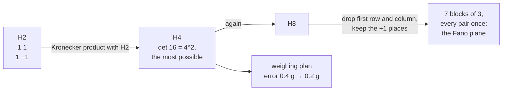

# Hadamard matrices: square tables of plus and minus ones with perpendicular rows, possible only in sizes 1, 2 and multiples of 4, and the largest determinant such a table can have

[Syllabus](../../../SYLLABUS.md) → [Combinatorics and graphs](../README.md) → [Designs](../README.md#s16) → Hadamard matrices

---

## General Overview

A lab weighs four parcels of 120, 75, 210 and 45 grams on a two-pan balance that shows left pan minus right pan. Each reading is off by about 0.4 g, so weighing them one at a time leaves each weight 0.4 g out.

Instead, put all four on the balance every time, each on the left pan (+1) or the right (−1):

| Weighing | Parcel 1 | Parcel 2 | Parcel 3 | Parcel 4 | Reading |
| --- | --- | --- | --- | --- | --- |
| 1 | + | + | + | + | 450 g |
| 2 | + | − | + | − | 210 g |
| 3 | + | + | − | − | −60 g |
| 4 | + | − | − | + | −120 g |

Each weight comes back as a signed average of the readings: parcel 1 is (450 + 210 − 60 − 120)/4 = 120 g. Averaging four readings halves the error to 0.2 g, at no extra cost.

The sign table is $`H_4`$, a **Hadamard matrix**: a square table of +1 and −1 whose rows are **perpendicular**, meaning any two different rows have dot product 0 (multiply place by place, then add). Perpendicular rows let the readings untangle cleanly.

**A Hadamard matrix is a square table of plus and minus ones whose rows are perpendicular; that forces its size to be 1, 2 or a multiple of 4, doubling builds one in every power of 2, and no square table with entries between −1 and 1 has a larger determinant.**

**What kind of fact this is:** a definition and four theorems, all proved on this card in Why it works. That every multiple of 4 has one is the Hadamard conjecture, unproved as of 2026-11-23.

### The picture: from H2 to the Fano plane



---

## The formula

```math
HH^{\mathsf T} = nI \quad\Longrightarrow\quad n = 1,\ n = 2 \ \text{or}\ 4 \mid n, \qquad H_{2n} = H_2 \otimes H_n, \qquad \lvert \det A \rvert \le n^{n/2}
```

**Read it aloud:** each row dotted with itself gives n and with any other row 0; that needs size 1, 2 or a multiple of 4; a Kronecker product with H2 doubles the size; and entries between −1 and 1 keep the determinant at most n to the power n/2.

For $`H_4`$: $`\det H_4 = 16 = 4^{4/2}`$, so it reaches the bound.

| Symbol | Plain meaning | In our example | Push it up and the answer… |
| --- | --- | --- | --- |
| $`H`$, $`n`$ | a Hadamard matrix and its number of rows | $`H_4`$, $`n = 4`$ | the bound $`n^{n/2}`$ grows fast |
| $`H^{\mathsf T}`$, $`I`$ | the transpose (the table turned on its side) and the identity matrix (1 on the diagonal, 0 elsewhere) | $`H_4H_4^{\mathsf T} = 4I`$ | — |
| $`\otimes`$ | the Kronecker product: every entry of the first table times the whole second table | $`H_4 = H_2 \otimes H_2`$ | — |
| $`A`$, $`a_{ij}`$, $`M`$ | any square table of real numbers, and its entry in row $`i`$, column $`j`$, here with $`\lvert a_{ij} \rvert \le 1`$; $`M`$ is one such table of ±1 | $`M`$ in Step 4 has determinant 8 | — |
| $`\det`$; $`U`$, $`L`$, $`u_i`$ | the determinant, the signed volume of the box the rows span; in the fold, the leftovers' table, the subtraction table, and row $`i`$'s leftover | $`\det H_4 = 16`$ | — |
| $`a, b, c, d`$; $`4 \mid n`$ | column counts in the size proof; "4 divides n" | 2, 2, 2, 2 in $`H_8`$ | each is $`n/4`$ |
| $`w`$, $`y`$ | the parcel weights, and the readings $`y = H_4 w`$ | 120, 75, 210, 45 g; 450, 210, −60, −120 g | — |
| 2-(v, k, λ) | a block design: v points, blocks of size k, each pair in λ blocks | 2-(7, 3, 1), the Fano plane | — |

### When it holds

- **Entries exactly ±1, in an allowed size.** Otherwise the bound holds but is not reached: at size 3 the best is 4, not 5.1962.
- **Every pair of rows perpendicular.** At size 6 at most 2 rows manage it.
- **Real entries.** Complex entries of size 1, as in the discrete Fourier matrix, give perpendicular rows in every size.
- **Normalised before reading a design.** Otherwise the blocks have unequal sizes.

---

## Why it works

### Step 0: perpendicular means half agree

Two ±1 rows give +1 where they agree and −1 where they differ, so they are perpendicular exactly when they agree in $`n/2`$ places. Every result below counts agreements.

### Step 1: flipping signs keeps a Hadamard matrix

Flip a column: that entry flips in every row, so no dot product changes. Flip a row: its dot products change sign, and 0 stays 0.

So any Hadamard matrix can be **normalised**: flip columns until the first row is all +1, then rows until the first column is. Sylvester's tables already are.

### Step 2: the size is 1, 2 or a multiple of 4

With two or more rows, rows 1 and 2 agree in $`n/2`$ places, so $`n`$ is even. Size 2 works: $`H_2`$.

For $`n \ge 3`$, normalise and look at rows 2 and 3. Sort the columns by the signs those rows hold there: $`a`$ columns with (+, +), $`b`$ with (+, −), $`c`$ with (−, +), $`d`$ with (−, −). Row 1 is all +1, so the three perpendicular pairs and the column total give

```math
a+b+c+d = n, \qquad a+b-c-d = 0, \qquad a-b+c-d = 0, \qquad a-b-c+d = 0
```

Adding all four gives $`4a = n`$, and the same trick gives $`b = c = d = n/4`$. So 4 divides $`n`$. In $`H_8`$ the counts are 2, 2, 2, 2.

At size 6 the counts would be 6/4, not whole. A search over all 10 balanced rows agrees: at most 2 perpendicular rows.

### Step 3: doubling with the Kronecker product

Build $`H_{2n}`$ as the block table `[[H, H], [H, -H]]`, which is $`H_2 \otimes H_n`$ ([Tensor products](../../03-Algebra/11-Duals%2C%20Quotients%20and%20Tensors/03-tensor-products.md)). Multiply it by its transpose, block by block:

```math
\begin{pmatrix} H & H \\ H & -H \end{pmatrix}\begin{pmatrix} H^{\mathsf T} & H^{\mathsf T} \\ H^{\mathsf T} & -H^{\mathsf T} \end{pmatrix} = \begin{pmatrix} 2HH^{\mathsf T} & 0 \\ 0 & 2HH^{\mathsf T} \end{pmatrix} = 2nI
```

The minus sign cancels the off-diagonal blocks. From $`H_2`$ this reaches every power of 2 (Sylvester, 1867).

### Step 4: Hadamard's bound, by Gram-Schmidt

Read $`\lvert \det A \rvert`$ as the volume of the box with the rows as edges ([Determinants](../../03-Algebra/05-Solving%20Systems/04-determinants.md)).

1. Run [Gram-Schmidt](../../03-Algebra/06-Dot%20Products%20and%20Best%20Fits/03-gram-schmidt-and-orthonormal-bases.md) without the rescaling: from each row subtract its shadow on the earlier rows (the part of it that points along them). What is left is the **leftover**.
2. This shears the box but keeps its volume. The leftovers are perpendicular, so the volume is the product of their lengths.
3. Each row is its shadow plus its leftover, at a right angle, so the leftover is no longer than the row.
4. A row of $`n`$ entries between −1 and 1 has length at most $`\sqrt{n}`$.

Chain them: $`\lvert \det A \rvert \le (\sqrt{n})^n = n^{n/2}`$. Equality needs every entry ±1 and every row already perpendicular to the earlier ones: a Hadamard matrix.

For $`H_4`$ the leftovers are 2, 2, 2, 2, product 16. For the table `M = [[1, 1, 1, 1], [1, 1, 1, -1], [1, 1, -1, 1], [1, -1, 1, 1]]` they are 2, 1.7321, 1.6330, 1.4142, product 8, which is its determinant.

<details>
<summary>Detailed proof: the box keeps its volume, and the volume is the product of the leftovers</summary>

Write the leftovers as the rows of a table $`U`$. Each leftover is its own row minus multiples of earlier rows, so $`U = LA`$, where $`L`$ has 1 on the diagonal and 0 above it. Then $`\det L = 1`$ and

$`\displaystyle \det U = \det L \cdot \det A = \det A`$

The rows of $`U`$ are perpendicular, so $`UU^{\mathsf T}`$ has the squared lengths on the diagonal and 0 elsewhere:

$`\displaystyle (\det A)^2 = \det U \cdot \det U^{\mathsf T} = \det(UU^{\mathsf T}) = \lVert u_1 \rVert^2 \cdots \lVert u_n \rVert^2`$

Here $`u_i`$ is the leftover of row $`i`$ and $`\lVert u_i \rVert`$ its length. For a Hadamard matrix the shortcut is direct: $`\det(HH^{\mathsf T}) = \det(nI) = n^n`$, so $`\lvert \det H \rvert = n^{n/2}`$.

</details>

### Step 5: from H8 to the Fano plane

Normalise $`H_8`$ and delete its first row and column. The 7 by 7 **core** that remains has three +1 entries in each row: four in the full row, minus the first.

Take the columns as points and the +1 places of each core row as a block. Sylvester's $`H_8`$ gives the blocks {2, 4, 6}, {1, 4, 5}, {3, 4, 7}, {1, 2, 3}, {2, 5, 7}, {1, 6, 7}, {3, 5, 6}. $`H^{\mathsf T}`$ is also Hadamard, because $`H^{\mathsf T}/n`$ is the inverse of $`H`$, so Step 2 applies to columns. Any two columns are both +1 in $`n/4 = 2`$ rows, one being the deleted top row. So each pair of points shares exactly 1 block: a 2-(7, 3, 1) design. Swap labels 3 and 4 and send 5 → 7 → 6 → 5, and the blocks become the house lines {1, 2, 4}, …, {7, 1, 3}.

In general a normalised $`H_n`$ gives a 2-(n − 1, n/2 − 1, n/4 − 1) design. It runs backwards too: +1 where a point lies on a Fano line, −1 elsewhere, plus a border of +1s, gives $`HH^{\mathsf T} = 8I`$. This core is twice the Fano plane's 0/1 incidence matrix, turned on its side, minus a table of all 1s.

---

## Worked numbers, by hand

| Step | Arithmetic | Value |
| --- | --- | --- |
| build $`H_4`$ | $`H_2 \otimes H_2`$ | rows `[1, 1, 1, 1]`, `[1, -1, 1, -1]`, `[1, 1, -1, -1]`, `[1, -1, -1, 1]` |
| rows 2 and 3 | 1 − 1 − 1 + 1 | 0, perpendicular |
| $`H_4H_4^{\mathsf T}`$ | each row with itself: 1 + 1 + 1 + 1 | $`4I`$ |
| $`\det(H_4H_4^{\mathsf T})`$ | $`4^4`$ | 256 |
| $`\det H_4`$ | square root of 256 | 16 |
| Hadamard's bound | $`4^{4/2}`$ | 16 |
| every 4 by 4 table of ±1 | 65,536 tables, largest absolute determinant | **16, reached by 768 tables** |

No 4 by 4 table of ±1 beats 16, and the 768 that reach it are the Hadamard matrices of size 4.

### What breaks if you drop a piece

| Mistake | Comes out at | What went wrong |
| --- | --- | --- |
| Expecting the bound at size 3 | largest of 512 tables is 4, not 5.1962 | no Hadamard matrix of size 3 exists |
| Doubling without the minus, `[[H4, H4], [H4, H4]]` | determinant 0, and $`HH^{\mathsf T} \ne 8I`$ | rows 1 and 5 are the same row |
| Reading the −1 places of the core as blocks | blocks of 4, each pair together 2 times | that is the complement, a 2-(7, 4, 2) design |
| Hoping for size 6 | at most 2 perpendicular rows | 6/4 is not whole |


---

## Code, from first principles, and it actually runs

The code builds Sylvester's tables and checks $`HH^{\mathsf T} = nI`$ up to size 16. It takes three roads to $`\det H_4`$: expansion along a row, Gram-Schmidt leftovers, and brute force over all 65,536 tables of ±1. It recovers the weights two ways, as $`H_4^{\mathsf T}y/4`$ and by elimination. It reads the Fano plane off $`H_8`$, finds the relabelling by search, and goes back.

### Python

```python
# Hadamard matrices -- the check behind the card.  Nothing is imported.  Sylvester's tables are
# Kronecker products of H2; the determinant is found by expansion, as a Gram-Schmidt volume and by
# brute force over every 4 by 4 table of +-1; the weighing plan is solved two ways; H8 becomes Fano.
def kron(a, b): return [[x * y for x in ra for y in rb] for ra in a for rb in b]
def gram(m): return [[sum(x * y for x, y in zip(p, q)) for q in m] for p in m]
def is_nI(m): return gram(m) == [[len(m) * (i == j) for j in range(len(m))] for i in range(len(m))]
def f4(xs): return ", ".join(f"{x:.4f}" for x in xs)
def det(m):                                    # Laplace expansion along the first row, exact
    return m[0][0] if len(m) == 1 else sum((-1) ** j * m[0][j] * det([r[:j] + r[j + 1:] for r in m[1:]]) for j in range(len(m)) if m[0][j])
def leftovers(m):                              # Gram-Schmidt: lengths of what is left of each row
    qs, out = [], []
    for u in m:
        for q in qs: u = [a - sum(x * z for x, z in zip(u, q)) * b for a, b in zip(u, q)]
        out.append(sum(a * a for a in u) ** 0.5); qs.append([a / out[-1] for a in u])
    return out
def solve(m, y):                               # Gauss-Jordan elimination (H4 needs no row swaps)
    n = len(m); a = [[float(x) for x in r] + [float(t)] for r, t in zip(m, y)]
    for i in range(n):
        for r in [r for r in range(n) if r != i]: a[r] = [x - a[r][i] / a[i][i] * z for x, z in zip(a[r], a[i])]
    return [a[i][n] / a[i][i] for i in range(n)]
def tables(n): return [[[1 - 2 * (c >> (n * i + j) & 1) for j in range(n)] for i in range(n)] for c in range(2 ** (n * n))]
def pairs(bl): return sorted({sum(x in B and y in B for B in bl) for x in range(1, 8) for y in range(x + 1, 8)})
def perms(xs): return [[x] + p for i, x in enumerate(xs) for p in perms(xs[:i] + xs[i + 1:])] if xs else [[]]
H2 = [[1, 1], [1, -1]]; H4 = kron(H2, H2); H8 = kron(H2, H4); H16 = kron(H2, H8)
print(f"H4 = H2 (x) H2 = {H4}\nH H^T = n I: " + ", ".join(f"n = {len(h)} {'yes' if is_nI(h) else 'NO'}" for h in (H2, H4, H8, H16)))
abcd = [sum(H8[1][c] == s and H8[2][c] == t for c in range(8)) for s, t in ((1, 1), (1, -1), (-1, 1), (-1, -1))]
print(f"H8 rows 2, 3: columns (+,+) (+,-) (-,+) (-,-) = {abcd}, each n/4 = {8 // 4}")
cand = [v for v in ([1] + [1 - 2 * (c >> j & 1) for j in range(5)] for c in range(32)) if sum(v) == 0]
ok = lambda s: all(sum(x * y for x, y in zip(cand[i], cand[j])) == 0 for i in range(10) for j in range(i) if s >> i & s >> j & 1)
best = 1 + max(bin(s).count("1") for s in range(2 ** len(cand)) if ok(s))
print(f"n = 6: {len(cand)} balanced rows, at most {best} mutually perpendicular rows, 6 needed")
all4 = [abs(det(t)) for t in tables(4)]; big = max(all4)
print(f"det H4 = {det(H4)}; det(H4 H4^T) = {det(gram(H4))} = 16^2; bound 4^(4/2) = {4 ** 2}")
print(f"all {len(all4)} 4 by 4 tables of +-1: largest |det| {big}, reached by {all4.count(big)}")
M = [[1, 1, 1, 1], [1, 1, 1, -1], [1, 1, -1, 1], [1, -1, 1, 1]]; lh, lm = leftovers(H4), leftovers(M)
pr = lambda xs: xs[0] * xs[1] * xs[2] * xs[3]
print(f"Gram-Schmidt leftovers: H4 {f4(lh)}, product {pr(lh):.4f}; M {f4(lm)}, product {pr(lm):.4f}; |det M| = {abs(det(M))}")
w = [120, 75, 210, 45]; y = [sum(h * x for h, x in zip(row, w)) for row in H4]
byT = [sum(H4[k][i] * y[k] for k in range(4)) / 4 for i in range(4)]; byG = solve(H4, y)
print(f"parcels {w} g; readings H4 w = {y} g\nrecovered: H4^T y / 4 = {f4(byT)}; elimination {f4(byG)}")
var = sum(solve(H4, [k == j for k in range(4)])[0] ** 2 for j in range(4))   # row 1 of H4^-1, squared
print(f"variance factor per parcel {var:.4f}: scale error 0.4 g becomes {0.4 * var ** 0.5:.4f} g")
core = [r[1:] for r in H8[1:]]
blocks = [tuple(j + 1 for j in range(7) if r[j] == 1) for r in core]; lam = pairs(blocks)
print(f"H8 core, +1 places: blocks {blocks}; every pair together {lam} times")
FANO = [(1, 2, 4), (2, 3, 5), (3, 4, 6), (4, 5, 7), (5, 6, 1), (6, 7, 2), (7, 1, 3)]; fs = {tuple(sorted(L)) for L in FANO}
pi = next(p for p in perms(list(range(1, 8))) if {tuple(sorted(p[x - 1] for x in B)) for B in blocks} == fs)
print("relabel " + " ".join(f"{x}->{pi[x - 1]}" for x in range(1, 8)) + ": the blocks become the 7 Fano lines")
back = [[1] * 8] + [[1] + [1 if x in L else -1 for x in range(1, 8)] for L in FANO]
print(f"Fano lines -> +1 on the line, -1 off it, border of +1s: H H^T = 8I {'yes' if is_nI(back) else 'NO'}")
all3 = [abs(det(t)) for t in tables(3)]; JH = kron([[1, 1], [1, 1]], H4)
minus = [tuple(j + 1 for j in range(7) if r[j] == -1) for r in core]; lam2 = pairs(minus)
print(f"mistake 1, n = 3: largest |det| of {len(all3)} tables {max(all3)}, bound 3^(3/2) = {3 ** 1.5:.4f}")
print(f"mistake 2, [[H4, H4], [H4, H4]]: det {det(JH)}, H H^T = 8I {'yes' if is_nI(JH) else 'NO'}")
print(f"mistake 3, -1 places: blocks of {len(minus[0])}, every pair together {lam2} times")
assert all(is_nI(h) for h in (H2, H4, H8, H16)) and abcd == [2, 2, 2, 2] and best == 2
assert det(H4) ** 2 == det(gram(H4)) == 4 ** 4 and big == 16 == round(pr(lh)) and abs(pr(lm) - abs(det(M))) < 1e-9
assert [round(x, 9) for x in byT] == [round(x, 9) for x in byG] == w and abs(var - 0.25) < 1e-12
assert lam == [1] and is_nI(back) and max(all3) == 4 and det(JH) == 0 and lam2 == [2]
print("ALL CHECKS PASS")
```

**Ran 2026-11-23 on macOS, Python 3.14.10, standard library only. All checks passed. Output, pasted from the run:**

```
H4 = H2 (x) H2 = [[1, 1, 1, 1], [1, -1, 1, -1], [1, 1, -1, -1], [1, -1, -1, 1]]
H H^T = n I: n = 2 yes, n = 4 yes, n = 8 yes, n = 16 yes
H8 rows 2, 3: columns (+,+) (+,-) (-,+) (-,-) = [2, 2, 2, 2], each n/4 = 2
n = 6: 10 balanced rows, at most 2 mutually perpendicular rows, 6 needed
det H4 = 16; det(H4 H4^T) = 256 = 16^2; bound 4^(4/2) = 16
all 65536 4 by 4 tables of +-1: largest |det| 16, reached by 768
Gram-Schmidt leftovers: H4 2.0000, 2.0000, 2.0000, 2.0000, product 16.0000; M 2.0000, 1.7321, 1.6330, 1.4142, product 8.0000; |det M| = 8
parcels [120, 75, 210, 45] g; readings H4 w = [450, 210, -60, -120] g
recovered: H4^T y / 4 = 120.0000, 75.0000, 210.0000, 45.0000; elimination 120.0000, 75.0000, 210.0000, 45.0000
variance factor per parcel 0.2500: scale error 0.4 g becomes 0.2000 g
H8 core, +1 places: blocks [(2, 4, 6), (1, 4, 5), (3, 4, 7), (1, 2, 3), (2, 5, 7), (1, 6, 7), (3, 5, 6)]; every pair together [1] times
relabel 1->1 2->2 3->4 4->3 5->7 6->5 7->6: the blocks become the 7 Fano lines
Fano lines -> +1 on the line, -1 off it, border of +1s: H H^T = 8I yes
mistake 1, n = 3: largest |det| of 512 tables 4, bound 3^(3/2) = 5.1962
mistake 2, [[H4, H4], [H4, H4]]: det 0, H H^T = 8I NO
mistake 3, -1 places: blocks of 4, every pair together [2] times
ALL CHECKS PASS
```

### Rust

Same numbers and labels.

```rust
// Hadamard matrices -- the same check as the Python, in Rust.  No crates.  Sylvester's tables are
// Kronecker products of H2; the determinant is found by expansion, as a Gram-Schmidt volume and by
// brute force over every 4 by 4 table of +-1; the weighing plan is solved two ways; H8 becomes Fano.
type M = Vec<Vec<i64>>;
fn kron(a: &M, b: &M) -> M { a.iter().flat_map(|ra| b.iter().map(move |rb| ra.iter().flat_map(|x| rb.iter().map(move |y| x * y)).collect())).collect() }
fn dot(p: &[i64], q: &[i64]) -> i64 { p.iter().zip(q).map(|(x, y)| x * y).sum() }
fn gram(m: &M) -> M { m.iter().map(|p| m.iter().map(|q| dot(p, q)).collect()).collect() }
fn is_ni(m: &M) -> bool { let n = m.len() as i64; let g = gram(m); (0..m.len()).all(|i| (0..m.len()).all(|j| g[i][j] == n * (i == j) as i64)) }
fn yes(b: bool) -> &'static str { if b { "yes" } else { "NO" } }
fn f4(xs: &[f64]) -> String { xs.iter().map(|x| format!("{:.4}", x)).collect::<Vec<_>>().join(", ") }
fn det(m: &M) -> i64 {                           // Laplace expansion along the first row, exact
    if m.len() == 1 { return m[0][0]; }
    (0..m.len()).filter(|&j| m[0][j] != 0).map(|j| (1 - 2 * (j as i64 % 2)) * m[0][j]
        * det(&m[1..].iter().map(|r| [&r[..j], &r[j + 1..]].concat()).collect())).sum()
}
fn leftovers(m: &M) -> Vec<f64> {                // Gram-Schmidt: lengths of what is left of each row
    let (mut qs, mut out): (Vec<Vec<f64>>, Vec<f64>) = (vec![], vec![]);
    for row in m {
        let mut u: Vec<f64> = row.iter().map(|&x| x as f64).collect();
        for q in &qs { let d: f64 = u.iter().zip(q).map(|(a, b)| a * b).sum(); u = u.iter().zip(q).map(|(a, b)| a - d * b).collect(); }
        let l = u.iter().map(|a| a * a).sum::<f64>().sqrt(); out.push(l); qs.push(u.iter().map(|a| a / l).collect());
    }
    out
}
fn solve(m: &M, y: &[f64]) -> Vec<f64> {         // Gauss-Jordan elimination (H4 needs no row swaps)
    let n = m.len(); let mut a: Vec<Vec<f64>> = m.iter().zip(y).map(|(r, t)| r.iter().map(|&x| x as f64).chain([*t]).collect()).collect();
    for i in 0..n { for r in (0..n).filter(|&r| r != i) { let f = a[r][i] / a[i][i]; let ai = a[i].clone(); for c in 0..=n { a[r][c] -= f * ai[c]; } } }
    (0..n).map(|i| a[i][n] / a[i][i]).collect()
}
fn tables(n: usize) -> Vec<M> { (0..1u32 << (n * n)).map(|c| (0..n).map(|i| (0..n).map(|j| 1 - 2 * ((c >> (n * i + j)) & 1) as i64).collect()).collect()).collect() }
fn pairs(bl: &Vec<Vec<i64>>) -> Vec<i64> {
    let mut s: Vec<i64> = (1..8).flat_map(|x| (x + 1..8).map(move |y| (x, y))).map(|(x, y)| bl.iter().filter(|b| b.contains(&x) && b.contains(&y)).count() as i64).collect();
    s.sort(); s.dedup(); s
}
fn perms(xs: Vec<i64>) -> Vec<Vec<i64>> {                // every ordering, in dictionary order
    if xs.is_empty() { vec![vec![]] } else { (0..xs.len()).flat_map(|i| { let mut rest = xs.clone(); let x = rest.remove(i); perms(rest).into_iter().map(move |p| [vec![x], p].concat()) }).collect() }
}
fn tup(bl: &Vec<Vec<i64>>) -> String { bl.iter().map(|b| format!("({})", b.iter().map(|x| x.to_string()).collect::<Vec<_>>().join(", "))).collect::<Vec<_>>().join(", ") }
fn main() {
    let h2: M = vec![vec![1, 1], vec![1, -1]]; let h4 = kron(&h2, &h2); let h8 = kron(&h2, &h4); let h16 = kron(&h2, &h8);
    println!("H4 = H2 (x) H2 = {:?}", h4);
    println!("H H^T = n I: {}", [&h2, &h4, &h8, &h16].iter().map(|h| format!("n = {} {}", h.len(), yes(is_ni(h)))).collect::<Vec<_>>().join(", "));
    let abcd: Vec<usize> = [(1, 1), (1, -1), (-1, 1), (-1, -1)].iter().map(|&(s, t)| (0..8).filter(|&c| h8[1][c] == s && h8[2][c] == t).count()).collect();
    println!("H8 rows 2, 3: columns (+,+) (+,-) (-,+) (-,-) = {:?}, each n/4 = {}", abcd, 8 / 4);
    let cand: Vec<Vec<i64>> = (0..32).map(|c| [vec![1], (0..5).map(|j| 1 - 2 * ((c >> j) & 1)).collect()].concat()).filter(|v: &Vec<i64>| v.iter().sum::<i64>() == 0).collect();
    let ok = |s: u32| (0..10).all(|i| (0..i).all(|j| (s >> i) & (s >> j) & 1 == 0 || dot(&cand[i], &cand[j]) == 0));
    let best = 1 + (0..1u32 << cand.len()).filter(|&s| ok(s)).map(|s| s.count_ones()).max().unwrap();
    println!("n = 6: {} balanced rows, at most {} mutually perpendicular rows, 6 needed", cand.len(), best);
    let all4: Vec<i64> = tables(4).iter().map(|t| det(t).abs()).collect(); let big = *all4.iter().max().unwrap();
    println!("det H4 = {}; det(H4 H4^T) = {} = 16^2; bound 4^(4/2) = {}", det(&h4), det(&gram(&h4)), 4i64.pow(2));
    println!("all {} 4 by 4 tables of +-1: largest |det| {}, reached by {}", all4.len(), big, all4.iter().filter(|&&d| d == big).count());
    let m: M = vec![vec![1, 1, 1, 1], vec![1, 1, 1, -1], vec![1, 1, -1, 1], vec![1, -1, 1, 1]]; let (lh, lm) = (leftovers(&h4), leftovers(&m));
    let pr = |xs: &Vec<f64>| xs[0] * xs[1] * xs[2] * xs[3];
    println!("Gram-Schmidt leftovers: H4 {}, product {:.4}; M {}, product {:.4}; |det M| = {}", f4(&lh), pr(&lh), f4(&lm), pr(&lm), det(&m).abs());
    let w = vec![120i64, 75, 210, 45]; let y: Vec<i64> = h4.iter().map(|r| dot(r, &w)).collect();
    let by_t: Vec<f64> = (0..4).map(|i| (0..4).map(|k| h4[k][i] * y[k]).sum::<i64>() as f64 / 4.0).collect();
    let by_g = solve(&h4, &y.iter().map(|&t| t as f64).collect::<Vec<_>>());
    println!("parcels {:?} g; readings H4 w = {:?} g\nrecovered: H4^T y / 4 = {}; elimination {}", w, y, f4(&by_t), f4(&by_g));
    let var: f64 = (0..4).map(|j| solve(&h4, &(0..4).map(|k| (k == j) as i64 as f64).collect::<Vec<_>>())[0].powi(2)).sum();
    println!("variance factor per parcel {:.4}: scale error 0.4 g becomes {:.4} g", var, 0.4 * var.sqrt());
    let core: M = h8[1..].iter().map(|r| r[1..].to_vec()).collect();
    let pick = |s: i64| -> Vec<Vec<i64>> { core.iter().map(|r| (0..7).filter(|&j| r[j] == s).map(|j| j as i64 + 1).collect()).collect() };
    let (blocks, minus) = (pick(1), pick(-1)); let (lam, lam2) = (pairs(&blocks), pairs(&minus));
    println!("H8 core, +1 places: blocks [{}]; every pair together {:?} times", tup(&blocks), lam);
    let fano: M = vec![vec![1, 2, 4], vec![2, 3, 5], vec![3, 4, 6], vec![4, 5, 7], vec![5, 6, 1], vec![6, 7, 2], vec![7, 1, 3]];
    let norm = |bl: &M| { let mut s: M = bl.iter().map(|b| { let mut b = b.clone(); b.sort(); b }).collect(); s.sort(); s };
    let pi = perms((1..8).collect()).into_iter().find(|p| norm(&blocks.iter().map(|b| b.iter().map(|&x| p[x as usize - 1]).collect()).collect()) == norm(&fano)).unwrap();
    println!("relabel {}: the blocks become the 7 Fano lines", (1..8).map(|x| format!("{}->{}", x, pi[x - 1])).collect::<Vec<_>>().join(" "));
    let back: M = [vec![vec![1; 8]], fano.iter().map(|l| [vec![1], (1..8).map(|x| if l.contains(&x) { 1 } else { -1 }).collect()].concat()).collect()].concat();
    println!("Fano lines -> +1 on the line, -1 off it, border of +1s: H H^T = 8I {}", yes(is_ni(&back)));
    let all3: Vec<i64> = tables(3).iter().map(|t| det(t).abs()).collect(); let jh = kron(&vec![vec![1, 1], vec![1, 1]], &h4);
    println!("mistake 1, n = 3: largest |det| of {} tables {}, bound 3^(3/2) = {:.4}", all3.len(), all3.iter().max().unwrap(), 3f64.powf(1.5));
    println!("mistake 2, [[H4, H4], [H4, H4]]: det {}, H H^T = 8I {}", det(&jh), yes(is_ni(&jh)));
    println!("mistake 3, -1 places: blocks of {}, every pair together {:?} times", minus[0].len(), lam2);
    assert!([&h2, &h4, &h8, &h16].iter().all(|h| is_ni(h)) && abcd == vec![2, 2, 2, 2] && best == 2);
    assert!(det(&h4).pow(2) == det(&gram(&h4)) && det(&gram(&h4)) == 256 && big == 16 && pr(&lh).round() == 16.0 && (pr(&lm) - det(&m).abs() as f64).abs() < 1e-9);
    assert!((0..4).all(|i| (by_t[i] - w[i] as f64).abs() < 1e-9 && (by_g[i] - w[i] as f64).abs() < 1e-9) && (var - 0.25).abs() < 1e-12);
    assert!(lam == vec![1] && is_ni(&back) && *all3.iter().max().unwrap() == 4 && det(&jh) == 0 && lam2 == vec![2]);
    println!("ALL CHECKS PASS");
}
```

**Ran 2026-11-23 on macOS, rustc 1.98.1, no crates. All checks passed. Output, pasted from the run:**

```
H4 = H2 (x) H2 = [[1, 1, 1, 1], [1, -1, 1, -1], [1, 1, -1, -1], [1, -1, -1, 1]]
H H^T = n I: n = 2 yes, n = 4 yes, n = 8 yes, n = 16 yes
H8 rows 2, 3: columns (+,+) (+,-) (-,+) (-,-) = [2, 2, 2, 2], each n/4 = 2
n = 6: 10 balanced rows, at most 2 mutually perpendicular rows, 6 needed
det H4 = 16; det(H4 H4^T) = 256 = 16^2; bound 4^(4/2) = 16
all 65536 4 by 4 tables of +-1: largest |det| 16, reached by 768
Gram-Schmidt leftovers: H4 2.0000, 2.0000, 2.0000, 2.0000, product 16.0000; M 2.0000, 1.7321, 1.6330, 1.4142, product 8.0000; |det M| = 8
parcels [120, 75, 210, 45] g; readings H4 w = [450, 210, -60, -120] g
recovered: H4^T y / 4 = 120.0000, 75.0000, 210.0000, 45.0000; elimination 120.0000, 75.0000, 210.0000, 45.0000
variance factor per parcel 0.2500: scale error 0.4 g becomes 0.2000 g
H8 core, +1 places: blocks [(2, 4, 6), (1, 4, 5), (3, 4, 7), (1, 2, 3), (2, 5, 7), (1, 6, 7), (3, 5, 6)]; every pair together [1] times
relabel 1->1 2->2 3->4 4->3 5->7 6->5 7->6: the blocks become the 7 Fano lines
Fano lines -> +1 on the line, -1 off it, border of +1s: H H^T = 8I yes
mistake 1, n = 3: largest |det| of 512 tables 4, bound 3^(3/2) = 5.1962
mistake 2, [[H4, H4], [H4, H4]]: det 0, H H^T = 8I NO
mistake 3, -1 places: blocks of 4, every pair together [2] times
ALL CHECKS PASS
```

### Lean

Lean proves the size rule, the doubling step and Hadamard's bound for every size $`n`$, and checks the worked numbers.

- Suppose $`H`$ is an $`n`$ by $`n`$ table of ±1 with $`HH^{\mathsf T} = nI`$. Then $`n`$ is 1, 2 or a multiple of 4.
- Suppose $`H`$ is such a table. Then $`H_2 \otimes H`$ is a Hadamard matrix of size $`2n`$.
- Suppose $`A`$ is an $`n`$ by $`n`$ table of real numbers with every $`\lvert a_{ij} \rvert \le 1`$. Then $`\lvert \det A \rvert \le n^{n/2}`$.
- Take $`H_4 = H_2 \otimes H_2`$. Then $`H_4H_4^{\mathsf T} = 4I`$ and $`\det H_4 = 16`$, so it reaches the bound.
- Take parcels of 120, 75, 210 and 45 g. Then the readings are 450, 210, −60 and −120 g, and $`H_4^{\mathsf T}y/4`$ gives the parcels back.
- In Sylvester's $`H_8`$, rows 2 and 3 give the column counts 2, 2, 2, 2.
- The +1 places of the core of Sylvester's $`H_8`$ form a 2-(7, 3, 1) design, the Fano plane. In the −1 places, each pair of points is together 2 times.
- Put +1 on each house line and −1 off it, plus a border of +1s. Then $`HH^{\mathsf T} = 8I`$.
- Doubling without the minus, `[[H4, H4], [H4, H4]]`, fails: $`HH^{\mathsf T} \ne 8I`$.

The equality case, the searches over small tables and the Gram-Schmidt leftovers are left to the Python and Rust checks.

```lean
-- Hadamard matrices: a square table of plus and minus ones with perpendicular rows has size 1, 2 or a multiple of 4, the Kronecker product with H2 doubles such a table, and no real square table with entries between -1 and 1 has determinant larger than n^(n/2).
import Mathlib.LinearAlgebra.Matrix.Kronecker
import Mathlib.LinearAlgebra.Matrix.Determinant.Basic
import Mathlib.Analysis.SpecialFunctions.Pow.Real
import Mathlib.LinearAlgebra.Matrix.Notation
import Mathlib.Analysis.Matrix.PosDef
import Mathlib.Analysis.MeanInequalities
import Mathlib.Analysis.SpecialFunctions.Pow.NNReal
import Mathlib.Analysis.SpecialFunctions.Sqrt
import Mathlib.Algebra.Order.Star.Real
import Mathlib.Tactic

namespace HadamardMatrices

open Matrix
open scoped Kronecker

/-- The card's main result, the size rule. Take an `n` by `n` table `H` whose entries are all
`+1` or `-1` and whose rows are perpendicular, so that `H * Hᵀ = n I` (each row dotted with itself
gives `n`, with any other row gives `0`). Then the size `n` is 1, 2 or a multiple of 4. -/
theorem hadamard_size_one_two_or_four_dvd {n : ℕ} (H : Matrix (Fin n) (Fin n) ℤ)
    (hpm : ∀ i j, H i j = 1 ∨ H i j = -1)
    (hH : H * Hᵀ = (n : ℤ) • (1 : Matrix (Fin n) (Fin n) ℤ)) :
    n = 1 ∨ n = 2 ∨ 4 ∣ n := by
  rcases Nat.lt_or_ge n 3 with h | h
  · interval_cases n <;> simp
  right; right
  have e : ∀ i k : Fin n, ∑ j, H i j * H k j = if i = k then (n : ℤ) else 0 := by
    intro i k
    have : ∑ j, H i j * H k j = (H * Hᵀ) i k := by rw [Matrix.mul_apply]; rfl
    rw [this, hH]; split_ifs with hik <;> simp [hik]
  let a : Fin n := ⟨0, by omega⟩
  let b : Fin n := ⟨1, by omega⟩
  let c : Fin n := ⟨2, by omega⟩
  have hab : a ≠ b := by simp [a, b, Fin.ext_iff]
  have hac : a ≠ c := by simp [a, c, Fin.ext_iff]
  have hbc : b ≠ c := by simp [b, c, Fin.ext_iff]
  have key : (n : ℤ) = ∑ j, (H a j + H b j) * (H a j + H c j) := by
    have h1 := e a a
    have h2 := e a c
    have h3 := e b a
    have h4 := e b c
    simp only [↓reduceIte, hac, hab.symm, hbc] at h1 h2 h3 h4
    have : ∑ j, (H a j + H b j) * (H a j + H c j)
        = ∑ j, H a j * H a j + ∑ j, H a j * H c j + ∑ j, H b j * H a j + ∑ j, H b j * H c j := by
      simp only [← Finset.sum_add_distrib]; congr 1; ext j; ring
    rw [this, h1, h2, h3, h4]; ring
  have : (4 : ℤ) ∣ (n : ℤ) := by
    rw [key]
    apply Finset.dvd_sum
    intro j _
    rcases hpm a j with h1 | h1 <;> rcases hpm b j with h2 | h2 <;> rcases hpm c j with h3 | h3 <;>
      simp [h1, h2, h3]
  exact_mod_cast this

/-- Sylvester's doubling. If `H` is an `n` by `n` table of `±1` with `H * Hᵀ = n I`, then the
Kronecker product `H₂ ⊗ H` with `H₂ = [[1, 1], [1, -1]]` (the block table `[[H, H], [H, -H]]`)
is a `2n` by `2n` table of `±1` with perpendicular rows: its product with its transpose is
`2n I`. -/
theorem sylvester_doubling_is_hadamard {n : ℕ} (H : Matrix (Fin n) (Fin n) ℤ)
    (hpm : ∀ i j, H i j = 1 ∨ H i j = -1)
    (hH : H * Hᵀ = (n : ℤ) • (1 : Matrix (Fin n) (Fin n) ℤ)) :
    (∀ i j, (!![1, 1; 1, -1] ⊗ₖ H) i j = 1 ∨ (!![1, 1; 1, -1] ⊗ₖ H) i j = -1) ∧
      (!![1, 1; 1, -1] ⊗ₖ H) * (!![1, 1; 1, -1] ⊗ₖ H)ᵀ =
        ((2 * n : ℕ) : ℤ) • (1 : Matrix (Fin 2 × Fin n) (Fin 2 × Fin n) ℤ) := by
  constructor
  · rintro ⟨a, i⟩ ⟨b, j⟩
    simp only [kroneckerMap_apply]
    rcases hpm i j with h | h <;> fin_cases a <;> fin_cases b <;> simp [h]
  · have h2 : (!![1, 1; 1, -1] : Matrix (Fin 2) (Fin 2) ℤ) * (!![1, 1; 1, -1])ᵀ
        = (2 : ℤ) • (1 : Matrix (Fin 2) (Fin 2) ℤ) := by decide
    rw [← kroneckerMap_transpose, ← mul_kronecker_mul, h2, hH,
      smul_kronecker, kronecker_smul, one_kronecker_one, smul_smul]
    push_cast; ring_nf

/-- Hadamard's bound. Every `n` by `n` table `A` of real numbers whose entries all lie between
`-1` and `1` has determinant at most `n` to the power `n/2` in size: `|det A| ≤ n ^ (n/2)`. -/
theorem abs_det_le_hadamard_bound {n : ℕ} (A : Matrix (Fin n) (Fin n) ℝ)
    (hA : ∀ i j, |A i j| ≤ 1) :
    |A.det| ≤ (n : ℝ) ^ ((n : ℝ) / 2) := by
  rcases Nat.eq_zero_or_pos n with rfl | hn
  · simp
  have hP : (A * Aᵀ).PosSemidef := by
    simpa [conjTranspose_eq_transpose_of_trivial] using posSemidef_self_mul_conjTranspose A
  have hev : ∀ i, 0 ≤ hP.1.eigenvalues i := hP.eigenvalues_nonneg
  have hdet : A.det ^ 2 = ∏ i, hP.1.eigenvalues i := by
    have := hP.1.det_eq_prod_eigenvalues
    rw [det_mul, det_transpose] at this
    simpa [sq] using this
  have htr : ∑ i, hP.1.eigenvalues i ≤ (n : ℝ) ^ 2 := by
    have := hP.1.trace_eq_sum_eigenvalues
    simp only [RCLike.ofReal_real_eq_id, id] at this
    rw [← this]
    simp only [trace, diag, Matrix.mul_apply, transpose_apply]
    calc ∑ i, ∑ j, A i j * A i j ≤ ∑ i : Fin n, ∑ j : Fin n, (1 : ℝ) := by
          gcongr with i _ j _
          have := hA i j
          nlinarith [abs_mul_abs_self (A i j), abs_nonneg (A i j)]
      _ = (n : ℝ) ^ 2 := by simp; ring
  have hn' : (0 : ℝ) < n := by exact_mod_cast hn
  have hamgm : ∏ i, hP.1.eigenvalues i ^ ((1 : ℝ) / n) ≤ ∑ i, ((1 : ℝ) / n) * hP.1.eigenvalues i :=
    Real.geom_mean_le_arith_mean_weighted Finset.univ (fun _ => (1 : ℝ) / n) _
      (fun _ _ => by positivity) (by simp; field_simp) (fun i _ => hev i)
  rw [Real.finsetProd_rpow _ _ (fun i _ => hev i), ← Finset.mul_sum] at hamgm
  have h1 : (A.det ^ 2) ^ ((1 : ℝ) / n) ≤ n := by
    rw [hdet]
    calc _ ≤ _ := hamgm
      _ ≤ 1 / n * (n : ℝ) ^ 2 := by gcongr
      _ = n := by field_simp
  have h2 : |A.det| = ((A.det ^ 2) ^ ((1 : ℝ) / n)) ^ ((n : ℝ) / 2) := by
    rw [← Real.rpow_mul (by positivity)]
    have : (1 : ℝ) / n * (n / 2) = 1 / 2 := by field_simp
    rw [this, ← Real.sqrt_eq_rpow, Real.sqrt_sq_eq_abs]
  rw [h2]
  exact Real.rpow_le_rpow (by positivity) h1 (by positivity)

/-! ### The card's worked examples -/

/-- `H₂ = [[1, 1], [1, -1]]`. -/
def H2 : Matrix (Fin 2) (Fin 2) ℤ := !![1, 1; 1, -1]

/-- `H₄ = H₂ ⊗ H₂`, written out as on the card. -/
def H4 : Matrix (Fin 4) (Fin 4) ℤ :=
  !![1, 1, 1, 1; 1, -1, 1, -1; 1, 1, -1, -1; 1, -1, -1, 1]

-- H4 is the Kronecker product H2 ⊗ H2 (pairs (a, b) listed as row 2a + b).
example : H2 ⊗ₖ H2 = H4.submatrix finProdFinEquiv finProdFinEquiv := by decide

-- H4 H4ᵀ = 4 I.
example : H4 * H4ᵀ = (4 : ℤ) • (1 : Matrix (Fin 4) (Fin 4) ℤ) := by decide

-- det H4 = 16 = 4 ^ (4/2): H4 reaches Hadamard's bound.
example : H4.det = 16 := by
  simp [H4, Matrix.det_succ_row_zero, Fin.sum_univ_succ]; decide

-- The weighing plan: parcels 120, 75, 210, 45 g give readings 450, 210, -60, -120 g,
-- and H4ᵀ y / 4 recovers the parcels.
example : H4 *ᵥ ![120, 75, 210, 45] = ![450, 210, -60, -120] := by decide
example : H4ᵀ *ᵥ ![450, 210, -60, -120] = (4 : ℤ) • ![120, 75, 210, 45] := by decide

-- Rows 2 and 3 of Sylvester's H8 = H2 ⊗ H4: the columns split 2, 2, 2, 2 by sign pattern.
example :
    (Finset.univ.filter fun c : Fin 2 × Fin 4 => (H2 ⊗ₖ H4) (0, 1) c = 1 ∧ (H2 ⊗ₖ H4) (0, 2) c = 1).card = 2 ∧
    (Finset.univ.filter fun c : Fin 2 × Fin 4 => (H2 ⊗ₖ H4) (0, 1) c = 1 ∧ (H2 ⊗ₖ H4) (0, 2) c = -1).card = 2 ∧
    (Finset.univ.filter fun c : Fin 2 × Fin 4 => (H2 ⊗ₖ H4) (0, 1) c = -1 ∧ (H2 ⊗ₖ H4) (0, 2) c = 1).card = 2 ∧
    (Finset.univ.filter fun c : Fin 2 × Fin 4 => (H2 ⊗ₖ H4) (0, 1) c = -1 ∧ (H2 ⊗ₖ H4) (0, 2) c = -1).card = 2 := by
  decide

/-- The 7 by 7 core of Sylvester's `H₈`: its first row and column deleted. -/
def core8 (i j : Fin 7) : ℤ :=
  (H2 ⊗ₖ H4) (finProdFinEquiv.symm (i.succ.cast rfl)) (finProdFinEquiv.symm (j.succ.cast rfl))

-- Each core row has three +1 places, and every two columns share a +1 in exactly one row:
-- the +1 places form a 2-(7, 3, 1) design, the Fano plane.
example : ∀ i : Fin 7, (Finset.univ.filter fun j => core8 i j = 1).card = 3 := by decide
example : ∀ x y : Fin 7, x ≠ y →
    (Finset.univ.filter fun i => core8 i x = 1 ∧ core8 i y = 1).card = 1 := by decide

-- The −1 places give the complement: blocks of 4, each pair together twice, a 2-(7, 4, 2) design.
example : ∀ x y : Fin 7, x ≠ y →
    (Finset.univ.filter fun i => core8 i x = -1 ∧ core8 i y = -1).card = 2 := by decide

/-- Back from the Fano plane: a border of `+1`s, then `+1` on each house line {1, 2, 4},
{2, 3, 5}, {3, 4, 6}, {4, 5, 7}, {5, 6, 1}, {6, 7, 2}, {7, 1, 3} and `-1` off it. -/
def fanoH8 : Matrix (Fin 8) (Fin 8) ℤ :=
  !![1, 1, 1, 1, 1, 1, 1, 1;
     1, 1, 1, -1, 1, -1, -1, -1;
     1, -1, 1, 1, -1, 1, -1, -1;
     1, -1, -1, 1, 1, -1, 1, -1;
     1, -1, -1, -1, 1, 1, -1, 1;
     1, 1, -1, -1, -1, 1, 1, -1;
     1, -1, 1, -1, -1, -1, 1, 1;
     1, 1, -1, 1, -1, -1, -1, 1]

example : fanoH8 * fanoH8ᵀ = (8 : ℤ) • (1 : Matrix (Fin 8) (Fin 8) ℤ) := by decide

-- Dropping the minus: [[H4, H4], [H4, H4]] has two equal rows, so H Hᵀ ≠ 8 I.
example : (!![1, 1; 1, 1] ⊗ₖ H4) * (!![1, 1; 1, 1] ⊗ₖ H4)ᵀ ≠
    (8 : ℤ) • (1 : Matrix (Fin 2 × Fin 4) (Fin 2 × Fin 4) ℤ) := by decide

#print axioms hadamard_size_one_two_or_four_dvd
#print axioms sylvester_doubling_is_hadamard
#print axioms abs_det_le_hadamard_bound

end HadamardMatrices
```

**Checked 2026-11-23 on macOS, Lean 4.36.0-rc2, Mathlib v4.36.0-rc2. Every proof is complete and uses only Lean's standard axioms. Output, pasted from the run:**

```
'HadamardMatrices.hadamard_size_one_two_or_four_dvd' depends on axioms: [propext, Classical.choice, Quot.sound]
'HadamardMatrices.sylvester_doubling_is_hadamard' depends on axioms: [propext, Classical.choice, Quot.sound]
'HadamardMatrices.abs_det_le_hadamard_bound' depends on axioms: [propext, Classical.choice, Quot.sound]
```

> [!TIP]
> **Try changing**
> - **Different parcels.** Set `w` to `[500, 1, 33, 250]`. Guess first: does the error factor change? No, it stays 0.2500: it depends only on the plan.
> - **A noisier balance.** Change both `0.4`s to `1.0`. Guess first: the error per parcel becomes 0.5000 g, half the balance's error.
> - **Start from a different H2.** Set `H2 = [[1, 1], [-1, 1]]`. Guess first: what fails? The size checks pass, but $`H_8`$ is no longer normalised, the blocks have unequal sizes, and the relabelling search stops the program.

---

## The usual mistake

> [!warning]
> **Reading the size rule backwards.** The rule forbids every size except 1, 2 and multiples of 4. It does not promise that every multiple of 4 works. That is the Hadamard conjecture, still open: 428 was settled in 2005, and 668 is the smallest size with no known example.
>
> - **Dropping the minus in the doubling.** `[[H4, H4], [H4, H4]]` has determinant 0.
> - **Expecting the bound at every size.** At size 3 the best is 4, not 5.1962.
> - **Reading the −1 places.** They give the 2-(7, 4, 2) complement, not the Fano plane.

---

## Where you meet it in real life

- **Weighing and measuring.** Weighing objects together by a ±1 plan cuts the error per object, as Hotelling showed in 1944.
- **Mobile phone signals.** Older CDMA (code-division) networks gave each call one row of Sylvester's 64 by 64 table. Perpendicular rows let a receiver pull one call out of the sum.
- **Codes from space.** The 1971 Mariner 9 probe sent its Mars pictures with a code made from the rows of a 32 by 32 Hadamard matrix and their negatives.
- **Screening experiments.** Plackett–Burman designs, built from Hadamard matrices, test 11 factors in 12 runs.

> **Say it back**
> A Hadamard matrix is a square table of +1 and −1 with perpendicular rows, so H H^T = n I. Counting how three rows agree forces size 1, 2 or a multiple of 4. The block table [H, H; H, −H] doubles the size. Gram-Schmidt caps the determinant at n^(n/2) for entries between −1 and 1, and Hadamard matrices reach it: 16 for H4. The +1 places in the core of a normalised H8 are the Fano plane.

---

## What this builds on

- [Block designs](01-block-designs-and-fishers-inequality.md): the 2-(v, k, λ) language and the Fano plane that $`H_8`$ turns into.
- [Steiner triple systems](02-steiner-triple-systems.md) and [Finite planes and orthogonal Latin squares](03-projective-planes-and-orthogonal-latin-squares.md): the Fano plane as the smallest of each family.
- [Tensor products](../../03-Algebra/11-Duals%2C%20Quotients%20and%20Tensors/03-tensor-products.md): the Kronecker product behind Sylvester's doubling.
- [Gram-Schmidt](../../03-Algebra/06-Dot%20Products%20and%20Best%20Fits/03-gram-schmidt-and-orthonormal-bases.md): the shadows and leftovers that prove Hadamard's bound.
- [Determinants](../../03-Algebra/05-Solving%20Systems/04-determinants.md): the determinant as a volume, unchanged when multiples of one row are added to another.

## Where this goes next

The fast Walsh–Hadamard transform, which multiplies by Sylvester's table in about $`n \log n`$ steps, and Hadamard codes are planned for the applied and computational wing.

Does every multiple of 4 have a Hadamard matrix, starting with 668?

---

## Sources

Verified 2026-11-23: every link below resolves to the publisher's page.

- Sylvester, J. J. "Thoughts on inverse orthogonal matrices, simultaneous sign-successions, and tessellated pavements in two or more colours." *Philosophical Magazine* 34 (1867), 461–475. [doi:10.1080/14786446708639914](https://doi.org/10.1080/14786446708639914). The doubling construction that gives every power of 2.
- Hotelling, H. "Some improvements in weighing and other experimental techniques." *Annals of Mathematical Statistics* 15 (1944), 297–306. [doi:10.1214/aoms/1177731236](https://doi.org/10.1214/aoms/1177731236). Weighing objects together, and the smaller error.
- Kharaghani, H., and B. Tayfeh-Rezaie. "A Hadamard matrix of order 428." *Journal of Combinatorial Designs* 13 (2005), 435–440. [doi:10.1002/jcd.20043](https://doi.org/10.1002/jcd.20043). The construction that left 668 as the smallest open size.
- van Lint, J. H., and R. M. Wilson. *A Course in Combinatorics*, 2nd ed. Cambridge University Press, 2001. [doi:10.1017/CBO9780511987045](https://doi.org/10.1017/CBO9780511987045). Chapter 18: the size rule, Sylvester's construction and the link to designs.
