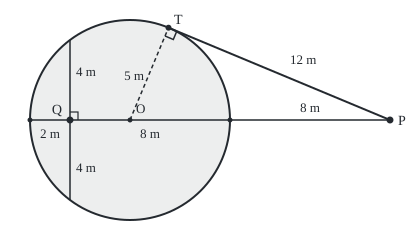

# Power of a point: every chord, secant and tangent through one point gives the same product

[Syllabus](../../../SYLLABUS.md) → [Geometry and trig](../README.md) → [Circles and Solids](../README.md#s02) → Power of a point

---

## General Overview

A round pond is 10 m across, so its radius is 5 m. Nobody wants to wade in with a tape. A stake stands on the grass 13 m from the pond's centre.

Stretch a string from the stake so it just grazes the water's edge: it is 12 m long. The shortest line from the stake to the water heads for the centre: it reaches the near bank after 8 m and the far bank after 18 m. And 8 × 18 = 144 = 12 × 12. Tilt the line by any angle that still crosses the water and the two distances change, but their product stays 144.

So the stake alone fixes one number, 144 square metres. Measure the string and the near bank, and the far bank follows: 144 ÷ 8 = 18 m. The pond is 18 − 8 = 10 m across, found without getting wet.

Inside works too. A fountain jet stands 3 m from the centre. Every straight footbridge over it, bank to bank, is cut by the jet into two pieces that multiply to 16: 2 and 8 along the diameter, 4 and 4 square across (at right angles to it).

**Every straight line through a point that meets a circle cuts off two distances whose product is the same number: the size of the point's power, its distance from the centre squared minus the radius squared (negative inside).**

**What kind of fact this is:** a theorem, Euclid's *Elements* III.35 and III.36, proved on this card in Why it works; "power" and "radical axis" are definitions.

### The picture: the pond, the stake and the fountain

<p align="center"></p>

To scale, 1 m = 20 units. P is the stake, T the point the string touches, O the centre and Q the fountain. Dashed: the radius OT. The small squares mark right angles. Above the diameter, the stake's 8 m to the near bank; below it, the fountain's 2 m and 8 m to the two banks.

---

## The formula

Three words first. A **chord** joins two points of a circle. A **secant** is a line from an outside point that crosses the circle twice. A **tangent** touches it at one point only ([Angles at a circle](03-angles-in-a-circle.md)).

Let a line through the point $`P`$ meet the circle at $`A`$ and $`B`$. The circle has centre $`O`$ and radius $`r`$, and $`P`$ is $`d`$ from $`O`$. The **power** of $`P`$ is

```math
\mathrm{pow}(P) = d^2 - r^2, \qquad PA \times PB = \lvert d^2 - r^2 \rvert, \qquad PT^2 = d^2 - r^2
```

**Read it aloud:** the power is the distance to the centre squared, minus the radius squared; the two pieces of any line through the point multiply to its size; from outside, the tangent squared equals it.

For the stake: $`13^2 - 5^2 = 144`$, so $`PT = 12`$ m. For the fountain: $`3^2 - 5^2 = -16`$, and every footbridge splits into pieces multiplying to 16.

The sign says where the point is: positive outside, zero on the circle, negative inside. The unit is square metres: the product is the area of a rectangle with sides $`PA`$ and $`PB`$, as Euclid stated it.

Two circles give a second use. The **radical axis** is the set of points with equal power to both. Put the second centre, radius $`r_2`$, a distance $`s`$ from O. The radical axis is a straight line square to the line of centres, crossing it a distance $`x`$ from O:

```math
x = \frac{s^2 + r^2 - r_2^2}{2s}
```

**Read it aloud:** the axis crosses the line of centres at the centres' gap squared, plus the first radius squared, minus the second radius squared, all over twice the gap.

A second pond, radius 9 m, centre 28 m away: $`x = (28^2 + 5^2 - 9^2) \div 56 = 13`$ m. The stake is on it: strings grazing either pond are 12 m long.

| Symbol | Plain meaning | In our example | Push it up and the answer… |
| --- | --- | --- | --- |
| $`O`$, $`r`$ | the circle's centre and radius | pond centre; 5 m | power falls |
| $`P`$, $`Q`$; $`d`$ | the stake and the fountain; a point's distance to $`O`$ | 13 m; 3 m | power rises |
| $`\mathrm{pow}(P)`$ | the power, $`d^2 - r^2`$, in square metres | 144; −16 | longer tangent |
| $`A`$, $`B`$; $`C`$, $`D`$ | where two lines through $`P`$ meet the circle | 8 m and 18 m | product fixed |
| $`T`$, $`PT`$ | the touching point; the tangent length | (1.923, 4.615) on the grid; 12 m | — |
| $`M`$ | where a line from $`O`$ meets the chord $`AB`$ square on: its midpoint | O itself, on the line through O | — |
| $`r_2`$, $`s`$ | second pond's radius; gap between the centres | 9 m; 28 m | $`r_2`$ up: axis moves toward O; for separate circles, $`s`$ up: away from both centres |
| $`x`$, $`y`$ | grid position in metres, O at (0, 0); $`x`$ also places the axis | axis at x = 13 | — |

### When it holds

- **A straight line through P.** Bend the path and its pieces no longer multiply to the power.
- **Both meeting points counted.** A line from outside that misses the pond has no pieces. A tangent counts its one point twice: $`PT \times PT`$.
- **Distances measured from P.** Measured from the near bank, the pieces 8 m and 10 m give 80, not 144.
- **A real circle.** On an oval the products change with the line's direction.
- **Two circles with different centres** for a radical axis. Circles round one centre have equal power nowhere, unless they are the same circle.

---

## Why it works

### Step 0: the line from the centre halves every chord

Drop a line from O square onto (at right angles to) the line through P, meeting it at M. Triangles OMA and OMB share OM, have right angles at M, and have equal sides OA = OB = r. By Pythagoras MA = MB: M is the chord's midpoint. So the two pieces from P are "PM plus a half-chord" and "PM minus a half-chord".

### Step 1: a sum times a difference is a difference of squares

For the stake, outside: $`PA \times PB = (PM - MA)(PM + MA) = PM^2 - MA^2`$.

Pythagoras twice ([Pythagoras](../01-Angles%2C%20Triangles%20and%20Congruence/05-pythagoras-and-its-converse.md)): in triangle OMP, $`PM^2 = d^2 - OM^2`$; in triangle OMA, $`MA^2 = r^2 - OM^2`$. Subtract and $`OM^2`$ cancels: $`PA \times PB = d^2 - r^2`$.

The tilt of the line only moves M, so it only changes $`OM`$, and $`OM`$ cancels. That is why every line gives 144.

### Step 2: the fountain, inside

Inside, P lies between A and B, so the pieces are $`MA - PM`$ and $`MA + PM`$. The same subtraction gives $`r^2 - d^2 = 25 - 9 = 16`$. The sign flips because the point is inside.

The footbridge square to the diameter has $`M = P`$, so both pieces are the half-chord: $`4 \times 4 = 16`$.

### Step 3: the tangent is the limit case

A tangent meets the radius at a right angle (proved in [Angles at a circle](03-angles-in-a-circle.md), Step 4). So triangle OTP has a right angle at T, and Pythagoras gives $`PT^2 = 13^2 - 5^2 = 144`$, $`PT = 12`$. That is a secant whose two meeting points have merged.

### Step 4: a second road, by similar triangles

<details>
<summary>Detailed proof: two chords through the fountain, by similar triangles</summary>

Let two chords AB and CD cross at Q. Triangles QAC and QDB have equal angles at Q, since the angles are vertically opposite. Their angles at A and D both stand on the arc CB, so they are equal by the inscribed-angle rule ([Angles at a circle](03-angles-in-a-circle.md), Step 1).

Two equal angles make the triangles similar ([Similar triangles](../01-Angles%2C%20Triangles%20and%20Congruence/04-similar-triangles-and-scale.md)), so matching sides keep one ratio:

$`\displaystyle \frac{QA}{QD} = \frac{QC}{QB}, \qquad\text{so}\qquad QA \times QB = QC \times QD`$

At the fountain: 2 × 8 = 4 × 4. Taking one chord as the diameter gives $`(r - d)(r + d) = r^2 - d^2`$. For two secants from outside, triangles PAD and PCB share the angle at P, and the same argument runs.

</details>

### Step 5: the radical axis is a line

Put O at (0, 0) and the second centre at (s, 0), with distances by Pythagoras. A point (x, y) has powers $`x^2 + y^2 - r^2`$ and $`(x - s)^2 + y^2 - r_2^2`$. Set them equal: $`x^2`$ and $`y^2`$ cancel, leaving $`2sx = s^2 + r^2 - r_2^2`$. Only x is fixed, so the points form a vertical line.

On it, at (13, 5), the tangents to both ponds are 13 m.

Add a third pond, centre (0, 20), radius 5 m. If a point has equal power to ponds 1 and 2, and to ponds 1 and 3, then it has equal power to 2 and 3. So, unless the three centres lie in one line, the three radical axes meet in one point, the **radical centre**: here (13, 10), power 244, with tangents of 15.620 m to all three ponds.

---

## Worked numbers, by hand

| Step | Arithmetic | Value |
| --- | --- | --- |
| stake's power | 13 × 13 − 5 × 5 | **144** m² |
| tangent string | √144 | **12 m** |
| far bank from the near one | 144 ÷ 8 | 18 m |
| pond across | 18 − 8 | **10 m** |
| fountain's power | 3 × 3 − 5 × 5 | **−16** m² |
| footbridges | 2 × 8 and 4 × 4 | 16, both |
| radical axis | (28² + 5² − 9²) ÷ 56 | **13 m** from O |

From one stake, one string and one sight line, the pond is 10 m across; the stake sits on the line of equal tangents to both ponds.

### What breaks if you drop a piece

| Mistake | Comes out at | What went wrong |
| --- | --- | --- |
| Outside piece times inside piece | 8 × 10 = 80, tangent 8.944 m | The second distance runs from P, not from the near bank |
| Tangent taken as d − r | 8 m, not 12 | That is the gap to the nearest bank, not the tangent |
| Radical axis at the midpoint, x = 14 | tangents 13.077 m and 10.724 m | Unequal radii push the axis toward the smaller circle |

---

## Code, from first principles, and it actually runs

The programs take two roads. Road one is the formula $`d^2 - r^2`$. Road two never uses it: it walks each line through the point, finds where it meets the circle by **bisection** (halving a bracket until it is tiny), and multiplies the two distances. Tangents are found the same way, as the rim point where the radius is square to the line from P.

### Python

```python
# Power of a point -- the check behind the card.  math supplies hypot, sqrt,
# cos, sin, atan2 and pi, nothing more.  A round pond, radius 5 m, has its
# centre at (0, 0).  Road one: the formula d^2 - r^2.  Road two: lines and
# tangents measured on the drawing, each meeting point found by bisection.
import math

def dist(p, q): return math.hypot(p[0] - q[0], p[1] - q[1])
def power(p, c, r): return dist(p, c) ** 2 - r ** 2   # road one

def halve(f, lo, hi):                          # bisection: f changes sign on [lo, hi]
    for _ in range(200):
        mid = (lo + hi) / 2
        lo, hi = (mid, hi) if (f(lo) > 0) == (f(mid) > 0) else (lo, mid)
    return (lo + hi) / 2

def crossing(p, deg, c, r):                    # road two: walk a line through p
    u = (math.cos(deg * math.pi / 180), math.sin(deg * math.pi / 180))
    f = lambda t: dist((p[0] + t * u[0], p[1] + t * u[1]), c) - r
    lo, hi = -60.0, 60.0                       # closest approach to c, by thirds
    for _ in range(200):
        a, b = lo + (hi - lo) / 3, hi - (hi - lo) / 3
        lo, hi = (lo, b) if f(a) < f(b) else (a, hi)
    return tuple(sorted((abs(halve(f, -60.0, lo)), abs(halve(f, lo, 60.0)))))

def tangent(p, c, r):                          # road two: the rim point where CT is square to PT
    a, rim = math.atan2(p[1] - c[1], p[0] - c[0]), lambda f: (c[0] + r * math.cos(f), c[1] + r * math.sin(f))
    g = lambda f: (rim(f)[0] - c[0]) * (rim(f)[0] - p[0]) + (rim(f)[1] - c[1]) * (rim(f)[1] - p[1])
    t = rim(halve(g, a, a + math.pi))
    return dist(t, p), t

O, R, P, Q, O2, R2, O3, R3 = (0.0, 0.0), 5.0, (13.0, 0.0), (-3.0, 0.0), (28.0, 0.0), 9.0, (0.0, 20.0), 5.0
(near, far), (tp, T) = crossing(P, 0, O, R), tangent(P, O, R)
outs, ins = [crossing(P, d, O, R) for d in (0, 10, 20)], [crossing(Q, d, O, R) for d in (0, 30, 60, 90)]
x_ax = (28 ** 2 + R ** 2 - R2 ** 2) / (2 * 28)
tl = [(tangent((x_ax, y), O, R)[0], tangent((x_ax, y), O2, R2)[0]) for y in (0.0, 5.0, 10.0)]
rc = (x_ax, (O3[1] ** 2 + R ** 2 - R3 ** 2) / (2 * O3[1]))
t3 = [tangent(rc, c, r)[0] for c, r in ((O, R), (O2, R2), (O3, R3))]
pairs = lambda xs: ", ".join(f"{a:.3f} x {b:.3f} = {a * b:.3f}" for a, b in xs)
print(f"pond radius {R:g} m; stake P {P[0]:g} m out: power {P[0]:g}^2 - 5^2 = {power(P, O, R):g}")
print(f"tangent measured {tp:.3f} m, touching at ({T[0]:.3f}, {T[1]:.3f}); line through O: {near:.3f} and {far:.3f}")
print(f"tilted 0, 10, 20 deg: {pairs(outs)}")
print(f"diameter from the bank: far bank {power(P, O, R):g} / {near:g} = {power(P, O, R) / near:.3f} m, minus {near:g} = {power(P, O, R) / near - near:.3f} m")
print(f"fountain Q {abs(Q[0]):g} m from O: power {abs(Q[0]):g}^2 - 5^2 = {power(Q, O, R):g}")
print(f"crossings at 0, 30, 60, 90 deg: {pairs(ins)}")
print(f"second pond: centre (28, 0), radius {R2:g}; radical axis x = (28^2 + 5^2 - {R2:g}^2) / 56 = {x_ax:g}")
print("on it, y = 0, 5, 10: tangents " + ", ".join(f"{a:.3f} and {b:.3f}" for a, b in tl))
print(f"third pond (0, 20), radius 5: radical centre ({rc[0]:g}, {rc[1]:g}), power {power(rc, O, R):g}, "
      f"tangents {t3[0]:.3f}, {t3[1]:.3f}, {t3[2]:.3f}")
print(f"horizon from 1.7 m: sqrt(0.0017 x (2 x 6371 + 0.0017)) = {math.sqrt(0.0017 * (2 * 6371 + 0.0017)):.3f} km")
print(f"arch 8 m wide, 2 m high: 4 x 4 = 2 x (2r - 2), so r = {(4 * 4 / 2 + 2) / 2:g} m")
print(f"mistake 1, outside x inside: {near:g} x {far - near:g} = {near * (far - near):g}, tangent {math.sqrt(near * (far - near)):.3f} m")
print(f"mistake 2, tangent taken as d - r: {P[0] - R:g} m, not {tp:.0f}")
print(f"mistake 3, axis at the midpoint x = 14: tangents {tangent((14.0, 0.0), O, R)[0]:.3f} and {tangent((14.0, 0.0), O2, R2)[0]:.3f}")
print(f"figure, 1 m = 20 units: O (130, 120), radius 100, P (390, 120), T ({130 + 20 * T[0]:.1f}, {120 - 20 * T[1]:.1f}), "
      f"Q (70, 120), chord (70, 40) to (70, 200)")
assert all(abs(a * b - power(P, O, R)) < 1e-9 for a, b in outs)            # every secant: 144
assert all(abs(a * b + power(Q, O, R)) < 1e-9 for a, b in ins)             # every chord: 16
assert abs(tp ** 2 - power(P, O, R)) < 1e-9 and abs(far - near - 2 * R) < 1e-9  # tangent; diameter
assert all(abs(a - b) < 1e-9 for a, b in tl) and abs(t3[2] ** 2 - power(rc, O2, R2)) < 1e-9
print("ALL CHECKS PASS")
```

**Ran 2026-11-23 on macOS, Python 3.14.10, standard library only. All checks passed. Output, pasted from the run:**

```
pond radius 5 m; stake P 13 m out: power 13^2 - 5^2 = 144
tangent measured 12.000 m, touching at (1.923, 4.615); line through O: 8.000 and 18.000
tilted 0, 10, 20 deg: 8.000 x 18.000 = 144.000, 8.341 x 17.264 = 144.000, 9.929 x 14.503 = 144.000
diameter from the bank: far bank 144 / 8 = 18.000 m, minus 8 = 10.000 m
fountain Q 3 m from O: power 3^2 - 5^2 = -16
crossings at 0, 30, 60, 90 deg: 2.000 x 8.000 = 16.000, 2.172 x 7.368 = 16.000, 2.772 x 5.772 = 16.000, 4.000 x 4.000 = 16.000
second pond: centre (28, 0), radius 9; radical axis x = (28^2 + 5^2 - 9^2) / 56 = 13
on it, y = 0, 5, 10: tangents 12.000 and 12.000, 13.000 and 13.000, 15.620 and 15.620
third pond (0, 20), radius 5: radical centre (13, 10), power 244, tangents 15.620, 15.620, 15.620
horizon from 1.7 m: sqrt(0.0017 x (2 x 6371 + 0.0017)) = 4.654 km
arch 8 m wide, 2 m high: 4 x 4 = 2 x (2r - 2), so r = 5 m
mistake 1, outside x inside: 8 x 10 = 80, tangent 8.944 m
mistake 2, tangent taken as d - r: 8 m, not 12
mistake 3, axis at the midpoint x = 14: tangents 13.077 and 10.724
figure, 1 m = 20 units: O (130, 120), radius 100, P (390, 120), T (168.5, 27.7), Q (70, 120), chord (70, 40) to (70, 200)
ALL CHECKS PASS
```

### Rust

Same numbers, same labels, built with `rustc --edition 2021 -O`.

```rust
// Power of a point -- the same check as the Python, in Rust, no crates.  A
// round pond, radius 5 m, has its centre at (0, 0).  Road one: the formula
// d^2 - r^2.  Road two: lines and tangents measured on the drawing, each
// meeting point found by bisection.
use std::f64::consts::PI;
type Pt = (f64, f64);

fn dist(p: Pt, q: Pt) -> f64 { (p.0 - q.0).hypot(p.1 - q.1) }
fn power(p: Pt, c: Pt, r: f64) -> f64 { dist(p, c).powi(2) - r * r }   // road one
fn g(x: f64) -> String { format!("{}", x.round() as i64) }              // whole numbers, as %g prints them

fn halve(f: &dyn Fn(f64) -> f64, mut lo: f64, mut hi: f64) -> f64 {    // bisection
    for _ in 0..200 {
        let mid = (lo + hi) / 2.0;
        if (f(lo) > 0.0) == (f(mid) > 0.0) { lo = mid } else { hi = mid }
    }
    (lo + hi) / 2.0
}

fn crossing(p: Pt, deg: f64, c: Pt, r: f64) -> (f64, f64) {          // road two: walk a line through p
    let u = ((deg * PI / 180.0).cos(), (deg * PI / 180.0).sin());
    let f = |t: f64| dist((p.0 + t * u.0, p.1 + t * u.1), c) - r;
    let (mut lo, mut hi) = (-60.0, 60.0);                              // closest approach to c, by thirds
    for _ in 0..200 {
        let (a, b) = (lo + (hi - lo) / 3.0, hi - (hi - lo) / 3.0);
        if f(a) < f(b) { hi = b } else { lo = a }
    }
    let (s, t) = (halve(&f, -60.0, lo).abs(), halve(&f, lo, 60.0).abs());
    if s < t { (s, t) } else { (t, s) }
}

fn tangent(p: Pt, c: Pt, r: f64) -> (f64, Pt) {                      // road two: CT square to PT
    let a = (p.1 - c.1).atan2(p.0 - c.0);
    let rim = |f: f64| (c.0 + r * f.cos(), c.1 + r * f.sin());
    let gq = |f: f64| { let t = rim(f); (t.0 - c.0) * (t.0 - p.0) + (t.1 - c.1) * (t.1 - p.1) };
    let t = rim(halve(&gq, a, a + PI));
    (dist(t, p), t)
}

fn pairs(xs: &[(f64, f64)]) -> String {
    xs.iter().map(|(a, b)| format!("{:.3} x {:.3} = {:.3}", a, b, a * b)).collect::<Vec<_>>().join(", ")
}

fn main() {
    let (o, r, p, q) = ((0.0, 0.0), 5.0, (13.0, 0.0), (-3.0, 0.0));
    let (o2, r2, o3, r3) = ((28.0, 0.0), 9.0, (0.0, 20.0), 5.0);
    let ((near, far), (tp, t)) = (crossing(p, 0.0, o, r), tangent(p, o, r));
    let outs: Vec<(f64, f64)> = [0.0, 10.0, 20.0].iter().map(|&d| crossing(p, d, o, r)).collect();
    let ins: Vec<(f64, f64)> = [0.0, 30.0, 60.0, 90.0].iter().map(|&d| crossing(q, d, o, r)).collect();
    let x_ax = (28.0 * 28.0 + r * r - r2 * r2) / (2.0 * 28.0);
    let tl: Vec<(f64, f64)> = [0.0, 5.0, 10.0].iter().map(|&y| (tangent((x_ax, y), o, r).0, tangent((x_ax, y), o2, r2).0)).collect();
    let rc = (x_ax, (o3.1 * o3.1 + r * r - r3 * r3) / (2.0 * o3.1));
    let t3: Vec<f64> = [(o, r), (o2, r2), (o3, r3)].iter().map(|&(c, rr)| tangent(rc, c, rr).0).collect();
    println!("pond radius {} m; stake P {} m out: power {}^2 - 5^2 = {}", g(r), g(p.0), g(p.0), g(power(p, o, r)));
    println!("tangent measured {:.3} m, touching at ({:.3}, {:.3}); line through O: {:.3} and {:.3}", tp, t.0, t.1, near, far);
    println!("tilted 0, 10, 20 deg: {}", pairs(&outs));
    let pw = power(p, o, r);
    println!("diameter from the bank: far bank {} / {} = {:.3} m, minus {} = {:.3} m", g(pw), g(near), pw / near, g(near), pw / near - near);
    println!("fountain Q {} m from O: power {}^2 - 5^2 = {}", g(q.0.abs()), g(q.0.abs()), g(power(q, o, r)));
    println!("crossings at 0, 30, 60, 90 deg: {}", pairs(&ins));
    println!("second pond: centre (28, 0), radius {}; radical axis x = (28^2 + 5^2 - {}^2) / 56 = {}", g(r2), g(r2), g(x_ax));
    println!("on it, y = 0, 5, 10: tangents {}", tl.iter().map(|(a, b)| format!("{:.3} and {:.3}", a, b)).collect::<Vec<_>>().join(", "));
    println!("third pond (0, 20), radius 5: radical centre ({}, {}), power {}, tangents {:.3}, {:.3}, {:.3}",
             g(rc.0), g(rc.1), g(power(rc, o, r)), t3[0], t3[1], t3[2]);
    println!("horizon from 1.7 m: sqrt(0.0017 x (2 x 6371 + 0.0017)) = {:.3} km", (0.0017_f64 * (2.0 * 6371.0 + 0.0017)).sqrt());
    println!("arch 8 m wide, 2 m high: 4 x 4 = 2 x (2r - 2), so r = {} m", g((4.0 * 4.0 / 2.0 + 2.0) / 2.0));
    println!("mistake 1, outside x inside: {} x {} = {}, tangent {:.3} m", g(near), g(far - near), g(near * (far - near)), (near * (far - near)).sqrt());
    println!("mistake 2, tangent taken as d - r: {} m, not {:.0}", g(p.0 - r), tp);
    println!("mistake 3, axis at the midpoint x = 14: tangents {:.3} and {:.3}", tangent((14.0, 0.0), o, r).0, tangent((14.0, 0.0), o2, r2).0);
    println!("figure, 1 m = 20 units: O (130, 120), radius 100, P (390, 120), T ({:.1}, {:.1}), Q (70, 120), chord (70, 40) to (70, 200)",
             130.0 + 20.0 * t.0, 120.0 - 20.0 * t.1);
    assert!(outs.iter().all(|(a, b)| (a * b - power(p, o, r)).abs() < 1e-9));   // every secant: 144
    assert!(ins.iter().all(|(a, b)| (a * b + power(q, o, r)).abs() < 1e-9));    // every chord: 16
    assert!((tp * tp - power(p, o, r)).abs() < 1e-9 && (far - near - 2.0 * r).abs() < 1e-9);
    assert!(tl.iter().all(|(a, b)| (a - b).abs() < 1e-9) && (t3[2] * t3[2] - power(rc, o2, r2)).abs() < 1e-9);
    println!("ALL CHECKS PASS");
}
```

**Ran 2026-11-23 on macOS, rustc 1.98.1, no crates. All checks passed. Output, pasted from the run:**

```
pond radius 5 m; stake P 13 m out: power 13^2 - 5^2 = 144
tangent measured 12.000 m, touching at (1.923, 4.615); line through O: 8.000 and 18.000
tilted 0, 10, 20 deg: 8.000 x 18.000 = 144.000, 8.341 x 17.264 = 144.000, 9.929 x 14.503 = 144.000
diameter from the bank: far bank 144 / 8 = 18.000 m, minus 8 = 10.000 m
fountain Q 3 m from O: power 3^2 - 5^2 = -16
crossings at 0, 30, 60, 90 deg: 2.000 x 8.000 = 16.000, 2.172 x 7.368 = 16.000, 2.772 x 5.772 = 16.000, 4.000 x 4.000 = 16.000
second pond: centre (28, 0), radius 9; radical axis x = (28^2 + 5^2 - 9^2) / 56 = 13
on it, y = 0, 5, 10: tangents 12.000 and 12.000, 13.000 and 13.000, 15.620 and 15.620
third pond (0, 20), radius 5: radical centre (13, 10), power 244, tangents 15.620, 15.620, 15.620
horizon from 1.7 m: sqrt(0.0017 x (2 x 6371 + 0.0017)) = 4.654 km
arch 8 m wide, 2 m high: 4 x 4 = 2 x (2r - 2), so r = 5 m
mistake 1, outside x inside: 8 x 10 = 80, tangent 8.944 m
mistake 2, tangent taken as d - r: 8 m, not 12
mistake 3, axis at the midpoint x = 14: tangents 13.077 and 10.724
figure, 1 m = 20 units: O (130, 120), radius 100, P (390, 120), T (168.5, 27.7), Q (70, 120), chord (70, 40) to (70, 200)
ALL CHECKS PASS
```

The two outputs match line for line.

### Lean

Lean proves the three general facts for every circle in the plane, not only the pond.

- Take a straight line through P that meets the circle at A and B. Then $`PA \times PB = \lvert d^2 - r^2 \rvert`$.
- Take a point T on the circle where the line PT is square to the radius. Then $`PT^2 = d^2 - r^2`$.
- Put O at (0, 0) and the second centre at (s, 0), with s not zero. Then the radical axis is exactly the vertical line $`x = (s^2 + r^2 - r_2^2) / (2s)`$.
- The card's pond numbers add up: 144, 12, 8 × 18, −16, the axis at 13 and the radical centre's 244.

The Python and Rust checks still measure the lines by bisection and show three radical axes meeting at one point.

```lean
-- Power of a point: for any line through a point that meets a circle at A and B, the distances PA and PB multiply to the size of d² − r², the tangent squared equals d² − r², and points of equal power to two circles with different centres form a line at x = (s² + r² − r₂²)/(2s).
import Mathlib.Geometry.Euclidean.Sphere.Power
import Mathlib.Analysis.InnerProductSpace.PiL2

open EuclideanGeometry

/-- The plane, with points written by their coordinates (x, y). -/
local notation "Plane" => EuclideanSpace ℝ (Fin 2)

/-- **Power of a point** (Euclid III.35 and III.36). Take a circle in the plane with centre O
and radius r, and a point P at distance d = PO from the centre. If a straight line through P
meets the circle at A and B, then the two distances from P multiply to the size of the
point's power: PA × PB = |d² − r²|. This covers any secant or chord meeting the circle at
distinct points A and B (when A = B, line[ℝ, A, B] is just {A}, forcing P = A); the tangent
case from outside is proved next. -/
theorem mul_dist_eq_abs_dist_center_sq_sub_radius_sq {ω : Sphere Plane} {P A B : Plane}
    (hP : P ∈ line[ℝ, A, B]) (hA : A ∈ ω) (hB : B ∈ ω) :
    dist P A * dist P B = |dist P ω.center ^ 2 - ω.radius ^ 2| := by
  exact Sphere.mul_dist_eq_abs_power hP hA hB

/-- **Tangent length.** If the line from P to the point T of the circle touches the circle
at T, then the tangent squared equals the power: PT² = d² − r². -/
theorem dist_tangent_sq_eq_dist_center_sq_sub_radius_sq {ω : Sphere Plane} {P T : Plane}
    (hT : ω.IsTangentAt T line[ℝ, P, T]) :
    dist P T ^ 2 = dist P ω.center ^ 2 - ω.radius ^ 2 := by
  exact (Sphere.IsTangentAt.power_eq_dist_sq hT).symm

/-- **The radical axis is a line.** Put the first circle's centre O at (0, 0) and the second
circle's centre at (s, 0), with s ≠ 0 so the centres differ. The points with equal power to
both circles are exactly the vertical line x = (s² + r² − r₂²)/(2s), where r and r₂ are the
radii. -/
theorem radical_axis_eq_vertical_line {ω₁ ω₂ : Sphere Plane} {s : ℝ}
    (h₁ : ω₁.center = !₂[0, 0]) (h₂ : ω₂.center = !₂[s, 0]) (hs : s ≠ 0) :
    {p : Plane | ω₁.power p = ω₂.power p} =
      {p : Plane | p 0 = (s ^ 2 + ω₁.radius ^ 2 - ω₂.radius ^ 2) / (2 * s)} := by
  have key : ∀ p : Plane, ω₁.power p = ω₂.power p ↔
      p 0 = (s ^ 2 + ω₁.radius ^ 2 - ω₂.radius ^ 2) / (2 * s) := by
    intro p
    have e1 : dist p ω₁.center ^ 2 = (p 0) ^ 2 + (p 1) ^ 2 := by
      rw [EuclideanSpace.dist_eq, Real.sq_sqrt (Finset.sum_nonneg fun _ _ => sq_nonneg _), Fin.sum_univ_two, h₁]
      simp [sq_abs]
    have e2 : dist p ω₂.center ^ 2 = (p 0 - s) ^ 2 + (p 1) ^ 2 := by
      rw [EuclideanSpace.dist_eq, Real.sq_sqrt (Finset.sum_nonneg fun _ _ => sq_nonneg _), Fin.sum_univ_two, h₂]
      simp [Real.dist_eq, sq_abs]
    simp only [Sphere.power, e1, e2]
    rw [eq_div_iff (mul_ne_zero two_ne_zero hs)]
    constructor <;> intro h <;> linarith
  ext p
  exact key p

-- The stake, 13 m from the centre of a pond of radius 5 m: power 144, tangent 12 m.
example : (13 : ℤ) ^ 2 - 5 ^ 2 = 144 := by norm_num
example : (12 : ℤ) ^ 2 = 13 ^ 2 - 5 ^ 2 := by norm_num
-- The line through the centre meets the banks at 8 m and 18 m: 8 × 18 = 144 = 12 × 12.
example : (8 : ℤ) * 18 = 13 ^ 2 - 5 ^ 2 ∧ (8 : ℤ) * 18 = 12 * 12 := by norm_num
-- Far bank from the near one, then the pond across: 144 ÷ 8 = 18, and 18 − 8 = 10.
example : (144 : ℤ) / 8 = 18 ∧ (18 : ℤ) - 8 = 10 := by norm_num
-- The fountain, 3 m from the centre: power −16; the diameter splits 2 × 8 and the
-- chord square to it splits 4 × 4, both 16.
example : (3 : ℤ) ^ 2 - 5 ^ 2 = -16 := by norm_num
example : (2 : ℤ) * 8 = |(3 : ℤ) ^ 2 - 5 ^ 2| ∧ (4 : ℤ) * 4 = |(3 : ℤ) ^ 2 - 5 ^ 2| := by norm_num
-- Diameter as one chord: (r − d)(r + d) = r² − d² at r = 5, d = 3.
example : ((5 : ℤ) - 3) * (5 + 3) = 5 ^ 2 - 3 ^ 2 := by norm_num
-- Second pond, radius 9 m, centre 28 m away: the radical axis is at x = 13.
example : ((28 : ℚ) ^ 2 + 5 ^ 2 - 9 ^ 2) / (2 * 28) = 13 := by norm_num
-- At (13, 5) on the axis, the tangents to both ponds are 13 m: power 169 for each.
example : (13 : ℤ) ^ 2 + 5 ^ 2 - 5 ^ 2 = 13 ^ 2 ∧ ((13 : ℤ) - 28) ^ 2 + 5 ^ 2 - 9 ^ 2 = 13 ^ 2 := by
  norm_num
-- Third pond, centre (0, 20), radius 5: the radical centre (13, 10) has power 244 to all three.
example : (13 : ℤ) ^ 2 + 10 ^ 2 - 5 ^ 2 = 244 ∧ ((13 : ℤ) - 28) ^ 2 + 10 ^ 2 - 9 ^ 2 = 244 ∧
    (13 : ℤ) ^ 2 + (10 - 20) ^ 2 - 5 ^ 2 = 244 := by norm_num
-- The arch 8 m wide rising 2 m: half-span 4, so 4 × 4 = 2 × (2r − 2) gives r = 5.
example : (4 : ℤ) * 4 = 2 * (2 * 5 - 2) := by norm_num
-- The usual mistake: the outside piece times the inside piece gives 8 × 10 = 80, not 144.
example : (8 : ℤ) * 10 ≠ 13 ^ 2 - 5 ^ 2 := by norm_num

#print axioms mul_dist_eq_abs_dist_center_sq_sub_radius_sq
#print axioms dist_tangent_sq_eq_dist_center_sq_sub_radius_sq
#print axioms radical_axis_eq_vertical_line
```

**Checked 2026-11-25 on macOS, Lean 4.36.0-rc2, Mathlib v4.36.0-rc2. Every proof is complete and uses only Lean's standard axioms. Output, pasted from the run:**

```
'mul_dist_eq_abs_dist_center_sq_sub_radius_sq' depends on axioms: [propext, Classical.choice, Quot.sound]
'dist_tangent_sq_eq_dist_center_sq_sub_radius_sq' depends on axioms: [propext, Classical.choice, Quot.sound]
'radical_axis_eq_vertical_line' depends on axioms: [propext, Classical.choice, Quot.sound]
```

> [!TIP]
> **Try changing**
> Guess first, then run it.
> - **Move the stake in.** Set `P` to `(10.0, 0.0)`. Guess the tangent. It is √75 = 8.660 m, and the line through O meets the banks at 5 m and 15 m.
> - **Put the fountain at the centre.** Set `Q` to `(0.0, 0.0)`. Every footbridge splits 5 × 5 = 25, the radius squared.
> - **Grow the second pond.** Set `R2` to `15.0`. Guess which way the axis moves. It moves toward the small pond, to x = 10.4286, and the tangents on it still match.
> - **Break the formula.** Change `- r ** 2` to `+ r ** 2` in `power`. The measured products no longer match it, and the first assert stops the run.

---

## The usual mistake

> [!warning]
> **Multiplying the outside piece by the inside piece.** From the stake the line runs 8 m to the near bank, then 10 m across the water. The rule needs both distances from P: 8 × 18 = 144. Using 8 × 10 = 80 gives a tangent of 8.944 m, not 12 m.
>
> - **Tangent as distance minus radius.** 13 − 5 = 8 m is the walk to the nearest bank; the string is 12 m.
> - **Ignoring the sign.** The fountain's power is −16: no tangent leaves an inside point, so √16 = 4 is a half-chord, not a tangent.
> - **Radical axis halfway.** At x = 14 the tangents are 13.077 m and 10.724 m, not equal.

---

## Where you meet it in real life

- **Measuring what you cannot cross.** A round tank, pond or tower is sized from outside: one tangent and one near distance give the far side.
- **Arches and lenses.** A curve 8 m wide that rises 2 m has half-span 4 m. So 4 × 4 = 2 × (2r − 2), and the radius is 5 m. An optician's spherometer finds a lens's curve the same way.
- **The horizon.** From an eye 1.7 m above the sea, the tangent to an Earth of radius 6371 km is √(0.0017 × (2 × 6371 + 0.0017)) = 4.654 km.
- **Maps of nearest places.** Whether a fourth point lies inside the circle through three others is the sign of its power. That is the empty-circle test in [Nearest-neighbour maps](../07-Points%2C%20Convexity%20and%20Fractals/04-voronoi-and-delaunay.md).

> **Say it back**
> A point's power is its distance from the centre squared, minus the radius squared. Every line through the point that meets the circle cuts off two distances multiplying to that number, without its minus sign inside. From outside, the tangent squared equals it too, so a stake 13 m from a 5 m pond has a 12 m tangent. The proof is Pythagoras twice, with the tilt cancelling. Points with equal power to two circles form a straight line, the radical axis.

---

## What this builds on

- [Angles at a circle](03-angles-in-a-circle.md): the tangent square to the radius, and the inscribed-angle rule behind the similar-triangle proof. Its best aisle spot, √(ab) back, is this card's tangent length.
- [Similar triangles](../01-Angles%2C%20Triangles%20and%20Congruence/04-similar-triangles-and-scale.md): equal angles force equal ratios, the second road to the product.
- [Pythagoras](../01-Angles%2C%20Triangles%20and%20Congruence/05-pythagoras-and-its-converse.md): the two right triangles in Step 1, and the tangent in Step 3.

## Where this goes next

- [Inversion in a circle](../06-Beyond%20Euclid/08-inversion-in-a-circle.md): a map that sends each point to the point on the same ray from O whose distances from O multiply to $`r^2`$. The product rule here is the key step in showing it sends circles to circles.
- [Circles and parabolas](../04-Coordinates%20and%20Curves/04-circles-and-parabolas.md): a circle's equation, with everything on one side and $`x^2`$ and $`y^2`$ each taken once, gives any point's power when the point's coordinates are put in.

The card leaves open how to find a circle that crosses two given circles at right angles; its centre must lie on their radical axis, and inversion uses that. That completes the shelf's circle cards; next on this shelf, [Scissors congruence](08-scissors-congruence-and-dehn-invariant.md) returns to cutting polygons and polyhedra.

---

## Sources

Verified 2026-11-23: every link below resolves to the publisher's page.

- Euclid. *Elements*, David E. Joyce's edition, Clark University. [III.35](https://mathcs.clarku.edu/~djoyce/java/elements/bookIII/propIII35.html), two chords crossing; [III.36](https://mathcs.clarku.edu/~djoyce/java/elements/bookIII/propIII36.html), tangent and secant; [III.37](https://mathcs.clarku.edu/~djoyce/java/elements/bookIII/propIII37.html), its converse.
- Heath, Thomas L. *The Thirteen Books of the Elements*, Vol. 2, Books III to IX. Dover. [Publisher page](https://store.doverpublications.com/products/9780486600895). Book III, with commentary on the rectangle form of the theorem.
- Coxeter, H. S. M. *Introduction to Geometry*, 2nd ed., 1969; Wiley Classics reprint, Wiley, 1991. [Publisher page](https://www.wiley.com/en-us/Introduction+to+Geometry%2C+2nd+Edition-p-9780471504580). Chapter 6, "Circles and Spheres": the power of a point (p. 81) and the radical axis and centre (pp. 86–87), carried on to inversion.
