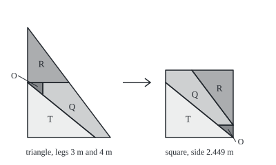

# Scissors congruence: equal-area polygons can always be cut into each other, but a cube and a tetrahedron of equal volume cannot

[Syllabus](../../../SYLLABUS.md) → [Geometry and trig](../README.md) → [Circles and Solids](../README.md#s02) → Scissors congruence

---

## General Overview

Tarping a roof truss leaves an offcut: a right-angled triangle with legs 3 m and 4 m, area 6 m². Can straight cuts turn it into a 6 m² square hatch cover, with no gaps and no overlap?

Yes. A cut along the mid-line (halfway up, parallel to the base) makes a 3 m by 2 m rectangle. Two more cuts make a square of side √6 = 2.449 m. Four pieces do it.

Shapes that cut into each other like this are **scissors congruent**. [Area](../01-Angles%2C%20Triangles%20and%20Congruence/06-area-of-triangles-and-polygons.md) shows cutting keeps area; for flat shapes, equal area is also enough.

In space it fails: Hilbert's third problem (1900) asked whether equal-volume solids always cut into each other, and a 1 m³ cube and a 1 m³ regular tetrahedron (four equal triangle faces) do not. A second number, the **Dehn invariant**, also survives cutting: 0 for the cube, 12.237893 for the tetrahedron (with the score chosen below).

**Any two polygons of equal area can be cut into finitely many pieces that rearrange from one into the other; solids also need equal Dehn invariants, which an equal-volume cube and regular tetrahedron lack.**

**What kind of fact this is:** two theorems, both proved on this card in Why it works: the Wallace–Bolyai–Gerwien theorem for polygons, and Dehn's 1901 answer to Hilbert's third problem.

### The picture: four pieces, two shapes

<p align="center"></p>

Scale 1 m = 40 units. Left: the mid-line (Step 1) and the slanted cut (Step 2). Right: T stays, Q slides up the cut, R turns half a turn, and O drops into the bottom-right corner.

---

## The formula

A rectangle of length $`L`$ and width $`W`$ becomes a square of the same area $`A = L\,W`$:

```math
s = \sqrt{L\,W}, \qquad \text{slide} = (s - L,\; s - W)
```

**Read it aloud:** the square's side is the root of the area; cut from the top-left corner to $`s`$ along the base, and slide the upper piece along the cut, $`L - s`$ left and $`s - W`$ up.

For solids, a **dihedral angle** is the angle between the two faces that meet at an edge, measured inside. Angles are in [Radians](02-radians-arcs-and-sectors.md), so $`\pi`$ is a half turn. A **rational multiple of π** is π times a fraction, such as 90° = π/2.

An **angle score** $`f`$ is any rule where scores add when angles add, a fraction of an angle gets that fraction of the score, and $`f(\pi) = 0`$. So every rational multiple of π scores 0.

```math
D_f(P) = \sum_{\text{edges } e \text{ of } P} \ell_e \, f(\alpha_e)
```

**Read it aloud:** for each edge of the solid, multiply its length by the score of its dihedral angle, and add.

An angle's cosine: walk that far anticlockwise round a circle of radius 1 from its rightmost point, and see how far right of the centre you end (negative if left). Whole turns give 1; up to 90° it is a right-angled triangle's side next to the angle over the longest side. $`\arccos(1/3)`$ is the angle from 0° to 180° with cosine 1/3.

| Symbol | Plain meaning | In our example | Push it up and the answer… |
| --- | --- | --- | --- |
| $`A`$ | the area to match, in m² | 6 | a bigger square |
| $`L`$, $`W`$ | length and width of the rectangle | 3 m, 2 m | past $`L = 4W`$, halve first |
| $`s`$ | side of the square, $`\sqrt{A}`$ | 2.449490 m | — |
| $`\ell_e`$, $`\alpha_e`$ | length and dihedral angle of edge $`e`$ | cube: 1 m and 90° | longer edges weigh more |
| $`\theta`$ | the regular tetrahedron's dihedral angle, $`\arccos(1/3)`$ | 70.528779° | — |
| $`a_n`$ | $`3^n \cos(n\theta)`$ for a whole number $`n`$ | 1, 1, −7, −23, 17, 241 | never divisible by 3 |
| $`f`$, $`\pi`$ | the angle score, with $`f(\theta) = 1`$; a half turn | $`f(90^\circ) = 0`$ | — |
| $`D_f(P)`$ | the Dehn invariant of a solid $`P`$ | cube 0, tetrahedron 12.237893 | grows with edge length |

### When it holds

- **Finitely many straight-cut pieces.** With five pieces too ragged to have a volume, a ball becomes two balls (the Banach–Tarski paradox).
- **The slide needs $`L \le 4W`$.** Otherwise the overhang misses the gap: halve a long strip across its length and stack the halves first.
- **Flat shapes: area alone decides.** Solids need equal volume and Dehn invariant, which suffice (Sydler, 1965).
- **Any valid score will do.** One that tells two solids apart is enough.

---

## Why it works

### Step 0: cut both shapes to one square

If shapes X and Y both cut into the same square, draw both sets of cuts on it. The small pieces rebuild X by undoing X's moves, or Y by undoing Y's. So X cuts into Y.

### Step 1: a triangle becomes a rectangle

Cut along the mid-line. The top is a small triangle with legs 1.5 m and 2 m. Turn it half a turn about (1.5, 2), the midpoint of the long side. It fills the gap on the right: a 3 m by 2 m rectangle.

For other triangles, take the longest side as base, so the top's height lands inside it, and cut the top along it too, turning each half.

### Step 2: a rectangle becomes a square

Cut from (0, 2) to (2.449490, 0). The lower-left piece T stays.

Slide the rest along the cut by (−0.550510, 0.449490). Its right edge and top now sit at 2.449490. A thin triangle O pokes out past the left edge. It matches the empty triangle at the bottom right, so it moves there.

<details>
<summary>Why the slide lands exactly on the square</summary>

The cut runs from (0, W) to (s, 0). Moving a fraction t of the way along it shifts by (−t s, t W). Bringing the right edge from L to s needs t s = L − s. The rise is then

$`\displaystyle t\,W = \frac{(L - s)\,W}{s} = \frac{s^2 - s W}{s} = s - W,`$

using $`s^2 = L W`$. So the top rises from W to exactly s. The overhang and the gap are right triangles with legs L − s and s − W, so they match.

</details>

### Step 3: every polygon becomes a square

Diagonals split any polygon into triangles. Each becomes a rectangle (Step 1), and the slide, aimed at a 1 m side (halving and stacking first if needed, as in When it holds), makes each 1 m wide. Stack the strips and apply Step 2. With Step 0, any two polygons of equal area are scissors congruent.

### Step 4: in space, a second number survives cutting

Cut a solid into pieces. Split every piece's edges wherever something changes, so each short stretch sits in one place:

1. **Inside the solid.** The pieces around it fill a full turn, 2π. Score 0.
2. **Inside a face.** They fill a half turn, π. Score 0.
3. **Along an edge of the solid.** They fill that edge's angle $`\alpha`$. Score $`f(\alpha)`$.

A piece with only a face along the stretch takes π, which scores 0.

Scores add, so the pieces' total equals the solid's Dehn invariant. Gluing the pieces into a new solid gives the same total. So scissors-congruent solids have equal Dehn invariants.

In the checks, halving the tetrahedron through an edge gives 6.118947 + 6.118947, the whole's 12.237893; the cube's two prisms, 0.000000 + 0.000000.

### Step 5: the tetrahedron's angle is not a fraction of π

Stand the tetrahedron on a face. Its top, the base's centre and the midpoint of a base edge make a right-angled triangle. A side face's height and the base's height meet that edge square on at the midpoint, making the angle θ. The longest side is the side face's height; the side along the base is a third of the base's height (the centre sits a third of the way up), and the heights are equal. So $`\cos\theta = 1/3`$, and θ = 70.528779°.

On the radius-1 circle, the points at $`(n \pm 1)\theta`$ mirror each other in the line from the centre through the point at $`n\theta`$. So their midpoint lies on it, cos θ = 1/3 of the way out (a right-angled triangle, longest side 1, angle θ), and its distance right of the centre, the average of theirs, is a third of that point's: the first equation. Times $`3^{n+1}`$ it is the second.

```math
\cos((n+1)\theta) + \cos((n-1)\theta) = \tfrac{2}{3}\cos(n\theta), \qquad\text{so}\qquad a_{n+1} = 2a_n - 9a_{n-1}, \qquad a_0 = a_1 = 1
```

Each term leaves the same remainder on division by 3 as twice the one before (1, 1, −7, −23, 17, 241), and $`a_1 = 1`$, so none is divisible by 3.

If θ were π times a fraction, some whole number $`n`$ of copies of θ would make whole turns. Then $`\cos(n\theta) = 1`$ and $`a_n = 3^n`$, divisible by 3. Impossible.

### Step 6: the cube and the tetrahedron differ

Every cube edge has 90°, so the cube scores 0. Since θ is not a rational multiple of π, a score with $`f(\theta) = 1`$ exists. The tetrahedron scores 6 edges × 2.039649 m × 1 = 12.237893. No cutting turns one into the other.

<details>
<summary>Why a score with f(θ) = 1 exists</summary>

Only finitely many angles occur in one cutting. Write each, and π and θ, as sums of fractions of a few basic angles, none a sum of fractions of the others. Since θ is not a fraction of π, both can be basic.

Score π as 0, θ as 1, the other basic angles 0, and every other angle by its fractions. This rule adds and respects fractions.

</details>

---

## Worked numbers, by hand

| Step | Arithmetic | Value |
| --- | --- | --- |
| triangle area | half of 3 × 4 | 6.000000 m² |
| mid-line cut | turn the top half a turn about (1.5, 2) | 3 m by 2 m |
| square side | √(3 × 2) | 2.449490 m |
| slanted cut | (0, 2) to (2.449490, 0) | piece T, 2.449490 m² |
| slide | 2.449490 − 3 across, 2.449490 − 2 up | (−0.550510, 0.449490) |
| the four pieces | 2.449490 + 0.123724 + 1.926786 + 1.500000 | **6.000000 m², a square** |
| cube | 12 edges × 1 m × f(90°) | 0.000000 |
| tetrahedron edge for 1 m³ | ∛(6√2) | 2.039649 m |
| tetrahedron | 6 × 2.039649 × f(θ), with f(θ) = 1 | **12.237893** |

The same 6 m² fills triangle and square, but the equal-volume cube and tetrahedron score 0 and 12.237893: no cutting links them.

### What breaks if you drop a piece

| Mistake | Comes out at | What went wrong |
| --- | --- | --- |
| Add length × angle with no score | cube 18.849556, its two prisms 27.735322 | New edges add, so the raw sum changes on cutting |
| Use the 60° face angle, not θ | score 0, like the cube | 60° is a rational multiple of π; a face's corner is not the angle between faces |
| Round θ to 72°, a fifth of a turn | score 0, Dehn 0, like the cube | 5θ = 352.643897° is close to a full turn, not one |

---

## Code, from first principles, and it actually runs

The script cuts and moves the four pieces, then checks the tiling two ways: shoelace areas (area from corner coordinates), and 90,000 grid points per shape, each in exactly one piece. For solids it finds faces and dihedral angles from corners alone and checks the scores against 0 and 6 × edge, and $`a_n`$ in whole numbers against decimals.

### Python

```python
# Scissors congruence and the Dehn invariant -- the check behind the card.  Standard library only.
from itertools import combinations
from math import acos, cos, pi, sqrt
s, th = sqrt(6), acos(1 / 3)                      # square side; tetrahedron's dihedral angle
def f6(v): return f"{v:.6f}"
def yn(c): return "yes" if c else "no"
def area(P): return sum(P[i - 1][0] * P[i][1] - P[i][0] * P[i - 1][1] for i in range(len(P))) / 2
def inside(P, x, y): return all((b[0] - a[0]) * (y - a[1]) > (b[1] - a[1]) * (x - a[0]) for a, b in zip(P, P[1:] + P[:1]))
before = [[(0, 0), (s, 0), (0, 2)],                           # T: stays put
          [(0, 2), (3 - s, 4 - s), (3 - s, 2)],               # O: small overhang
          [(s, 0), (3, 0), (1.5, 2), (3 - s, 2), (3 - s, 4 - s)],  # Q: rest of the bottom strip
          [(0, 2), (1.5, 2), (0, 4)]]                         # R: top of the triangle
moves = [lambda x, y: (x, y), lambda x, y: (x + 2 * s - 3, y + s - 4),
         lambda x, y: (x + s - 3, y + s - 2), lambda x, y: (s - x, s + 2 - y)]
after = [[m(x, y) for x, y in P] for P, m in zip(before, moves)]
def once(pieces, w, h, region, n=300):                        # grid points covered exactly once
    pts = [((i + .5) * w / n, (j + .25) * h / n) for i in range(n) for j in range(n)]
    return all(sum(inside(P, x, y) for P in pieces) == region(x, y) for x, y in pts)
tri_ok, sq_ok = once(before, 3, 4, lambda x, y: 4 * x + 3 * y < 12), once(after, s, s, lambda x, y: True)
print(f"triangle 3 m by 4 m, area {f6(area([(0, 0), (3, 0), (0, 4)]))}; square side root 6 = {f6(s)} m")
print("piece areas before:", ", ".join(f6(area(P)) for P in before), "| after:", ", ".join(f6(area(P)) for P in after))
print(f"grid 300 x 300: triangle covered exactly once: {yn(tri_ok)}; square covered exactly once: {yn(sq_ok)}")
print(f"figure, 1 m = 40 units: mid-line (0, 2) to ({3 / 2}, 2); cut (0, 2) to ({f6(s)}, 0); slide ({f6(s - 3)}, {f6(s - 2)}); overhang corner ({f6(3 - s)}, {f6(4 - s)}); SVG cut end ({40 + 40 * s:.2f}, 200), overhang corner ({40 + 40 * (3 - s):.2f}, {200 - 40 * (4 - s):.2f}), square top right ({240 + 40 * s:.2f}, {200 - 40 * s:.2f})")
def sub(a, b): return [a[k] - b[k] for k in range(3)]
def dot(a, b): return sum(a[k] * b[k] for k in range(3))
def cross(a, b): return [a[1] * b[2] - a[2] * b[1], a[2] * b[0] - a[0] * b[2], a[0] * b[1] - a[1] * b[0]]
def edges(V):                                                 # (length, dihedral angle) of each edge
    faces = {}
    for i, j, k in combinations(range(len(V)), 3):           # a face: a plane with every corner on one side
        n = cross(sub(V[j], V[i]), sub(V[k], V[i])); d = [dot(n, sub(p, V[i])) for p in V]
        if max(d) > 1e-9: n, d = [-c for c in n], [-c for c in d]
        if dot(n, n) > 1e-12 and max(d) < 1e-9:
            faces[frozenset(m for m in range(len(V)) if abs(d[m]) < 1e-9)] = [c / sqrt(dot(n, n)) for c in n]
    return [(sqrt(dot(sub(V[min(e)], V[max(e)]), sub(V[min(e)], V[max(e)]))), pi - acos(max(-1, min(1, dot(faces[f], faces[g])))))
            for f, g in combinations(faces, 2) if len(e := f & g) == 2]
def score(a):                     # f: the r with a - r th a rational multiple of pi, so f(pi) = 0 and f(th) = 1
    return next(r for r in [k / 2 for k in range(-4, 5)] if any(abs((a - r * th) / pi * q - round((a - r * th) / pi * q)) < 1e-9 for q in range(1, 13)))
def dehn(V): return sum(l * score(a) for l, a in edges(V))
def raw(V): return sum(l * a for l, a in edges(V))
cube = [(x, y, z) for x in (0, 1) for y in (0, 1) for z in (0, 1)]; prisms = [[p for p in cube if p[0] >= p[1]], [p for p in cube if p[0] <= p[1]]]
e = (6 * sqrt(2)) ** (1 / 3); k = e / (2 * sqrt(2))           # tetrahedron edge for volume 1 m^3
A, B, C, D = [(k * a, k * b, k * c) for a, b, c in [(1, 1, 1), (1, -1, -1), (-1, 1, -1), (-1, -1, 1)]]
M = tuple((C[i] + D[i]) / 2 for i in range(3)); vol = abs(dot(sub(B, A), cross(sub(C, A), sub(D, A)))) / 6
an = [1, 1]
for n in range(60): an.append(2 * an[-1] - 9 * an[-2])        # a_n = 3^n cos(n th), by the recurrence
print(f"cube 1 m: {len(edges(cube))} edges, dihedral angles all {f6(max(a for _, a in edges(cube)) * 180 / pi)} deg, Dehn {f6(dehn(cube))}")
print(f"tetrahedron edge {f6(e)} m, volume {f6(vol)} m^3 (formula {f6(e ** 3 / (6 * sqrt(2)))}), dihedral {th * 180 / pi:.6f} deg")
print(f"tetrahedron Dehn {f6(dehn([A, B, C, D]))} = 6 x edge {f6(6 * e)}")
print(f"a_n, n = 0..8, by recurrence {an[:9]}; by 3^n cos(n th) {[round(3 ** n * cos(n * th)) for n in range(9)]}")
print(f"any of a_0 .. a_61 divisible by 3: {yn(any(a % 3 == 0 for a in an))}")
print(f"cut in two: tetrahedron halves Dehn {f6(dehn([A, B, C, M]))} + {f6(dehn([A, B, D, M]))}; cube prisms {f6(dehn(prisms[0]))} + {f6(dehn(prisms[1]))}")
print(f"mistake 1, raw sum length x angle: cube {f6(raw(cube))}, its two prisms {f6(raw(prisms[0]) + raw(prisms[1]))}")
print(f"mistake 2, face angle 60 deg in place of {th * 180 / pi:.6f}: score {score(pi / 3):.0f}, so Dehn 0 like the cube")
print(f"mistake 3, th taken as 72 deg: score {score(2 * pi / 5):.0f}, so Dehn 0 like the cube; true 5 x th = {5 * th * 180 / pi:.6f} deg, cos = {an[5]}/{3 ** 5} = {f6(an[5] / 3 ** 5)}")
assert tri_ok and sq_ok and abs(sum(map(area, after)) - 6) < 1e-12
assert all(abs(3 ** n * cos(n * th) - an[n]) < 1e-6 for n in range(12)) and all(a % 3 for a in an)
assert abs(vol - 1) < 1e-12 and abs(dehn(cube)) < 1e-12 and abs(dehn(prisms[0]) + dehn(prisms[1])) < 1e-12
assert abs(dehn([A, B, C, D]) - 6 * e) < 1e-9 and abs(dehn([A, B, C, M]) + dehn([A, B, D, M]) - 6 * e) < 1e-9
assert abs(raw(cube) - 6 * pi) < 1e-9 and abs(raw(prisms[0]) + raw(prisms[1]) - (6 + 2 * sqrt(2)) * pi) < 1e-9
print("ALL CHECKS PASS")
```

**Ran 2026-11-23 on macOS, Python 3.14.10, standard library only. All checks passed. Output, pasted from the run:**

```
triangle 3 m by 4 m, area 6.000000; square side root 6 = 2.449490 m
piece areas before: 2.449490, 0.123724, 1.926786, 1.500000 | after: 2.449490, 0.123724, 1.926786, 1.500000
grid 300 x 300: triangle covered exactly once: yes; square covered exactly once: yes
figure, 1 m = 40 units: mid-line (0, 2) to (1.5, 2); cut (0, 2) to (2.449490, 0); slide (-0.550510, 0.449490); overhang corner (0.550510, 1.550510); SVG cut end (137.98, 200), overhang corner (62.02, 137.98), square top right (337.98, 102.02)
cube 1 m: 12 edges, dihedral angles all 90.000000 deg, Dehn 0.000000
tetrahedron edge 2.039649 m, volume 1.000000 m^3 (formula 1.000000), dihedral 70.528779 deg
tetrahedron Dehn 12.237893 = 6 x edge 12.237893
a_n, n = 0..8, by recurrence [1, 1, -7, -23, 17, 241, 329, -1511, -5983]; by 3^n cos(n th) [1, 1, -7, -23, 17, 241, 329, -1511, -5983]
any of a_0 .. a_61 divisible by 3: no
cut in two: tetrahedron halves Dehn 6.118947 + 6.118947; cube prisms 0.000000 + 0.000000
mistake 1, raw sum length x angle: cube 18.849556, its two prisms 27.735322
mistake 2, face angle 60 deg in place of 70.528779: score 0, so Dehn 0 like the cube
mistake 3, th taken as 72 deg: score 0, so Dehn 0 like the cube; true 5 x th = 352.643897 deg, cos = 241/243 = 0.991770
ALL CHECKS PASS
```

### Rust

Built with `rustc --edition 2021 -O`.

```rust
// Scissors congruence and the Dehn invariant -- the same check as the Python, in Rust.  No crates.
use std::f64::consts::PI;
type P2 = (f64, f64); type V3 = [f64; 3];
fn f6(v: f64) -> String { format!("{:.6}", v) }  fn yn(c: bool) -> &'static str { if c { "yes" } else { "no" } }
fn area(p: &[P2]) -> f64 { (0..p.len()).map(|i| { let a = p[(i + p.len() - 1) % p.len()]; a.0 * p[i].1 - p[i].0 * a.1 }).sum::<f64>() / 2.0 }
fn inside(p: &[P2], x: f64, y: f64) -> bool { (0..p.len()).all(|i| { let (a, b) = (p[i], p[(i + 1) % p.len()]); (b.0 - a.0) * (y - a.1) > (b.1 - a.1) * (x - a.0) }) }
fn once(pieces: &[Vec<P2>], w: f64, h: f64, region: impl Fn(f64, f64) -> bool) -> bool {   // grid points covered exactly once
    let n = 300;
    (0..n).all(|i| (0..n).all(|j| { let (x, y) = ((i as f64 + 0.5) * w / n as f64, (j as f64 + 0.25) * h / n as f64);
        pieces.iter().filter(|p| inside(p, x, y)).count() == region(x, y) as usize }))
}
fn sub(a: V3, b: V3) -> V3 { [a[0] - b[0], a[1] - b[1], a[2] - b[2]] }
fn dot(a: V3, b: V3) -> f64 { a[0] * b[0] + a[1] * b[1] + a[2] * b[2] }
fn cross(a: V3, b: V3) -> V3 { [a[1] * b[2] - a[2] * b[1], a[2] * b[0] - a[0] * b[2], a[0] * b[1] - a[1] * b[0]] }
fn edges(v: &[V3]) -> Vec<(f64, f64)> {                       // (length, dihedral angle) of each edge
    let mut faces: Vec<(Vec<usize>, V3)> = Vec::new();
    for i in 0..v.len() { for j in i + 1..v.len() { for k in j + 1..v.len() {   // a face: every corner on one side
        let mut n = cross(sub(v[j], v[i]), sub(v[k], v[i]));
        let mut d: Vec<f64> = v.iter().map(|&p| dot(n, sub(p, v[i]))).collect();
        if d.iter().cloned().fold(f64::MIN, f64::max) > 1e-9 { n = [-n[0], -n[1], -n[2]]; d = d.iter().map(|x| -x).collect(); }
        let on: Vec<usize> = (0..v.len()).filter(|&m| d[m].abs() < 1e-9).collect();
        if dot(n, n) > 1e-12 && d.iter().all(|&x| x < 1e-9) && !faces.iter().any(|f| f.0 == on) {
            let r = dot(n, n).sqrt(); faces.push((on, [n[0] / r, n[1] / r, n[2] / r]));
        }
    } } }
    let mut out = Vec::new();
    for a in 0..faces.len() { for b in a + 1..faces.len() {
        let e: Vec<usize> = faces[a].0.iter().cloned().filter(|m| faces[b].0.contains(m)).collect();
        if e.len() == 2 { out.push((dot(sub(v[e[0]], v[e[1]]), sub(v[e[0]], v[e[1]])).sqrt(), PI - dot(faces[a].1, faces[b].1).clamp(-1.0, 1.0).acos())); }
    } }
    out
}
fn score(a: f64, th: f64) -> f64 {           // f: the r with a - r th a rational multiple of pi, so f(pi) = 0 and f(th) = 1
    (-4..5).map(|k| k as f64 / 2.0).find(|r| (1..13).any(|q| { let x = (a - r * th) / PI * q as f64; (x - x.round()).abs() < 1e-9 })).unwrap()
}
fn dehn(v: &[V3], th: f64) -> f64 { edges(v).iter().map(|&(l, a)| l * score(a, th)).sum() }
fn raw(v: &[V3]) -> f64 { edges(v).iter().map(|&(l, a)| l * a).sum() }
fn main() {
    let (s, th) = (6f64.sqrt(), (1.0f64 / 3.0).acos());     // square side; tetrahedron's dihedral angle
    let before: Vec<Vec<P2>> = vec![vec![(0.0, 0.0), (s, 0.0), (0.0, 2.0)],                  // T: stays put
        vec![(0.0, 2.0), (3.0 - s, 4.0 - s), (3.0 - s, 2.0)],                                   // O: small overhang
        vec![(s, 0.0), (3.0, 0.0), (1.5, 2.0), (3.0 - s, 2.0), (3.0 - s, 4.0 - s)],             // Q: rest of the bottom strip
        vec![(0.0, 2.0), (1.5, 2.0), (0.0, 4.0)]];                                              // R: top of the triangle
    let moves: [Box<dyn Fn(P2) -> P2>; 4] = [Box::new(|p| p), Box::new(move |p: P2| (p.0 + 2.0 * s - 3.0, p.1 + s - 4.0)),
        Box::new(move |p: P2| (p.0 + s - 3.0, p.1 + s - 2.0)), Box::new(move |p: P2| (s - p.0, s + 2.0 - p.1))];
    let after: Vec<Vec<P2>> = before.iter().zip(moves.iter()).map(|(p, m)| p.iter().map(|&q| m(q)).collect()).collect();
    let (tri_ok, sq_ok) = (once(&before, 3.0, 4.0, |x, y| 4.0 * x + 3.0 * y < 12.0), once(&after, s, s, |_, _| true));
    let join = |ps: &Vec<Vec<P2>>| ps.iter().map(|p| f6(area(p))).collect::<Vec<_>>().join(", ");
    println!("triangle 3 m by 4 m, area {}; square side root 6 = {} m", f6(area(&[(0.0, 0.0), (3.0, 0.0), (0.0, 4.0)])), f6(s));
    println!("piece areas before: {} | after: {}", join(&before), join(&after));
    println!("grid 300 x 300: triangle covered exactly once: {}; square covered exactly once: {}", yn(tri_ok), yn(sq_ok));
    println!("figure, 1 m = 40 units: mid-line (0, 2) to ({}, 2); cut (0, 2) to ({}, 0); slide ({}, {}); overhang corner ({}, {}); SVG cut end ({:.2}, 200), overhang corner ({:.2}, {:.2}), square top right ({:.2}, {:.2})", 3.0 / 2.0, f6(s), f6(s - 3.0), f6(s - 2.0), f6(3.0 - s), f6(4.0 - s), 40.0 + 40.0 * s, 40.0 + 40.0 * (3.0 - s), 200.0 - 40.0 * (4.0 - s), 240.0 + 40.0 * s, 200.0 - 40.0 * s);
    let mut cube: Vec<V3> = Vec::new();
    for x in 0..2 { for y in 0..2 { for z in 0..2 { cube.push([x as f64, y as f64, z as f64]) } } }
    let prisms: Vec<Vec<V3>> = vec![cube.iter().cloned().filter(|p| p[0] >= p[1]).collect(), cube.iter().cloned().filter(|p| p[0] <= p[1]).collect()];
    let e = (6.0 * 2f64.sqrt()).powf(1.0 / 3.0); let k = e / (2.0 * 2f64.sqrt());   // tetrahedron edge for volume 1 m^3
    let t: Vec<V3> = [[1.0, 1.0, 1.0], [1.0, -1.0, -1.0], [-1.0, 1.0, -1.0], [-1.0, -1.0, 1.0]].iter().map(|p: &V3| [k * p[0], k * p[1], k * p[2]]).collect();
    let (a, b, c, d) = (t[0], t[1], t[2], t[3]); let m = [(c[0] + d[0]) / 2.0, (c[1] + d[1]) / 2.0, (c[2] + d[2]) / 2.0];
    let vol = dot(sub(b, a), cross(sub(c, a), sub(d, a))).abs() / 6.0;
    let mut an: Vec<i128> = vec![1, 1];
    for _ in 0..60 { let n = an.len(); an.push(2 * an[n - 1] - 9 * an[n - 2]) }   // a_n = 3^n cos(n th), by the recurrence
    let fl: Vec<i64> = (0..9).map(|n| (3f64.powi(n) * (n as f64 * th).cos()).round() as i64).collect();
    let (h1, h2) = (dehn(&[a, b, c, m], th), dehn(&[a, b, d, m], th)); let deg = |x: f64| x * 180.0 / PI;
    println!("cube 1 m: {} edges, dihedral angles all {} deg, Dehn {}", edges(&cube).len(), f6(deg(edges(&cube).iter().map(|x| x.1).fold(0.0, f64::max))), f6(dehn(&cube, th)));
    println!("tetrahedron edge {} m, volume {} m^3 (formula {}), dihedral {} deg", f6(e), f6(vol), f6(e.powi(3) / (6.0 * 2f64.sqrt())), f6(deg(th)));
    println!("tetrahedron Dehn {} = 6 x edge {}", f6(dehn(&t, th)), f6(6.0 * e));
    println!("a_n, n = 0..8, by recurrence {:?}; by 3^n cos(n th) {:?}", &an[..9], fl);
    println!("any of a_0 .. a_61 divisible by 3: {}", yn(an.iter().any(|x| x % 3 == 0)));
    println!("cut in two: tetrahedron halves Dehn {} + {}; cube prisms {} + {}", f6(h1), f6(h2), f6(dehn(&prisms[0], th)), f6(dehn(&prisms[1], th)));
    println!("mistake 1, raw sum length x angle: cube {}, its two prisms {}", f6(raw(&cube)), f6(raw(&prisms[0]) + raw(&prisms[1])));
    println!("mistake 2, face angle 60 deg in place of {}: score {:.0}, so Dehn 0 like the cube", f6(deg(th)), score(PI / 3.0, th));
    println!("mistake 3, th taken as 72 deg: score {:.0}, so Dehn 0 like the cube; true 5 x th = {} deg, cos = {}/{} = {}", score(2.0 * PI / 5.0, th), f6(deg(5.0 * th)), an[5], 3i64.pow(5), f6(an[5] as f64 / 243.0));
    assert!(tri_ok && sq_ok && (after.iter().map(|p| area(p)).sum::<f64>() - 6.0).abs() < 1e-12);
    assert!((0..12).all(|n| (3f64.powi(n) * (n as f64 * th).cos() - an[n as usize] as f64).abs() < 1e-6) && an.iter().all(|x| x % 3 != 0));
    assert!((vol - 1.0).abs() < 1e-12 && dehn(&cube, th).abs() < 1e-12 && (dehn(&prisms[0], th) + dehn(&prisms[1], th)).abs() < 1e-12);
    assert!((dehn(&t, th) - 6.0 * e).abs() < 1e-9 && (h1 + h2 - 6.0 * e).abs() < 1e-9);
    assert!((raw(&cube) - 6.0 * PI).abs() < 1e-9 && (raw(&prisms[0]) + raw(&prisms[1]) - (6.0 + 2f64.sqrt() * 2.0) * PI).abs() < 1e-9);
    println!("ALL CHECKS PASS");
}
```

**Ran 2026-11-23 on macOS, rustc 1.98.1, no crates. All checks passed. Output, pasted from the run:**

```
triangle 3 m by 4 m, area 6.000000; square side root 6 = 2.449490 m
piece areas before: 2.449490, 0.123724, 1.926786, 1.500000 | after: 2.449490, 0.123724, 1.926786, 1.500000
grid 300 x 300: triangle covered exactly once: yes; square covered exactly once: yes
figure, 1 m = 40 units: mid-line (0, 2) to (1.5, 2); cut (0, 2) to (2.449490, 0); slide (-0.550510, 0.449490); overhang corner (0.550510, 1.550510); SVG cut end (137.98, 200), overhang corner (62.02, 137.98), square top right (337.98, 102.02)
cube 1 m: 12 edges, dihedral angles all 90.000000 deg, Dehn 0.000000
tetrahedron edge 2.039649 m, volume 1.000000 m^3 (formula 1.000000), dihedral 70.528779 deg
tetrahedron Dehn 12.237893 = 6 x edge 12.237893
a_n, n = 0..8, by recurrence [1, 1, -7, -23, 17, 241, 329, -1511, -5983]; by 3^n cos(n th) [1, 1, -7, -23, 17, 241, 329, -1511, -5983]
any of a_0 .. a_61 divisible by 3: no
cut in two: tetrahedron halves Dehn 6.118947 + 6.118947; cube prisms 0.000000 + 0.000000
mistake 1, raw sum length x angle: cube 18.849556, its two prisms 27.735322
mistake 2, face angle 60 deg in place of 70.528779: score 0, so Dehn 0 like the cube
mistake 3, th taken as 72 deg: score 0, so Dehn 0 like the cube; true 5 x th = 352.643897 deg, cos = 241/243 = 0.991770
ALL CHECKS PASS
```

The two outputs match line for line.

### Lean

Lean proves the slide for every rectangle, and the score fact for cubes and regular tetrahedra of every size.

- Take a rectangle of length $`L`$ and width $`W`$, and slide as in Step 2. Then the top rises by exactly $`s - W`$.
- Take the same rectangle. Then the overhang fits beside the square exactly when $`L \le 4W`$.
- The tetrahedron's dihedral angle θ is not a rational multiple of π.
- So an angle score $`f`$ with $`f(\theta) = 1`$ exists.
- Take that score, and a cube and a regular tetrahedron of any size. Then the cube's Dehn invariant is 0, and the tetrahedron's is not.
- Lean also checks the card's whole numbers: the 6 m² areas, the 3 m by 2 m slide, and the first 62 terms $`a_n`$, none divisible by 3.

The four pieces, the Dehn invariant surviving a cut, and the decimals are left to the Python and Rust checks.

```lean
-- Scissors congruence: the rectangle-to-square slide lands exactly, the regular tetrahedron's dihedral angle arccos(1/3) is no rational multiple of π, and so an angle score exists that gives every cube Dehn invariant 0 and every regular tetrahedron a non-zero one.
import Mathlib.Analysis.SpecialFunctions.Trigonometric.Inverse
import Mathlib.LinearAlgebra.Basis.VectorSpace
import Mathlib.LinearAlgebra.Dual.Lemmas
import Mathlib.Tactic

open Real

def tetSeq : ℕ → ℤ
  | 0 => 1
  | 1 => 1
  | (n + 2) => 2 * tetSeq (n + 1) - 9 * tetSeq n

lemma tetSeq_succ_modEq (n : ℕ) : tetSeq (n + 1) ≡ 2 ^ n [ZMOD 3] := by
  induction n with
  | zero => decide
  | succ n ih =>
    show 2 * tetSeq (n + 1) - 9 * tetSeq n ≡ 2 ^ (n + 1) [ZMOD 3]
    have h9 : (9 : ℤ) * tetSeq n ≡ 0 [ZMOD 3] :=
      (Int.modEq_zero_iff_dvd).2 (Dvd.dvd.mul_right (by norm_num) _)
    calc 2 * tetSeq (n + 1) - 9 * tetSeq n ≡ 2 * 2 ^ n - 0 [ZMOD 3] := (ih.mul_left 2).sub h9
      _ = 2 ^ (n + 1) := by ring

lemma tetSeq_not_dvd (n : ℕ) : ¬ (3 : ℤ) ∣ tetSeq n := by
  rcases n with _ | n
  · decide
  · intro h
    have h1 := (tetSeq_succ_modEq n).symm.trans ((Int.modEq_zero_iff_dvd).2 h)
    have h2 : (3 : ℤ) ∣ 2 ^ n := (Int.modEq_zero_iff_dvd).1 h1
    have h3 : (3 : ℤ) ∣ 2 := Int.Prime.dvd_pow' (by norm_num) h2
    omega

lemma three_pow_mul_cos (n : ℕ) :
    (3 : ℝ) ^ n * cos (n * arccos (1 / 3)) = tetSeq n := by
  induction n using Nat.strong_induction_on with
  | _ n ih =>
    match n, ih with
    | 0, _ => simp [tetSeq]
    | 1, _ =>
      rw [pow_one, Nat.cast_one, one_mul, cos_arccos (by norm_num) (by norm_num)]
      simp [tetSeq]
    | (n + 2), ih =>
      have h1 := ih (n + 1) (by omega)
      have h0 := ih n (by omega)
      set θ := arccos (1 / 3)
      have hc : cos θ = 1 / 3 := cos_arccos (by norm_num) (by norm_num)
      have key : cos (((n + 2 : ℕ) : ℝ) * θ) =
          2 * cos θ * cos (((n + 1 : ℕ) : ℝ) * θ) - cos ((n : ℝ) * θ) := by
        have e1 : ((n + 2 : ℕ) : ℝ) * θ = ((n + 1 : ℕ) : ℝ) * θ + θ := by push_cast; ring
        have e2 : (n : ℝ) * θ = ((n + 1 : ℕ) : ℝ) * θ - θ := by push_cast; ring
        rw [e1, e2, cos_add, cos_sub]; ring
      have ha : (tetSeq (n + 2) : ℝ) = 2 * tetSeq (n + 1) - 9 * tetSeq n := by
        rw [show tetSeq (n + 2) = 2 * tetSeq (n + 1) - 9 * tetSeq n from rfl]; push_cast; ring
      rw [key, hc, ha, ← h1, ← h0]
      ring

lemma arccos_one_third_irrational (q : ℚ) : arccos (1 / 3) ≠ (q : ℝ) * π := by
  intro h
  have hden : (0 : ℝ) < q.den := by exact_mod_cast q.den_pos
  have h2 : ((2 * q.den : ℕ) : ℝ) * arccos (1 / 3) = (q.num : ℝ) * (2 * π) := by
    rw [h]
    have : (q : ℝ) = q.num / q.den := by exact_mod_cast (Rat.num_div_den q).symm
    rw [this]; push_cast; field_simp
  have h3 := three_pow_mul_cos (2 * q.den)
  rw [h2, cos_int_mul_two_pi, mul_one] at h3
  have h4 : ((3 ^ (2 * q.den) : ℤ) : ℝ) = (tetSeq (2 * q.den) : ℝ) := by push_cast; exact h3
  have h5 : (3 : ℤ) ^ (2 * q.den) = tetSeq (2 * q.den) := by exact_mod_cast h4
  apply tetSeq_not_dvd (2 * q.den)
  rw [← h5]
  exact dvd_pow_self 3 (by have := q.den_pos; omega)


#print axioms tetSeq_succ_modEq
#print axioms tetSeq_not_dvd
#print axioms three_pow_mul_cos
#print axioms arccos_one_third_irrational

/-- Hilbert's third problem, the cube and the regular tetrahedron. An angle score is a rule
f on angles where scores add when angles add and a fraction of an angle gets that fraction of
the score (a ℚ-linear map from ℝ to ℝ), with f(π) = 0. There is such a score with
f(arccos(1/3)) = 1. With it, a cube of any edge a (12 edges, all at 90° = π/2) has Dehn
invariant 12 · a · f(π/2) = 0, while a regular tetrahedron of any edge e > 0 (6 edges, all at
the angle arccos(1/3)) has Dehn invariant 6 · e · f(arccos(1/3)), which is not 0. -/
theorem cube_and_tetrahedron_dehn_invariants_differ :
    ∃ f : ℝ →ₗ[ℚ] ℝ, f π = 0 ∧ f (arccos (1 / 3)) = 1 ∧
      ∀ a e : ℝ, 0 < e →
        (12 : ℝ) * a * f (π / 2) = 0 ∧ (6 : ℝ) * e * f (arccos (1 / 3)) ≠ 0 := by
  set p : Submodule ℚ ℝ := Submodule.span ℚ {π}
  have hx : arccos (1 / 3) ∉ p := by
    intro hm
    obtain ⟨q, hq⟩ := Submodule.mem_span_singleton.1 hm
    apply arccos_one_third_irrational q
    rw [← hq, Rat.smul_def]
  obtain ⟨g, hg, hgp⟩ := Submodule.exists_dual_map_eq_bot_of_notMem hx inferInstance
  have hpi : g π = 0 := by
    have : g π ∈ p.map g := Submodule.mem_map_of_mem (Submodule.mem_span_singleton_self π)
    rw [hgp] at this; exact this
  have hf1 : ((Algebra.linearMap ℚ ℝ).comp ((g (arccos (1 / 3)))⁻¹ • g)) (arccos (1 / 3)) = 1 := by
    simp only [LinearMap.comp_apply, LinearMap.smul_apply, smul_eq_mul, inv_mul_cancel₀ hg,
      Algebra.linearMap_apply, map_one]
  have hf0 : ((Algebra.linearMap ℚ ℝ).comp ((g (arccos (1 / 3)))⁻¹ • g)) π = 0 := by
    simp only [LinearMap.comp_apply, LinearMap.smul_apply, smul_eq_mul, hpi, mul_zero,
      Algebra.linearMap_apply, map_zero]
  refine ⟨(Algebra.linearMap ℚ ℝ).comp ((g (arccos (1 / 3)))⁻¹ • g), hf0, hf1, ?_⟩
  · have hhalf : ((Algebra.linearMap ℚ ℝ).comp ((g (arccos (1 / 3)))⁻¹ • g)) (π / 2) = 0 := by
      set f := (Algebra.linearMap ℚ ℝ).comp ((g (arccos (1 / 3)))⁻¹ • g)
      have e : f π = f (π / 2) + f (π / 2) := by rw [← map_add]; ring_nf
      linarith
    intro a e he
    refine ⟨by rw [hhalf]; ring, ?_⟩
    rw [hf1]; positivity

/-- Step 5: the regular tetrahedron's dihedral angle θ = arccos(1/3) is not π times a fraction. -/
theorem arccos_one_third_ne_rat_mul_pi (q : ℚ) : arccos (1 / 3) ≠ (q : ℝ) * π := by
  exact arccos_one_third_irrational q

/-- Step 2: a rectangle of length L > 0 and width W > 0 has square side s = √(L W). Sliding the
piece above the cut from (0, W) to (s, 0) far enough to bring its right edge from L to s
(a fraction t = (L − s)/s of the cut, so a rise of t · W) raises the top by exactly s − W.
The overhanging triangle, with legs L − s and s − W, fits beside the square (L − s ≤ s)
exactly when L ≤ 4W. -/
theorem rectangle_slide_lands_on_square {L W : ℝ} (hL : 0 < L) (hW : 0 < W) :
    (L - √(L * W)) / √(L * W) * W = √(L * W) - W ∧
      (L - √(L * W) ≤ √(L * W) ↔ L ≤ 4 * W) := by
  have hLW : 0 < L * W := mul_pos hL hW
  have hs : 0 < √(L * W) := Real.sqrt_pos.2 hLW
  have hs2 : √(L * W) ^ 2 = L * W := Real.sq_sqrt hLW.le
  refine ⟨?_, ?_⟩
  · field_simp
    nlinarith
  · constructor
    · intro h; nlinarith
    · intro h; nlinarith [sq_nonneg (L - 2 * √(L * W))]

-- The roof-truss triangle with legs 3 m and 4 m has area 6 m², and its 3 m by 2 m rectangle too.
example : (3 * 4 : ℚ) / 2 = 6 := by norm_num
example : (3 * 2 : ℕ) = 6 := by decide
-- The slide condition L ≤ 4W holds for L = 3, W = 2.
example : (3 : ℕ) ≤ 4 * 2 := by decide

/-- a_n = 3^n cos(nθ) in whole numbers: a_0 = a_1 = 1 and a_{n+1} = 2 a_n − 9 a_{n−1}. -/
def a : ℕ → ℤ
  | 0 => 1
  | 1 => 1
  | (n + 2) => 2 * a (n + 1) - 9 * a n

-- The card's values 1, 1, −7, −23, 17, 241, 329, −1511, −5983, none divisible by 3.
example : (List.range 9).map a = [1, 1, -7, -23, 17, 241, 329, -1511, -5983] := by decide
example : ∀ n < 62, ¬ (3 : ℤ) ∣ a n := by decide
-- Five tetrahedra round one edge: cos(5θ) = 241/243, not 1, so 5θ is not a whole turn.
example : (241 : ℤ) ≠ 3 ^ 5 := by decide

#print axioms cube_and_tetrahedron_dehn_invariants_differ
#print axioms arccos_one_third_ne_rat_mul_pi
#print axioms rectangle_slide_lands_on_square
```

**Checked 2026-11-23 on macOS, Lean 4.36.0-rc2, Mathlib v4.36.0-rc2. Every proof is complete and uses only Lean's standard axioms. Output, pasted from the run:**

```
'tetSeq_succ_modEq' depends on axioms: [propext, Classical.choice, Quot.sound]
'tetSeq_not_dvd' depends on axioms: [propext, Classical.choice, Quot.sound]
'three_pow_mul_cos' depends on axioms: [propext, Classical.choice, Quot.sound]
'arccos_one_third_irrational' depends on axioms: [propext, Classical.choice, Quot.sound]
'cube_and_tetrahedron_dehn_invariants_differ' depends on axioms: [propext, Classical.choice, Quot.sound]
'arccos_one_third_ne_rat_mul_pi' depends on axioms: [propext, Classical.choice, Quot.sound]
'rectangle_slide_lands_on_square' depends on axioms: [propext, Classical.choice, Quot.sound]
```

> [!TIP]
> **Try changing**
> - Guess first: does a 1 m by 1 m by 2 m box score 0? Change `for z in (0, 1)` to `for z in (0, 2)`. Every angle is still 90°, so Dehn stays 0; the raw sum becomes 25.132741 and the last assert stops the run.
> - Guess first: what does a regular octahedron (eight triangle faces) score? Before the last line, add `print(f6(dehn([(1, 0, 0), (-1, 0, 0), (0, 1, 0), (0, -1, 0), (0, 0, 1), (0, 0, -1)])))`. Its angle is 180° − θ, scoring −1, so 12 edges of √2 m give −16.970563.
> - Guess first: what if the slide misses by 0.1 m? Change `y + s - 2` to `y + s - 1.9`. The square reports "covered exactly once: no" and the first assert stops the run.

---

## The usual mistake

> [!warning]
> **Equal volume does not mean the solids cut into each other.** Equal area is enough in the plane, so it is tempting in space. But the 1 m³ cube scores 0, the 1 m³ tetrahedron 12.237893, and no cutting changes either.
>
> - **No score.** Raw length × angle changes on cutting: cube 18.849556, its two prisms 27.735322.
> - **The face angle.** 60° scores 0, wrongly matching the cube; use 70.528779°.
> - **Rounding θ to 72°.** That scores 0, like the cube; yet 5θ is 352.643897°, cos 0.991770, not 1.

---

## Where you meet it in real life

- **Dissection puzzles.** Henry Dudeney's 1907 haberdasher's puzzle cuts an equilateral triangle into four pieces that form a square. Step 3 says some cut always exists.
- **Why pyramid volume needs slicing.** A triangle's ½ comes from cutting and rearranging. A pyramid's ⅓ ([Pyramids, cones and spheres](05-pyramids-cones-and-spheres.md)) cannot always, so its proof slices the solid into ever-thinner layers.
- **Packing tetrahedra.** Five regular tetrahedra round one edge fill 352.643897°, leaving a gap.

> **Say it back**
> Straight cuts turn triangles into rectangles and rectangles into squares, so equal-area polygons are scissors congruent. The Dehn invariant adds each edge's length times its angle's score, rational multiples of π scoring 0; cutting keeps it. The cube scores 0, but the tetrahedron's arccos(1/3) is no rational multiple of π, so the equal-volume pair never cut into each other.

---

## What this builds on

- [Area](../01-Angles%2C%20Triangles%20and%20Congruence/06-area-of-triangles-and-polygons.md): cutting and moving pieces never changes area, the direction this card turns round.
- [Polyhedra](06-polyhedra-and-eulers-formula.md): faces, edges and corners of a solid, and the regular tetrahedron and cube.

## Where this goes next

- [The unit circle](../03-Trigonometry/02-radians-and-the-unit-circle.md): cosine for every angle, used in Step 5.
- [Trig identities](../03-Trigonometry/03-trig-identities.md): the addition formulas, which extend Step 5's midpoint rule.
- [Inverse trig](../03-Trigonometry/05-inverse-trig-and-solving-equations.md): arccos as an undo of cosine, returning one angle from a fixed window.

Left open: Sydler's 1965 converse, that equal volume and Dehn invariant suffice, is stated here without proof.

---

## Sources

Verified 2026-11-23: every link below resolves to the publisher's page.

- Hartshorne, Robin. *Geometry: Euclid and Beyond*, chapter 5, "Area." Springer, 2000. [doi:10.1007/978-0-387-22676-7_6](https://doi.org/10.1007/978-0-387-22676-7_6). Cutting polygons into squares, and Hilbert's third problem.
- Aigner, Martin, and Günter M. Ziegler. "Hilbert's third problem: decomposing polyhedra." *Proofs from THE BOOK*, 6th ed., 67–75. Springer, 2018. [doi:10.1007/978-3-662-57265-8_10](https://doi.org/10.1007/978-3-662-57265-8_10). The Dehn invariant.
- Dehn, M. "Ueber den Rauminhalt." *Mathematische Annalen* 55 (1901): 465–478. [doi:10.1007/BF01448001](https://doi.org/10.1007/BF01448001). The first proof that equal-volume solids need not be scissors congruent.
- Sydler, J.-P. "Conditions nécessaires et suffisantes pour l'équivalence des polyèdres de l'espace euclidien à trois dimensions." *Commentarii Mathematici Helvetici* 40 (1965): 43–80. [doi:10.1007/BF02564364](https://doi.org/10.1007/BF02564364). The converse: volume and Dehn invariant together decide.
