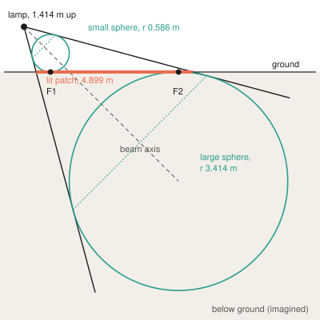

# Every conic: untangle a tilted equation by turning the axes, and the spheres that show a cone's slice is an ellipse

[Syllabus](../../../SYLLABUS.md) → [Geometry and trig](../README.md) → [Coordinates and Curves](../README.md#s04) → Every conic

---

## General Overview

A garden plan gives an oval flower bed by one equation, in metres from the bed's centre: $`x^2 + xy + y^2 = 3`$. The gardener wants to peg it out with a string tied to two pegs, by the rule of [Ellipses and hyperbolas](05-ellipses-and-hyperbolas.md). That card handles only curves square to the axes; the $`xy`$ term means this bed is tilted.

One number, built from the numbers $`A`$, $`B`$, $`C`$ in front of $`x^2`$, $`xy`$ and $`y^2`$, names the curve first: $`B^2 - 4AC`$ = 1 − 4 = −3, negative, so an ellipse. Turn the axes by 45° and the $`xy`$ term disappears: $`X^2/2 + Y^2/6 = 1`$. The half-axes are 1.414 m and 2.449 m. The pegs go at (−1.414, 1.414) and (1.414, −1.414), and the pencil's distances to them always add to 4.899 m.

The name "conic" comes from cones. A garden lamp with a cone-shaped beam, aimed 45° off vertical, lights a patch of exactly the bed's shape. Two spheres wedged in the beam prove the patch has two pegs.

**Turn the axes by the angle that kills the $`xy`$ term, and any second-degree equation becomes a circle, ellipse, parabola or hyperbola in standard position (or a degenerate case: a single point, a pair of lines, or no points at all); the sign of $`B^2 - 4AC`$, which no turn changes, says which one, and two spheres show that a flat slice of a cone is the same curve.**

**What kind of fact this is:** theorems, all proved in Why it works: the turning formulas, the unchanged $`B^2 - 4AC`$, and the Dandelin spheres argument with the slice's eccentricity.

### The picture: the lamp's beam and the two spheres, side view

<p align="center"></p>

Drawn at 1 m = 40 units. The beam's sides lie 30° either side of its axis. Dotted: where each sphere touches the beam.

---

## The formula

The general second-degree equation in $`x`$ and $`y`$ is

```math
Ax^2 + Bxy + Cy^2 + Dx + Ey + F = 0
```

**Read it aloud:** squared terms, a cross term, straight terms and a constant add to zero.

When $`B \ne 0`$ (if $`B = 0`$, no turn is needed), turn the axes by the angle θ (theta) given by

```math
\cot 2\theta = \frac{A - C}{B}, \qquad B^2 - 4AC \;\begin{cases} < 0 & \text{ellipse (or circle)} \\ = 0 & \text{parabola} \\ > 0 & \text{hyperbola} \end{cases}
```

**Read it aloud:** turn by half the angle whose cotangent (cosine over sine) is A minus C over B; the sign of B squared minus four A C names the curve.

| Symbol | Plain meaning | In our example | Push it up and the answer… |
| --- | --- | --- | --- |
| $`x`$, $`y`$, $`z`$ | position on the plan, across and up, metres; height (Step 5) | the bed's centre is (0, 0) | — |
| $`A`$, $`B`$, $`C`$, $`D`$, $`E`$, $`F`$ | the numbers in front of $`x^2`$, $`xy`$, $`y^2`$, $`x`$, $`y`$; the constant | 1, 1, 1, 0, 0, −3 | larger $`B`$: longer bed, a hyperbola past 2 |
| $`\theta`$ | the angle the axes turn, anticlockwise | 45° | — |
| $`X`$, $`Y`$, $`r`$, $`\varphi`$ | position along the turned axes; distance and angle (phi) from the centre | bed: $`X^2/2 + Y^2/6 = 1`$ | — |
| $`A'`$, $`B'`$, $`C'`$ | the squared-term and cross-term numbers after turning | 1.50, 0.00, 0.50 | — |
| $`a`$, $`b`$, $`c`$, $`e`$ | long and short half-axes; centre to each peg; eccentricity $`c/a`$ | 2.449, 1.414, 2.000, 0.8165 | — |
| $`\alpha`$, $`\beta`$, $`m`$ | cone's half-angle (alpha); slicing plane's angle to the axis (beta); plane's slope | 30°, 45°, 1.000 | steeper plane: the curve opens |
| $`F_1`$, $`F_2`$, $`P`$, $`d`$ | the two foci (pegs); any point on the curve; lamp to a sphere's centre, along the axis | pegs (−1.414, 1.414), (1.414, −1.414) | — |

### When it holds

- **Second degree.** With $`A`$, $`B`$, $`C`$ all 0 the equation is a straight line.
- **A curve is left over.** $`x^2 + xy + y^2 + 3 = 0`$ also gives −3, yet no point fits it; $`x^2 - y^2 = 0`$ (value 4) is two crossing lines. These degenerate cases are slices through the cone's tip, or nothing.
- **$`B`$ is the whole cross term.** Books that write $`2Bxy`$ test $`B^2 - AC`$; mixing the two misreads the bed as a parabola.
- **Axes square, equal units.** Stretched axes turn circles into ellipses and change $`B`$.

---

## Why it works

### Step 0: turning the axes renames points, it does not move them

The curve stays put; only the ruler turns. A point at distance $`r`$ from the centre, at angle φ (phi) from the new $`X`$-axis, has $`X = r\cos\varphi`$ and $`Y = r\sin\varphi`$. The old axis is θ behind, so the addition formulas of [Trig identities](../03-Trigonometry/03-trig-identities.md) give

```math
x = r\cos(\varphi + \theta) = X\cos\theta - Y\sin\theta, \qquad y = r\sin(\varphi + \theta) = X\sin\theta + Y\cos\theta
```

### Step 1: choose θ so the cross term vanishes

Put those into $`Ax^2 + Bxy + Cy^2`$ and collect the $`XY`$ terms; the double-angle formulas tidy the result:

```math
B' = -2A\sin\theta\cos\theta + B(\cos^2\theta - \sin^2\theta) + 2C\sin\theta\cos\theta = B\cos 2\theta - (A - C)\sin 2\theta
```

This is zero when $`\cot 2\theta = (A - C)/B`$: 0 for the bed, so 2θ = 90° and θ = 45°.

### Step 2: read the turned curve

The other two come out the same way:

```math
A' = \tfrac{A + C}{2} + \tfrac{A - C}{2}\cos 2\theta + \tfrac{B}{2}\sin 2\theta, \qquad C' = \tfrac{A + C}{2} - \tfrac{A - C}{2}\cos 2\theta - \tfrac{B}{2}\sin 2\theta
```

For the bed, $`\cos 90° = 0`$ and $`\sin 90° = 1`$: $`A'`$ = 1 + 0.5 = 1.50 and $`C'`$ = 1 − 0.5 = 0.50. So $`1.5X^2 + 0.5Y^2 = 3`$. Divide by 3: $`X^2/2 + Y^2/6 = 1`$, half-axes $`\sqrt 2`$ = 1.414 along the 45° line and $`\sqrt 6`$ = 2.449 along the 135° line.

Then $`c^2 = 6 - 2`$, so $`c`$ = 2.000: the pegs sit 2 m from the centre along the long axis.

### Step 3: $`B^2 - 4AC`$ never changes under a turn

From Step 2, $`A' + C' = A + C`$ and $`A' - C' = (A - C)\cos 2\theta + B\sin 2\theta`$. Now

```math
B'^2 - 4A'C' = B'^2 + (A' - C')^2 - (A' + C')^2 = (A - C)^2 + B^2 - (A + C)^2 = B^2 - 4AC
```

In the middle step the cosine-sine cross terms cancel, and $`\cos^2 + \sin^2 = 1`$ leaves $`(A - C)^2 + B^2`$.

### Step 4: so the sign names the curve

After the turn $`B'`$ = 0, so the unchanged number is $`-4A'C'`$. Negative: $`A'`$ and $`C'`$ share a sign, an ellipse. Positive: a hyperbola. Zero: a parabola. That is the sign test of [Ellipses and hyperbolas](05-ellipses-and-hyperbolas.md). For an ellipse or hyperbola, completing the squares only shifts the centre (and changes the constant, which decides whether a real curve remains); for a parabola, the straight term in the unsquared variable sets its focal length.

The hyperbola $`xy = 1`$ has $`B^2 - 4AC`$ = 1. The same 45° turn gives $`0.5X^2 - 0.5Y^2 = 1`$, that is $`X^2/2 - Y^2/2 = 1`$.

### Step 5: the same test is the cone-slice test

Stand a double cone of half-angle $`\alpha`$ ($`0° < \alpha < 90°`$) on its tip, axis vertical. A point at height $`z`$ is on it when its distance from the axis is $`|z|\tan\alpha`$. Cut it with the plane $`z = mx + 1`$ and substitute:

```math
(1 - m^2\tan^2\alpha)\,x^2 + y^2 + (\text{straight terms}) = 0, \qquad B^2 - 4AC = -4\,(1 - m^2\tan^2\alpha)
```

This is the slice seen from straight above, squashed evenly in one direction: sizes change, the kind does not. With α = 30° the cone's side has slope 1.732.

- **Shallower than the side** ($`m`$ = 1.000): −2.667, an ellipse.
- **Parallel to it** ($`m`$ = 1.732): 0.000, a parabola.
- **Steeper** ($`m`$ = 3.000): 8.000, a hyperbola.

### Step 6: Dandelin's spheres prove the slice has two foci

The key fact: from a point outside a ball, every tangent to the ball has the same length, because by Pythagoras its square is the distance to the centre squared minus the radius squared.

The lamp is 1.414 m up, beam half-angle 30°, axis 45° off vertical: a cone, as in [Pyramids, cones and spheres](../02-Circles%20and%20Solids/05-pyramids-cones-and-spheres.md). It lights the ground from 0.379 m to 5.278 m beyond its foot.

1. **Fit two spheres.** Each is centred on the beam's axis, touches the beam in a circle and the ground at one point. The small one (radius 0.586 m) touches the ground at F1, 0.828 m out. The large one (radius 3.414 m), imagined below ground, touches it at F2, 4.828 m out.
2. **Take any point P on the patch's rim.** The line from the lamp through P lies on the beam's edge. It meets the two touching circles 1.015 m and 5.914 m from the lamp.
3. **Swap tangents.** PF1 equals the stretch from P to the small circle: both are tangents from P to one sphere. Likewise PF2 equals the stretch to the large circle.
4. **Add.** PF1 + PF2 = 5.914 − 1.015 = 4.899 m, whichever P you take.

A fixed sum of distances to two points defines an ellipse, so F1 and F2 are its foci and $`2a`$ = 4.899 m, the bed's. Its eccentricity matches too. On every beam edge the touching circles are the centres' gap times $`\cos\alpha`$ apart: $`2a`$. The pegs, square below and above the centres on ground at β to the axis, are that gap times $`\cos\beta`$ apart: $`2c`$. So $`e = \cos\beta/\cos\alpha`$ = 0.8165.

<details>
<summary>Detailed working: the two spheres' sizes</summary>

A sphere centred $`d`$ along the axis from the lamp touches the beam when its radius is $`d\sin 30°`$. Its centre is $`1.414 - d\cos 45°`$ high, which must equal plus or minus that radius:

$`\displaystyle d = \frac{1.414}{\cos 45° \pm \sin 30°}`$

Plus gives the small sphere, centre (0.828, 0.586); minus the large, centre (4.828, −3.414). Each touches the beam $`d\cos 30°`$ from the lamp: 1.015 and 5.914.

</details>

---

## Worked numbers, by hand

| Step | Arithmetic | Value |
| --- | --- | --- |
| kind | $`B^2 - 4AC`$ = 1 − 4 | −3: ellipse |
| angle | $`\cot 2\theta`$ = (1 − 1) ÷ 1 = 0 | θ = 45.00° |
| turned numbers | $`A'`$ = 1 + 0.5, $`B'`$ = 1 × 0 − 0 × 1, $`C'`$ = 1 − 0.5 | 1.50, 0.00, 0.50 |
| standard form | divide $`1.5X^2 + 0.5Y^2 = 3`$ by 3 | $`X^2/2 + Y^2/6 = 1`$ |
| half-axes | $`\sqrt{2}`$, $`\sqrt{6}`$ | 1.414 m, 2.449 m |
| peg distance | $`c = \sqrt{6 - 2}`$ | 2.000 m |
| string, tied to both pegs | $`2a`$ = 2 × 2.449 | **4.899 m** |

So the pegs go 2 m either side of the centre along the 135° line, joined by 4.899 m of string; a loop round both would need $`2a + 2c`$ = 8.899 m.

The same steps on five more equations (each one $`= 0`$):

| Equation | $`B^2 - 4AC`$ | Turn | $`A'`$, $`C'`$ | Curve |
| --- | --- | --- | --- | --- |
| $`xy - 1`$ | 1 | 45.00° | 0.50, −0.50 | hyperbola |
| $`2x^2 + 4xy + 5y^2 - 6`$ | −24 | 63.43° | 6.00, 1.00 | ellipse: $`6X^2 + Y^2 = 6`$ |
| $`x^2 + 2xy + y^2`$ + straight terms | 0 | 45.00° | 2.00, 0.00 | parabola or parallel lines |
| $`x^2 - y^2`$ | 4 | 0.00° | 1.00, −1.00 | two crossing lines |
| $`x^2 + xy + y^2 + 3`$ | −3 | 45.00° | 1.50, 0.50 | no points |

Turning $`2x^2 + 4xy + 5y^2`$ by 0°, 20°, 45°, 63.43° and 100° gives $`B'^2 - 4A'C'`$ = −24.00 every time, and $`A' + C'`$ stays 7.00.

### What breaks if you drop a piece

| Mistake | Comes out at | What went wrong |
| --- | --- | --- |
| −45° numbers on +45° axes | 0.50 and 1.50; (1.732, 1.732) gives 9.00, not 3 | the long axis is drawn on the wrong line |
| Dropping the $`xy`$ term | a circle, radius 1.732 | the tilt carries the stretch |
| Using $`B^2 - AC`$ | 0: "parabola" | that test is for $`2Bxy`$ |
| String = the two radii added | 4.000 m, the peg gap | the string runs between touching circles |

---

## Code, from first principles, and it actually runs

Five roads. One: the formula for the angle. Two: halving to find where $`B'`$ is zero. Three: 1800 directions scanned for the bed's nearest and farthest points, the half-axes. Four: the lamp in three dimensions, 3600 points on the patch's rim, whose distances to F1 and F2 must add to road one's 4.899. Five: each curve named without $`B^2 - 4AC`$, from the signs $`Ax^2 + Bxy + Cy^2`$ takes as the direction turns.

### Python

```python
# Every conic -- the check behind the card.  Standard library only.
# Flower bed x^2 + xy + y^2 = 3 (metres); a lamp with a 30-degree half-angle beam, aimed 45 degrees off vertical.
from math import sqrt, sin, cos, tan, atan2, radians as rad, degrees as deg, pi
def turn(A, B, C, t):                         # the x^2, xy, y^2 numbers after turning the axes by t
    c, s = cos(t), sin(t)
    return A*c*c + B*s*c + C*s*s, B*(c*c - s*s) - 2*(A - C)*s*c, A*s*s - B*s*c + C*c*c
def halve(f, lo, hi):                         # road two: find where f changes sign
    for _ in range(200): mid = (lo + hi) / 2; lo, hi = (mid, hi) if (f(mid) > 0) == (f(lo) > 0) else (lo, mid)
    return (lo + hi) / 2
def name(A, B, C, F):                         # A x^2 + B xy + C y^2 + F = 0, centred
    d, (P, _, Q) = B*B - 4*A*C, turn(A, B, C, atan2(B, A - C) / 2)
    kd = "parabola or parallel lines" if d == 0 else ("two crossing lines" if d > 0 else "one point") if F == 0 else "hyperbola" if d > 0 else "ellipse" if -F / P > 0 else "no points"
    return d, kd, P, Q
def scan(A, B, C, F):                         # road five, no B^2 - 4AC: the signs A x^2 + B xy + C y^2 takes over a half-turn
    g = {(v > 1e-9) - (v < -1e-9) for v in (A*cos(f)*cos(f) + B*cos(f)*sin(f) + C*sin(f)*sin(f) for f in (rad(i / 10) for i in range(1800)))}
    return ("two crossing lines" if F == 0 else "hyperbola") if {1, -1} <= g else "parabola or parallel lines" if 0 in g else "one point" if F == 0 else "ellipse" if g == {(F < 0) - (F > 0)} else "no points"
t = atan2(1, 1 - 1) / 2                       # road one: cot 2t = (A - C)/B
P, B2, Q = turn(1, 1, 1, t); th = halve(lambda u: turn(1, 1, 1, u)[1], 0, pi / 2)
sa, la = sqrt(3 / P), sqrt(3 / Q); c = sqrt(la**2 - sa**2)   # semi-axes; centre to each peg
r = [(sqrt(3 / (1 + cos(rad(i / 10)) * sin(rad(i / 10)))), i / 10) for i in range(1800)]   # road three: polar scan
print(f"bed: B^2 - 4AC = {name(1, 1, 1, -3)[0]} -> {name(1, 1, 1, -3)[1]}; cot 2t = 0, t = {deg(t):.2f} deg; halving on B' = 0: {deg(th):.2f} deg")
print(f"turned: {P:.2f} X^2 + {abs(B2):.2f} XY + {Q:.2f} Y^2 = 3, so X^2/{3 / P:.2f} + Y^2/{3 / Q:.2f} = 1, semi-axes {sa:.3f} and {la:.3f}")
print(f"polar scan, 1800 directions: nearest {min(r)[0]:.3f} at {min(r)[1]:.1f} deg, farthest {max(r)[0]:.3f} at {max(r)[1]:.1f} deg")
print(f"pegs ({-c / sqrt(2):.3f}, {c / sqrt(2):.3f}) and ({c / sqrt(2):.3f}, {-c / sqrt(2):.3f}), c = {c:.3f}, "
      f"string tied to both 2a = {2 * la:.3f}, loop round both 2a + 2c = {2 * la + 2 * c:.3f}, e = {c / la:.4f}, area {pi * sa * la:.2f} m^2")
for co in (eqs := ((1, 1, 1, -3), (0, 1, 0, -1), (2, 4, 5, -6), (1, 2, 1, 0), (1, 0, -1, 0), (1, 1, 1, 3))):
    d, kd, p, q = name(*co)
    print(f"  {co}: B^2 - 4AC = {d}, {kd}, turn {deg(atan2(co[1], co[0] - co[2]) / 2):.2f} deg, X^2 and Y^2 numbers {p:.2f}, {q:.2f}")
inv = [turn(2, 4, 5, rad(a)) for a in (0, 20, 45, 63.43494882, 100)]
print("2x^2 + 4xy + 5y^2 turned 0, 20, 45, 63.43, 100 deg: B'^2 - 4A'C' =", " ".join(f"{b*b - 4*a*cc:.2f}" for a, b, cc in inv),
      "| A' + C' =", " ".join(f"{a + cc:.2f}" for a, b, cc in inv))
k = tan(rad(30)); cs = [(m, round(-4 * (1 - k*k*m*m), 9) + 0) for m in (1, 1 / k, 3)]   # cone x^2 + y^2 = k^2 z^2 cut by the plane z = m x + 1
print("cone slice, plane slope m: " + "; ".join(f"m = {m:.3f}: B^2 - 4AC = {v:.3f}" for m, v in cs))
al, be = rad(30), rad(45); tilt = pi / 2 - be  # the lamp: beam half-angle, ground's angle to axis, tilt from vertical
H = 2 * la / (tan(tilt + al) - tan(tilt - al)); x1, x2 = H * tan(tilt - al), H * tan(tilt + al)   # height that makes the lit patch 2a long
print(f"lamp: height {H:.3f}, lit patch from {x1:.3f} to {x2:.3f}, length {x2 - x1:.3f}, e = cos 45 / cos 30 = {cos(be) / cos(al):.4f}")
ds = [H / (cos(tilt) + s * sin(al)) for s in (1, -1)]; sph = [(d * sin(tilt), H - d * cos(tilt), d * sin(al), d * cos(al)) for d in ds]   # the two Dandelin spheres: centre x, z; radius; touch distance
print("spheres: " + "; ".join(f"centre ({x:.3f}, {z:.3f}), radius {q:.3f}, touches the beam {g:.3f} from the lamp" for x, z, q, g in sph)
      + f"; gap {sph[1][3] - sph[0][3]:.3f}")
u, e1, sums, half, tang = (sin(tilt), 0, -cos(tilt)), (cos(tilt), 0, sin(tilt)), [], 0, 0   # beam axis; a direction square to it
for i in range(3600):                         # road four: 3600 points on the lit patch's rim, in 3-D
    f = rad(i / 10); w = [cos(al) * u[j] + sin(al) * (cos(f) * e1[j] + (j == 1) * sin(f)) for j in range(3)]
    L = -H / w[2]; Px, Py = L * w[0], L * w[1]
    F1, F2 = sqrt((Px - sph[0][0])**2 + Py**2), sqrt((Px - sph[1][0])**2 + Py**2)
    sums.append(F1 + F2); half = max(half, abs(Py)); tang = max(tang, abs(F1 - (L - sph[0][3])), abs(F2 - (sph[1][3] - L)))
print(f"3600 rim points: PF1 + PF2 from {min(sums):.3f} to {max(sums):.3f}, half-width {half:.3f}")
print("mistakes: turn -45 deg gives {:.2f} X^2 + {:.2f} Y^2; ".format(*turn(1, 1, 1, -t)[::2]) + f"(1.732, 1.732) gives {3 * sqrt(3)**2:.2f}; "
      f"drop xy: circle radius {sqrt(3):.3f}; B^2 - AC = {1 - 1}; r1 + r2 = {sph[0][2] + sph[1][2]:.3f}")
X, Z, gen = lambda x: 30 + 40 * x, lambda z: 90 - 40 * z, [(sin(tilt + s * al), -cos(tilt + s * al)) for s in (-1, 1)]
print(f"figure, 1 m = 40 units: lamp ({X(0):.2f}, {Z(H):.2f}), patch ({X(x1):.2f}, 90.00) ({X(x2):.2f}, 90.00), pegs "
      + " ".join(f"({X(x):.2f}, 90.00)" for x, *_ in sph) + ", circles " + " ".join(f"({X(x):.2f}, {Z(z):.2f}) r {40 * q:.2f}" for x, z, q, _ in sph))
print("figure, beam ends and touch points: " + " ".join(f"({X(L * a):.2f}, {Z(H + L * b):.2f})" for a, b in gen for L in (8.6, sph[0][3], sph[1][3])))
assert abs(th - t) < 1e-12 and abs(B2) < 1e-12                  # halving agrees with cot 2t; xy term gone
assert abs(min(r)[0] - sa) + abs(max(r)[0] - la) < 1e-9          # polar scan meets the turned semi-axes
assert all(abs(b*b - 4*a*cc - (4*4 - 4*2*5)) + abs(a + cc - (2 + 5)) < 1e-9 for a, b, cc in inv)   # B^2 - 4AC and A + C unchanged by every turn
assert abs(max(sums) - 2 * la) + abs(min(sums) - 2 * la) + abs(half - sa) < 1e-6 and tang < 1e-9   # cone slice = bed
assert abs(c / la - cos(be) / cos(al)) < 1e-12                   # eccentricity two ways
assert all(name(*co)[1] == scan(*co) for co in eqs)              # B^2 - 4AC names each curve as the sign scan does
assert [(v > 0) - (v < 0) for m, v in cs] == [(m > 1 / k) - (m < 1 / k) for m, v in cs]   # shallower, parallel, steeper than the cone's side
print("ALL CHECKS PASS")
```

**Ran 2026-11-25 on macOS, Python 3.14.10, standard library only. All checks passed. Output, pasted from the run:**

```
bed: B^2 - 4AC = -3 -> ellipse; cot 2t = 0, t = 45.00 deg; halving on B' = 0: 45.00 deg
turned: 1.50 X^2 + 0.00 XY + 0.50 Y^2 = 3, so X^2/2.00 + Y^2/6.00 = 1, semi-axes 1.414 and 2.449
polar scan, 1800 directions: nearest 1.414 at 45.0 deg, farthest 2.449 at 135.0 deg
pegs (-1.414, 1.414) and (1.414, -1.414), c = 2.000, string tied to both 2a = 4.899, loop round both 2a + 2c = 8.899, e = 0.8165, area 10.88 m^2
  (1, 1, 1, -3): B^2 - 4AC = -3, ellipse, turn 45.00 deg, X^2 and Y^2 numbers 1.50, 0.50
  (0, 1, 0, -1): B^2 - 4AC = 1, hyperbola, turn 45.00 deg, X^2 and Y^2 numbers 0.50, -0.50
  (2, 4, 5, -6): B^2 - 4AC = -24, ellipse, turn 63.43 deg, X^2 and Y^2 numbers 6.00, 1.00
  (1, 2, 1, 0): B^2 - 4AC = 0, parabola or parallel lines, turn 45.00 deg, X^2 and Y^2 numbers 2.00, 0.00
  (1, 0, -1, 0): B^2 - 4AC = 4, two crossing lines, turn 0.00 deg, X^2 and Y^2 numbers 1.00, -1.00
  (1, 1, 1, 3): B^2 - 4AC = -3, no points, turn 45.00 deg, X^2 and Y^2 numbers 1.50, 0.50
2x^2 + 4xy + 5y^2 turned 0, 20, 45, 63.43, 100 deg: B'^2 - 4A'C' = -24.00 -24.00 -24.00 -24.00 -24.00 | A' + C' = 7.00 7.00 7.00 7.00 7.00
cone slice, plane slope m: m = 1.000: B^2 - 4AC = -2.667; m = 1.732: B^2 - 4AC = 0.000; m = 3.000: B^2 - 4AC = 8.000
lamp: height 1.414, lit patch from 0.379 to 5.278, length 4.899, e = cos 45 / cos 30 = 0.8165
spheres: centre (0.828, 0.586), radius 0.586, touches the beam 1.015 from the lamp; centre (4.828, -3.414), radius 3.414, touches the beam 5.914 from the lamp; gap 4.899
3600 rim points: PF1 + PF2 from 4.899 to 4.899, half-width 1.414
mistakes: turn -45 deg gives 0.50 X^2 + 1.50 Y^2; (1.732, 1.732) gives 9.00; drop xy: circle radius 1.732; B^2 - AC = 0; r1 + r2 = 4.000
figure, 1 m = 40 units: lamp (30.00, 33.43), patch (45.16, 90.00) (241.12, 90.00), pegs (63.14, 90.00) (223.14, 90.00), circles (63.14, 66.57) r 23.43 (223.14, 226.57) r 136.57
figure, beam ends and touch points: (119.03, 365.71) (40.50, 72.63) (91.22, 261.92) (362.28, 122.47) (69.20, 43.94) (258.48, 94.65)
ALL CHECKS PASS
```

### Rust

Same numbers, same labels, built with `rustc --edition 2021 -O`.

```rust
// Every conic -- the same check as the Python, in Rust.  No crates.
// Flower bed x^2 + xy + y^2 = 3 (metres); a lamp with a 30-degree half-angle beam, aimed 45 degrees off vertical.
use std::f64::consts::PI;
fn turn(a: f64, b: f64, c: f64, t: f64) -> (f64, f64, f64) { // the x^2, xy, y^2 numbers after turning the axes by t
    let (co, s) = (t.cos(), t.sin());
    (a * co * co + b * s * co + c * s * s, b * (co * co - s * s) - 2.0 * (a - c) * s * co, a * s * s - b * s * co + c * co * co)
}
fn halve(f: impl Fn(f64) -> f64, mut lo: f64, mut hi: f64) -> f64 { // road two: find where f changes sign
    for _ in 0..200 { let mid = (lo + hi) / 2.0; if (f(mid) > 0.0) == (f(lo) > 0.0) { lo = mid } else { hi = mid } }
    (lo + hi) / 2.0
}
fn name(co: [i64; 4]) -> (i64, &'static str, f64, f64, f64) { // A x^2 + B xy + C y^2 + F = 0, centred
    let [a, b, c, f] = co; let d = b * b - 4 * a * c;
    let t = (b as f64).atan2((a - c) as f64) / 2.0;
    let (p, _, q) = turn(a as f64, b as f64, c as f64, t);
    let kd = if d == 0 { "parabola or parallel lines" } else if f == 0 { if d > 0 { "two crossing lines" } else { "one point" } } else if d > 0 { "hyperbola" } else if -(f as f64) / p > 0.0 { "ellipse" } else { "no points" };
    (d, kd, p, q, t.to_degrees())
}
fn scan(co: [i64; 4]) -> &'static str { // road five, no B^2 - 4AC: the signs A x^2 + B xy + C y^2 takes over a half-turn
    let [a, b, c, f] = co.map(|v| v as f64);
    let g: Vec<i32> = (0..1800).map(|i| (i as f64 / 10.0).to_radians()).map(|t| a * t.cos() * t.cos() + b * t.cos() * t.sin() + c * t.sin() * t.sin()).map(|v| (v > 1e-9) as i32 - (v < -1e-9) as i32).collect();
    if g.contains(&1) && g.contains(&-1) { if f == 0.0 { "two crossing lines" } else { "hyperbola" } } else if g.contains(&0) { "parabola or parallel lines" }
    else if f == 0.0 { "one point" } else if g[0] == (f < 0.0) as i32 - (f > 0.0) as i32 { "ellipse" } else { "no points" }
}
fn main() {
    let t = 1f64.atan2(0.0) / 2.0; let s2 = 2f64.sqrt(); // road one: cot 2t = (A - C)/B
    let th = halve(|u| turn(1.0, 1.0, 1.0, u).1, 0.0, PI / 2.0); let (p, b2, q) = turn(1.0, 1.0, 1.0, t);
    let (sa, la) = ((3.0 / p).sqrt(), (3.0 / q).sqrt()); let c = (la * la - sa * sa).sqrt(); // semi-axes; centre to each peg
    let r: Vec<(f64, f64)> = (0..1800).map(|i| { let a = (i as f64 / 10.0).to_radians(); ((3.0 / (1.0 + a.cos() * a.sin())).sqrt(), i as f64 / 10.0) }).collect();
    let (mn, mx) = (r.iter().cloned().fold((f64::MAX, 0.0), |m, x| if x.0 < m.0 { x } else { m }), r.iter().cloned().fold((f64::MIN, 0.0), |m, x| if x.0 > m.0 { x } else { m }));
    println!("bed: B^2 - 4AC = {} -> {}; cot 2t = 0, t = {:.2} deg; halving on B' = 0: {:.2} deg", name([1, 1, 1, -3]).0, name([1, 1, 1, -3]).1, t.to_degrees(), th.to_degrees());
    println!("turned: {:.2} X^2 + {:.2} XY + {:.2} Y^2 = 3, so X^2/{:.2} + Y^2/{:.2} = 1, semi-axes {:.3} and {:.3}", p, b2.abs(), q, 3.0 / p, 3.0 / q, sa, la);
    println!("polar scan, 1800 directions: nearest {:.3} at {:.1} deg, farthest {:.3} at {:.1} deg", mn.0, mn.1, mx.0, mx.1);
    println!("pegs ({:.3}, {:.3}) and ({:.3}, {:.3}), c = {:.3}, string tied to both 2a = {:.3}, loop round both 2a + 2c = {:.3}, e = {:.4}, area {:.2} m^2",
             -c / s2, c / s2, c / s2, -c / s2, c, 2.0 * la, 2.0 * la + 2.0 * c, c / la, PI * sa * la);
    let eqs = [[1, 1, 1, -3], [0, 1, 0, -1], [2, 4, 5, -6], [1, 2, 1, 0], [1, 0, -1, 0], [1, 1, 1, 3]];
    for co in eqs {
        let (d, kd, pp, qq, ang) = name(co);
        println!("  ({}, {}, {}, {}): B^2 - 4AC = {}, {}, turn {:.2} deg, X^2 and Y^2 numbers {:.2}, {:.2}", co[0], co[1], co[2], co[3], d, kd, ang, pp, qq);
    }
    let inv: Vec<(f64, f64, f64)> = [0.0, 20.0, 45.0, 63.43494882, 100.0].iter().map(|a: &f64| turn(2.0, 4.0, 5.0, a.to_radians())).collect();
    let (ds, tr): (Vec<String>, Vec<String>) = inv.iter().map(|&(a, b, cc)| (format!("{:.2}", b * b - 4.0 * a * cc), format!("{:.2}", a + cc))).unzip();
    println!("2x^2 + 4xy + 5y^2 turned 0, 20, 45, 63.43, 100 deg: B'^2 - 4A'C' = {} | A' + C' = {}", ds.join(" "), tr.join(" "));
    let k = 30f64.to_radians().tan(); // cone x^2 + y^2 = k^2 z^2 cut by the plane z = m x + 1
    let cv: Vec<(f64, f64)> = [1.0, 1.0 / k, 3.0].iter().map(|&m: &f64| (m, (-4.0 * (1.0 - k * k * m * m) * 1e9).round() / 1e9 + 0.0)).collect();
    let cs: Vec<String> = cv.iter().map(|&(m, v)| format!("m = {:.3}: B^2 - 4AC = {:.3}", m, v)).collect();
    println!("cone slice, plane slope m: {}", cs.join("; "));
    let (al, be) = (30f64.to_radians(), 45f64.to_radians()); let tilt = PI / 2.0 - be; // beam half-angle, ground's angle to axis, tilt from vertical
    let hh = 2.0 * la / ((tilt + al).tan() - (tilt - al).tan()); let (x1, x2) = (hh * (tilt - al).tan(), hh * (tilt + al).tan()); // patch 2a long
    println!("lamp: height {:.3}, lit patch from {:.3} to {:.3}, length {:.3}, e = cos 45 / cos 30 = {:.4}", hh, x1, x2, x2 - x1, be.cos() / al.cos());
    let sph: Vec<(f64, f64, f64, f64)> = [1.0, -1.0].iter().map(|&s: &f64| hh / (tilt.cos() + s * al.sin())) // the two Dandelin spheres
        .map(|d| (d * tilt.sin(), hh - d * tilt.cos(), d * al.sin(), d * al.cos())).collect(); // centre x, z; radius; touch distance
    let sp: Vec<String> = sph.iter().map(|&(x, z, q, g)| format!("centre ({:.3}, {:.3}), radius {:.3}, touches the beam {:.3} from the lamp", x, z, q, g)).collect();
    println!("spheres: {}; gap {:.3}", sp.join("; "), sph[1].3 - sph[0].3);
    let (u, e1) = ([tilt.sin(), 0.0, -tilt.cos()], [tilt.cos(), 0.0, tilt.sin()]); let (mut lo, mut hi, mut half, mut tang) = (f64::MAX, f64::MIN, 0f64, 0f64); // beam axis; a direction square to it
    for i in 0..3600 { // road four: 3600 points on the lit patch's rim, in 3-D
        let f = (i as f64 / 10.0).to_radians();
        let w: Vec<f64> = (0..3).map(|j| al.cos() * u[j] + al.sin() * (f.cos() * e1[j] + if j == 1 { f.sin() } else { 0.0 })).collect();
        let l = -hh / w[2]; let (px, py) = (l * w[0], l * w[1]);
        let (f1, f2) = (((px - sph[0].0).powi(2) + py * py).sqrt(), ((px - sph[1].0).powi(2) + py * py).sqrt());
        lo = lo.min(f1 + f2); hi = hi.max(f1 + f2); half = half.max(py.abs());
        tang = tang.max((f1 - (l - sph[0].3)).abs()).max((f2 - (sph[1].3 - l)).abs());
    }
    println!("3600 rim points: PF1 + PF2 from {:.3} to {:.3}, half-width {:.3}", lo, hi, half);
    println!("mistakes: turn -45 deg gives {:.2} X^2 + {:.2} Y^2; (1.732, 1.732) gives {:.2}; drop xy: circle radius {:.3}; B^2 - AC = {}; r1 + r2 = {:.3}",
             turn(1.0, 1.0, 1.0, -t).0, turn(1.0, 1.0, 1.0, -t).2, 3.0 * 3f64.sqrt().powi(2), 3f64.sqrt(), 1 - 1, sph[0].2 + sph[1].2);
    let (fx, fz) = (|x: f64| 30.0 + 40.0 * x, |z: f64| 90.0 - 40.0 * z);
    let (pg, ci): (Vec<String>, Vec<String>) = sph.iter().map(|s| (format!("({:.2}, 90.00)", fx(s.0)), format!("({:.2}, {:.2}) r {:.2}", fx(s.0), fz(s.1), 40.0 * s.2))).unzip();
    println!("figure, 1 m = 40 units: lamp ({:.2}, {:.2}), patch ({:.2}, 90.00) ({:.2}, 90.00), pegs {}, circles {}", fx(0.0), fz(hh), fx(x1), fx(x2), pg.join(" "), ci.join(" "));
    let mut ends = Vec::new(); for s in [-1.0, 1.0] { let (a, b) = ((tilt + s * al).sin(), -(tilt + s * al).cos()); for l in [8.6, sph[0].3, sph[1].3] { ends.push(format!("({:.2}, {:.2})", fx(l * a), fz(hh + l * b))); } }
    println!("figure, beam ends and touch points: {}", ends.join(" "));
    assert!((th - t).abs() < 1e-12 && b2.abs() < 1e-12); // halving agrees with cot 2t; xy term gone
    assert!((mn.0 - sa).abs() + (mx.0 - la).abs() < 1e-9); // polar scan meets the turned semi-axes
    assert!(inv.iter().all(|&(a, b, cc)| (b * b - 4.0 * a * cc - (4.0 * 4.0 - 4.0 * 2.0 * 5.0)).abs() + (a + cc - (2.0 + 5.0)).abs() < 1e-9)); // B^2 - 4AC and A + C unchanged by every turn
    assert!((hi - 2.0 * la).abs() + (lo - 2.0 * la).abs() + (half - sa).abs() < 1e-6 && tang < 1e-9); // cone slice = bed
    assert!((c / la - be.cos() / al.cos()).abs() < 1e-12); // eccentricity two ways
    assert!(eqs.iter().all(|&co| name(co).1 == scan(co))); // B^2 - 4AC names each curve as the sign scan does
    assert!(cv.iter().all(|&(m, v)| (v > 0.0) as i32 - (v < 0.0) as i32 == (m > 1.0 / k) as i32 - (m < 1.0 / k) as i32)); // shallower, parallel, steeper than the cone's side
    println!("ALL CHECKS PASS");
}
```

**Ran 2026-11-25 on macOS, rustc 1.98.1, no crates. All checks passed. Output, pasted from the run:**

```
bed: B^2 - 4AC = -3 -> ellipse; cot 2t = 0, t = 45.00 deg; halving on B' = 0: 45.00 deg
turned: 1.50 X^2 + 0.00 XY + 0.50 Y^2 = 3, so X^2/2.00 + Y^2/6.00 = 1, semi-axes 1.414 and 2.449
polar scan, 1800 directions: nearest 1.414 at 45.0 deg, farthest 2.449 at 135.0 deg
pegs (-1.414, 1.414) and (1.414, -1.414), c = 2.000, string tied to both 2a = 4.899, loop round both 2a + 2c = 8.899, e = 0.8165, area 10.88 m^2
  (1, 1, 1, -3): B^2 - 4AC = -3, ellipse, turn 45.00 deg, X^2 and Y^2 numbers 1.50, 0.50
  (0, 1, 0, -1): B^2 - 4AC = 1, hyperbola, turn 45.00 deg, X^2 and Y^2 numbers 0.50, -0.50
  (2, 4, 5, -6): B^2 - 4AC = -24, ellipse, turn 63.43 deg, X^2 and Y^2 numbers 6.00, 1.00
  (1, 2, 1, 0): B^2 - 4AC = 0, parabola or parallel lines, turn 45.00 deg, X^2 and Y^2 numbers 2.00, 0.00
  (1, 0, -1, 0): B^2 - 4AC = 4, two crossing lines, turn 0.00 deg, X^2 and Y^2 numbers 1.00, -1.00
  (1, 1, 1, 3): B^2 - 4AC = -3, no points, turn 45.00 deg, X^2 and Y^2 numbers 1.50, 0.50
2x^2 + 4xy + 5y^2 turned 0, 20, 45, 63.43, 100 deg: B'^2 - 4A'C' = -24.00 -24.00 -24.00 -24.00 -24.00 | A' + C' = 7.00 7.00 7.00 7.00 7.00
cone slice, plane slope m: m = 1.000: B^2 - 4AC = -2.667; m = 1.732: B^2 - 4AC = 0.000; m = 3.000: B^2 - 4AC = 8.000
lamp: height 1.414, lit patch from 0.379 to 5.278, length 4.899, e = cos 45 / cos 30 = 0.8165
spheres: centre (0.828, 0.586), radius 0.586, touches the beam 1.015 from the lamp; centre (4.828, -3.414), radius 3.414, touches the beam 5.914 from the lamp; gap 4.899
3600 rim points: PF1 + PF2 from 4.899 to 4.899, half-width 1.414
mistakes: turn -45 deg gives 0.50 X^2 + 1.50 Y^2; (1.732, 1.732) gives 9.00; drop xy: circle radius 1.732; B^2 - AC = 0; r1 + r2 = 4.000
figure, 1 m = 40 units: lamp (30.00, 33.43), patch (45.16, 90.00) (241.12, 90.00), pegs (63.14, 90.00) (223.14, 90.00), circles (63.14, 66.57) r 23.43 (223.14, 226.57) r 136.57
figure, beam ends and touch points: (119.03, 365.71) (40.50, 72.63) (91.22, 261.92) (362.28, 122.47) (69.20, 43.94) (258.48, 94.65)
ALL CHECKS PASS
```

### Lean

Lean proves the turning facts for every angle and every $`A`$, $`B`$, $`C`$, the tangent fact for every sphere, and the hand numbers.

- Turn the axes by any angle θ, with $`B`$ the whole cross term. Then $`B'^2 - 4A'C' = B^2 - 4AC`$.
- Suppose $`B \ne 0`$ and $`\cot 2\theta = (A - C)/B`$. Then the turned equation has no $`XY`$ term, and $`A'`$ and $`C'`$ are Step 2's formulas.
- Take a point and two tangents from it to one sphere. Then each tangent squared is the distance to the centre squared minus the radius squared.
- So both tangents from that point have the same length, the key fact of Step 6.
- The hand numbers are exact: −3 for the bed, its turn to $`X^2/2 + Y^2/6 = 1`$, and the five table rows.

Python and Rust check the rest: the sign naming each curve, the cone-slice test, the spheres' sizes, and PF1 + PF2 = 4.899 m.

```lean
-- Every conic: turning the axes by any angle leaves B^2 - 4AC unchanged, the turn with cot 2θ = (A - C)/B removes the xy term, and all tangents from one point to a sphere have the same length.
import Mathlib.Analysis.SpecialFunctions.Trigonometric.Basic
import Mathlib.Analysis.InnerProductSpace.PiL2
import Mathlib.Tactic

open Real

/-- B^2 - 4AC never changes under a turn. Turn the axes by any angle θ, so the old position
(x, y) is x = X cos θ - Y sin θ, y = X sin θ + Y cos θ in the new position (X, Y) (axes square,
equal units). If Ax^2 + Bxy + Cy^2 becomes A'X^2 + B'XY + C'Y^2 for every point (B and B' the
whole cross terms), then B'^2 - 4A'C' = B^2 - 4AC. -/
theorem discriminant_unchanged_by_turning_axes (A B C θ A' B' C' : ℝ)
    (h : ∀ X Y : ℝ,
      A * (X * cos θ - Y * sin θ) ^ 2
        + B * (X * cos θ - Y * sin θ) * (X * sin θ + Y * cos θ)
        + C * (X * sin θ + Y * cos θ) ^ 2
      = A' * X ^ 2 + B' * X * Y + C' * Y ^ 2) :
    B' ^ 2 - 4 * A' * C' = B ^ 2 - 4 * A * C := by
  have h10 := h 1 0
  have h01 := h 0 1
  have h11 := h 1 1
  simp only [one_mul, zero_mul, sub_zero, zero_sub, add_zero, zero_add, mul_one, one_pow,
    ne_eq, OfNat.ofNat_ne_zero, not_false_eq_true, zero_pow, mul_zero] at h10 h01 h11
  have hA : A' = A * cos θ ^ 2 + B * cos θ * sin θ + C * sin θ ^ 2 := by linarith
  have hC : C' = A * sin θ ^ 2 - B * sin θ * cos θ + C * cos θ ^ 2 := by
    have : A' * 0 ^ 2 + B' * 0 * 1 + C' * 1 ^ 2 = C' := by ring
    nlinarith
  have hB' : B' = -2 * A * cos θ * sin θ + B * (cos θ ^ 2 - sin θ ^ 2)
      + 2 * C * cos θ * sin θ := by
    linear_combination h10 + h01 - h11
  subst hA hC hB'
  linear_combination (B ^ 2 - 4 * A * C) * (sin θ ^ 2 + cos θ ^ 2 + 1) * (sin_sq_add_cos_sq θ)

/-- Turning by the angle with cot 2θ = (A - C)/B kills the xy term. When B ≠ 0 and θ is chosen
with cot 2θ = (A - C)/B (so cot 2θ is defined: sin 2θ ≠ 0), the turned equation has no XY term:
Ax^2 + Bxy + Cy^2 = A'X^2 + C'Y^2 with
A' = (A + C)/2 + ((A - C)/2) cos 2θ + (B/2) sin 2θ and
C' = (A + C)/2 - ((A - C)/2) cos 2θ - (B/2) sin 2θ. -/
theorem cot_two_theta_turn_removes_cross_term (A B C θ : ℝ) (hB : B ≠ 0)
    (hsin : sin (2 * θ) ≠ 0) (hcot : cot (2 * θ) = (A - C) / B) (X Y : ℝ) :
    A * (X * cos θ - Y * sin θ) ^ 2
        + B * (X * cos θ - Y * sin θ) * (X * sin θ + Y * cos θ)
        + C * (X * sin θ + Y * cos θ) ^ 2
      = ((A + C) / 2 + (A - C) / 2 * cos (2 * θ) + B / 2 * sin (2 * θ)) * X ^ 2
        + ((A + C) / 2 - (A - C) / 2 * cos (2 * θ) - B / 2 * sin (2 * θ)) * Y ^ 2 := by
  have key : B * cos (2 * θ) = (A - C) * sin (2 * θ) := by
    rw [Real.cot_eq_cos_div_sin, div_eq_div_iff hsin hB] at hcot
    linear_combination hcot
  rw [cos_two_mul, sin_two_mul] at key ⊢
  linear_combination (C * X ^ 2 + A * Y ^ 2 - B * X * Y) * (sin_sq_add_cos_sq θ) + X * Y * key

/-- Dandelin's key fact: from a point P, every tangent to a ball has the same length. If T₁ and
T₂ lie on the sphere with centre O and radius r, and each segment PTᵢ is square to the radius
OTᵢ (a tangent), then PT₁² = PO² - r² (Pythagoras) and PT₁ = PT₂. -/
theorem tangents_from_a_point_to_a_sphere_are_equal
    (O P T₁ T₂ : EuclideanSpace ℝ (Fin 3)) (r : ℝ)
    (h₁ : dist T₁ O = r) (h₂ : dist T₂ O = r)
    (ht₁ : inner ℝ (P - T₁) (T₁ - O) = 0) (ht₂ : inner ℝ (P - T₂) (T₂ - O) = 0) :
    dist P T₁ ^ 2 = dist P O ^ 2 - r ^ 2 ∧ dist P T₁ = dist P T₂ := by
  have key : ∀ T : EuclideanSpace ℝ (Fin 3), dist T O = r → inner ℝ (P - T) (T - O) = 0 →
      dist P T ^ 2 = dist P O ^ 2 - r ^ 2 := by
    intro T hT ht
    rw [← hT]
    simp only [dist_eq_norm]
    have e : P - O = (P - T) + (T - O) := by abel
    rw [e, norm_add_sq_real, ht]
    ring
  refine ⟨key T₁ h₁ ht₁, ?_⟩
  have e : dist P T₁ ^ 2 = dist P T₂ ^ 2 := by rw [key T₁ h₁ ht₁, key T₂ h₂ ht₂]
  nlinarith [dist_nonneg (x := P) (y := T₁), dist_nonneg (x := P) (y := T₂)]

-- The bed x^2 + xy + y^2 = 3: A = B = C = 1, so B^2 - 4AC = 1 - 4 = -3 < 0, an ellipse.
example : (1 : ℤ) ^ 2 - 4 * 1 * 1 = -3 := by decide
-- The 45-degree turn: cos 45° = sin 45° = 1/√2, so x = (X - Y)/√2, y = (X + Y)/√2, and
-- x^2 + xy + y^2 = ((X - Y)^2 + (X - Y)(X + Y) + (X + Y)^2)/2 = (3/2)X^2 + (1/2)Y^2.
example (X Y : ℝ) :
    ((X - Y) ^ 2 + (X - Y) * (X + Y) + (X + Y) ^ 2) / 2 = 3 / 2 * X ^ 2 + 1 / 2 * Y ^ 2 := by
  ring
-- Dividing (3/2)X^2 + (1/2)Y^2 = 3 by 3 gives X^2/2 + Y^2/6 = 1; then c^2 = 6 - 2 = 2^2.
example (X Y : ℝ) : 3 / 2 * X ^ 2 + 1 / 2 * Y ^ 2 = 3 ↔ X ^ 2 / 2 + Y ^ 2 / 6 = 1 := by
  constructor <;> intro h <;> linarith
example : (6 : ℤ) - 2 = 2 ^ 2 := by decide
-- After the turn B' = 0, and the unchanged number is 0^2 - 4(3/2)(1/2) = -3 again.
example : (0 : ℚ) ^ 2 - 4 * (3 / 2) * (1 / 2) = -3 := by norm_num
-- xy = 1: B^2 - 4AC = 1 > 0, a hyperbola; the 45-degree turn gives X^2/2 - Y^2/2.
example : (1 : ℤ) ^ 2 - 4 * 0 * 0 = 1 := by decide
example (X Y : ℝ) : (X - Y) * (X + Y) / 2 = X ^ 2 / 2 - Y ^ 2 / 2 := by ring
-- 2x^2 + 4xy + 5y^2 - 6: B^2 - 4AC = 16 - 40 = -24; the turn with cos θ = 1/√5, sin θ = 2/√5
-- (63.43°) gives 6X^2 + Y^2, and 0^2 - 4·6·1 = -24 again.
example : (4 : ℤ) ^ 2 - 4 * 2 * 5 = -24 ∧ (0 : ℤ) ^ 2 - 4 * 6 * 1 = -24 := by decide
example (X Y : ℝ) :
    (2 * (X - 2 * Y) ^ 2 + 4 * (X - 2 * Y) * (2 * X + Y) + 5 * (2 * X + Y) ^ 2) / 5
      = 6 * X ^ 2 + Y ^ 2 := by
  ring
-- x^2 + 2xy + y^2: B^2 - 4AC = 0 (parabola or parallel lines); x^2 - y^2: 4 (two crossing lines);
-- x^2 + xy + y^2 + 3: -3, yet no point fits it.
example : (2 : ℤ) ^ 2 - 4 * 1 * 1 = 0 ∧ (0 : ℤ) ^ 2 - 4 * 1 * (-1) = 4 := by decide
example (x y : ℝ) : x ^ 2 + x * y + y ^ 2 + 3 ≠ 0 := by
  nlinarith [sq_nonneg (x + y / 2), sq_nonneg y]
-- Using B^2 - AC instead (the test for 2Bxy) misreads the bed: 1 - 1 = 0, "parabola".
example : (1 : ℤ) ^ 2 - 1 * 1 = 0 := by decide

#print axioms discriminant_unchanged_by_turning_axes
#print axioms cot_two_theta_turn_removes_cross_term
#print axioms tangents_from_a_point_to_a_sphere_are_equal
```

**Checked 2026-11-23 on macOS, Lean 4.36.0-rc2, Mathlib v4.36.0-rc2. Every proof is complete and uses only Lean's standard axioms. Output, pasted from the run:**

```
'discriminant_unchanged_by_turning_axes' depends on axioms: [propext, Classical.choice, Quot.sound]
'cot_two_theta_turn_removes_cross_term' depends on axioms: [propext, Classical.choice, Quot.sound]
'tangents_from_a_point_to_a_sphere_are_equal' depends on axioms: [propext, Classical.choice, Quot.sound]
```

> [!TIP]
> **Try changing**
> Guess first, then run it.
> - **A bigger cross term.** Add the row `(1, 3, 1, -3)` to the list of equations. Guess its kind: $`B^2 - 4AC`$ = 5, a hyperbola, turned 45.00° to 2.50 and −0.50.
> - **No turn at all.** Set `t = 0`. The turned line keeps 1.00 XY, and the first assert stops the run.
> - **Narrow the beam.** Set `al` to `rad(20)`. The eccentricity falls to 0.7525, the half-width grows to 1.613 m, and the fourth assert stops it.

---

## The usual mistake

> [!warning]
> **Reading the half-axes off the turned numbers.** $`1.5X^2 + 0.5Y^2 = 3`$ does not have half-axes 1.50 and 0.50. Divide by 3 first: the denominators are 2.00 and 6.00, and the half-axes are their square roots, 1.414 and 2.449 m.
>
> - **Turning the wrong way.** The −45° numbers drawn on +45° axes put the long axis on the 45° line, where (1.732, 1.732) gives 9.00, not 3.
> - **Pegs at the sphere centres.** The small centre (0.828, 0.586) is in the air; F1 is the touching point below it.
> - **Adding the radii for the string.** 4.000 m is the peg gap: no room for a bed.

---

## Where you meet it in real life

- **Garden and site layout.** A tilted oval on a plan is six numbers; turning the axes says where the pegs go.
- **Light on walls.** A wall lamp's cone of light meets the wall, which is steeper than the beam's edge, in hyperbola-shaped edges.
- **Position error.** A navigation fix's uncertainty region is $`Ax^2 + Bxy + Cy^2`$ = constant; the same turn finds its long axis.

> **Say it back**
> An $`xy`$ term means a tilted conic. Turning the axes by the angle with $`\cot 2\theta = (A - C)/B`$ removes it. $`B^2 - 4AC`$ survives every turn; its sign says ellipse, parabola or hyperbola. A plane shallower than, parallel to or steeper than a cone's side cuts the same three. Two spheres touching cone and plane mark the foci, and equal tangents make the distances add to a constant.

---

## What this builds on

- [Ellipses and hyperbolas](05-ellipses-and-hyperbolas.md): foci, the string rule and the sign test, for curves square to the axes.
- [Trig identities](../03-Trigonometry/03-trig-identities.md): the addition and double-angle formulas behind the turn.
- [Pyramids, cones and spheres](../02-Circles%20and%20Solids/05-pyramids-cones-and-spheres.md): the cone and the sphere, which the Dandelin proof combines.

## Where this goes next

- [Ceva and Menelaus](10-ceva-and-menelaus.md): next on this shelf, returning to triangles to test when three corner lines meet or three side points line up.
- [Moving shapes with matrices](../05-Vectors%20in%20Space/04-transformations-with-matrices.md): Step 0's turn as one rotation matrix.
- [Elliptic, parabolic, hyperbolic](../../19-Partial%20differential%20equations/01-Classification%20and%20Well-Posedness/04-classification-elliptic-parabolic-hyperbolic.md): the same $`B^2 - 4AC`$ test sorts the equations of heat, waves and steady states.
- [Projective varieties](../../22-Algebraic%20geometry/02-Affine%20and%20Projective%20Varieties/04-projective-varieties-and-closure.md): points at infinity, where the three conics become one curve.

This card wraps up conics before [Ceva and Menelaus](10-ceva-and-menelaus.md) returns to triangles on this shelf. Left open: the turn for an equation in three or more variables.

---

## Sources

Verified 2026-11-23: every link below resolves to the publisher's page.

- Abramson, Jay, et al. *Precalculus 2e*, section 10.4. OpenStax, Rice University. [Rotation of Axes](https://openstax.org/books/precalculus-2e/pages/10-4-rotation-of-axes). The turning angle and the $`B^2 - 4AC`$ test.
- Brannan, David A., Matthew F. Esplen and Jeremy J. Gray. *Geometry*, 2nd ed., chapter 1, Conics. Cambridge University Press, 2012. [doi:10.1017/CBO9781139003001](https://doi.org/10.1017/CBO9781139003001). Conics, their equations and their classification.
