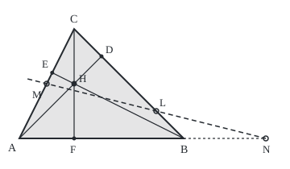

# Ceva and Menelaus: one product of side ratios says three lines meet, another says three points line up

[Syllabus](../../../SYLLABUS.md) → [Geometry and trig](../README.md) → [Coordinates and Curves](../README.md#s04) → Ceva and Menelaus

---

## General Overview

A photo shows a building's corner. Its edges run in three square directions, and each family of parallel edges seems to meet at one point, its **vanishing point**: A (0, 0), B (6, 0) and C (2, 4), in thousands of pixels. From each corner of this triangle, draw a line to the opposite side. Do the three lines meet in one point? Usually not: two cross, and the third misses.

[Triangle centres](08-triangle-centres.md) proved that medians, perpendicular bisectors and angle bisectors each meet. It left out the **altitudes**: the lines from each corner that meet the opposite side at right angles. This card tests any three lines from the corners.

Each line cuts its side into two pieces. Walk round the triangle, divide the piece before each cut by the piece after it, and multiply the three answers. The lines meet exactly when the product is 1.

Here the altitudes cut the sides in the ratios 1/2, 3 and 2/3. The product is 1, so they meet, at H (2, 2): the **orthocentre**. For the photo it is the **principal point**, where the lens's axis meets the picture.

A twin test answers the opposite question. Take one point on each side line. The points lie on one straight line exactly when the same kind of product is −1. The minus sign records that a straight line always meets at least one side line outside the triangle.

**Lines from a triangle's corners to non-corner points on the opposite side lines meet (or are parallel) exactly when the signed side ratios multiply to 1 (Ceva's theorem); three non-corner points on the side lines line up exactly when their signed ratios multiply to −1 (Menelaus' theorem).**

**What kind of fact this is:** two theorems and their converses, proved on this card in Why it works; the signed ratio is a definition.

### The picture: the altitudes meet, and three points line up

<p align="center"></p>

Drawn at 1 grid unit = 34 units. Thin lines: the altitudes AD, BE and CF. Dashed: one straight line through M (1, 2), L (5, 1) and N (9, 0).

---

## The formula

Name the three points where the lines from the corners land: D on side BC, E on side CA, F on side AB.

```math
\frac{AF}{FB}\cdot\frac{BD}{DC}\cdot\frac{CE}{EA} = 1
```

**Read it aloud:** going round from A to B to C, divide the piece before each cut by the piece after it; for non-corner points on the side segments, AD, BE and CF meet exactly when the product is 1.

Now name three points to test for lining up: L on line BC, M on line CA, N on line AB.

```math
\frac{AN}{NB}\cdot\frac{BL}{LC}\cdot\frac{CM}{MA} = -1
```

**Read it aloud:** the same walk with the test points; they line up exactly when the product is minus 1.

Each fraction is a **signed ratio**. For a point X on the line through U and V, UX/XV divides two lengths measured along the line, positive from U towards V, so XU = −UX and the ratio is negative exactly when X lies outside U and V. If X sits a fraction $`t`$ of the way from U to V, the signed ratio is $`t/(1 - t)`$. For N (9, 0) on line AB: $`t = 3/2`$, so AN/NB = 9/(−3) = −3.

| Symbol | Plain meaning | In our example | Push it up and the answer… |
| --- | --- | --- | --- |
| $`A`$, $`B`$, $`C`$ | the triangle's corners | (0, 0), (6, 0), (2, 4) | every ratio changes |
| $`D`$, $`E`$, $`F`$ | where the lines from A, B, C land on sides BC, CA, AB | altitude feet (3, 3), (6/5, 12/5), (2, 0) | D towards C: BD/DC grows |
| $`AF/FB`$ | a signed ratio: piece before the cut over piece after it | altitudes: 1/2, 3, 2/3 | — |
| $`P`$, $`H`$, $`G`$, $`K`$ | meeting point of three lines; orthocentre (altitudes); centroid (medians); line AB meets the parallel to LMN through C | H (2, 2), G (8/3, 4/3), K (18, 0) | — |
| $`L`$, $`M`$, $`N`$ | three points on lines BC, CA, AB, tested for lining up | (5, 1), (1, 2), (9, 0) | N further out: AN/NB nears −1 |
| $`U`$, $`V`$, $`X`$, $`t`$, $`k`$ | X on line UV; how far from U to V it sits, as a fraction; its ratio UX/XV | t = 3/2, k = −3 for N on AB | t past 1: X is beyond V, ratio negative |
| $`[ABH]`$ | the area of triangle ABH, likewise for others | ABH 6, BCH 4, CAH 2 | — |
| $`a`$, $`b`$, $`c`$; $`\cos A`$ | the sides facing A, B, C; the cosine of the angle at A (in the fold) | side c = AB = 6 | — |

### When it holds

- **No point at a corner.** There a ratio is 0 or has a zero bottom, and the product means nothing.
- **Lines through the corners, for Ceva.** Three lines placed anywhere need [Lines](02-lines-slopes-and-intersections.md) instead.
- **Signs kept.** Without them, the transversal's ratios multiply to 1, as if three lines met.
- **Product 1 may mean parallel.** The full converse of Ceva reads "meet in one point, or are all parallel". Lines to inside points of the sides are never parallel.
- **A flat plane.** On a sphere, Menelaus' theorem holds with the sines of arcs in place of lengths.

---

## Why it works

### Step 0: turn lengths into areas

Two triangles with the same height have areas in the ratio of their bases ([Area](../01-Angles%2C%20Triangles%20and%20Congruence/06-area-of-triangles-and-polygons.md)). So a cut on a side becomes a comparison of two areas. Areas around one meeting point then cancel in the product.

### Step 1: one ratio, one point

As X slides along line UV, the signed ratio $`t/(1 - t)`$ takes each value once: a ratio $`k`$ gives $`t = k/(1 + k)`$. So a ratio fixes its point; only −1 has none. Both converses rest on this.

### Step 2: Ceva by areas

Suppose AD, BE and CF meet at a point P inside the triangle. Write $`[ABD]`$ for the area of triangle ABD.

1. Triangles ABD and ADC share the height from A, so BD/DC = [ABD]/[ADC].
2. Triangles PBD and PDC share the height from P, so BD/DC = [PBD]/[PDC].
3. When two fractions are equal, subtracting the second's top and bottom from the first's leaves the same fraction. Here [ABD] − [PBD] = [ABP] and [ADC] − [PDC] = [CAP], so BD/DC = [ABP]/[CAP].
4. In the same way, CE/EA = [BCP]/[ABP] and AF/FB = [CAP]/[BCP].

Multiply the three. Each area appears once on top and once below, so the product is 1. For P outside, count an area negative when its corners run clockwise; every step still holds.

At the orthocentre the areas are [ABH] = 6, [BCH] = 4 and [CAH] = 2, which add to the whole area, 12. The area ratios are 2/4 = 1/2, 6/2 = 3 and 4/6 = 2/3: the same three ratios as the altitude feet.

### Step 3: the converse, product 1 forces a meeting

Suppose the product is 1. If AD and BE meet at P, line CP hits AB at some F′ (otherwise CP ∥ AB forces AF/FB = −1, impossible by Step 1). By Step 2, F′ gives product 1, so AF′/F′B = AF/FB and F′ = F: CF passes through P. (If AD ∥ BE, a similar check makes CF parallel to both.)

### Step 4: the altitudes always meet

Here the ratios are 1/2, 3 and 2/3 (Worked numbers), product 1. The fold shows the product is 1 in every triangle, so by Step 3 the altitudes always meet.

<details>
<summary>Why every triangle's altitudes meet</summary>

At a 90° corner, two altitudes are the sides there, so all three meet at that corner. Otherwise no cosine is zero. Let $`a`$, $`b`$, $`c`$ be the sides facing A, B, C, and A, B, C the angles there. Each altitude foot splits a side: AF = b cos A, FB = a cos B, and likewise round the triangle. So

$`\displaystyle \frac{AF}{FB}\cdot\frac{BD}{DC}\cdot\frac{CE}{EA} = \frac{b\cos A}{a\cos B}\cdot\frac{c\cos B}{b\cos C}\cdot\frac{a\cos C}{c\cos A} = 1.`$

In a triangle with an angle over 90°, that cosine is negative, the foot lands outside the side, and the signed ratio carries the minus sign. The product is still 1, so the altitudes still meet, outside the triangle.

</details>

### Step 5: Menelaus by a parallel line

Let one straight line cross lines BC, CA and AB at L, M and N. Through C, draw a line parallel to it, meeting line AB at K. Here K = (18, 0).

1. In the corner at B, lines NL and KC are parallel. A parallel cut divides both sides in the same ratio ([Similar triangles](../01-Angles%2C%20Triangles%20and%20Congruence/04-similar-triangles-and-scale.md)), so BL/LC = BN/NK. Numbers: 1/3 = 3/9.
2. In the corner at A, lines NM and KC are parallel, so CM/MA = KN/NA. Numbers: 1 = 9/9.
3. Substitute: the product becomes AN/NB × BN/NK × KN/NA.

Each length now appears twice, read both ways: AN and NA, BN and NB, KN and NK. Read backwards, a length changes sign, so the three pairs give $`(-1)^3 = -1`$.

The converse runs as in Step 3. Let line LM meet line AB at N′. Then N′ gives product −1, so AN′/N′B = AN/NB, and N′ = N.

---

## Worked numbers, by hand

| Step | Arithmetic | Value |
| --- | --- | --- |
| median feet | midpoints of AB, BC, CA | F (3, 0), D (4, 2), E (1, 2) |
| median ratios | each side cut in half | 1, 1, 1 |
| median product | 1 × 1 × 1 | **1: the medians meet**, at G (8/3, 4/3) |
| altitude feet | drop a right angle from each corner | F (2, 0), D (3, 3), E (6/5, 12/5) |
| altitude ratios | 2/4; three times as far from B; 2 parts to 3 | 1/2, 3, 2/3 |
| altitude product | 1/2 × 3 × 2/3 | **1: the altitudes meet** |
| where | AD is y = x; CF is x = 2 | **H (2, 2)** |
| areas round H | half base times height | ABH 6, BCH 4, CAH 2 |
| transversal | N (9, 0), L (5, 1), M (1, 2) | AN/NB = 9/(−3) = −3, BL/LC = 1/3, CM/MA = 1 |
| its product | −3 × 1/3 × 1 | **−1: the three points line up** |

The altitudes meet, so the photo has one principal point, H (2, 2): three side ratios proved it.

### What breaks if you drop a piece

| Mistake | Comes out at | What went wrong |
| --- | --- | --- |
| Two medians with the altitude from C | product 1/2; G is 0.67 off that altitude | lines from different families need not meet |
| Flipping one ratio, DC/BD for BD/DC | 1/9 for the altitudes | the walk must keep one direction |
| Dropping the signs on the transversal | 1, as if three lines met | sizes alone cannot separate the two theorems |

---

## Code, from first principles, and it actually runs

Every number is an exact fraction. Road one multiplies the three signed ratios. Road two crosses two lines and tests the third directly with a cross product, the determinant of two arrows from one point ([Determinants](../../03-Algebra/05-Solving%20Systems/04-determinants.md)), which is 0 exactly when three points lie on one line. Road three compares areas round H, and the parallel line through C checks Menelaus. A sweep of 125 triples of lines and 512 triples of points confirms the two tests never disagree.

### Python

```python
# Ceva and Menelaus -- the check behind the card.  Triangle A (0, 0), B (6, 0), C (2, 4), exact fractions.
# Roads: multiply three signed side ratios; meet the lines and test the third directly; areas at the meeting point.
from fractions import Fraction as Q
def sub(p, q): return (p[0] - q[0], p[1] - q[1])
def cross(u, v): return u[0] * v[1] - u[1] * v[0]
def at(P, R, t): return (P[0] + t * (R[0] - P[0]), P[1] + t * (R[1] - P[1]))
def ratio(P, X, R):                       # signed PX/XR: negative when X lies outside P-R
    d = sub(R, P); t = (sub(X, P)[0] * d[0] + sub(X, P)[1] * d[1]) / (d[0] ** 2 + d[1] ** 2)
    return t / (1 - t)
def meet(P, R, S, T):                     # where line PR crosses line ST
    return at(P, R, cross(sub(S, P), sub(T, S)) / cross(sub(R, P), sub(T, S)))
def area(P, R, S): return abs(cross(sub(R, P), sub(S, P))) / 2
def pt(p): return f"({p[0]}, {p[1]})"
A, B, C = (Q(0), Q(0)), (Q(6), Q(0)), (Q(2), Q(4))
def ceva(D, E, F, name):                  # D on BC, E on CA, F on AB
    r = [ratio(A, F, B), ratio(B, D, C), ratio(C, E, A)]
    P = meet(A, D, B, E)                  # two lines meet at P; does the third pass?
    miss = cross(sub(F, C), sub(P, C))   # 0 exactly when P lies on line CF
    gap = abs(miss) / ((F[0] - C[0]) ** 2 + (F[1] - C[1]) ** 2) ** 0.5
    print(f"{name}: feet F {pt(F)}, D {pt(D)}, E {pt(E)}; AF/FB {r[0]}, BD/DC {r[1]}, "
          f"CE/EA {r[2]}; product {r[0] * r[1] * r[2]}; AD and BE meet at {pt(P)}; P is {gap:.2f} off CF")
    return r[0] * r[1] * r[2], P, miss
print(f"triangle A {pt(A)}, B {pt(B)}, C {pt(C)}; area {area(A, B, C)}")
pm, G, mm = ceva(at(B, C, Q(1, 2)), at(C, A, Q(1, 2)), at(A, B, Q(1, 2)), "medians")
foot = lambda P, R, S: at(R, S, ((P[0] - R[0]) * (S[0] - R[0]) + (P[1] - R[1]) * (S[1] - R[1]))
                         / ((S[0] - R[0]) ** 2 + (S[1] - R[1]) ** 2))
Da, Eb, Fc = foot(A, B, C), foot(B, C, A), foot(C, A, B)
ph, H, mh = ceva(Da, Eb, Fc, "altitudes")
ar = [area(A, B, H), area(B, C, H), area(C, A, H)]
print(f"areas at H: ABH {ar[0]}, BCH {ar[1]}, CAH {ar[2]}; CAH/BCH {ar[2] / ar[1]}, "
      f"ABH/CAH {ar[0] / ar[2]}, BCH/ABH {ar[1] / ar[0]}")
px, _, mx = ceva(at(B, C, Q(1, 2)), at(C, A, Q(1, 2)), Fc, "mixed")
N, L, M = (Q(9), Q(0)), at(B, C, Q(1, 4)), at(C, A, Q(1, 2))   # one straight line
mr = [ratio(A, N, B), ratio(B, L, C), ratio(C, M, A)]
K = meet(A, B, C, (C[0] + N[0] - M[0], C[1] + N[1] - M[1]))   # through C, parallel to the line
print(f"transversal: N {pt(N)}, L {pt(L)}, M {pt(M)}; AN/NB {mr[0]}, BL/LC {mr[1]}, CM/MA {mr[2]}; "
      f"product {mr[0] * mr[1] * mr[2]}; off-line by {cross(sub(L, N), sub(M, N))}")
print(f"slips: altitudes with BD/DC flipped {ratio(A, Fc, B) / ratio(B, Da, C) * ratio(C, Eb, A)}; "
      f"transversal with signs dropped {abs(mr[0]) * abs(mr[1]) * abs(mr[2])}")
print(f"parallel through C meets AB at K {pt(K)}; BN/NK {ratio(B, N, K)}, KN/NA {ratio(K, N, A)}")
cv = mn = bad = 0
for i, j, k in (T := [(i, j, k) for i in range(1, 6) for j in range(1, 6) for k in range(1, 6)]):   # every cevian triple on the sixths of the sides
    D, E, F = at(B, C, Q(i, 6)), at(C, A, Q(j, 6)), at(A, B, Q(k, 6))
    one = ratio(A, F, B) * ratio(B, D, C) * ratio(C, E, A) == 1
    P = meet(A, D, B, E); cv += one; bad += one != (cross(sub(F, C), sub(P, C)) == 0)
S = [Q(-1), Q(-1, 2), Q(1, 3), Q(1, 2), Q(2, 3), Q(3, 2), Q(2), Q(3)]
for i, j, k in [(i, j, k) for i in S for j in S for k in S]:            # points on the three side-lines, inside or out
    L2, M2, N2 = at(B, C, i), at(C, A, j), at(A, B, k)
    one = ratio(A, N2, B) * ratio(B, L2, C) * ratio(C, M2, A) == -1
    mn += one; bad += one != (cross(sub(L2, N2), sub(M2, N2)) == 0)
print(f"sweep: Ceva product 1 for {cv} of {len(T)} triples, Menelaus -1 for {mn} of {len(S) ** 3}; mismatches {bad}")
sv = lambda p: f"({float(24 + 34 * p[0]):.1f}, {float(172 - 34 * p[1]):.1f})"
print("figure, 1 unit = 34:", ", ".join(f"{n} {sv(p)}" for n, p in zip("ABCHDEFLMN", (A, B, C, H, Da, Eb, Fc, L, M, N))))
assert pm == 1 and mm == 0 and G == (Q(8, 3), Q(4, 3))   # medians: product 1, they meet
assert ph == 1 and mh == 0 and H == (Q(2), Q(2))         # altitudes: product 1, they meet
assert [ar[2] / ar[1], ar[0] / ar[2], ar[1] / ar[0]] == [ratio(A, Fc, B), ratio(B, Da, C), ratio(C, Eb, A)]
assert px != 1 and mx != 0                               # product off 1: the lines miss
assert mr[0] * mr[1] * mr[2] == -1 and cross(sub(L, N), sub(M, N)) == 0
assert ratio(B, N, K) == mr[1] and ratio(K, N, A) == mr[2] and bad == 0
print("ALL CHECKS PASS")
```

**Ran 2026-11-23 on macOS, Python 3.14.10, standard library only. All checks passed. Output, pasted from the run:**

```
triangle A (0, 0), B (6, 0), C (2, 4); area 12
medians: feet F (3, 0), D (4, 2), E (1, 2); AF/FB 1, BD/DC 1, CE/EA 1; product 1; AD and BE meet at (8/3, 4/3); P is 0.00 off CF
altitudes: feet F (2, 0), D (3, 3), E (6/5, 12/5); AF/FB 1/2, BD/DC 3, CE/EA 2/3; product 1; AD and BE meet at (2, 2); P is 0.00 off CF
areas at H: ABH 6, BCH 4, CAH 2; CAH/BCH 1/2, ABH/CAH 3, BCH/ABH 2/3
mixed: feet F (2, 0), D (4, 2), E (1, 2); AF/FB 1/2, BD/DC 1, CE/EA 1; product 1/2; AD and BE meet at (8/3, 4/3); P is 0.67 off CF
transversal: N (9, 0), L (5, 1), M (1, 2); AN/NB -3, BL/LC 1/3, CM/MA 1; product -1; off-line by 0
slips: altitudes with BD/DC flipped 1/9; transversal with signs dropped 1
parallel through C meets AB at K (18, 0); BN/NK 1/3, KN/NA 1
sweep: Ceva product 1 for 13 of 125 triples, Menelaus -1 for 18 of 512; mismatches 0
figure, 1 unit = 34: A (24.0, 172.0), B (228.0, 172.0), C (92.0, 36.0), H (92.0, 104.0), D (126.0, 70.0), E (64.8, 90.4), F (92.0, 172.0), L (194.0, 138.0), M (58.0, 104.0), N (330.0, 172.0)
ALL CHECKS PASS
```

### Rust

Same numbers, same labels, built with `rustc --edition 2021 -O`.

```rust
// Ceva and Menelaus -- the same check as the Python, in Rust, no crates.  Triangle A (0, 0), B (6, 0), C (2, 4).
// Roads: multiply three signed side ratios; meet the lines and test the third directly; areas at the meeting point.
#[derive(Clone, Copy, PartialEq)]
struct Q(i64, i64); // numerator, denominator; always in lowest terms, denominator positive
fn gcd(a: i64, b: i64) -> i64 { if b == 0 { a.abs() } else { gcd(b, a % b) } }
fn q(n: i64, d: i64) -> Q { let g = gcd(n, d) * d.signum(); Q(n / g, d / g) }
fn add(a: Q, b: Q) -> Q { q(a.0 * b.1 + b.0 * a.1, a.1 * b.1) }
fn sb(a: Q, b: Q) -> Q { q(a.0 * b.1 - b.0 * a.1, a.1 * b.1) }
fn mul(a: Q, b: Q) -> Q { q(a.0 * b.0, a.1 * b.1) }
fn dv(a: Q, b: Q) -> Q { q(a.0 * b.1, a.1 * b.0) }
fn f(a: Q) -> f64 { a.0 as f64 / a.1 as f64 }
fn s(a: Q) -> String { if a.1 == 1 { format!("{}", a.0) } else { format!("{}/{}", a.0, a.1) } }
type P = (Q, Q); // a point: two exact coordinates
fn n(k: i64) -> Q { Q(k, 1) }
fn sub(p: P, r: P) -> P { (sb(p.0, r.0), sb(p.1, r.1)) }
fn cross(u: P, v: P) -> Q { sb(mul(u.0, v.1), mul(u.1, v.0)) }
fn dot(u: P, v: P) -> Q { add(mul(u.0, v.0), mul(u.1, v.1)) }
fn at(p: P, r: P, t: Q) -> P { (add(p.0, mul(t, sb(r.0, p.0))), add(p.1, mul(t, sb(r.1, p.1)))) }
fn ratio(p: P, x: P, r: P) -> Q { // signed PX/XR: negative when X lies outside P-R
    let t = dv(dot(sub(x, p), sub(r, p)), dot(sub(r, p), sub(r, p)));
    dv(t, sb(n(1), t))
}
fn meet(p: P, r: P, a: P, b: P) -> P { at(p, r, dv(cross(sub(a, p), sub(b, a)), cross(sub(r, p), sub(b, a)))) }
fn area(p: P, r: P, t: P) -> Q { let c = cross(sub(r, p), sub(t, p)); q(c.0.abs(), 2 * c.1) }
fn pt(p: P) -> String { format!("({}, {})", s(p.0), s(p.1)) }
fn foot(p: P, r: P, t: P) -> P { at(r, t, dv(dot(sub(p, r), sub(t, r)), dot(sub(t, r), sub(t, r)))) }
const A: P = (Q(0, 1), Q(0, 1)); const B: P = (Q(6, 1), Q(0, 1)); const C: P = (Q(2, 1), Q(4, 1));
fn ceva(d: P, e: P, fp: P, name: &str) -> (Q, P, Q) { // D on BC, E on CA, F on AB
    let r = [ratio(A, fp, B), ratio(B, d, C), ratio(C, e, A)];
    let p = meet(A, d, B, e); // two lines meet at P; does the third pass?
    let miss = cross(sub(fp, C), sub(p, C)); // 0 exactly when P lies on line CF
    let gap = f(miss).abs() / f(dot(sub(fp, C), sub(fp, C))).sqrt();
    let pr = mul(mul(r[0], r[1]), r[2]);
    println!("{}: feet F {}, D {}, E {}; AF/FB {}, BD/DC {}, CE/EA {}; product {}; AD and BE meet at {}; P is {:.2} off CF",
             name, pt(fp), pt(d), pt(e), s(r[0]), s(r[1]), s(r[2]), s(pr), pt(p), gap);
    (pr, p, miss)
}
fn main() {
    println!("triangle A {}, B {}, C {}; area {}", pt(A), pt(B), pt(C), s(area(A, B, C)));
    let (pm, g, mm) = ceva(at(B, C, q(1, 2)), at(C, A, q(1, 2)), at(A, B, q(1, 2)), "medians");
    let (da, eb, fc) = (foot(A, B, C), foot(B, C, A), foot(C, A, B));
    let (ph, h, mh) = ceva(da, eb, fc, "altitudes");
    let ar = [area(A, B, h), area(B, C, h), area(C, A, h)];
    println!("areas at H: ABH {}, BCH {}, CAH {}; CAH/BCH {}, ABH/CAH {}, BCH/ABH {}", s(ar[0]), s(ar[1]), s(ar[2]),
             s(dv(ar[2], ar[1])), s(dv(ar[0], ar[2])), s(dv(ar[1], ar[0])));
    let (px, _, mx) = ceva(at(B, C, q(1, 2)), at(C, A, q(1, 2)), fc, "mixed");
    let (nn, l, m) = ((n(9), n(0)), at(B, C, q(1, 4)), at(C, A, q(1, 2))); // one straight line
    let mr = [ratio(A, nn, B), ratio(B, l, C), ratio(C, m, A)];
    let k = meet(A, B, C, (add(C.0, sb(nn.0, m.0)), add(C.1, sb(nn.1, m.1)))); // through C, parallel
    let mp = mul(mul(mr[0], mr[1]), mr[2]);
    println!("transversal: N {}, L {}, M {}; AN/NB {}, BL/LC {}, CM/MA {}; product {}; off-line by {}",
             pt(nn), pt(l), pt(m), s(mr[0]), s(mr[1]), s(mr[2]), s(mp), s(cross(sub(l, nn), sub(m, nn))));
    println!("slips: altitudes with BD/DC flipped {}; transversal with signs dropped {}",
             s(mul(dv(ratio(A, fc, B), ratio(B, da, C)), ratio(C, eb, A))), s(q(mp.0.abs(), mp.1)));
    println!("parallel through C meets AB at K {}; BN/NK {}, KN/NA {}", pt(k), s(ratio(B, nn, k)), s(ratio(k, nn, A)));
    let (mut cv, mut mn, mut bad, mut tot) = (0, 0, 0, 0);
    for i in 1..6 { for j in 1..6 { for kk in 1..6 { // every cevian triple on the sixths of the sides
        let (d, e, fp) = (at(B, C, q(i, 6)), at(C, A, q(j, 6)), at(A, B, q(kk, 6)));
        let one = mul(mul(ratio(A, fp, B), ratio(B, d, C)), ratio(C, e, A)) == n(1);
        let p = meet(A, d, B, e);
        cv += one as i32; tot += 1; bad += (one != (cross(sub(fp, C), sub(p, C)) == n(0))) as i32;
    } } }
    let st = [n(-1), q(-1, 2), q(1, 3), q(1, 2), q(2, 3), q(3, 2), n(2), n(3)];
    for &i in &st { for &j in &st { for &kk in &st { // points on the three side-lines, inside or out
        let (l2, m2, n2) = (at(B, C, i), at(C, A, j), at(A, B, kk));
        let one = mul(mul(ratio(A, n2, B), ratio(B, l2, C)), ratio(C, m2, A)) == n(-1);
        mn += one as i32; bad += (one != (cross(sub(l2, n2), sub(m2, n2)) == n(0))) as i32;
    } } }
    println!("sweep: Ceva product 1 for {} of {} triples, Menelaus -1 for {} of {}; mismatches {}", cv, tot, mn, st.len().pow(3), bad);
    let sv = |p: P| format!("({:.1}, {:.1})", 24.0 + 34.0 * f(p.0), 172.0 - 34.0 * f(p.1));
    let pts = [("A", A), ("B", B), ("C", C), ("H", h), ("D", da), ("E", eb), ("F", fc), ("L", l), ("M", m), ("N", nn)];
    println!("figure, 1 unit = 34: {}", pts.iter().map(|(t, p)| format!("{} {}", t, sv(*p))).collect::<Vec<_>>().join(", "));
    assert!(pm == n(1) && mm == n(0) && g == (q(8, 3), q(4, 3))); // medians: product 1, they meet
    assert!(ph == n(1) && mh == n(0) && h == (n(2), n(2))); // altitudes: product 1, they meet
    assert!([dv(ar[2], ar[1]), dv(ar[0], ar[2]), dv(ar[1], ar[0])] == [ratio(A, fc, B), ratio(B, da, C), ratio(C, eb, A)]);
    assert!(px != n(1) && mx != n(0)); // product off 1: the lines miss
    assert!(mp == n(-1) && cross(sub(l, nn), sub(m, nn)) == n(0));
    assert!(ratio(B, nn, k) == mr[1] && ratio(k, nn, A) == mr[2] && bad == 0);
    println!("ALL CHECKS PASS");
}
```

**Ran 2026-11-23 on macOS, rustc 1.98.1, no crates. All checks passed. Output, pasted from the run:**

```
triangle A (0, 0), B (6, 0), C (2, 4); area 12
medians: feet F (3, 0), D (4, 2), E (1, 2); AF/FB 1, BD/DC 1, CE/EA 1; product 1; AD and BE meet at (8/3, 4/3); P is 0.00 off CF
altitudes: feet F (2, 0), D (3, 3), E (6/5, 12/5); AF/FB 1/2, BD/DC 3, CE/EA 2/3; product 1; AD and BE meet at (2, 2); P is 0.00 off CF
areas at H: ABH 6, BCH 4, CAH 2; CAH/BCH 1/2, ABH/CAH 3, BCH/ABH 2/3
mixed: feet F (2, 0), D (4, 2), E (1, 2); AF/FB 1/2, BD/DC 1, CE/EA 1; product 1/2; AD and BE meet at (8/3, 4/3); P is 0.67 off CF
transversal: N (9, 0), L (5, 1), M (1, 2); AN/NB -3, BL/LC 1/3, CM/MA 1; product -1; off-line by 0
slips: altitudes with BD/DC flipped 1/9; transversal with signs dropped 1
parallel through C meets AB at K (18, 0); BN/NK 1/3, KN/NA 1
sweep: Ceva product 1 for 13 of 125 triples, Menelaus -1 for 18 of 512; mismatches 0
figure, 1 unit = 34: A (24.0, 172.0), B (228.0, 172.0), C (92.0, 36.0), H (92.0, 104.0), D (126.0, 70.0), E (64.8, 90.4), F (92.0, 172.0), L (194.0, 138.0), M (58.0, 104.0), N (330.0, 172.0)
ALL CHECKS PASS
```

### Lean

Lean proves Ceva, Menelaus and the meeting of the altitudes for every triangle in a flat plane.

- Take D, E, F on lines BC, CA, AB, none at a corner. Then AD, BE and CF meet in one point, or are all parallel, exactly when the signed ratios multiply to 1.
- Take L, M, N on lines BC, CA, AB, none at a corner. Then L, M and N lie on one straight line exactly when the signed ratios multiply to −1.
- In every triangle, one point lies on all three altitudes: the orthocentre always exists.
- The card's worked numbers hold, from the altitude ratios 1/2, 3 and 2/3 to the transversal's product −1.

Finding the feet and meeting points, the 0.67 miss, the sweep and the figure's coordinates are left to the Python and Rust checks.

```lean
-- Ceva and Menelaus: in a flat plane, lines from a triangle's corners to points on the opposite side lines meet in one point (or are all parallel) exactly when the signed side ratios multiply to 1, three points on the side lines lie on one line exactly when their signed ratios multiply to -1, and the three altitudes always meet.
import Mathlib.LinearAlgebra.AffineSpace.Ceva
import Mathlib.LinearAlgebra.AffineSpace.FiniteDimensional
import Mathlib.Analysis.InnerProductSpace.PiL2
import Mathlib.Tactic.NormNum

open scoped Affine RealInnerProductSpace

/-! A point a fraction `t` of the way from `U` to `V` is `AffineMap.lineMap U V t`; its signed
ratio `UX/XV` is `t / (1 - t)`, as defined on the card. Corners `A`, `B`, `C` form a triangle
(affinely independent) in the flat plane `ℝ²`. -/

lemma ceva_indep3 {A B C : EuclideanSpace ℝ (Fin 2)} (h : AffineIndependent ℝ ![A, B, C])
    {a b c : ℝ} (hs : a + b + c = 0) (hv : a • A + b • B + c • C = 0) :
    a = 0 ∧ b = 0 ∧ c = 0 := by
  have := h.eq_zero_of_sum_eq_zero (s := Finset.univ) (w := ![a, b, c])
    (by simpa [Fin.sum_univ_three] using hs) (by simpa [Fin.sum_univ_three] using hv)
  exact ⟨this 0 (by simp), this 1 (by simp), this 2 (by simp)⟩

#print axioms ceva_indep3

/-- **Ceva's theorem and its converse.** Let `D`, `E`, `F` sit fractions `d`, `e`, `f` of the way
along sides `BC`, `CA`, `AB`, none at a corner. Then the signed ratios multiply to 1,
`AF/FB · BD/DC · CE/EA = 1`, exactly when the lines `AD`, `BE`, `CF` meet in one point or are
all parallel. -/
theorem ceva_product_eq_one_iff_concurrent_or_parallel
    {A B C D E F : EuclideanSpace ℝ (Fin 2)} {d e f : ℝ}
    (hABC : AffineIndependent ℝ ![A, B, C])
    (hD : D = AffineMap.lineMap B C d) (hE : E = AffineMap.lineMap C A e)
    (hF : F = AffineMap.lineMap A B f)
    (hd0 : d ≠ 0) (hd1 : d ≠ 1) (he0 : e ≠ 0) (he1 : e ≠ 1) (hf0 : f ≠ 0) (hf1 : f ≠ 1) :
    f / (1 - f) * (d / (1 - d)) * (e / (1 - e)) = 1 ↔
      ((∃ P, P ∈ line[ℝ, A, D] ∧ P ∈ line[ℝ, B, E] ∧ P ∈ line[ℝ, C, F]) ∨
        (line[ℝ, A, D] ∥ line[ℝ, B, E] ∧ line[ℝ, B, E] ∥ line[ℝ, C, F])) := by
  have hd1' : 1 - d ≠ 0 := sub_ne_zero.mpr (Ne.symm hd1)
  have he1' : 1 - e ≠ 0 := sub_ne_zero.mpr (Ne.symm he1)
  have hf1' : 1 - f ≠ 0 := sub_ne_zero.mpr (Ne.symm hf1)
  rw [div_mul_div_comm, div_mul_div_comm,
    div_eq_one_iff_eq (mul_ne_zero (mul_ne_zero hf1' hd1') he1')]
  subst hD hE hF
  constructor
  · intro hprod
    by_cases hΔ : (1 - d) * (1 - e) + d = 0
    · right
      have hfe : f * (1 - e) = 1 := by
        apply mul_left_cancel₀ hd0
        first | linear_combination -hprod - (1 - f) * hΔ | linear_combination hprod + (1 - f) * hΔ
      constructor
      · rw [AffineSubspace.affineSpan_pair_parallel_iff_vectorSpan_eq, vectorSpan_pair,
          vectorSpan_pair, Submodule.span_singleton_eq_span_singleton]
        refine ⟨Units.mk0 (-1 / (1 - d)) (div_ne_zero (neg_ne_zero.mpr one_ne_zero) hd1'), ?_⟩
        simp only [Units.smul_mk0, vsub_eq_sub, AffineMap.lineMap_apply_module]
        match_scalars <;> field_simp <;>
          first | ring1 | linear_combination hΔ | linear_combination -hΔ
      · rw [AffineSubspace.affineSpan_pair_parallel_iff_vectorSpan_eq, vectorSpan_pair,
          vectorSpan_pair, Submodule.span_singleton_eq_span_singleton]
        refine ⟨Units.mk0 (-f) (neg_ne_zero.mpr hf0), ?_⟩
        simp only [Units.smul_mk0, vsub_eq_sub, AffineMap.lineMap_apply_module]
        match_scalars <;>
          first | ring1 | linear_combination hfe | linear_combination -hfe
    · left
      refine ⟨(1 - (1 - e) / ((1 - d) * (1 - e) + d)) • A
        + ((1 - e) / ((1 - d) * (1 - e) + d) * (1 - d)) • B
        + ((1 - e) / ((1 - d) * (1 - e) + d) * d) • C, ?_, ?_, ?_⟩ <;>
        rw [mem_affineSpan_pair_iff_exists_lineMap_eq]
      · refine ⟨(1 - e) / ((1 - d) * (1 - e) + d), ?_⟩
        simp only [AffineMap.lineMap_apply_module]
        match_scalars <;> field_simp <;> ring1
      · refine ⟨d / ((1 - d) * (1 - e) + d), ?_⟩
        simp only [AffineMap.lineMap_apply_module]
        match_scalars <;> field_simp <;> ring1
      · refine ⟨(1 - d) * (1 - e) / (((1 - d) * (1 - e) + d) * f), ?_⟩
        simp only [AffineMap.lineMap_apply_module]
        match_scalars <;> field_simp <;>
          first | ring1 | linear_combination hprod | linear_combination -hprod
  · rintro (⟨P, h1, h2, h3⟩ | ⟨h1, h2⟩)
    · rw [mem_affineSpan_pair_iff_exists_lineMap_eq] at h1 h2 h3
      obtain ⟨s, rfl⟩ := h1
      obtain ⟨t, ht⟩ := h2
      obtain ⟨w, hw⟩ := h3
      simp only [AffineMap.lineMap_apply_module] at ht hw
      obtain ⟨ha, hb, hc⟩ := ceva_indep3 hABC (a := t * e - (1 - s))
        (b := (1 - t) - s * (1 - d)) (c := t * (1 - e) - s * d) (by ring)
        (by linear_combination (norm := module) ht)
      obtain ⟨hwa, hwb, hwc⟩ := ceva_indep3 hABC (a := w * (1 - f) - (1 - s))
        (b := w * f - s * (1 - d)) (c := (1 - w) - s * d) (by ring)
        (by linear_combination (norm := module) hw)
      have hs : s ≠ 0 := by
        rintro rfl
        apply he1'
        linear_combination hc + (1 - e) * hb
      have ht0 : t ≠ 0 := by
        rintro rfl
        apply hd0
        linear_combination d * hb - (1 - d) * hc
      have hw0 : w ≠ 0 := by
        rintro rfl
        have : s * (1 - d) = 0 := by linear_combination -hwb
        rcases mul_eq_zero.mp this with h | h
        · exact hs h
        · exact hd1' h
      apply mul_left_cancel₀ (mul_ne_zero (mul_ne_zero hs hw0) ht0)
      linear_combination (s * d * t * e) * hwb - (s * (1 - d) * t * e) * hc
        - (s * (1 - d) * t * (1 - e)) * (hwa - ha)
    · rw [AffineSubspace.affineSpan_pair_parallel_iff_vectorSpan_eq, vectorSpan_pair,
        vectorSpan_pair, Submodule.span_singleton_eq_span_singleton] at h1 h2
      obtain ⟨z, hz⟩ := h1
      obtain ⟨z', hz'⟩ := h2
      simp only [Units.smul_def, vsub_eq_sub, AffineMap.lineMap_apply_module] at hz hz'
      obtain ⟨ha, hb, hc⟩ := ceva_indep3 hABC (a := (z : ℝ) + e)
        (b := -(z : ℝ) * (1 - d) - 1) (c := -(z : ℝ) * d + (1 - e)) (by ring)
        (by linear_combination (norm := module) hz)
      obtain ⟨ha', hb', hc'⟩ := ceva_indep3 hABC (a := -(z' : ℝ) * e + (1 - f))
        (b := (z' : ℝ) + f) (c := -(z' : ℝ) * (1 - e) - 1) (by ring)
        (by linear_combination (norm := module) hz')
      have h1 : f * (1 - e) = 1 := by linear_combination hc' + (1 - e) * hb'
      have h2 : e * (1 - d) = 1 := by linear_combination hb + (1 - d) * ha
      linear_combination (-d) * h1 + (1 - f) * h2

/-- **Menelaus' theorem and its converse.** Let `L`, `M`, `N` sit fractions `l`, `m`, `n` of the
way along the side lines `BC`, `CA`, `AB` (inside the side or beyond it), none at a corner. Then
`L`, `M`, `N` lie on one straight line exactly when the signed ratios multiply to -1,
`AN/NB · BL/LC · CM/MA = -1`. -/
theorem menelaus_collinear_iff_product_eq_neg_one
    {A B C L M N : EuclideanSpace ℝ (Fin 2)} {l m n : ℝ}
    (hABC : AffineIndependent ℝ ![A, B, C])
    (hL : L = AffineMap.lineMap B C l) (hM : M = AffineMap.lineMap C A m)
    (hN : N = AffineMap.lineMap A B n)
    (hl0 : l ≠ 0) (hl1 : l ≠ 1) (hm0 : m ≠ 0) (hm1 : m ≠ 1) (hn0 : n ≠ 0) (hn1 : n ≠ 1) :
    Collinear ℝ {L, M, N} ↔ n / (1 - n) * (l / (1 - l)) * (m / (1 - m)) = -1 := by
  have hl1' : 1 - l ≠ 0 := sub_ne_zero.mpr (Ne.symm hl1)
  have hm1' : 1 - m ≠ 0 := sub_ne_zero.mpr (Ne.symm hm1)
  have hn1' : 1 - n ≠ 0 := sub_ne_zero.mpr (Ne.symm hn1)
  rw [div_mul_div_comm, div_mul_div_comm, div_eq_iff (mul_ne_zero (mul_ne_zero hn1' hl1') hm1')]
  subst hL hM hN
  have hMN : AffineMap.lineMap C A m ≠ AffineMap.lineMap A B n := by
    intro h
    simp only [AffineMap.lineMap_apply_module] at h
    obtain ⟨-, hb, -⟩ := ceva_indep3 hABC (a := m - (1 - n)) (b := -n) (c := 1 - m) (by ring)
      (by linear_combination (norm := module) h)
    exact hn0 (neg_eq_zero.mp hb)
  constructor
  · intro hcol
    have h := hcol.mem_affineSpan_of_mem_of_ne (p₃ := AffineMap.lineMap B C l) (by simp) (by simp) (by simp) hMN
    rw [mem_affineSpan_pair_iff_exists_lineMap_eq] at h
    obtain ⟨r, hr⟩ := h
    simp only [AffineMap.lineMap_apply_module] at hr
    obtain ⟨ha, hb, hc⟩ := ceva_indep3 hABC (a := (1 - r) * m + r * (1 - n))
      (b := r * n - (1 - l)) (c := (1 - r) * (1 - m) - l) (by ring)
      (by linear_combination (norm := module) hr)
    linear_combination n * (1 - m) * ha - n * m * hc - (1 - n) * (1 - m) * hb
  · intro h
    apply collinear_insert_of_mem_affineSpan_pair
    rw [mem_affineSpan_pair_iff_exists_lineMap_eq]
    refine ⟨(1 - l) / n, ?_⟩
    simp only [AffineMap.lineMap_apply_module]
    match_scalars <;> field_simp <;> first | linear_combination h | linear_combination -h

/-- **The altitudes always meet (the orthocentre exists).** In every triangle there is a point
`H` on all three altitudes: `AH` is at right angles to `BC`, `BH` to `CA`, and `CH` to `AB`. -/
theorem altitudes_meet
    {A B C : EuclideanSpace ℝ (Fin 2)} (hABC : AffineIndependent ℝ ![A, B, C]) :
    ∃ H : EuclideanSpace ℝ (Fin 2),
      ⟪H -ᵥ A, C -ᵥ B⟫ = 0 ∧ ⟪H -ᵥ B, A -ᵥ C⟫ = 0 ∧ ⟪H -ᵥ C, B -ᵥ A⟫ = 0 := by
  have hdet : (C.ofLp 0 - B.ofLp 0) * (A.ofLp 1 - C.ofLp 1)
      - (C.ofLp 1 - B.ofLp 1) * (A.ofLp 0 - C.ofLp 0) ≠ 0 := by
    intro hdet
    obtain ⟨hp1, hq1, -⟩ := ceva_indep3 hABC (a := -(C.ofLp 1 - B.ofLp 1))
      (b := -(A.ofLp 1 - C.ofLp 1)) (c := (A.ofLp 1 - C.ofLp 1) + (C.ofLp 1 - B.ofLp 1))
      (by ring) (by
        ext i; fin_cases i <;> simp <;>
          first | ring1 | linear_combination hdet | linear_combination -hdet)
    obtain ⟨hp0, hq0, -⟩ := ceva_indep3 hABC (a := -(C.ofLp 0 - B.ofLp 0))
      (b := -(A.ofLp 0 - C.ofLp 0)) (c := (A.ofLp 0 - C.ofLp 0) + (C.ofLp 0 - B.ofLp 0))
      (by ring) (by
        ext i; fin_cases i <;> simp <;>
          first | ring1 | linear_combination hdet | linear_combination -hdet)
    obtain ⟨-, h1, -⟩ := ceva_indep3 hABC (a := 0) (b := 1) (c := -1) (by ring) (by
        ext i; fin_cases i <;> simp <;>
          first | linear_combination hp0 | linear_combination hp1)
    exact one_ne_zero h1
  set det := (C.ofLp 0 - B.ofLp 0) * (A.ofLp 1 - C.ofLp 1)
      - (C.ofLp 1 - B.ofLp 1) * (A.ofLp 0 - C.ofLp 0) with hdet_def
  set α := (C.ofLp 0 - B.ofLp 0) * A.ofLp 0 + (C.ofLp 1 - B.ofLp 1) * A.ofLp 1
  set β := (A.ofLp 0 - C.ofLp 0) * B.ofLp 0 + (A.ofLp 1 - C.ofLp 1) * B.ofLp 1
  refine ⟨!₂[(α * (A.ofLp 1 - C.ofLp 1) - β * (C.ofLp 1 - B.ofLp 1)) / det,
    ((C.ofLp 0 - B.ofLp 0) * β - (A.ofLp 0 - C.ofLp 0) * α) / det], ?_, ?_, ?_⟩ <;>
    simp only [vsub_eq_sub, PiLp.inner_apply, Fin.sum_univ_two, PiLp.sub_apply] <;>
    simp [α, β] <;> field_simp <;> rw [hdet_def] <;> ring

/-! The card's worked numbers: triangle A (0, 0), B (6, 0), C (2, 4), exact fractions. -/

-- A signed ratio t/(1 - t): the altitude feet F, D, E sit 1/3, 3/4, 2/5 of the way along AB, BC, CA.
example : (1/3 : ℚ) / (1 - 1/3) = 1/2 := by norm_num
example : (3/4 : ℚ) / (1 - 3/4) = 3 := by norm_num
example : (2/5 : ℚ) / (1 - 2/5) = 2/3 := by norm_num
-- Medians: each side cut in half, ratios 1, 1, 1, product 1.
example : (1/2 : ℚ) / (1 - 1/2) = 1 := by norm_num
example : (1 : ℚ) * 1 * 1 = 1 := by norm_num
-- Altitudes: 1/2 × 3 × 2/3 = 1.
example : (1/2 : ℚ) * 3 * (2/3) = 1 := by norm_num
-- H (2, 2) lies on all three altitudes: AH ⟂ BC, BH ⟂ CA, CH ⟂ AB.
example : (2 - 0 : ℚ) * (2 - 6) + (2 - 0) * (4 - 0) = 0 := by norm_num
example : (2 - 6 : ℚ) * (0 - 2) + (2 - 0) * (0 - 4) = 0 := by norm_num
example : (2 - 2 : ℚ) * (6 - 0) + (2 - 4) * (0 - 0) = 0 := by norm_num
-- Areas round H: ABH 6, BCH 4, CAH 2, adding to 12; their ratios are the altitude ratios.
example : (6 : ℚ) + 4 + 2 = 12 ∧ (2 : ℚ) / 4 = 1/2 ∧ (6 : ℚ) / 2 = 3 ∧ (4 : ℚ) / 6 = 2/3 := by
  norm_num
-- Transversal: N (9, 0) at t = 3/2 on AB, L at t = 1/4 on BC, M at t = 1/2 on CA.
example : (3/2 : ℚ) / (1 - 3/2) = -3 := by norm_num
example : (1/4 : ℚ) / (1 - 1/4) = 1/3 := by norm_num
example : (-3 : ℚ) * (1/3) * 1 = -1 := by norm_num
-- L (5, 1), M (1, 2), N (9, 0) are on one line: the cross product of L - N and M - N is 0.
example : (5 - 9 : ℚ) * (2 - 0) - (1 - 0) * (1 - 9) = 0 := by norm_num
-- Slips: one ratio flipped gives 1/9; the transversal's signs dropped give 1.
example : (1/2 : ℚ) * (1/3) * (2/3) = 1/9 := by norm_num
example : (3 : ℚ) * (1/3) * 1 = 1 := by norm_num
-- Mixed lines (two medians with the altitude from C): 1/2 × 1 × 1 = 1/2, not 1.
example : (1/2 : ℚ) * 1 * 1 ≠ 1 := by norm_num
-- Parallel through C meets AB at K (18, 0): BN/NK = 3/9 = 1/3 and KN/NA = 9/9 = 1.
example : (3 : ℚ) / 9 = 1/3 ∧ (9 : ℚ) / 9 = 1 := by norm_num

#print axioms ceva_product_eq_one_iff_concurrent_or_parallel
#print axioms menelaus_collinear_iff_product_eq_neg_one
#print axioms altitudes_meet
```

**Checked 2026-11-23 on macOS, Lean 4.36.0-rc2, Mathlib v4.36.0-rc2. Every proof is complete and uses only Lean's standard axioms. Output, pasted from the run:**

```
'ceva_indep3' depends on axioms: [propext, Classical.choice, Quot.sound]
'ceva_product_eq_one_iff_concurrent_or_parallel' depends on axioms: [propext, Classical.choice, Quot.sound]
'menelaus_collinear_iff_product_eq_neg_one' depends on axioms: [propext, Classical.choice, Quot.sound]
'altitudes_meet' depends on axioms: [propext, Classical.choice, Quot.sound]
```

> [!TIP]
> **Try changing**
> - Guess first: move L to the midpoint of BC (`Q(1, 4)` becomes `Q(1, 2)`). The product becomes −3 and the off-line number is 6, not 0: line ML is now parallel to AB and misses N.
> - Guess first: widen the corner at A past 90° by moving C to (−2, 4). The altitude product stays 1, but two ratios turn negative (−1/4 and −8/3) and H moves outside, to (−2, −4). The asserts on G and H fail, as they should.
> - Guess first: sweep on eighths instead of sixths (`range(1, 8)` and `Q(i, 8)`): 19 of 343 triples give product 1, still with no mismatches.

---

## The usual mistake

> [!warning]
> **Multiplying plain lengths and reading 1 as "the lines meet".** The transversal's plain lengths give 3 × 1/3 × 1 = 1, yet lines AL, BM and CN do not meet. Only the sign separates the cases: Ceva needs +1, Menelaus −1.
>
> - **Walking one side backwards.** Use DC/BD in place of BD/DC and the altitudes give 1/9, so they seem to miss.
> - **Looking for the third point inside a side.** A straight line always meets at least one side line outside the triangle, so at least one ratio is negative: AN/NB = −3 here.

---

## Where you meet it in real life

- **Early astronomy.** Menelaus' theorem, in its form for triangles on a sphere, was used to compute sun and star positions.
- **Computer graphics.** A point inside a triangle is stored by three weights: the areas of the three small triangles it makes with the sides. At H the weights 4 on A, 2 on B and 6 on C give H = (4A + 2B + 6C)/12. Ceva's ratios are ratios of these weights.

> **Say it back**
> Lines from the corners of a triangle to the opposite sides meet exactly when their three side ratios multiply to 1. Three points on the side lines lie on one line exactly when their signed ratios multiply to −1. Ceva is proved by areas, Menelaus by a parallel line. Here the altitudes give 1/2 × 3 × 2/3 = 1, so they meet at H (2, 2).

---

## What this builds on

- [Triangle centres](08-triangle-centres.md): the medians and the centroid; this card adds the orthocentre.
- [Similar triangles](../01-Angles%2C%20Triangles%20and%20Congruence/04-similar-triangles-and-scale.md): a parallel cut divides two sides in one ratio, the step behind Menelaus.
- [Area](../01-Angles%2C%20Triangles%20and%20Congruence/06-area-of-triangles-and-polygons.md): half base times height, so equal heights make areas follow their bases, the step behind Ceva.

## Where this goes next

- [The Euler line and the nine-point circle](11-euler-line-and-nine-point-circle.md): reuses this photo to put H, G and the circumcentre on one line.
- [Perspective](../05-Vectors%20in%20Space/05-perspective-and-projective-coordinates.md): photos like this one, which keep lines straight but change plain length ratios.
- [Cross-ratio](../05-Vectors%20in%20Space/07-cross-ratio-and-harmonic-points.md): the number built from lengths that a perspective photo keeps unchanged.

Next, [The Euler line and the nine-point circle](11-euler-line-and-nine-point-circle.md) asks how H lines up with G and the circumcentre.

---

## Sources

Verified 2026-11-23: every link below resolves to the publisher's page.

- Euclid, *Elements*, Book VI, [Proposition 1](https://mathcs.clarku.edu/~djoyce/elements/bookVI/propVI1.html), D. E. Joyce's edition, Clark University. Triangles of the same height have areas in the ratio of their bases: Step 2.
- Euclid, *Elements*, Book VI, [Proposition 2](https://mathcs.clarku.edu/~djoyce/elements/bookVI/propVI2.html), same edition. A line parallel to one side cuts the other two in proportion: Step 5.
- Grünbaum, B., and G. C. Shephard. "Ceva, Menelaus, and the Area Principle." *Mathematics Magazine* 68 (4), 1995, 254–268. [doi:10.1080/0025570X.1995.11996330](https://doi.org/10.1080/0025570X.1995.11996330). Both theorems, proved by comparing areas.
- Abeles, F. "The Affine Theorems of Pasch, Menelaus and Ceva." *Mathematics Magazine* 45, 1972, 78–82. [doi:10.1080/0025570X.1972.11976197](https://doi.org/10.1080/0025570X.1972.11976197). Both theorems as facts about ratios along lines alone.
