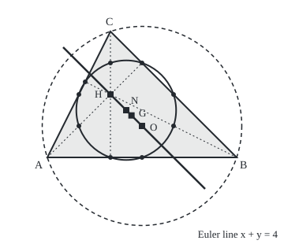

# The Euler line and the nine-point circle: four centres on one line and nine points on one circle

[Syllabus](../../../SYLLABUS.md) → [Geometry and trig](../README.md) → [Coordinates and Curves](../README.md#s04) → The Euler line and the nine-point circle

---

## General Overview

A photo shows the corner of a building. Its edges run in three directions at right angles: along one wall, along the other wall, and straight up. In the photo, each family of parallel edges seems to meet at one point, its **vanishing point**. On the photo's grid, in thousands of pixels, the three vanishing points sit at A (0, 0), B (6, 0) and C (2, 4).

Camera-calibration software (programs that work out how a camera was set up) needs the **principal point**: where the lens's central axis meets the picture. For an ordinary camera it is the **orthocentre** H of triangle ABC. That is where the three **altitudes** cross; an altitude is the line from a corner that meets the opposite side at a right angle. Here H = (2, 2), and the focal length (the lens's height above the picture) comes out at 2.00 thousand pixels.

No altitude needs to be drawn. The **centroid** G, the average of the corners, is (8/3, 4/3). The **circumcentre** O, the point equally far from all three corners, is (3, 1). Then H = 3G − 2O = (2, 2).

All three points lie on one line, x + y = 4: the **Euler line**. Halfway from O to H sits N = (5/2, 3/2), the centre of a circle half the size of the one through the corners. That circle passes through nine special points of the triangle.

**In every triangle the orthocentre is H = 3G − 2O, so the circumcentre, centroid and orthocentre lie on one line; and the circle centred halfway from O to H, with half the circumradius, passes through the three side midpoints, the three feet of the altitudes and the three midpoints between H and the corners.**

**What kind of fact this is:** two theorems, proved in Why it works. The camera fact is a theorem about the ideal pinhole camera, sketched in Where you meet it in real life.

### The picture: the vanishing-point triangle

<p align="center"></p>

Drawn at 1 unit = 40. Dashed: the circumcircle. Dotted: the altitudes. Thick: the Euler line, with H, N, G and O as squares. Solid: the nine-point circle through the nine dots.

---

## The formula

Points are added, and multiplied by numbers, one coordinate at a time, as vectors are.

```math
H = 3G - 2O
```

**Read it aloud:** go from the circumcentre to the centroid, then twice as far again, and the end point is the orthocentre.

```math
N = \frac{O + H}{2}, \qquad \rho = \frac{R}{2}
```

**Read it aloud:** the nine-point centre is the midpoint of O and H, and the nine-point radius is half the circumradius.

| Symbol | Plain meaning | In our example | Push it up and the answer… |
| --- | --- | --- | --- |
| $`A`$, $`B`$, $`C`$ | the corners: here the vanishing points, in thousands of pixels | (0, 0), (6, 0), (2, 4) | every centre moves |
| $`x`$, $`y`$ | a point's two coordinates, across and up | Euler line x + y = 4 | — |
| $`O`$ | circumcentre: equally far from all three corners | (3, 1) | for fixed G, H moves 2 steps the other way |
| $`R`$ | circumradius: the distance from O to each corner | √10 = 3.1623 | the nine-point circle grows by half as much |
| $`G`$ | centroid: the average of the corners | (8/3, 4/3) = (2.6667, 1.3333) | for fixed O, H moves 3 steps the same way |
| $`H`$ | orthocentre: where the altitudes cross | (2, 2) | — |
| $`N`$, $`\rho`$ | nine-point centre, the midpoint of O and H; nine-point radius ("rho"), half of R | (2.50, 1.50); √10 / 2 = 1.5811 | — |
| $`U`$, $`V`$, $`f`$ | camera: two vanishing points; focal length | two of A, B, C; f = 2.00 | — |

### When it holds

- **Corners not in a row.** In a row, the perpendicular bisectors are parallel, O does not exist, and the code divides by zero.
- **Not equilateral.** In an equilateral triangle O, G, H and N are one point, so no single line is fixed; the formulas still hold.
- **Any angles at all.** With an angle over 90°, O and H leave the triangle, but the line and the circle still hold. With an angle of exactly 90°, H is that corner.
- **For the camera: an ideal camera.** Square pixels, no skew and truly perpendicular edges in the scene. Without them, the principal point is not H.

---

## Why it works

### Step 0: measure everything from the circumcentre

Put the origin at O. Then each corner, read as an arrow from O, has the same length R. Write $`\lvert B\rvert`$ for the length of arrow B.

Two arrows of equal length have a sum at right angles to their difference. Picture the diamond they span: its two diagonals cross square on. In dot-product terms (multiply matching coordinates and add; zero means a right angle, [The dot product](../../03-Algebra/06-Dot%20Products%20and%20Best%20Fits/01-dot-product.md)):

```math
(B + C)\cdot(B - C) = \lvert B\rvert^2 - \lvert C\rvert^2 = R^2 - R^2 = 0
```

### Step 1: the point A + B + C is on every altitude

Take the point A + B + C, still measured from O. Its step away from corner A is B + C. By Step 0, that step is square to side BC, whose direction is B − C. So A + B + C lies on the altitude from A.

The same argument, letter by letter, puts it on the altitudes from B and C. So the three altitudes meet at one point, and that point is H = A + B + C.

In the example, from O = (3, 1) the corners are (−3, −1), (3, −1) and (−1, 3). Their sum is (−1, 1). Adding O back gives H = (2, 2).

### Step 2: O, G and H lie on one line, 1 : 2

Measured from O, the centroid is G = (A + B + C)/3 = H/3. So G sits on the straight line from O to H, a third of the way along. Back in ordinary coordinates this says G − O = (H − O)/3, which rearranges to H = 3G − 2O.

So HG is twice GO: 0.9428 against 0.4714 in the example. The line through them is the Euler line, x + y = 4.

### Step 3: nine points at distance R/2 from N

Measured from O, the midpoint of O and H is N = (A + B + C)/2. Two of the nine points are easy to write from N.

- The midpoint of side BC is (B + C)/2. It is N − A/2.
- The midpoint of A and H is (A + H)/2 = A + (B + C)/2. It is N + A/2.

Both are A/2 away from N, a distance of R/2. They are opposite ends of one diameter of the circle about N with radius R/2.

The foot of the altitude from A completes the trio. If it coincides with either end of that diameter (as in an isosceles or right triangle), it is already on the circle. Otherwise, from that foot, one end of the diameter lies along side BC, and the other lies up the altitude. Those two directions are square to each other. An angle of 90° that spans a diameter puts its corner on the circle (the angle in a semicircle, [Angles at a circle](../02-Circles%20and%20Solids/03-angles-in-a-circle.md)). So the foot is on the circle too.

Repeat for corners B and C: 3 × 3 = 9 points on one circle.

<details>
<summary>The same circle seen as a half-size copy of the circumcircle</summary>

Shrink the whole picture towards H by half. Each corner A lands on the midpoint of A and H, and O lands on the midpoint of O and H, which is N. So the circumcircle shrinks onto the circle with centre N and radius R/2, through the three midpoints to H.

Now shrink towards G by half and turn the picture through half a turn about G. Corner A lands on

$`\displaystyle G - \tfrac{1}{2}(A - G) = \tfrac{3}{2}G - \tfrac{1}{2}A = \frac{B + C}{2},`$

the midpoint of side BC. O lands on $`\tfrac{3}{2}G - \tfrac{1}{2}O`$, which is (H + O)/2 = N, because 3G = H + 2O. So the same circle also passes through the three side midpoints.

</details>

---

## Worked numbers, by hand

| Step | Arithmetic | Value |
| --- | --- | --- |
| bisector of A and B | equal distance from (0, 0) and (6, 0) | x = 3 |
| bisector of A and C | 4x + 8y = 20, with x = 3 | y = 1, so O = (3, 1) |
| circumradius | √(3² + 1²) | R = √10 = 3.1623 |
| centroid | ((0 + 6 + 2)/3, (0 + 0 + 4)/3) | G = (2.6667, 1.3333) |
| orthocentre | 3G − 2O = (8 − 6, 4 − 2) | **H = (2, 2)** |
| check H | altitude from C is x = 2; from A is y = x | (2, 2) is on both |
| Euler line | x + y at O, G, H | 4, 4, 4 |
| nine-point centre | ((3 + 2)/2, (1 + 2)/2) | N = (2.50, 1.50) |
| nine-point radius | √10 / 2 | **ρ = 1.5811** |
| check one point | N to the side midpoint (3, 0): √(0.5² + 1.5²) | 1.5811 |

The principal point of the photo is (2, 2), and each of the nine points is 1.5811 from N.

The nine points are:

- side midpoints (4, 2), (1, 2) and (3, 0);
- altitude feet (3, 3), (1.2, 2.4) and (2, 0);
- midpoints to H (1, 1), (4, 1) and (2, 3).

### What breaks if you drop a piece

| Mistake | Comes out at | What went wrong |
| --- | --- | --- |
| H = 3G − O | (5.00, 3.00), 3.00 off the altitude x = 2 | the 2 in front of O was dropped |
| G halfway from O to H: H = 2G − O | (2.3333, 1.6667), 0.33 off the altitude | G is a third of the way, not half |
| Nine-point circle centred at G | side midpoints 1.49, 1.80 and 1.37 from G | the centre is N, the midpoint of OH |
| Nine-point radius R | 3.1623, missing every point by 1.5811 | the circle is the half-size copy |

---

## Code, from first principles, and it actually runs

H is found by two roads: the formula H = 3G − 2O, and two altitudes crossed with Cramer's rule (a ratio of cross-multiplied coefficients). The nine-point circle is found as the half-size circle about the midpoint of OH, and as the circle through the side midpoints; all nine points are then measured from N. Last, 200 triangles from a fixed pseudo-random sequence (a repeatable list of scattered numbers) test both theorems.

### Python

```python
# Euler line and nine-point circle -- the check behind the card.  Nothing is imported.  Triangle
# A (0, 0), B (6, 0), C (2, 4).  H twice: 3G - 2O, and two altitudes crossing.  The nine-point circle
# twice: half-size about the midpoint of OH, and the circle through the three side midpoints.
def sub(p, q): return (p[0] - q[0], p[1] - q[1])
def dot(p, q): return p[0] * q[0] + p[1] * q[1]
def mid(p, q): return ((p[0] + q[0]) / 2, (p[1] + q[1]) / 2)
def dist(p, q): return dot(sub(p, q), sub(p, q)) ** 0.5
def solve(r1, r2):                        # Cramer's rule for two lines a x + b y = k
    (a1, b1, k1), (a2, b2, k2) = r1, r2; det = a1 * b2 - b1 * a2
    return ((k1 * b2 - b1 * k2) / det, (a1 * k2 - k1 * a2) / det)
def circum(A, B, C):                      # perpendicular bisectors: |P - A|^2 = |P - Q|^2
    row = lambda Q: (2 * (Q[0] - A[0]), 2 * (Q[1] - A[1]), dot(Q, Q) - dot(A, A))
    return solve(row(B), row(C))
def altitudes(A, B, C):                   # (P - A).(B - C) = 0 and (P - B).(C - A) = 0
    return solve((*sub(B, C), dot(A, sub(B, C))), (*sub(C, A), dot(B, sub(C, A))))
def foot(P, U, V):                        # foot of the drop from P onto the line UV
    d = sub(V, U); t = dot(sub(P, U), d) / dot(d, d)
    return (U[0] + t * d[0], U[1] + t * d[1])
def centres(A, B, C):                     # route one: O by bisectors, then H = 3G - 2O
    O = circum(A, B, C); G = ((A[0] + B[0] + C[0]) / 3, (A[1] + B[1] + C[1]) / 3)
    H = (3 * G[0] - 2 * O[0], 3 * G[1] - 2 * O[1]); return O, G, H, mid(O, H), dist(O, A)
def nine(A, B, C, H): return [mid(B, C), mid(C, A), mid(A, B), foot(A, B, C), foot(B, C, A),
                              foot(C, A, B), mid(A, H), mid(B, H), mid(C, H)]
def pt(p): return f"({p[0]:.2f}, {p[1]:.2f})"
def fig(p): return pt((60 + 40 * p[0], 200 - 40 * p[1]))   # figure: 1 unit = 40, y flipped
A, B, C = (0.0, 0.0), (6.0, 0.0), (2.0, 4.0)
O, G, H, N, R = centres(A, B, C); H2 = altitudes(A, B, C)  # route two for H
N2 = circum(mid(B, C), mid(C, A), mid(A, B)); P9 = nine(A, B, C, H); d9 = [dist(N, p) for p in P9]  # route two for N
print(f"triangle A {pt(A)}, B {pt(B)}, C {pt(C)}; circumcentre O {pt(O)}, R = {R:.4f}")
print(f"centroid G ({G[0]:.4f}, {G[1]:.4f}); H = 3G - 2O {pt(H)}; H by two altitudes {pt(H2)}")
print(f"x + y at O, G, N, H: {', '.join(f'{p[0] + p[1]:.2f}' for p in (O, G, N, H))}")
print(f"HG = {dist(H, G):.4f}, GO = {dist(G, O):.4f}, ratio {dist(H, G) / dist(G, O):.2f}")
print(f"nine-point centre N = midpoint of OH {pt(N)}, radius R/2 = {R / 2:.4f}")
print(f"circle through the side midpoints: centre {pt(N2)}, radius {dist(N2, P9[0]):.4f}")
print("side midpoints " + ", ".join(pt(p) for p in P9[:3]))
print("altitude feet " + ", ".join(pt(p) for p in P9[3:6]))
print("midpoints to H " + ", ".join(pt(p) for p in P9[6:]))
print("N to the nine points: " + ", ".join(f"{d:.4f}" for d in d9))
W1, W2 = (3 * G[0] - O[0], 3 * G[1] - O[1]), (2 * G[0] - O[0], 2 * G[1] - O[1])
print(f"wrong: 3G - O {pt(W1)}, 2G - O ({W2[0]:.4f}, {W2[1]:.4f}); off x = 2 by {W1[0] - 2:.2f}, {W2[0] - 2:.2f}")
print(f"wrong: G to the side midpoints {', '.join(f'{dist(G, p):.2f}' for p in P9[:3])}")
cam = [dot(sub(U, H), sub(V, H)) for U, V in ((A, B), (B, C), (C, A))]
print(f"camera: (U - H).(V - H) for AB, BC, CA: {', '.join(f'{c:.2f}' for c in cam)}; "
      f"focal length {format((-cam[0]) ** 0.5, '.2f') if cam[0] < 0 else 'none: the triangle is not acute'}")
s, good = 2026, 0                         # 200 triangles from a fixed pseudo-random sequence
for _ in range(200):
    v = []
    for _ in range(6): s = (s * 1103515245 + 12345) % 2 ** 31; v.append(s / 2 ** 31 * 10)
    T = [(v[0], v[1]), (v[2], v[3]), (v[4], v[5])]
    o, g, h, n, r = centres(*T); tol = 1e-9 * (1 + r) ** 2
    good += dist(h, altitudes(*T)) < tol and abs(dot(sub(h, T[2]), sub(T[0], T[1]))) < tol and max(abs(dist(n, p) - r / 2) for p in nine(*T, h)) < tol
print(f"random triangles: {good} of 200 have H = 3G - 2O on all altitudes and nine points on the circle")
print(f"figure, 1 unit = 40: A {fig(A)}, B {fig(B)}, C {fig(C)}, O {fig(O)}, G {fig(G)}, H {fig(H)}, N {fig(N)}, "
      f"R {40 * R:.2f}, R/2 {20 * R:.2f}")
assert dist(H, H2) < 1e-12 and dist(N, N2) < 1e-12        # two roads to H, two to N
assert max(abs(d - R / 2) for d in d9) < 1e-12            # all nine points on one circle
assert abs(dist(H2, G) - 2 * dist(G, O)) < 1e-12          # HG = 2 GO, with H from the altitudes
assert abs(cam[0] - cam[1]) + abs(cam[1] - cam[2]) < 1e-12  # the three camera products agree
assert good == 200
print("ALL CHECKS PASS")
```

**Ran 2026-11-23 on macOS, Python 3.14.10, standard library only. All checks passed. Output, pasted from the run:**

```
triangle A (0.00, 0.00), B (6.00, 0.00), C (2.00, 4.00); circumcentre O (3.00, 1.00), R = 3.1623
centroid G (2.6667, 1.3333); H = 3G - 2O (2.00, 2.00); H by two altitudes (2.00, 2.00)
x + y at O, G, N, H: 4.00, 4.00, 4.00, 4.00
HG = 0.9428, GO = 0.4714, ratio 2.00
nine-point centre N = midpoint of OH (2.50, 1.50), radius R/2 = 1.5811
circle through the side midpoints: centre (2.50, 1.50), radius 1.5811
side midpoints (4.00, 2.00), (1.00, 2.00), (3.00, 0.00)
altitude feet (3.00, 3.00), (1.20, 2.40), (2.00, 0.00)
midpoints to H (1.00, 1.00), (4.00, 1.00), (2.00, 3.00)
N to the nine points: 1.5811, 1.5811, 1.5811, 1.5811, 1.5811, 1.5811, 1.5811, 1.5811, 1.5811
wrong: 3G - O (5.00, 3.00), 2G - O (2.3333, 1.6667); off x = 2 by 3.00, 0.33
wrong: G to the side midpoints 1.49, 1.80, 1.37
camera: (U - H).(V - H) for AB, BC, CA: -4.00, -4.00, -4.00; focal length 2.00
random triangles: 200 of 200 have H = 3G - 2O on all altitudes and nine points on the circle
figure, 1 unit = 40: A (60.00, 200.00), B (300.00, 200.00), C (140.00, 40.00), O (180.00, 160.00), G (166.67, 146.67), H (140.00, 120.00), N (160.00, 140.00), R 126.49, R/2 63.25
ALL CHECKS PASS
```

### Rust

Same numbers, same labels, built with `rustc --edition 2021 -O`.

```rust
// Euler line and nine-point circle -- the same check as the Python, in Rust.  No crates.  Triangle
// A (0, 0), B (6, 0), C (2, 4).  H twice: 3G - 2O, and two altitudes crossing.  The nine-point circle
// twice: half-size about the midpoint of OH, and the circle through the three side midpoints.
type P = (f64, f64);
fn sub(p: P, q: P) -> P { (p.0 - q.0, p.1 - q.1) }
fn dot(p: P, q: P) -> f64 { p.0 * q.0 + p.1 * q.1 }
fn mid(p: P, q: P) -> P { ((p.0 + q.0) / 2.0, (p.1 + q.1) / 2.0) }
fn dist(p: P, q: P) -> f64 { dot(sub(p, q), sub(p, q)).powf(0.5) }
fn solve(r1: (f64, f64, f64), r2: (f64, f64, f64)) -> P { // Cramer's rule for two lines a x + b y = k
    let ((a1, b1, k1), (a2, b2, k2)) = (r1, r2); let det = a1 * b2 - b1 * a2;
    ((k1 * b2 - b1 * k2) / det, (a1 * k2 - k1 * a2) / det)
}
fn circum(a: P, b: P, c: P) -> P { // perpendicular bisectors: |P - A|^2 = |P - Q|^2
    let row = |q: P| (2.0 * (q.0 - a.0), 2.0 * (q.1 - a.1), dot(q, q) - dot(a, a));
    solve(row(b), row(c))
}
fn altitudes(a: P, b: P, c: P) -> P { // (P - A).(B - C) = 0 and (P - B).(C - A) = 0
    let (u, v) = (sub(b, c), sub(c, a));
    solve((u.0, u.1, dot(a, u)), (v.0, v.1, dot(b, v)))
}
fn foot(p: P, u: P, v: P) -> P { // foot of the drop from P onto the line UV
    let d = sub(v, u); let t = dot(sub(p, u), d) / dot(d, d);
    (u.0 + t * d.0, u.1 + t * d.1)
}
fn centres(a: P, b: P, c: P) -> (P, P, P, P, f64) { // route one: O by bisectors, then H = 3G - 2O
    let o = circum(a, b, c);
    let g = ((a.0 + b.0 + c.0) / 3.0, (a.1 + b.1 + c.1) / 3.0);
    let h = (3.0 * g.0 - 2.0 * o.0, 3.0 * g.1 - 2.0 * o.1);
    (o, g, h, mid(o, h), dist(o, a))
}
fn nine(a: P, b: P, c: P, h: P) -> [P; 9] {
    [mid(b, c), mid(c, a), mid(a, b), foot(a, b, c), foot(b, c, a), foot(c, a, b), mid(a, h), mid(b, h), mid(c, h)]
}
fn pt(p: P) -> String { format!("({:.2}, {:.2})", p.0, p.1) }
fn fig(p: P) -> String { pt((60.0 + 40.0 * p.0, 200.0 - 40.0 * p.1)) } // figure: 1 unit = 40, y flipped
fn join(xs: &[String]) -> String { xs.join(", ") }
fn main() {
    let (a, b, c) = ((0.0, 0.0), (6.0, 0.0), (2.0, 4.0));
    let (o, g, h, n, r) = centres(a, b, c);
    let h2 = altitudes(a, b, c); // route two for H
    let n2 = circum(mid(b, c), mid(c, a), mid(a, b)); // route two for the nine-point circle
    let p9 = nine(a, b, c, h);
    let d9: Vec<f64> = p9.iter().map(|&p| dist(n, p)).collect();
    println!("triangle A {}, B {}, C {}; circumcentre O {}, R = {:.4}", pt(a), pt(b), pt(c), pt(o), r);
    println!("centroid G ({:.4}, {:.4}); H = 3G - 2O {}; H by two altitudes {}", g.0, g.1, pt(h), pt(h2));
    println!("x + y at O, G, N, H: {}", join(&[o, g, n, h].map(|p| format!("{:.2}", p.0 + p.1))));
    println!("HG = {:.4}, GO = {:.4}, ratio {:.2}", dist(h, g), dist(g, o), dist(h, g) / dist(g, o));
    println!("nine-point centre N = midpoint of OH {}, radius R/2 = {:.4}", pt(n), r / 2.0);
    println!("circle through the side midpoints: centre {}, radius {:.4}", pt(n2), dist(n2, p9[0]));
    let pts = |s: &[P]| join(&s.iter().map(|&p| pt(p)).collect::<Vec<_>>());
    println!("side midpoints {}", pts(&p9[..3]));
    println!("altitude feet {}", pts(&p9[3..6]));
    println!("midpoints to H {}", pts(&p9[6..]));
    println!("N to the nine points: {}", join(&d9.iter().map(|d| format!("{:.4}", d)).collect::<Vec<_>>()));
    let (w1, w2) = ((3.0 * g.0 - o.0, 3.0 * g.1 - o.1), (2.0 * g.0 - o.0, 2.0 * g.1 - o.1));
    println!("wrong: 3G - O {}, 2G - O ({:.4}, {:.4}); off x = 2 by {:.2}, {:.2}", pt(w1), w2.0, w2.1, w1.0 - 2.0, w2.0 - 2.0);
    println!("wrong: G to the side midpoints {}", join(&p9[..3].iter().map(|&p| format!("{:.2}", dist(g, p))).collect::<Vec<_>>()));
    let cam = [(a, b), (b, c), (c, a)].map(|(u, v)| dot(sub(u, h), sub(v, h)));
    println!("camera: (U - H).(V - H) for AB, BC, CA: {}; focal length {}",
             join(&cam.map(|x| format!("{:.2}", x))), if cam[0] < 0.0 { format!("{:.2}", (-cam[0]).powf(0.5)) } else { "none: the triangle is not acute".to_string() });
    let (mut s, mut good): (u64, u32) = (2026, 0); // 200 triangles from a fixed pseudo-random sequence
    for _ in 0..200 {
        let mut v = [0.0; 6];
        for x in v.iter_mut() { s = (s * 1103515245 + 12345) % (1 << 31); *x = s as f64 / 2147483648.0 * 10.0; }
        let t = [(v[0], v[1]), (v[2], v[3]), (v[4], v[5])];
        let (_, _, h3, n3, r3) = centres(t[0], t[1], t[2]);
        let tol = 1e-9 * (1.0 + r3).powi(2);
        let worst = nine(t[0], t[1], t[2], h3).iter().map(|&p| (dist(n3, p) - r3 / 2.0).abs()).fold(0.0, f64::max);
        if dist(h3, altitudes(t[0], t[1], t[2])) < tol && dot(sub(h3, t[2]), sub(t[0], t[1])).abs() < tol && worst < tol { good += 1; }
    }
    println!("random triangles: {} of 200 have H = 3G - 2O on all altitudes and nine points on the circle", good);
    println!("figure, 1 unit = 40: A {}, B {}, C {}, O {}, G {}, H {}, N {}, R {:.2}, R/2 {:.2}",
             fig(a), fig(b), fig(c), fig(o), fig(g), fig(h), fig(n), 40.0 * r, 20.0 * r);
    assert!(dist(h, h2) < 1e-12 && dist(n, n2) < 1e-12); // two roads to H, two to N
    assert!(d9.iter().all(|d| (d - r / 2.0).abs() < 1e-12)); // all nine points on one circle
    assert!((dist(h2, g) - 2.0 * dist(g, o)).abs() < 1e-12); // HG = 2 GO, with H from the altitudes
    assert!((cam[0] - cam[1]).abs() + (cam[1] - cam[2]).abs() < 1e-12); // the three camera products agree
    assert!(good == 200);
    println!("ALL CHECKS PASS");
}
```

**Ran 2026-11-23 on macOS, rustc 1.98.1, no crates. All checks passed. Output, pasted from the run:**

```
triangle A (0.00, 0.00), B (6.00, 0.00), C (2.00, 4.00); circumcentre O (3.00, 1.00), R = 3.1623
centroid G (2.6667, 1.3333); H = 3G - 2O (2.00, 2.00); H by two altitudes (2.00, 2.00)
x + y at O, G, N, H: 4.00, 4.00, 4.00, 4.00
HG = 0.9428, GO = 0.4714, ratio 2.00
nine-point centre N = midpoint of OH (2.50, 1.50), radius R/2 = 1.5811
circle through the side midpoints: centre (2.50, 1.50), radius 1.5811
side midpoints (4.00, 2.00), (1.00, 2.00), (3.00, 0.00)
altitude feet (3.00, 3.00), (1.20, 2.40), (2.00, 0.00)
midpoints to H (1.00, 1.00), (4.00, 1.00), (2.00, 3.00)
N to the nine points: 1.5811, 1.5811, 1.5811, 1.5811, 1.5811, 1.5811, 1.5811, 1.5811, 1.5811
wrong: 3G - O (5.00, 3.00), 2G - O (2.3333, 1.6667); off x = 2 by 3.00, 0.33
wrong: G to the side midpoints 1.49, 1.80, 1.37
camera: (U - H).(V - H) for AB, BC, CA: -4.00, -4.00, -4.00; focal length 2.00
random triangles: 200 of 200 have H = 3G - 2O on all altitudes and nine points on the circle
figure, 1 unit = 40: A (60.00, 200.00), B (300.00, 200.00), C (140.00, 40.00), O (180.00, 160.00), G (166.67, 146.67), H (140.00, 120.00), N (160.00, 140.00), R 126.49, R/2 63.25
ALL CHECKS PASS
```

### Lean

Lean proves both theorems for every triangle in the plane with corners not in a row, and checks the example.

- Take any triangle with circumcentre O and centroid G. Then 3G − 2O lies on all three altitudes, so it is the orthocentre H.
- O, G and H lie on one line, the Euler line.
- The distance HG is twice the distance GO.
- Take N, the midpoint of O and H. Then the side midpoints, altitude feet and midpoints from H to the corners are all R/2 from N.
- The example holds exactly in fractions. O, G and H have x + y = 4, and all nine points are √10 / 2 from N = (5/2, 3/2).

The camera's focal length, the wrong-formula numbers and the figure's coordinates are left to the Python and Rust checks.

```lean
-- The Euler line and the nine-point circle: in every triangle in the plane the point 3G - 2O lies on all three altitudes and is the orthocentre, O, G and H lie on one line with HG = 2 GO, and the circle centred halfway from O to H with half the circumradius passes through the three side midpoints, the three altitude feet and the three midpoints from H to the corners.
import Mathlib.Geometry.Euclidean.NinePointCircle
import Mathlib.Analysis.InnerProductSpace.PiL2

open EuclideanGeometry

/-- The plane, with ordinary straight-line distance. -/
local notation "Plane" => EuclideanSpace ℝ (Fin 2)

theorem euler_aux_centroid (t : Affine.Triangle ℝ Plane) :
    t.centroid = (1 / 3 : ℝ) • (t.points 0 + t.points 1 + t.points 2) := by
  have h := t.centroid_vsub_eq 0
  simp only [vsub_eq_sub, sub_zero] at h
  rw [h, Fin.sum_univ_three]; norm_num

theorem euler_aux_orthocenter (t : Affine.Triangle ℝ Plane) :
    (3 : ℝ) • t.centroid - (2 : ℝ) • t.circumcenter = t.orthocenter := by
  rw [t.orthocenter_eq_smul_vsub_vadd_circumcenter, Affine.Simplex.univ_centroid_eq,
    vsub_eq_sub, vadd_eq_add]
  module

theorem euler_aux_radius (t : Affine.Triangle ℝ Plane) (i : Fin 3) :
    ‖t.points i - t.circumcenter‖ = t.circumradius := by
  rw [← dist_eq_norm]; exact t.dist_circumcenter_eq_circumradius i

#print axioms euler_aux_centroid
#print axioms euler_aux_orthocenter
#print axioms euler_aux_radius

/-- **Euler line.** In every triangle (corners not in a row), with circumcentre O and
centroid G, the point H = 3G - 2O lies on all three altitudes and is the orthocentre,
and O, G and H lie on one line. -/
theorem three_centroid_sub_two_circumcenter_is_orthocenter_on_euler_line
    (t : Affine.Triangle ℝ Plane) :
    let O := t.circumcenter
    let G := t.centroid
    let H := (3 : ℝ) • G - (2 : ℝ) • O
    (∀ i, H ∈ t.altitude i) ∧ H = t.orthocenter ∧ Collinear ℝ ({O, G, H} : Set Plane) := by
  dsimp only
  have hH := euler_aux_orthocenter t
  refine ⟨fun i => hH ▸ t.orthocenter_mem_altitude, hH, ?_⟩
  rw [collinear_iff_of_mem (p₀ := t.circumcenter) (by simp)]
  refine ⟨t.centroid - t.circumcenter, ?_⟩
  intro p hp
  simp only [Set.mem_insert_iff, Set.mem_singleton_iff] at hp
  rcases hp with rfl | rfl | rfl
  · exact ⟨0, by simp⟩
  · exact ⟨1, by simp⟩
  · exact ⟨3, by simp only [vadd_eq_add]; module⟩

/-- **The 2 : 1 split.** On the Euler line the centroid sits a third of the way from O to
H: the distance HG is twice the distance GO. -/
theorem dist_orthocenter_centroid_eq_two_mul_dist_centroid_circumcenter
    (t : Affine.Triangle ℝ Plane) :
    let O := t.circumcenter
    let G := t.centroid
    let H := (3 : ℝ) • G - (2 : ℝ) • O
    dist H G = 2 * dist G O := by
  dsimp only
  have : (3 : ℝ) • t.centroid - (2 : ℝ) • t.circumcenter - t.centroid =
      (2 : ℝ) • (t.centroid - t.circumcenter) := by module
  rw [dist_eq_norm, dist_eq_norm, this, norm_smul]
  norm_num

/-- **Nine-point circle.** In every triangle, with circumcentre O, circumradius R and
H = 3G - 2O, the circle centred at N, the midpoint of O and H, with radius R / 2 passes
through the three side midpoints, the three feet of the altitudes and the three midpoints
between H and the corners. -/
theorem nine_points_on_circle_midpoint_OH_half_circumradius
    (t : Affine.Triangle ℝ Plane) :
    let O := t.circumcenter
    let G := t.centroid
    let H := (3 : ℝ) • G - (2 : ℝ) • O
    let N := midpoint ℝ O H
    (∀ i j, i ≠ j → dist (midpoint ℝ (t.points i) (t.points j)) N = t.circumradius / 2) ∧
    (∀ i, dist (t.altitudeFoot i) N = t.circumradius / 2) ∧
    (∀ i, dist (midpoint ℝ H (t.points i)) N = t.circumradius / 2) := by
  dsimp only
  have hG := euler_aux_centroid t
  have hN : midpoint ℝ t.circumcenter ((3 : ℝ) • t.centroid - (2 : ℝ) • t.circumcenter) =
      (1 / 2 : ℝ) • ((3 : ℝ) • t.centroid - t.circumcenter) := by
    simp only [midpoint_eq_smul_add, invOf_eq_inv]; module
  have key : ∀ k, ‖(1 / 2 : ℝ) • (t.points k - t.circumcenter)‖ = t.circumradius / 2 := by
    intro k
    rw [norm_smul, euler_aux_radius]; norm_num; ring
  refine ⟨?_, ?_, ?_⟩
  · intro i j hij
    rw [dist_comm, dist_eq_norm, hN, midpoint_eq_smul_add, hG]
    fin_cases i <;> fin_cases j <;> simp at hij <;> simp only [Fin.zero_eta, Fin.mk_one, Fin.reduceFinMk, Fin.isValue]
    · convert key 2 using 2; simp only [invOf_eq_inv]; module
    · convert key 1 using 2; simp only [invOf_eq_inv]; module
    · convert key 2 using 2; simp only [invOf_eq_inv]; module
    · convert key 0 using 2; simp only [invOf_eq_inv]; module
    · convert key 1 using 2; simp only [invOf_eq_inv]; module
    · convert key 0 using 2; simp only [invOf_eq_inv]; module
  · intro i
    have h := t.altitudeFoot_mem_ninePointCircle i
    rw [EuclideanGeometry.mem_sphere, Affine.Simplex.ninePointCircle_center,
      Affine.Simplex.ninePointCircle_radius] at h
    have hc : ((((2 : ℕ) : ℝ) + 1) / ((2 : ℕ) : ℝ)) • (t.centroid -ᵥ t.circumcenter) +ᵥ
        t.circumcenter = (1 / 2 : ℝ) • ((3 : ℝ) • t.centroid - t.circumcenter) := by
      rw [vsub_eq_sub, vadd_eq_add]; norm_num; module
    rw [hc] at h
    rw [hN, h]; norm_num
  · intro i
    rw [dist_eq_norm, hN, midpoint_eq_smul_add]
    convert key i using 2
    simp only [invOf_eq_inv]; module

/-! The card's example: A (0, 0), B (6, 0), C (2, 4), worked exactly in fractions. -/

-- O = (3, 1) is equally far from all three corners: squared distance 10 each, so R = √10.
example : (3 - 0 : ℚ) ^ 2 + (1 - 0) ^ 2 = 10 ∧ (3 - 6 : ℚ) ^ 2 + (1 - 0) ^ 2 = 10 ∧
    (3 - 2 : ℚ) ^ 2 + (1 - 4) ^ 2 = 10 := by norm_num

-- G = ((0 + 6 + 2)/3, (0 + 0 + 4)/3) = (8/3, 4/3), and H = 3G - 2O = (2, 2).
example : ((0 + 6 + 2) / 3 : ℚ) = 8 / 3 ∧ ((0 + 0 + 4) / 3 : ℚ) = 4 / 3 ∧
    3 * (8 / 3 : ℚ) - 2 * 3 = 2 ∧ 3 * (4 / 3 : ℚ) - 2 * 1 = 2 := by norm_num

-- H = (2, 2) is on all three altitudes: (H - A)·(B - C) = 0, (H - B)·(C - A) = 0, (H - C)·(A - B) = 0.
example : (2 - 0 : ℚ) * (6 - 2) + (2 - 0) * (0 - 4) = 0 ∧
    (2 - 6 : ℚ) * (2 - 0) + (2 - 0) * (4 - 0) = 0 ∧
    (2 - 2 : ℚ) * (0 - 6) + (2 - 4) * (0 - 0) = 0 := by norm_num

-- O, G, H all lie on the Euler line x + y = 4.
example : (3 + 1 : ℚ) = 4 ∧ (8 / 3 + 4 / 3 : ℚ) = 4 ∧ (2 + 2 : ℚ) = 4 := by norm_num

-- HG = 2 GO, compared as squares: |H - G|² = 8/9 and |G - O|² = 2/9.
example : (2 - 8 / 3 : ℚ) ^ 2 + (2 - 4 / 3) ^ 2 = 4 * ((8 / 3 - 3) ^ 2 + (4 / 3 - 1) ^ 2) := by
  norm_num

-- N = midpoint of O (3, 1) and H (2, 2) = (5/2, 3/2); all nine points are at squared
-- distance 10/4 = (R/2)² from N.
example : ((3 + 2) / 2 : ℚ) = 5 / 2 ∧ ((1 + 2) / 2 : ℚ) = 3 / 2 := by norm_num

example :
    -- side midpoints (4, 2), (1, 2), (3, 0)
    (4 - 5 / 2 : ℚ) ^ 2 + (2 - 3 / 2) ^ 2 = 10 / 4 ∧
    (1 - 5 / 2 : ℚ) ^ 2 + (2 - 3 / 2) ^ 2 = 10 / 4 ∧
    (3 - 5 / 2 : ℚ) ^ 2 + (0 - 3 / 2) ^ 2 = 10 / 4 ∧
    -- altitude feet (3, 3), (6/5, 12/5), (2, 0)
    (3 - 5 / 2 : ℚ) ^ 2 + (3 - 3 / 2) ^ 2 = 10 / 4 ∧
    (6 / 5 - 5 / 2 : ℚ) ^ 2 + (12 / 5 - 3 / 2) ^ 2 = 10 / 4 ∧
    (2 - 5 / 2 : ℚ) ^ 2 + (0 - 3 / 2) ^ 2 = 10 / 4 ∧
    -- midpoints to H (1, 1), (4, 1), (2, 3)
    (1 - 5 / 2 : ℚ) ^ 2 + (1 - 3 / 2) ^ 2 = 10 / 4 ∧
    (4 - 5 / 2 : ℚ) ^ 2 + (1 - 3 / 2) ^ 2 = 10 / 4 ∧
    (2 - 5 / 2 : ℚ) ^ 2 + (3 - 3 / 2) ^ 2 = 10 / 4 := by norm_num

#print axioms three_centroid_sub_two_circumcenter_is_orthocenter_on_euler_line
#print axioms dist_orthocenter_centroid_eq_two_mul_dist_centroid_circumcenter
#print axioms nine_points_on_circle_midpoint_OH_half_circumradius
```

**Checked 2026-11-23 on macOS, Lean 4.36.0-rc2, Mathlib v4.36.0-rc2. Every proof is complete and uses only Lean's standard axioms. Output, pasted from the run:**

```
'euler_aux_centroid' depends on axioms: [propext, Classical.choice, Quot.sound]
'euler_aux_orthocenter' depends on axioms: [propext, Classical.choice, Quot.sound]
'euler_aux_radius' depends on axioms: [propext, Classical.choice, Quot.sound]
'three_centroid_sub_two_circumcenter_is_orthocenter_on_euler_line' depends on axioms: [propext, Classical.choice, Quot.sound]
'dist_orthocenter_centroid_eq_two_mul_dist_centroid_circumcenter' depends on axioms: [propext, Classical.choice, Quot.sound]
'nine_points_on_circle_midpoint_OH_half_circumradius' depends on axioms: [propext, Classical.choice, Quot.sound]
```

> [!TIP]
> **Try changing**
> Guess first, then run it.
> - **The van's grid.** Set the corners to the depot (0, 0) and the drops (3, 4) and (8, 1). Both roads give H = (2.90, 4.83), N = (3.47, 2.46) and radius 2.0263. The line is no longer x + y = 4, but the ratio is still 2.00. Being obtuse, it has no focal length.
> - **A right angle.** Set `C` (in Rust, `c`) to `(0.0, 4.0)`. H lands on the right-angle corner, (0.00, 0.00), and N is (1.50, 1.00).
> - **An obtuse angle.** Set `C` to `(1.0, 1.0)`. O = (3.00, −2.00) and H = (1.00, 5.00) are both outside the triangle; the ratio is still 2.00, all checks pass, and the focal length is none.

---

## The usual mistake

> [!warning]
> **Putting the centroid halfway between O and H.** It is a third of the way from O, not half. Taking H = 2G − O gives (2.3333, 1.6667), which is 0.33 off the altitude x = 2.
>
> - **Dropping the 2.** H = 3G − O gives (5.00, 3.00), 3.00 off that altitude.
> - **Centring the circle on the centroid.** G is 1.49, 1.80 and 1.37 from the three side midpoints, so no circle about G passes through them.
> - **Using the full circumradius.** A radius of 3.1623 misses every one of the nine points by 1.5811.

---

## Where you meet it in real life

- **Camera calibration.** The camera sits a focal length f above H. Its sight lines to the three vanishing points are square to each other, so (U − H)·(V − H) + f² = 0 for each pair of vanishing points U and V. In the example each product is −4.00, so f = 2.00 thousand pixels. Each product is −f², so a camera's triangle is always acute. Equal products also force H onto every altitude.
- **Testing geometry code.** A program that computes triangle centres can test itself with H = 3G − 2O. Three points found separately must line up 2 : 1, as this card's check does for 200 random triangles.
- **Reading a triangle's shape.** O and G coincide only in an equilateral triangle. The Euler line meets a corner only if the two sides there are equal or the angle there is 90°.
- **Catalogues of centres.** The *Encyclopedia of Triangle Centers* lists tens of thousands of centres and marks those on the Euler line.

> **Say it back**
> The orthocentre H, where the altitudes cross, never needs its altitudes drawn: H = 3G − 2O. Measured from O the corners have equal length, so A + B + C is on every altitude and is three times the centroid. That puts O, G and H on one line, with G a third of the way from O. The midpoint N of O and H is the centre of a circle of half the circumradius. It passes through the side midpoints, the altitude feet and the midpoints from H to the corners.

---

## What this builds on

- [Ceva and Menelaus](10-ceva-and-menelaus.md): a test for when three lines from the corners meet; here the altitudes' meeting is proved by vectors instead.
- [Triangle centres](08-triangle-centres.md): the centroid and circumcentre, the two inputs to H = 3G − 2O.
- [Circles and parabolas](04-circles-and-parabolas.md): a circle as every point at one distance from a centre, which is how the nine points are tested.
- [Angles at a circle](../02-Circles%20and%20Solids/03-angles-in-a-circle.md): the angle in a semicircle, which puts the altitude feet on the circle.

## Where this goes next

- [Cross product](../05-Vectors%20in%20Space/01-cross-product-and-oriented-area.md): starts the next shelf, taking vectors, right angles and areas from the plane into three-dimensional space.
- [Perspective](../05-Vectors%20in%20Space/05-perspective-and-projective-coordinates.md): the projective geometry behind the building-corner vanishing points used in this card.

This card closes the Coordinates and Curves shelf before [Cross product](../05-Vectors%20in%20Space/01-cross-product-and-oriented-area.md) opens Vectors in Space. Left open in triangle geometry: the incentre, centre of the largest circle inside the triangle, is usually off the Euler line, yet the nine-point circle touches the incircle and the three circles outside the triangle that touch all three side lines (Feuerbach's theorem); why should one circle touch all four?

---

## Sources

Verified 2026-11-23: every link below resolves to the publisher's page.

- Coxeter, H. S. M., and S. L. Greitzer. *Geometry Revisited*. MAA, 1967. [doi:10.5948/UPO9780883859346](https://doi.org/10.5948/UPO9780883859346). Sections 1.6 to 1.8: the orthic triangle, the Euler line and the nine-point circle.
- Coxeter, H. S. M. *Introduction to Geometry*, 2nd edition (1969). Wiley Classics Library, 1991. [Publisher page](https://www.wiley.com/en-us/Introduction+to+Geometry%2C+2nd+Edition-p-9780471504580). Chapter 1, Triangles: a short treatment of the orthocentre and the nine-point circle.
- Caprile, B., and V. Torre. "Using vanishing points for camera calibration." *International Journal of Computer Vision* 4 (1990): 127–139. [doi:10.1007/BF00127813](https://doi.org/10.1007/BF00127813). The principal point as the orthocentre of the vanishing-point triangle.
- Kimberling, Clark. [*Encyclopedia of Triangle Centers*](https://faculty.evansville.edu/ck6/encyclopedia/ETC.html), University of Evansville. The orthocentre, nine-point centre and the other centres on the Euler line.
