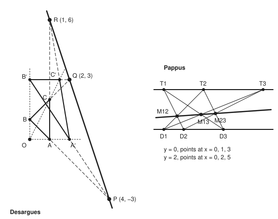

# Desargues and Pappus: two theorems where only which lines meet matters, and the duality that swaps points and lines

[Syllabus](../../../SYLLABUS.md) → [Geometry and trig](../README.md) → [Vectors in Space](../README.md#s05) → Desargues and Pappus

---

## General Overview

A lamp makes a triangular card cast a triangular shadow, each shadow corner on the ray from the lamp through a card corner. Such triangles are **in perspective from a point**, the **centre**.

A flat drawing of such a pair: centre O = (0, 0), triangle A = (1, 0), B = (0, 1), C = (1, 2), and A′ = (2, 0), B′ = (0, 3), C′ = (1.5, 3).

Extend matching sides until they cross. AB and A′B′ meet at P = (4, −3), BC and B′C′ at Q = (2, 3), CA and C′A′ at R = (1, 6). The slope from P to Q is −3, and from Q to R it is −3 again: one line, where the planes of card and shadow meet. That is **Desargues' theorem**.

**Pappus's theorem** is its partner. Put points D1, D2, D3 at x = 0, 1, 3 on the line y = 0, and T1, T2, T3 at x = 0, 2, 5 on y = 2. For positions 1 and 2, lines D1T2 and D2T1 cross; likewise for 1 and 3, and 2 and 3. The three crossings (2/3, 2/3), (15/8, 3/4) and (13/5, 4/5) have slope 2/29 between each pair: one line again.

Neither theorem uses a length or an angle. They are **incidence theorems**: they say only which points lie on which lines. Coordinates turn each into a zero determinant, a test that treats points and lines alike.

**Desargues: triangles in perspective from a point have matching sides meeting on one line. Pappus: the cross-joins of three points on each of two lines meet on one line. Swap the words point and line, and each stays true.**

**What kind of fact this is:** two theorems of the projective plane (the plane plus its points at infinity) over the real numbers, proved in Why it works; the swap, the **duality principle**, is proved in Step 4.

### The picture: both theorems, drawn from the numbers

<p align="center"></p>

Drawn to scale: 40 units per coordinate unit. Thick: the line each theorem promises.

---

## The formula

Notation from [Perspective](05-perspective-and-projective-coordinates.md): a point is a triple $`(x : y : w)`$, any nonzero multiple naming the same point $`(x/w,\ y/w)`$. A line is a triple $`\ell`$, and point $`p`$ lies on it when $`\ell \cdot p = 0`$. Joining two points, or meeting two lines, is a cross product. Three points share a line exactly when the determinant of their triples is zero: the box they span is flat ([Triple product](03-triple-product-and-volume.md)).

```math
P = (a \times b) \times (a' \times b'),\quad Q = (b \times c) \times (b' \times c'),\quad R = (c \times a) \times (c' \times a'),\qquad \det[P\ \ Q\ \ R] = 0
```

**Read it aloud:** meet each side with its partner side, and the three meets have zero determinant, so they share a line.

```math
M_{ij} = (D_i \times T_j) \times (D_j \times T_i),\qquad \det[M_{12}\ \ M_{13}\ \ M_{23}] = 0
```

**Read it aloud:** join each bottom point to a different top point, cross the joins in pairs, and the crossings share a line.

```math
\ell \cdot p = 0 \iff p \cdot \ell = 0
```

**Read it aloud:** the incidence test does not care which triple is the point and which the line.

| Symbol | Plain meaning | In our example | Push it up and the answer… |
| --- | --- | --- | --- |
| $`(x : y : w)`$ | a point as a triple, up to a nonzero multiple | C′ = (1.5, 3) is (3 : 6 : 2) | any multiple: same point |
| $`O`$; $`A, B, C`$; $`A', B', C'`$ | the centre; two triangles, each primed corner on the ray from O through its partner | O = (0, 0); A = (1, 0), A′ = (2, 0) | slide A′ along its ray: P moves, the line survives |
| $`a, b, c`$; $`a', b', c'`$; $`o`$; $`\alpha, \alpha'`$ | the corners' triples, rescaled so each pair differs by $`o`$, O's triple; the rescaling numbers | a = (4, 0, 4), a′ = (4, 0, 2), o = (0, 0, 2) | — |
| $`\times`$; $`\ell`$, $`p`$ | cross product, which joins points and meets lines; a line's triple, a point's | P = (a × b) × (a′ × b′) | — |
| $`P, Q, R`$ | where AB meets A′B′, BC meets B′C′, CA meets C′A′ | (4, −3), (2, 3), (1, 6) | — |
| $`\det`$; $`G`$ | 3 by 3 determinant, zero when the points share a line; an invertible 3 by 3 matrix moving triples | 0 | nonzero: no shared line |
| $`D_i = (d_i, 0)`$, $`T_i = (t_i, h)`$ | Pappus's points (and their triples) on two lines a height $`h`$ apart; $`i`$, $`j`$ run 1 to 3 | d = 0, 1, 3; t = 0, 2, 5; h = 2 | raise $`h`$: the crossing line tilts |
| $`M_{ij}`$; $`V_i`$ | where $`D_iT_j`$ meets $`D_jT_i`$; helper $`V_i = (d_i t_i,\ h d_i,\ d_i + t_i)`$ | M12 = (2/3, 2/3); V2 = (2, 2, 3) | — |

### When it holds

- **Genuine triangles, distinct sides.** If a triangle is flat, or AB and A′B′ are one line, the meets mean nothing.
- **Sides matched correctly.** Mismatched pairs give slopes −15/7 and 6.
- **Pappus's lines and crossings.** The two lines must differ and the three cross-join meets must be genuine.
- **Points at infinity count.** If AB is parallel to A′B′, P has last entry 0 and the line through Q and R runs parallel to both (Try changing).
- **Coordinates from numbers.** Some planes built from rules alone break Desargues (fold after Step 4).

---

## Why it works

### Step 0: in space, Desargues is obvious

Lift the card off the table. The two triangles now lie in two planes that cross in a line. AB and A′B′ both lie in the plane through O, A and B, so they meet, at a point in both triangle planes: on the crossing line. So do Q and R. A drawing is a photograph of this.

### Step 1: incidence is a determinant

A point's triple is a line through the origin of 3D space, and a line's points fill a plane through the origin. Three points share a line when one triple is a combination of the other two. Each proof below finds that combination.

### Step 2: Desargues, by rescaling the corners

O, A and A′ share a line, so o is a combination of a and a′. Rescale a and a′ so that $`a - a' = o`$, and the same for B and C. Here o = (0, 0, 2), and a = (4, 0, 4), a′ = (4, 0, 2).

Now $`a - b = a' - b'`$. The left side is a combination of a and b, so it lies on line AB; the right side lies on A′B′. So it is P: here (4, −3, 1). Likewise Q = b − c and R = c − a. These add up to zero, so P, Q and R share a line.

<details>
<summary>Detailed proof: Desargues, with every condition</summary>

Assume O is no corner, A ≠ A′ (likewise B, C), and matching sides differ.

Since O, A, A′ share a line, $`o = \alpha a + \alpha' a'`$ for numbers $`\alpha`$, $`\alpha'`$, neither zero since O ≠ A and O ≠ A′. Rename $`\alpha a`$ as $`a`$ and $`-\alpha' a'`$ as $`a'`$: the same points, now with $`a - a' = o`$.

Then $`p = a - b = a' - b'`$ is nonzero, since A ≠ B. It lies on AB and on A′B′, so it is their single meet ([Perspective](05-perspective-and-projective-coordinates.md) proves two lines meet once). With $`q = b - c`$ and $`r = c - a`$:

$`\displaystyle p + q + r = 0`$

So $`r = -p - q`$ and $`\det[p\ q\ r] = 0`$.

</details>

### Step 3: Pappus, by the same kind of trick

Take the two lines as y = 0 and y = h, so $`D_i = (d_i, 0, 1)`$ and $`T_j = (t_j, h, 1)`$. The line $`D_iT_j`$ is $`(-h,\ t_j - d_i,\ h d_i)`$. Crossing it with $`D_jT_i`$ gives h times

```math
\big(d_j t_j - d_i t_i,\ \ h(d_j - d_i),\ \ (d_j - d_i) + (t_j - t_i)\big) = V_j - V_i
```

So $`M_{12} = V_2 - V_1`$, $`M_{13} = V_3 - V_1`$ and $`M_{23} = V_3 - V_2`$, the second minus the first: one line. Here V1 = (0, 0, 0), V2 = (2, 2, 3), V3 = (15, 6, 8).

<details>
<summary>Why any two lines can be moved to y = 0 and y = h</summary>

Take distinct lines meeting at $`m`$. If one of the six points is $`m`$ itself, two of the crossings coincide, so the three crossings share a line. Otherwise pick $`u \neq m`$ on the first, $`v \neq m`$ on the second, and $`h \neq 0`$.

Independent triples $`m, u, v`$ map via an invertible 3 by 3 matrix $`G`$ to (1, 0, 0), (0, 0, 1) and (0, $`h`$, 1), sending the lines to $`y = 0`$ and $`y = h`$ and $`m`$ to infinity.

$`G`$ keeps every incidence, since a line $`\ell`$ becomes $`\ell G^{-1}`$ and

$`\displaystyle (\ell G^{-1}) \cdot (G p) = \ell \cdot p`$

These are the moves of [Moving shapes with matrices](04-transformations-with-matrices.md), with the last row free.

</details>

### Step 4: duality, a second theorem for free

The incidence test $`\ell \cdot p = 0`$ is symmetric: swapping which triples name points and which name lines keeps every incidence. Any incidence theorem thus gives its **dual**, with its proof, by a fixed swap:

1. Swap the words point and line.
2. Swap "lies on" with "passes through", and "join" with "meet".
3. Swap "share a line" with "pass through one point". The dual of Desargues: if matching sides meet on one line, the lines through matching corners pass through one point. That is Desargues' converse.

Fed the six side lines, the routine written for corners returns CC′ = (−36, 18, 0), AA′ = (0, 18, 0) and BB′ = (−36, 0, 0), with determinant 0 and common point (0, 0): the centre, found from the sides alone.

<details>
<summary>Where coordinates end: planes where Desargues fails</summary>

A projective plane can be defined by rules alone: two points share one line, two lines share one point, and some four points have no three on a line. Some such planes break Desargues; one bends certain lines where they cross the y-axis.

There Desargues is an axiom. It holds exactly when the plane takes coordinates from a number system with the usual rules, except that $`xy`$ may differ from $`yx`$. Pappus holds exactly when multiplication also commutes, so Pappus implies Desargues.

</details>

---

## Worked numbers, by hand

| Step | Arithmetic | Value |
| --- | --- | --- |
| rescale so each pair differs by (0, 0, 2) | a = (4, 0, 4), a′ = (4, 0, 2); b = (0, 3, 3), b′ = (0, 3, 1); c = (6, 12, 6), c′ = (6, 12, 4) | each a − a′ = (0, 0, 2) |
| P | a − b = (4, −3, 1) | (4, −3) |
| Q | b − c = (−6, −9, −3), over −3 | (2, 3) |
| R | c − a = (2, 12, 2), over 2 | (1, 6) |
| one line? | slopes P to Q, Q to R | **−3, −3** |
| Pappus helpers | $`(d t,\ 2d,\ d + t)`$ for (0, 0), (1, 2), (3, 5) | (0, 0, 0), (2, 2, 3), (15, 6, 8) |
| crossings | V2 − V1, V3 − V1, V3 − V2 | (2/3, 2/3), (15/8, 3/4), (13/5, 4/5) |
| one line? | slopes M12 to M13, M13 to M23 | **2/29, 2/29** |

Both sets of three points share a line.

### What breaks if you drop a piece

| Mistake | Comes out at | What went wrong |
| --- | --- | --- |
| AB with C′A′, BC with A′B′, CA with B′C′ | slopes −15/7 and 6 | Mismatched sides |
| C′ moved to (3/2, 5/2) | slopes −11/5 and −5 | No longer in perspective |
| A − B unscaled | (1, −1, 0), at infinity, not P | Only rescaled triples land on both lines |
| D3 moved to (3, 1/2) | slopes 1/7 and −1/38 | A Pappus point off its line |

---

## Code, from first principles, and it actually runs

Whole-number arithmetic makes every zero exact. Two independent roads reach the worked numbers: meets by cross products, and rescaling and subtracting. A third tests each theorem on 2,000 random cases. Nudging C′ off its ray breaks the line in 1,972 of 1,978 cases; the other 6 have a flat triangle.

### Python

```python
# Desargues and Pappus -- the check behind the card.  Nothing is imported.
# A point (x, y) is the whole-number triple (x, y, 1) or any nonzero multiple.
# The line through two points and the meet of two lines are cross products;
# three points share a line, or three lines a point, when the 3 x 3 determinant
# of their triples is 0.  All arithmetic is exact, in whole numbers.
def cross(a, b): return (a[1]*b[2] - a[2]*b[1], a[2]*b[0] - a[0]*b[2], a[0]*b[1] - a[1]*b[0])
def det(a, b, c): return sum(x * y for x, y in zip(cross(a, b), c))
def meet(p, q, r, s): return cross(cross(p, q), cross(r, s))       # line pq meets line rs
def sub(a, b): return tuple(x - y for x, y in zip(a, b))
def gcd(a, b): return gcd(b, a % b) if b else abs(a)
def fr(n, d): g = gcd(n, d) * (1 if d > 0 else -1); return str(n // g) if d == g else f"{n // g}/{d // g}"
def pt(p): return f"({fr(p[0], p[2])}, {fr(p[1], p[2])})" if p[2] else str(p)
def slopes(p, q, r): return [fr(v[1]*u[2] - u[1]*v[2], v[0]*u[2] - u[0]*v[2]) for u, v in ((p, q), (q, r))]
def sides(a, b, c, a2, b2, c2): return meet(a, b, a2, b2), meet(b, c, b2, c2), meet(c, a, c2, a2)
def pappus(d, t): return meet(d[0], t[1], d[1], t[0]), meet(d[0], t[2], d[2], t[0]), meet(d[1], t[2], d[2], t[1])
O, A, B, C, A2, B2, C2 = (0, 0, 1), (1, 0, 1), (0, 1, 1), (1, 2, 1), (2, 0, 1), (0, 3, 1), (3, 6, 2)
print("triangles A B C =", *map(pt, (A, B, C)), " A' B' C' =", *map(pt, (A2, B2, C2)), " centre O", pt(O))
P, Q, R = sides(A, B, C, A2, B2, C2)
print("road 1, meets of matching sides: P", pt(P), "Q", pt(Q), "R", pt(R), "| det", det(P, Q, R), "| slopes", *slopes(P, Q, R))
def scaled(a, a2):                        # s, s2, k with s*a - s2*a2 = k*O, read off cross products
    D = cross(a, a2); i = 0 if D[0] else (1 if D[1] else 2)
    return cross(O, a2)[i], cross(O, a)[i], D[i]
pairs, g = [(A, A2), (B, B2), (C, C2)], 0
sc = [scaled(*p) for p in pairs]
reps = [tuple(sc[i][j] * sc[0][2] * sc[1][2] * sc[2][2] // sc[i][2] * x for x in pairs[i][j]) for i in range(3) for j in (0, 1)]
for x in sum(reps, ()): g = gcd(g, x)
a, a2, b, b2, c, c2 = [tuple(x // g for x in v) for v in reps]
print("road 2, rescaled: a", a, "a'", a2, "b", b, "b'", b2, "c", c, "c'", c2, "| each pair differs by", sub(a, a2))
print("road 2: a - b =", sub(a, b), "->", pt(sub(a, b)), " b - c =", sub(b, c), "->", pt(sub(b, c)), " c - a =", sub(c, a), "->", pt(sub(c, a)))
dual = sides(cross(B, C), cross(C, A), cross(A, B), cross(B2, C2), cross(C2, A2), cross(A2, B2))   # lines in, lines out
print("dual, the sides fed in as points: lines", *dual, "| det", det(*dual), "| common point", pt(cross(dual[0], dual[1])))
D, T = [(0, 0, 1), (1, 0, 1), (3, 0, 1)], [(0, 2, 1), (2, 2, 1), (5, 2, 1)]
M = pappus(D, T)
print("Pappus, x = 0 1 3 on y = 0, x = 0 2 5 on y = 2: M12", pt(M[0]), "M13", pt(M[1]), "M23", pt(M[2]), "| det", det(*M), "| slopes", *slopes(*M))
V = [(d[0] * t[0], 2 * d[0], d[0] + t[0]) for d, t in zip(D, T)]          # V_i = (d t, h d, d + t)
diffs = [sub(V[1], V[0]), sub(V[2], V[0]), sub(V[2], V[1])]
print("Pappus road 2: V =", *V, "| V2 - V1, V3 - V1, V3 - V2 ->", *map(pt, diffs))
S, n = [2026], [0, 0, 0, 0, 0]            # random state; genuine cases, off the line; nudged, off; nudged, flat ABC
def rnd():                                # a 64-bit congruential generator, whole numbers -9 to 9
    S[0] = (S[0] * 6364136223846793005 + 1442695040888963407) % 2**64; return (S[0] >> 33) % 19 - 9
def on(p, q): k = rnd() or 10; return tuple(k * x + y for x, y in zip(p, q))   # on line pq, not p or q
for _ in range(2000):
    o, x, y, z, u = [(rnd(), rnd(), rnd()) for _ in range(5)]
    cases = [sides(x, y, z, on(o, x), on(o, y), on(o, z)), pappus([on(u, o) for _ in "123"], [on(x, y) for _ in "123"]),
             sides(x, y, z, on(o, x), on(o, y), sub(on(o, z), cross(o, z)))]
    for i, pqr in enumerate(cases):
        if (0, 0, 0) not in pqr: n[i // 2 * 2] += 1; n[i // 2 * 2 + 1] += det(*pqr) != 0; n[4] += i == 2 and det(x, y, z) == 0
print(f"road 3, 2000 random cases of each theorem: {n[0]} with three genuine meets, {n[1]} of them off one line; nudge C' off its ray: {n[3]} of {n[2]} off the line, {n[4]} with a flat triangle ABC")
W = sides(A, B, C, C2, A2, B2); N = sides(A, B, C, A2, B2, (3, 5, 2)); K = pappus(D[:2] + [(6, 1, 2)], T)
print("mistakes: AB with C'A', BC with A'B', CA with B'C' -> slopes", *slopes(*W), "| C' = (3/2, 5/2) -> slopes", *slopes(*N))
print("mistakes: A - B unscaled ->", sub(A, B), "| D3 = (3, 1/2) -> slopes", *slopes(*K))
f = lambda p, x0, y0: f"({(x0 + 40 * p[0] / p[2]):.1f}, {(y0 - 40 * p[1] / p[2]):.1f})"
print("figure, Desargues 40 per unit:", " ".join(f(p, 60, 280) for p in (O, A, B, C, A2, B2, C2, P, Q, R)))
print("figure, Pappus 40 per unit:", " ".join(f(p, 330, 260) for p in D + T + list(M)))
assert det(P, Q, R) == 0 and [pt(P), pt(Q), pt(R)] == ["(4, -3)", "(2, 3)", "(1, 6)"]
assert sub(a, a2) == sub(b, b2) == sub(c, c2) and all(cross(r, m) == (0, 0, 0) for r, m in zip([sub(a, b), sub(b, c), sub(c, a)], [P, Q, R]))
assert det(*dual) == 0 and cross(dual[0], dual[1])[:2] == (0, 0) and det(*M) == 0
assert all(cross(r, m) == (0, 0, 0) for r, m in zip(diffs, M)) and n[1] == 0 and n[0] > 3000 and n[3] + n[4] == n[2]
print("ALL CHECKS PASS")
```

**Ran 2026-11-23 on macOS, Python 3.14.10, standard library only. All checks passed. Output, pasted from the run:**

```
triangles A B C = (1, 0) (0, 1) (1, 2)  A' B' C' = (2, 0) (0, 3) (3/2, 3)  centre O (0, 0)
road 1, meets of matching sides: P (4, -3) Q (2, 3) R (1, 6) | det 0 | slopes -3 -3
road 2, rescaled: a (4, 0, 4) a' (4, 0, 2) b (0, 3, 3) b' (0, 3, 1) c (6, 12, 6) c' (6, 12, 4) | each pair differs by (0, 0, 2)
road 2: a - b = (4, -3, 1) -> (4, -3)  b - c = (-6, -9, -3) -> (2, 3)  c - a = (2, 12, 2) -> (1, 6)
dual, the sides fed in as points: lines (-36, 18, 0) (0, 18, 0) (-36, 0, 0) | det 0 | common point (0, 0)
Pappus, x = 0 1 3 on y = 0, x = 0 2 5 on y = 2: M12 (2/3, 2/3) M13 (15/8, 3/4) M23 (13/5, 4/5) | det 0 | slopes 2/29 2/29
Pappus road 2: V = (0, 0, 0) (2, 2, 3) (15, 6, 8) | V2 - V1, V3 - V1, V3 - V2 -> (2/3, 2/3) (15/8, 3/4) (13/5, 4/5)
road 3, 2000 random cases of each theorem: 3937 with three genuine meets, 0 of them off one line; nudge C' off its ray: 1972 of 1978 off the line, 6 with a flat triangle ABC
mistakes: AB with C'A', BC with A'B', CA with B'C' -> slopes -15/7 6 | C' = (3/2, 5/2) -> slopes -11/5 -5
mistakes: A - B unscaled -> (1, -1, 0) | D3 = (3, 1/2) -> slopes 1/7 -1/38
figure, Desargues 40 per unit: (60.0, 280.0) (100.0, 280.0) (60.0, 240.0) (100.0, 200.0) (140.0, 280.0) (60.0, 160.0) (120.0, 160.0) (220.0, 400.0) (140.0, 160.0) (100.0, 40.0)
figure, Pappus 40 per unit: (330.0, 260.0) (370.0, 260.0) (450.0, 260.0) (330.0, 180.0) (410.0, 180.0) (530.0, 180.0) (356.7, 233.3) (405.0, 230.0) (434.0, 228.0)
ALL CHECKS PASS
```

### Rust

Same numbers and labels, built with `rustc --edition 2021 -O`.

```rust
// Desargues and Pappus -- the same check as the Python, in Rust, std only.
// A point (x, y) is the whole-number triple (x, y, 1) or any nonzero multiple.
// The line through two points and the meet of two lines are cross products;
// three points share a line, or three lines a point, when the 3 x 3 determinant
// of their triples is 0.  All arithmetic is exact, in whole numbers (i128).
type V3 = [i128; 3];
fn cross(a: V3, b: V3) -> V3 { [a[1] * b[2] - a[2] * b[1], a[2] * b[0] - a[0] * b[2], a[0] * b[1] - a[1] * b[0]] }
fn det(a: V3, b: V3, c: V3) -> i128 { let x = cross(a, b); x[0] * c[0] + x[1] * c[1] + x[2] * c[2] }
fn meet(p: V3, q: V3, r: V3, s: V3) -> V3 { cross(cross(p, q), cross(r, s)) } // line pq meets line rs
fn sub(a: V3, b: V3) -> V3 { [a[0] - b[0], a[1] - b[1], a[2] - b[2]] }
fn gcd(a: i128, b: i128) -> i128 { if b != 0 { gcd(b, a % b) } else { a.abs() } }
fn fr(n: i128, d: i128) -> String { let g = gcd(n, d) * d.signum(); if d == g { format!("{}", n / g) } else { format!("{}/{}", n / g, d / g) } }
fn tri(p: V3) -> String { format!("({}, {}, {})", p[0], p[1], p[2]) }
fn pt(p: V3) -> String { if p[2] != 0 { format!("({}, {})", fr(p[0], p[2]), fr(p[1], p[2])) } else { tri(p) } }
fn sl(u: V3, v: V3) -> String { fr(v[1] * u[2] - u[1] * v[2], v[0] * u[2] - u[0] * v[2]) }
fn slopes(m: [V3; 3]) -> String { format!("{} {}", sl(m[0], m[1]), sl(m[1], m[2])) }
fn sides(a: V3, b: V3, c: V3, a2: V3, b2: V3, c2: V3) -> [V3; 3] { [meet(a, b, a2, b2), meet(b, c, b2, c2), meet(c, a, c2, a2)] }
fn pappus(d: [V3; 3], t: [V3; 3]) -> [V3; 3] { [meet(d[0], t[1], d[1], t[0]), meet(d[0], t[2], d[2], t[0]), meet(d[1], t[2], d[2], t[1])] }
// a 64-bit congruential generator, giving whole numbers -9 to 9
fn rnd(s: &mut u64) -> i128 { *s = s.wrapping_mul(6364136223846793005).wrapping_add(1442695040888963407); ((*s >> 33) % 19) as i128 - 9 }
fn on(s: &mut u64, p: V3, q: V3) -> V3 { let k = match rnd(s) { 0 => 10, k => k }; [k * p[0] + q[0], k * p[1] + q[1], k * p[2] + q[2]] }
fn figs(ps: &[V3], x0: f64, y0: f64) -> String { ps.iter().map(|p| format!("({:.1}, {:.1})",
    x0 + 40.0 * p[0] as f64 / p[2] as f64, y0 - 40.0 * p[1] as f64 / p[2] as f64)).collect::<Vec<_>>().join(" ") }
fn main() {
    let (o, a, b, c, a2, b2, c2): (V3, V3, V3, V3, V3, V3, V3) = ([0, 0, 1], [1, 0, 1], [0, 1, 1], [1, 2, 1], [2, 0, 1], [0, 3, 1], [3, 6, 2]);
    println!("triangles A B C = {} {} {}  A' B' C' = {} {} {}  centre O {}", pt(a), pt(b), pt(c), pt(a2), pt(b2), pt(c2), pt(o));
    let [p, q, r] = sides(a, b, c, a2, b2, c2);
    println!("road 1, meets of matching sides: P {} Q {} R {} | det {} | slopes {}", pt(p), pt(q), pt(r), det(p, q, r), slopes([p, q, r]));
    let pairs = [(a, a2), (b, b2), (c, c2)];
    let sc: Vec<(i128, i128, i128)> = pairs.iter().map(|&(u, u2)| { // s, s2, k with s*u - s2*u2 = k*O
        let d = cross(u, u2); let i = if d[0] != 0 { 0 } else if d[1] != 0 { 1 } else { 2 }; (cross(o, u2)[i], cross(o, u)[i], d[i]) }).collect();
    let reps: Vec<V3> = (0..6).map(|j| { let (i, m) = (j / 2, sc[0].2 * sc[1].2 * sc[2].2 / sc[j / 2].2);
        if j % 2 == 0 { pairs[i].0.map(|x| sc[i].0 * m * x) } else { pairs[i].1.map(|x| sc[i].1 * m * x) } }).collect();
    let g = reps.iter().flatten().fold(0, |g, &x| gcd(g, x));
    let [ra, ra2, rb, rb2, rc, rc2]: [V3; 6] = std::array::from_fn(|i| reps[i].map(|x| x / g));
    println!("road 2, rescaled: a {} a' {} b {} b' {} c {} c' {} | each pair differs by {}",
             tri(ra), tri(ra2), tri(rb), tri(rb2), tri(rc), tri(rc2), tri(sub(ra, ra2)));
    let road2 = [sub(ra, rb), sub(rb, rc), sub(rc, ra)];
    println!("road 2: a - b = {} -> {}  b - c = {} -> {}  c - a = {} -> {}",
             tri(road2[0]), pt(road2[0]), tri(road2[1]), pt(road2[1]), tri(road2[2]), pt(road2[2]));
    let dual = sides(cross(b, c), cross(c, a), cross(a, b), cross(b2, c2), cross(c2, a2), cross(a2, b2)); // lines in, lines out
    println!("dual, the sides fed in as points: lines {} {} {} | det {} | common point {}",
             tri(dual[0]), tri(dual[1]), tri(dual[2]), det(dual[0], dual[1], dual[2]), pt(cross(dual[0], dual[1])));
    let (d, t): ([V3; 3], [V3; 3]) = ([[0, 0, 1], [1, 0, 1], [3, 0, 1]], [[0, 2, 1], [2, 2, 1], [5, 2, 1]]);
    let m = pappus(d, t);
    println!("Pappus, x = 0 1 3 on y = 0, x = 0 2 5 on y = 2: M12 {} M13 {} M23 {} | det {} | slopes {}",
             pt(m[0]), pt(m[1]), pt(m[2]), det(m[0], m[1], m[2]), slopes(m));
    let v: [V3; 3] = std::array::from_fn(|i| [d[i][0] * t[i][0], 2 * d[i][0], d[i][0] + t[i][0]]); // V_i = (d t, h d, d + t)
    let diffs = [sub(v[1], v[0]), sub(v[2], v[0]), sub(v[2], v[1])];
    println!("Pappus road 2: V = {} {} {} | V2 - V1, V3 - V1, V3 - V2 -> {} {} {}",
             tri(v[0]), tri(v[1]), tri(v[2]), pt(diffs[0]), pt(diffs[1]), pt(diffs[2]));
    let (mut s, mut n) = (2026u64, [0i128; 5]); // random state; genuine cases, off the line; nudged, off; nudged, flat ABC
    for _ in 0..2000 {
        let [o, x, y, z, u]: [V3; 5] = std::array::from_fn(|_| [rnd(&mut s), rnd(&mut s), rnd(&mut s)]);
        let (e1, e2, e3) = (on(&mut s, o, x), on(&mut s, o, y), on(&mut s, o, z));
        let dd: [V3; 3] = std::array::from_fn(|_| on(&mut s, u, o));
        let tt: [V3; 3] = std::array::from_fn(|_| on(&mut s, x, y));
        let (f1, f2, f3) = (on(&mut s, o, x), on(&mut s, o, y), on(&mut s, o, z));
        for (i, pqr) in [sides(x, y, z, e1, e2, e3), pappus(dd, tt), sides(x, y, z, f1, f2, sub(f3, cross(o, z)))].iter().enumerate() {
            if !pqr.contains(&[0, 0, 0]) { n[i / 2 * 2] += 1; n[i / 2 * 2 + 1] += (det(pqr[0], pqr[1], pqr[2]) != 0) as i128; n[4] += (i == 2 && det(x, y, z) == 0) as i128; }
        }
    }
    println!("road 3, 2000 random cases of each theorem: {} with three genuine meets, {} of them off one line; nudge C' off its ray: {} of {} off the line, {} with a flat triangle ABC",
             n[0], n[1], n[3], n[2], n[4]);
    let (w, nn, k) = (sides(a, b, c, c2, a2, b2), sides(a, b, c, a2, b2, [3, 5, 2]), pappus([d[0], d[1], [6, 1, 2]], t));
    println!("mistakes: AB with C'A', BC with A'B', CA with B'C' -> slopes {} | C' = (3/2, 5/2) -> slopes {}", slopes(w), slopes(nn));
    println!("mistakes: A - B unscaled -> {} | D3 = (3, 1/2) -> slopes {}", tri(sub(a, b)), slopes(k));
    println!("figure, Desargues 40 per unit: {}", figs(&[o, a, b, c, a2, b2, c2, p, q, r], 60.0, 280.0));
    println!("figure, Pappus 40 per unit: {}", figs(&[d[0], d[1], d[2], t[0], t[1], t[2], m[0], m[1], m[2]], 330.0, 260.0));
    assert!(det(p, q, r) == 0 && [pt(p), pt(q), pt(r)] == ["(4, -3)", "(2, 3)", "(1, 6)"]);
    assert!(sub(ra, ra2) == sub(rb, rb2) && sub(rb, rb2) == sub(rc, rc2));
    assert!(road2.iter().zip([p, q, r]).all(|(&x, y)| cross(x, y) == [0, 0, 0]));
    assert!(det(dual[0], dual[1], dual[2]) == 0 && cross(dual[0], dual[1])[..2] == [0, 0] && det(m[0], m[1], m[2]) == 0);
    assert!(diffs.iter().zip(m).all(|(&x, y)| cross(x, y) == [0, 0, 0]));
    assert!(n[1] == 0 && n[0] > 3000 && n[3] + n[4] == n[2]);
    println!("ALL CHECKS PASS");
}
```

**Ran 2026-11-23 on macOS, rustc 1.98.1, no crates. All checks passed. Output, pasted from the run:**

```
triangles A B C = (1, 0) (0, 1) (1, 2)  A' B' C' = (2, 0) (0, 3) (3/2, 3)  centre O (0, 0)
road 1, meets of matching sides: P (4, -3) Q (2, 3) R (1, 6) | det 0 | slopes -3 -3
road 2, rescaled: a (4, 0, 4) a' (4, 0, 2) b (0, 3, 3) b' (0, 3, 1) c (6, 12, 6) c' (6, 12, 4) | each pair differs by (0, 0, 2)
road 2: a - b = (4, -3, 1) -> (4, -3)  b - c = (-6, -9, -3) -> (2, 3)  c - a = (2, 12, 2) -> (1, 6)
dual, the sides fed in as points: lines (-36, 18, 0) (0, 18, 0) (-36, 0, 0) | det 0 | common point (0, 0)
Pappus, x = 0 1 3 on y = 0, x = 0 2 5 on y = 2: M12 (2/3, 2/3) M13 (15/8, 3/4) M23 (13/5, 4/5) | det 0 | slopes 2/29 2/29
Pappus road 2: V = (0, 0, 0) (2, 2, 3) (15, 6, 8) | V2 - V1, V3 - V1, V3 - V2 -> (2/3, 2/3) (15/8, 3/4) (13/5, 4/5)
road 3, 2000 random cases of each theorem: 3937 with three genuine meets, 0 of them off one line; nudge C' off its ray: 1972 of 1978 off the line, 6 with a flat triangle ABC
mistakes: AB with C'A', BC with A'B', CA with B'C' -> slopes -15/7 6 | C' = (3/2, 5/2) -> slopes -11/5 -5
mistakes: A - B unscaled -> (1, -1, 0) | D3 = (3, 1/2) -> slopes 1/7 -1/38
figure, Desargues 40 per unit: (60.0, 280.0) (100.0, 280.0) (60.0, 240.0) (100.0, 200.0) (140.0, 280.0) (60.0, 160.0) (120.0, 160.0) (220.0, 400.0) (140.0, 160.0) (100.0, 40.0)
figure, Pappus 40 per unit: (330.0, 260.0) (370.0, 260.0) (450.0, 260.0) (330.0, 180.0) (410.0, 180.0) (530.0, 180.0) (356.7, 233.3) (405.0, 230.0) (434.0, 228.0)
ALL CHECKS PASS
```

### Lean

Lean proves Desargues, Pappus and the dual of Desargues for all real triples, points at infinity included.

- Two genuine triangles in perspective from a point, with distinct matching sides: P, Q and R share a line.
- Three points on each of two lines, with genuine crossings: the three crossings share a line.
- Two genuine triangles with distinct matching sides and P, Q, R on one line: matching-corner lines share one point.
- Worked numbers checked exactly: P, Q, R, both roads, the dual's lines, Pappus's crossings and mismatched sides.

The other mistakes, the random cases and the figure are left to the Python and Rust checks, and the general swap to Step 4.

```lean
-- Desargues and Pappus: in homogeneous coordinates over the reals, triangles in perspective from a point have matching sides meeting on one line, the cross-joins of three points on each of two lines meet on one line, and the dual of Desargues (its converse) holds.
import Mathlib.LinearAlgebra.CrossProduct
import Mathlib.Basic.Real.Basic
import Mathlib.LinearAlgebra.Matrix.Determinant.Basic
import Mathlib.LinearAlgebra.Matrix.Notation
import Mathlib.Tactic.NormNum
import Mathlib.LinearAlgebra.Matrix.ToLinearEquiv
import Mathlib.Tactic.Ring

open Matrix

/-- Bracket identity behind Desargues: the side-meet determinant factors as the two triangle
determinants times the determinant of the three corner-joining lines. -/
theorem desargues_bracket_identity (a b c a' b' c' : Fin 3 → ℝ) :
    det ![(a ⨯₃ b) ⨯₃ (a' ⨯₃ b'), (b ⨯₃ c) ⨯₃ (b' ⨯₃ c'), (c ⨯₃ a) ⨯₃ (c' ⨯₃ a')] =
      det ![a, b, c] * det ![a', b', c'] * det ![a ⨯₃ a', b ⨯₃ b', c ⨯₃ c'] := by
  simp only [← triple_product_eq_det]
  simp [cross_apply, dotProduct, Fin.sum_univ_three]
  ring

#print axioms desargues_bracket_identity

/-- Bracket identity behind Pappus: the crossing determinant is a combination of the two
collinearity determinants `det ![d₁, d₂, d₃]` and `det ![t₁, t₂, t₃]`. -/
theorem pappus_bracket_identity (d₁ d₂ d₃ t₁ t₂ t₃ : Fin 3 → ℝ) :
    det ![(d₁ ⨯₃ t₂) ⨯₃ (d₂ ⨯₃ t₁), (d₁ ⨯₃ t₃) ⨯₃ (d₃ ⨯₃ t₁), (d₂ ⨯₃ t₃) ⨯₃ (d₃ ⨯₃ t₂)] =
      det ![d₁, d₂, d₃] * det ![d₁, t₁, t₂] * det ![d₂, t₁, t₃] * det ![d₃, t₂, t₃] -
      det ![t₁, t₂, t₃] * det ![d₁, d₂, t₁] * det ![d₁, d₃, t₂] * det ![d₂, d₃, t₃] := by
  simp only [← triple_product_eq_det]
  simp [cross_apply, dotProduct, Fin.sum_univ_three]
  ring

#print axioms pappus_bracket_identity

/-- Three triples all perpendicular to one nonzero triple have determinant `0`. -/
theorem det_eq_zero_of_dotProduct_eq_zero (u v w o : Fin 3 → ℝ) (ho : o ≠ 0)
    (hu : u ⬝ᵥ o = 0) (hv : v ⬝ᵥ o = 0) (hw : w ⬝ᵥ o = 0) : det ![u, v, w] = 0 := by
  show det (Matrix.of ![u, v, w]) = 0
  rw [← Matrix.exists_mulVec_eq_zero_iff]
  refine ⟨o, ho, ?_⟩
  ext i
  fin_cases i <;> simp [mulVec, hu, hv, hw]

#print axioms det_eq_zero_of_dotProduct_eq_zero

/-- Desargues' theorem. Points and lines are real triples (any nonzero multiple naming the same
point); a point `p` lies on the line through `u` and `v` when `det [p u v] = 0`; the line through
two points, and the meet of two lines, are cross products. If triangles `a b c` and `a' b' c'`
are in perspective from a point `o` (each primed corner on the line through `o` and its
partner), both triangles are genuine (not flat), and matching sides are distinct lines (their
meets are genuine points), then the three meets `P = AB ∩ A'B'`, `Q = BC ∩ B'C'` and
`R = CA ∩ C'A'` lie on one line: the determinant of their triples is `0`. Points at infinity
(last entry `0`) are allowed. -/
theorem desargues_perspective_triangles_sides_meet_on_one_line
    (o a b c a' b' c' : Fin 3 → ℝ) (ho : o ≠ 0)
    (hA : det ![o, a, a'] = 0) (hB : det ![o, b, b'] = 0) (hC : det ![o, c, c'] = 0)
    (habc : det ![a, b, c] ≠ 0) (habc' : det ![a', b', c'] ≠ 0)
    (hP : (a ⨯₃ b) ⨯₃ (a' ⨯₃ b') ≠ 0) (hQ : (b ⨯₃ c) ⨯₃ (b' ⨯₃ c') ≠ 0)
    (hR : (c ⨯₃ a) ⨯₃ (c' ⨯₃ a') ≠ 0) :
    det ![(a ⨯₃ b) ⨯₃ (a' ⨯₃ b'), (b ⨯₃ c) ⨯₃ (b' ⨯₃ c'), (c ⨯₃ a) ⨯₃ (c' ⨯₃ a')] = 0 := by
  rw [desargues_bracket_identity]
  have hL : det ![a ⨯₃ a', b ⨯₃ b', c ⨯₃ c'] = 0 :=
    det_eq_zero_of_dotProduct_eq_zero _ _ _ o ho
      (by rw [dotProduct_comm, triple_product_eq_det]; exact hA)
      (by rw [dotProduct_comm, triple_product_eq_det]; exact hB)
      (by rw [dotProduct_comm, triple_product_eq_det]; exact hC)
  rw [hL, mul_zero]

/-- Pappus's theorem. Points `d₁ d₂ d₃` lie on one line `ℓ` and points `t₁ t₂ t₃` on another
line `m` (a point `p` lies on a line `ℓ` when `ℓ ⬝ p = 0`). Join each `dᵢ` to a different `tⱼ`
and cross the joins in pairs: `Mᵢⱼ = (dᵢ × tⱼ) × (dⱼ × tᵢ)`. When the three crossings are genuine
points, they lie on one line: the determinant of their triples is `0`. -/
theorem pappus_cross_joins_meet_on_one_line
    (ℓ m d₁ d₂ d₃ t₁ t₂ t₃ : Fin 3 → ℝ) (hℓ : ℓ ≠ 0) (hm : m ≠ 0)
    (hd₁ : ℓ ⬝ᵥ d₁ = 0) (hd₂ : ℓ ⬝ᵥ d₂ = 0) (hd₃ : ℓ ⬝ᵥ d₃ = 0)
    (ht₁ : m ⬝ᵥ t₁ = 0) (ht₂ : m ⬝ᵥ t₂ = 0) (ht₃ : m ⬝ᵥ t₃ = 0)
    (hM₁₂ : (d₁ ⨯₃ t₂) ⨯₃ (d₂ ⨯₃ t₁) ≠ 0) (hM₁₃ : (d₁ ⨯₃ t₃) ⨯₃ (d₃ ⨯₃ t₁) ≠ 0)
    (hM₂₃ : (d₂ ⨯₃ t₃) ⨯₃ (d₃ ⨯₃ t₂) ≠ 0) :
    det ![(d₁ ⨯₃ t₂) ⨯₃ (d₂ ⨯₃ t₁), (d₁ ⨯₃ t₃) ⨯₃ (d₃ ⨯₃ t₁), (d₂ ⨯₃ t₃) ⨯₃ (d₃ ⨯₃ t₂)] = 0 := by
  have hD : det ![d₁, d₂, d₃] = 0 :=
    det_eq_zero_of_dotProduct_eq_zero _ _ _ ℓ hℓ
      (by rw [dotProduct_comm]; exact hd₁) (by rw [dotProduct_comm]; exact hd₂)
      (by rw [dotProduct_comm]; exact hd₃)
  have hT : det ![t₁, t₂, t₃] = 0 :=
    det_eq_zero_of_dotProduct_eq_zero _ _ _ m hm
      (by rw [dotProduct_comm]; exact ht₁) (by rw [dotProduct_comm]; exact ht₂)
      (by rw [dotProduct_comm]; exact ht₃)
  rw [pappus_bracket_identity, hD, hT]
  ring

/-- The dual of Desargues, which is its converse. For genuine triangles `a b c` and `a' b' c'`
whose matching sides are distinct lines, if the meets of matching sides lie on one line, then
the lines through matching corners pass through one point: some point `o` lies on the line
through `a` and `a'`, on the line through `b` and `b'`, and on the line through `c` and `c'`,
so the triangles are in perspective from `o`. -/
theorem desargues_converse_sides_on_one_line_gives_perspective_from_a_point
    (a b c a' b' c' : Fin 3 → ℝ)
    (habc : det ![a, b, c] ≠ 0) (habc' : det ![a', b', c'] ≠ 0)
    (hP : (a ⨯₃ b) ⨯₃ (a' ⨯₃ b') ≠ 0) (hQ : (b ⨯₃ c) ⨯₃ (b' ⨯₃ c') ≠ 0)
    (hR : (c ⨯₃ a) ⨯₃ (c' ⨯₃ a') ≠ 0)
    (h : det ![(a ⨯₃ b) ⨯₃ (a' ⨯₃ b'), (b ⨯₃ c) ⨯₃ (b' ⨯₃ c'), (c ⨯₃ a) ⨯₃ (c' ⨯₃ a')] = 0) :
    ∃ o : Fin 3 → ℝ, o ≠ 0 ∧ det ![o, a, a'] = 0 ∧ det ![o, b, b'] = 0 ∧ det ![o, c, c'] = 0 := by
  rw [desargues_bracket_identity] at h
  have hL : det ![a ⨯₃ a', b ⨯₃ b', c ⨯₃ c'] = 0 := by
    rcases mul_eq_zero.mp h with h1 | h1
    · exact absurd h1 (mul_ne_zero habc habc')
    · exact h1
  obtain ⟨o, ho, hmul⟩ :=
    (Matrix.exists_mulVec_eq_zero_iff (M := Matrix.of ![a ⨯₃ a', b ⨯₃ b', c ⨯₃ c'])).mpr hL
  have h0 := congrFun hmul 0
  have h1 := congrFun hmul 1
  have h2 := congrFun hmul 2
  simp [mulVec] at h0 h1 h2
  refine ⟨o, ho, ?_, ?_, ?_⟩
  · rw [← triple_product_eq_det, dotProduct_comm]; exact h0
  · rw [← triple_product_eq_det, dotProduct_comm]; exact h1
  · rw [← triple_product_eq_det, dotProduct_comm]; exact h2

-- The card's triangles: A = (1 : 0 : 1), B = (0 : 1 : 1), C = (1 : 2 : 1) and
-- A' = (2 : 0 : 1), B' = (0 : 3 : 1), C' = (3/2, 3) = (3 : 6 : 2), in perspective from O = (0 : 0 : 1).
example : det !![(0 : ℚ), 0, 1; 1, 0, 1; 2, 0, 1] = 0 ∧
    det !![(0 : ℚ), 0, 1; 0, 1, 1; 0, 3, 1] = 0 ∧
    det !![(0 : ℚ), 0, 1; 1, 2, 1; 3, 6, 2] = 0 := by
  norm_num [det_fin_three]
-- Meets of matching sides by cross products: P = (-4 : 3 : -1) = (4, -3),
-- Q = (-6 : -9 : -3) = (2, 3), R = (2 : 12 : 2) = (1, 6).
example : (![(1 : ℚ), 0, 1] ⨯₃ ![0, 1, 1]) ⨯₃ (![2, 0, 1] ⨯₃ ![0, 3, 1]) = ![-4, 3, -1] := by
  norm_num [cross_apply]
example : (![(0 : ℚ), 1, 1] ⨯₃ ![1, 2, 1]) ⨯₃ (![0, 3, 1] ⨯₃ ![3, 6, 2]) = ![-6, -9, -3] := by
  norm_num [cross_apply]
example : (![(1 : ℚ), 2, 1] ⨯₃ ![1, 0, 1]) ⨯₃ (![3, 6, 2] ⨯₃ ![2, 0, 1]) = ![2, 12, 2] := by
  norm_num [cross_apply]
-- P, Q, R share a line: determinant 0, and slope -3 from P to Q and from Q to R.
example : det !![(-4 : ℚ), 3, -1; -6, -9, -3; 2, 12, 2] = 0 := by
  norm_num [det_fin_three]
example : ((3 : ℚ) - (-3)) / (2 - 4) = -3 ∧ ((6 : ℚ) - 3) / (1 - 2) = -3 := by norm_num
-- Road 2, rescaled corners: a - a' = b - b' = c - c' = (0, 0, 2), and
-- a - b = (4, -3, 1), b - c = (-6, -9, -3), c - a = (2, 12, 2), which add to zero.
example : ![(4 : ℚ), 0, 4] - ![4, 0, 2] = ![0, 0, 2] ∧ ![(0 : ℚ), 3, 3] - ![0, 3, 1] = ![0, 0, 2] ∧
    ![(6 : ℚ), 12, 6] - ![6, 12, 4] = ![0, 0, 2] := by
  refine ⟨?_, ?_, ?_⟩ <;> ext i <;> fin_cases i <;> norm_num
example : ![(4 : ℚ), 0, 4] - ![0, 3, 3] = ![4, -3, 1] ∧ ![(0 : ℚ), 3, 3] - ![6, 12, 6] = ![-6, -9, -3] ∧
    ![(6 : ℚ), 12, 6] - ![4, 0, 4] = ![2, 12, 2] := by
  refine ⟨?_, ?_, ?_⟩ <;> ext i <;> fin_cases i <;> norm_num
-- The dual: the lines through matching corners, (-36 : 18 : 0), (0 : 18 : 0), (-36 : 0 : 0),
-- have determinant 0 and pass through the centre (0, 0).
example : det !![(-36 : ℚ), 18, 0; 0, 18, 0; -36, 0, 0] = 0 := by
  norm_num [det_fin_three]
example : ![(-36 : ℚ), 18, 0] ⬝ᵥ ![0, 0, 1] = 0 ∧ ![(0 : ℚ), 18, 0] ⬝ᵥ ![0, 0, 1] = 0 ∧
    ![(-36 : ℚ), 0, 0] ⬝ᵥ ![0, 0, 1] = 0 := by
  norm_num [dotProduct, Fin.sum_univ_succ]
-- Pappus: x = 0, 1, 3 on y = 0 and x = 0, 2, 5 on y = 2. The crossings are
-- M12 = (4 : 4 : 6) = (2/3, 2/3), M13 = (30 : 12 : 16) = (15/8, 3/4), M23 = (26 : 8 : 10) = (13/5, 4/5).
example : (![(0 : ℚ), 0, 1] ⨯₃ ![2, 2, 1]) ⨯₃ (![1, 0, 1] ⨯₃ ![0, 2, 1]) = ![4, 4, 6] := by
  norm_num [cross_apply]
example : (![(0 : ℚ), 0, 1] ⨯₃ ![5, 2, 1]) ⨯₃ (![3, 0, 1] ⨯₃ ![0, 2, 1]) = ![30, 12, 16] := by
  norm_num [cross_apply]
example : (![(1 : ℚ), 0, 1] ⨯₃ ![5, 2, 1]) ⨯₃ (![3, 0, 1] ⨯₃ ![2, 2, 1]) = ![26, 8, 10] := by
  norm_num [cross_apply]
example : det !![(4 : ℚ), 4, 6; 30, 12, 16; 26, 8, 10] = 0 := by
  norm_num [det_fin_three]
-- Slope 2/29 from M12 to M13 and from M13 to M23.
example : ((3/4 : ℚ) - 2/3) / (15/8 - 2/3) = 2/29 ∧ ((4/5 : ℚ) - 3/4) / (13/5 - 15/8) = 2/29 := by
  norm_num
-- Pappus road 2: V = (0, 0, 0), (2, 2, 3), (15, 6, 8); V2 - V1, V3 - V1, V3 - V2 name the crossings.
example : ![(2 : ℚ), 2, 3] - ![0, 0, 0] = ![2, 2, 3] ∧ ![(15 : ℚ), 6, 8] - ![0, 0, 0] = ![15, 6, 8] ∧
    ![(15 : ℚ), 6, 8] - ![2, 2, 3] = ![13, 4, 5] := by
  refine ⟨?_, ?_, ?_⟩ <;> ext i <;> fin_cases i <;> norm_num
example : (2 : ℚ) / 3 = 4 / 6 ∧ (15 : ℚ) / 8 = 30 / 16 ∧ (6 : ℚ) / 8 = 12 / 16 ∧
    (13 : ℚ) / 5 = 26 / 10 ∧ (4 : ℚ) / 5 = 8 / 10 := by norm_num
-- Mistake: mismatched sides (AB with C'A', BC with A'B', CA with B'C') give (11/5, -6/5),
-- (4/5, 9/5) and (1, 3): determinant not 0, slopes -15/7 and 6, no shared line.
example : (![(1 : ℚ), 0, 1] ⨯₃ ![0, 1, 1]) ⨯₃ (![3, 6, 2] ⨯₃ ![2, 0, 1]) = ![11, -6, 5] := by
  norm_num [cross_apply]
example : (![(0 : ℚ), 1, 1] ⨯₃ ![1, 2, 1]) ⨯₃ (![2, 0, 1] ⨯₃ ![0, 3, 1]) = ![4, 9, 5] := by
  norm_num [cross_apply]
example : (![(1 : ℚ), 2, 1] ⨯₃ ![1, 0, 1]) ⨯₃ (![0, 3, 1] ⨯₃ ![3, 6, 2]) = ![6, 18, 6] := by
  norm_num [cross_apply]
example : det !![(11 : ℚ), -6, 5; 4, 9, 5; 6, 18, 6] ≠ 0 := by
  norm_num [det_fin_three]
example : ((9/5 : ℚ) - (-6/5)) / (4/5 - 11/5) = -15/7 ∧ ((3 : ℚ) - 9/5) / (1 - 4/5) = 6 := by
  norm_num

#print axioms desargues_perspective_triangles_sides_meet_on_one_line
#print axioms pappus_cross_joins_meet_on_one_line
#print axioms desargues_converse_sides_on_one_line_gives_perspective_from_a_point
```

**Checked 2026-11-23 on macOS, Lean 4.36.0-rc2, Mathlib v4.36.0-rc2. Every proof is complete and uses only Lean's standard axioms. Output, pasted from the run:**

```
'desargues_bracket_identity' depends on axioms: [propext, Classical.choice, Quot.sound]
'pappus_bracket_identity' depends on axioms: [propext, Classical.choice, Quot.sound]
'det_eq_zero_of_dotProduct_eq_zero' depends on axioms: [propext, Classical.choice, Quot.sound]
'desargues_perspective_triangles_sides_meet_on_one_line' depends on axioms: [propext, Classical.choice, Quot.sound]
'pappus_cross_joins_meet_on_one_line' depends on axioms: [propext, Classical.choice, Quot.sound]
'desargues_converse_sides_on_one_line_gives_perspective_from_a_point' depends on axioms: [propext, Classical.choice, Quot.sound]
```

> [!TIP]
> **Try changing**
> Guess first, then run it.
> - **Make two sides parallel.** Set `A2` to `(3, 0, 1)`. P prints as `(-6, 6, 0)`, at infinity; R moves to (1, 4); slopes −1 and −1, so the theorem holds. The figure line then stops on a division by zero.
> - **Raise Pappus's top line.** Change the 2 in each `T` triple's y-place to 3. The crossings become (2/3, 1), (15/8, 9/8), (13/5, 6/5), slopes 3/29 and 3/29. The last assert stops the run, as V still uses h = 2.
> - **Change the seed.** Set `S` to `[7]`: 3,952 genuine cases, none off its line; the nudge breaks 1,976 of 1,984.

---

## The usual mistake

> [!warning]
> **Pairing a side with the wrong partner.** AB goes with A′B′, the side through the partners of A and B. Meet AB with C′A′, BC with A′B′ and CA with B′C′, and the slopes are −15/7 and 6: no line.
>
> - **Dropping the perspective.** C′ at (3/2, 5/2), off the ray OC: slopes −11/5 and −5.
> - **Subtracting unscaled triples.** (1, 0, 1) − (0, 1, 1) = (1, −1, 0), a point at infinity, not P.
> - **A stray Pappus point.** D3 at (3, 1/2): slopes 1/7 and −1/38.

---

## Where you meet it in real life

- **Shadows in drawings.** A sign and its shadow from one lamp are in perspective, so each edge and its shadow meet where the sign's plane meets the ground.
- **Camera software.** Image points and lines are stored as triples, and "three on one line" is this same determinant.

> **Say it back**
> Triangles in perspective from a point have matching sides meeting on one line: Desargues. Three points on each of two lines, joined crosswise, give crossings on one line: Pappus. With triples, each is a zero determinant, proved by rescaling and subtracting. The incidence test treats points and lines alike, so swapping the words gives a true theorem. The dual of Desargues is its converse.

---

## What this builds on

- [Perspective](05-perspective-and-projective-coordinates.md): triples for points and lines, joins and meets by cross products.
- [Cross product](01-cross-product-and-oriented-area.md): the join and the meet.
- [Triple product](03-triple-product-and-volume.md): the determinant as a box's volume, zero when the box is flat.
- [Moving shapes with matrices](04-transformations-with-matrices.md): 3 by 3 matrices on triples, which move Pappus's lines into place.

## Where this goes next

- [Cross-ratio](07-cross-ratio-and-harmonic-points.md): the one number a perspective keeps, built from four points on a line.
- [Projective space](../../22-Algebraic%20geometry/02-Affine%20and%20Projective%20Varieties/03-projective-space-and-homogeneous-coordinates.md): these coordinates in any dimension.

Open question: which number, if any, does a perspective leave unchanged?

---

## Sources

Verified 2026-11-23: every link below resolves to the publisher's page.

- Stillwell, John. *The Four Pillars of Geometry*. Springer, 2005. [DOI](https://doi.org/10.1007/0-387-29052-4). Chapters 5 and 6: Pappus, Desargues, and the algebra each forces on coordinates.
- Richter-Gebert, Jürgen. *Perspectives on Projective Geometry*. Springer, 2011. [DOI](https://doi.org/10.1007/978-3-642-17286-1). Incidence theorems proved with determinants, and duality.
- Coxeter, H. S. M. *Introduction to Geometry*, 2nd ed. Wiley, 1969. [Publisher page](https://www.wiley.com/en-us/Introduction+to+Geometry%2C+2nd+Edition-p-9780471504580). Chapter 14: the projective plane and the principle of duality.
- Moulton, Forest Ray. "A simple non-Desarguesian plane geometry." *Transactions of the American Mathematical Society* 3 (2), 1902, 192–195. [DOI](https://doi.org/10.1090/S0002-9947-1902-1500595-3). A plane that obeys the incidence rules but breaks Desargues.
