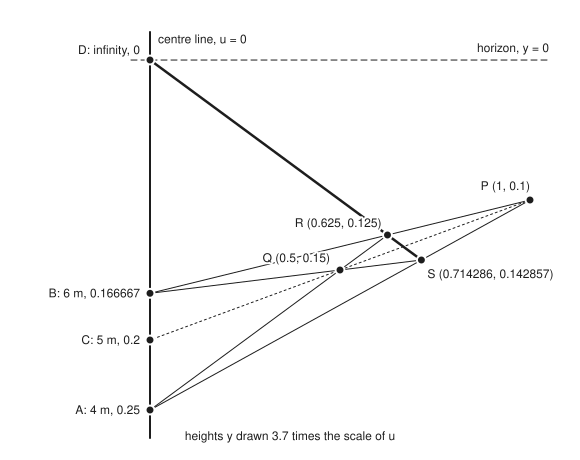

# Cross-ratio: the one number a perspective photo cannot change, and harmonic sets of points

[Syllabus](../../../SYLLABUS.md) → [Geometry and trig](../README.md) → [Vectors in Space](../README.md#s05) → Cross-ratio

---

## General Overview

A camera stands level, 1 m above a railway track, looking down the line. Four of its sleepers (the cross-ties under the rails) lie 4, 5, 6 and 7 m ahead. In the photo they bunch up toward the horizon. In focal lengths (the lens-to-sensor distance, the photo's unit), they sit 1/4, 1/5, 1/6 and 1/7 below the horizon.

Lengths change in the photo, and so do ratios of lengths. One number does not: the **cross-ratio**, a fraction with two differences between the four positions on top and two below. It is 4/3 for the sleepers on the ground, 4/3 for their images, and 4/3 with the camera tipped 10 degrees down.

So a photo measures. Know three sleepers' distances, read four heights off the photo, and the fourth follows: 7 m, with no camera height, lens data or tilt angle.

**Four points on a line carry one number, the cross-ratio, that every perspective view of them keeps, so three known points and a photo fix the fourth; when that number is −1 the four points form a harmonic set, which a ruler alone can draw.**

**What kind of fact this is:** a theorem, proved on this card in Why it works; the cross-ratio itself is a definition.

### The picture: even steps on the ground, shrinking steps in the photo

Each bar is a sleeper's height below the horizon in the level photo, one `#` per 0.01 focal length. The ground gaps are equal; the photo gaps shrink.

```
sleeper 4 m  #########################  0.25
sleeper 5 m  ####################       0.2
sleeper 6 m  #################          0.166667
sleeper 7 m  ##############             0.142857
```

---

## The formula

Give each point its position along the line as one number: for the sleepers, metres ahead.

```math
(A,B;C,D) = \frac{(C-A)(D-B)}{(C-B)(D-A)}
```

**Read it aloud:** the cross-ratio of A, B, C, D is C's distance from A times D's distance from B, divided by C's distance from B times D's distance from A.

On the ground: (6 − 4)(7 − 5) / ((6 − 5)(7 − 4)) = 4/3 = 1.333333.

A **projective map** of the line, the rule a camera applies to it, has four fixed numbers p, q, r and s:

```math
f(x) = \frac{px+q}{rx+s},\quad ps-qr\neq 0 \quad\Longrightarrow\quad (f(A),f(B);f(C),f(D)) = (A,B;C,D)
```

**Read it aloud:** send all four points through the same projective map, and the cross-ratio comes out unchanged.

The level camera is the map f(Z) = 1/Z. The photo's cross-ratio is (1/210) / (1/280) = 4/3, as the ground's.

When the cross-ratio is −1, the four points are a **harmonic set**, and D is the **harmonic conjugate** of C with respect to A and B:

```math
(A,B;C,D) = -1
```

**Read it aloud:** C and D split the stretch from A to B in the same ratio, C from inside and D from outside.

| Symbol | Plain meaning | In our example | Push it up and the answer… |
| --- | --- | --- | --- |
| $`A`$, $`B`$, $`C`$, $`D`$ | four points on one line, as positions along it | sleepers 4, 5, 6, 7 m | move D farther: the value climbs toward 2 |
| $`(A,B;C,D)`$ | the cross-ratio of the four points, in that order | 4/3 = 1.333333 | — |
| $`Z`$ | distance ahead of the camera, metres | 4 to 7 m | the photo height shrinks toward the horizon |
| $`u`$, $`y`$ | photo position: $`u`$ across from centre, $`y`$ focal lengths below the photo centre (the horizon when level) | sleeper 4: $`y`$ = 0.25 | — |
| $`f`$; $`p`$, $`q`$, $`r`$, $`s`$ | a projective map of the line, and its four numbers | $`f(Z) = 1/Z`$: 0, 1, 1, 0 | — |
| $`ps - qr`$; $`t`$ | nonzero, or the line collapses to a point; $`t = \tan 10°`$, the tilt | −1 level; −1.031091 tipped | — |
| $`k`$, $`x`$ | a cross-ratio read off a photo, and the unknown position it fixes | 4/3 and 7 m | larger $`k`$: farther $`x`$ |
| $`P`$, $`Q`$, $`R`$, $`S`$ | helper points of the ruler construction in Step 4 | P (1, 0.1), Q (0.5, 0.15) | move them: D stays put |

### When it holds

- **Four different points on one straight line.** If two coincide, the value is 0, 1 or undefined: 1 when A = B or C = D.
- **A pinhole camera: light travels in straight lines through one point.** Real lenses bend lines near the frame's edge, and the photo's cross-ratio drifts.
- **One line in the scene.** Points scattered across the ground need a map of the plane, fixed by four known points, not three.
- **The same order on both sides.** Swap two letters on one side only and the value changes: 4/3 becomes −1/3.
- **A point at infinity is allowed.** Drop the factors that contain it: (C − A)/(C − B) when D is at infinity.

---

## Why it works

### Step 0: each point appears once on top and once below

A camera stretches the line by a different amount near each point, so a difference such as C − A picks up one factor from C and one from A. In the cross-ratio every letter appears once on top and once below, so every factor cancels.

### Step 1: a camera applies a projective map to a line

The [Perspective](05-perspective-and-projective-coordinates.md) card shows a camera dividing by distance. For a level camera 1 m up, the ground 1 m below the lens shows at y = 1/Z. That is f(x) = (px + q)/(rx + s) with p = 0, q = 1, r = 1, s = 0.

Tip the camera down by 10 degrees, and write t = tan 10° = 0.176327. The tangent subtraction rule gives y = (1 − tZ)/(Z + t). That is again a projective map: p = −t, q = 1, r = 1, s = t, and ps − qr = −t² − 1 = −1.031091, never 0.

### Step 2: the stretch factors cancel

For any projective map, a difference of images is the old difference times one factor for each point:

```math
f(C) - f(A) = \frac{(ps-qr)\,(C-A)}{(rC+s)(rA+s)}
```

In the photo: 1/6 − 1/4 = −(6 − 4)/(6 × 4) = −1/12. In the cross-ratio each such factor appears as often on top as below, so only the original cross-ratio survives.

<details>
<summary>Detailed proof: the difference rule, and the cancellation</summary>

Put both fractions over one denominator:

$`\displaystyle f(C) - f(A) = \frac{(pC+q)(rA+s) - (pA+q)(rC+s)}{(rC+s)(rA+s)}`$

The top expands to $`prAC + psC + qrA + qs - prAC - psA - qrC - qs`$, which is $`(ps - qr)(C - A)`$.

Write $`m(X) = rX + s`$ for short. Then:

$`\displaystyle \frac{(f(C)-f(A))(f(D)-f(B))}{(f(C)-f(B))(f(D)-f(A))} = \frac{(ps-qr)^2 (C-A)(D-B) / (m(C)m(A)m(D)m(B))}{(ps-qr)^2 (C-B)(D-A) / (m(C)m(B)m(D)m(A))}`$

The two denominators hold the same four factors, so they cancel, as does $`(ps - qr)^2`$. What remains is $`(A,B;C,D)`$.

</details>

### Step 3: three points fix the map, so the photo fixes the fourth point

Set the ground's cross-ratio, with an unknown fourth point x, equal to the photo's value k. Solve for x:

```math
x = \frac{(C-A)B - k(C-B)A}{(C-A) - k(C-B)}
```

When the denominator is 0, the fourth point sits at infinity. With A = 4, B = 5, C = 6 and k = 4/3: x = (10 − 16/3)/(2 − 4/3) = (14/3)/(2/3) = 7 m. The tipped photo gives the same k, so the same 7 m.

A projective map that leaves three points in place solves px + q = x(rx + s) three times: a quadratic with three roots. So r = 0, q = 0 and p = s, and the map moves nothing. Two maps that agree on three points are then equal: one undone after the other fixes all three.

### Step 4: harmonic sets, and drawing one with a ruler

In this step A, B and C are the sleepers at 4, 6 and 5 m. The midpoint's harmonic conjugate is the point at infinity: (4, 6; 5, ∞) = (5 − 4)/(5 − 6) = −1. The camera sends the point at infinity to the horizon, y = 0. So in the photo, (0.25, 0.166667; 0.2, 0) = −1.

Solved for the middle image, it gives 2AB/(A + B), the **harmonic mean** of the outer images, hence the name: 2(0.25)(0.166667)/(0.416667) = 0.2.

A ruler finds the conjugate with no measuring. In the photo A, B and C sit on the centre line u = 0 at 0.25, 0.166667 and 0.2.

1. Pick any point P off the line, here (1, 0.1). Draw lines PA, PB and PC.
2. Pick any point Q on line PC other than P and C, here halfway: (0.5, 0.15).
3. Let R be where AQ meets PB: (0.625, 0.125). Let S be where BQ meets PA: (0.714286, 0.142857).
4. Line RS meets the line u = 0 at D: (0, 0), the horizon.

<p align="center"></p>

Any other choice of P and Q gives the same D.

<details>
<summary>Detailed proof: the construction gives cross-ratio −1</summary>

Let T be where RS meets PC. Project line AB onto line RS from P: A goes to S, B to R, C to T, and D stays. Each image is two cross products (the line to P, met with RS), linear in the point's triple, so this projection is a projective map and $`(A,B;C,D) = (S,R;T,D)`$.

Now project RS back onto AB from Q. S lies on QB, so S goes to B. R lies on QA, so R goes to A. T lies on QC, so T goes to C. So $`(S,R;T,D) = (B,A;C,D)`$.

Swapping the first two letters turns the cross-ratio upside down, so $`(A,B;C,D) = k`$ and also $`1/k`$. Then $`k^2 = 1`$. The value 1 would need C = D, so $`k = -1`$.

</details>

---

## Worked numbers, by hand

| Step | Arithmetic | Value |
| --- | --- | --- |
| ground cross-ratio | (6 − 4)(7 − 5) / ((6 − 5)(7 − 4)) | 4/3 = 1.333333 |
| photo top | (1/6 − 1/4)(1/7 − 1/5) = (−1/12)(−2/35) | 1/210 = 0.004762 |
| photo bottom | (1/6 − 1/5)(1/7 − 1/4) = (−1/30)(−3/28) | 1/280 = 0.003571 |
| photo cross-ratio | (1/210) / (1/280) = 280/210 | 1.333333 |
| tipped photo | 0.070563, 0.022867, −0.009385, −0.032647 in the same formula | 1.333333 |
| fourth sleeper from three and the photo | (2 × 5 − 4/3 × 1 × 4) / (2 − 4/3) | **7 m** |
| the middle sleeper's image | 2 × 0.25 × 0.166667 / (0.25 + 0.166667) | **0.2** |

Three sleepers and one photo place the fourth at 7 m; a midpoint's image is the harmonic mean of its neighbours' images.

### What breaks if you drop a piece

| Mistake | Comes out at | What went wrong |
| --- | --- | --- |
| A simple ratio AC/BC instead of the cross-ratio | 2 on the ground, 2.5 in the photo | Perspective does not keep a ratio of two lengths |
| Photo gaps read in proportion to ground gaps | fourth sleeper at 6.142857 m | The photo shrinks the far gaps |
| Order A, C, B, D on one side | −0.333333; fourth sleeper at 4.857143 m | The value depends on the order |
| Photo midpoint taken as the ground midpoint | height 0.208333, read as 4.8 m | Perspective keeps harmonic sets, not midpoints |

---

## Code, from first principles, and it actually runs

Three roads reach 7 m: solving the cross-ratio, fitting the map through three photo-and-ground pairs, and the camera's own ray, which alone needs the height and lens. The harmonic conjugate comes from the formula and from the ruler construction, with lines joined and met by cross products.

### Python

```python
# Cross-ratio and harmonic points -- the check behind the card.  Standard library
# only (math, for the tipped camera).  A level pinhole camera, 1 m above the track,
# focal length 1, sees a sleeper Z m ahead 1/Z focal lengths below the horizon.
from math import atan, tan, radians
GROUND = [4.0, 5.0, 6.0, 7.0]                           # sleepers, metres ahead

def cr(a, b, c, d): return (c - a) * (d - b) / ((c - b) * (d - a))
def solve(a, b, c, k):                                  # the x with cr(a, b, c, x) = k
    den = (c - a) - k * (c - b)
    return None if abs(den) < 1e-12 else ((c - a) * b - k * (c - b) * a) / den
def tipped(z): return tan(atan(1 / z) - radians(10))    # same camera, tipped 10 degrees down
def cross(u, v): return [u[1]*v[2] - u[2]*v[1], u[2]*v[0] - u[0]*v[2], u[0]*v[1] - u[1]*v[0]]
def dot(u, v): return sum(x * y for x, y in zip(u, v))
def fit(pairs):                      # road 2: the map z = (p y + q)/(r y + s) through three pairs
    rows = [[y, 1, -z * y, -z] for y, z in pairs]       # p y + q - z (r y + s) = 0, three times
    minor = [[[r[i] for i in range(4) if i != j] for r in rows] for j in range(4)]
    return [(-1) ** j * dot(m[0], cross(m[1], m[2])) for j, m in enumerate(minor)]
def num(x):
    s = f"{x:.6f}".rstrip("0").rstrip(".")
    return "0" if s == "-0" else s
def nums(v): return ", ".join(num(x) for x in v)
def pt(v): return f"({num(v[0] / v[2])}, {num(v[1] / v[2])})"

photo = [1 / z for z in GROUND]
tilt, t = [tipped(z) for z in GROUND], tan(radians(10))  # t: the tipped camera's map (Step 1)
k = cr(*photo)
top, bot = (photo[2] - photo[0]) * (photo[3] - photo[1]), (photo[2] - photo[1]) * (photo[3] - photo[0])
print(f"ground: sleepers at {nums(GROUND)} m; cross-ratio (6-4)(7-5)/((6-5)(7-4)) = {num(cr(*GROUND))}")
print(f"level photo: heights {nums(photo)} focal lengths below the horizon")
print(f"level photo: top ({num(photo[2] - photo[0])})({num(photo[3] - photo[1])}) = {num(top)} = 1/{num(1 / top)}, "
      f"bottom ({num(photo[2] - photo[1])})({num(photo[3] - photo[0])}) = {num(bot)} = 1/{num(1 / bot)}, cross-ratio {num(k)}")
print(f"photo tipped 10 degrees down: heights {nums(tilt)} from centre; cross-ratio {num(cr(*tilt))}")
print(f"tipped map: t = tan 10 degrees = {num(t)}, (p, q, r, s) = ({nums([-t, 1, 1, t])}), ps - qr = {num(-t * t - 1)}")
for z, y in zip(GROUND, photo): print(f"bar, sleeper {num(z)} m  {'#' * round(100 * y):<25}  {num(y)}")
r1, r3, rt = solve(4, 5, 6, k), 1 / photo[3], solve(4, 5, 6, cr(*tilt))
m = fit(list(zip(photo[:3], GROUND[:3])))
m = [x / m[1] for x in m]
r2 = (m[0] * photo[3] + m[1]) / (m[2] * photo[3] + m[3])
print(f"road 1, photo cross-ratio solved with sleepers 4, 5, 6: fourth sleeper at {num(r1)} m")
print(f"road 2, map through three photo-ground pairs: (p, q, r, s) = ({nums(m)}); sends {num(photo[3])} to {num(r2)} m")
print(f"road 3, the camera's own ray, 1 m drop over Z m: {num(r3)} m; the tipped photo by cross-ratio: {num(rt)} m")
g, h = solve(4, 6, 5, -1), solve(1 / 4, 1 / 6, 1 / 5, -1)
print(f"harmonic, ground: conjugate of 5 against 4 and 6: {'at infinity' if g is None else num(g)}")
print(f"harmonic, photo: conjugate of 0.2 against 0.25 and 0.166667: {num(h)}; harmonic mean 2(0.25)(0.166667)/{num(photo[0] + photo[2])} = {num(2 * photo[0] * photo[2] / (photo[0] + photo[2]))}")
A, B, C, P = [0, 1 / 4, 1], [0, 1 / 6, 1], [0, 1 / 5, 1], [1, 0.1, 1]     # A, B, C on the line u = 0
Q = [(P[0] + C[0]) / 2, (P[1] + C[1]) / 2, 1]                           # Q halfway along PC
R, S = cross(cross(A, Q), cross(P, B)), cross(cross(B, Q), cross(P, A))
D = cross(cross(R, S), cross(A, B))
print(f"figure, A {pt(A)}, B {pt(B)}, C {pt(C)}, P {pt(P)}, Q {pt(Q)}, R {pt(R)}, S {pt(S)}; line RS meets the centre line at D {pt(D)}")
prop = 4 + (photo[0] - photo[3]) / (photo[0] - photo[1])
print(f"mistake, simple ratio AC/BC: ground {num((6 - 4) / (6 - 5))}, photo {num((photo[2] - photo[0]) / (photo[2] - photo[1]))}; "
      f"gap {num(photo[0] - photo[1])} read as 1 m makes gap {num(photo[0] - photo[3])} read as {num(prop - 4)} m, fourth sleeper at {num(prop)} m")
print(f"mistake, order A, C, B, D: cross-ratio {num(cr(4, 6, 5, 7))}; solved, fourth sleeper at {num(solve(4, 5, 6, cr(4, 6, 5, 7)))} m")
print(f"mistake, photo midpoint of 4 and 6: height {num((photo[0] + photo[2]) / 2)}, read as {num(2 / (photo[0] + photo[2]))} m")
assert all(abs((1 - t * z) / (z + t) - y) < 1e-12 for z, y in zip(GROUND, tilt))  # Step 1's map = the camera
assert abs(cr(*GROUND) - k) < 1e-12 and abs(cr(*tilt) - k) < 1e-12     # invariance, two cameras
assert abs(r1 - r3) < 1e-9 and abs(r2 - r3) < 1e-9 and abs(rt - r3) < 1e-9  # three roads to 7 m
assert g is None and abs(D[1] / D[2] - h) < 1e-12 and abs(D[0] / D[2]) < 1e-12  # construction = formula
assert abs(cr(1 / 4, 1 / 6, 1 / 5, D[1] / D[2]) + 1) < 1e-12 and abs(prop - r3) > 0.5
print("ALL CHECKS PASS")
```

**Ran 2026-11-23 on macOS, Python 3.14.10, standard library only. All checks passed. Output, pasted from the run:**

```
ground: sleepers at 4, 5, 6, 7 m; cross-ratio (6-4)(7-5)/((6-5)(7-4)) = 1.333333
level photo: heights 0.25, 0.2, 0.166667, 0.142857 focal lengths below the horizon
level photo: top (-0.083333)(-0.057143) = 0.004762 = 1/210, bottom (-0.033333)(-0.107143) = 0.003571 = 1/280, cross-ratio 1.333333
photo tipped 10 degrees down: heights 0.070563, 0.022867, -0.009385, -0.032647 from centre; cross-ratio 1.333333
tipped map: t = tan 10 degrees = 0.176327, (p, q, r, s) = (-0.176327, 1, 1, 0.176327), ps - qr = -1.031091
bar, sleeper 4 m  #########################  0.25
bar, sleeper 5 m  ####################       0.2
bar, sleeper 6 m  #################          0.166667
bar, sleeper 7 m  ##############             0.142857
road 1, photo cross-ratio solved with sleepers 4, 5, 6: fourth sleeper at 7 m
road 2, map through three photo-ground pairs: (p, q, r, s) = (0, 1, 1, 0); sends 0.142857 to 7 m
road 3, the camera's own ray, 1 m drop over Z m: 7 m; the tipped photo by cross-ratio: 7 m
harmonic, ground: conjugate of 5 against 4 and 6: at infinity
harmonic, photo: conjugate of 0.2 against 0.25 and 0.166667: 0; harmonic mean 2(0.25)(0.166667)/0.416667 = 0.2
figure, A (0, 0.25), B (0, 0.166667), C (0, 0.2), P (1, 0.1), Q (0.5, 0.15), R (0.625, 0.125), S (0.714286, 0.142857); line RS meets the centre line at D (0, 0)
mistake, simple ratio AC/BC: ground 2, photo 2.5; gap 0.05 read as 1 m makes gap 0.107143 read as 2.142857 m, fourth sleeper at 6.142857 m
mistake, order A, C, B, D: cross-ratio -0.333333; solved, fourth sleeper at 4.857143 m
mistake, photo midpoint of 4 and 6: height 0.208333, read as 4.8 m
ALL CHECKS PASS
```

### Rust

Same numbers, same labels, built with `rustc --edition 2021 -O`.

```rust
// Cross-ratio and harmonic points -- the same check as the Python, in Rust, std
// only.  A level pinhole camera, 1 m above the track, focal length 1, sees a
// sleeper Z m ahead 1/Z focal lengths below the horizon.
const GROUND: [f64; 4] = [4.0, 5.0, 6.0, 7.0];               // sleepers, metres ahead

fn cr(a: f64, b: f64, c: f64, d: f64) -> f64 { (c - a) * (d - b) / ((c - b) * (d - a)) }
fn cr4(v: &[f64]) -> f64 { cr(v[0], v[1], v[2], v[3]) }
fn solve(a: f64, b: f64, c: f64, k: f64) -> Option<f64> {   // the x with cr(a, b, c, x) = k
    let den = (c - a) - k * (c - b);
    if den.abs() < 1e-12 { None } else { Some(((c - a) * b - k * (c - b) * a) / den) }
}
fn tipped(z: f64) -> f64 { ((1.0 / z).atan() - 10f64.to_radians()).tan() } // tipped 10 degrees down
fn cross(u: [f64; 3], v: [f64; 3]) -> [f64; 3] {
    [u[1] * v[2] - u[2] * v[1], u[2] * v[0] - u[0] * v[2], u[0] * v[1] - u[1] * v[0]]
}
fn dot(u: [f64; 3], v: [f64; 3]) -> f64 { u[0] * v[0] + u[1] * v[1] + u[2] * v[2] }
fn fit(pairs: &[(f64, f64)]) -> Vec<f64> {   // road 2: the map z = (p y + q)/(r y + s) through three pairs
    let rows: Vec<[f64; 4]> = pairs.iter().map(|&(y, z)| [y, 1.0, -z * y, -z]).collect();
    (0..4).map(|j| {
        let m: Vec<[f64; 3]> = rows.iter().map(|r| {
            let k: Vec<f64> = (0..4).filter(|&i| i != j).map(|i| r[i]).collect();
            [k[0], k[1], k[2]]
        }).collect();
        (if j % 2 == 0 { 1.0 } else { -1.0 }) * dot(m[0], cross(m[1], m[2]))
    }).collect()
}
fn num(x: f64) -> String {
    let s = format!("{:.6}", x);
    let s = s.trim_end_matches('0').trim_end_matches('.');
    if s == "-0" { "0".to_string() } else { s.to_string() }
}
fn nums(v: &[f64]) -> String { v.iter().map(|&x| num(x)).collect::<Vec<_>>().join(", ") }
fn pt(v: [f64; 3]) -> String { format!("({}, {})", num(v[0] / v[2]), num(v[1] / v[2])) }

fn main() {
    let photo: Vec<f64> = GROUND.iter().map(|z| 1.0 / z).collect();
    let tilt: Vec<f64> = GROUND.iter().map(|&z| tipped(z)).collect();
    let t = 10f64.to_radians().tan();                          // t: the tipped camera's map (Step 1)
    let k = cr4(&photo);
    let (top, bot) = ((photo[2] - photo[0]) * (photo[3] - photo[1]), (photo[2] - photo[1]) * (photo[3] - photo[0]));
    println!("ground: sleepers at {} m; cross-ratio (6-4)(7-5)/((6-5)(7-4)) = {}", nums(&GROUND), num(cr4(&GROUND)));
    println!("level photo: heights {} focal lengths below the horizon", nums(&photo));
    println!("level photo: top ({})({}) = {} = 1/{}, bottom ({})({}) = {} = 1/{}, cross-ratio {}", num(photo[2] - photo[0]), num(photo[3] - photo[1]),
             num(top), num(1.0 / top), num(photo[2] - photo[1]), num(photo[3] - photo[0]), num(bot), num(1.0 / bot), num(k));
    println!("photo tipped 10 degrees down: heights {} from centre; cross-ratio {}", nums(&tilt), num(cr4(&tilt)));
    println!("tipped map: t = tan 10 degrees = {}, (p, q, r, s) = ({}), ps - qr = {}", num(t), nums(&[-t, 1.0, 1.0, t]), num(-t * t - 1.0));
    for (z, y) in GROUND.iter().zip(&photo) {
        println!("bar, sleeper {} m  {:<25}  {}", num(*z), "#".repeat((100.0 * y).round() as usize), num(*y));
    }
    let (r1, r3, rt) = (solve(4.0, 5.0, 6.0, k).unwrap(), 1.0 / photo[3], solve(4.0, 5.0, 6.0, cr4(&tilt)).unwrap());
    let m = fit(&[(photo[0], 4.0), (photo[1], 5.0), (photo[2], 6.0)]);
    let m: Vec<f64> = m.iter().map(|x| x / m[1]).collect();
    let r2 = (m[0] * photo[3] + m[1]) / (m[2] * photo[3] + m[3]);
    println!("road 1, photo cross-ratio solved with sleepers 4, 5, 6: fourth sleeper at {} m", num(r1));
    println!("road 2, map through three photo-ground pairs: (p, q, r, s) = ({}); sends {} to {} m", nums(&m), num(photo[3]), num(r2));
    println!("road 3, the camera's own ray, 1 m drop over Z m: {} m; the tipped photo by cross-ratio: {} m", num(r3), num(rt));
    let (g, h) = (solve(4.0, 6.0, 5.0, -1.0), solve(0.25, 1.0 / 6.0, 0.2, -1.0).unwrap());
    println!("harmonic, ground: conjugate of 5 against 4 and 6: {}", g.map_or("at infinity".to_string(), num));
    println!("harmonic, photo: conjugate of 0.2 against 0.25 and 0.166667: {}; harmonic mean 2(0.25)(0.166667)/{} = {}",
             num(h), num(photo[0] + photo[2]), num(2.0 * photo[0] * photo[2] / (photo[0] + photo[2])));
    let (a, b, c, p) = ([0.0, 0.25, 1.0], [0.0, 1.0 / 6.0, 1.0], [0.0, 0.2, 1.0], [1.0, 0.1, 1.0]); // a, b, c on u = 0
    let q = [(p[0] + c[0]) / 2.0, (p[1] + c[1]) / 2.0, 1.0];                    // q halfway along pc
    let (r, s) = (cross(cross(a, q), cross(p, b)), cross(cross(b, q), cross(p, a)));
    let d = cross(cross(r, s), cross(a, b));
    println!("figure, A {}, B {}, C {}, P {}, Q {}, R {}, S {}; line RS meets the centre line at D {}",
             pt(a), pt(b), pt(c), pt(p), pt(q), pt(r), pt(s), pt(d));
    let prop = 4.0 + (photo[0] - photo[3]) / (photo[0] - photo[1]);
    println!("mistake, simple ratio AC/BC: ground {}, photo {}; gap {} read as 1 m makes gap {} read as {} m, fourth sleeper at {} m",
             num((6.0 - 4.0) / (6.0 - 5.0)), num((photo[2] - photo[0]) / (photo[2] - photo[1])),
             num(photo[0] - photo[1]), num(photo[0] - photo[3]), num(prop - 4.0), num(prop));
    let wrong = cr(4.0, 6.0, 5.0, 7.0);
    println!("mistake, order A, C, B, D: cross-ratio {}; solved, fourth sleeper at {} m", num(wrong), num(solve(4.0, 5.0, 6.0, wrong).unwrap()));
    println!("mistake, photo midpoint of 4 and 6: height {}, read as {} m", num((photo[0] + photo[2]) / 2.0), num(2.0 / (photo[0] + photo[2])));
    assert!(GROUND.iter().zip(&tilt).all(|(z, y)| ((1.0 - t * z) / (z + t) - y).abs() < 1e-12)); // Step 1's map = the camera
    assert!((cr4(&GROUND) - k).abs() < 1e-12 && (cr4(&tilt) - k).abs() < 1e-12);       // invariance, two cameras
    assert!((r1 - r3).abs() < 1e-9 && (r2 - r3).abs() < 1e-9 && (rt - r3).abs() < 1e-9); // three roads to 7 m
    assert!(g.is_none() && (d[1] / d[2] - h).abs() < 1e-12 && (d[0] / d[2]).abs() < 1e-12); // construction = formula
    assert!((cr(0.25, 1.0 / 6.0, 0.2, d[1] / d[2]) + 1.0).abs() < 1e-12 && (prop - r3).abs() > 0.5);
    println!("ALL CHECKS PASS");
}
```

**Ran 2026-11-23 on macOS, rustc 1.98.1, no crates. All checks passed. Output, pasted from the run:**

```
ground: sleepers at 4, 5, 6, 7 m; cross-ratio (6-4)(7-5)/((6-5)(7-4)) = 1.333333
level photo: heights 0.25, 0.2, 0.166667, 0.142857 focal lengths below the horizon
level photo: top (-0.083333)(-0.057143) = 0.004762 = 1/210, bottom (-0.033333)(-0.107143) = 0.003571 = 1/280, cross-ratio 1.333333
photo tipped 10 degrees down: heights 0.070563, 0.022867, -0.009385, -0.032647 from centre; cross-ratio 1.333333
tipped map: t = tan 10 degrees = 0.176327, (p, q, r, s) = (-0.176327, 1, 1, 0.176327), ps - qr = -1.031091
bar, sleeper 4 m  #########################  0.25
bar, sleeper 5 m  ####################       0.2
bar, sleeper 6 m  #################          0.166667
bar, sleeper 7 m  ##############             0.142857
road 1, photo cross-ratio solved with sleepers 4, 5, 6: fourth sleeper at 7 m
road 2, map through three photo-ground pairs: (p, q, r, s) = (0, 1, 1, 0); sends 0.142857 to 7 m
road 3, the camera's own ray, 1 m drop over Z m: 7 m; the tipped photo by cross-ratio: 7 m
harmonic, ground: conjugate of 5 against 4 and 6: at infinity
harmonic, photo: conjugate of 0.2 against 0.25 and 0.166667: 0; harmonic mean 2(0.25)(0.166667)/0.416667 = 0.2
figure, A (0, 0.25), B (0, 0.166667), C (0, 0.2), P (1, 0.1), Q (0.5, 0.15), R (0.625, 0.125), S (0.714286, 0.142857); line RS meets the centre line at D (0, 0)
mistake, simple ratio AC/BC: ground 2, photo 2.5; gap 0.05 read as 1 m makes gap 0.107143 read as 2.142857 m, fourth sleeper at 6.142857 m
mistake, order A, C, B, D: cross-ratio -0.333333; solved, fourth sleeper at 4.857143 m
mistake, photo midpoint of 4 and 6: height 0.208333, read as 4.8 m
ALL CHECKS PASS
```

### Lean

Lean proves Steps 2 and 3 for any points on a line with no point at infinity, and checks the worked numbers.

- Take a projective map f, with $`rC + s`$ and $`rA + s`$ not 0. Then $`f(C) - f(A) = \frac{(ps-qr)(C-A)}{(rC+s)(rA+s)}`$.
- Take four different points and a projective map with $`ps - qr \neq 0`$, sending none of them to infinity. Then the cross-ratio of their images is $`(A,B;C,D)`$.
- Suppose $`(A,B;C,x) = (A,B;C,y)`$, where A, B, C are different and x, y differ from all three. Then $`x = y`$.
- Suppose a projective map with $`ps - qr \neq 0`$ leaves three different points in place. Then $`r = 0`$, $`q = 0`$ and $`p = s`$, so it moves nothing.
- The worked numbers: cross-ratio 4/3 on the ground and in the photo, and the fourth sleeper at 7 m.
- In the photo, $`(1/4, 1/6; 1/5, 0) = -1`$, a harmonic set.
- The numbers in The usual mistake, as exact fractions: for example, the fourth sleeper at 43/7 m, not 7 m.

The tipped camera, the ruler construction and points at infinity are left to the Python and Rust checks.

```lean
-- Cross-ratio: a projective map x ↦ (px + q)/(rx + s) with ps − qr ≠ 0 keeps the cross-ratio of four different points on a line, so three known points and the cross-ratio fix the fourth, and a projective map that fixes three points moves nothing.
import Mathlib.Data.Real.Basic
import Mathlib.Tactic.FieldSimp
import Mathlib.Tactic.Ring
import Mathlib.Tactic.NormNum
import Mathlib.Tactic.LinearCombination
import Mathlib.Tactic.Linarith

/-- The cross-ratio (A, B; C, D) = (C − A)(D − B) / ((C − B)(D − A)) of four points on a line,
each given by its position along the line. Mathlib has no cross-ratio of real numbers, so the
card's formula is written out here. -/
noncomputable def crossRatio (A B C D : ℝ) : ℝ :=
  (C - A) * (D - B) / ((C - B) * (D - A))

/-- The projective map of the line with numbers p, q, r, s: x ↦ (px + q)/(rx + s). -/
noncomputable def projMap (p q r s x : ℝ) : ℝ :=
  (p * x + q) / (r * x + s)

/-- The gap between two images under the projective map: f(x) − f(y) = (ps − qr)(x − y)/((rx + s)(ry + s)). -/
theorem projMap_sub (p q r s x y : ℝ) (hx : r * x + s ≠ 0) (hy : r * y + s ≠ 0) :
    projMap p q r s x - projMap p q r s y
      = (p * s - q * r) * (x - y) / ((r * x + s) * (r * y + s)) := by
  unfold projMap
  rw [div_sub_div _ _ hx hy]
  congr 1
  ring

#print axioms projMap_sub

/-- Invariance: send four different points of a line through the same projective map
f(x) = (px + q)/(rx + s) with ps − qr ≠ 0, and the cross-ratio comes out unchanged.
(This is the case where no point is sent to the point at infinity, so rX + s ≠ 0 at each.) -/
theorem cross_ratio_invariant_under_projective_map (p q r s A B C D : ℝ)
    (hdet : p * s - q * r ≠ 0)
    (hAB : A ≠ B) (hAC : A ≠ C) (hAD : A ≠ D) (hBC : B ≠ C) (hBD : B ≠ D) (hCD : C ≠ D)
    (hA : r * A + s ≠ 0) (hB : r * B + s ≠ 0) (hC : r * C + s ≠ 0) (hD : r * D + s ≠ 0) :
    crossRatio (projMap p q r s A) (projMap p q r s B) (projMap p q r s C) (projMap p q r s D)
      = crossRatio A B C D := by
  unfold crossRatio
  rw [projMap_sub p q r s C A hC hA, projMap_sub p q r s D B hD hB,
    projMap_sub p q r s C B hC hB, projMap_sub p q r s D A hD hA]
  have h1 : C - A ≠ 0 := sub_ne_zero.mpr (Ne.symm hAC)
  have h2 : D - B ≠ 0 := sub_ne_zero.mpr (Ne.symm hBD)
  have h3 : C - B ≠ 0 := sub_ne_zero.mpr (Ne.symm hBC)
  have h4 : D - A ≠ 0 := sub_ne_zero.mpr (Ne.symm hAD)
  field_simp

/-- Three known points and the cross-ratio fix the fourth: for three different points
A, B, C, two candidate fourth points x and y (each different from A, B and C) that give the
same cross-ratio (A, B; C, ·) are the same point. -/
theorem cross_ratio_fixes_fourth_point (A B C x y : ℝ)
    (hAB : A ≠ B) (hAC : A ≠ C) (hBC : B ≠ C)
    (hxA : x ≠ A) (hxB : x ≠ B) (hxC : x ≠ C) (hyA : y ≠ A) (hyB : y ≠ B) (hyC : y ≠ C)
    (h : crossRatio A B C x = crossRatio A B C y) : x = y := by
  unfold crossRatio at h
  have h1 : C - A ≠ 0 := sub_ne_zero.mpr (Ne.symm hAC)
  have h3 : C - B ≠ 0 := sub_ne_zero.mpr (Ne.symm hBC)
  have h4 : x - A ≠ 0 := sub_ne_zero.mpr hxA
  have h5 : y - A ≠ 0 := sub_ne_zero.mpr hyA
  rw [div_eq_div_iff (mul_ne_zero h3 h4) (mul_ne_zero h3 h5)] at h
  have h6 : (C - A) * (C - B) * ((B - A) * (x - y)) = 0 := by linear_combination h
  have h7 : (C - A) * (C - B) ≠ 0 := mul_ne_zero h1 h3
  have h8 : B - A ≠ 0 := sub_ne_zero.mpr (Ne.symm hAB)
  rcases mul_eq_zero.mp h6 with h9 | h9
  · exact absurd h9 h7
  · rcases mul_eq_zero.mp h9 with h10 | h10
    · exact absurd h10 h8
    · exact sub_eq_zero.mp h10

/-- A projective map x ↦ (px + q)/(rx + s) with ps − qr ≠ 0 that leaves three different
points in place has r = 0, q = 0 and p = s, so it moves nothing. -/
theorem projective_map_fixing_three_points_is_identity (p q r s a b c : ℝ)
    (hdet : p * s - q * r ≠ 0) (hab : a ≠ b) (hac : a ≠ c) (hbc : b ≠ c)
    (ha : r * a + s ≠ 0) (hb : r * b + s ≠ 0) (hc : r * c + s ≠ 0)
    (hfa : projMap p q r s a = a) (hfb : projMap p q r s b = b) (hfc : projMap p q r s c = c) :
    r = 0 ∧ q = 0 ∧ p = s := by
  unfold projMap at hfa hfb hfc
  rw [div_eq_iff ha] at hfa
  rw [div_eq_iff hb] at hfb
  rw [div_eq_iff hc] at hfc
  have hab' : a - b ≠ 0 := sub_ne_zero.mpr hab
  have hac' : a - c ≠ 0 := sub_ne_zero.mpr hac
  have hbc' : b - c ≠ 0 := sub_ne_zero.mpr hbc
  have e1 : (a - b) * (r * (a + b) + (s - p)) = 0 := by linear_combination hfb - hfa
  have e2 : (a - c) * (r * (a + c) + (s - p)) = 0 := by linear_combination hfc - hfa
  have f1 : r * (a + b) + (s - p) = 0 := (mul_eq_zero.mp e1).resolve_left hab'
  have f2 : r * (a + c) + (s - p) = 0 := (mul_eq_zero.mp e2).resolve_left hac'
  have g : (b - c) * r = 0 := by linear_combination f1 - f2
  have hr : r = 0 := (mul_eq_zero.mp g).resolve_left hbc'
  subst hr
  have hps : p = s := by linarith
  subst hps
  refine ⟨rfl, ?_, rfl⟩
  linarith

-- The sleepers 4, 5, 6, 7 m ahead: cross-ratio 4/3.
example : crossRatio 4 5 6 7 = 4 / 3 := by norm_num [crossRatio]

-- Their photo heights 1/4, 1/5, 1/6, 1/7: top 1/210, bottom 1/280, cross-ratio 4/3 again.
example : (1 / 6 - 1 / 4 : ℝ) * (1 / 7 - 1 / 5) = 1 / 210 := by norm_num
example : (1 / 6 - 1 / 5 : ℝ) * (1 / 7 - 1 / 4) = 1 / 280 := by norm_num
example : crossRatio (1 / 4) (1 / 5) (1 / 6) (1 / 7) = 4 / 3 := by norm_num [crossRatio]

-- The level camera is the map with (p, q, r, s) = (0, 1, 1, 0): ps − qr = −1, and 6 m shows at 1/6.
example : (0 : ℝ) * 0 - 1 * 1 = -1 := by norm_num
example : projMap 0 1 1 0 6 = 1 / 6 := by norm_num [projMap]

-- Step 2's difference rule in the photo: 1/6 − 1/4 = −(6 − 4)/(6 × 4) = −1/12.
example : (1 / 6 - 1 / 4 : ℝ) = -(6 - 4) / (6 * 4) ∧ (1 / 6 - 1 / 4 : ℝ) = -1 / 12 := by norm_num

-- Step 3: sleepers 4, 5, 6 and photo cross-ratio 4/3 put the fourth sleeper at 7 m.
example : ((6 - 4) * 5 - 4 / 3 * (6 - 5) * 4 : ℝ) / ((6 - 4) - 4 / 3 * (6 - 5)) = 7 := by norm_num

-- Step 4: in the photo (1/4, 1/6; 1/5, 0) = −1, and 1/5 is the harmonic mean of 1/4 and 1/6.
example : crossRatio (1 / 4) (1 / 6) (1 / 5) 0 = -1 := by norm_num [crossRatio]
example : 2 * (1 / 4 : ℝ) * (1 / 6) / (1 / 4 + 1 / 6) = 1 / 5 := by norm_num

-- The usual mistakes: AC/BC is 2 on the ground but 5/2 in the photo; gaps read in proportion put
-- the fourth sleeper at 43/7 m; order A, C, B, D gives −1/3 and 34/7 m; the photo midpoint 5/24
-- reads as 24/5 m.
example : ((6 - 4) / (6 - 5) : ℝ) = 2 ∧ ((1 / 6 - 1 / 4) / (1 / 6 - 1 / 5) : ℝ) = 5 / 2 := by norm_num
example : (4 + (1 / 4 - 1 / 7) / (1 / 4 - 1 / 5) : ℝ) = 43 / 7 := by norm_num
example : crossRatio 4 6 5 7 = -1 / 3 := by norm_num [crossRatio]
example : ((6 - 4) * 5 - (-1 / 3) * (6 - 5) * 4 : ℝ) / ((6 - 4) - (-1 / 3) * (6 - 5)) = 34 / 7 := by
  norm_num
example : ((1 / 4 + 1 / 6) / 2 : ℝ) = 5 / 24 ∧ (2 / (1 / 4 + 1 / 6) : ℝ) = 24 / 5 := by norm_num

#print axioms cross_ratio_invariant_under_projective_map
#print axioms cross_ratio_fixes_fourth_point
#print axioms projective_map_fixing_three_points_is_identity
```

**Checked 2026-11-23 on macOS, Lean 4.36.0-rc2, Mathlib v4.36.0-rc2. Every proof is complete and uses only Lean's standard axioms. Output, pasted from the run:**

```
'projMap_sub' depends on axioms: [propext, Classical.choice, Quot.sound]
'cross_ratio_invariant_under_projective_map' depends on axioms: [propext, Classical.choice, Quot.sound]
'cross_ratio_fixes_fourth_point' depends on axioms: [propext, Classical.choice, Quot.sound]
'projective_map_fixing_three_points_is_identity' depends on axioms: [propext, Classical.choice, Quot.sound]
```

> [!TIP]
> **Try changing**
> - **Tip the camera further.** Guess first, then change both `radians(10)` to `radians(25)` (the labels still say 10). Every photo height moves; the cross-ratio stays 1.333333 and the fourth sleeper 7 m.
> - **Move the last sleeper.** Guess first, then set `GROUND` to `[4.0, 5.0, 6.0, 8.0]`. The cross-ratio is 1.5 on both sides, and road 1 finds 8 m.
> - **Move the helper point.** Guess first, then set `P` to `[0.3, 0.3, 1]`. R and S move to (0.1875, 0.25) and (0.214286, 0.285714); D stays at (0, 0).

---

## The usual mistake

> [!warning]
> **Using a ratio of two lengths.** Perspective keeps only the ratio of two ratios. AC/BC is 2 on the ground but 2.5 in the photo.
>
> - **Reading photo gaps in proportion.** One photo gap of 0.05 is 1 m, so a gap of 0.107143 looks like 2.142857 m: the fourth sleeper lands at 6.142857 m, not 7 m.
> - **Mixing the order.** (4, 6; 5, 7) is −0.333333, not 1.333333; solved as if it were the photo's value, it puts the fourth sleeper at 4.857143 m. Keep one order on both sides.
> - **Taking the photo midpoint as the ground midpoint.** Halfway between 0.25 and 0.166667 is 0.208333, which reads as 4.8 m, not 5 m.

---

## Where you meet it in real life

- **Measuring from photographs.** Three known marks along a straight road edge, such as lane-dash ends, let one photo give the distance to a fourth point on it.
- **Drawing in perspective.** To find the middle of a receding wall, artists cross its diagonals. That is the ruler construction of Step 4, with one point at infinity.
- **Computer vision.** A target of four dots in a row with a known cross-ratio is recognized from any viewing angle.

> **Say it back**
> The cross-ratio of four points on a line is a ratio of two products of distances. A camera stretches each point by its own factor, and each point appears once on top and once below, so the factors cancel: 4/3 on the ground and in the photo. Three known points and a photo therefore fix a fourth: the sleeper at 7 m. A cross-ratio of −1 is a harmonic set, which a ruler alone can construct.

---

## What this builds on

- [Perspective](05-perspective-and-projective-coordinates.md): a camera divides by distance, and lines are joined and met by cross products of homogeneous coordinates.
- [Desargues and Pappus](06-desargues-and-pappus.md): ruler-only theorems about points and lines; the harmonic construction is one more.

## Where this goes next

- [Every rigid motion of the plane is at most three mirror flips, so there are only four kinds](08-plane-isometries-and-three-reflections.md): stepping back from perspective maps to moves of the plane that keep every distance unchanged.
- [Mobius transformations](../../07-Complex%20analysis/07-Conformal%20Maps%20and%20Harmonic%20Functions/02-mobius-transformations-and-the-point-at-infinity.md): the same map (az + b)/(cz + d) on complex numbers, which keeps the complex cross-ratio and sends any three points to any three.

Three points fix a projective map of a line; four points, no three on one line, fix one of the whole plane. Next on this shelf, we step back from perspective maps to moves that keep every distance unchanged: [Every rigid motion of the plane is at most three mirror flips, so there are only four kinds](08-plane-isometries-and-three-reflections.md).

---

## Sources

Verified 2026-11-23: every link below resolves to the publisher's page.

- Stillwell, John. *The Four Pillars of Geometry*. Springer, Undergraduate Texts in Mathematics, 2005. [doi:10.1007/0-387-29052-4](https://doi.org/10.1007/0-387-29052-4). Chapter 5, Perspective, builds projective maps of a line and the cross-ratio they keep.
- Coxeter, H. S. M. *Introduction to Geometry*, 2nd ed. Wiley, 1969. [Publisher page](https://www.wiley.com/en-us/Introduction+to+Geometry%2C+2nd+Edition-p-9780471504580). The complete quadrangle and harmonic sets, drawn with a ruler alone.
- Richter-Gebert, Jürgen. *Perspectives on Projective Geometry*. Springer, 2011. [doi:10.1007/978-3-642-17286-1](https://doi.org/10.1007/978-3-642-17286-1). Cross-ratios computed from homogeneous coordinates, the method the checks use.
