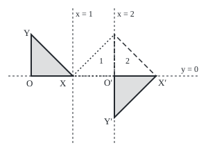

# Every rigid motion of the plane is at most three mirror flips, so there are only four kinds

[Syllabus](../../../SYLLABUS.md) → [Geometry and trig](../README.md) → [Vectors in Space](../README.md#s05) → Every rigid motion of the plane is at most three mirror flips, so there are only four kinds

---

## General Overview

Look back along a trail of footprints on a wet beach. Each right print is the left print before it, carried one step forward and flipped across the line you walked. No slide or turn can make a left foot into a right foot.

That move is a **glide reflection**: a flip in a line, then a slide along that line. It is one of only four kinds of **rigid motion** (or **isometry**) of a flat plane: a move that keeps every distance between points the same. The reason there are only four is a counting fact: every rigid motion is at most three mirror flips.

Two flips already give a lot:

- Flip in the x-axis, then in the line y = x. The point (x, y) goes to (x, −y), then to (−y, x). That is a quarter turn about the origin.
- Flip in the line x = 0, then in x = 1. Everything slides 2 to the right.
- Add a third flip, in y = 0. Now (x, y) goes to (x + 2, −y): the footprint move. It fixes no point and leaves no line in place point by point, so it is none of the other three kinds.

**Every distance-keeping move of the plane is one, two or three mirror flips (or none), so it is a translation, a rotation, a reflection or a glide reflection, and its matrix and its fixed points say which.**

**What kind of fact this is:** a theorem, proved on this card in Why it works; the four names are definitions.

### The picture: three flips make the footprint move

<p align="center"></p>

Drawn to scale, with the recipe's mirrors x = 1 and x = 2 (Step 2): 1 apart, like x = 0 and x = 1, so the same slide. Shaded left: the start, O (0, 0), X (1, 0), Y (0, 1). Dotted "1": after the flip in x = 1. Dashed "2": after x = 2. Shaded right: after y = 0, the mirror lines dashed.

---

## The formula

A **mirror** here is a straight line. Write it as $`n \cdot p = c`$: $`n`$ is an arrow 1 long at a right angle to the line (its **unit normal**), $`p`$ is any point, the dot is the dot product, and $`c`$ says how far the line sits from the origin along $`n`$. For x = 1, $`n = (1, 0)`$ and $`c = 1`$.

The flip $`\rho`$ (Greek rho) in that mirror is:

```math
\rho(p) = p - 2\,(n \cdot p - c)\,n
```

**Read it aloud:** measure how far the point sits past the mirror, then step back across it twice that far.

The theorem:

```math
f = \rho_3 \circ \rho_2 \circ \rho_1, \qquad f(p) = A\,p + t
```

**Read it aloud:** any rigid motion f is at most three flips, done right to left, and in coordinates it is one 2 × 2 matrix A followed by one shift t.

The **determinant** $`\det A`$ (top-left times bottom-right, minus top-right times bottom-left) is −1 for each flip, so it says whether the flip count is even (+1) or odd (−1). With the **fixed points**, the points f leaves in place, it names the kind:

| Kind | $`\det A`$ | Fixed points | Fewest flips | On this card |
| --- | --- | --- | --- | --- |
| identity (a slide by 0) | +1 | every point | 0 | — |
| rotation | +1 | exactly one | 2, crossing | quarter turn about (0, 0) |
| translation (slide) | +1 | none | 2, parallel | slide by 2 |
| reflection | −1 | one whole line | 1 | flip in y = x |
| glide reflection | −1 | none | 3 | (x, y) → (x + 2, −y) |

| Symbol | Plain meaning | In our example | Push it up and the answer… |
| --- | --- | --- | --- |
| $`f`$, $`A`$, $`t`$ | the rigid motion; its matrix part; its shift, where the origin goes | the glide; `[[1, 0], [0, -1]]`; (2, 0) | a bigger t, a longer slide |
| $`p = (x, y)`$ | a point | a heel at (0, 0.25) | — |
| $`\rho_1, \rho_2, \rho_3`$ | the first, second and third flip | in x = 1, x = 2, y = 0 | — |
| $`n`$, $`c`$ | a mirror's unit normal and its distance from the origin | (1, 0) and 1 for x = 1 | larger c moves the mirror out |
| $`\circ`$ | "after": the right-hand move is done first | flip 1 first | — |
| $`\det A`$ | the determinant: +1 for an even flip count, −1 for odd | −1 | — |
| O, X, Y | three anchor points, not on one line | (0, 0), (1, 0), (0, 1) | — |
| β, γ, φ, a, b, u, s, w | in the proof fold: two mirror angles and a point's angle; two parallel mirrors x = a, x = b; a mirror direction, the slide along it, the shift across it | 0° and 45°; a = 0, b = 1; s = 2 | — |

### When it holds

- **A flat plane.** On a sphere three flips still suffice, but there are no slides, so the kinds differ.
- **Every distance kept exactly.** No set of mirrors makes a scaling by 1.5.
- **Anchors not on one line.** Anchors on y = 0 cannot tell "do nothing" from "flip in y = 0".
- **Two dimensions.** In space the mirrors are planes and up to four flips are needed ([Rigid motions in space](09-rigid-motions-in-space-and-screws.md)).

---

## Why it works

### Step 0: three points pin down the whole move

A point is fixed by its distances from three anchors not on one line. Two distances leave two candidates, mirror images across the line through the first two anchors. The third distance picks one.

A rigid motion keeps those distances, so where O, X and Y go fixes where every point goes. Two rigid motions that agree on O, X and Y agree everywhere: the side-side-side test of [Congruent triangles](../01-Angles%2C%20Triangles%20and%20Congruence/03-congruent-triangles.md), applied point by point.

### Step 1: one flip can carry any point to any other

The **perpendicular bisector** of two points is the line of points equally far from both: it crosses the segment between them at its midpoint, at a right angle ([Lines](../04-Coordinates%20and%20Curves/02-lines-slopes-and-intersections.md)). The flip in that line swaps the two points. For two different points, $`n`$ is the unit arrow (length 1) pointing from the first to the second, and $`c`$ is $`n`$ dotted with their midpoint.

### Step 2: match the anchors one at a time

1. If O is not already where f sends it, flip in the bisector of O and f(O). Now O is right.
2. If X is not right, flip in the bisector of where X is now and f(X). This mirror passes through f(O), because f(O) is the same distance OX from both points. So O stays right.
3. If Y is not right, flip in the bisector of where Y is now and f(Y). This mirror passes through both f(O) and f(X), for the same reason, so they stay right.

Now the flips agree with f on O, X and Y, so by Step 0 everywhere.

### Step 3: count the flips to name the kind

Each flip turns a left hand into a right hand, so the count's evenness decides handedness.

- **One flip** is a reflection, fixing its mirror line.
- **Two crossing mirrors** give a rotation about the crossing, by twice their angle: 45° gives 90°.
- **Two parallel mirrors** give a translation across them, by twice the gap: 1 gives 2.
- **Three flips** that are not one flip give a glide reflection. Done twice it is a slide, so it fixes no point.

<details>
<summary>Detailed proof: two flips make a turn or a slide, and three make a glide</summary>

Flip in a line through the origin at angle β. A point at angle φ lands at angle 2β − φ, the same distance out. A second flip, at angle γ, sends that to 2γ − (2β − φ) = φ + 2(γ − β). Every point turns by twice the angle between the mirrors.

Flip in x = a sends x to 2a − x. Then x = b sends it to 2b − (2a − x) = x + 2(b − a). Every point slides by twice the gap.

Three flips have $`\det A = -1`$, so A is the matrix of a flip in some line through the origin. Call its direction u. Split the shift t into a part s along u and a part w across it. Then f is the flip in the parallel line through w/2, followed by a slide s along that line. If s = 0, f is a reflection. Otherwise it is a glide reflection, and doing it twice slides every point by 2s.

</details>

---

## Worked numbers, by hand

Run the recipe of Step 2 on the glide f(x, y) = (x + 2, −y), with anchors O (0, 0), X (1, 0), Y (0, 1).

| Step | Arithmetic | Value |
| --- | --- | --- |
| where the anchors must go | (x + 2, −y) on each | (2, 0), (3, 0), (2, −1) |
| mirror 1 | bisector of (0, 0) and (2, 0): midpoint (1, 0) | x = 1 |
| after mirror 1 | x becomes 2 − x | O (2, 0), X (1, 0), Y (2, 1) |
| mirror 2 | bisector of (1, 0) and (3, 0) | x = 2, through (2, 0) |
| after mirror 2 | x becomes 4 − x | O (2, 0), X (3, 0), Y (2, 1) |
| mirror 3 | bisector of (2, 1) and (2, −1) | y = 0 |
| after mirror 3 | y becomes −y | O (2, 0), X (3, 0), Y (2, −1) |
| the kind | 3 flips, det −1, done twice sends (0, 0) to (4, 0) | **glide reflection, slide 2** |

At 35 cm a unit, a heel at (0, 0.25) lands at (2, −0.25): the next print, one 70 cm step ahead, across the walking line.

On the quarter turn the recipe finds x − y = 0 and x = 0, crossing at 45°: a 90° turn, as the matrix `[[0, -1], [1, 0]]` with fixed point (0, 0) says.

### What breaks if you drop a piece

| Mistake | Comes out at | What went wrong |
| --- | --- | --- |
| Flipping in y = x first, then in the x-axis | (1, 0) goes to (0, −1), not (0, 1) | Order matters: swapping the flips turns the other way |
| Calling the glide a reflection, since det A = −1 | twice sends (0, 0) to (4, 0) | A reflection twice moves nothing |
| Reading the mirror gap 1 as the slide | slide 1, true slide 2 | The slide is twice the gap |
| Reading the mirror angle 45° as the turn | 45°, true turn 90° | The turn is twice the angle |

---

## Code, from first principles, and it actually runs

The script builds four moves from mirrors: the quarter turn, the slide, a flip in y = x, and the glide. Two independent roads name each one:

- **Road one** reads the matrix: determinant, then the fixed point by Cramer's rule (solving two equations with determinants), or the slide along the mirror.
- **Road two** runs the recipe of Step 2 and names the kind from its mirrors alone: how many, crossing or parallel, and the angle or gap.

The asserts check that the roads agree, that the fixed point stays put, that the flips match the move at 121 grid points, and the formulas (x + 2, −y) and (−y, x).

### Python

```python
# Plane isometries and three reflections -- the check behind the card.  Standard library only.  A move is
# (A, t): p -> A p + t.  Road one names it from A and its fixed points; road two rebuilds it from mirrors.
from math import sqrt, atan2, acos, degrees, dist
def num(v): v = round(v, 6) + 0.0; return str(int(v)) if v == int(v) else f"{v:g}"
def pt(p): return f"({num(p[0])}, {num(p[1])})"
def go(f, p): (a, b), (c, d) = f[0]; return (a * p[0] + b * p[1] + f[1][0], c * p[0] + d * p[1] + f[1][1])
def chain(ms):                       # apply the mirrors in order, first mirror first
    A, t = ((1, 0), (0, 1)), (0, 0)
    for n, c in ms:                  # mirror n . p = c, n a unit normal: p -> p - 2(n . p - c) n
        R = ((1 - 2 * n[0] ** 2, -2 * n[0] * n[1]), (-2 * n[0] * n[1], 1 - 2 * n[1] ** 2))
        A = tuple(tuple(sum(R[i][k] * A[k][j] for k in range(2)) for j in range(2)) for i in range(2))
        t = go((R, (2 * c * n[0], 2 * c * n[1])), t)
    return A, t
def line(n, c):
    s = n[0] if abs(n[0]) > 1e-9 else n[1]; w = lambda k: "" if abs(abs(k / s) - 1) < 1e-9 else num(abs(k / s))
    terms = [("-" if k / s < 0 else "+", w(k) + v) for k, v in ((n[0], "x"), (n[1], "y")) if abs(k) > 1e-9]
    return terms[0][1] + "".join(f" {g} {v}" for g, v in terms[1:]) + f" = {num(c / s)}"
def say(kind, size): return {"identity": "identity", "rotation": f"rotation by {num(size)} degrees", "translation": f"translation by {num(size)}",
                             "reflection": "reflection", "glide reflection": f"glide reflection, slide {num(size)}"}[kind]
def road1(f):                        # from the matrix and the fixed points
    ((a, b), (c, d)), t = f
    if a * d - b * c > 0 and abs(a - 1) + abs(c) < 1e-9: return ("identity", 0, "det +1, every point fixed") if dist(t, (0, 0)) < 1e-9 else ("translation", dist(t, (0, 0)), "det +1, no fixed point")
    if a * d - b * c > 0:            # solve (I - A) p = t by Cramer's rule
        D = (1 - a) * (1 - d) - b * c; fix = ((t[0] * (1 - d) + b * t[1]) / D, ((1 - a) * t[1] + c * t[0]) / D); assert dist(go(f, fix), fix) < 1e-9
        return "rotation", abs(degrees(atan2(c, a))), f"det +1, one fixed point {pt(fix)}"
    u = (1 + a, c) if abs(1 + a) + abs(c) > 1e-9 else (b, 1 + d)   # a column of I + A: along the mirror
    s = abs(t[0] * u[0] + t[1] * u[1]) / dist(u, (0, 0))
    return ("reflection", 0, "det -1, a whole line fixed") if s < 1e-9 else ("glide reflection", s, "det -1, no fixed point")
def road2(f):                        # the three-point recipe, then name from mirrors and points only
    ms = []
    for P in ((0, 0), (1, 0), (0, 1)):
        Q, R = go(chain(ms), P), go(f, P)
        if dist(Q, R) < 1e-9: continue
        n = ((R[0] - Q[0]) / dist(Q, R), (R[1] - Q[1]) / dist(Q, R))   # perpendicular bisector of Q and R
        ms.append((n, n[0] * (Q[0] + R[0]) / 2 + n[1] * (Q[1] + R[1]) / 2))
    if len(ms) == 3: return ms, "glide reflection", dist(go(chain(ms * 2), (0, 0)), (0, 0)) / 2   # twice = a slide
    if len(ms) < 2: return ms, ["identity", "reflection"][len(ms)], 0
    (n1, c1), (n2, c2) = ms; dot = n1[0] * n2[0] + n1[1] * n2[1]
    if abs(abs(dot) - 1) < 1e-9: return ms, "translation", 2 * abs(c2 - dot * c1)   # parallel: twice the gap
    return ms, "rotation", 2 * degrees(acos(abs(dot)))                          # crossing: twice the angle
r2, grid = 1 / sqrt(2), [(x / 2 - 2.5, y / 2 - 2.5) for x in range(11) for y in range(11)]
cases = {"quarter turn": [((0, 1), 0), ((r2, -r2), 0)], "slide": [((1, 0), 0), ((1, 0), 1)],
         "mirror": [((r2, -r2), 0)], "glide": [((1, 0), 0), ((1, 0), 1), ((0, 1), 0)]}
for (name, ms), m in zip(cases.items(), (2, 2, 1, 3)):     # m: the fewest mirrors
    f = chain(ms); (a, b), (c, d) = f[0]; k1, s1, why = road1(f); rec, k2, s2 = road2(f)
    print(f"{name}: mirrors {', '.join(line(n, c) for n, c in ms)}; A = [[{num(a)}, {num(b)}], [{num(c)}, {num(d)}]], t = {pt(f[1])}")
    print(f"  matrix road: {why} -> {say(k1, s1)}")
    print(f"  recipe road: {', '.join(line(n, c) for n, c in rec)} -> {say(k2, s2)}")
    assert k1 == k2 and abs(s1 - s2) < 1e-9 and len(rec) == m and max(dist(go(f, p), go(chain(rec), p)) for p in grid) < 1e-9
glide, turn = chain(cases["glide"]), chain(cases["quarter turn"]); (_, c1), (_, c2), ((u1, v1), _), ((u2, v2), _) = cases["slide"] + cases["quarter turn"]   # the spec: (x + 2, -y), (-y, x)
assert max(dist(go(glide, p), (p[0] + 2, -p[1])) + dist(go(turn, p), (-p[1], p[0])) for p in grid) < 1e-12
assert all(abs(dist(go(glide, p), go(glide, q)) - dist(p, q)) < 1e-12 for p in grid for q in grid[::7])
print(f"footprint heel {pt((0, 0.25))} -> {pt(go(glide, (0, 0.25)))}; at 35 cm a unit, one step is {num(2 * 35)} cm")
print(f"mistakes: mirrors swapped send (1, 0) to {pt(go(chain(cases['quarter turn'][::-1]), (1, 0)))}, not "
      f"{pt(go(turn, (1, 0)))}; the glide done twice sends (0, 0) to {pt(go(glide, go(glide, (0, 0))))}")
print(f"mistakes: mirror gap {num(abs(c2 - c1))}, true slide {num(road1(chain(cases['slide']))[1])}; mirror angle "
      f"{num(degrees(acos(abs(u1 * u2 + v1 * v2))))} degrees, true turn {num(road1(turn)[1])} degrees")
print("figure, O X Y after 0 to 3 recipe mirrors, drawn at (45 + 60x, 110 - 60y): " + "; ".join(" ".join(pt(go(
      chain(road2(glide)[0][:k]), p)) for p in ((0, 0), (1, 0), (0, 1))) for k in range(4)))
print("ALL CHECKS PASS")
```

**Ran 2026-11-25 on macOS, Python 3.14.10, standard library only. All checks passed. Output, pasted from the run:**

```
quarter turn: mirrors y = 0, x - y = 0; A = [[0, -1], [1, 0]], t = (0, 0)
  matrix road: det +1, one fixed point (0, 0) -> rotation by 90 degrees
  recipe road: x - y = 0, x = 0 -> rotation by 90 degrees
slide: mirrors x = 0, x = 1; A = [[1, 0], [0, 1]], t = (2, 0)
  matrix road: det +1, no fixed point -> translation by 2
  recipe road: x = 1, x = 2 -> translation by 2
mirror: mirrors x - y = 0; A = [[0, 1], [1, 0]], t = (0, 0)
  matrix road: det -1, a whole line fixed -> reflection
  recipe road: x - y = 0 -> reflection
glide: mirrors x = 0, x = 1, y = 0; A = [[1, 0], [0, -1]], t = (2, 0)
  matrix road: det -1, no fixed point -> glide reflection, slide 2
  recipe road: x = 1, x = 2, y = 0 -> glide reflection, slide 2
footprint heel (0, 0.25) -> (2, -0.25); at 35 cm a unit, one step is 70 cm
mistakes: mirrors swapped send (1, 0) to (0, -1), not (0, 1); the glide done twice sends (0, 0) to (4, 0)
mistakes: mirror gap 1, true slide 2; mirror angle 45 degrees, true turn 90 degrees
figure, O X Y after 0 to 3 recipe mirrors, drawn at (45 + 60x, 110 - 60y): (0, 0) (1, 0) (0, 1); (2, 0) (1, 0) (2, 1); (2, 0) (3, 0) (2, 1); (2, 0) (3, 0) (2, -1)
ALL CHECKS PASS
```

### Rust

Same numbers, same labels, built with `rustc --edition 2021 -O`.

```rust
// Plane isometries and three reflections -- the same check as the Python, in Rust, std only.  A move is
// (A, t): p -> A p + t.  Road one names it from A and its fixed points; road two rebuilds it from mirrors.
type P = [f64; 2]; type Iso = ([[f64; 2]; 2], P); type Mirror = (P, f64);   // a point, a move, a mirror n . p = c
fn num(v: f64) -> String { let r = (v * 1e6).round() / 1e6 + 0.0; if r.fract() == 0.0 { format!("{}", r as i64) } else { format!("{}", r) } }
fn pt(p: P) -> String { format!("({}, {})", num(p[0]), num(p[1])) }
fn go(f: &Iso, p: P) -> P { let a = f.0; [a[0][0] * p[0] + a[0][1] * p[1] + f.1[0], a[1][0] * p[0] + a[1][1] * p[1] + f.1[1]] }
fn dist(p: P, q: P) -> f64 { (p[0] - q[0]).hypot(p[1] - q[1]) }
fn chain(ms: &[Mirror]) -> Iso {                  // apply the mirrors in order, first mirror first
    let (mut a, mut t) = ([[1.0, 0.0], [0.0, 1.0]], [0.0, 0.0]);
    for &(n, c) in ms {                           // mirror n . p = c, n a unit normal: p -> p - 2(n . p - c) n
        let r = [[1.0 - 2.0 * n[0] * n[0], -2.0 * n[0] * n[1]], [-2.0 * n[0] * n[1], 1.0 - 2.0 * n[1] * n[1]]];
        let mut b = [[0.0; 2]; 2];
        for i in 0..2 { for j in 0..2 { for k in 0..2 { b[i][j] += r[i][k] * a[k][j]; } } }
        a = b; t = go(&(r, [2.0 * c * n[0], 2.0 * c * n[1]]), t);
    }
    (a, t)
}
fn line(m: &Mirror) -> String {
    let (n, c) = *m; let s = if n[0].abs() > 1e-9 { n[0] } else { n[1] };
    let terms: Vec<(&str, String)> = [(n[0], "x"), (n[1], "y")].iter().filter(|(k, _)| k.abs() > 1e-9)
        .map(|&(k, v)| (if k / s < 0.0 { "-" } else { "+" }, if ((k / s).abs() - 1.0).abs() < 1e-9 { v.to_string() } else { format!("{}{}", num((k / s).abs()), v) })).collect();
    let rest: String = terms[1..].iter().map(|(g, v)| format!(" {} {}", g, v)).collect();
    format!("{}{} = {}", terms[0].1, rest, num(c / s))
}
fn lines(ms: &[Mirror]) -> String { ms.iter().map(line).collect::<Vec<_>>().join(", ") }
fn say(kind: &str, size: f64) -> String { match kind { "identity" => "identity".to_string(), "rotation" => format!("rotation by {} degrees", num(size)),
    "translation" => format!("translation by {}", num(size)), "reflection" => "reflection".to_string(), _ => format!("glide reflection, slide {}", num(size)) } }
fn road1(f: &Iso) -> (&'static str, f64, String) {   // from the matrix and the fixed points
    let ([[a, b], [c, d]], t) = *f;
    if a * d - b * c > 0.0 && (a - 1.0).abs() + c.abs() < 1e-9 { return if dist(t, [0.0, 0.0]) < 1e-9 { ("identity", 0.0, "det +1, every point fixed".into()) } else { ("translation", dist(t, [0.0, 0.0]), "det +1, no fixed point".into()) }; }
    if a * d - b * c > 0.0 {                       // solve (I - A) p = t by Cramer's rule
        let dd = (1.0 - a) * (1.0 - d) - b * c;
        let fix = [(t[0] * (1.0 - d) + b * t[1]) / dd, ((1.0 - a) * t[1] + c * t[0]) / dd]; assert!(dist(go(f, fix), fix) < 1e-9);
        return ("rotation", c.atan2(a).to_degrees().abs(), format!("det +1, one fixed point {}", pt(fix)));
    }
    let u = if (1.0 + a).abs() + c.abs() > 1e-9 { [1.0 + a, c] } else { [b, 1.0 + d] };  // a column of I + A
    let s = (t[0] * u[0] + t[1] * u[1]).abs() / dist(u, [0.0, 0.0]);
    if s < 1e-9 { ("reflection", 0.0, "det -1, a whole line fixed".into()) } else { ("glide reflection", s, "det -1, no fixed point".into()) }
}
fn road2(f: &Iso) -> (Vec<Mirror>, &'static str, f64) {   // the three-point recipe, then name from mirrors and points only
    let mut ms: Vec<Mirror> = Vec::new();
    for p in [[0.0, 0.0], [1.0, 0.0], [0.0, 1.0]] {
        let (q, r) = (go(&chain(&ms), p), go(f, p));
        if dist(q, r) < 1e-9 { continue; }
        let n = [(r[0] - q[0]) / dist(q, r), (r[1] - q[1]) / dist(q, r)];   // perpendicular bisector of q and r
        ms.push((n, n[0] * (q[0] + r[0]) / 2.0 + n[1] * (q[1] + r[1]) / 2.0));
    }
    if ms.len() == 3 { let twice = [&ms[..], &ms[..]].concat(); let s = dist(go(&chain(&twice), [0.0, 0.0]), [0.0, 0.0]) / 2.0; return (ms, "glide reflection", s); }
    if ms.len() < 2 { let k = if ms.is_empty() { "identity" } else { "reflection" }; return (ms, k, 0.0); }
    let ((n1, c1), (n2, c2)) = (ms[0], ms[1]); let dot = n1[0] * n2[0] + n1[1] * n2[1];
    if (dot.abs() - 1.0).abs() < 1e-9 { let s = 2.0 * (c2 - dot * c1).abs(); return (ms, "translation", s); }   // parallel
    let s = 2.0 * dot.abs().acos().to_degrees(); (ms, "rotation", s)                                          // crossing
}
fn main() {
    let (r2, grid): (f64, Vec<P>) = (1.0 / 2f64.sqrt(), (0..121).map(|i| [(i / 11) as f64 / 2.0 - 2.5, (i % 11) as f64 / 2.0 - 2.5]).collect());
    let cases: [(&str, Vec<Mirror>, usize); 4] = [("quarter turn", vec![([0.0, 1.0], 0.0), ([r2, -r2], 0.0)], 2),
        ("slide", vec![([1.0, 0.0], 0.0), ([1.0, 0.0], 1.0)], 2), ("mirror", vec![([r2, -r2], 0.0)], 1),
        ("glide", vec![([1.0, 0.0], 0.0), ([1.0, 0.0], 1.0), ([0.0, 1.0], 0.0)], 3)];   // last: the fewest mirrors
    for (name, ms, m) in &cases {
        let f = chain(ms); let a = f.0; let (k1, s1, why) = road1(&f); let (rec, k2, s2) = road2(&f);
        println!("{}: mirrors {}; A = [[{}, {}], [{}, {}]], t = {}", name, lines(ms), num(a[0][0]), num(a[0][1]), num(a[1][0]), num(a[1][1]), pt(f.1));
        println!("  matrix road: {} -> {}", why, say(k1, s1));
        println!("  recipe road: {} -> {}", lines(&rec), say(k2, s2));
        assert!(k1 == k2 && (s1 - s2).abs() < 1e-9 && rec.len() == *m && grid.iter().all(|&p| dist(go(&f, p), go(&chain(&rec), p)) < 1e-9));
    }
    let (glide, turn) = (chain(&cases[3].1), chain(&cases[0].1));   // the spec: (x + 2, -y), (-y, x)
    assert!(grid.iter().all(|&p| dist(go(&glide, p), [p[0] + 2.0, -p[1]]) + dist(go(&turn, p), [-p[1], p[0]]) < 1e-12));
    assert!(grid.iter().all(|&p| grid.iter().step_by(7).all(|&q| (dist(go(&glide, p), go(&glide, q)) - dist(p, q)).abs() < 1e-12)));
    println!("footprint heel {} -> {}; at 35 cm a unit, one step is {} cm", pt([0.0, 0.25]), pt(go(&glide, [0.0, 0.25])), num(2.0 * 35.0));
    println!("mistakes: mirrors swapped send (1, 0) to {}, not {}; the glide done twice sends (0, 0) to {}",
             pt(go(&chain(&cases[0].1.iter().rev().copied().collect::<Vec<_>>()), [1.0, 0.0])), pt(go(&turn, [1.0, 0.0])), pt(go(&glide, go(&glide, [0.0, 0.0]))));
    let ((u, _), (v, _), gap) = (cases[0].1[0], cases[0].1[1], (cases[1].1[1].1 - cases[1].1[0].1).abs());
    println!("mistakes: mirror gap {}, true slide {}; mirror angle {} degrees, true turn {} degrees", num(gap),
             num(road1(&chain(&cases[1].1)).1), num((u[0] * v[0] + u[1] * v[1]).abs().acos().to_degrees()), num(road1(&turn).1));
    let stages: Vec<String> = (0..4).map(|k| [[0.0, 0.0], [1.0, 0.0], [0.0, 1.0]].iter().map(|&p| { let q = go(&chain(&road2(&glide).0[..k]), p);
        pt(q) }).collect::<Vec<_>>().join(" ")).collect();
    println!("figure, O X Y after 0 to 3 recipe mirrors, drawn at (45 + 60x, 110 - 60y): {}", stages.join("; "));
    println!("ALL CHECKS PASS");
}
```

**Ran 2026-11-25 on macOS, rustc 1.98.1, no crates. All checks passed. Output, pasted from the run:**

```
quarter turn: mirrors y = 0, x - y = 0; A = [[0, -1], [1, 0]], t = (0, 0)
  matrix road: det +1, one fixed point (0, 0) -> rotation by 90 degrees
  recipe road: x - y = 0, x = 0 -> rotation by 90 degrees
slide: mirrors x = 0, x = 1; A = [[1, 0], [0, 1]], t = (2, 0)
  matrix road: det +1, no fixed point -> translation by 2
  recipe road: x = 1, x = 2 -> translation by 2
mirror: mirrors x - y = 0; A = [[0, 1], [1, 0]], t = (0, 0)
  matrix road: det -1, a whole line fixed -> reflection
  recipe road: x - y = 0 -> reflection
glide: mirrors x = 0, x = 1, y = 0; A = [[1, 0], [0, -1]], t = (2, 0)
  matrix road: det -1, no fixed point -> glide reflection, slide 2
  recipe road: x = 1, x = 2, y = 0 -> glide reflection, slide 2
footprint heel (0, 0.25) -> (2, -0.25); at 35 cm a unit, one step is 70 cm
mistakes: mirrors swapped send (1, 0) to (0, -1), not (0, 1); the glide done twice sends (0, 0) to (4, 0)
mistakes: mirror gap 1, true slide 2; mirror angle 45 degrees, true turn 90 degrees
figure, O X Y after 0 to 3 recipe mirrors, drawn at (45 + 60x, 110 - 60y): (0, 0) (1, 0) (0, 1); (2, 0) (1, 0) (2, 1); (2, 0) (3, 0) (2, 1); (2, 0) (3, 0) (2, -1)
ALL CHECKS PASS
```

The two outputs match line for line.

### Lean

Lean proves the three-flips theorem and the four kinds for every rigid motion of the flat plane, not just the card's examples.

- Every rigid motion is three flips or fewer, possibly none, done first mirror first.
- Every rigid motion is a translation, a rotation, a reflection or a glide reflection. The rotation turns by a nonzero angle; the glide slides a nonzero distance along its mirror.
- Take the line through the point $`c\,n`$ at a right angle to $`n`$, with $`n`$ a unit normal. Then its points are exactly those with $`n \cdot p = c`$.
- Take that mirror. Then the flip in it is $`\rho(p) = p - 2\,(n \cdot p - c)\,n`$.
- On sample points, the flips in x = 0, x = 1 and y = 0 give the glide (x + 2, −y).
- The recipe's mirrors x = 1, x = 2, y = 0 move O, X, Y as in the Worked numbers table.
- The matrices multiply as the card says: x-axis then y = x gives `[[0, -1], [1, 0]]`, with determinant +1.
- The glide done twice sends (0, 0) to (4, 0).

Running the recipe on decimals, and naming each kind from its determinant and fixed points, are left to the Python and Rust checks.

```lean
-- Every rigid motion of the plane is at most three mirror flips: every distance-keeping move of the flat plane is one, two or three reflections in lines (or none), so it is a translation, a rotation, a reflection or a glide reflection.
import Mathlib.Geometry.Euclidean.Projection
import Mathlib.Geometry.Euclidean.Angle.Oriented.Rotation
import Mathlib.Analysis.InnerProductSpace.PiL2
import Mathlib.Topology.MetricSpace.Isometry
import Mathlib.LinearAlgebra.Matrix.Determinant.Basic
import Mathlib.Tactic.NormNum
import Mathlib.Analysis.Convex.StrictConvexBetween
import Mathlib.Analysis.InnerProductSpace.Convex

/-! The flat plane is `ℝ²` (Mathlib's `EuclideanSpace ℝ (Fin 2)`), with the usual distance; the
point `(x, y)` is `!₂[x, y]` and `⟪n, p⟫` is the dot product `n · p`. A distance-keeping move is
an `f : ℝ² → ℝ²` with `Isometry f`. A mirror is a line `n · p = c` with `n` a unit normal: below,
`mirror n c` is the line through `c n` at a right angle to `n`, and the flip in it is Mathlib's
`EuclideanGeometry.reflection`. A list of mirrors is applied in order, first mirror first. -/

open EuclideanGeometry EuclideanSpace RealInnerProductSpace

local notation "ℝ²" => EuclideanSpace ℝ (Fin 2)

/-- The mirror `n · p = c`: the line through the point `c n`, at a right angle to `n`. -/
noncomputable abbrev mirror (n : ℝ²) (c : ℝ) : AffineSubspace ℝ ℝ² :=
  AffineSubspace.mk' (c • n) (ℝ ∙ n)ᗮ

/-- The standard way round of the plane (counterclockwise from the x-axis to the y-axis),
used to measure turns. -/
noncomputable abbrev standardOrientation : Orientation ℝ ℝ² (Fin 2) :=
  (EuclideanSpace.basisFun (Fin 2) ℝ).toBasis.orientation

/-! Helper lemmas: coordinates on the plane, and the coordinate form of an isometry. -/

lemma inner_coord (n p : ℝ²) : ⟪n, p⟫ = n 0 * p 0 + n 1 * p 1 := by
  simp [PiLp.inner_apply, Fin.sum_univ_two]; ring

#print axioms inner_coord

lemma norm_one_iff (n : ℝ²) : ‖n‖ = 1 ↔ n 0 ^ 2 + n 1 ^ 2 = 1 := by
  rw [← pow_eq_one_iff_of_nonneg (norm_nonneg _) two_ne_zero, ← real_inner_self_eq_norm_sq, inner_coord]
  constructor <;> intro h <;> linarith

#print axioms norm_one_iff

lemma ext2 {p q : ℝ²} (h0 : p 0 = q 0) (h1 : q 1 = p 1) : p = q := by
  ext i; fin_cases i
  · exact h0
  · exact h1.symm

#print axioms ext2

lemma rot_coord (θ : Real.Angle) (x : ℝ²) :
    standardOrientation.rotation θ x 0 = θ.cos * x 0 - θ.sin * x 1 ∧
    standardOrientation.rotation θ x 1 = θ.sin * x 0 + θ.cos * x 1 := by
  have hJ : ∀ i, standardOrientation.rightAngleRotation x i =
      standardOrientation.areaForm x (EuclideanSpace.single i 1) := by
    intro i
    rw [← Orientation.inner_rightAngleRotation_left, EuclideanSpace.inner_single_right]
    simp
  have hω : ∀ y, standardOrientation.areaForm x y = x 0 * y 1 - x 1 * y 0 := by
    intro y
    rw [Orientation.areaForm_to_volumeForm,
      Orientation.volumeForm_robust _ (EuclideanSpace.basisFun (Fin 2) ℝ) rfl]
    simp [Module.Basis.det_apply, Matrix.det_fin_two, Module.Basis.toMatrix_apply]; ring
  rw [Orientation.rotation_apply]
  simp [hJ, hω]
  constructor <;> ring

#print axioms rot_coord

lemma iso_coords (f : ℝ² → ℝ²) (hf : Isometry f) :
    ∃ a b e : ℝ, a ^ 2 + b ^ 2 = 1 ∧ (e = 1 ∨ e = -1) ∧ ∀ p : ℝ²,
      f p 0 = a * p 0 - e * b * p 1 + f 0 0 ∧ f p 1 = b * p 0 + e * a * p 1 + f 0 1 := by
  set F := hf.affineIsometryOfStrictConvexSpace
  set L := F.linearIsometry
  have hL : ∀ p, f p = L p + f 0 := by
    intro p
    have := F.toAffineMap.linear_apply_vsub p 0
    simp only [vsub_eq_sub, sub_zero] at this
    have h2 : L p = f p - f 0 := this
    rw [h2]; abel
  set u := L (EuclideanSpace.single 0 1)
  set w := L (EuclideanSpace.single 1 1)
  have hp : ∀ p : ℝ², p = p 0 • EuclideanSpace.single 0 1 + p 1 • EuclideanSpace.single 1 1 := by
    intro p; ext i; fin_cases i <;> simp
  have hu : u 0 ^ 2 + u 1 ^ 2 = 1 := by
    rw [← norm_one_iff]; simp [u]
  have hw : w 0 ^ 2 + w 1 ^ 2 = 1 := by
    rw [← norm_one_iff]; simp [w]
  have huw : u 0 * w 0 + u 1 * w 1 = 0 := by
    rw [← inner_coord]; simp only [u, w, LinearIsometry.inner_map_map]
    simp [EuclideanSpace.inner_single_right]
  set e := u 0 * w 1 - u 1 * w 0 with he
  have hw0 : w 0 = -e * u 1 := by linear_combination (-w 0) * hu + u 0 * huw
  have hw1 : w 1 = e * u 0 := by linear_combination (-w 1) * hu + u 1 * huw
  have he2 : e ^ 2 = 1 := by linear_combination (w 0 ^ 2 + w 1 ^ 2) * hu + hw - (u 0 * w 0 + u 1 * w 1) * huw
  refine ⟨u 0, u 1, e, hu, ?_, ?_⟩
  · have : (e - 1) * (e + 1) = 0 := by linear_combination he2
    rcases mul_eq_zero.1 this with h | h
    · left; linarith
    · right; linarith
  · intro p
    have hLp : L p = p 0 • u + p 1 • w := by rw [← map_smul, ← map_smul, ← map_add, ← hp p]
    rw [hL p, hLp]
    simp only [PiLp.add_apply, PiLp.smul_apply, smul_eq_mul]
    constructor
    · rw [hw0]; ring
    · rw [hw1]; ring

#print axioms iso_coords

lemma refl_formula (n : ℝ²) (c : ℝ) (hn : ‖n‖ = 1) (p : ℝ²) :
    (p ∈ mirror n c ↔ ⟪n, p⟫ = c) ∧
      reflection (mirror n c) p = p - (2 * (⟪n, p⟫ - c)) • n := by
  have hnn : ⟪n, n⟫ = 1 := by rw [real_inner_self_eq_norm_sq, hn]; norm_num
  constructor
  · rw [AffineSubspace.mem_mk', vsub_eq_sub, Submodule.mem_orthogonal_singleton_iff_inner_right,
      inner_sub_right, inner_smul_right, hnn, sub_eq_zero, mul_one]
  · rw [reflection_apply_of_mem _ p (AffineSubspace.self_mem_mk' _ _)]
    rw [AffineSubspace.direction_mk', Submodule.reflection_orthogonal_apply,
      Submodule.reflection_apply, Submodule.starProjection_unit_singleton ℝ hn]
    simp only [vsub_eq_sub, vadd_eq_add, inner_sub_right, inner_smul_right, hnn]
    module

#print axioms refl_formula

lemma refl_coord (n : ℝ²) (c : ℝ) (hn : ‖n‖ = 1) (p : ℝ²) :
    reflection (mirror n c) p 0 = p 0 - 2 * (n 0 * p 0 + n 1 * p 1 - c) * n 0 ∧
    reflection (mirror n c) p 1 = p 1 - 2 * (n 0 * p 0 + n 1 * p 1 - c) * n 1 := by
  rw [(refl_formula n c hn p).2, inner_coord]
  simp

#print axioms refl_coord

lemma refl_vec (a b : ℝ) (hab : a ^ 2 + b ^ 2 = 1) :
    ∃ n : ℝ², ‖n‖ = 1 ∧ 1 - 2 * n 0 ^ 2 = a ∧ -2 * n 0 * n 1 = b ∧ 1 - 2 * n 1 ^ 2 = -a := by
  by_cases ha : a = 1
  · subst ha
    have hb : b = 0 := by nlinarith
    subst hb
    refine ⟨!₂[0, 1], ?_, ?_, ?_, ?_⟩ <;> simp [norm_one_iff]
    norm_num
  · have ha1 : a < 1 := lt_of_le_of_ne (by nlinarith) ha
    set s := Real.sqrt (2 - 2 * a)
    have hs : s ^ 2 = 2 - 2 * a := Real.sq_sqrt (by linarith)
    have hs0 : s ≠ 0 := by
      intro h; rw [h] at hs; linarith
    refine ⟨!₂[(1 - a) / s, -b / s], ?_, ?_, ?_, ?_⟩ <;> simp only [norm_one_iff] <;>
      simp <;> field_simp <;> rw [hs] <;> nlinarith

#print axioms refl_vec

lemma transl_two (v : ℝ²) : ∃ (m : ℝ²) (d₁ d₂ : ℝ), ‖m‖ = 1 ∧
    ∀ p, reflection (mirror m d₂) (reflection (mirror m d₁) p) = p + v := by
  by_cases hv : v = 0
  · refine ⟨!₂[1, 0], 0, 0, by simp [norm_one_iff], fun p => ?_⟩
    simp [hv]
  · have hv' : ‖v‖ ≠ 0 := norm_ne_zero_iff.2 hv
    set m := ‖v‖⁻¹ • v
    have hm : ‖m‖ = 1 := by simp [m, norm_smul, hv']
    have hmm : ⟪m, m⟫ = 1 := by rw [real_inner_self_eq_norm_sq, hm]; norm_num
    refine ⟨m, 0, ‖v‖ / 2, hm, fun p => ?_⟩
    rw [(refl_formula m _ hm _).2, (refl_formula m _ hm _).2]
    simp only [inner_sub_right, inner_smul_right, hmm]
    have : v = ‖v‖ • m := by simp only [m, smul_smul, mul_inv_cancel₀ hv', one_smul]
    rw [show p + v = p + ‖v‖ • m from by rw [← this]]
    module

#print axioms transl_two

lemma four_kinds (f : ℝ² → ℝ²) (hf : Isometry f) :
    (∃ v : ℝ², ∀ p, f p = p + v) ∨
    (∃ (c : ℝ²) (θ : Real.Angle), θ ≠ 0 ∧ ∀ p, f p = c + standardOrientation.rotation θ (p - c)) ∨
    (∃ (n : ℝ²) (c : ℝ), ‖n‖ = 1 ∧ ∀ p, f p = reflection (mirror n c) p) ∨
    (∃ (n : ℝ²) (c : ℝ) (s : ℝ²), ‖n‖ = 1 ∧ s ≠ 0 ∧ ⟪n, s⟫ = 0 ∧
      ∀ p, f p = reflection (mirror n c) p + s) := by
  obtain ⟨a, b, e, hab, he, hfp⟩ := iso_coords f hf
  set v := f 0
  rcases he with rfl | rfl
  · by_cases ha : a = 1
    · subst ha
      have hb : b = 0 := by nlinarith
      subst hb
      left
      refine ⟨v, fun p => ext2 ?_ ?_⟩
      · simp [(hfp p).1]
      · simp [(hfp p).2]
    · right; left
      have ha1 : a < 1 := lt_of_le_of_ne (by nlinarith) ha
      have hD : (2 - 2 * a) ≠ 0 := by intro h; linarith
      set z : ℂ := ⟨a, b⟩
      have hz : ‖z‖ = 1 := by
        rw [Complex.norm_def, Complex.normSq_mk]
        simp [show a * a + b * b = 1 by nlinarith]
      have hz0 : z ≠ 0 := by intro h; rw [h] at hz; simp at hz
      set θ : Real.Angle := (Complex.arg z : Real.Angle)
      have hcos : θ.cos = a := by
        simp only [θ, Real.Angle.cos_coe, Complex.cos_arg hz0, hz, div_one]; rfl
      have hsin : θ.sin = b := by
        simp only [θ, Real.Angle.sin_coe, Complex.sin_arg, hz, div_one]; rfl
      refine ⟨!₂[((1 - a) * v 0 - b * v 1) / (2 - 2 * a), (b * v 0 + (1 - a) * v 1) / (2 - 2 * a)],
        θ, ?_, fun p => ext2 ?_ ?_⟩
      · intro h; rw [h, Real.Angle.cos_zero] at hcos; exact ha hcos.symm
      · simp [(hfp p).1, (rot_coord θ _).1, hcos, hsin]
        field_simp
        linear_combination (-v 0) * hab
      · simp [(hfp p).2, (rot_coord θ _).2, hcos, hsin]
        field_simp
        linear_combination (v 1) * hab
  · right; right
    obtain ⟨n, hn, h1, h2, h3⟩ := refl_vec a b hab
    set k := n 0 * v 0 + n 1 * v 1
    set s := v - k • n
    have hns : ⟪n, s⟫ = 0 := by
      simp only [s, inner_sub_right, inner_smul_right, real_inner_self_eq_norm_sq, hn, inner_coord]
      ring
    have key : ∀ p, f p = reflection (mirror n (k / 2)) p + s := by
      intro p
      apply ext2
      · simp [(hfp p).1, (refl_coord n _ hn p).1, s]
        linear_combination (-p 0) * h1 - p 1 * h2
      · simp [(hfp p).2, (refl_coord n _ hn p).2, s]
        linear_combination p 1 * h3 + p 0 * h2
    by_cases hs : s = 0
    · left
      exact ⟨n, k / 2, hn, fun p => by rw [key p, hs, add_zero]⟩
    · right
      exact ⟨n, k / 2, s, hn, hs, hns, key⟩

#print axioms four_kinds

/-- The three reflections theorem. Every distance-keeping move `f` of the flat plane is at most
three mirror flips: there are at most three mirrors `n · p = c` (each `n` a unit normal) such
that flipping in them, first mirror first, moves every point exactly as `f` does. -/
theorem isometry_of_plane_is_at_most_three_reflections (f : ℝ² → ℝ²) (hf : Isometry f) :
    ∃ ms : List (ℝ² × ℝ), ms.length ≤ 3 ∧ (∀ m ∈ ms, ‖m.1‖ = 1) ∧
      ∀ p, f p = ms.foldl (fun q m => reflection (mirror m.1 m.2) q) p := by
  rcases four_kinds f hf with ⟨v, hv⟩ | ⟨c, θ, -, hrot⟩ | ⟨n, c, hn, hr⟩ |
      ⟨n, c, s, hn, -, -, hg⟩
  · obtain ⟨m, d₁, d₂, hm, ht⟩ := transl_two v
    refine ⟨[(m, d₁), (m, d₂)], by simp, by simp [hm], fun p => ?_⟩
    simp [hv p, ht p]
  · obtain ⟨n, hn, h1, h2, h3⟩ := refl_vec θ.cos θ.sin (Real.Angle.cos_sq_add_sin_sq θ)
    have he : ‖(!₂[0, 1] : ℝ²)‖ = 1 := by simp [norm_one_iff]
    refine ⟨[(!₂[0, 1], c 1), (n, n 0 * c 0 + n 1 * c 1)], by simp, by simp [hn, he],
      fun p => ?_⟩
    simp only [List.foldl_cons, List.foldl_nil]
    rw [hrot p]
    apply ext2
    · simp [(rot_coord θ _).1, (refl_coord n _ hn _).1, (refl_coord _ _ he _).1,
        (refl_coord _ _ he _).2]
      linear_combination -(p 0 - c 0) * h1 + (p 1 - c 1) * h2
    · simp [(rot_coord θ _).2, (refl_coord n _ hn _).2, (refl_coord _ _ he _).1,
        (refl_coord _ _ he _).2]
      linear_combination (p 0 - c 0) * h2 - (p 1 - c 1) * h3
  · exact ⟨[(n, c)], by simp, by simp [hn], fun p => by simp [hr p]⟩
  · obtain ⟨m, d₁, d₂, hm, ht⟩ := transl_two s
    refine ⟨[(n, c), (m, d₁), (m, d₂)], by simp, by simp [hn, hm], fun p => ?_⟩
    simp [hg p, ht]

/-- Only four kinds. Every distance-keeping move `f` of the flat plane is a translation (a slide
by some `v`, the identity being the slide by 0), a rotation about some point `c` by a nonzero
angle `θ`, a reflection in some mirror, or a glide reflection: a flip in some mirror followed by
a nonzero slide `s` along that mirror. -/
theorem isometry_of_plane_is_one_of_four_kinds (f : ℝ² → ℝ²) (hf : Isometry f) :
    (∃ v : ℝ², ∀ p, f p = p + v) ∨
    (∃ (c : ℝ²) (θ : Real.Angle), θ ≠ 0 ∧ ∀ p, f p = c + standardOrientation.rotation θ (p - c)) ∨
    (∃ (n : ℝ²) (c : ℝ), ‖n‖ = 1 ∧ ∀ p, f p = reflection (mirror n c) p) ∨
    (∃ (n : ℝ²) (c : ℝ) (s : ℝ²), ‖n‖ = 1 ∧ s ≠ 0 ∧ ⟪n, s⟫ = 0 ∧
      ∀ p, f p = reflection (mirror n c) p + s) := by
  exact four_kinds f hf

/-- The flip formula. For a unit normal `n` and a number `c`, the points of `mirror n c` are
exactly the points `p` with `n · p = c`, and the flip in it sends `p` to
`ρ(p) = p − 2 (n · p − c) n`. -/
theorem reflection_in_mirror_eq_formula (n : ℝ²) (c : ℝ) (hn : ‖n‖ = 1) (p : ℝ²) :
    (p ∈ mirror n c ↔ ⟪n, p⟫ = c) ∧
      reflection (mirror n c) p = p - (2 * (⟪n, p⟫ - c)) • n := by
  exact refl_formula n c hn p

/-! The card's whole-number examples. Every mirror in them has the unit normal `(1, 0)` or
`(0, 1)` or `(1, -1)/√2`; the first two have whole-number entries, so the flip formula
`ρ(p) = p − 2 (n · p − c) n` can be run exactly on whole-number points. -/

/-- The card's flip formula on whole-number points, for the mirrors `x = c` (`n = (1, 0)`) and
`y = c` (`n = (0, 1)`). -/
def flipZ (n : ℤ × ℤ) (c : ℤ) (p : ℤ × ℤ) : ℤ × ℤ :=
  p - (2 * (n.1 * p.1 + n.2 * p.2 - c)) • n

-- The glide (x, y) ↦ (x + 2, −y): the flips in x = 0, x = 1, y = 0 give it on the anchors
-- O (0, 0), X (1, 0), Y (0, 1) and on a sample point (5, −3).
example : [((0, 0) : ℤ × ℤ), (1, 0), (0, 1), (5, -3)].map
    (fun p => flipZ (0, 1) 0 (flipZ (1, 0) 1 (flipZ (1, 0) 0 p))) =
    [(2, 0), (3, 0), (2, -1), (7, 3)] := by decide
-- Flips in x = 0, then x = 1, slide everything 2 to the right: twice the gap of 1.
example : [((0, 0) : ℤ × ℤ), (1, 0), (0, 1), (-4, 7)].map
    (fun p => flipZ (1, 0) 1 (flipZ (1, 0) 0 p)) = [(2, 0), (3, 0), (2, 1), (-2, 7)] := by decide
-- Worked numbers, by hand: the recipe's mirrors x = 1, x = 2, y = 0 move the anchors
-- O, X, Y to (2, 0), (1, 0), (2, 1); then (2, 0), (3, 0), (2, 1); then (2, 0), (3, 0), (2, −1).
example : [((0, 0) : ℤ × ℤ), (1, 0), (0, 1)].map (flipZ (1, 0) 1) = [(2, 0), (1, 0), (2, 1)] ∧
    [((2, 0) : ℤ × ℤ), (1, 0), (2, 1)].map (flipZ (1, 0) 2) = [(2, 0), (3, 0), (2, 1)] ∧
    [((2, 0) : ℤ × ℤ), (3, 0), (2, 1)].map (flipZ (0, 1) 0) = [(2, 0), (3, 0), (2, -1)] := by
  decide
-- The glide done twice sends (0, 0) to (4, 0), so it is not a reflection.
example : (fun p : ℤ × ℤ => (p.1 + 2, -p.2)) ((fun p : ℤ × ℤ => (p.1 + 2, -p.2)) (0, 0)) =
    (4, 0) := by decide
-- Matrices: the flip in the x-axis is [[1, 0], [0, −1]] and in y = x is [[0, 1], [1, 0]];
-- x-axis first, then y = x, gives the quarter turn [[0, −1], [1, 0]], det +1. The other order
-- turns the other way, sending (1, 0) to (0, −1). The glide's matrix has det −1.
example : (!![0, 1; 1, 0] * !![1, 0; 0, -1] : Matrix (Fin 2) (Fin 2) ℤ) = !![0, -1; 1, 0] ∧
    (!![1, 0; 0, -1] * !![0, 1; 1, 0] : Matrix (Fin 2) (Fin 2) ℤ) = !![0, 1; -1, 0] ∧
    (!![0, -1; 1, 0] : Matrix (Fin 2) (Fin 2) ℤ).det = 1 ∧
    (!![1, 0; 0, -1] : Matrix (Fin 2) (Fin 2) ℤ).det = -1 := by
  decide

#print axioms isometry_of_plane_is_at_most_three_reflections
#print axioms isometry_of_plane_is_one_of_four_kinds
#print axioms reflection_in_mirror_eq_formula
```

**Checked 2026-11-23 on macOS, Lean 4.36.0-rc2, Mathlib v4.36.0-rc2. Every proof is complete and uses only Lean's standard axioms. Output, pasted from the run:**

```
'inner_coord' depends on axioms: [propext, Classical.choice, Quot.sound]
'norm_one_iff' depends on axioms: [propext, Classical.choice, Quot.sound]
'ext2' depends on axioms: [propext, Classical.choice, Quot.sound]
'rot_coord' depends on axioms: [propext, Classical.choice, Quot.sound]
'iso_coords' depends on axioms: [propext, Classical.choice, Quot.sound]
'refl_formula' depends on axioms: [propext, Classical.choice, Quot.sound]
'refl_coord' depends on axioms: [propext, Classical.choice, Quot.sound]
'refl_vec' depends on axioms: [propext, Classical.choice, Quot.sound]
'transl_two' depends on axioms: [propext, Classical.choice, Quot.sound]
'four_kinds' depends on axioms: [propext, Classical.choice, Quot.sound]
'isometry_of_plane_is_at_most_three_reflections' depends on axioms: [propext, Classical.choice, Quot.sound]
'isometry_of_plane_is_one_of_four_kinds' depends on axioms: [propext, Classical.choice, Quot.sound]
'reflection_in_mirror_eq_formula' depends on axioms: [propext, Classical.choice, Quot.sound]
```

> [!TIP]
> **Try changing**
> - Guess first: set the slide's second mirror to `((1, 0), 3)`. Mirrors 3 apart: both roads report a translation by 6, and the checks pass.
> - Guess first: set the glide's last mirror to `((0, 1), 0.5)`, the line y = 0.5. Still a glide with slide 2, but now (x + 2, 1 − y), so the (x + 2, −y) assert stops the run.
> - Guess first: set the quarter turn's second mirror to `((-0.5, 3 ** 0.5 / 2), 0)`, a line at 30°. The turn is 60°, so the (−y, x) assert stops the run.
> - Guess first: in `road2`, use anchors `(0, 0), (1, 0), (2, 0)`, all on one line. One mirror, x − y = 0, matches all three, so the recipe calls the quarter turn a reflection and the first assert stops the run.

---

## The usual mistake

> [!warning]
> **Taking a glide reflection for a reflection.** Both have det A = −1 and both turn a left foot into a right one. But a reflection fixes its whole mirror line, and done twice it moves nothing. The glide (x + 2, −y) fixes no point, and done twice it sends (0, 0) to (4, 0). Check the fixed points, not only the determinant.
>
> - **Flips in the wrong order.** y = x first, then the x-axis, sends (1, 0) to (0, −1): the turn runs the other way.
> - **The gap read as the slide.** Mirrors 1 apart slide by 2, not 1.
> - **The mirror angle read as the turn.** Mirrors 45° apart turn by 90°, not 45°.

---

## Where you meet it in real life

- **Footprints.** A trail of prints repeats by a glide reflection: one step along, flipped across the walking line.
- **Kaleidoscopes.** Two mirrors at 45° show images turned by multiples of 90°, twice the mirror angle.
- **Drawing software.** A "flip horizontal" then a move is one of the four kinds; the matrix says which.
- **Wallpaper and borders.** Every symmetry of a repeating pattern is one of the four kinds, the starting point of [Symmetry](../06-Beyond%20Euclid/04-symmetry-and-tilings.md).

> **Say it back**
> A rigid motion keeps every distance, so where three points not on one line go fixes the whole move. A flip in a perpendicular bisector carries one point to its target, and each later flip keeps the points already matched, so three flips are enough. Two give a rotation or a translation, one a reflection, three a glide reflection. The determinant says even or odd; the fixed points decide the rest.

---

## What this builds on

- [Moving shapes with matrices](04-transformations-with-matrices.md): writing a move as a matrix and a shift, and a mirror's determinant of −1.
- [Congruent triangles](../01-Angles%2C%20Triangles%20and%20Congruence/03-congruent-triangles.md): three side lengths fix a triangle, which is why three anchors fix a move.
- [Lines](../04-Coordinates%20and%20Curves/02-lines-slopes-and-intersections.md): equations of lines, and lines meeting at a right angle, used for the perpendicular bisector.

## Where this goes next

- [Rigid motions in space](09-rigid-motions-in-space-and-screws.md): mirrors become planes, up to four flips, and every move without a mirror is a screw: a turn plus a slide along its axis.
- [Symmetry](../06-Beyond%20Euclid/04-symmetry-and-tilings.md): which of the four kinds a pattern can have, and the counts of border and wallpaper patterns.

In the flat plane, at most three mirror lines build every rigid motion. What happens in three-dimensional space, where mirrors become planes and every proper rigid motion turns into a screw, is [Rigid motions in space](09-rigid-motions-in-space-and-screws.md).

---

## Sources

Verified 2026-11-23: every link below resolves to the publisher's page.

- Stillwell, John. *The Four Pillars of Geometry*. Springer, Undergraduate Texts in Mathematics, 2005. [doi:10.1007/0-387-29052-4](https://doi.org/10.1007/0-387-29052-4). Chapter 3, "Coordinates", ends with the isometries of the plane and the three reflections theorem.
- Martin, George E. *Transformation Geometry: An Introduction to Symmetry*. Springer, Undergraduate Texts in Mathematics, 1982. [doi:10.1007/978-1-4612-5680-9](https://doi.org/10.1007/978-1-4612-5680-9). The chapters on reflections and congruence build every isometry from reflections.
- Coxeter, H. S. M. *Introduction to Geometry*, 2nd ed. Wiley (first published 1969). [Publisher page](https://www.wiley.com/en-us/Introduction+to+Geometry%2C+2nd+Edition-p-9780471504580). Chapter 3, "Isometry in the Euclidean Plane": reflections, rotations, translations and glides.
