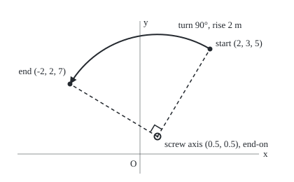

# Rigid motions in space: every one is a screw, a turn about an axis plus a slide along it

[Syllabus](../../../SYLLABUS.md) → [Geometry and trig](../README.md) → [Vectors in Space](../README.md#s05) → Rigid motions in space

---

## General Overview

A drone hovers at (2, 3, 5) on a grid in metres, with z as the height. Its flight controller gives one command: turn 90° about the vertical line through the grid's corner (0, 0, 0), then shift by (1, 0, 2). That is 1 m across and 2 m up. The drone ends at (−2, 2, 7).

The same move has a simpler description. There is one vertical line, through (0.5, 0.5, 0), that the move only slides along itself. The whole move is a 90° turn about that line plus a 2 m rise along it, like a bolt turning in a nut.

Here a **rigid motion** keeps every distance and never mirrors the shape (a **proper** rigid motion). Mirror moves keep distances too, but are never screws. Every rigid motion in space has such a line, its **screw axis**.

**Every rigid motion in space is a screw: a turn about one line plus a slide along that same line.**

**What kind of fact this is:** two theorems, proved on this card in Why it works: Euler's axis theorem (every turn in space leaves one direction alone) and Chasles's theorem (every rigid motion is a screw). The four-mirror count at the end is a theorem stated with a source, not proved.

### The picture: the move seen from above

<p align="center"></p>

Drawn at 1 m = 50 units, looking straight down. The axis shows as a point. Done as one screw, the move carries the drone along a quarter circle about it, rising 2 m from height 5 to height 7.

---

## The formula

A rigid motion sends a point $`x`$ to $`M(x) = R\,x + t`$. Here $`R`$ is a 3 × 3 rotation matrix: its columns are three arrows of length 1 at right angles (a **frame**), and its determinant (the factor it scales volumes by, negative for a mirror) is +1, so it keeps handedness ([Moving shapes with matrices](04-transformations-with-matrices.md)). $`t`$ is the shift. $`I`$ is the identity matrix, which changes nothing.

Euler's axis theorem finds the direction the turn leaves alone, and the angle from the **trace** $`\mathrm{tr}\,R`$, the sum of the diagonal entries:

```math
R\,u = u, \qquad \cos\theta = \frac{\mathrm{tr}\,R - 1}{2}
```

**Read it aloud:** the turn sends the axis direction to itself, and the cosine of the angle is the trace minus one, halved.

Chasles's theorem then rewrites the whole move as a screw:

```math
M(x) = R\,(x - c) + c + s\,u, \qquad s = t \cdot u, \qquad (I - R)\,c = t_\perp = t - s\,u
```

**Read it aloud:** turn about the line through $`c`$ in direction $`u`$, then slide $`s`$ along it; the slide is the part of the shift along the axis, and the axis point absorbs the sideways part.

| Symbol | Plain meaning | In our example | Push it up and the answer… |
| --- | --- | --- | --- |
| $`x`$, $`M(x)`$ | a point in metres, and where the move sends it | drone (2, 3, 5) → (−2, 2, 7) | — |
| $`R`$, $`R^{\mathsf T}`$, $`I`$ | the turning matrix; it flipped across its diagonal; the do-nothing matrix | R sends (x, y, z) to (−y, x, z) | — |
| $`\mathrm{tr}\,R`$ | the trace: the diagonal entries added | 0 + 0 + 1 = 1 | a smaller angle |
| $`t`$ | the shift | (1, 0, 2) | moves the axis, or lengthens the slide |
| $`u`$, $`w`$ | the axis direction, length 1; the lopsided entries, $`2\sin\theta`$ times $`u`$ | (0, 0, 1); (0, 0, 2) | — |
| $`\theta`$ | the turning angle, about $`u`$ (theta) | 90° | the drone swings further round |
| $`s`$ | the slide along the axis | 2 m | the screw climbs faster |
| $`t_\perp`$, $`c`$ | the shift's sideways part; a point on the screw axis | (1, 0, 0); (0.5, 0.5, 0) | the axis moves further from (0, 0, 0) |

### When it holds

- **No mirror.** $`R`$ must have determinant +1. A mirror move, with determinant −1, is never a screw.
- **Three dimensions.** The proof uses an odd number of dimensions. In the plane a turn fixes no direction; it fixes a point instead.
- **A real turn.** At $`\theta = 0`$ the move is a pure shift: every line along $`t`$ is an axis, and the formula for $`c`$ divides by zero.
- **Not a half turn, for the quick axis formula.** At 180° the lopsided entries used in Step 2 are all zero. The axis still exists; find it from the rows of $`R - I`$ instead.

---

## Why it works

### Step 0: a turn in space must leave one direction alone

Space has an odd number of directions, and a determinant argument shows a turn cannot move them all: one stays put, the axis. Split the shift into parts along and across the axis. Moving the axis sideways absorbs the part across, as in the plane. Only the slide is left.

### Step 1: Euler's axis theorem

A rotation matrix satisfies $`R^{\mathsf T} R = I`$, where $`R^{\mathsf T}`$ is $`R`$ with rows and columns swapped. Its determinant is 1 ([Determinants](../../03-Algebra/05-Solving%20Systems/04-determinants.md)). Then:

```math
\det(R - I) = \det\big(R\,(I - R^{\mathsf T})\big) = \det(I - R^{\mathsf T}) = \det(I - R) = (-1)^3 \det(R - I)
```

A number equal to its own negative is 0. So $`R - I`$ squashes some arrow $`u`$ to zero: $`R\,u = u`$. So 1 is an eigenvalue of $`R`$, and $`u`$ its eigenvector, a direction the matrix leaves alone ([Eigenvalues and eigenvectors](../../03-Algebra/07-Eigenvalues%20and%20Symmetric%20Matrices/02-eigenvalues-and-eigenvectors.md)).

In the plane the sign is $`(-1)^2 = +1`$, so the argument fails; indeed a 90° plane turn moves every direction.

### Step 2: read the axis and the angle off the matrix

In a frame with $`u`$ as one arrow, $`R`$ is a plane turn by $`\theta`$ across $`u`$, plus a 1 for $`u`$. Its diagonal adds to $`1 + 2\cos\theta`$, and the trace is the same in every frame.

The **lopsided entries** give the direction. They are the gaps between mirror-image entries across the diagonal, the entries of $`R - R^{\mathsf T}`$ (twice its **skew-symmetric part**); $`R_{ij}`$ is the entry in row i, column j:

```math
w = (R_{32} - R_{23},\; R_{13} - R_{31},\; R_{21} - R_{12}) = 2\sin\theta\; u
```

**Read it aloud:** the gaps between partner entries across the diagonal give the axis direction, scaled by twice the sine.

For the drone, $`w = (0, 0, 2)`$, so $`u`$ points straight up and $`\sin\theta = 1`$. Now take a turn whose axis is hidden: the camera mount sends x to y, y to z and z to x. Its trace is 0, so $`\cos\theta = -\tfrac12`$ and the angle is 120°. Its lopsided entries are (1, 1, 1), so the axis runs along the cube's diagonal.

### Step 3: Chasles's theorem, the shift splits in two

Split the shift into a part along the axis and a part across it. The slide is $`s = t \cdot u`$, and the sideways part is $`t_\perp = t - s\,u`$ ([Lines and planes](02-lines-and-planes-in-space.md) uses the same dot-product split).

A turn about the parallel line through a point $`c`$ sends $`x`$ to $`R(x - c) + c = R\,x + (I - R)\,c`$. So the screw matches the move exactly when $`(I - R)\,c = t_\perp`$.

Across the axis, $`R`$ turns every arrow by $`\theta \neq 0`$, so $`I - R`$ sends no nonzero sideways arrow to zero. So exactly one $`c`$ in the plane across $`u`$ through (0, 0, 0) solves it. The slide runs along the axis, so turn and slide can come in either order.

For the drone, $`t_\perp = (1, 0, 0)`$. Points whose ground position the move leaves unchanged solve $`(-y + 1,\, x) = (x,\, y)`$, so $`x = y = 0.5`$.

<details>
<summary>The axis point as one formula, and why it works</summary>

Write $`\cot`$ for the cotangent, cosine over sine. The axis point closest to (0, 0, 0) is

$`\displaystyle c = \tfrac12\Big(t_\perp + \cot\tfrac{\theta}{2}\; u \times t_\perp\Big)`$

For a sideways arrow $`c`$, the turn gives $`R\,c = c\cos\theta + (u \times c)\sin\theta`$. Put the formula in. The cross-product terms cancel because $`(1 - \cos\theta)\cot\tfrac{\theta}{2} = \sin\theta`$. The $`t_\perp`$ terms add to $`\sin^2\tfrac{\theta}{2} + \cos^2\tfrac{\theta}{2} = 1`$ times $`t_\perp`$. So $`(I - R)\,c = t_\perp`$.

For the drone, $`\cot 45° = 1`$ and $`u \times t_\perp = (0, 1, 0)`$, so $`c = \tfrac12\big((1, 0, 0) + (0, 1, 0)\big) = (0.5, 0.5, 0)`$.

</details>

### Step 4: the axis is where the move moves points least

A point on the axis only slides, so it moves exactly $`s`$. Any other point also swings round, so it moves further: the drone moves 4.582576 m. A grid search over the ground finds the least move, 2 m, at (0.5, 0.5): the axis, found without the formula.

### Step 5: four mirrors make any screw

Two mirror planes that meet along a line at angle $`\theta/2`$ make a turn by $`\theta`$ about that line. Two parallel mirror planes a distance $`s/2`$ apart make a slide of $`s`$ ([Every rigid motion of the plane is at most three mirror flips, so there are only four kinds](08-plane-isometries-and-three-reflections.md) proves both in the plane).

For the drone, mirrors z = 0 then z = 1 lift it 2 m; mirrors y = 0.5 then y = x meet along the axis at 45° and turn it 90°. The Cartan–Dieudonné theorem bounds the count: a distance-keeping map of n-dimensional space that fixes a point needs at most n mirrors, so a rigid motion of space needs at most four.

---

## Worked numbers, by hand

| Step | Arithmetic | Value |
| --- | --- | --- |
| the turn | R sends (x, y, z) to | (−y, x, z) |
| the drone | (−3, 2, 5) + (1, 0, 2) | (−2, 2, 7) |
| the axis direction | lopsided entries (0, 0, 2), scaled to length 1 | u = (0, 0, 1) |
| the angle | trace 0 + 0 + 1 = 1; cos θ = (1 − 1)/2 = 0 | 90° |
| the slide | t · u = (1, 0, 2) · (0, 0, 1) | **2 m** |
| the sideways shift | (1, 0, 2) − 2 × (0, 0, 1) | (1, 0, 0) |
| the axis point | (−y + 1, x) = (x, y) | **(0.5, 0.5, 0)** |

The drone's move is a 90° turn about the vertical through (0.5, 0.5, 0) with a 2 m rise.

### What breaks if you drop a piece

| Mistake | Comes out at | What went wrong |
| --- | --- | --- |
| Axis through (0, 0, 0), where the matrix turns | drone at (−3, 2, 7), 1 m off | The sideways shift moves the axis |
| The whole shift taken as the slide | 2.236068 m, not 2 m | Only the part along the axis slides |
| Shift applied before the turn | axis through (−0.5, 0.5, 0) | Turn-then-shift is a different move |

---

## Code, from first principles, and it actually runs

Three roads reach the drone's screw. Road one reads the axis and angle off the matrix, by formula and again by crossing two rows of $`R - I`$, then rebuilds the screw and tests it on the drone and four corners of a solar panel. Road two searches a grid of ground points for the one moved least. Road three rebuilds the move from four mirrors. The camera mount runs through road one too.

### Python

```python
# Rigid motions in space and screws -- the check behind the card.  Standard library only.
# The drone's move: turn 90 degrees about the vertical through (0, 0, 0), then shift (1, 0, 2).
# Road one: axis and screw by formula.  Two: grid search for the least move.  Three: four mirrors.
from math import atan2, cos, sin, tan, sqrt, degrees

def dot(a, b): return sum(x * y for x, y in zip(a, b))
def add(a, b, k=1): return [x + k * y for x, y in zip(a, b)]
def cross(a, b): return [a[1]*b[2] - a[2]*b[1], a[2]*b[0] - a[0]*b[2], a[0]*b[1] - a[1]*b[0]]
def move(R, t, x): return add([dot(row, x) for row in R], t)
def unit(v): return [x / sqrt(dot(v, v)) for x in v]
def gap(a, b): return sqrt(dot(add(a, b, -1), add(a, b, -1)))
def f(v, n=6): return "(" + ", ".join(f"{(x if abs(x) >= 5e-7 else 0.0):.{n}f}" for x in v) + ")"
def screw(R, t):                       # road one: axis u, angle, slide s, axis point c
    w = [R[2][1] - R[1][2], R[0][2] - R[2][0], R[1][0] - R[0][1]]   # = 2 sin(angle) u
    u = unit(w)
    th = atan2(sqrt(dot(w, w)) / 2, (R[0][0] + R[1][1] + R[2][2] - 1) / 2)
    s = dot(t, u)
    tp = add(t, u, -s)                 # the sideways part of the shift
    return u, th, s, tp, [(a + b / tan(th / 2)) / 2 for a, b in zip(tp, cross(u, tp))]
def axis_two(R):                       # second road: cross two rows of R - I, turn a side arrow
    m = [[R[i][j] - (i == j) for j in range(3)] for i in range(3)]
    u = unit(cross(m[0], m[1]))
    v = cross(u, [1, 0, 0])
    rv = move(R, [0, 0, 0], v)
    return u, atan2(dot(u, cross(v, rv)), dot(v, rv)), dot(m[0], cross(m[1], m[2]))
def rebuilt(u, th, s, c, x):           # turn about the line through c, then slide s along u
    v = add(x, c, -1)
    r = add([a * cos(th) + b * sin(th) for a, b in zip(v, cross(u, v))], u, dot(u, v) * (1 - cos(th)))
    return add(add(c, r), u, s)
def mirror(n, k, x): return add(x, n, -2 * (dot(n, x) - k) / dot(n, n))   # plane n.x = k

R, Rc, t, p = [[0, -1, 0], [1, 0, 0], [0, 0, 1]], [[0, 0, 1], [1, 0, 0], [0, 1, 0]], [1, 0, 2], [2, 3, 5]
tests = [p, [0, 0, 0], [10, 0, 0], [10, 4.8, 3.6], [0, 4.8, 3.6]]   # drone, panel corners
for name, Q in (("drone turn", R), ("camera mount x->y->z->x", Rc)):
    u, th, s, tp, c = screw(Q, t)
    u2, th2, d = axis_two(Q)
    err = max(gap(rebuilt(u, th, s, c, x), move(Q, t, x)) for x in tests)
    print(f"{name}: det(R - I) = {d:.6f}, trace {Q[0][0] + Q[1][1] + Q[2][2]}")
    print(f"  axis {f(u)} from the lopsided entries, {f(u2)} from rows of R - I")
    print(f"  angle {degrees(th):.6f} from the trace, {degrees(th2):.6f} by turning a side arrow")
    print(f"  slide {s:.6f}, sideways shift {f(tp)}, axis point {f(c)}, screw rebuilt matches: {'yes' if err < 1e-9 else 'no'}")
    assert abs(d) < 1e-12 and gap(u, u2) < 1e-12 and abs(th - th2) < 1e-12 and err < 1e-9
u, th, s, tp, c = screw(R, t)
best = min((gap(move(R, t, [i / 100, j / 100, 0]), [i / 100, j / 100, 0]), i, j)
           for i in range(-300, 301) for j in range(-300, 301))   # road two
print(f"drone {f(p, 0)} -> {f(move(R, t, p), 0)}, moved {gap(p, move(R, t, p)):.6f} m; grid search: least move {best[0]:.6f} at ({best[1] / 100:.2f}, {best[2] / 100:.2f})")
four = [move(R, t, x) for x in tests]
for n, k in ([0, 0, 1], 0), ([0, 0, 1], 1), ([0, 1, 0], 0.5), ([-1, 1, 0], 0): tests = [mirror(n, k, x) for x in tests]          # road three
print(f"four mirrors z = 0, z = 1, y = 0.5, y = x send the drone to {f(tests[0], 0)}, all five points match: {'yes' if max(gap(a, b) for a, b in zip(tests, four)) < 1e-12 else 'no'}")
w = rebuilt(u, th, s, [0, 0, 0], p)
print(f"mistake, axis through (0, 0, 0): drone -> {f(w, 0)}, {gap(w, move(R, t, p)):.6f} m from the truth")
print(f"mistake, whole shift as the slide: {sqrt(dot(t, t)):.6f} m, not {s:.6f} m")
print(f"mistake, shift before the turn: axis point {f(screw(R, move(R, [0, 0, 0], t))[4], 1)}")
P = lambda v: f"({200 + 50 * v[0]:.2f}, {220 - 50 * v[1]:.2f})"
print(f"figure, 1 m = 50 units, axis {P(c)} start {P(p)} end {P(move(R, t, p))} radius {50 * gap(p[:2], c[:2]):.2f}")
assert abs(best[0] - s) < 1e-12 and gap([best[1] / 100, best[2] / 100], c[:2]) < 1e-9   # roads one and two
assert gap(c, [0.5, 0.5, 0]) < 1e-12 and abs(s - 2) < 1e-12          # the hand solution
assert max(gap(a, b) for a, b in zip(tests, four)) < 1e-12            # road three
print("ALL CHECKS PASS")
```

**Ran 2026-11-23 on macOS, Python 3.14.10, standard library only. All checks passed. Output, pasted from the run:**

```
drone turn: det(R - I) = 0.000000, trace 1
  axis (0.000000, 0.000000, 1.000000) from the lopsided entries, (0.000000, 0.000000, 1.000000) from rows of R - I
  angle 90.000000 from the trace, 90.000000 by turning a side arrow
  slide 2.000000, sideways shift (1.000000, 0.000000, 0.000000), axis point (0.500000, 0.500000, 0.000000), screw rebuilt matches: yes
camera mount x->y->z->x: det(R - I) = 0.000000, trace 0
  axis (0.577350, 0.577350, 0.577350) from the lopsided entries, (0.577350, 0.577350, 0.577350) from rows of R - I
  angle 120.000000 from the trace, 120.000000 by turning a side arrow
  slide 1.732051, sideways shift (0.000000, -1.000000, 1.000000), axis point (0.333333, -0.666667, 0.333333), screw rebuilt matches: yes
drone (2, 3, 5) -> (-2, 2, 7), moved 4.582576 m; grid search: least move 2.000000 at (0.50, 0.50)
four mirrors z = 0, z = 1, y = 0.5, y = x send the drone to (-2, 2, 7), all five points match: yes
mistake, axis through (0, 0, 0): drone -> (-3, 2, 7), 1.000000 m from the truth
mistake, whole shift as the slide: 2.236068 m, not 2.000000 m
mistake, shift before the turn: axis point (-0.5, 0.5, 0.0)
figure, 1 m = 50 units, axis (225.00, 195.00) start (300.00, 70.00) end (100.00, 120.00) radius 145.77
ALL CHECKS PASS
```

### Rust

Same numbers, same labels, built with `rustc --edition 2021 -O`.

```rust
// Rigid motions in space and screws -- the same check as the Python, in Rust, std only.
// The drone's move: turn 90 degrees about the vertical through (0, 0, 0), then shift (1, 0, 2).
// Road one: axis and screw by formula.  Two: grid search for the least move.  Three: four mirrors.
type V = [f64; 3];  type M = [[f64; 3]; 3];
fn dot(a: V, b: V) -> f64 { a[0] * b[0] + a[1] * b[1] + a[2] * b[2] }
fn add(a: V, b: V, k: f64) -> V { [a[0] + k * b[0], a[1] + k * b[1], a[2] + k * b[2]] }
fn cross(a: V, b: V) -> V { [a[1]*b[2] - a[2]*b[1], a[2]*b[0] - a[0]*b[2], a[0]*b[1] - a[1]*b[0]] }
fn mv(r: &M, t: V, x: V) -> V { add([dot(r[0], x), dot(r[1], x), dot(r[2], x)], t, 1.0) }
fn unit(v: V) -> V { let n = dot(v, v).sqrt(); [v[0] / n, v[1] / n, v[2] / n] }
fn gap(a: V, b: V) -> f64 { let d = add(a, b, -1.0); dot(d, d).sqrt() }
fn f(v: V, n: usize) -> String {
    let s: Vec<String> = v.iter().map(|&x| format!("{:.*}", n, if x.abs() >= 5e-7 { x } else { 0.0 })).collect();
    format!("({})", s.join(", "))
}
fn yn(b: bool) -> &'static str { if b { "yes" } else { "no" } }
fn trace(r: &M) -> f64 { r[0][0] + r[1][1] + r[2][2] }
fn screw(r: &M, t: V) -> (V, f64, f64, V, V) {   // road one: axis u, angle, slide s, axis point c
    let w = [r[2][1] - r[1][2], r[0][2] - r[2][0], r[1][0] - r[0][1]];   // = 2 sin(angle) u
    let u = unit(w);
    let th = (dot(w, w).sqrt() / 2.0).atan2((trace(r) - 1.0) / 2.0);
    let s = dot(t, u);
    let tp = add(t, u, -s);                      // the sideways part of the shift
    let k = cross(u, tp);
    let c = [0, 1, 2].map(|i| (tp[i] + k[i] / (th / 2.0).tan()) / 2.0);
    (u, th, s, tp, c)
}
fn axis_two(r: &M) -> (V, f64, f64) {             // second road: cross two rows of R - I, turn a side arrow
    let m: M = [0, 1, 2].map(|i| [0, 1, 2].map(|j| r[i][j] - if i == j { 1.0 } else { 0.0 }));
    let u = unit(cross(m[0], m[1]));
    let v = cross(u, [1.0, 0.0, 0.0]);
    let rv = mv(r, [0.0; 3], v);
    (u, dot(u, cross(v, rv)).atan2(dot(v, rv)), dot(m[0], cross(m[1], m[2])))
}
fn rebuilt(u: V, th: f64, s: f64, c: V, x: V) -> V {   // turn about the line through c, then slide s along u
    let v = add(x, c, -1.0);
    let k = cross(u, v);
    let r = add([0, 1, 2].map(|i| v[i] * th.cos() + k[i] * th.sin()), u, dot(u, v) * (1.0 - th.cos()));
    add(add(c, r, 1.0), u, s)
}
fn mirror(n: V, k: f64, x: V) -> V { add(x, n, -2.0 * (dot(n, x) - k) / dot(n, n)) }   // plane n.x = k
fn main() {
    let r: M = [[0.0, -1.0, 0.0], [1.0, 0.0, 0.0], [0.0, 0.0, 1.0]];
    let rc: M = [[0.0, 0.0, 1.0], [1.0, 0.0, 0.0], [0.0, 1.0, 0.0]];
    let (t, p): (V, V) = ([1.0, 0.0, 2.0], [2.0, 3.0, 5.0]);
    let mut tests: Vec<V> = vec![p, [0.0; 3], [10.0, 0.0, 0.0], [10.0, 4.8, 3.6], [0.0, 4.8, 3.6]];   // drone, panel corners
    for (name, q) in [("drone turn", &r), ("camera mount x->y->z->x", &rc)] {
        let (u, th, s, tp, c) = screw(q, t);
        let (u2, th2, d) = axis_two(q);
        let err = tests.iter().map(|&x| gap(rebuilt(u, th, s, c, x), mv(q, t, x))).fold(0.0, f64::max);
        println!("{}: det(R - I) = {:.6}, trace {:.0}", name, d, trace(q));
        println!("  axis {} from the lopsided entries, {} from rows of R - I", f(u, 6), f(u2, 6));
        println!("  angle {:.6} from the trace, {:.6} by turning a side arrow", th.to_degrees(), th2.to_degrees());
        println!("  slide {:.6}, sideways shift {}, axis point {}, screw rebuilt matches: {}", s, f(tp, 6), f(c, 6), yn(err < 1e-9));
        assert!(d.abs() < 1e-12 && gap(u, u2) < 1e-12 && (th - th2).abs() < 1e-12 && err < 1e-9);
    }
    let (u, th, s, _tp, c) = screw(&r, t);
    let mut best = (f64::INFINITY, 0, 0);            // road two
    for i in -300..=300 { for j in -300..=300 {
        let x = [i as f64 / 100.0, j as f64 / 100.0, 0.0];  let g = gap(mv(&r, t, x), x);
        if g < best.0 { best = (g, i, j) }
    } }
    println!("drone {} -> {}, moved {:.6} m; grid search: least move {:.6} at ({:.2}, {:.2})", f(p, 0), f(mv(&r, t, p), 0), gap(p, mv(&r, t, p)), best.0, best.1 as f64 / 100.0, best.2 as f64 / 100.0);
    let four: Vec<V> = tests.iter().map(|&x| mv(&r, t, x)).collect();
    for (n, k) in [([0.0, 0.0, 1.0], 0.0), ([0.0, 0.0, 1.0], 1.0), ([0.0, 1.0, 0.0], 0.5), ([-1.0, 1.0, 0.0], 0.0)] {
        tests = tests.iter().map(|&x| mirror(n, k, x)).collect();   // road three
    }
    let worst = tests.iter().zip(&four).map(|(&a, &b)| gap(a, b)).fold(0.0, f64::max);
    println!("four mirrors z = 0, z = 1, y = 0.5, y = x send the drone to {}, all five points match: {}", f(tests[0], 0), yn(worst < 1e-12));
    let w = rebuilt(u, th, s, [0.0; 3], p);
    println!("mistake, axis through (0, 0, 0): drone -> {}, {:.6} m from the truth", f(w, 0), gap(w, mv(&r, t, p)));
    println!("mistake, whole shift as the slide: {:.6} m, not {:.6} m", dot(t, t).sqrt(), s);
    println!("mistake, shift before the turn: axis point {}", f(screw(&r, mv(&r, [0.0; 3], t)).4, 1));
    let pp = |v: V| format!("({:.2}, {:.2})", 200.0 + 50.0 * v[0], 220.0 - 50.0 * v[1]);
    let rad = 50.0 * gap([p[0], p[1], 0.0], [c[0], c[1], 0.0]);
    println!("figure, 1 m = 50 units, axis {} start {} end {} radius {:.2}", pp(c), pp(p), pp(mv(&r, t, p)), rad);
    assert!((best.0 - s).abs() < 1e-12 && gap([best.1 as f64 / 100.0, best.2 as f64 / 100.0, 0.0], [c[0], c[1], 0.0]) < 1e-9);
    assert!(gap(c, [0.5, 0.5, 0.0]) < 1e-12 && (s - 2.0).abs() < 1e-12);   // the hand solution
    assert!(worst < 1e-12);                                                // road three
    println!("ALL CHECKS PASS");
}
```

**Ran 2026-11-23 on macOS, rustc 1.98.1, no crates. All checks passed. Output, pasted from the run:**

```
drone turn: det(R - I) = 0.000000, trace 1
  axis (0.000000, 0.000000, 1.000000) from the lopsided entries, (0.000000, 0.000000, 1.000000) from rows of R - I
  angle 90.000000 from the trace, 90.000000 by turning a side arrow
  slide 2.000000, sideways shift (1.000000, 0.000000, 0.000000), axis point (0.500000, 0.500000, 0.000000), screw rebuilt matches: yes
camera mount x->y->z->x: det(R - I) = 0.000000, trace 0
  axis (0.577350, 0.577350, 0.577350) from the lopsided entries, (0.577350, 0.577350, 0.577350) from rows of R - I
  angle 120.000000 from the trace, 120.000000 by turning a side arrow
  slide 1.732051, sideways shift (0.000000, -1.000000, 1.000000), axis point (0.333333, -0.666667, 0.333333), screw rebuilt matches: yes
drone (2, 3, 5) -> (-2, 2, 7), moved 4.582576 m; grid search: least move 2.000000 at (0.50, 0.50)
four mirrors z = 0, z = 1, y = 0.5, y = x send the drone to (-2, 2, 7), all five points match: yes
mistake, axis through (0, 0, 0): drone -> (-3, 2, 7), 1.000000 m from the truth
mistake, whole shift as the slide: 2.236068 m, not 2.000000 m
mistake, shift before the turn: axis point (-0.5, 0.5, 0.0)
figure, 1 m = 50 units, axis (225.00, 195.00) start (300.00, 70.00) end (100.00, 120.00) radius 145.77
ALL CHECKS PASS
```

### Lean

Lean proves Euler's axis theorem and Chasles's theorem for every rotation matrix and every shift, not just the drone's move.

- Take any rotation matrix $`R`$. Then $`\det(R - I) = 0`$, so some nonzero arrow $`u`$ has $`R\,u = u`$.
- Take any rotation matrix $`R`$ and any shift $`t`$. Then the move is a screw. Its axis direction $`u`$ has length 1, and $`R\,u = u`$. Its slide is $`s = t \cdot u`$. Some axis point $`c`$ gives $`R\,x + t = R\,(x - c) + c + s\,u`$ for every point $`x`$.
- This includes a pure shift, with no turn at all.
- For the drone, the turn is a rotation matrix with trace 1, and the move sends (2, 3, 5) to (−2, 2, 7).
- For the drone, the axis direction is (0, 0, 1), the slide is 2 m, and the axis point is (0.5, 0.5, 0).
- For the camera mount, the trace is 0, and the arrow (1, 1, 1) is left alone.

The angle, lopsided-entry and axis-point formulas, the grid search and the four mirrors are left to the Python and Rust checks.

```lean
-- Rigid motions in space: every turn of space in SO(3) leaves a direction alone (Euler's axis theorem), and every proper rigid motion x ↦ R x + t of space is a screw, a turn about one line plus a slide along it (Chasles's theorem).
import Mathlib.LinearAlgebra.UnitaryGroup
import Mathlib.LinearAlgebra.Matrix.Determinant.Basic
import Mathlib.LinearAlgebra.Matrix.Trace
import Mathlib.Basic.Real.Basic
import Mathlib.Tactic.NormNum
import Mathlib.Tactic.FinCases
import Mathlib.LinearAlgebra.Matrix.Adjugate
import Mathlib.LinearAlgebra.Matrix.PosDef
import Mathlib.LinearAlgebra.Matrix.ToLinearEquiv
import Mathlib.Analysis.Real.Sqrt
import Mathlib.Algebra.Order.Star.Real
import Mathlib.Tactic.Module
import Mathlib.Tactic.LinearCombination

open Matrix

lemma rot_tR {R : Matrix (Fin 3) (Fin 3) ℝ} (hR : R ∈ Matrix.specialOrthogonalGroup (Fin 3) ℝ) :
    Rᵀ * R = 1 :=
  (Matrix.mem_orthogonalGroup_iff' (Fin 3) ℝ).mp ((Matrix.mem_specialOrthogonalGroup_iff.mp hR).1)

lemma rot_Rt {R : Matrix (Fin 3) (Fin 3) ℝ} (hR : R ∈ Matrix.specialOrthogonalGroup (Fin 3) ℝ) :
    R * Rᵀ = 1 :=
  (Matrix.mem_orthogonalGroup_iff (Fin 3) ℝ).mp ((Matrix.mem_specialOrthogonalGroup_iff.mp hR).1)

lemma rot_det {R : Matrix (Fin 3) (Fin 3) ℝ} (hR : R ∈ Matrix.specialOrthogonalGroup (Fin 3) ℝ) :
    R.det = 1 :=
  (Matrix.mem_specialOrthogonalGroup_iff.mp hR).2

lemma rot_det_sub_one {R : Matrix (Fin 3) (Fin 3) ℝ}
    (hR : R ∈ Matrix.specialOrthogonalGroup (Fin 3) ℝ) : (R - 1).det = 0 := by
  have h1 : R - 1 = -(R * (R - 1)ᵀ) := by
    rw [transpose_sub, transpose_one, mul_sub, rot_Rt hR, mul_one, neg_sub]
  have h2 : (R - 1).det = -(R - 1).det := by
    conv_lhs => rw [h1]
    rw [det_neg, det_mul, det_transpose, rot_det hR]
    simp
    ring
  linarith

lemma ch_identity_fin_three (A : Matrix (Fin 3) (Fin 3) ℝ) :
    A * A - A.trace • A + (adjugate A).trace • (1 : Matrix (Fin 3) (Fin 3) ℝ) - adjugate A = 0 := by
  ext i j
  fin_cases i <;> fin_cases j <;>
    simp [adjugate_fin_three, Matrix.mul_apply, Fin.sum_univ_three, Matrix.trace_fin_three] <;> ring

lemma rot_adjugate {R : Matrix (Fin 3) (Fin 3) ℝ}
    (hR : R ∈ Matrix.specialOrthogonalGroup (Fin 3) ℝ) : adjugate R = Rᵀ := by
  calc adjugate R = adjugate R * (R * Rᵀ) := by rw [rot_Rt hR, mul_one]
    _ = (adjugate R * R) * Rᵀ := by rw [mul_assoc]
    _ = Rᵀ := by rw [adjugate_mul, rot_det hR, one_smul, one_mul]

lemma rot_sq {R : Matrix (Fin 3) (Fin 3) ℝ} (hR : R ∈ Matrix.specialOrthogonalGroup (Fin 3) ℝ) :
    R * R = R.trace • R - R.trace • (1 : Matrix (Fin 3) (Fin 3) ℝ) + Rᵀ := by
  have h := ch_identity_fin_three R
  rw [rot_adjugate hR, trace_transpose] at h
  rw [← sub_eq_zero, ← h]
  abel

/-- `S = R + Rᵀ - (tr R - 1) I` is fixed by `R` on the left. -/
lemma rot_mul_S {R : Matrix (Fin 3) (Fin 3) ℝ} (hR : R ∈ Matrix.specialOrthogonalGroup (Fin 3) ℝ) :
    R * (R + Rᵀ - (R.trace - 1) • (1 : Matrix (Fin 3) (Fin 3) ℝ)) =
      R + Rᵀ - (R.trace - 1) • (1 : Matrix (Fin 3) (Fin 3) ℝ) := by
  rw [mul_sub, mul_add, rot_sq hR, rot_Rt hR, mul_smul_comm, mul_one]
  module

lemma S_eq {R : Matrix (Fin 3) (Fin 3) ℝ} (hR : R ∈ Matrix.specialOrthogonalGroup (Fin 3) ℝ) :
    R + Rᵀ - (R.trace - 1) • (1 : Matrix (Fin 3) (Fin 3) ℝ) =
      R * R - (R.trace - 1) • R + 1 := by
  rw [rot_sq hR]
  module

lemma S_mul_S {R : Matrix (Fin 3) (Fin 3) ℝ} (hR : R ∈ Matrix.specialOrthogonalGroup (Fin 3) ℝ) :
    (R + Rᵀ - (R.trace - 1) • (1 : Matrix (Fin 3) (Fin 3) ℝ)) *
      (R + Rᵀ - (R.trace - 1) • (1 : Matrix (Fin 3) (Fin 3) ℝ)) =
      (3 - R.trace) • (R + Rᵀ - (R.trace - 1) • (1 : Matrix (Fin 3) (Fin 3) ℝ)) := by
  set S := R + Rᵀ - (R.trace - 1) • (1 : Matrix (Fin 3) (Fin 3) ℝ) with hS
  have h1 : R * S = S := rot_mul_S hR
  have h2 : Rᵀ * S = S := by
    calc Rᵀ * S = Rᵀ * (R * S) := by rw [h1]
      _ = S := by rw [← mul_assoc, rot_tR hR, one_mul]
  calc S * S = R * S + Rᵀ * S - (R.trace - 1) • S := by
        rw [hS, sub_mul, add_mul, smul_mul_assoc, one_mul]
    _ = (3 - R.trace) • S := by rw [h1, h2]; module

lemma S_transpose (R : Matrix (Fin 3) (Fin 3) ℝ) :
    (R + Rᵀ - (R.trace - 1) • (1 : Matrix (Fin 3) (Fin 3) ℝ))ᵀ =
      R + Rᵀ - (R.trace - 1) • (1 : Matrix (Fin 3) (Fin 3) ℝ) := by
  rw [transpose_sub, transpose_add, transpose_transpose, transpose_smul, transpose_one]
  abel

lemma S_trace (R : Matrix (Fin 3) (Fin 3) ℝ) :
    (R + Rᵀ - (R.trace - 1) • (1 : Matrix (Fin 3) (Fin 3) ℝ)).trace = 3 - R.trace := by
  rw [trace_sub, trace_add, trace_smul, trace_one, trace_transpose]
  simp
  ring

lemma rot_eq_one_of_trace {R : Matrix (Fin 3) (Fin 3) ℝ}
    (hR : R ∈ Matrix.specialOrthogonalGroup (Fin 3) ℝ) (h : R.trace = 3) : R = 1 := by
  have key : ((R - 1)ᴴ * (R - 1)).trace = 0 := by
    rw [conjTranspose_eq_transpose_of_trivial, transpose_sub, transpose_one, sub_mul, mul_sub,
      mul_sub, rot_tR hR, mul_one, one_mul, mul_one, trace_sub, trace_sub, trace_sub,
      trace_transpose, h, trace_one]
    simp
  exact sub_eq_zero.mp (trace_conjTranspose_mul_self_eq_zero_iff.mp key)

lemma dot_sym_mulVec (P : Matrix (Fin 3) (Fin 3) ℝ) (hP : Pᵀ = P) (x y : Fin 3 → ℝ) :
    x ⬝ᵥ (P *ᵥ y) = (P *ᵥ x) ⬝ᵥ y := by
  rw [dotProduct_mulVec, ← vecMul_transpose, hP]

lemma normalize_facts (n t : Fin 3 → ℝ) (hn : n ≠ 0) :
    ((Real.sqrt (n ⬝ᵥ n))⁻¹ • n) ⬝ᵥ ((Real.sqrt (n ⬝ᵥ n))⁻¹ • n) = 1 ∧
      (t ⬝ᵥ ((Real.sqrt (n ⬝ᵥ n))⁻¹ • n)) • ((Real.sqrt (n ⬝ᵥ n))⁻¹ • n) =
        ((t ⬝ᵥ n) / (n ⬝ᵥ n)) • n := by
  have hpos : 0 < n ⬝ᵥ n := by
    rcases (dotProduct_self_star_nonneg n).lt_or_eq with h | h
    · simpa using h
    · exact absurd (dotProduct_self_eq_zero.mp (by simpa using h.symm)) hn
  have hs : Real.sqrt (n ⬝ᵥ n) * Real.sqrt (n ⬝ᵥ n) = n ⬝ᵥ n := Real.mul_self_sqrt hpos.le
  have hsne : Real.sqrt (n ⬝ᵥ n) ≠ 0 := (Real.sqrt_pos.mpr hpos).ne'
  constructor
  · rw [smul_dotProduct, dotProduct_smul, smul_eq_mul, smul_eq_mul, ← mul_assoc]
    field_simp
    linarith
  · rw [dotProduct_smul, smul_smul, smul_eq_mul]
    congr 1
    field_simp
    rw [Real.sq_sqrt hpos.le]
    ring

/-- Chasles's theorem. Every rigid motion of space without a mirror, `x ↦ R x + t` with `R` a
3 × 3 rotation matrix (`Rᵀ R = I`, `det R = 1`), is a screw: there is an axis direction `u` of
length 1 that `R` leaves alone, a point `c` on the axis, and a slide `s = t · u` such that the
move is a turn about the line through `c` in direction `u` followed by a slide `s` along it. -/
theorem every_rigid_motion_is_a_screw (R : Matrix (Fin 3) (Fin 3) ℝ)
    (hR : R ∈ Matrix.specialOrthogonalGroup (Fin 3) ℝ) (t : Fin 3 → ℝ) :
    ∃ (u c : Fin 3 → ℝ) (s : ℝ), u ⬝ᵥ u = 1 ∧ R *ᵥ u = u ∧ s = t ⬝ᵥ u ∧
      ∀ x : Fin 3 → ℝ, R *ᵥ x + t = R *ᵥ (x - c) + c + s • u := by
  by_cases h3 : R.trace = 3
  · -- R is the identity: slide straight along `t`.
    have hR1 : R = 1 := rot_eq_one_of_trace hR h3
    subst hR1
    by_cases ht : t = 0
    · subst ht
      refine ⟨Pi.single 0 1, 0, 0, ?_, ?_, ?_, ?_⟩
      · simp
      · rw [one_mulVec]
      · simp
      · intro x; simp
    · obtain ⟨hu, hproj⟩ := normalize_facts t t ht
      refine ⟨(Real.sqrt (t ⬝ᵥ t))⁻¹ • t, 0, _, hu, by simp, rfl, ?_⟩
      intro x
      have htt : t ⬝ᵥ t ≠ 0 := fun h => ht (dotProduct_self_eq_zero.mp h)
      rw [hproj, div_self htt, one_smul]
      simp
  · have h3' : (3 - R.trace) ≠ 0 := sub_ne_zero.mpr (Ne.symm h3)
    set S := R + Rᵀ - (R.trace - 1) • (1 : Matrix (Fin 3) (Fin 3) ℝ) with hS
    set P := (3 - R.trace)⁻¹ • S with hP
    have hRP : R * P = P := by rw [hP, mul_smul_comm, rot_mul_S hR]
    have hPP : P * P = P := by
      rw [hP, smul_mul_smul_comm, S_mul_S hR, smul_smul]
      congr 1
      field_simp
    have hPt : Pᵀ = P := by rw [hP, transpose_smul, S_transpose]
    have hPtr : P.trace = 1 := by
      rw [hP, trace_smul, S_trace, smul_eq_mul, inv_mul_cancel₀ h3']
    -- A vector `v` with `P v ≠ 0` that gives the right axis.
    have hPne : ∃ v, P *ᵥ v ≠ 0 ∧ ((t ⬝ᵥ (P *ᵥ v)) / ((P *ᵥ v) ⬝ᵥ (P *ᵥ v))) • (P *ᵥ v) = P *ᵥ t := by
      by_cases ht : P *ᵥ t = 0
      · have : ∃ v, P *ᵥ v ≠ 0 := by
          by_contra hc
          push Not at hc
          have hP0 : P = 0 := by
            ext i j
            have := congrFun (hc (Pi.single j 1)) i
            simpa [mulVec_single_one] using this
          rw [hP0, trace_zero] at hPtr
          exact zero_ne_one hPtr
        obtain ⟨v, hv⟩ := this
        refine ⟨v, hv, ?_⟩
        rw [dot_sym_mulVec P hPt, ht]
        simp
      · refine ⟨t, ht, ?_⟩
        have e1 : (P *ᵥ t) ⬝ᵥ (P *ᵥ t) = t ⬝ᵥ (P *ᵥ t) := by
          rw [dot_sym_mulVec P hPt, mulVec_mulVec, hPP, dotProduct_comm]
        have hne : (P *ᵥ t) ⬝ᵥ (P *ᵥ t) ≠ 0 := fun h => ht (dotProduct_self_eq_zero.mp h)
        rw [← e1, div_self hne, one_smul]
    obtain ⟨v, hv, hproj⟩ := hPne
    obtain ⟨hu, hproj2⟩ := normalize_facts (P *ᵥ v) t hv
    set u := (Real.sqrt ((P *ᵥ v) ⬝ᵥ (P *ᵥ v)))⁻¹ • (P *ᵥ v) with hu_def
    have hRu : R *ᵥ u = u := by rw [hu_def, mulVec_smul, mulVec_mulVec, hRP]
    have hsu : (t ⬝ᵥ u) • u = P *ᵥ t := by rw [hproj2, hproj]
    -- The part of `t` across the axis.
    set w := t - P *ᵥ t with hw
    have hPw : P *ᵥ w = 0 := by
      rw [hw, mulVec_sub, mulVec_mulVec, hPP, sub_self]
    have hSw : S *ᵥ w = 0 := by
      have : S = (3 - R.trace) • P := by rw [hP, smul_smul, mul_inv_cancel₀ h3', one_smul]
      rw [this, smul_mulVec, hPw, smul_zero]
    have hRRw : R *ᵥ (R *ᵥ w) = (R.trace - 1) • (R *ᵥ w) - w := by
      have h := hSw
      rw [hS, S_eq hR, add_mulVec, sub_mulVec, smul_mulVec, one_mulVec,
        ← mulVec_mulVec] at h
      rw [← sub_eq_zero, ← h]
      abel
    set β := (3 - R.trace)⁻¹ with hβ
    set α := 1 - β with hα
    set c := α • w + β • (R *ᵥ w) with hc
    have hcRc : c - R *ᵥ c = w := by
      have hb : β * (3 - R.trace) = 1 := inv_mul_cancel₀ h3'
      calc c - R *ᵥ c
          = (α + β) • w + (β - α - β * (R.trace - 1)) • (R *ᵥ w) := by
            rw [hc, mulVec_add, mulVec_smul, mulVec_smul, hRRw]
            module
        _ = w := by
            have e1 : α + β = 1 := by rw [hα]; ring
            have e2 : β - α - β * (R.trace - 1) = 0 := by
              rw [hα]; linear_combination hb
            rw [e1, e2, one_smul, zero_smul, add_zero]
    refine ⟨u, c, t ⬝ᵥ u, hu, hRu, rfl, ?_⟩
    intro x
    rw [hsu, mulVec_sub]
    have : t = (c - R *ᵥ c) + P *ᵥ t := by rw [hcRc, hw, sub_add_cancel]
    conv_lhs => rw [this]
    abel

/-- Euler's axis theorem. Every 3 × 3 rotation matrix leaves some nonzero direction alone:
1 is an eigenvalue of `R`. -/
theorem euler_axis_theorem (R : Matrix (Fin 3) (Fin 3) ℝ)
    (hR : R ∈ Matrix.specialOrthogonalGroup (Fin 3) ℝ) :
    ∃ u : Fin 3 → ℝ, u ≠ 0 ∧ R *ᵥ u = u := by
  obtain ⟨v, hv, h⟩ := Matrix.exists_mulVec_eq_zero_iff.mpr (rot_det_sub_one hR)
  refine ⟨v, hv, ?_⟩
  rw [sub_mulVec, one_mulVec, sub_eq_zero] at h
  exact h

/-- The key step of Euler's theorem: for a 3 × 3 rotation matrix, `det (R - I) = 0`,
because it equals its own negative in three dimensions. -/
theorem det_rotation_sub_one_eq_zero (R : Matrix (Fin 3) (Fin 3) ℝ)
    (hR : R ∈ Matrix.specialOrthogonalGroup (Fin 3) ℝ) :
    (R - 1).det = 0 := by
  exact rot_det_sub_one hR

/-! The card's worked numbers: the drone's turn sends (x, y, z) to (-y, x, z), shift (1, 0, 2). -/

-- The drone's turn is a rotation matrix: Rᵀ R = I and det R = 1.
example : (!![0, -1, 0; 1, 0, 0; 0, 0, 1] : Matrix (Fin 3) (Fin 3) ℝ)ᵀ *
    !![0, -1, 0; 1, 0, 0; 0, 0, 1] = 1 := by
  ext i j; fin_cases i <;> fin_cases j <;> simp [Matrix.mul_apply, Fin.sum_univ_three]

example : (!![0, -1, 0; 1, 0, 0; 0, 0, 1] : Matrix (Fin 3) (Fin 3) ℝ).det = 1 := by
  simp [Matrix.det_fin_three]

-- The drone at (2, 3, 5) ends at (-2, 2, 7).
example : (!![0, -1, 0; 1, 0, 0; 0, 0, 1] : Matrix (Fin 3) (Fin 3) ℝ) *ᵥ ![2, 3, 5]
    + ![1, 0, 2] = ![-2, 2, 7] := by
  ext i; fin_cases i <;> norm_num

-- The trace is 0 + 0 + 1 = 1, so cos θ = 0: a 90° turn.
example : (!![0, -1, 0; 1, 0, 0; 0, 0, 1] : Matrix (Fin 3) (Fin 3) ℝ).trace = 1 := by
  simp [Matrix.trace_fin_three]

-- det (R - I) = 0 for the drone's turn.
example : ((!![0, -1, 0; 1, 0, 0; 0, 0, 1] : Matrix (Fin 3) (Fin 3) ℝ) - 1).det = 0 := by
  rw [Matrix.det_fin_three]; simp

-- The axis direction u = (0, 0, 1) is left alone, and the slide is t · u = 2.
example : (!![0, -1, 0; 1, 0, 0; 0, 0, 1] : Matrix (Fin 3) (Fin 3) ℝ) *ᵥ ![0, 0, 1]
    = ![0, 0, 1] := by
  ext i; fin_cases i <;> simp

example : (![1, 0, 2] : Fin 3 → ℝ) ⬝ᵥ ![0, 0, 1] = 2 := by
  simp [dotProduct, Fin.sum_univ_three]

-- The axis point c = (1/2, 1/2, 0) solves (I - R) c = t⊥ = (1, 0, 0).
example : (1 - (!![0, -1, 0; 1, 0, 0; 0, 0, 1] : Matrix (Fin 3) (Fin 3) ℝ)) *ᵥ ![1/2, 1/2, 0]
    = ![1, 0, 0] := by
  ext i; fin_cases i <;> norm_num [Matrix.sub_mulVec]

-- The screw rebuilds the move at every point: R x + t = R (x - c) + c + 2 u.
example (x : Fin 3 → ℝ) : (!![0, -1, 0; 1, 0, 0; 0, 0, 1] : Matrix (Fin 3) (Fin 3) ℝ) *ᵥ x
    + ![1, 0, 2] = (!![0, -1, 0; 1, 0, 0; 0, 0, 1] : Matrix (Fin 3) (Fin 3) ℝ) *ᵥ
      (x - ![1/2, 1/2, 0]) + ![1/2, 1/2, 0] + (2 : ℝ) • ![0, 0, 1] := by
  ext i; fin_cases i <;>
    simp [dotProduct, Fin.sum_univ_three, Matrix.vecHead, Matrix.vecTail]
  ring

-- The camera mount x → y → z → x: trace 0 (a 120° turn), and it leaves (1, 1, 1) alone.
example : (!![0, 0, 1; 1, 0, 0; 0, 1, 0] : Matrix (Fin 3) (Fin 3) ℝ).trace = 0 := by
  simp [Matrix.trace_fin_three]

example : (!![0, 0, 1; 1, 0, 0; 0, 1, 0] : Matrix (Fin 3) (Fin 3) ℝ) *ᵥ ![1, 1, 1]
    = ![1, 1, 1] := by
  ext i; fin_cases i <;> simp

#print axioms every_rigid_motion_is_a_screw
#print axioms euler_axis_theorem
#print axioms det_rotation_sub_one_eq_zero
#print axioms rot_tR
#print axioms rot_Rt
#print axioms rot_det
#print axioms rot_det_sub_one
#print axioms ch_identity_fin_three
#print axioms rot_adjugate
#print axioms rot_sq
#print axioms rot_mul_S
#print axioms S_eq
#print axioms S_mul_S
#print axioms S_transpose
#print axioms S_trace
#print axioms rot_eq_one_of_trace
#print axioms dot_sym_mulVec
#print axioms normalize_facts
```

**Checked 2026-11-23 on macOS, Lean 4.36.0-rc2, Mathlib v4.36.0-rc2. Every proof is complete and uses only Lean's standard axioms. Output, pasted from the run:**

```
'every_rigid_motion_is_a_screw' depends on axioms: [propext, Classical.choice, Quot.sound]
'euler_axis_theorem' depends on axioms: [propext, Classical.choice, Quot.sound]
'det_rotation_sub_one_eq_zero' depends on axioms: [propext, Classical.choice, Quot.sound]
'rot_tR' depends on axioms: [propext, Classical.choice, Quot.sound]
'rot_Rt' depends on axioms: [propext, Classical.choice, Quot.sound]
'rot_det' depends on axioms: [propext, Classical.choice, Quot.sound]
'rot_det_sub_one' depends on axioms: [propext, Classical.choice, Quot.sound]
'ch_identity_fin_three' depends on axioms: [propext, Classical.choice, Quot.sound]
'rot_adjugate' depends on axioms: [propext, Classical.choice, Quot.sound]
'rot_sq' depends on axioms: [propext, Classical.choice, Quot.sound]
'rot_mul_S' depends on axioms: [propext, Classical.choice, Quot.sound]
'S_eq' depends on axioms: [propext, Classical.choice, Quot.sound]
'S_mul_S' depends on axioms: [propext, Classical.choice, Quot.sound]
'S_transpose' depends on axioms: [propext, Classical.choice, Quot.sound]
'S_trace' depends on axioms: [propext, Classical.choice, Quot.sound]
'rot_eq_one_of_trace' depends on axioms: [propext, Classical.choice, Quot.sound]
'dot_sym_mulVec' depends on axioms: [propext, Classical.choice, Quot.sound]
'normalize_facts' depends on axioms: [propext, Classical.choice, Quot.sound]
```

> [!TIP]
> **Try changing**
> - Guess first: set `t` to `[1, 0, 0]`, a shift with no rise. The slide drops to 0 and the axis point stays at (0.5, 0.5, 0): a pure turn about a moved line. The hand-solution assert stops the run, since it expects a 2 m slide.
> - Guess first: set `R` to the half turn `[[-1, 0, 0], [0, -1, 0], [0, 0, 1]]`. Every lopsided entry is 0, so road one divides by zero. This is the half-turn case in When it holds.
> - Guess first: change the mirror `([0, 1, 0], 0.5)` to `([0, 1, 0], 0)`. The two upright mirrors now meet on the vertical through (0, 0, 0), so the drone lands at (−3, 2, 7) and the last assert fails.

---

## The usual mistake

> [!warning]
> **Putting the screw axis where the matrix turns.** $`R`$ turns about the vertical through (0, 0, 0), but the whole move turns about the vertical through (0.5, 0.5, 0). The sideways part of the shift moves the axis. Turning the drone about the wrong line sends it to (−3, 2, 7), 1 m from the truth.
>
> - **The whole shift as the slide.** The shift is 2.236068 m long; only its 2 m along the axis is slide.
> - **Swapping the order.** Shift then turn is a different move: its axis runs through (−0.5, 0.5, 0).
> - **Hunting for a fixed point.** A screw with a slide fixes no point: every point rises 2 m. The axis slides along itself.

---

## Where you meet it in real life

- **Robot arms.** Each joint turns or slides about one line, so each is a screw. Robotics stores a screw as six numbers, its screw coordinates, and chains them joint by joint into the hand's pose.
- **Drones and spacecraft.** Attitude software stores a turn as Euler's axis and angle.
- **Knees and jaws.** Movement labs fit a screw axis, the helical axis, to markers on a moving joint.
- **Crystals and DNA.** A screw axis is a symmetry: the double helix repeats by a fixed turn plus a fixed rise per base pair.

> **Say it back**
> A rigid motion in space keeps distances and handedness: a turn plus a shift. The turn leaves one direction alone, because $`\det(R - I)`$ equals its own negative in three dimensions. The shift's part along that direction is the slide; the part across only moves the axis. So every rigid motion is a screw. The drone's move is a 90° turn about the vertical through (0.5, 0.5, 0) with a 2 m rise.

---

## What this builds on

- [Every rigid motion of the plane is at most three mirror flips, so there are only four kinds](08-plane-isometries-and-three-reflections.md): the plane version, where a turn plus a shift is a turn about a new point, and mirrors build every move.
- [Lines and planes](02-lines-and-planes-in-space.md): splitting an arrow along a direction with the dot product.
- [Moving shapes with matrices](04-transformations-with-matrices.md): rotation matrices, shifts and why they keep lengths.

## Where this goes next

- [Rotation group](../../23-Differential%20geometry%20and%20Lie%20groups/06-Lie%20Groups/04-rotations-so3-and-quaternions.md): all turns in space as one group, and quaternions, a four-number shortcut for chaining them.
- [Symmetry](../06-Beyond%20Euclid/04-symmetry-and-tilings.md): the moves that leave a shape or a wallpaper pattern unchanged.

The open question: when two screws are chained, where is the axis of the result?

---

## Sources

Verified 2026-11-23: every link below resolves to the publisher's page.

- Coxeter, H. S. M. *Introduction to Geometry*, 2nd ed. Wiley, 1969. [Publisher page](https://www.wiley.com/en-us/Introduction+to+Geometry%2C+2nd+Edition-p-9780471504580). Chapter 7: isometries of space, the twist (screw), and moves built from reflections.
- Murray, Richard M., Zexiang Li and S. Shankar Sastry. *A Mathematical Introduction to Robotic Manipulation*. CRC Press, 1994. [Publisher page](https://www.routledge.com/A-Mathematical-Introduction-to-Robotic-Manipulation/Murray-Li-Sastry/p/book/9780849379819). Chapter 2: rotation matrices, Chasles's theorem and screw coordinates.
- Lynch, Kevin M., and Frank C. Park. *Modern Robotics: Mechanics, Planning, and Control*. Cambridge University Press, 2017. [DOI](https://doi.org/10.1017/9781316661239). Chapter 3: rigid-body motions, the screw axis and the six-number twist.
